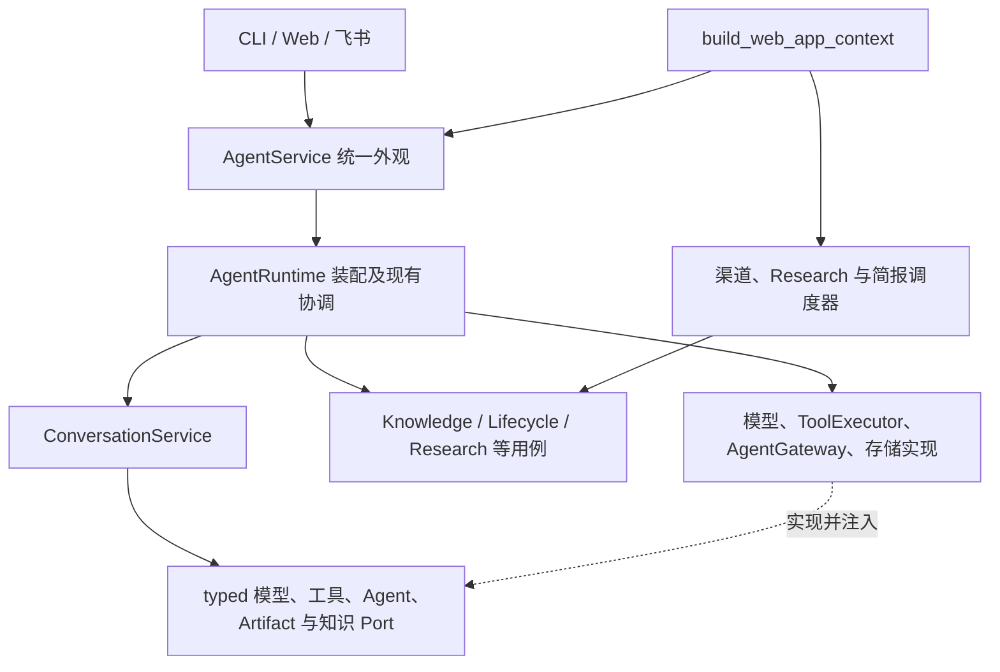

# 代码地图与依赖

> 2026-10-16 按源码、装配与静态导入核对。本文用于定位修改范围；系统信息流见[当前核心架构](core-architecture-current-state.md)，架构约束由 [ARC](../devSpec/architecture-ownership.md)拥有。

## 1. 逻辑角色与实际包

架构角色按事实与责任划分，Python 包按当前代码布局解释。一个角色可能由多个包协作实现，目录名称不证明已经满足全部分层规则。

下表路径均相对 [`src/personal_agent/`](../../src/personal_agent/)。

| 包 | 当前实现与阅读入口 | 修改时的边界 |
| --- | --- | --- |
| `adapters` | [CLI](../../src/personal_agent/adapters/cli/main.py)、[Web](../../src/personal_agent/adapters/web/api.py)、[飞书](../../src/personal_agent/adapters/feishu/service.py) | 传输、认证、输入转换；业务动作复用 Application 入口 |
| `orchestration` | [AgentService](../../src/personal_agent/orchestration/service.py)、[AgentRuntime](../../src/personal_agent/orchestration/runtime.py)、[worker](../../src/personal_agent/orchestration/worker.py) | 外观、依赖装配和现有协调逻辑；新增独立业务规则归业务模块 |
| `application` | [Conversation](../../src/personal_agent/application/conversation/service.py)、[Knowledge](../../src/personal_agent/application/knowledge/service.py)、[Research](../../src/personal_agent/application/research/service.py) 等 | 用例、领域语义与结果契约；详细功能定位见下表 |
| `domain` | [`__init__.py`](../../src/personal_agent/domain/__init__.py) 仅含包声明 | 目前没有独立领域实现；不能为补齐图形新增空壳模型或复制业务事实 |
| `capabilities` | [定义](../../src/personal_agent/capabilities/definitions.py)、[投影解析](../../src/personal_agent/capabilities/resolver.py)、[模型准入](../../src/personal_agent/capabilities/model_resolution.py)、[contracts](../../src/personal_agent/capabilities/contracts/) | 跨业务协议、准入与只读能力投影；业务能力语义归 Application |
| `execution` | [invocation](../../src/personal_agent/execution/contracts/invocation.py)、[journal](../../src/personal_agent/execution/contracts/journal.py) | 当前主要提供调用与执行日志契约，不是一个独立通用执行引擎 |
| `runtime` | [ProcedureRuntime](../../src/personal_agent/runtime/procedure_runtime.py)、[运行管理原语](../../src/personal_agent/runtime/run_manager.py) | 固定程序物化、运行和 lease 等技术协议；是否用于某入口须核对装配与消费者 |
| `governance` | [ToolExecutor](../../src/personal_agent/governance/gateway.py)、[PolicyEngine](../../src/personal_agent/governance/policy/engine.py) | 工具执行准入、授权决定消费、限流与审计 |
| `tools` | [业务工具工厂及外部工具](../../src/personal_agent/tools/) | 工具定义和执行适配，复用业务用例及受治理网关 |
| `agents` | [AgentGateway](../../src/personal_agent/agents/gateway.py)、[GPT Researcher Adapter](../../src/personal_agent/agents/gpt_researcher_a2a.py) | 委派、submission、子运行状态及服务方协议；父级仍拥有目标验收 |
| `planning` | [StepProjectionValidator](../../src/personal_agent/planning/step_projection_validator.py) | 步骤投影校验；当前 Conversation 工作清单位于其 Application 内 |
| `memory` | [MemoryFacade](../../src/personal_agent/memory/facade.py)、[Graphiti](../../src/personal_agent/memory/graphiti/store.py)、[结构检索](../../src/personal_agent/memory/structural_retriever/store.py) | 记忆访问、可见性及检索；本包也包含具体服务方实现，不能视作纯 Domain |
| `infra` | [模型工厂](../../src/personal_agent/infra/structured_model.py)、[响应解析](../../src/personal_agent/infra/model_response.py)、[存储实现](../../src/personal_agent/infra/storage/) | SDK、网络、数据库和外部协议适配；通过现行 Port 交回结果 |
| `kernel` | [contracts](../../src/personal_agent/kernel/contracts/)、[共享模型](../../src/personal_agent/kernel/models.py)、[Prompt 注册](../../src/personal_agent/kernel/prompt_registry.py)、[配置](../../src/personal_agent/kernel/config.py) | 现有共享契约与基础设施辅助；禁止因底层可被导入就堆入新的业务规则 |

领域事实的文件位置与 owner 分开判断。例如，知识模型在 `application/knowledge/models.py`，删除与恢复契约在 `application/knowledge_lifecycle/models.py`，Research 模型在 `kernel/contracts/research.py`。已有事实在其现行入口修改；需要迁移位置时迁移全部消费者并删除原定义，遵守 [ARC 唯一契约](../devSpec/architecture-ownership.md#11-同一职责采用唯一契约)。

## 2. 从功能进入代码

目标写入前核验与回答核验使用不同任务及历史，契约见[子Spec §9.14](../optimization/to_verify/analysis-goal-maintenance.md#914-分离目标核验与回答核验的职责及历史)。`verification_context.py`从原Journal按职责筛选；`verification_prompt.py`选择相应提示、标准及实际Schema预算。`HistoryCompactor`按职责保存派生摘要，不新增核验服务或独立日志。

| 修改目标 | 主要入口与直接协作者 | 详细契约 |
| --- | --- | --- |
| 对话决策、执行与交付 | [ConversationService](../../src/personal_agent/application/conversation/service.py)；同目录的 `ports.py`、`model_actions.py`、`working_plan.py`、`verification_admission.py` | 当前还直接编排请求内研究，混合点见[架构 §3.1](core-architecture-current-state.md#31-当前主循环的职责混合)；契约见 [Runtime](../topics/runtime.md)、[Verification/Completion](../topics/verification-and-completion.md) |
| 可替换回答结果与核验开关 | [answer_results.py](../../src/personal_agent/application/conversation/answer_results.py)、[writer 契约](../../src/personal_agent/kernel/contracts/answer_result.py)、[feature flags](../../src/personal_agent/kernel/feature_flags.py) | Settings 读取 TOML，Runtime 注入 writer 与两项核验开关；默认 claims、两类核验开启，Journal 冻结装配。关闭只跳过对应语义核验，不生成通过回执，契约见 [ADR 0050](../adr/0050-verification-feature-flags.md)。普通回答拒稿后由原循环完整重提，见 [ADR 0049](../adr/0049-answer-regeneration-in-original-loop.md)；claims 业务编辑保持。主循环继续拥有模型准入、执行、计量和唯一 Final |
| 原生消息及动作模型接口 | [model_actions.py](../../src/personal_agent/application/conversation/model_actions.py)、[answer_results.py](../../src/personal_agent/application/conversation/answer_results.py)、[ModelActionDefinition](../../src/personal_agent/capabilities/contracts/model.py) | 同轮定义绑定工具直接参数，普通assistant正文经回答模块形成同一候选；调用优先，非法调用不降正文，无通用决策包装或第二Final相位，见[ADR 0045](../adr/0045-native-intent-loop-and-recorded-model-output.md) |
| 原生工具历史续接 | [model_history.py](../../src/personal_agent/application/conversation/model_history.py)、[引用展示](../../src/personal_agent/application/conversation/citations.py)、原 Model Port／Adapter | Journal 保存完整原响应，结果从可见事实派生；独立分析按原问答匹配历史运行，由请求位置在原轮次恢复完整交换，当前轮仍末尾续接。引用正文单份带坐标展示，原件和权限归原 owner；见 [ADR 0042](../adr/0042-native-model-tool-continuation.md) |
| 独立分析执行目标维护与读取 | [goal_models.py](../../src/personal_agent/application/conversation/goal_models.py)、[goal_maintenance.py](../../src/personal_agent/application/conversation/goal_maintenance.py)，原 Service／Journal／原生历史投影 | 完整目标正文仅有一个 `objective` 字符串；材料引用由原工具与历史提供。写入、沿用及可选读取共用原 Journal 事实；默认非读取操作经目标核验后提交并绑定 `verification_ref`，关闭时保存为未核验接纳，Journal 按运行开关校验，Runtime 管理版本。每轮先维护，当前完整目标进入主请求。回答及修复不要求先读，沿用和读取不改版本；跨轮反馈保持原身份。协议及语义结果分别验收，见 [ADR 0048](../adr/0048-conversation-goal-maintenance.md)及 [ADR 0050](../adr/0050-verification-feature-flags.md) |
| 对话中的个人知识读取投影 | [ConversationKnowledgeReadAdapter](../../src/personal_agent/application/conversation/knowledge_reading.py)；消费 KnowledgeService，按现行 `ConversationKnowledgeReadPort` 返回候选与证据 | 筛选和结果投影归 Application；AgentRuntime 构造并注入，知识事实仍归 KnowledgeService |
| Context、来源读取与引用 | Conversation 内的 [Context 物化](../../src/personal_agent/application/conversation/context_materialization.py)、[来源读取](../../src/personal_agent/application/conversation/source_reading.py)、[引用](../../src/personal_agent/application/conversation/citations.py) | [Context Engineering](../topics/context-engineering.md)、[引用坐标 ADR](../adr/0030-document-line-citation-identity.md) |
| 独立 Python 分析的目标及回答核验 | [verification_context.py](../../src/personal_agent/application/conversation/verification_context.py)、原 `ConversationService._verify_before_send` 及核验工具 | `task_context`按职责分别选择目标或回答的有序events及判决、修复，保留完整用户问题；创建、修订及沿用先核验目标定义，读取除外。专用提示、判据及预算由`verification_prompt.py`拥有；HistoryCompactor按职责管理摘要。失败回原循环，不带普通工具材料。原 claims／其他核验保持；契约见 [ADR 0047](../adr/0047-user-goal-verification-context.md) |
| 独立分析的任务理解与回答 | 原 `ConversationService` 的分析入口及主决策物化；[原话投影](../../src/personal_agent/application/conversation/context_materialization.py)及具名中英文 `conversation.analysis.task` | 由既有 Python 授权与 direct writer 选择，不新增开关；同一主模型先维护目标，再消费累计执行与原生历史作答，每次从 Journal.messages 派生用户原话区。无独立 criteria 提取；目标解释和原话的职责分开，其他 Intent 消费者保持，见[目标维护 Spec](../optimization/to_verify/analysis-goal-maintenance.md) |
| 旧执行历史压缩与恢复 | [HistoryCompactor](../../src/personal_agent/application/conversation/history_compaction.py)、[检查点契约](../../src/personal_agent/application/conversation/history_models.py)；由 ConversationService 为 Intent 和主循环装配与消费 | 原 Journal 保留输入／用量，Artifact 保留原件，协作者只拥有派生视图；历史压力证据见 [ADR 0038](../adr/0038-history-compaction-before-natural-pressure.md#2026-10-25-longds补充证据)。Intent 累计输入及上轮条件经 [interaction_intent.py](../../src/personal_agent/application/conversation/interaction_intent.py)物化，当前六轮消费与未触发压缩的边界见 [SEM §7.4](../optimization/to_verify/longtask-semantic-consistency.md#74-从空对话运行六轮并累积业务-context) |
| 知识捕获与入库 | [CaptureService](../../src/personal_agent/application/capture/service.py)、[IngestionPipeline](../../src/personal_agent/application/capture/ingestion_pipeline.py)、[KnowledgeService](../../src/personal_agent/application/knowledge/service.py) | [Memory](../topics/memory.md)；原始材料、知识事实与图投影按各自 owner 处理 |
| 知识删除与恢复 | [KnowledgeLifecycleService](../../src/personal_agent/application/knowledge_lifecycle/service.py)、同目录 `models.py` 与 `store.py` | [删除链路](../workflow/delete-knowledge-workflow.md) |
| Research 与周期任务 | [ResearchService](../../src/personal_agent/application/research/service.py)、同目录 `scheduler.py`、[Web 装配](../../src/personal_agent/adapters/web/context.py) | [Research 链路](../workflow/research-once-workflow.md) |
| 复习简报与知识缺口 | [ReviewDigestUseCase](../../src/personal_agent/application/review/service.py)、[KnowledgeGapUseCase](../../src/personal_agent/application/insight/service.py)、各自 job/scheduler | [主动知识闭环](../proactive-knowledge-loop.md) |
| 工具与委派接入 | [ToolExecutor](../../src/personal_agent/governance/gateway.py)、[AgentGateway](../../src/personal_agent/agents/gateway.py)、[Conversation Port](../../src/personal_agent/application/conversation/ports.py) | [工具专题](../topics/tools.md)、[A2A 链路](../workflow/gpt-researcher-a2a-workflow.md) |
| MCP 发现、映射与关闭 | [MCP 装配](../../src/personal_agent/orchestration/mcp_bindings.py)、[单工具转换](../../src/personal_agent/tools/mcp.py)、[客户端](../../src/personal_agent/infra/mcp.py) | [连接生命周期 ADR](../adr/0051-mcp-client-lifecycle.md) |
| 工作区确认与续跑 | [Conversation 工作区用例](../../src/personal_agent/application/conversation/workspace_changes.py)、[部署装配](../../src/personal_agent/orchestration/workspace_changes.py) | [工作区授权 ADR](../adr/0053-workspace-change-approval.md) |
| 检索实验与候选程序执行 | [实验用例](../../src/personal_agent/application/retrieval_experiment/service.py)、[外层 Docker](../../src/personal_agent/infra/retrieval_experiment/backend.py)、[唯一引擎](../../src/personal_agent/infra/retrieval_experiment/controller.py) | Runtime 按显式许可部署注册一个受治理工具，原 Conversation Journal 保存接受／命令／执行／回执；模型选择实验及程序，代码拥有评分、冻结及终态。完整 target 尚未验收，契约由[研究 Spec](../optimization/to_verify/knowledge-decision-delivery.md)拥有 |
| 模型自主 Python 分析 | [Python 用例](../../src/personal_agent/application/python_execution/service.py)、[执行适配器](../../src/personal_agent/infra/python_execution/backend.py)、[共享沙箱](../../src/personal_agent/infra/python_execution/sandbox.py)、[工具](../../src/personal_agent/tools/execute_python.py) | 与检索实验并列，经原工具循环执行；原 Journal 拥有接受、命令、进程事实和回执，共享执行额度；原 Artifact 保存程序、确切输入清单及输出。Runtime 将检索部署或独立对话许可映射为同一 Profile；Journal 按许可聚合分析任务消费并投影历史原件，统计及解释由模型选择，见 [ADR 0039](../adr/0039-model-directed-python-execution.md)及 [ADR 0040](../adr/0040-scoped-python-analysis-authorization.md) |
| 共享程序产物及用户文件 | [ArtifactService](../../src/personal_agent/application/artifacts/service.py)、[文本坐标](../../src/personal_agent/application/artifacts/text_coordinates.py)、[认证内容路由](../../src/personal_agent/adapters/web/routes/artifacts.py) | 一个 owner 保存确切字节、完整 producer 与不可变引用；模型以现有 resource_id 选文件，Artifact 从当前获准集合恢复唯一完整引用；typed 初始／成功来源供读搜，草稿修改、实验执行和下载分别检查权限；上传不自动入库 |
| 研究实验完成与恢复 | [Conversation完成](../../src/personal_agent/application/conversation/research_delivery.py)、[实验校验](../../src/personal_agent/application/retrieval_experiment/delivery.py) | 核对当前SubmittedFinal、真实执行、冻结／test和原件引用后直接返回同一Final；不发布清单／ZIP／报告副本。既有[CLI读取](../../src/personal_agent/infra/retrieval_experiment/reproduction.py)只保留现有离线消费者，退出Agent验收门槛 |
| 模型 transport、provider 扩展、重试与观测 | [模型工厂](../../src/personal_agent/infra/structured_model.py)、[策略工厂及三家实现](../../src/personal_agent/infra/model_providers/)、[策略契约](../../src/personal_agent/kernel/model_provider.py)、[模型 Port](../../src/personal_agent/capabilities/contracts/model.py)、[响应解析](../../src/personal_agent/infra/model_response.py)、[请求内 HTTP 诊断](../../src/personal_agent/infra/model_transport.py) | 厂商规则在独立策略，SDK 消费注入的 Protocol；治理组合保持，见[横切机制](cross-cutting.md)、[模型协议 ADR](../adr/0007-structured-output-transport-capability.md) |
| Loop 原生意图及逐响应恢复 | [动作投影](../../src/personal_agent/application/conversation/model_actions.py)、[回答模块](../../src/personal_agent/application/conversation/answer_results.py)、[Journal](../../src/personal_agent/application/conversation/journal.py) | [ADR 0045](../adr/0045-native-intent-loop-and-recorded-model-output.md)；提交携带正文，Journal 保存请求／响应原件并以 typed 引用恢复；实际生成、连续交付和进程恢复范围见 [Loop 结果](../optimization/to_verify/conversation-loop-schema.md#16-完整运行结果与实际边界) |
| SSE 答案展示 | [entry_stream.py](../../src/personal_agent/adapters/web/routes/entry_stream.py)；调用现有 `AgentService.converse()`，将验收后的完整答案分块输出 | [API](../api.md)；模型仍通过统一 `StructuredModelClient.generate()` 调用，展示层不另建模型执行链 |
| 策略审计归属 | [PolicyDecisionRecorder](../../src/personal_agent/kernel/observability.py)、[typed 事件](../../src/personal_agent/kernel/contracts/policy.py)、[PostgreSQL 写入口](../../src/personal_agent/infra/storage/postgres_tool_governance_store.py)；Runtime 显式注入三个调用点 | [观测与治理](../topics/observability-governance.md)、[ADR 0034](../adr/0034-runtime-policy-audit-isolation.md)；可选 sink 不承担授权或完成判断 |

一次局部修改从对应入口、typed 契约和直接协作者开始阅读。跨越业务写入、权限或恢复边界时再沿实际调用链扩展，模块组织遵守 [COD](../devSpec/code-structure.md#32-功能模块化与开发上下文)。

主循环容量治理沿 `service._build_decision_request → HistoryCompactor → history_compaction_source` 读取：Service构造同一候选／正式请求；压缩器绑定原件、实际摘要和检查点激活；选区模块从原Journal事实构造有序run前缀。`model_history` 消费覆盖并在原交互边界放入摘要，现有 Python 执行层负责全文外置及有界预览；已覆盖旧预览由同一完整交互投影移除，`context_materialization` 继续负责请求局部材料物化。`StructuredModelClient.measure_capacity` 经Governed、观测、用量和重试包装只读转交到原Provider Adapter，不新增调用授权或实际费用。契约及验收由[目标维护Spec §9.20](../optimization/to_verify/analysis-goal-maintenance.md#920-结果卸载与完整交互压缩)拥有。

## 3. 正式入口与装配

此图表达构造与调用关系，不是 import DAG。CLI 入口由 [`pyproject.toml`](../../pyproject.toml) 指向 `personal_agent.main:app`；Web 从 `create_app()` 与 `build_web_app_context()` 装配。直接业务 API 与 Conversation 工具路径复用业务用例及其写入契约。

## 4. 依赖检查的权威来源与覆盖

[`scripts/check_layers.py`](../../scripts/check_layers.py) 的 `ALLOWED_DEPENDENCIES` 是包间**允许直接依赖**的唯一机器定义。本页不复制允许矩阵；允许的边不代表已发生的边，传递可达也不授权新增直接 import。

该脚本扫描包内静态 `import` / `from`，检查未知包、缺失包、包间循环及禁止依赖；当前 CI 在 [architecture.yml](../../.github/workflows/architecture.yml) 执行。它不检查第三方依赖、包内职责混装、动态导入、事实 owner 或运行可达性，不能据此宣布架构已完全纯化。

当前物理布局与逻辑分层存在上述差异。新增或调整生产代码时先核对相关调用方与契约；实质改变包依赖或责任边界时按 [ARC 演进规则](../devSpec/architecture-ownership.md#8-架构基线与持续演进)说明必要性、同步架构与检查规则。禁止为消除报错直接扩大允许集合，或通过动态导入、`kernel` 中转和运行时查找绕过依赖门禁。
