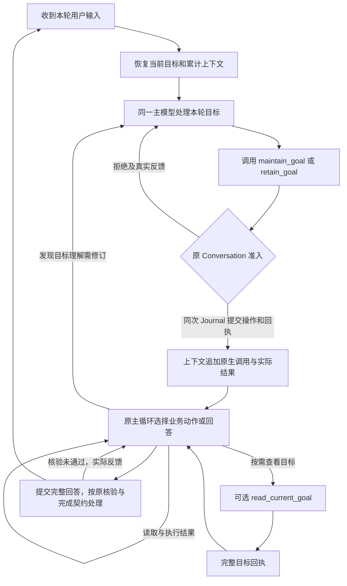
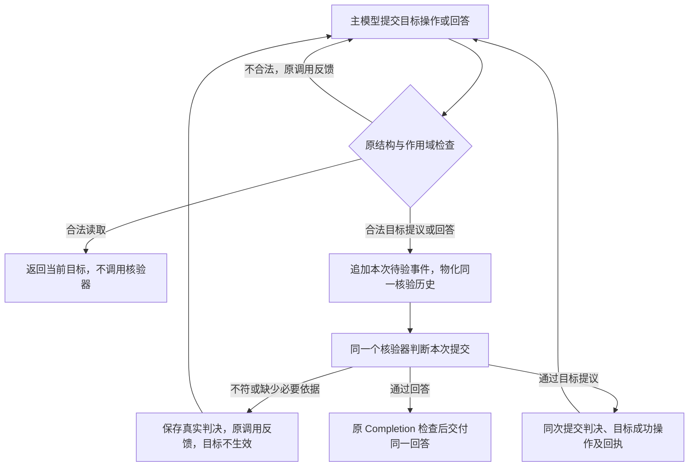

# 长程分析执行目标维护 Spec

目标维护已成立边界（2026-11-01）：§9.5 扁平工具已接入，原前三轮全部交付，三次维护首响应合法、上下文及读取审计通过，原参数阻塞未再复现；独立评分 [1, 1, 0]，整体目标理解和遵守仍失败。结果由[验证记录 §25](verify_results/analysis-correctness.md#25-目标维护工具扁平化后的前三轮)拥有，旧身份保留。

§9.9旧身份结论（2026-11-02）：单一目标正文及取消目标内成果引用已接入，原前三轮全部交付、独立分[1,1,0]；结构简化按[固化记录](../completed/conversation-goal-contract.md)关闭，整体语义未通过。旧身份、首次环境失败、评分及费用由[记录§29](verify_results/analysis-correctness.md#29-单一目标正文与取消成果引用后的前三轮)保留。

§9.11历史结论（2026-11-02）：按用户要求取消隔离前提，§9.11统一目标／回答核验已完整接入，空会话连续前三轮3/3交付。原LongDS分[1,0,1]，原用户结果与必要反事实为通过／失败／失败。第三问原评分忽略额外美国，原分保留；3次目标及3次回答均放行，机械接入成立，语义漏放仍存在。结果见[记录§31](verify_results/analysis-correctness.md#31-统一目标与回答核验的空会话连续前三轮)；本轮新隔离模型调用0，旧§30保留历史身份。

问题编号：`KNOWLEDGE-DECISION-DELIVERY-001`。归属[研究能力增强与实验交付总 Spec](knowledge-decision-delivery.md)。历史状态（2026-10-31）：§9.4 的读取及门禁成立，第三轮因参数阻塞未完成；该失败和已交付两轮评分 2/2 保留原身份。此前 §9.2 的固定提示通用性纠正、旧六轮 2/6、通用版前三轮 1/3 及 §9.3 的隔离诊断保留原身份。本文唯一拥有执行目标、每轮维护、回答前读取和上下文接续契约；旧尝试由[长程语义记录](longtask-semantic-consistency.md)保留，该轮结果由[验证记录 §24](verify_results/analysis-correctness.md#24-回答前读取目标的接入与前三轮验证)拥有。

随后按用户要求完成 §9.3 的两次运行后隔离追问：范围选择及数量例外的理解偏差在原记录和追问中相互印证；不能归为完全不理解目标，也没有证明唯一隐藏因果。没有生产改动或新产品评分，实际依据由[验证记录 §23](verify_results/analysis-correctness.md#23-目标理解与实际判决的隔离追问)拥有。

§9.12历史实现与证据（2026-11-02）：§9.12已实现单字段四段正文及四项目标核验，并从空会话连续交付前三轮；原分[1,0,0]，用户结果通过／失败／失败。原生历史与统一核验输入审计通过，3次目标均放行；第一轮正确初稿被误拒，第二轮前五／前八范围错误和第三轮多选比利时均漏放。接入及本组执行完成，语义验收未通过；详见[记录§32](verify_results/analysis-correctness.md#32-单正文四项内容契约的空会话连续前三轮)。本轮没有隔离模型调用或历史模型回放，不追加同义Prompt或重采。

历史结果（2026-11-02）：§9.13逐项报告及原回执已接通，但一次空会话连续前三轮计划在第一轮terminal_limitation终止，正常答案0、后两轮未执行。首次目标核验错误要求实际数值，8次目标维护均未生效；40次主决策与40次核验耗尽本轮预算。原生历史、报告归一及39次后继反馈可见成立，语义验收失败；见[记录§33](verify_results/analysis-correctness.md#33-逐项用户要求核验的空会话连续前三轮)。旧分[1,0,0]保持。

§9.14结果（2026-11-03）：职责分离已落地，空会话连续前三轮3/3交付，原分[1,1,1]、预声明用户结果通过／通过／失败。两类核验各自历史、原始用户输入及主循环接续审计通过；第三轮仍允许以美国补第三名额，另有额外展示义务与错误拒绝。实际结果与停止决定见[记录§34](verify_results/analysis-correctness.md#34-分离目标与回答核验的空会话连续前三轮)。§9.11—§9.13混合输入仅为历史契约，旧结果不改写。

上一版全量尝试（2026-11-03）：按用户要求保持上述源码，从空会话连续运行原34轮；实际请求3轮、正常交付2轮、原分[1,0]，第三轮两次修订参数类型错误后返回limitation，后31轮未执行。第二轮前五／候选名单范围冲突在目标与回答核验中均被漏放，职责隔离和历史接续仍成立。全量未完成，详见[记录§35](verify_results/analysis-correctness.md#35-当前实现的task2全量连续运行)。

## 1. 问题、目标与适用范围

实施前的独立 Python direct 分析由主模型理解并回答，已经保存实际用户消息、跨轮原生工具交换及观察。当时六轮的 23 次主请求均收到完整用户原话及新版指令，第二轮仍混用承接名单与展示前五，第三轮仍把必要条件交集换成综合推荐。原话存在及调用连续已经成立，持续遵守要求没有成立，见[真实六轮结果](verify_results/analysis-correctness.md#17-用户原话与持续约束候选的完整六轮)。第五轮的家族分摊计算错误单独归因。

实施前缺少可由主模型更新、由后续决策明确消费的执行目标记录。设计依据是该机制缺口和上述用户结果失败；“维护当前目标能改善这些结果”是候选假设，不能把缺少目标记录写成全部错误的已证实原因。接入后的六轮没有满足语义验收，具体成立边界及剩余问题见 §9。

实施前 Runtime 反馈的同轮和跨轮路径不同：Service 将 `DecisionFeedback` 提交到当前 Trace 并继续主循环；新用户轮次通过 `analysis_observations` 继承的类型仅为 `ActionObservation`，没有继承 Runtime 决策反馈。原生历史投影遇到缺少可见反馈的交换会跳过整组，因此存在跨轮反馈及对应拒绝交换遗漏的代码路径；本次已在 [Service](../../../src/personal_agent/application/conversation/service.py)、[Journal](../../../src/personal_agent/application/conversation/journal.py)及[历史投影](../../../src/personal_agent/application/conversation/model_history.py)补齐，实际审计见 §9。设计时只读核对 uc630、h630、v630、c629 各六份原 Trace，其中 `DecisionFeedback` 均为 0；此前六轮连续性检查没有覆盖这一分支，不能将该静态缺口冒称为这些旧轨迹已实测的丢失。

本方案让同一分析任务在多轮请求、工具往返及压缩恢复后继续消费一份当前目标。目标表达整体目的、仍有效的要求和本轮任务，既能延续旧要求，也能响应用户修改和纠正模型误解。首版适用现有独立 Python 授权的专用分析对话、direct 回答及 `none` 核验配置，正式入口为 `POST /api/conversation/turn`；其他研究、普通问答和传输入口保持各自契约，不因本方案存在自动迁移。

目标维护使用同一主模型的正常工具循环，不恢复独立 Intent／criteria 提取，不增加自动续跑调度。首版关闭核验；§9.7 仅在原 direct/required 边界接入目标核验及原反馈修复，不接 claim 或其他核验。一次回答结束后仍保留当前目标及有效要求，供后续用户问题接续；目标记录本身不产生后台执行或整体完成事实。

## 2. 已核对源码与采用决定

以下固定源码于 2026-10-30 只读核对，属于 A 级机制依据，未运行第三方项目。实际装配、写入、后续消费和修改限制分别核对，不将接口声明当作完整实现。

| 实现与版本 | 实际调用链与边界 | 本工程采用及必要差异 |
| --- | --- | --- |
| DeepSeek Harness `b150a551b8d465e31e418e1b2eaf5e79bbb7d28e` | [基础装配](https://github.com/deepseek-ai/deepseek-harness/blob/b150a551b8d465e31e418e1b2eaf5e79bbb7d28e/packages/bundle/base/cordis.patch.yml#L256)安装目标服务及续跑驱动；[标准工具面](https://github.com/deepseek-ai/deepseek-harness/blob/b150a551b8d465e31e418e1b2eaf5e79bbb7d28e/apps/cli/config/agent-presets/standard/agent.cordis.yml#L89)安装模型工具。`create_goal/update_goal → GoalService → goal/change`，服务从原会话事件恢复；[更新工具](https://github.com/deepseek-ai/deepseek-harness/blob/b150a551b8d465e31e418e1b2eaf5e79bbb7d28e/packages/goal/tool-goal/src/index.ts#L234)检查目标引用并限制正文修改所在的用户输入轮；[续跑驱动](https://github.com/deepseek-ai/deepseek-harness/blob/b150a551b8d465e31e418e1b2eaf5e79bbb7d28e/packages/goal/goal-round-driver/src/index.ts#L164)读取当前目标后通过 `Agent.followup` 继续同一会话 | 采用唯一持久来源、版本绑定、受控修改及后续显式消费。原 Journal 已承担运行事实，不复制独立目标数据库、自动轮次或完整事件框架；本工程每个用户轮次必须处理目标，属于此次明确要求，不冒称外部默认机制 |
| Codex `dc40446064cc0896851a5f2ef69f10f62d2206a1` | [App Server 装配](https://github.com/openai/codex/blob/dc40446064cc0896851a5f2ef69f10f62d2206a1/codex-rs/app-server/src/extensions.rs#L87)按 Goals 功能配置安装扩展；[模型工具](https://github.com/openai/codex/blob/dc40446064cc0896851a5f2ef69f10f62d2206a1/codex-rs/ext/goal/src/tool.rs#L204)写入线程目标，更新状态时不改目标正文；[续跑入口](https://github.com/openai/codex/blob/dc40446064cc0896851a5f2ef69f10f62d2206a1/codex-rs/ext/goal/src/runtime.rs#L436)从持久状态读取目标再启动下一轮。[续跑指令](https://github.com/openai/codex/blob/dc40446064cc0896851a5f2ef69f10f62d2206a1/codex-rs/ext/goal/templates/goals/continuation.md#L9)要求保持完整目标，不能用已有工作重新定义成功；用户编辑后另行注入新目标 | 采用用户要求与执行进展分开、目标变更明确生效及完整目标对照。保留原完成和预算责任，不复制其线程状态、自动调度或目标完成工具。本工程目标是可纠正的工作解释，修改必须有用户依据，不能给模型任意改写用户标准的权力 |
| smolagents `96f33faaf028479119ec8d34507b47694cf14e34` | [`MultiStepAgent.run`](https://github.com/huggingface/smolagents/blob/96f33faaf028479119ec8d34507b47694cf14e34/src/smolagents/agents.py#L469)保存原任务；[计划更新](https://github.com/huggingface/smolagents/blob/96f33faaf028479119ec8d34507b47694cf14e34/src/smolagents/agents.py#L639)重新消费原任务及实际观察，旧计划在摘要模式下不进入该更新输入。`planning_interval` 默认 `None` | 采用目标与可变方法分离；不引入固定规划调用或刷新间隔 |

“维护执行目标”由 `maintain_goal` 创建或完整修订，`retain_goal` 确认沿用；工具契约按 §9.9 简化为单一完整正文。2026-10-31 曾按用户要求在 §9.4 增加无参数 `read_current_goal` 及回答前读取门禁；2026-11-02 按 §9.8 取消强制读取，当前只保留按需查看，读取不修改目标版本，不引入生命周期调度。

## 3. 行为规格

下表的编号只用于文档追溯，不作为生产字段。`GOAL-1` 至 `GOAL-9` 为既有契约；`GOAL-10`至`GOAL-12`已在§9.11接入；当前目标与回答的独立核验契约由§9.14拥有。

| 编号 | 触发条件与必须结果 | 失败行为及验收入口 |
| --- | --- | --- |
| GOAL-1 持续维护 | 首次建立目标；后续依据上一版目标、原要求和实际新输入修订，未被用户撤销的要求继续适用；模型发现旧理解错误时可依据原话纠正 | 目标误解、遗漏条件或自行放宽分别计错；按 §8 的六轮实际目标及回答检查 |
| GOAL-2 每轮先处理 | 每个新用户请求在执行业务动作或交付回答前，必须有本轮成功的目标创建、修订或沿用回执；一次模型调用或一次 Python 执行不算新用户轮次 | 未满足前置条件时拒绝业务动作及最终答案，零业务执行，反馈进入同一循环 |
| GOAL-3 合法沿用 | 目标和当前任务没有变化时可明确沿用；沿用记录本轮确认，不制造目标新版本；本轮任务或有效要求有变化时修订完整目标 | 无目标时沿用、过期引用或错误修订结构均拒绝；语义上错误沿用由真实结果判定，代码不替模型解释用户意图 |
| GOAL-4 同轨迹消费 | 目标维护、程序执行及回答继承同一轨迹的实际消息、模型响应、工具回执和 Runtime 反馈；新轮次继续消费此前真实成果及反馈—修正过程 | 不另起目标提取空会话，不按工具结果类型漏掉拒绝或修正反馈，不用旧测试答案或人工目标替代实际模型产物 |
| GOAL-5 版本与作用域 | 更新绑定当前合法目标引用、本轮冻结用户输入及原生调用身份；主体、会话、分析授权和历史分支匹配 | 过期、错分支、错主体或混合首批调用拒绝，目标和业务状态零写入；成果访问由原工具权限边界校验，不要求逐条用户消息索引 |
| GOAL-6 压缩与恢复 | 当前完整目标从 Journal 恢复后独立物化；历史压缩保留目标变化依据、用户纠正及必要近期交换；同 run 恢复复用已接受操作 | 摘要不能覆盖当前目标；缺失必要原件或绑定失败时沿原容量／恢复规则停止，不默认为已处理目标 |
| GOAL-7 遵守目标 | 主模型以当前目标和原用户要求选择方法及交付；正确执行和工具成功不能替代用户结果，临时试算不自动变为有效要求 | 目标正确但执行或回答不符，仍计遵守失败；结构准入不签发语义通过 |
| GOAL-8 成本与完成 | 目标往返消耗原主循环请求、tokens、工具及时间预算；本轮答案结束不清空后续仍有效的要求 | 不隐藏新增模型调用，不以预算将尽标记目标完成；目标核验按当前配置和§9.7履责，沿原完成契约交付 |
| GOAL-9 按需读取 | 需要查看当前完整目标时可单独调用read_current_goal；每次主请求仍从Journal物化当前目标 | 回答和修复不要求新鲜读取，不因未读或较早读取拒绝；读取不修改版本，也不替代目标维护或语义核验 |
| GOAL-10 写入前核验 | 每次合法的创建、修订、沿用提议触发一次目标定义核验；通过后才提交操作及成功回执；读取只返回当前目标 | 语义不符或必要依据不足均不生效；修订提议失败不改变当前版本，失败沿用不取得本轮维护事实 |
| GOAL-11 按职责续接核验历史 | 目标核验只接收历次目标提议、目标判决及目标修订；回答核验只接收历次回答、回答判决及修复后回答。分别按用户轮次及原时间顺序累计，保留完整原始用户要求 | 从同一Journal筛选，只读投影不新增独立写入历史；相应历史及摘要不得串入另一职责，不只保留最新稿 |
| GOAL-12 原话与交付权威 | 两类核验均以原用户要求为准；目标核验判断任务定义，回答核验判断实际交付，当前目标仅作为可纠正的任务依据交接 | 目标通过不表示结果已经完成，也不能豁免回答与原要求的冲突；回答核验及原 Completion 成立后才允许交付 |

## 4. 事实归属与最小契约

### 4.1 原要求、工作解释和执行事实

对照[当前架构](../../architecture/core-architecture-current-state.md)及[代码地图](../../architecture/code-map.md)，此能力属于现有 Conversation Application。依赖保持正式入口 → Conversation → 原 Model／Tool／Artifact Port，Composition Root 延用现有装配；不新建跨业务目标平台。

| 内容 | 唯一责任主体及合法写入口 | 下游用途 |
| --- | --- | --- |
| 用户原要求及新修改 | 当前请求冻结消息，保存于 `InteractionTrace.messages`，按原上下文提供原话 | 判断模型解释是否有据；目标不保存逐条消息索引，也不取得高于用户原话的权威 |
| 当前执行目标的工作解释 | 主模型通过 `maintain_goal` 提议；Conversation 准入后在原 Journal 提交不可变目标操作 | 后续主决策、目标维护及当前目标输入投影 |
| 本轮是否完成目标前置处理 | 从本轮成功操作、用户输入绑定和当前目标引用推导 | 限制工具面及最终提交；不另存可独立修改的 ready 布尔值 |
| 计划、工具观察与实际执行 | 原工作计划、原生模型记录、Journal 和 Artifact | 调整方法、复用成果及验证交付；不反向改写用户要求 |

当前目标是成功操作序列的只读投影。原 Journal 保存唯一操作事实，不新增可独立写入的目标文件、目标表或 system Prompt 快照。它与原消息的关系是“有来源的模型解释”，不是第二份用户原文。

### 4.2 目标与工具参数

目标正文只保留 `objective` 一个非空字符串。它表达完整执行目标，依据原用户输入及有效历史写清本轮交付、仍有效的范围、条件、关系及例外，可按需用 Markdown 组织；不要求固定小节或分字段重复表述。2026-11-02 按 §9.9 合并原整体目的、有效要求和本轮任务，删除 `requirements`、`current_task`、`result_resource_ids` 及目标操作的 `result_refs`；不接受旧形状，也不在 Runtime 中自动拼接旧字段。已删除的来源索引、纯文本包装及混合操作参数不恢复。

材料和成果引用由原输入、成功工具回执、Artifact 与历史物化机制保存和提供，不另在目标内维护资源目录。工具成果与执行进展继续由原事实拥有，不复制为用户要求。中文字段元数据经现有 Catalog 投影英文，不增加翻译器或另一份参数模型。

遇到历史指代时，完整目标正文须依据原话展开所指对象及适用要求；相关名单、程序或结果仍从原工作成果恢复，不能只保留一句“沿用上次”让后继重新猜测。目标正文不构成授权；要求依据由实际原话和历史交互提供。用户尚未指定或仍需取证的条件在文字中明确为未知；先记录已知目标及缺口，再沿原循环取证或澄清，不为通过前置条件补造数值或用户要求。

三个原生工具分别表达完整写入、沿用和读取，不让模型填写条件字段组合：

| 工具 | 参数及前提 | 准入后结果 |
| --- | --- | --- |
| maintain_goal | 只提交完整 `objective` 正文，不传其他业务字段、操作类型或版本引用 | 无当前目标时创建首版；否则完整修订并增版本，绑定实际当前分支及输入 |
| retain_goal | 已有完整目标且正文无需改变，参数 {} | 保留正文及版本，记录当前轮维护成功；尚无目标时不可见 |
| read_current_goal | 当前轮维护成功，需要查看目标时按需单独调用，参数 {} | 返回revision与完整目标；只读记录不增版本，不追加强制作答或重新读取提示 |

Runtime 从当前 Journal 恢复完整 base 引用，绑定原操作、修订号、内容摘要及冻结用户输入；模型不复制内部版本。Service 串行消费本次请求的决定，通过原 Journal revision 冲突及不可变分支校验提交，不接受跨分支或被改写的旧操作。模型可见视图只有修订号与完整目标，修订号用于识别回执，不是需回填的参数。旧嵌套契约只由冻结历史源码解释，不在新生产路径接受或转换。

修订由新用户要求或对原要求的理解纠正支持。模型决定语义关系；Runtime 校验目标版本、会话作用域、结构及写入前提，不做成果资源或逐条来源索引校验。资源访问权限继续由既有工具边界校验。解释是否符合原话仍是语义责任，不能用确定性代码根据关键词或数据结果修改目标正文。

工具成功返回实际操作、当前完整目标及修订号；拒绝返回确切原因和合法修正范围。成功、拒绝及模型重提均按原调用身份进入历史。目标正文只能由成功维护操作新增或修改；读取只恢复同一版本。普通回答、Python 输出、笔记、摘要和模型自述没有写权限。

## 5. 主循环中的前置处理

每个用户请求先沿原历史选择恢复当前目标，再进入同一个主模型循环。首步必须包含原始消息、当前目标及完整适用历史，不单独调用目标生成模型。



前置条件未满足时，首次仅暴露 `maintain_goal`；已有目标时同时暴露 `retain_goal`，均设置现有 `action_choice="required"`。Runtime 同时检查实际响应：无工具的提前终答、业务调用、多次目标调用或混入其他动作的批次均拒绝；在任何写入和业务执行前检查完整批次，为每个原 call ID 返回真实拒绝，不先执行其中一部分再接受其余部分。

目标维护成功后重新物化业务和可选目标读取工具面，恢复 `action_choice="auto"`；后续仍可调用目标维护工具修正理解。用户于2026-11-02取消回答前紧邻读取限制：正文、回答工具和核验后的修复提交均不再检查读取新鲜性，原每轮维护及其作用域约束保持。读取后可继续行动、修订或回答，不要求再读。回答提议仍先记录再进入原目标准入、引用、语义核验及完成契约；记录不代表通过或交付。

“已处理”绑定本轮冻结用户输入和当前目标版本。新用户输入使上轮确认失效；同轮有效目标修订产生新的成功绑定。当前 run 的正常后继调用和恢复沿用已成立绑定，不因一次 LLM 调用重新关闭业务工具。

目标操作、控制处置和原调用绑定在同一次 Journal 提交中成立。用原调用身份恢复已提交操作，重复恢复返回同一事实，不追加目标版本或重复计执行。恢复发生在目标提交后、后继请求前时，先补全原生回执再继续。候选不嫁接旧未完成 run 的冻结请求和新 Schema，旧封存保持原身份，验证使用新会话。

所有拒绝及修正消耗现有预算；耗尽时沿原限制或失败出口说明实际进展，不能发布绕过维护前置条件的正常业务答案。维护准入不承担语义核验，最终答复按当前配置进入原核验路径；接受目标工具不代表目标理解正确。

## 6. 目标维护与执行的上下文接续

### 6.1 每次请求提供什么

主模型的职责保持任务理解、选择动作及回答。输入按 Markdown 区分本轮用户请求、当前目标、累计工作成果与最新反馈；用户消息角色和原生工具协议保持。当前目标区明确其为可纠正的工作解释，用户原话仍为依据。

每个新用户请求先依据原话维护完整目标正文，保存成功后，以最新正文约束后续动作。具体条件、关系、完成标准及明确例外从真实用户输入和有效历史解释，不在固定 Prompt 中预先选择任务类别或解题规则。方法由模型依据当前信息选择，不因此修改用户要求；每次取得执行结果后，对照实际方法和产物检查是否符合目标。发现执行偏离时修正方法或结果；目标解释与原话冲突时，依据原话修订目标。提交前以实际执行依据逐项核对当前目标及原要求后交付。这些检查由同一主循环完成，不新增独立核验调用、核验工具或对用户的自查清单。

执行过程中发现当前目标不够明确、无法据此回答用户问题时，先回查用户原话，补清影响回答的对象、条件、计算口径或交付要求，并额外调用 `maintain_goal` 提交完整修订，成功后再继续；同一用户轮次不限制为一次维护。用户要求仍不足以确定关键条件时，说明具体缺口并请求澄清，不能把期望数量、已有结果或自行设计的门槛填成用户要求。此规则复用已有修订和反馈路径，不新增工具、相位或状态。

目标维护步骤与业务步骤使用同一消息来源和原生交换序列。实际目标调用参数、对应回执、适用推理协议、拒绝及后继修正均追加到原历史；不能在目标步骤结束后仅把目标正文交给另一份空消息列表。请求原件继续由现有模型 Journal 保存，供核对目标生成时实际看到了什么。

Runtime 的目标前置拒绝、版本／来源错误、业务准入拒绝及协议修正同样滚动进入 Context，保存错误原因、修正要求及原决策绑定。属于工具调用的反馈按原 call ID 配对；没有合法 call ID 的整体响应反馈按原运行系统消息提供，不编造工具调用。下一次目标维护及业务决策均消费真实反馈和后继修正，不能只在服务日志记录，或只传一次错误字符串后丢失。

历史反馈只保留在发生它的原交互中，不在当前目标旁另建汇总区，也不每次把已发生的拒绝再复制为 system 清单。当前目标区只物化当前目标及本轮前置状态；原交互的来源、拒绝、回执和修正顺序仍由原生历史投影承担。

原生交换同时承载该次决定之后实际产生的 Runtime 反馈。原工具调用与结果仍按 call ID 配对；自动核验等没有模型原调用的反馈，按 Journal 的主决策输入区间归属到触发它的决定，在该次 assistant／tool 消息之后以 Runtime 消息追加。保留历次判决及实际修复，不以“只保留最新核验”替代历史；消息位置、反馈正文与原始调用身份共同参与请求摘要和容量计量。该投影仅消费当前可见事实，已消费反馈不再进入集中执行材料。合法压缩以整组“决定、结果、反馈”为单位，当前未决反馈及必要上下文保持原文。

每次只额外物化一份当前目标视图，旧版留在原工具历史供溯源，不另建“上一轮 criteria”注入路径。历史回执仍保留其原版本，不改写成当前目标；当前目标区负责说明哪个版本有效。工具回执与派生视图的重复输入计入真实容量和费用，不宣称新增视图天然降低成本。

### 6.2 跨用户轮次、压缩及恢复

跨轮读取沿现有 `prior_analysis_turns` 的主体、会话、分析授权、原问答前缀和实际最终答复匹配，再读取该分支成功目标操作。目标当前引用须绑定原操作而非单独序号；不同合法分支分别沿自己的真实前驱继承，不按同一 `conversation_id` 的最大版本选择。前驱存在歧义时拒绝恢复，不猜测最近一份记录。

跨轮投影须同时取得匹配历史中的 Runtime 反馈，保留其源 run、原决策及调用身份，作为原历史交换消费，不能仅复用当前只收集工具观察的入口。旧轮已修复反馈保留历史性质，不冒充本轮尚未解决的拒绝；反馈不能变成用户要求或越权修改目标。不能因为缺少反馈视图而静默丢掉整组拒绝—修正交换。

沿用现有请求预算和压缩机制，计入目标正文、工具声明、原生交换及输出预留。压缩前后均从 Journal 恢复当前完整目标并物化；历史摘要保留用户纠正、目标变化及依据、有效成果、未决事项和可用原件位置。较早交换可按原压缩契约覆盖，不能拆断保留的调用与回执，也不能用摘要文字覆盖当前目标事实。

未解决的反馈及其必要上下文作为后继决策的保护输入；已解决的反馈可随旧交换压缩，但保留问题、修正结果和原件位置。摘要存在不等于修正完成，是否已经解除仍依据实际后继操作和结果。

尚未达到容量线时不为展示机制强行压缩。真实容量压力或正式恢复场景分别验收目标恢复与后继实际消费；未触发时登记未覆盖，不将六轮历史完整外推为压缩后语义保持。

## 7. 生产接入、迁移及复杂度

下表为本切片的职责落点；目标工具、状态、前置准入和上下文已经接入，六轮未通过语义验收。

| 职责 | 落点与直接协作者 | 实施要求 |
| --- | --- | --- |
| 目标参数、目标版本引用及成功操作事实 | [goal_models.py](../../../src/personal_agent/application/conversation/goal_models.py)；由原 [models.py](../../../src/personal_agent/application/conversation/models.py)承载进 Trace | 只定义真实读写者需要的 typed 契约，不混入计划、执行或完成状态 |
| 目标版本、分支、完整批次和本轮前置条件 | [goal_maintenance.py](../../../src/personal_agent/application/conversation/goal_maintenance.py)；消费目标类型及原冻结输入 | 同职责集中准入与状态推导，返回接受或具体拒绝，不替模型解释或修补目标；成果资源仍由原工具边界校验 |
| 工具声明、原生决定解析与分阶段工具面 | 原 [model_actions.py](../../../src/personal_agent/application/conversation/model_actions.py)、[service.py](../../../src/personal_agent/application/conversation/service.py) | 复用原动作协议及主循环；Service 装配具名协作，不堆入目标规则 |
| 唯一写入口、同 run 恢复及分支目标读取 | 原 [journal.py](../../../src/personal_agent/application/conversation/journal.py)、[models.py](../../../src/personal_agent/application/conversation/models.py) | 原成功操作序列及其调用处置共同提交，当前目标只读推导；无独立目标存储 |
| 工具结果配对、跨轮续接及当前视图 | 原 [model_history.py](../../../src/personal_agent/application/conversation/model_history.py)、[context_materialization.py](../../../src/personal_agent/application/conversation/context_materialization.py)、[history_compaction.py](../../../src/personal_agent/application/conversation/history_compaction.py) | 目标回执纳入现行控制结果协议，不能只保存状态而漏掉回执；补齐匹配历史的 Runtime 反馈投影，保持原身份和当前反馈的区分，压缩继续消费原轨迹 |
| 通用指令及双语镜像 | 原中英文 `conversation` Prompt Catalog | 具名版本表达目标解释、维护前提及新旧版本作用；不写具体题目、国家、公式或期望名单 |

当前复杂度为完整写入、沿用和按需读取三个模型工具、一个目标正文字段、目标及操作的 typed 契约、每轮维护前提，以及一个当前输入投影。§9.9 删除原三个语义字段之间的重复表达及目标内成果引用；§9.5 已删除两个文本包装和混合参数类型，版本绑定交给 Runtime。读取复用原操作序列，以 `read` 区别于修改及沿用；同一目标版本的只读回执不能改写目标内容，回答及修复不强制读取。两个职责模块仍分别拥有类型和转移规则；没有新能力平台、独立模型、数据库、调度器、可写 ready 状态或依赖包。新持久事实和主链前置协议由 [ADR 0048](../../adr/0048-conversation-goal-maintenance.md)引用本文，不复制另一份规格。

原 `ModelCallDisposition` 扩展目标维护操作，以 typed 成功操作引用绑定原 call ID；对应原生工具结果从同一 Journal 事实恢复，不把完整目标重复存入多个可写字段。声明、解析、成功处置、拒绝反馈、历史投影和请求恢复须同轮迁移，沿用旧控制工具种类枚举而漏掉目标结果视为未完成接入。

实施顺序为：目标事实及恢复 → 工具声明与准入 → 全部答案／动作出口限制 → 原生回执及跨轮投影 → 当前目标及压缩输入 → 中英文 Prompt → §8 验证。各环节连续完成后才验证用户结果，不用手工目标替代前置模型输出。

替换现有“每次仅从原话重新理解”的分析任务指令，保留原用户原话和已固化工具历史。当前候选目录中的旧不新增目标状态决定按原尝试身份解释；新目标契约只由本文拥有。不恢复独立 criteria、辅助标准清单或全局旧路径，不修改其他消费者以假装全部已迁移。

## 8. 验收、预算与停止条件

### 8.1 必须检查的结果

本节为首版完整六轮验收契约；§9.9 用户本轮授权的定向前三轮范围、预算和停止条件单独声明，不以三轮代替完整六轮。首版候选以现有 `.tmp/uc630/` 六轮为失败依据，使用相同正式 HTTP、原始六问和 CSV，从新主体／空会话连续生成，不向 Runtime 输入旧答案、参考程序、人工目标或评分。第一轮实际创建的目标及每轮真实操作、回执和回答必须成为下一步真实输入。

| 场景 | 覆盖需求与通过条件 |
| --- | --- |
| 新会话第一轮 | GOAL-1／2／4：实际主模型创建目标，成功回执先于首次业务执行及回答；目标包含原请求所需的整体目的和有效要求 |
| 第 2、3 轮连续分析 | GOAL-1／7：当前目标明确承接名单与展示集合的作用，必要条件及数量不足规则仍有效；回答不把展示数量当比较范围，不用综合分替代资格。评测侧参照原题检查，不把正确名单写入生产工具或 Prompt |
| 第 4、6 轮条件变化 | GOAL-1／3／7：真实目标更新反映均摊及后续条件变化，仍有效门槛和所指名单正确；合法补充试算可以保留，主结果必须回答当前用户问题 |
| 第 5 轮及完整六轮 | GOAL-7／8：目标是否正确、程序是否正确及最终原分分别计量；家族分摊错误独立报告，不以目标通过覆盖用户结果失败 |
| 实际提前终答、业务调用或混合首批次 | GOAL-2／5：在真实阶段输入上验证前置拒绝、零业务执行、真实 call ID 反馈和后继消费；不能只看工具定义不可见 |
| Runtime 反馈后的同轮、跨轮决策 | GOAL-4／6：从真实目标或业务拒绝到实际修正，再到下一条用户输入，核对各次请求均包含对应反馈及原交换，且旧反馈没有变成本轮拒绝；压缩时未解决反馈仍可消费。没有真实拒绝样本时登记未覆盖，不把正常六轮通过当作该分支通过 |
| 沿用、过期引用及原件恢复 | GOAL-3／5／6：沿用不增加目标版本；在实际目标轨迹上验证旧版本或错误分支拒绝及零写入；成果引用由原工具校验。同 run 恢复不重复变更，跨轮只继承匹配分支 |
| 实际容量压力及压缩后的工作 | GOAL-4／6：当前目标逐字段恢复一致，必要依据可回读，后继模型实际使用；未触发则单列未覆盖，等待对应真实压力用例，不补跑凑触发 |

确定性反事实使用完整真实阶段产物进行 Offline Eval，标明修改的引用或动作及其边界；不新增等价单元测试。语义验收运行一次允许自主选择动作的完整六轮旅程，按[方案推进 §3.1](../../../.agents/skills/analyze-proposal-progress/SKILL.md#31-自主决策的验收例外)取证，不以十次重复目标提取代替连续任务。若后续改为局部语义判定修复，另按该技能 §3.2 预声明，不借本次旅程逃避适用门槛。

目标前置契约须六轮全部成立；实际目标的有效要求及第 2／3／4／6 轮相关主结果须满足原用户契约，才可关闭本切片的目标接续与遵守问题。只通过工具调用顺序或目标正文检查，只能报告对应局部机制成立。原六轮官方总分照常报告，完整任务或发布沿上位方案判定；第五轮独立计算错误不被改判，也不自动重开已成立的历史工具组织机制。

### 8.2 比较身份与资源

候选固定原生成模型 `MiniMax-M3.1-Flash`、adaptive＋medium、32,768 输出、1M 配置窗口、8,192 协议预留、原 Docker 镜像及原材料。每个用户轮次继续使用 40 次主决策、256 工具、3600 秒；目标往返及拒绝修正计入这些限制，不能另建无限准备循环。新增生成限额 6M 已知 tokens，独立评分统一限额 300K；未知用量沿现行规则预留，旧费用保持原账本。

实施完成、ADR 和实际运行命令／源身份冻结后，才启动该计划。2026-10-30 设计交付时未运行模型；用户后续授权的实施与实际验证由 §9 及验证记录保存。评分仅在采集封存且进程退出后执行，复核原评分配置和有效资格，再对六份新答案各评分一次；资格不可用时在付费前停止，不临时换评测器或改分。

保存每次实际请求、原生响应、目标操作与回执、冻结源码、角色及分支绑定，审计目标步骤与执行步骤确实共享累计上下文。分别报告前置契约、目标语义、回答结果、压缩触发、请求数、tokens 和耗时。基线与候选是独立随机轨迹，分差不单独证明目标机制的因果收益；独立收益主张须另取责任边界反事实或消融。

### 8.3 失败归因和去留

语义错误不触发中途改 Prompt、替换样本或注入正确目标，仍完成已确定六轮；环境、权限、容量、未知用量或预算阻断按原规则停止并留证。最早错误分别定位到目标解释、版本／输入交接、执行或回答，不把它们统称历史丢失。

目标记录存在但仍在同一用户结果上失效时，停止同义指令和同类整轮重采，按 [EVD 复审](../../devSpec/change-evidence.md#72-重复阻塞先复审方案再继续)核对设计、实现与真实消费。撤回或保留按具体成立边界决定；不自动启用核验器、前置 criteria 或另一套目标状态，也不改变旧评分。

## 9. 整体设计复审与当前状态

| 复审点 | 本设计结论及具体措施 |
| --- | --- |
| 用户价值及因果假设 | 对应已发生的范围和条件替换；新增变化是模型维护并被后续消费的当前目标，不再只追加原话。语义收益仍由 §8 真实结果决定 |
| 目标权威及修改 | 原要求拥有业务权威，目标是可纠正解释；版本和来源准入阻止错绑定，开放语义仍由主模型判断 |
| 每轮处理及循环成本 | 创建／修订／沿用均有真实回执；沿用避免强制改写，前置条件按用户轮次推导；至少增加目标工具往返，通常多一次主请求，全部计费 |
| 架构与恢复 | 原 Conversation 和 Journal 拥有状态及写入，工具、历史及当前视图是实际消费者；成功事实和回执共同提交，恢复不重复修改 |
| 上下文与压缩 | 同一原生序列滚动累积，当前目标从唯一事实恢复，压缩不替换其权威；总输入成本按实际请求衡量 |
| 验收及 Agent 自主性 | Runtime 限制前置条件，不代选名单、改公式或生成理想目标；模型仍选择解释、方法及后续行动，目标文本与用户结果分别验收 |

2026-10-31 用户授权按本设计落地并完成 task2 六轮。[ADR 0048](../../adr/0048-conversation-goal-maintenance.md)记录主链及持久事实决定；实施身份 `.tmp/gm630/` 已保存实现前快照和工作树 diff。当日初次实现将前驱 Runtime 反馈同时放入原生历史和额外只读区，六轮原采集保持该身份；后续按下段用户要求删除额外汇总。原生历史恢复不再依赖只继承工具观察，当前实现仍保守保护决策反馈，不在缺乏解决依据时裁掉旧反馈。

独立全切片评审的两项重要问题均已修正：目标回执按原决策及 call ID 配对，避免复用 ID 返回旧目标；前驱反馈投影排除本轮反馈，避免同键消耗本轮拒绝。零模型 [Offline Eval](../../../.tmp/gm630/offline-report.json)消费 uc630 完整真实阶段，中英文共 12 份未处理目标的最终提交均被拒绝，23 份原请求恢复通过；lv4 第 19／35 轮两份真实 Trace 均有相同协议反馈键，回放确认两组反馈及交换保留。该证据不含人工正确目标，不证明目标语义或回答改善。lint、分层、规范及评分资格准备通过后，按 §8 冻结并从空会话连续验证。

首次正式采集 `.tmp/gm630/c/` 已停止并封存：请求 2 轮、交付 1 轮，10 次主请求、249,371 已知 tokens、未知 0、122.5 秒，第二轮为 `terminal_limitation`。首轮数组被输出成 item 包装，反馈后正确修复并创建目标；第二轮复制完整引用时将摘要写成 65 位，原 Schema 拒绝，后继错误移除了 base 引用。实际请求、参数、反馈及同轨迹推理确认是工具引用表达和修复反馈的协议阻塞，不是已完成六轮，也未取得语义评分。

当前仅作一次有界协议修正：完整目标引用继续由 Runtime 拥有，模型以现成版本选择符选择，由程序恢复原 typed 引用；目标工具的拒绝反馈说明目标专用修复及数组协议，不沿用建议直接终答的通用反馈。不放宽版本、来源、批次或目标前置条件，不改业务方法与目标语义。新身份 `.tmp/gm631/` 从第一轮空会话重跑，不消费首段答案；生成额度只剩原 6M 中的 5,750,629，旧段费用保留，独立评分仍统一 300K。同一协议阻塞若再次终止，停止依赖批量并复审，不再换措辞连续重跑。

2026-10-31 新六轮已完整交付，目标依次创建一次、修订五次；38 次主请求的当前目标、前置工具面、原生回执及跨轮反馈审计通过。新生成使用 3,772,465 已知 tokens、671.015 秒；六次独立评分使用 30,622 tokens，结果为第 1／2 轮通过、第 3—6 轮未通过。含首段协议失败，本次共 54 次物理调用、4,052,458 已知 tokens、未知 0；正式评分与费用见[评测盘点](../../evals/02-current-case-inventory.md#2026-10-31-持续执行目标接入后的六轮)，具体归因和覆盖限制见[验证记录 §18](verify_results/analysis-correctness.md#18-持续执行目标接入后的完整六轮)。

本轮复审保留目标记录、前置处理和反馈接续的实际机制，不认定语义修复成立。第三轮目标未明确“高”的判据，但进一步核对[同轨迹输入、决策摘要及程序](../../../.tmp/gm631/turn03-following-audit.json)后，最早可定位偏离更明确：模型已判断中位数交集只有英国、法国，仍反复寻找能得到三国的规则，再将较低门槛写入程序；goal 及禁止为数量放宽条件的指令均实际到达。第四轮目标已写明均摊重算包括准入门槛，执行仍使用原始标题数准入；第六轮目标则已把先前试算的 68.870 写成原成熟度门槛。它们显示目标保存不等于遵守、执行偏离及错误解释被持久保留，不能统归历史消息丢失或全部归因目标提取。外部机制采用和本地调用接入均已核对，但持久化本身不保证解释正确；本次独立随机轨迹也不证明该机制必然降低成绩。

当前停止依赖同类提示修改的自动重跑，保持 criteria／Runtime 核验关闭。真实压缩、沿用分支、故障后同 run 恢复及完整越权／混批反事实未在本组六轮验证，不补采凑触发、不报全覆盖；下一次生产语义变更须先从本次真实目标与回答复审具体责任并更新唯一设计。

2026-10-31 用户明确要求历史反馈只出现在发生它的交互，不再单独展示。本次 `.tmp/gm632/` 仅删除 Service 的历史反馈汇总及中英文专用资源，目标区版本更新以标记输入构造契约变化；原 Journal、原生反馈投影和当前目标正文保持。依据为 gm631 实际请求中已有配对反馈、另有 6,594 字符的重复汇总，不主张这项删除修复名单或成熟度语义。实施前已保存当前文件及工作树差异；[零模型回放](../../../.tmp/gm632/report.json)消费该完整六轮，中文 38 份真实阶段的目标区、原生历史及模型适配器回放通过，英文另 38 份仅检查目标与原生历史投影，不冒充英文正式请求或语义验证；lv4 两份同键反馈轨迹均保留原配对。中文全部请求只减少汇总副本，52 次原位置历史反馈出现均保留，累计少 165,123 字符，第六轮每次少 6,594 字符。中英文 Catalog 各 411 项一致。回放器端点及语言配置的两处准备错误已修正，未发网络请求。没有启动付费模型或新六轮，原 2/6 保持原身份；不新增状态、工具或抽象，静态检查通过。本次只验收重复输入删除及原生反馈保持，压缩和后继回答语义未新测。

2026-10-31 用户明确授权优化 Prompt 后重新验证三轮，并追加“goal 不够明确时依用户要求再次更新”。新身份 `.tmp/gm633/` 先保存当前源码、设计及工作树差异，再替换中英文主任务规则：每轮依据用户要求维护 goal、成功后约束方法选择、执行后检查实际结果、提交前逐项对照；发现目标不足以回答时，先依据原话再次修订目标，成功后继续，不以猜测补全关键要求。此候选修改的是目标到执行的检查责任，不以增加“严格”等同义词声称修复；不得写入国家、阈值、参考答案或历史测试结论。范围仅原主循环 Prompt，不改状态、工具、执行或完成协议，不恢复 criteria／Verifier。原话视图、原生历史、反馈仅留原交互和既有执行材料区保持。

验收为从原第一问、CSV 和空会话开始，经过正式 HTTP 连续执行前三轮一次；每轮的实际 goal、调用、反馈与回答成为下一步输入，不注入 gm631 的答案或目标。中文生产 Prompt 配原英文题面，生成模型、参数、Docker、40 主调用／256 工具／3600 秒及原评分协议保持；新生成上限 3M 已知 tokens，独立评分上限 300K，旧费用及未知另计。封存且进程退出后，复用已核对资格对第 1／2／3 轮各评分一次，评分不回流 Runtime。原官方分与 goal 理解、约束遵守、输入连续性分别检查；第三轮须按有效交集及不足处理返回结果，不能自行放宽以凑数量。新旧三轮均使用各自真实前置产物，属于一次自主旅程，按 §8.1 的自主决策规则取证，不宣称局部判定稳定性或单句独立收益。完成三轮即停止；语义失败不补采、不中途改词或换样本，技术阻断按原停止协议留证。

v4 已接入，但 gm633 第一轮因目标参数协议失败停止：两次主请求、15,700 tokens、未知 0、24.875 秒，目标成功操作 0、业务执行 0、答案 0，未评分。两次原始服务方响应均将数组写为 item 包装对象，第二次还把空数组写为空字符串；既有反馈完整进入下一次原生交换，但只定位 `$.goal/schema_anyOf`。这与 gm630 的数组格式问题同类，故先复审协议和诊断，不继续同义提示补采。核对 [MiniMax 原生工具协议](https://platform.minimax.io/docs/guides/text-m3-function-call)确认参数为原 JSON 字符串及完整 assistant 续接；本地适配没有制造该包装。核对 [jsonschema 官方错误树](https://python-jsonschema.readthedocs.io/en/stable/errors/)确认组合错误的 context 保留具体子错误；本工程现行校验只投影父错误，丢失可行动的字段定位。

本次只准入一次确定性诊断修正：由原 model_actions 的线级校验 owner 展开“单一非 null 分支＋null”组合中的非 null 子错误，定位实际数组或字段错误；其他组合保留原诊断，不选择业务分支、不改 payload、不转换错误数组、不放宽校验或重试上限。先消费 gm633 两份完整实际调用和 gm631 实际合法调用做零模型回放，验证错误字段定位及合法参数保持，再以新身份 `.tmp/gm634/` 从原题空会话重跑三轮。v4 主任务 Prompt 保持冻结，生成额度只剩原 3M 的 2,984,300，首段费用保留。若同类协议阻塞再次终止，停止依赖重跑并重审，不追加第二次修正；结果与生成／评分分别登记。目标语义是否改善仍由完整新旅程判断。

诊断回放已通过：gm633 两份原错误调用仍被拒，定位到 objective／current_task 的来源索引、requirements 及第二次的 result_resource_ids，而非仅报 goal；gm631／gm633 实际声明内调用中，37 份合法参数逐项保持，3 份不合法仍拒绝，载荷改写 0、模型及业务执行 0。证据见[完整报告](../../../.tmp/gm634/diagnostic-replay.json)。分层、导入及原评分资格核对通过后冻结新代码，恢复既定三轮，未调整 v4 任务规则或输入材料。

gm634 已停止并封存：计划三轮，请求两轮，只交付第一轮；10 次主请求、293,124 tokens、未知 0、125.578 秒。第一轮首次目标参数仍用 item 包装，收到具体字段反馈后修正为标准数组，成功创建目标并完成审计；第二轮两次修订均把来源索引写为字符串而非整数，Runtime 精确指出数组元素路径，仍未修复，按原重复无效动作限制返回 limitation。第二轮合法目标更新及业务执行均未到达，第三轮未执行。10 份实际输入的 v4 指令、目标快照、前置工具面、原生回执、反馈、完整历史和 SDK 绑定核对通过，三轮完成检查明确保留“第二轮无答案、第三轮缺采集”两项，不将局部输入通过写成三轮通过。

独立原协议只评分已交付第一轮一次，通过 1/1，5,053 tokens；第二轮 limitation 和未执行第三轮不伪造官方 0 分。含 gm633 首段，本轮共 13 次物理调用、313,877 已知 tokens、未知 0，生成合计 308,824，未耗尽原 3M；没有新评分资格调用。第三轮是否遵守 goal 的目标未验证，旧 2/6 不改判。详细原件与限制见[验证记录 §19](verify_results/analysis-correctness.md#19-目标执行核对-prompt-与前三轮协议阻塞)。

按先行停止线关闭本次重跑，保留 v4 为未完成语义验证的候选，不追加第二次协议修正。当前复审事实是：nullable 子错误定位已恢复、一次实际参数修复成功，但完整目标参数的模型填写及类型修复仍失败；问题已从对象包装到字符串索引重复显现。下一次准入先重审该工具的参数填写负担与可行动类型反馈，不能再以同义语义提示、自动强制转换或扩大重试绕过原格式契约。其与原第三轮数量偏离是独立阻塞，不把未到达写成 v4 语义成功或失败；criteria／Verifier 继续关闭。

用户随后明确取消目标中的来源索引。当前重新准入来自这项契约变更：删除 GoalStatement 的 source_message_indices、目标准入中的逐条消息角色／索引校验，以及中英文工具说明、当前目标和修复反馈中的索引要求；不保留可选旧字段或强制转换。原用户消息和来源视图继续作为模型理解依据，整轮输入、主体、会话、版本及成果资源仍沿原不变量绑定。目标工具、当前视图及回执同步使用无索引 Schema，相关 Prompt 独立升版。现处正式兼容期前，旧冻结运行及档案保留原身份，由原冻结源码解释；不把旧未结束请求、带索引目标或原 digest 静默嫁接新契约。

新身份 `.tmp/gm635/` 先保存实施前文件及工作树，按取消索引的反事实消费 gm634 两份完整实际失败调用：只删除被取消字段，保留目标正文、要求、资源及实际新请求，验证新 Schema／准入可接受，且版本／成果资源拒绝及原话输入仍成立。该零模型诊断不冒充新目标生成。随后接续用户已授权的前三轮，从原第一问、CSV 和空会话连续运行一次，不输入旧目标或测试答案，原 v4 执行核对及不明确时再次修订规则保持。生成额度为原 3M 扣除 308,824 后的 2,691,176；独立评分外层额度为原 300K 扣除 5,053 后的 294,947，内层配置及资格不变。采集退出封存后各答案评分一次，条件、实际 goal、执行和主结果分别审读；若再次技术终止或三轮结束即留证，不自行追加协议补丁或采样。

取消索引的零模型反事实已通过：两份完整原调用在中英文各投影一次，四例只删除该字段后均通过线级校验及目标准入；八项过期版本／未知成果资源拒绝仍成立，原目标文字和原参数的其他部分保持，旧字段不以可选兼容方式留存。证据见[反事实报告](../../../.tmp/gm635/index-removal-replay.json)。导入、分层和原评分资格核对通过，当前契约已接入；新三轮实际结果如下。

gm635 已结束并封存：8 次主请求、159,129 tokens、未知 0、84.391 秒，请求两轮、交付第一轮，第二轮 limitation、第三轮未到达。8 份实际主请求的目标 Schema 和当前快照均不含 source_message_indices，成功目标及原生回执也不含该字段；目标版本、前置限制和历史继续成立。第二轮当前错误是 requirements 被写成 item 对象、result_resource_ids 被写成空字符串，收到对应字段反馈后仍重复；不再是来源索引阻塞。已交付第一轮独立原协议评分 1/1、3,828 tokens，当前段合计 9 次物理／162,957 tokens。连同 gm633／gm634，本次原三轮计划累计 22 次物理、476,834 已知 tokens、未知 0，其中生成 467,953、评分 8,881；所有失败和费用保留。索引删除已按本次指示落实，不将其他数组错误归因于索引，也不宣称原第三轮数量偏离已修复。当前停止继续逐字段提示补丁或重跑，先重审目标工具嵌套参数与实际修复反馈的完整可用性。完整记录见[验证记录 §20](verify_results/analysis-correctness.md#20-取消-goal-来源索引与原三轮续验)。

### 9.1 字段说明缺口的复审与本次续验

用户已授权优化对应描述并继续验证。审计 gm635 第二轮两份完整实际请求及八份 SDK 工具定义：Schema 语法正确且逐项与 typed 模型一致，但所有字段均无 description；总说明只列三个目标字段及成果引用，没有给各字段职责、无引用填法或完整调用形状。两次真实修复反馈均已给出具体字段路径及数组规则，第二次仍原样提交。由此只确认首次参数说明存在可定位缺口，不能推定补说明一定解除阻塞，也不能把恢复失败归为没有收到反馈。

复核并复用[已有参数设计源码对照](../../agentRef/tool-execution-and-safety.md#10-python工具的参数结构与字段说明)：AutoGen 004749e6 的 Field 描述进入模型参数，OpenHands d39f7ae0 的工具字段直接携带 description；本轮重新核对本地十份固定源码的 SHA-256 全部一致。外部实时 raw 访问不可用时不伪造新源码证据。采用字段语义随 Schema 进入实际请求的机制；继续用本工程既有双语 Catalog、本地拒绝及同调用反馈，不引入模型、宽松转换、重试或状态。Gemini 3c311bea 的 WriteTodos 工具另证数组仍须执行前校验，不据此删除本地校验。一个通用合法形状示例只用于消除已复现的对象包装／空字符串歧义，不嵌入 LongDS 字段、国家、阈值或答案。

最小改动是 goal_models 的 Field 元数据、目标工具总说明及两者英文资源；主任务 v4、当前目标、反馈正文、参数结构、Admission、上下文组织、strict=false 和恢复上限均保持。Conversation 仍拥有参数契约，现有 Structured Model Adapter 调用 Catalog.localize_schema 后传给 Provider；无新增装配、模块、业务字段或持久事实。整体复审认为本轮描述改动有实际输入缺口依据，其他协议修复不能继续串加；撤回仅恢复这四份文件的本轮描述差异，不影响已取消索引和原目标机制。

本轮先用 gm635 的完整真实两轮产物核对中英文 Schema：去除 description 后结构逐项等同旧版、合法旧调用保持、无效数组仍精确拒绝、字段翻译齐全、通用示例可解析；该零模型审计只证明输入及确定性契约。随后新身份 `.tmp/gm636/` 从原第一问、CSV 和空会话连续运行前三轮一次，沿同轨迹消费实际目标、调用、回执、反馈及答案；不向模型传任何旧调用、诊断内容、目标、答案或评测材料。按方案推进 §3.1 的自主行动旅程验收，不以局部判定的十次重复替代连续用户任务。

本次通过条件：三轮都成功完成本轮目标前置且交付，实际 SDK 字段说明和双语投影一致、历史滚动积累保真，目标及原协议评分逐轮审读；第三轮必须按仍有效条件处理不足数量，不自行补齐。正确工具形状或到达第三轮分别只证明相应边界，原整体六轮目标不在本轮宣称完成。固定原模型、adaptive＋medium、输出 32,768、Docker、每轮限制、反馈和独立评分协议；原 3M 生成扣除 467,953 后剩 2,532,047，原 300K 评分扣除 8,881 后剩 291,119，内层资格及配置不变，旧所有成本和失败保留。捕获封存并退出后各已交付答案独立评分一次，评分不回流；三轮结束或再次技术终止即停，不临时补丁、换样或自动重跑，压缩未触发如实单列。

本轮已结束：三轮全部交付、三次目标成功操作、15 次主请求，514,885 tokens、未知 0、185.375 秒。15 份实际 SDK 请求均带 9 处字段说明；同语言比较，中文说明及 Schema 合计比旧版增加 1,011 字符，英文投影增加 2,484 字符。去除 description 后验证结构逐项保持，双语 Catalog 各 411 项。五次目标调用中三次有效，两次分别为 requirements 的 item 包装及 operation 放进 goal 内，均经实际反馈恢复；不宣称参数错误已消除。原话、目标、原生回执和七次历史反馈出现均保真，未触发压缩；英文只完成结构投影，不外推产品语义结果。

退出封存后，原协议独立评分为第一轮 1、第二轮 1、第三轮 0，共 2/3，评分 10,361 tokens。第三轮目标已将窄 genre 写为 focus 低于中位数，并添加反向 focus 的自定综合排序；回答据此排除法国，同时承认只有英国满足其条件、加拿大成熟度不足，仍列英美加三个，未遵守自己保留的不足少报要求。参考名单为英国、法国。描述补齐和实际传递成立，目标理解及数量处理仍失败；独立随机轨迹的差异不能作为描述提高成功率的因果证明。按既定停止线结束本轮，保留这部分输入改进，下一语义变更先复审真实第三轮目标与执行，不继续追加参数提示或自动重跑。原件和判据见[验证记录 §21](verify_results/analysis-correctness.md#21-目标工具字段描述与前三轮续验)。

### 9.2 固定提示通用性纠正

用户指出“不得填满名单而放宽条件”等固定提示违反 LLM 决策设计 skill §3.1。复核确认 v4 虽没有写入国家或数值，仍将本任务的筛选、合格名单、排序、数量不足及替代试算等症状改成固定行为提示；工具当前目标包装及 Schema 说明也预选了相应业务概念。之前实现审计只确认这些内容到达模型，没有审计固定与动态内容的职责边界，该结论不足以通过通用性门禁。

本轮按用户要求删除这些固定任务描述，主任务改为 v5-general-user-goal-md，仅陈述用户原话权威、每轮维护 goal、依据 goal 行动、观察反馈、必要时修订及交付前核对。goal.description 和 goal.context 同步升版，Schema 字段说明只定义内容来源、关系保真及参数协议；通用调用示例移除预设的比较任务。中英文正文及元数据同步，不新增模板变量、工具、模型调用阶段或业务字段，不让 Runtime 代写用户条件。具体业务规则保留在真实用户消息及其动态 goal 中；历史冻结源码、Prompt 和成绩不改写。

准入依据是上述真实请求与固定源码中可定位的规范违反，不主张该清理一定提高 LongDS 得分。先以 gm636 的十五份完整真实请求及五次目标调用核对新中英文 Catalog、各固定资源、参数验证结构和样例形状，确保此前有效调用保持、非法调用仍拒绝；对全部修改正文人工审查通用性，关键词扫描仅作辅助。随后按既有真实模型验证门禁，从原第一问／CSV／空会话运行前三轮一次，使用新身份 `.tmp/gm637/`，不把旧测试、目标、答案或人工筛选条件输入模型。验证新固定资源实际进入 SDK 请求、任务内容仅由本次原话与真实运行产生、每轮目标前置及滚动历史保持，目标与回答仍按原用户结果分别评分；不把得分不变或失败解释为已修复遵循。

原模型、参数、工具、Docker、恢复上限、关闭 criteria／Verifier、评分配置及资格保持。原 3M 生成累计已用 982,838，剩 2,017,162；原 300K 评分累计已用 19,242，剩 280,758，所有旧失败和成本保留。该三轮采用技能 §3.1 的自主行动路径，运行结束或技术终止即封存，不中途追加提示或重抽样；只验证通用性纠正与原运行契约，旧任务语义问题仍以实际结果记录。未触发压缩及未执行英文产品语义时继续单列，不扩大为发布或泛化通过。

本轮已结束封存：三轮交付，二十次主请求、963,614 tokens、未知 0、263.906 秒，三次目标操作成功；首轮一次 requirements 包装错误后恢复。二十份实际 SDK 请求均使用通用版主任务及目标工具说明，固定与动态内容边界核对通过，原话、目标、回执、反馈和观察继续滚动，未触发压缩。四份生产文件增加 32 行、删除 34 行，无新增业务结构；通用性结论限定本轮修改资源，不等同对整个仓库或任意任务的泛化证明。

原协议独立评分 1、0、0，共 1/3，评分 19,290 tokens。第二轮主结果仍混淆承接名单与展示前五；第三轮已正确解释集中度方向、明确报告严格条件下英法两名，同时在主表加入不满足增长条件的比利时，原评分判为答案集合不符。严格两名说明和额外主名单均留证，不仅因出现补充分析判错，也不据独立随机轨迹把语义差异归因于提示清理。当前段共 23 次物理、982,904 已知 tokens、未知 0；原前三轮计划累计 63 次物理、1,984,984 已知 tokens，生成 1,946,452、评分 38,532。按停止线结束，合规纠正不恢复已删除专属提示，要求遵循问题仍未验收。见[验证记录 §22](verify_results/analysis-correctness.md#22-固定提示通用性纠正与回归)。

### 9.3 目标理解与实际判决的隔离追问

2026-10-31 用户提出“模型没有理解目标表述而判决失败”的假设，并要求通过适当反问，让模型说明答案依据目标的哪项判决。本轮只做运行后隔离诊断，不修改生产 Prompt、目标、门禁、工具、上下文构造或核验配置，不重跑产品旅程。继续保留 §9.2 的真实失败和输入传递结论；“目标理解失败”“理解后取舍错误”“目标文本自身含混”均待区分。

输入固定为 gm637 第二、三轮最终物理请求及其同次实际响应，包括原用户原话、当前目标、原生目标回执、业务观察和服务方推理协议。按 CTX §1.2.1 沿原响应各追加一次相同的中立追问，要求指出主要结论对应的目标条款、实际采用的事实、自行推断及要求之间取舍的依据；允许维持或修正，不提示国家、正确名单、八名／五名区别、不足处理或预期判断。不请求重建隐藏推理。题目与标签只由原样本和离线审读持有，不写入追问固定正文。实发请求保存原前缀，差异仅为续接该次原响应、隔离诊断范围说明及追问；不将这份副本称为未修改的原请求。

固定原模型 MiniMax-M3.1-Flash、api.minimax.cn、adaptive thinking／medium、32,768 单次输出上限、原工具定义和 tool_choice。每轮仅一次独立追问，共两次，不相互消费答复，不调用业务工具，不修改原会话，也不把追问内容送回生产。若模型只提交工具调用、答复不完整或没有新增判决依据，登记未决，不编造工具反馈、追加同义问题或重抽样；服务失败不自动重试并停止新增样本。

审读按原输入与实际用户结果逐项比较：第二轮关注模型实际把进出比较的对象理解为何种名单、数量限定作用于哪个交付；第三轮关注模型实际把画像条件理解为何种关系、数量请求与仍有效条件如何共同约束交付。必须引用实际条款及事实，区分明示、推断、未采用、错误应用和仍未知，不能以“我遵守了”计通过。原运行中的已知缺口、自设规则和最终主结论分别留证。追问能解释条件但原答违背时，仅支持解释与应用脱节；追问也误解时，记录该输入下的理解错误；事后修正不证明原响应当时已经理解，也不能作为修复验收。

归档为 `.tmp/goal-comprehension-20261031/`，先封存源码身份、原件 checksum、追问和对照计划，再发请求。最多两次物理调用，零评分模型、零业务执行；已知 tokens 上限 300,000，计入原前三轮生成剩余 1,053,548，历史 63 次物理／1,984,984 已知 tokens 保留。发起前按原同次输入用量加新增正文及 32,768 输出预留；使用未知时预留整次估算并停止，480 秒请求超时后登记未知，不后台补发。完成两问或技术／预算停止即封存，不以语义结论继续采样。不适用修复候选十次最低门槛：此次没有候选或改善率主张，只为区分假设；结论限定两个实际失败样本的追问，不计新 E2E、稳定识别率、优化成功或问题关闭。执行结果由[验证记录 §23](verify_results/analysis-correctness.md#23-目标理解与实际判决的隔离追问)拥有。

两次均完整返回，无工具调用、重试或用量未知。第二轮自述把展示前五作为主答是其推断；第三轮承认严格条件只有两名、复合补位没有用户依据，却仍称必须给出三个。这与原决策及主回答一致，支持名单指代和数量例外未被正确用于交付的局部解释；目标中已写内容不能据此视为已被正确理解。目标文本是否需要重组及哪种机制能改善执行仍待新设计和真实验证，本次不作生产修正。实发前缀、完整目标和原回执审计通过，3,756 份源码无漂移；两次共 171,107 tokens，原计划累计 65 次物理／2,156,091 已知 tokens，生成及诊断 2,117,559、评分 38,532，原生成余量 882,441。两问结束即停止。

### 9.4 回答前读取当前目标的接入与验证

2026-10-31 用户明确要求新增读取目标工具、Runtime 强制回答前调用，返回完整目标后提示“现在请按照目标回答用户问题。”。改动为产品协议扩展：责任仍在独立 Python direct 分析的 Conversation 主循环，原正式 HTTP → 生产装配 → 真实主模型 → Journal／执行 → 最终交付保持，criteria、claims 与独立核验继续关闭。依据为 gm637 两份正式失败的完整请求与实际 SDK 顺序，以及 §9.3 的同轨迹诊断；归档 `.tmp/gm638/baseline-input.json`。读取工具缺失和原目标区后仍有多组执行结果已确认；位置与语义失败的唯一因果未确认，本轮不主张该工具保证理解正确。

沿现行架构，`goal_models` 定义空参数读取提议，原成功事实统一命名为 `GoalOperationRecord`；`goal_maintenance` 拥有当前目标恢复、读取准入和答复门禁；`model_actions` 导出、解析独占读取；Service 只分派并同次提交控制回执；Journal 保持唯一写入口，原生历史从该事实渲染回执。原操作序列新增 `read`，复用当前目标引用和只读快照、原 call ID、主调用序号及冻结输入绑定。读取与 retain 一样不得改变已有内容、引用或修订号，但读取不能替代每轮维护。是否能回答由本轮读取事实、当前目标引用与紧邻主调用关系推导，不新增独立布尔状态或目标库。

读取只接受 `{}`，不让模型填写目标、版本或摘要。单独调用，和业务／维护混批在解析前整批拒绝。回执按原 call ID 返回完整最新目标、有效要求和本轮任务，末尾为用户要求的通用作答提示，成功不代表语义验收。回答前最后一次主模型调用必须为该读取；调用其他工具、修订目标或新增模型反馈修复后需重读。所有主动最终答复共用检查，包括正文及 `control_submit_final`；系统预算／授权／服务限制沿原 fail-closed 出口，不伪造读取。反馈只指导读取或修正协议，不代写目标。新旧正文、工具说明、成功回执和修复提示的中英文契约同步，删除“维护成功即可回答”等冲突指引；原每次请求的用户原话与目标视图保留。

本轮 critic：独立读回执能使目标出现在最新执行结果之后，直接消费者是下次主模型及最终门禁；额外成本至少一次主模型往返和目标正文重复，可能仍无法改善用户结果。相比仅移动 system 区，本机制按用户要求提供可检查的显式动作；不同时移动历史、改目标语义或重开核验。若真实结果仍错，只认可读取与门禁的成立范围，停止该候选自动重跑并复审，不追加特定题目规则。读取已经形成真实消费者时不因语义效果失败删掉用户要求的协议，保留范围与剩余问题分别记录。

验收预声明：先在历史真实完整阶段上验证无读取的原最终答复被拒绝，协议 Schema 与混批反事实为零模型诊断；再从原第一问／CSV／空会话经正式 HTTP 连续前三轮一次，主模型实际维护、执行、读取和回答均滚动成为后继输入，不注入旧答案、人工目标或诊断追问。用户结果按原评分协议分别评分；当前机制按实际 SDK 的完整目标读回执位于最后一组原生交换、末尾提示、每轮新鲜性和零绕过检查。对新真实轨迹做移除读取、前轮读取及混批的反事实；恢复的历史回执按原版本重建、重复恢复不能增版本。读取后又行动若真实未触发则单列，不能由脚本造成功样本。局部协议通过不代替用户结果。路径允许模型自主选择，按推进 skill §3.1 不设固定十次；三轮结束或技术／预算停止即封存，不补采。

原三轮及诊断累计生成 2,117,559，剩余 882,441，已小于 gm637 的 963,614，且新增三个读取往返预计再增约 250K。因此在调用前将同一账本总生成上限由 3M 一次调为 4M，新段最多 1,882,441；不重置旧失败、65 次物理／2,156,091 已知 tokens、评分 38,532 和旧未知。评分原 300K 余额 261,468 保持，资格按同配置复用、不新增资格调用；单次 32,768、原模型 adaptive／medium、Docker、40 决策／256 工具／3600 秒和恢复限制不变。达到原效率重审信号时核对服务延迟与输入成本，既定三轮的合理最坏预留仍以上述有依据上限执行。所有适用 lint、层级、输入与本地链接检查执行，不运行单元测试或发布矩阵。实现状态和结果待证据形成后写入[验证记录 §24](verify_results/analysis-correctness.md#24-回答前读取目标的接入与前三轮验证)。

当前已结束封存：读取与门禁已接入，两次成功回答的 SDK 最后一条消息均为完整目标读取回执，随后通过回答工具提交；原生调用配对和读取不增版本通过。两份旧真实阶段及新成功阶段的拒绝反事实通过，但真实提前终答、读取后再执行、压缩与故障恢复未触发。原前三轮只交付两轮，独立 2/2；第三轮两次维护参数把数组包为 `item` 对象，原限制终止，读取与画像判断未到达，不宣称第三轮或整体语义通过。生成及评分共 28 次物理／1,599,103 已知 tokens／未知 1；原计划累计生成及诊断 3,707,781、评分 47,413，旧费用保留。按停止线保留已成立协议，复审参数阻塞，不继续提示补丁或重跑，细节由验证记录 §24 拥有。

### 9.5 维护工具扁平化与分支分离

已证明问题是 §9.4 原始响应在两次正式反馈后仍把数组写为对象；参数由模型产生，适配器没有改坏合法数组。现行 Schema 与上一轮相同：文本被包装为单字段对象，创建、修订、沿用共享可空大对象，组合规则还依赖本地校验。不能断言某一层嵌套是唯一原因；候选假设是简化操作界面后能解除当前协议阻塞，仍须分别验证目标内容和用户结果。

采用 §2 固定版本 DeepSeek Harness 的浅层字符串目标、职责明确的目标工具；其更新工具仍要求模型提交版本引用。本工程现有主循环串行处理，Journal 恢复当前分支并由 admission 绑定完整 base、版本、摘要和输入，故由 Runtime 选择创建或修订，不让模型复制内部版本选择符。这是本工程的适用差异，不能声称外部源码同样如此。

候选契约：`maintain_goal` 直接接收 `objective: string`、`requirements: string[]`、`current_task: string`、可选 `result_resource_ids: string[]`，完整替换目标并保留仍有效要求；删除纯文本包装、模型填写的 operation、base_goal_ref 和外层 goal。无变化由独立 `retain_goal({})` 表达，只有已存在目标时可见；它保留正文和版本，但形成当前用户轮次的维护事实。读取仍为 `read_current_goal({})`，回答前必须紧邻成功读取。内部 operation、typed 引用、资源作用域校验与 Journal 单一写入口保留，不接受旧形状或自动转换错误参数。目标视图显示 revision 和完整目标，不再提供待填写的选择符。中英文契约同步，不加入任何题目条件。

职责与最小因果改动：Conversation 仍拥有目标正文、操作事实和门禁；model_actions 拥有原生动作定义、解码及其可修复反馈；Service 只装配可见动作和继续循环。无新数据库、独立模型、Verifier、criteria、业务算法或重试预算。新增一个无参数沿用工具以移除条件字段组合，删除两个文本包装及一个混合参数类型。critic：工具数量增加一个，但参数更浅、分支更明确；完整重写仍可能遗漏要求，形状合法也不证明理解正确，沿用误选仍计语义错误。

实施与验收：源码候选先冻结在 `.tmp/gm639/candidate`，对 gm638 第三轮首次失败的完整实际请求做隔离诊断，仅替换新工具、固定提示及同一目标的序列化形状；旧历史保真，混合协议历史仅作诊断，不冒称完整真实阶段修复验收。至多两次物理请求：首响应失败时使用生产反馈修复一次；首次合法不人为诱发错误。按生产 decoder 校验首响应与恢复，引用范围不放宽。候选通过后同步全部生产消费者及文档，并从原第一问、CSV、空会话经正式 HTTP 连续前三轮一次，累积实际目标、原生交互及反馈，不注入旧答案、人工目标或历史测试。沿用、修订等路径按自主选择验收，不强求固定十次。独立原评分器评分所有实际交付，维护成功、读取门禁、完整上下文与用户结果分开报告。保留必要非法形状及无读取拒绝反事实；未触发恢复等单列。

预算与停止：原账本累计 93 次物理请求、3,755,194 已知 tokens，其中生成及诊断 3,707,781、评分 47,413，未知 1 保留。本轮调用前将同一总生成上限从 4M 调至 6M，剩余 2,292,219；隔离诊断最多 350K、两次物理请求，正式三轮可用上述余额减去实际诊断用量。依据是上一轮三轮阶段实际 1,590,222 且输入继续滚动；原 292,219 无法完成。评分仍使用原 300K 总额余额 252,587、同配置资格，不重新资格调用。模型、单次 32,768、adaptive／medium、1M 上下文、Docker、40 决策／256 工具／3600 秒及恢复次数不变。诊断重复失败则不接入、不启动整轮；正式三轮结束或技术／预算停止即封存，不换措辞补跑。通过仅关闭已证明协议边界；语义仍错则保留成立机制并复审最早责任，不宣称用户目标解决。结果归属[验证记录](verify_results/analysis-correctness.md)。


§9.5 当前结果：隔离首响应失败、一次真实反馈恢复，正式前三轮三次维护均首次合法，全部交付；23 项协议／引用／沿用反事实与上下文及读回执审计通过。第三轮目标把集中度方向写反，回答又违背目标中的不足处理要求，整体语义未修复。不继续自动补丁或重跑；细节及累计费用由验证记录 §25 拥有。

### 9.6 当前执行目标接入既有目标核验

2026-11-01 用户恢复目标核验范围，要求查看输入维护的 goal 后能否识别第三轮错误。本轮已在隔离候选接通 Journal 当前目标→正式 Context 构造器→既有单一目标核验，并完成四次真实模型调用；没有接入生产，没有开启 claim、来源核验或 criteria 提取。目标数据送达成立，准确判断未成立，不能把拒稿当作识别成功。

旧目标核验只接收用户原文、空的辅助 criteria 和执行依据。候选以只读 CitedEvidence 增加 maintained_goal，来自当前精确会话分支的完整目标视图及版本，保留用户原话权威；不新增目标库、可写镜像、模型输出字段或业务规则。专用 Prompt 仅补该字段的含义和权威说明，中英文同步；主循环的冲突说明也只在候选修正。候选共 7 文件、+18/-8 行，补丁和源码保存在 `.tmp/gv640`，正式源文件保持原样。

预声明的三个可行性 workflow 及一次条件诊断全部执行：第三轮无 goal 与带完整 goal 均拒稿，但均认可错误筛选方向及补入第三项，仅指出其他描述问题；第一轮正确主结果被接受；将第三轮缩到全部用户原文、完整 goal、确切稿件及单一原检查项后，仍漏判并放行错误主结果。准确识别的两项通用关系均未成立：目标解释与原要求是否冲突、最终交付是否遵守仍有效的约束。结果只限这四次观察，不宣称稳定错误率或局部修复通过。

同轨迹记录表明核验注意到只剩两项的条件差异，却把较弱筛选解释为合法替代；不能继续以“没有输入 goal”解释本次失败，也不能据此断言唯一隐藏原因。工程边界已将拒稿、输入保真及真正目标识别分开，剩余问题在核验的语义判决；重审重点是怎样检查目标解释和结果执行两种关系，以及区分合法方法变化与改变用户条件。该方向尚无新获准方案，不新增 Prompt 禁句、题目提示、Schema 解释字段或重跑。

按 [QLT §2.1](../../devSpec/quality-security.md#21-核验漏放先验证最小充分上下文)停止对应生产准入和整轮验证，保留当前已验证的 direct/none 轨迹与目标维护／读取机制；不重新运行前三轮，不注入理想核验反馈。具体输入、报告、最小充分性依据、逐点复审、外部参考及未覆盖范围由[验证记录 §26](verify_results/analysis-correctness.md#26-当前-goal-接入目标核验的可行性与最小输入诊断)拥有，原预声明封存在 `.tmp/gv640/predeclared-design.md`。

本轮 4 次物理／104,994 已知 tokens／未知 0，均为 interaction_goal_verification；原账本累计 126 次／5,331,542 已知 tokens，生成及诊断 5,256,891、评分 74,651，原未知 1 保留。调用前预留的生成总上限从 6M 调到 8.5M、先阶段 750K／12 次物理均未超；评分总额仍为 300K，未新增评分调用。正式激活和反馈消费未到达，未做十次两臂组、英文真实模型采样或产品 E2E，不运行单元测试。

### 9.7 核验聚焦本轮问题与回答修复

用户进一步明确核验职责：输入用户问题、各轮模型回答和 goal verifier 判决，判决反馈给主模型后继续修复；随后强调按回答轮次编排，且必须保留以前用户轮次的回答、核验及修复后回答。需要排除的是全部工具调用和执行材料，不是历史问答与修复链。当前问题单独突出，已结束问题的问答／核验／修复继续累计。该要求覆盖 §9.6 的大执行 Context 候选，正式目标维护及主模型完整任务历史继续保留；旧实验不改判。

问题及已证明依据：gv640 完整请求同时含三轮用户原文、工作 goal、52 项读取状态和15项执行依据，实际任务已偏向程序与数值一致性；当前用户要求的输入边界没有成立。新方案只调整既有核验的任务及问答历史投影，依据当前问题和此前仍有效的用户要求判断，不将旧工具材料改名装回。历史指代或外部事实缺失时明确不能确定，不能自造条件。本轮不主张恢复原 LongDS 全历史 oracle 能力或稳定识别率。

最终生产契约：VerificationContext 只有 turns，按用户问题顺序排列；每项包含用户轮次、该问题原文和按回答轮次排列的 rounds。每个回答轮次包含确切回答及对应真实判决，修订稿形成后续回答轮次。复用原 SemanticVerificationReceipt，不让模型重抄原文，不新增独立核验历史表。新用户问题保留已经结束问题的完整回答／判决／修复链，其当前问题内回答轮号重新从1开始。精确前驱选择与每个运行首个主决策的 input_start 共同防止重复继承或混入其他会话分支，Journal 原事实保持。

Runtime 从各运行实际 SubmittedFinal 及已经交付的答复恢复回答序列；真实判决按其确切稿件和发生位置配对，最后一个用户问题的最后一轮是当前待验回答。回答与判决逐轮相邻，不用核验调用次数冒充回答次数；未产生判决明确标注，不能填造。相同稿件重提不新增修复轮次；恢复同稿时重建原待验历史前缀，用原摘要复用真实判决。该只读轮次投影不新增独立状态，删除候选 question／prior_verdicts 形状而不保留别名。两次补充要求到达前发出的阶段观察保留各自身份与费用，不能冒充最终跨用户轮次契约验收；后续仍使用同一预算。

正式轨迹进一步暴露答复提议记录位置过晚：第三问核验失败后的两次答复尝试（一次原稿重提，一次改写）被读取目标门禁拒绝，仅保留在原模型响应，尚未形成 SubmittedFinal，后继问题的回答投影会遗漏改写稿。这违反保留修复稿的要求。本轮仅将独立分析的回答提议记录移到目标准入之前，仍用原 SubmittedFinal、原资源引用及 Journal 写入口；提议不代表门禁通过、核验或交付，原决策和拒绝保持。同稿重复只复用当前提议，发生反馈后再次提议仍按实际位置记录，展示不把相同正文冒充新修复。普通及研究入口保持。

对此缺口准入一次有界记录时序修正，不修补第三轮的读取动作选择、不重跑正式三轮。以本次完整真实阶段恢复确切的两次模型原答复，核对它们与原判决、后续 Runtime 拒绝及终态答复的顺序；改写稿没有核验则保留空判决，同稿重提保持原轮判决。该恢复产物保持独立诊断身份，不改写原封存 Trace。原250K／4次物理阶段额度尚余一次，最多调用既有目标核验一次，输入实际原稿、真实失败判决及实际改写稿，核对多回答轮次实际进入请求；这不是读取门禁已通过或新产品交付。普通路径、已通过的有效提交及原调用决策逐项保持；原正式三轮的失败与费用不改写。

模型实际请求按具名双语 Markdown 组织为当前问题、之前用户问题各自的回答／核验／修复记录、当前问题的回答与核验记录；成功标准和输出协议位于 system。删除目标路径的旧 user_context／interpreted_criteria／execution_basis 包装、goal 投影、引用证据与读取状态输入；需要的历史问题直接与其答复配对，而不额外重放工具记录。普通来源核验保持旧行为。历史判决是可纠正的先前结论，不高于用户要求；当前问题的明确变更按其范围生效。任务只核验问题回答及仍适用的要求，方法选择不能自行改变条件，不做独立 claim、来源或程序审读，不补写答案。

Conversation继续拥有本轮问题和提交稿，核验器拥有语义判决，原ActionObservation／Journal拥有真实回执，Completion只接受原确切稿件。Service在原最终答复入口自动核验；失败回原主循环，主模型自主补充、重算或改稿，按当前完整目标再提交；§9.8已取消强制重新读取。没有前置criteria提取、新Agent或第二修订循环。同一确切稿重提复用原判决，重建其原历史前缀及请求摘要；不同稿件或当前问题变化不能复用旧通过。引用／权限等确定性检查保留，核验输入限制不取消执行治理。

删除项：旧执行材料恢复器及其专用缺件提示；旧 Context 三字段和 Service 的材料／历史装配；旧“分析不另起核验模型”的冲突主循环说明。新增内容仅为用户问题及回答轮次的 typed 只读投影和双语展示资源；复用原工具、三态报告、回执、费用、动作及门禁。参考沿用 §9.6 已核对的 PydanticAI 输出校验／反馈分层；本工程恢复跨用户轮次的问答及核验修复链，不将所有 writer 工具交给 verifier。主模型和核验器的 Context 分别按职责累积，不要求两者拥有同一材料。

验收先在 `.tmp/gv641` 冻结源码与真实 gm639 三轮输入，零模型检查：当前问题突出、此前问题及真实回答按组保留，执行工具及材料不进入请求；真实回执顺序与确切稿绑定；同稿恢复摘要相同、换稿／换问题失效；普通核验构造和双语 Schema 保持适用。随后对原第三轮原稿做一次最终跨用户轮次契约的真实核验观察，只输入真实问答链，不注入人工 goal、参考答案或理想反馈；其不能判断的要求单列，不以缺少原始材料误判事实为错。

接口及新阶段输出有效后，在 direct/required 配置从原第一问、CSV、空会话连续前三轮一次，主模型保留实际累计历史，核验仅见用户问题、各次实际稿和判决。逐次检查判决是否进入下一主决策、修订稿和新核验是否消费同一真实链，修复是否增加本组回答轮次、新问题是否保留此前各组，主回答仍按原独立 LongDS 判据评分。没有拒稿时反馈修订标为未触发，不人工改稿凑样本；有错误修订按实际结果计失败。按自主回答／修订旅程验收输入与消费机制，不把单例当作十次两臂语义修复组、稳定性或完整发布通过。

预算继承原126次物理、5,331,542已知tokens，生成及诊断5,256,891、评分74,651、原未知1。总生成8.5M余额3,243,109不重置；阶段观察最多250K／4次物理，新三轮额度为余额扣除实际观察。独立评分仍为原300K余额225,349、同资格，无新增资格调用。MiniMax-M3.1-Flash、adaptive／medium、单次32,768、1M容量、40主决策／256工具／3600秒及原有界修复不变。新三轮或技术／预算终态结束即封存，不同义改词重跑。缺证、错误判决、无反馈消费与未到达分别记录；不接 claim 或其他核验，不运行单元测试。

阶段观察已结束：澄清前的两个问题内原型各1次，共8,779 tokens；最终跨问题契约1次，9,556 tokens，合计3次／18,335／未知0。最终请求保留三问及各自原回答，没有工具材料或 goal；核验拒绝原第三轮，识别补入不满足条件项及部分判据替换，仍接受错误的集中度解释，反馈还存在补第三项的歧义。因此只确认输入范围及真实反馈可用，未确认整体目标语义修复。接续原定正式前三轮，生成额度为3,224,774；不把阶段原型当作最终契约的重复验收组。

本轮现已停止封存：正式链34次物理、2,030,413 tokens、未知0，前三轮请求、两轮交付，三次目标核验为通过／通过／失败。三问的历史回答数分别为[1]、[1,1]、[1,1,1]，前两问判决正确保留，第三问失败反馈实际进入后继主决策。第二问仍以展示前五作为主名单、把正确承接名单放在条件附注，核验漏放，独立评分0；第三问原稿包含不满足增长条件的项，核验识别该冲突，之后原稿重提及改写均因缺少新鲜读取被拒，未形成新核验。末次改写仍未按反馈修正主名单。

记录时序修正后，真实阶段回放保留原稿／失败判决、原稿重提、改写及终态limitation，同稿重提不计新修复轮。隔离补验仅取实际改写及其之前的真实问答／判决链，回答数[1,1,2]，7,680 tokens，一次仍拒绝错误主结果；不代表原读取门禁通过或产品已修复。补验脚本沿用了旧scope及来源标签，已在独立审计用实际输入及原响应哈希标明正确出处，只采用请求内容与回执绑定证据，不计权限或生产恢复证据。原Trace未修改，修正后的记录时序未再执行正式HTTP链。

本轮合计40次物理／2,067,513已知tokens／未知0，其中阶段4次26,015、正式生成34次2,030,413、独立评分2次11,085。原账本累计166次／7,399,055已知tokens，生成及诊断7,313,319、评分85,736，旧未知1保留，额度未超。保留用户要求的历史机制和已成立输入边界，停止语义准入及自动补采；整体要求遵循、核验漏放和实际修复未验收。压缩、故障恢复及英文模型语义未触发或未验证，不以本组外推；不接claim或来源核验，不运行单元测试。

### 9.8 移除回答前强制读取并重新验证

2026-11-02 用户明确要求移除强制goal读取及相关Prompt后重新执行。本次是已有协议的产品行为变更，依据为gv641第三问的完整真实请求、核验失败反馈和第9／10次主决策：目标已维护，完整目标仍在每次主请求中，两个答复仅因没有紧邻读取被goal_read_required拒绝。这证明强制读取是本轮闭环的实际阻断，不证明移除后答案一定正确。第二问漏放、第三问改写仍有条件冲突是独立语义问题，本次不修改判据或评分来掩盖。

最小改动：Conversation目标规则删除goal_read_ready及最终回答的新鲜读取检查；当前目标区删除读取就绪字段。中英文主任务、维护／沿用说明与回执、读取说明／回执／参数修复反馈同步删除必须读、必须最后读、修复后重读及读后立即作答的提示。read_current_goal保留为按需只读工具，空参数、单独调用、当前轮维护及版本不变仍成立；不是删除目标维护。原逐轮目标、当前完整目标视图、回答提议记录、跨问题问答／核验／修复链、原引用／权限／执行／核验／完成门禁保持。不改目标核验Prompt、Schema、模型参数或恢复次数，不接claim或来源核验。

责任和可达性沿现行架构：goal_maintenance拥有目标前提及只读投影，既有model_actions提供可选读取，Service仍在原分派点消费目标规则；原Journal保存目标及回答事实。无需新状态、工具、配置、开关或独立模型。删除的前提不保留第二套兼容路径。整体critic确认：已有完整目标输入支撑主模型自主继续与修复，去掉的是步骤约束，不以确定性代码代做用户语义；独立核验仍验收最终结果。读取变少只可报告实测，不能直接声称成本或正确率改善。

新身份`.tmp/gr642/`先冻结当前源码、设计及工作树差异。先用gv641第三问完整真实阶段做零模型反事实：第8／9／10次实际答复在本轮目标维护成立时不因读取状态被拒，移除本轮维护事实仍要求维护；可选读取仍返回相同目标和版本，当前目标区仍有完整正文。中英文Catalog／工具参数与实际Prompt投影一致，无强制读取遗留，原核验输入和跨轮选择保持。这些检查只证明协议边界。

随后从原第一问、CSV和空会话经正式HTTP连续前三轮一次，不向模型输入旧测试、旧goal、旧回答、旧核验或人工修复。主模型及核验器分别沿§9.7的实际职责滚动积累历史，第三问如发生拒稿，检查其真实后继是否可直接修复提交及重验；未触发不补采。用户结果由原独立协议逐轮评分，核验拦截、修复、历史接续及读取是否自主发生分别记录。允许模型按需读取，不以读取次数必须为0作为通过条件；不得再出现goal_read_required。记录时序的上轮最后修正也在本次正式链内自然消费，不注入理想中间结果。

预算沿同一账本：已有166次物理、生成及诊断7,313,319、评分85,736、旧未知1。本轮调用前将总生成上限从8.5M一次调至10.5M，余额3,186,681供新三轮使用；依据是上一正式三轮已用2,030,413且在修复前终止，原余额1,186,681不足以完整续验。评分总额仍300K，余额214,264，原资格及配置复用，无新资格调用。保持MiniMax-M3.1-Flash、adaptive／medium、32,768单次输出、1M容量、40主决策／256工具／3600秒和原有界恢复。前三轮结束、技术或预算终态即封存，不改变语义Prompt重跑、不追加随机成功样本。新未知消费、未交付和未到达明确保留；局部语义稳定性及完整六轮不在本轮宣称通过。原记录及费用不改写，静态／层级／规范／文档检查保留，不运行单元测试。

本次正式gr642第三问暴露独立的缓存消费阻塞：核验失败后主模型原样重提，新的SubmittedFinal排在旧失败回执之后；Runtime复用旧回执且按全局成员去重，不把复用失败交回当前提议。下一轮将最新提议误当成待恢复稿，反复复用缓存，不再调用主模型。现场主决策停在第6次，两个稿件完全相同、全部模型响应已完成，无在途业务调用；没有新的goal读取拒绝。这是当前修复闭环的确定性缺陷，不归为模型语义随机性。

已先保存typed现场及原Trace，在验证实际进程身份且没有在途调用后停止本次隔离服务器，由原采集器记录终态并封存。gr642保留27次物理／1,434,442 tokens／未知0、两轮实际交付，第三问HTTP失败不改写为答案或正常终态；原两份交付各独立评分一次。准入一次最小缓存交接修正：精确摘要匹配的失败回执仍复用，不再次付费核验、不修改原回执；为当前提议形成既有typed Runtime拒绝反馈，引用真实receipt_id、原判据反馈及修订反馈。该新拒绝位于最新提议之后，使原主循环继续决定。通过回执仍原样复用，普通及目标核验都不得以缓存失败稿恢复为待交付稿，不放宽引用、判据或完成门禁。

先以本次完整失败阶段及两份真实通过回执做零模型反事实，检查失败缓存不再形成待恢复稿、原判决及目标核验历史不变、通过仍精确绑定原稿，错稿仍拒绝。局部成立后新身份`.tmp/gr643/`从原第一问、CSV、空会话连续前三轮一次，不回灌gr642稿件或反馈。原故障和费用保留，若同类阻塞在这次有界修正后仍复现，停止依赖补丁与整轮重跑并复审，不再追加第二次修正。

本次续验前总生成额度由10.5M一次调至12.5M：现已用8,747,761，余额3,752,239；10.5M余额1,752,239不足以覆盖已有2,030,413的完整旅程及实际修复。评分仍在原300K总额内，扣除gr642实际两次评分后使用剩余，不重新资格调用。其他模型、参数、恢复次数和停止线保持。该续验是独立缓存协议修复，不是把第三问错误判决换措辞补采。

本轮已结束：gr642的两份实际交付独立评分[1,0]、17,034 tokens；第三问HTTP失败不计答案。缓存交接的完整真实阶段回放确认失败缓存不再成为待恢复稿，原回执、原反馈及核验Context保持，两个通过回执及错稿拒绝仍成立；没有增加模型调用。新gr643从原第一问重跑前三轮，全部交付；28次主调用、8次目标判断及1次原有Schema恢复，共37次物理、2,006,906 tokens、未知0、620.094秒。独立评分[1,0,1]，3次13,200 tokens。

第三问实际回答轮次从1增加到6，前5次失败反馈均进入下一主决策，最终将严格主名单改为英国、法国，并将美国标为放宽条件的补充。核验末次输入保留前两问及其判决、第三问全部原稿／失败判决／修复稿，各组回答数[1,1,6]；没有工具或执行材料。目标操作为创建、修订、第三轮修订／自主读取／再修订，完整目标持续进入全部主请求；最后一次读取后仍修订了目标，最终提交未被读取新鲜性拦截。自主读取总计1，goal_read_required为0。新旅程没有再次同稿重提，缓存修正的自然触发未覆盖，不强造样本。

本次用户请求累计69次物理／3,471,582已知tokens／新增未知0；原账本累计235次／10,870,637已知tokens，生成及诊断10,754,667、评分115,970，旧未知1保留，12.5M／300K额度均未超。源码4文件、+72／−77、净减5行，无新工具、状态、模块、依赖或配置开关。保留已成立的读取策略、历史及真实修复接续；第二问评分0仍是整体目标遵循的剩余问题，不继续改语义Prompt或重跑。三轮成功交付不等于3/3正确，更不能外推完整六轮、压缩恢复、英文语义或发布资格。

### 9.9 单一目标正文与取消目标内成果引用

2026-11-02，用户在核对第二轮原始输入、实际目标及决策后，授权落实两项简化并从第一问重新验证前三轮。本项属于模型可见工具、Prompt 及内部目标记录的产品行为变更，不宣称严格保持模型行为。实施前身份为 `.tmp/gr644/before-source`、`before-docs` 及工作树差异；此前 gr643 原始成绩 `[1,0,1]` 和费用不覆盖。

**问题与准入依据。** gr643 第二问完整收到原 `Context` 与 `Question`，目标保留八名与展示五名的区别；程序已经算出正确八名比较，组织主答时仍将最多五个新进入者解释为五个名单名额。当前三个语义字段一起被模型消费，没有分别驱动业务控制；整体目的与本轮任务重复描述同次敏感性检查。目标内成果列表仅在准入校验、保存、恢复与模型展示中消费，不驱动成果加载或最终核验；实际资源已由 `trace_resource_refs`、原输入及工具回执提供。gr642 第二问曾填写 CSV 与首轮汇总两项引用，gr643 四次成功写入均未填写；填过字段不证明必要性。上述依据准入删除重复协议和资源绑定，不证明它们是名单误解的唯一原因。

**需求及最小机制。** `GOAL-1`、`GOAL-4`、`GOAL-5` 与 `GOAL-7` 继续适用；本项要求目标工具只接收一个非空 `objective` 正文，当前视图、成功回执及按需读取返回同一正文。正文由模型依据真实用户输入及有效历史维护，表达当前完整目标、必要范围、条件关系和例外；可按需 Markdown 分段，不固定业务小节。删除三个旧字段与目标操作的资源引用状态，不在代码自动拼接、补充或改写用户语义。原材料、成果、引用及其权限仍由原工具机制拥有；原用户话语继续有权威，每轮维护、再次修订、沿用、可选读取及回答／核验／修复历史保持。主任务和目标资源中英文同步升版，不调整核验器、评分器或恢复次数，不添加任何题目条件。

**架构与参考。** 正式入口 `POST /api/conversation/turn` 经原 Composition Root 到 Conversation 主循环。`goal_models` 拥有一个正文的 typed 提议和不可变记录，`goal_maintenance` 校验本轮输入、分支、版本及前置；`model_actions` 继续从该模型生成唯一工具 Schema 并解码，Service 只去除已删除资源参数，Journal 和原生历史投影原样消费。无新模块、工具、状态、数据库或依赖。复用 §2 已核对的 Codex `dc40446064cc0896851a5f2ef69f10f62d2206a1`：`CreateGoalRequest.objective → insert_thread_goal → continue_if_idle → continuation_steering_item`，续跑模板提供完整 objective；DeepSeek Harness `b150a551b8d465e31e418e1b2eaf5e79bbb7d28e`：`create_goal.objective → GoalService → currentGoal → renderGoalRoundPrompt → Agent.followup`。2026-11-02 已重新取得两个固定版本源码，均将业务目标正文保存在一个字符串，运行元数据另管；采用单一完整正文，不照搬自动续跑、预算状态或其目标修改权限。外部源码未在本机运行，不能证明本工程语义收益。

**先行整体 critic。** 简化的是模型输出结构和无独立任务用途的资源镜像，保留长期目标及原话、全部必要条件、跨轮事实和核验闭环。单一正文仍可能遗漏或误解要求，不能以字段少、工具成功或三轮交付代替用户结果；本次同时删除字段并调整通用说明，只报告整体候选结果，不把随机分数差归因到某一句话或某个字段。只读引用显示和工具资源权限不依赖被删列表；未知历史旧记录不做兼容转换，冻结旧运行继续由旧代码解释。不存在待解决的跨模块职责或权限变更。

**固定验收及执行。** 按方案推进 §3.1 的自主决策旅程，从原英文第一问、CSV、空会话和新主体，经原正式 HTTP 连续前三轮一次，direct/required，独立分析仍不生成 criteria、不调用 claim 或来源核验。仅声明目标结构与通用说明为比较变量，原问题、原模型 MiniMax-M3.1-Flash、adaptive／medium、32,768 输出、1M 容量、Docker 镜像、40 主决策／256 工具／3600 秒及原有界恢复保持。模型不消费旧答案、旧 goal、诊断改稿、评分或参考结果；阶段一实际维护／执行／回答直接进入阶段二、三，核验器继续按问题和回答轮次消费原始问答／判决／修复。

先以完整 gr643 实发请求及目标调用做零模型输入契约审计，确认旧字段从新工具 Schema、说明和回执中消失，中文与英文形状一致，原用户文本、原生历史、核验任务和工具权限保持；不把改写后的历史目标输入新模型，也不把机械合同检查当语义通过。新旅程逐项核对完整原话和最新目标正文进入每次主请求、成功维护先于业务、版本／作用域和原生配对保持、无强制读取拒绝、实际反馈进入下一主决策及核验历史；合法自主选择和未触发可选读取不计失败。前三问原协议独立评分各一次，三轮均交付且原结果契约均通过才声明本组三轮正确；未交付、未到达及核验漏放原样报告。目标结构接入及工程约束下降可以单独验收，不因独立后续语义失败改写该局部结果。

**预算与停止。** 旧账本生成及诊断 10,754,667、评分 115,970、235 次物理，旧未知 1 保留。用户本轮新增三轮授权，调用前总生成上限由 12.5M 调至 15.5M，余额 4,745,333；旧余额 1,745,333 低于最近完整旅程 2,006,906。评分总额仍 300K，余额 184,030，复用原 MiMo 资格、配置及判据，零新增资格模型调用。使用新 `.tmp/gr644` 一次冻结和一次运行，采集退出封存后才评分。完成既定三轮或出现技术／预算终态即停止，不因语义失败改提示补采；同一独立阻塞一次有界修正后仍未解除时停止依赖重跑并复审。实际 SDK、源码身份、成本及协议恢复均封存；不运行单元测试，不宣称完整六轮、压缩恢复、英文模型语义或发布验收。

命令以 `.venv/Scripts/python.exe -X utf8` 执行 `.tmp/gr644/preflight.py`、`prepare_judge.py`、`launch.py prepare`、`launch.py run`，完成后执行 `audit.py`、`verification_history_audit.py`、`goal_policy_audit.py`、`score.py` 及工程检查。当前状态：结构简化已实现并由完整真实阶段接口审计及新三轮实际消费验证，局部问题由[固化记录](../completed/conversation-goal-contract.md)拥有；整体语义结果与原环境失败统一记录于[验证记录 §29](verify_results/analysis-correctness.md#29-单一目标正文与取消成果引用后的前三轮)。

首次 gr644 已按原停止线退出封存：请求第一问，成功保存单一正文目标，尚无回答；2 次物理、20,775 tokens、未知 0、54.5 秒。原 HTTP 500／application_runtime 原样保留。正式运行器使用既有评测 PostgreSQL 127.0.0.1:16432；现场 Docker Desktop 与后台服务均未运行，数据库池连接超时，第一次 execute_python 在治理持久化前失败。此为环境阻塞，不是目标字段解析错误，也不据此修改生产门禁。按 EVD 独立阻塞规则恢复 Docker 与既有数据库，先做零模型依赖检查；成立后以新身份 `.tmp/gr645`、同一冻结生产源码从第一问重新连续三轮一次，生成余额扣为 4,724,558，评分余额 184,030 不变。旧失败与调用费用不覆盖；依赖仍不可用时不新增模型调用。

恢复依赖后的 gr645 已完成：三轮全部交付、独立 `[1,1,0]`，17 次物理／550,647 tokens／未知 0／341.406 秒；三次目标首响应合法，版本 1→2→3，14 份主请求和三次核验的实际历史审计通过。目标正文分别 1,503／749／794 字符，按需读取未触发、强制读取拒绝为 0。第二问完整八名比较通过，第三问目标改成恰好三个并反向解释集中度，核验仍放行。目标接口简化的限定用例按[固化记录](../completed/conversation-goal-contract.md)关闭，整体要求遵循未通过；不因这次随机旅程的分数、调用或时延差主张因果收益。含环境失败与评分本次合计 22 次／593,384 已知 tokens，原累计 257 次／11,464,021，旧未知 1 保留；本轮结束，不追加提示或样本。详见[验证记录 §29](verify_results/analysis-correctness.md#29-单一目标正文与取消成果引用后的前三轮)。

### 9.10 目标与回答共用核验器及有序历史

#### 9.10.1 问题、范围和决定

本节拥有统一核验设计规格；隔离输入与判定已执行，生产接入尚未实施。遵循 [LLM 决策设计 skill](../../../.agents/skills/design-llm-decisions/SKILL.md)，按用户结果、调用责任、实际输入、最小输出和反馈消费设计；替代的是 §9.7 的“只接收回答”核验输入契约，不撤回其历史接续和反馈修复机制。用户追加要求两个核验合并，本设计因此只有一个核验器、一套稳定任务说明、一个输出契约和一条累计历史，目标与回答是同一职责内的两类待验产物。

最新停止决定及证据由[记录 §30](verify_results/analysis-correctness.md#30-目标与回答统一核验的隔离落地及语义准入失败)拥有，不将下述预定 Runtime 行为写作已实现。

已证明的缺口来自 gr645 正式第三轮：完整用户输入仍包含数量不足的例外，主模型却提交“给出恰好三个”的目标，Runtime 只作结构准入便保存；其后错误主答又被回答核验放行。实际目标及完整回答见[原始提取](../../../.tmp/gr645/review-extract.md#用户第-3-轮)，入口与原评分见[记录 §29](verify_results/analysis-correctness.md#29-单一目标正文与取消成果引用后的前三轮)。gr643 第三轮在目标已保留例外时仍先多报，经过真实反馈才修正，说明目标正确和回答正确必须分别判断，不能把新增目标核验当作最终交付的替代。

本切片要求错误目标在生效前得到可消费的反馈，并保持用户要求到回答修复的连续链。适用现有独立 Python direct 分析入口，`maintain_goal` 的创建／修订以及 `retain_goal` 均触发；沿用也是“旧解释仍适用于新输入”的语义提议，不能成为绕过核验的入口。`read_current_goal` 不触发。目标前置核验不受最终回答 `required/none` 配置绕过，`none` 仍只决定是否做最终回答核验；普通问答、claims 和来源核验不扩大迁移。

#### 9.10.2 从现行调用链确定责任与落点

正式入口仍为 `POST /api/conversation/turn` → 原生产装配 → `ConversationService`。当前主循环先持久化原始模型响应，再调用 `goal_decision_outcome`，非读取的合法结果直接作为 `GoalOperationRecord` 与 accepted 处置提交；缺口就在这次提交之前，见[目标规则](../../../src/personal_agent/application/conversation/goal_maintenance.py)和[主循环](../../../src/personal_agent/application/conversation/service.py)。最终回答由同一 Service 的 `_verify_before_send` 经原 Tool Port 调用 `verify_interaction_draft`；[Composition Root](../../../src/personal_agent/orchestration/runtime.py)注册它并注入 `generate_verification`，模型调用仍由原预算及 Journal 计量。

| 责任与消费者 | 最小改动与边界 |
| --- | --- |
| 主模型解释目标、执行和修复 | 保留正常主循环与三个目标工具；只提交一个 `objective` 或无参数沿用，不新增标准提取调用、核验调用工具或自评字段 |
| Conversation 结构准入与唯一写入口 | `goal_maintenance` 先验证结构、完整批次、输入和分支；合法提议交统一核验，通过后才构造并提交成功操作。Journal 校验相应通过依据、原调用及版本；候选不先变成有效目标 |
| 统一核验输入 | 扩展既有 `verification_context.py`，从当前精确分支的原消息、目标提议、实际回答及真实判决构造有序投影。失败目标从原模型响应恢复，不要求它已存在于成功操作表 |
| 统一核验决策 | 扩展现有 `verify_interaction_draft` 的分析分支，保持一个 `interaction_goal_verification` 操作、一个通用 Prompt 和原三态报告；一次触发只做一次逻辑判定，不串联目标生成、目标检查和答案检查模型 |
| 反馈、恢复与完成 | 原 `ActionObservation` 保存判决，原 `DecisionFeedback` 把拒绝交回主模型；成功目标操作及调用处置和对应判决同次提交。回答接纳和 Completion 只消费回答的通过回执 |
| 装配与版本 | 原 Composition Root 为使用目标工具的分析路径提供核验依赖；不能继续仅依据回答核验是否启用注册工具。依赖缺失时在目标写入前显式失败，不用 `none` 静默跳过 |

沿用 Application → 既有 Model／Tool Port 的依赖，不让 `goal_maintenance` 导入 `tools` 或编排服务；Service 负责固定依赖顺序，开放语义由核验模型判断。不新增目标库、核验历史表、通用 Hook、新 Agent 或第二修订循环。当前有效目标仍只从 Journal 的成功操作恢复，核验输入是只读投影。

#### 9.10.3 触发、提交和失败行为



首次创建通过才产生版本 1；修订通过才增加版本；沿用通过保留原正文及版本，并取得本轮维护事实。失败创建保持无目标；失败修订保留原目标；失败沿用不取得本轮确认。若本轮此前已有通过的维护，后续失败提议仍不生效，模型可依据反馈选择再修订或继续使用仍有效目标；有效目标不得被失败提议或“准备修复”的文字覆盖。

目标只需忠实表达已经明确的要求并足以指导下一步工作，不要求先完成取证或得到最终结论。正确写明未知项、待取证事项和必要澄清的目标可以通过，随后才开放原业务工具。核验器不能因目标尚未填写计算结果或来源事实而拒绝一个合法工作目标。

若连下一步目标都无法确定且确实依赖用户决定，允许主模型在未取得本轮维护事实时使用已有 `submit_final` 的 `clarification_required`、`limitation` 或 `failed` 分支。工具面只增加这些既有非业务分支，禁止 `answer`；Runtime 前置检查对其执行零目标写入、零业务执行，再由同一个核验器按其原 `FinalMessage.disposition` 判断澄清或限制是否对应真实缺口。合法澄清不是业务答案，不冒称目标已维护或任务完成；问题及判决仍进入同一历史，下一用户输入重新维护。GOAL-2 对业务执行及正常答案的前提不变。不能在目标尚未通过时指示模型调用实际上不可见的取证工具。

结构不合法时先按原协议返回字段／批次错误，不额外调用语义模型。每个新合法非读取调用各触发一次核验，正文相同或采用沿用也不能跨调用省略；语法恢复与服务重试沿原有限协议计量，不冒称多次独立判定。核验器不直接修改目标或答案，Runtime 不根据反馈内容补正文；主模型在下一次正常决策中修订、补充依据、澄清或继续。

核验完成后，Conversation 重新检查冻结用户输入和 base 目标引用仍匹配，再按最新 Journal revision 同次提交实际判决、通过操作与原调用 accepted 处置。模型计量导致的 Journal revision 变化不等于目标版本变化；base 目标或分支已改变时拒绝原提交，不把旧判决用于另一目标。失败分支提交真实判决及绑定原 call ID 的拒绝反馈，不提交成功操作，不派发同批业务动作。

同 run 恢复先找同一原调用已经完成的核验及提交事实，复用相同请求身份的真实结果；不能重新采样覆盖失败。通过核验但尚未提交时，从已封存响应恢复原判决，重新做确定性绑定检查后完成提交；无法恢复真实结果则明确停止，不假造通过。后继不同 call ID 的修订是新提议，必须重新核验。核验超时、依赖缺失、权限拒绝、协议失败或预算耗尽沿原失败边界退出，均不产生有效目标。

#### 9.10.4 一个 Context 怎样按原顺序增长

主模型继续使用原生行动历史；统一核验器使用同一条职责内的核验历史。两者都源自原 Journal，但不共享一份无差别的工具消息列表，也不另存可写会话副本。既有 `VerificationContext.turns` 按用户轮次保留完整问题；将只允许回答的 `rounds` 替换为按原发生顺序排列的 typed `events`，每项表达目标或回答的实际提交及其真实判决。当前待验对象始终为最后事件，其判决为空；没有发生的目标核验不回填为通过。

例如，同一问题内实际发生“目标提议 → 不通过 → 修订目标 → 通过 → 回答 → 不通过 → 再次修订目标 → 通过 → 修复回答 → 再核验”，输入也保持这个顺序。下一用户问题追加其原文和新事件，之前各问题的目标、答案、失败及修复全部保留。回答轮号只在本问题内派生；原稿重提保留发生位置，不冒充内容修复，不因正文相同而删除中间目标变更。任何状态快照只说明当前有效版本，不能用它把历史按类型重排。

| 输入内容及来源 | 核验器实际用途与表达 |
| --- | --- |
| 原用户消息 | 每个问题完整保留其 `Context` 和 `Question`，两者都属于用户要求；当前问题在当前位置突出，不把 Context 降成模型建议 |
| 历次目标提交及判决 | 从实际调用参数、成功操作、原调用处置及真实判决配对恢复，区分候选与已经生效；修订依据按发生顺序可追溯，旧通过只是先前判断 |
| 历次回答、判决及修复 | 复用已建立的 `SubmittedFinal` 及回执来源，保留原稿和改稿；回答核验失败后实际修改的目标也进入相同序列 |
| 当前有效目标 | 从成功操作恢复一份当前正文及版本供比较，和最后待验提议清楚区分；首个创建前明确尚无有效目标 |
| 判断所需的实际材料 | 默认由用户原话和保留的真实问答展开指代。目标尚未生效时，先区分可记录的未知项和真正无法理解的要求；通过目标后的补证仍使用原工具，不把全部工具轨迹自动拼入核验输入 |

沿用已有“只提供问题、目标、回答、判决”的边界时，必须正面处理缺证：目标核验先按上一节区分正常待取证内容与无法解释用户意图的前提；回答核验确需未提供的原始材料时，返回 `insufficient_evidence`，指出缺口，不能将候选自述当作证据。已经通过目标的主模型可以沿原工具补证；未通过维护的模型使用上述合法目标修订或澄清出口，不假设业务工具已经开放。若只靠此输入边界仍不能判断一个依赖外部材料的语义关系，明确保留未决并停止其生产准入；该关系须先补正式 typed 材料交接和真实用例，不纳入本切片已知两类原文关系的通过声明。本轮已知第三问的数量例外与原文关系可直接判断，不依赖额外材料。

模型可见输入以 Markdown 组织“本次待验对象”“原问题及有序核验交互”“当前有效目标”；原材料作为数据，不能执行其中指令。当前目标和候选正文由 Runtime 恢复原文，不让核验器重抄。独立核验不复制主模型 think；同一核验职责的服务方原生续接按当前模型协议保留必须的内容。若实际 Adapter 采用完整请求重建，所有必要历史仍由相同投影物化，不能把请求无会话状态误当历史无须累计。

预算计算覆盖完整核验请求、Schema 和输出预留。容量足够时按时间追加；达到当前模型的原容量压力线时，复用 `HistoryCompactor` 的预算判断、摘要调用、Artifact 导出及恢复校验机制，增加接受统一核验事件前缀的 typed 输入适配。摘要在被覆盖前缀的原位置替换旧交互，保留用户有效要求、纠正及目标变化依据、未解决判决、实际修复和必要近期原文，当前有效目标与当前待验正文保持完整。摘要调用也计入实际模型费用，不算本次核验的第二次语义判决。

现行 `InteractionTrace.history_compaction` 只属于主循环；新增 `verification_history_compaction` 只保存**一份目标与回答共用的核验压缩检查点**，两者不相互覆盖。该检查点是原 Journal 管理的只读历史投影，不是第二业务历史或目标来源。typed 契约位于原 `history_models`，只保存被覆盖前缀的结束事件位置、来源摘要、Artifact 原件引用、工作摘要及实际摘要响应引用；原运行、模型及 Prompt 版本从绑定的 Journal 请求恢复，不重复维护另一份账本。现有面向 `inputs/model_decisions` 的覆盖坐标不能冒充核验事件坐标。

`verification_context` 在每次请求前读取该检查点，核对当前精确分支的事件前缀摘要及原件可见性；Service 通过同一 Journal 提交经校验的更新，原 Artifact 持有不可变历史原件。新用户轮次只继承匹配前驱的核验检查点，当前轮继续在该摘要及保留尾部后追加；来源不匹配或原件不可恢复时明确失败，不读取其他分支的摘要。压缩失败保留上一份可用检查点，输入仍超容量则停止。未解决反馈及其依据不足以保真时不压缩该部分，不用摘要冒充已修复；必要原文不能恢复时禁止静默裁掉。本设计不增加目标核验和回答核验各自的检查点。

#### 9.10.5 一个核验任务和最小输出

同一个 Prompt 的职责是：**判断本次提交是否忠实遵循当前用户要求及历史中仍有效的要求，并将具体差异交回原主模型。** 目标是用户要求的可纠正解释，回答是实际交付；两者不会因为获得一次通过就高于原话。提交目标时只判它能否作为后续执行依据，不因尚无答案而拒绝；提交回答时检查当前目标解释及实际答案，允许指出此前误放的目标并要求修订。合法方法变化及非主结果补充本身不构成失败。

固定内容只表达这些职责、权威、相邻判据、输入边界和输出协议；条件、对象、关系、数量及例外均从当次真实输入解释。不得把本例的国家、名单、指标方向、数量不足措辞或预期答案写进 Prompt、Schema 示例或构造器默认值。中文主资源与英文镜像同时独立版本化，核验器和主循环工具说明统一说明写入前判定及修复出口。

中文任务草案：

> 核验本次提交与当前用户问题及历史仍有效要求是否一致。目标提交是待采纳的任务解释，检查它是否忠实、足以指导后续工作；回答提交是待交付结果，结合当前有效目标检查其是否完成用户所求，并纠正已接受目标与原要求的冲突。用户原话是判断依据；历史目标、回答及判决可能有错。按原顺序理解提交、判决和实际修复。仅报告影响本次结果的差异，必要依据不足时指出缺口；不改写产物、不推测未提供材料、不把此前通过当作本次通过。按当前 Schema 返回判断及可消费的修订反馈。

同一说明还须表达：目标可以忠实保留待取证内容；澄清／限制按原提交属性判断，不因尚无最终答案自动判错。这是目标和非业务出口的通用边界，不增加独立 Prompt。

英文镜像草案：

> Verify whether the current submission follows the current user request and earlier requirements that still apply. A goal submission is a proposed interpretation: assess whether it is faithful and sufficient to guide further work. An answer submission is a proposed deliverable: assess it together with the active goal, and identify any conflict between an accepted goal and the user's requirements. The user's words are authoritative; earlier goals, answers, and verdicts may be wrong. Follow the actual sequence of submissions, verdicts, and repairs. Report material differences or missing prerequisites. Do not rewrite the submission, infer unavailable evidence, or treat an earlier pass as a current pass. Return only the judgments and actionable feedback required by the current schema.

> A faithful working goal may identify facts that still need investigation. Assess clarification and limitation submissions according to their declared disposition; do not reject them merely because a final answer is not yet possible.

继续使用一个 Runtime 固定的通用检查项和现有 `SemanticVerificationReport`，模型只返回 `criterion_results` 内当前引用、三态 `status`、具体 `feedback` 及 `revision_feedback`。满足本次职责为 `satisfied`，明确遗漏／冲突为 `not_satisfied`，缺少不可替代的判断前提为 `insufficient_evidence`；不要求模型输出新的目标、标准清单、推理过程、置信度或重复状态。

| 必要契约内容 | 谁填写、谁消费，为什么保留 |
| --- | --- |
| 事件 `kind`，值为 `goal` 或 `answer` | Runtime 从原提交确定；Context 构造器、统一任务说明及配对校验区分两类产物。不是新增核验器或模型自行选择的模式 |
| 事件正文及对应判决 | Runtime 从确切提交和已发生回执恢复；核验器据此判断变化及实际修复。最后待验事件判决为 `null`，不补历史结论 |
| 回答事件的原 `disposition` | Runtime 沿用 `FinalMessage` 已有属性；统一核验区分正常交付与澄清／限制／失败说明，不增加模型必填字段或把合法非业务出口误作未完成答案 |
| 回执 `checked_kind`，值为 `goal` 或 `answer` | Runtime 从实际待验事件绑定，不由模型输出；目标写入、回答接纳和历史配对各自消费，防止同一工具的目标通过回执被误作答案通过 |
| 现有判据引用、状态和反馈 | 引用用于完整覆盖 Runtime 检查项，状态决定是否接纳，反馈进入原调用供修复；原文由 Runtime 恢复，不能要求模型转抄 |

回执继续保存确切待验正文、正文摘要与标准摘要；完整请求摘要还绑定主体、分支、本轮输入、原调用、base 目标、待验类型、历史及 Prompt 版本。已有 `ActionObservation.execution_request_digest` 和模型 Journal 承担该绑定，不再增加独立业务 digest 字段。回执身份按含待验类型的请求身份派生，不能仅凭相同正文或 `receipt_id` 复用。只有 `checked_kind=answer` 且确切答案、标准及请求绑定匹配的通过回执可进入回答接纳；目标通过只允许相应目标操作提交。

#### 9.10.6 反馈、历史和实现迁移

目标核验不通过时，原目标工具结果说明“本次提议未生效”、实际问题、对应原要求及可修订范围，保留原判决；沿用失败则提示应根据原话修订而非伪造沿用成功。反馈不代写正确目标或名单。主循环下一次请求收到原生调用／拒绝结果、当前有效目标及累计历史，实际修订再次触发同一个核验器。回答失败仍回原修订入口；若发现目标解释错误，模型调用已有维护工具纠正后再提交答案，两次判决进入同一时间序列。

实施顺序为：扩展统一 Context 与 Runtime 回执类型 → 改造同一核验工具及双语资源 → 目标写入前固定调用及原子提交 → 历史恢复／拒绝投影／缓存与答案接纳 → 正式装配 → 完整真实输入审计及既定验证。读取直接分支保留，结构检查仍在模型调用之前。删除当前“所有核验回执必定对应上一份回答”的解析假设和只允许回答的旧 Context 形状，不保留另一个 goal-only 核验工具、Prompt、历史或循环。

新增理解成本是两种待验产物的区分；新增执行成本是每次非读取目标操作的一次核验。模型输出字段数量不增加，目标正文仍只有一个；Runtime 增加有消费者的待验类别绑定、写入前条件及一份核验历史压缩检查点。该检查点只服务同一核验历史的预算与恢复，不复制目标事实；主循环检查点保持独立。不恢复来源索引、成果列表、三字段目标或独立 criteria。旧封存记录继续由旧冻结源码解释，新版本使用新会话；破坏式迁移须同步全部回执生产者、历史消费者、回答接纳、上下文压缩和装配，不靠默认 `answer` 隐藏未迁移调用。

本次比较并拒绝仅加强主模型自查：它不能为已发生的错误目标增加生效前拦截。也不采用两套核验器分别维护历史：会丢失目标修订和回答反馈之间的顺序，违背用户要求。采用同一核验器不代表一次通过就保证执行正确，目标前置点和最终提交点分别消费同一职责的实际判定。

#### 9.10.7 验收规格与执行边界

设计交付时只做文档检查、真实模型调用为 0；以下为实施前固定的判据，不把计划写成已验证。执行前冻结源码、模型配置、原始输入 checksum 及可复核命令。

2026-11-02 用户已授权落地并验证前三轮。实施身份为 `.tmp/gv646`，先冻结当前源码为 baseline 与隔离 candidate，保留 dirty diff 和原始资料身份。按下表先执行完整真实阶段审计和局部判定，达到既定判据后迁移全部生产消费者，再从第一问空会话连续三轮；不将离线目标或旧答案传入新旅程。执行命令采用 `.venv/Scripts/python.exe -X utf8 .tmp/gv646/stage_inputs.py`、`local_eval.py`、`preflight.py`、`launch.py prepare|run`、`score.py` 及 `audit.py`；阶段脚本在调用前冻结，不冒充此前已存在。新段累计生成及诊断上限 8M，其中局部最多 4M、三轮最多 4M，旧 11,326,089 生成及诊断／137,932 评分／257 次物理及旧未知 1 保留。现有评分资格、模型和原题保持。本地实现按既定 Spec 顺序内联推进，不创建或运行单元测试。

| 用例与真实输入 | 覆盖需求及预定结果 |
| --- | --- |
| gr645 第三轮首次目标提议及其完整真实前缀 | GOAL-10／12：识别原用户例外与目标强制数量之间的冲突，反馈定位真实差异；不以其他无关拒绝代替。拒绝后目标不生效 |
| gr643 第三轮最终实际修订目标及完整真实前缀 | GOAL-10／12：允许保留有效要求的合法解释通过，不能以未交付最终答案为由拒绝；不注入参考名单或理想反馈 |
| gr645 第三轮原漏放回答、gr643 第三轮最终合法回答，各自完整真实输入 | GOAL-11／12：错误主结果得到准确、可用反馈，合法主结果通过；候选输入含各自真实目标变化及问答核验历史，没有发生的历史目标核验留空 |
| 创建／修订／沿用／读取及提交失败的真实阶段反事实 | GOAL-2／5／10：非读取均有核验消费点；读取不调模型；失败零目标写入，合法沿用不增版本，新用户输入不能复用旧确认。反事实只证明确定性边界 |
| 真实尚未取证的目标、澄清提议及其前置失败阶段 | GOAL-2／10／12：合法工作目标不因未知事实被拒；维护前非业务出口可达且仍被统一核验，禁止正常答案或业务执行借此绕过。没有真实样本时先登记覆盖缺口，不编造成功证据 |
| 同一正文跨类型、跨用户输入、跨调用及同 run 恢复 | GOAL-5／10／12：目标回执不能放行回答，不同调用须新判定；同一原调用恢复复用真实事实，失败反馈在当前拒绝位置可消费，不形成缓存空转 |
| 真实容量压力或已封存的完整核验阶段 | GOAL-6／11：核验检查点与主循环检查点互不覆盖；来源或分支不匹配拒绝恢复。容量足够时不人为触发压缩；无真实触发只报未覆盖，不以结构检查证明压缩后语义保持 |
| 从原第一问、CSV、空会话经正式 HTTP 连续前三轮一次 | GOAL-1—12：每次实际目标与回答都走同一核验器，失败反馈进入下一主决策，目标修订与回答修复在同一历史交错；独立评分逐问保留，三轮均满足原用户结果才声明本组三轮通过 |

目标提议核验是新增职责覆盖，现行版本没有该阶段，不能把旧答案核验当作其生产 baseline。先用表内两个真实目标提议经正式新构造链形成完整阶段输入，各独立判定 10 次；候选须错误提议准确识别 10/10、合法提议放行 10/10。两例不拼接上游运行，不手工改目标或补历史判决，结果仅验收对应新增关系。

gv646 的阶段投影保持各自真实前缀：目标样本截到实际目标调用、回答样本截到实际待验稿，排除它之后的操作和判决。gr643 属旧多字段目标，离线读取边界仅将该完整目标逐字序列化为 JSON 文本交入新正文槽，保留所有原字段内容；既有真实回答核验回执由原阶段身份确定其 Runtime `checked_kind=answer`。这是明确记录的历史协议投影，不作生产兼容，不改用户要求、模型结论或原封存文件。每例保存原件与投影 checksum、目标调用及事件次序；baseline 回答判定直接使用原完整物理请求及原输出 Schema。该适配不证明旧目标由新模型自然生成，正式三轮只消费新轨迹产物。

gv646 首个错误目标判定已触发预声明失败早停：核验器实际收到原数量例外，却仍将“恰好三个”视为当前问题要求并返回 `satisfied`，1 次物理／10,373 tokens／未知 0。完整 10 次组、其余局部判定及正式三轮均暂停，生产源码未接入。先按 QLT §2.1 进行有界隔离诊断：保持 Prompt、Schema、模型及参数，仅删除前三问中的旧目标／旧答案／旧判决，保留三份完整用户原文、本次确切提议及原有效目标，独立判定一次；这只诊断历史干扰，不计优化通过。若依据仍不清楚，沿原同次请求与响应追加一次中立追问，询问实际采用的用户要求及历史有效性判断，不提示错误类别、例外句或答案。最多两次逻辑调用、250K tokens，计入局部 4M 额度，未知用量或服务失败即停止；结果不回流原轨迹，不以裁剪成功替代完整阶段验收。首段执行器在已保存判决和费用之后调用不存在的 `close` 方法，退出码失败另记；它没有改变已完整返回的语义判决，后续诊断按真实客户端生命周期结束，不重采覆盖首段。

最小输入诊断 1 次／7,147 tokens／未知 0 已识别原例外与强制数量的冲突；原全量同轨迹推理只把本问请求数量当作完整要求，未表达该例外的取舍。该对照只支持继续检验历史表达干扰，不证明删去哪类记录是唯一原因。准入一次有界输入组织修正：完整保留所有用户原文、目标、回答和真实判决，按用户轮次用相同角色的消息顺序传递；每轮明确区分权威的用户原文和可纠正的模型／核验记录，不再将旧用户原话埋在“先前回答记录”内、同时把最新问题单列为主要任务。通用任务和三态输出保持，不加入样本数量、国家或例外措辞。首候选源码保存为 `first-candidate`，新输入组织候选另存 `second-candidate`；第一次失败及诊断的 17,520 tokens／2 次物理计入本次 4M，不重置原比较。完整阶段用例与 10/10 判据保持；本次有界修正仍失败时停止依赖生产与三轮，不追加第二次同义修正。

诊断审读补充：首份裁剪结果还把已交付第二问误认成未交付，并提出错误的集中度方向，不能算整体核验成功。删除全部旧答案丢掉了历史交付依据，因此仅数量冲突有可定位识别，不能把该输入称为整个任务的最小充分输入。第二次且最后一次诊断改为保留前两问真实最终回答及原对应判决，删除旧目标及中间稿，其余固定；不执行原可选追问。新完整候选仍保留全部事件，另从原 `final_message` 投影每个历史问题的真实交付属性，明确其已交付事实，不将成功判决当作完成事实。该 Runtime 已知属性只服务历史范围理解，不增加模型输出字段或新的业务状态。

第二份充分性诊断又漏放，9,431 tokens；输入组织修正的首个完整样本同样漏放，10,544 tokens，均各 1 次、未知 0。按原停止线结束输入组织修复并停止生产接入。新可定位事实是：第二候选已明确写出原例外与候选目标不同，仍以尚未作答、执行时可兼顾为由，将修订降为可选精确化并返回 `satisfied`。因此不能再归为没有看到历史，也不能把首份裁剪识别当作可靠能力。前四次合计 37,495 tokens，原失败与未知口径保持。

按 EVD §7.2 重审后，仅重新准入一次职责判据修正，隔离为 `third-candidate`：核验的直接消费者是目标写入准入，必须判断**当前提议能否按原样生效**，而非判断将来是否可能交出正确答案。允许保留待取得的事实；已明确的用户要求若在提议中被改写或遗漏，则当前提议必须修订，不能因下一阶段可能纠正而通过。保持同一核验器、同一有序完整历史、相同三态 Schema 和输出字段，不增加任务专属规则或预期反馈；通过条件、样本数及局部 4M 总额不变。保留第二候选已成立的来源区分，但不声称它已修复识别。此重新准入基于实际判决的“已发现却不拦截”，与原输入遗漏假设不同；若新判据在既定组中再失败，停止该语义候选、生产迁移及三轮，不追加下一版。外部机制沿用 §9.10.8 的产物接纳前校验及真实反馈，不能以未来修复替代当前接纳条件；不增加新组件或模型来绕过失败。

对既有回答漏放的局部语义修复，按[方案推进 §3.2](../../../.agents/skills/analyze-proposal-progress/SKILL.md#32-局部语义判断类修复的重复验证)执行：上述错误回答和合法回答各自 baseline、候选各 10 次，共 40 次；旧版使用原完整请求，候选由同源真实记录经新 Context 构造链物化，声明增加目标时间序列及统一任务说明为联合变量，不声称其中一句提示的独立收益。候选每例准确识别或合法放行须 10/10；反馈定位及修复方向须忠实，不以出现关键词或任意拒稿计成功。首响应、协议恢复、未决及服务错误分别报告。任何一例出现语义失败即已不能达到本组 10/10，停止其依赖扩展及整轮验证，按原门禁复审，不换词补采。

两类局部用例成立后才进行连续三轮；该旅程按 §3.1 自主决策验收，不要求额外十轮 E2E。新模型不能消费离线样本、旧答案、核验标签或人工目标；其实际创建、修订、沿用、执行、核验及修复直接进入后继调用。未自然触发的沿用、拒绝修复或容量压力如实列未覆盖，不强造样本；真实阶段反事实与旅程结果分别计分。第三轮正确性、目标前置拦截和集中度解释分开验收，不能把数量修复扩大为全部语义已解决。

设计预留新增生成及诊断上限 8M tokens，其中局部判定最多 4M、正式三轮最多 4M，独立评分新增上限 30K；这是后续计划，当前不启动或消费。依据为局部最多 60 次判定、现有完整前三轮约 2,006,906 tokens 以及新增目标往返。执行前按实发输入加 32,768 输出逐项核对能否覆盖；不足则先修订本节额度，不减最低次数或裁必要材料。旧累计 257 次物理、11,464,021 已知 tokens、未知 1 保留，各层主决策／工具／时间及未知用量停止规则沿原契约。模型继续 MiniMax-M3.1-Flash、adaptive／medium、原 Docker 和评分资格；新增核验计入原 run 预算，独立评分在采集退出封存后各答一次，不回流 Runtime。

当前源码未变化，不能预称可运行的新命令已存在。实施前将零模型输入审计、局部判定、正式三轮、评分及工程检查命令写入本节并冻结运行身份；本项是实验与生产准入前的必要完成项。语义不通过不自动重跑整轮；结构或环境故障按原一次有界修正规则处理，失败和费用保留。撤回只移除未成立的新增写入前触发、相关输入迁移和装配，保留既有唯一目标、原话、真实历史及已成立回答反馈；不回退为静默接受错误目标并宣称目标核验已接入。

#### 9.10.8 参考采用与整体设计复审

复用 [LLM 决策实践对照](../../../.agents/skills/design-llm-decisions/references/open-source-practices.md)中已核对的两个独立 A 级实现：PydanticAI `922ee561846333665a5bd5391e175b4b20867667` 的 Agent 装配 → `_agent_graph` → `OutputValidator` → 真实反馈／再次请求，采用产物被消费者接纳前验证、失败由原循环修订；LangChain `b15a385cb1aa4507b86a3ba1e6430748b0c4ae4b` 的 `create_agent` → 输出解析 → 原 call ID 反馈 → 继续模型，采用输入、Schema、解析及反馈实际消费一致。它们没有替本工程提供“所有目标写入都必须由 LLM 核验”的默认契约；这个触发由本次用户要求和真实失败确定，调用次数及误拒成本仍须本地验收。

有序历史与当前状态分工复用 skill 的 [Hermes／DeepSeek Harness Context 源码对照](../../../.agents/skills/design-llm-decisions/references/context-lifecycle.md)：从同一权威运行记录派生模型可见输入，保留原交互顺序与工具配对，按预算压缩。采纳这些机制，不复制对方完整会话数据库、自动续跑或多 Agent 架构；固定版本和未执行第三方项目的边界保持。

整体 critic 已将设计阶段的冲突直接修入本节：两类判定共用任务及历史；读取排除而沿用纳入；候选不得提前生效；目标回执不得替代回答通过；`none` 的装配缺口明确修正；旧目标不高于用户原话。独立构建审查进一步发现两项缺口并已修正：维护前取证工具不可达，因此允许忠实记录未知项并提供受统一核验的既有非业务出口；主循环检查点不能保存另一种历史，因此由同一 Journal 独立管理一份统一核验检查点，明确读取、更新及跨轮恢复。模型仍拥有目标解释、修订、方法、补证与交付选择，Runtime 只固定提交前依赖及真实状态迁移。预期价值是提前暴露目标失真，代价是新增模型耗用和误拒机会；这些是待验证假设，不用机制存在证明收益。本轮隔离输入与判定已经实现并运行，但语义准入未通过；生产写入前调用、压缩与装配，以及正式前三轮均未执行。已停止继续修改同类候选，待基于新证据重审任务设计。

### 9.11 取消隔离前置验证并按新机制连续执行

2026-11-02 用户指出目标生成及其后继机制已经变化，旧固定目标的隔离判定不足以判断新链结果，并明确要求不执行隔离验证。本轮据此调整验证责任：保留 §9.10 的统一核验设计，完成真实 Runtime 后从首问新会话连续执行前三轮，不再运行局部固定输入判定、裁剪诊断或历史回放。§9.10.7 的 10 次局部组及其生产接入前置停止线仅归属原隔离计划，不作为本轮门禁；既有失败及费用保持，不能改判为通过。新链验收适用模型依赖连续验证及自主决策规则，以同一真实轨迹的用户结果和必要机制检查点分别判断。

**实现切片。** 使用既有单正文目标、原 Journal 和三个目标工具，接通创建／修订／沿用 → 同一个核验器 → 通过才提交目标；读取不核验。失败判决及原调用反馈进入同一主循环，后续修订、回答及再次核验继续进入同一个有序核验 Context。普通来源核验和 claims 不扩展；最终回答的 `required/none` 仍只控制回答检查，不能关闭目标写入前核验。新目标和新判决由本次真实模型产生，不消费 gv646 或更早轨迹的目标、答案、标签及反馈。

目标成功记录引用相应真实核验观察，由 Journal 校验同一调用、正文、类型及通过状态；候选不提前生效。模型已知的 base、用户输入与分支由 Runtime 绑定，核验后再次比较，防止旧通过放行新提议。新写入不能复用其他调用的判决，同一原调用的恢复复用原事实。保留读取可选和原生工具配对，不恢复强制读取、来源索引、多字段目标或 criteria 提取。

**上下文与压缩。** 统一事件保留全部当前分支的原始用户问题、真实目标、回答、判决及修复，并派生实际交付属性；候选与有效目标分开。主模型保留原行动历史，核验器不接收全部工具记录。现有 `HistoryCompactor` 增加核验历史物化：一份 `verification_history_compaction` 检查点保存已结束用户轮次的模型记录摘要，按原问题位置替换对应旧事件，所有用户原文、当前目标、待验产物及当前轮未决反馈保持原文。检查点不覆盖主循环 `history_compaction`，沿用 Artifact、模型 Journal、预算及来源校验；跨轮只从匹配前驱恢复。摘要逐个已完成用户轮次生成，继续复用原 `HistorySummary` 输出，不要求模型填写分组 ID 或复制原文。必要的原件、源摘要、轮次和摘要响应引用归 Runtime；无可安全压缩前缀时明确容量失败，不丢弃材料。

**实施身份与先行检查。** `.tmp/gv647` 保存本轮源码和文档修改前快照、dirty diff 及实施进度。先完成所有真实消费者、双语资源及装配，再运行 Catalog／Schema 构造、语法、ruff、依赖、文档和差异检查；这些为工程检查，不使用历史输入作隔离验证、不调用模型。整切片代码审查核对写入前时序、失败零目标变更、回执类型、调用绑定、历史顺序、压缩归属及非业务澄清出口；关闭阻断项后冻结正式源码。

**正式验收。** `.venv/Scripts/python.exe -X utf8 .tmp/gv647/launch.py prepare` 冻结源码与配置，`launch.py run` 通过正式 HTTP、生产装配、真实主模型和原 Python 执行链，从原第一问、CSV、空会话和新主体连续前三轮一次。逐次消费实际前置目标、判决、修订和答案，不注入正确中间结果。`audit.py` 检查新机制实际输入、版本／分支、非读取均先核验且通过才生效、读取无核验、失败反馈消费、统一事件时间顺序及跨轮保真；不存在的触发单列，不制造成功。用户结果沿原独立协议对封存后的实际答案各评分一次，三问都交付且各自通过原要求才声明本组三轮正确。机制检查点和原分分别报告，不能用局部通过覆盖错误回答；没有改正也不把原因全归目标提取。

**预算与停止。** 沿用原模型 MiniMax-M3.1-Flash、adaptive／medium、单次 32,768 输出、1M 容量、原 Docker、每轮 40 主决策／256 工具／3600 秒及原恢复限制。新增正式生成上限 4M，依据包括最近完整前三轮 2,006,906 tokens 及新增目标核验、可能修订；原生成累计 11,375,414、评分 137,932、262 次物理和旧未知 1 均不重置。评分复用原 MiMo 配置及资格，原 300K 总额剩余 162,068，零新增资格模型调用。运行前先用无模型依赖检查确认数据库、固定镜像及评分资格可用。完成三轮或出现真实技术／预算终态即封存；回答语义错误保留原分，不中途换提示、改目标或扩大重跑。真实链路故障按其责任修正及原有界恢复处理，不以旧隔离结果提前终止新链。完整六轮、英文模型语义、未触发的真实压缩和故障恢复不外推为通过，不运行单元测试。

**实施状态（正式运行前）。** 统一事件契约、目标写入前核验、原调用反馈、Journal回执绑定、非业务出口、双语资源及生产装配已接入。预算与真实native输出共用Schema转换，按ASCII请求体计量并预留服务提供方元数据；已关闭整切片静态审查发现的预算口径和当前未决反馈压缩问题。当前尚未执行新机制的模型语义验证，原隔离成绩不作为本轮结论。

**独立评分的有界接续。** 正式三轮已封存；评分前两轮原分为[1,0]，第三轮因外围脚本一次预留全部三次协议尝试而未发请求。沿用162,068本段评分上限（旧累计137,932不变）、原模型、资格、Prompt、输出与解析规则，按每次实际物理调用前的保守请求加输出预留检查余额，未知用量立即停止。不增加预算，不重评前两轮，仅补第三轮一次评分组；其原有有限协议重试也受同一逐次门禁。旧部分报告另存，新结果追加，封存Runtime及源码不改。

**本轮终态。** 统一核验已接入并完成空会话前三轮，原分[1,0,1]，用户结果通过／失败／失败。14次主请求保持当前目标视图，最终核验保留全部三份用户原话及六个有序目标／回答事件。6次核验均放行；拒绝修复、读取、非业务出口与压缩未触发，不计为已验证效果。整体要求遵循未解决，实际结果及预算见[记录§31](verify_results/analysis-correctness.md#31-统一目标与回答核验的空会话连续前三轮)，不追加同义Prompt或整轮重采。

### 9.12 单正文的任务定义与四项内容核验

#### 问题、依据与目标

§9.11真实HTTP前三轮中，第二轮目标文本保留八名规则，生成该目标的同次推理却仍在前五与八名名单间犹豫；下一次调用也未消除歧义。最早偏差应修正为目标生成未明确本轮关键指代，随后答稿又把新通过护栏当作新入围；不能以文字含八名判完整理解正确。第三轮目标保留不足可少报，却自行加入综合评分并被目标及答稿核验放行。原输入、同轨迹响应、评分[1,0,1]和用户结果[通过,失败,失败]由[记录§31](verify_results/analysis-correctness.md#31-统一目标与回答核验的空会话连续前三轮)保存。

用户2026-11-02批准本节并要求更新文档、落地及从空会话连续前三轮，不运行隔离判定。目标是让同一主模型生成可直接执行和验收的任务定义，保持原用户权威、单字符串正文、原生工具往返及统一核验历史。格式不证明语义；四项核验未通过时不得生效，是否能正确判定仍以实际链用户结果验收。

#### 内容契约、判断与反馈

`AnalysisGoal.objective`仍是唯一业务字段，非空字符串及原长度上限保持。正文以四段Markdown表达：本轮交付；对象与判定关系；有效约束与未决事项；完成条件与依据。段落必须给出实际内容，不能以四个标题、提纲、自述或未知占位符代替任务定义。Runtime不解析标题作业务决策，也不从模型正文生成第二套Goal字段。

主模型接收当前完整原用户消息、当前目标、按原顺序滚动的真实交互和可解释指代的事实，仍在原正常决策调用维护工具。必须将会改变结果的对象、指代、作用域、条件关系和当前变更落实到正式正文，不能只在think考虑；未变要求继续适用。事实尚未取得可以写明需要取得什么及怎样据此继续；意图存在无法从现有依据排除的重大歧义时用现有澄清出口，不伪造确定性。工具及实现方法保持选择空间，不得自行改变验收标准。生成指令、字段说明及修复提示是通用职责契约，任务对象、数字、阈值、公式和期望答案只来自动态用户输入。

同一目标／回答核验器保持一次调用、原三态报告和原反馈消费者。目标事件（创建、修订、沿用）替换原一个总检查项为以下四项，使用现有`criterion_results`，不加Goal字段、置信度或新核验阶段。答稿事件保持原用户目标检查，并明确消费目标中的具体完成条件及原话，旧目标通过不豁免新错误。

| 核验项 | 必须成立的内容 | 明确拒绝及边界 |
| --- | --- | --- |
| 准确 | 交付与本轮变化有用户依据，未改要求及其关系继续成立 | 增加、遗漏或改变用户标准，模型自选方法替代原条件；合法补充和可变方法本身不拒绝 |
| 明确 | 根据正文和实际交接依据能确定关键指代、范围、比较对象及条件关系 | 仍有会改变结果的互斥解释却留给执行者任意选择；已有明确指代无需机械复述全部历史 |
| 可执行 | 必要输入、所需产物和判断所依赖的事实清楚，未知事实有可执行取得或澄清处理 | 关键输入或产物未定义；取得未来事实不必在目标阶段先得结果，也不要求固定工具步骤 |
| 可衡量 | 关键交付有能检查的完成条件及实际依据，明确未满足时的处理 | 只有完整、准确等自述；不得凭空添加用户未要求的量化门槛，也不预填答案或成功事实 |

每项反馈用简洁解释说明正文实际含义与原要求的对应或冲突，不要求模型重抄原文或填写来源索引。任一项不满足或必要依据不足，沿原工具调用反馈定位具体缺口及修订范围，主模型改写同一正文后重验；四项满足才由原Journal接纳原样目标。拒绝不改版本，不补写目标。缺判、重复及非法引用由原报告绑定检查拒绝，结构成功不得作为语义成功。四项定义由一个命名函数产生，Service发起参数、核验工具本地绑定和压缩预算均消费同一函数，删除旧目标事件的一项分支，避免分散镜像。

#### 架构、最小切片与采用依据

入口仍是`POST /api/conversation/turn`，Composition Root及权限不变。Conversation拥有本轮目标操作及其输入绑定，Journal拥有成功事实和完整历史；模型拥有可纠正解释，Verifier拥有语义判断，原Completion拥有交付。`goal_models.py`只更新正文说明；具名双语资源拥有生成、核验及反馈契约；`capabilities/contracts/verification_prompt.py`拥有现有核验输入渲染及判据投影；Service与原核验工具共同消费，不新增Port、Service、状态或数据库。新增的是同一次报告中的四项判断及更具体正文，成本为提示和输出增加；比新增前置criteria提取、多模型投票或额外工具调用更小。原单字段、原生滚动交互、非读取写前核验、可选读取、失败缓存和压缩归属均保留。

复用此前已分析固定源码：Open Deep Research `1b7d2e80db9faa586165c60e09096dbbfd483a64`的[生成提示](https://github.com/langchain-ai/open_deep_research/blob/1b7d2e80db9faa586165c60e09096dbbfd483a64/src/open_deep_research/prompts.py)要求把会话转为具体任务且不虚构缺失限制；[正式图](https://github.com/langchain-ai/open_deep_research/blob/1b7d2e80db9faa586165c60e09096dbbfd483a64/src/open_deep_research/deep_researcher.py)由clarify进入write_research_brief，实际写入研究主管并供终稿消费。本工程采用内容交接，不复制独立前置模型或其结果截断机制。Codex `dc40446064cc0896851a5f2ef69f10f62d2206a1`的[计划模板](https://github.com/openai/codex/blob/dc40446064cc0896851a5f2ef69f10f62d2206a1/codex-rs/collaboration-mode-templates/templates/plan.md)区分可探索事实和意图歧义；[目标续跑](https://github.com/openai/codex/blob/dc40446064cc0896851a5f2ef69f10f62d2206a1/codex-rs/ext/goal/src/runtime.rs)读取目标，经[steering](https://github.com/openai/codex/blob/dc40446064cc0896851a5f2ef69f10f62d2206a1/codex-rs/ext/goal/src/steering.rs)将[完整目标及逐项证据核对](https://github.com/openai/codex/blob/dc40446064cc0896851a5f2ef69f10f62d2206a1/codex-rs/ext/goal/templates/goals/continuation.md)送入下一轮。本工程采用意图消歧和结果可检查，不采用自动续跑、固定审批或另一目标存储。源码为机制依据、未执行第三方；四段正文与四项报告是本工程适配，不声称外部均使用本设计或已证明本地收益。

整体critic：不增加用户能力，直接修复既有目标解释及消费缺口；现有职责和正式入口不变；核验主张仅为语义内容可用性而非保证模型永不误判。只有标题、调用、四项通过均不足以验收。保留模型选择执行方法、查证与修订能力；拒绝时必须能回原循环修订，不能让Runtime代写业务。真实反例已覆盖目标歧义及改写条件；本次按新真实依赖链一次验收，不对保留机制追加未声明泛化门槛。

#### 实施身份、验证、成本与停止

实施身份`.tmp/goal-quality-20261102`保护本轮源码、文档及dirty diff，先完成设计和静态检查，再由一名全切片只读审查者核对全部消费者与任务通用性，关闭阻断项后冻结源码。单字段Schema、中英文Catalog／元数据、判据数及来源、层依赖、文档链接和差异检查属于工程检查，不运行模型、不作历史输入判定，不运行单元测试。

正式运行通过现有`evals.product_baselines.run_longds`及HTTP，从原第一问、CSV、新主体和空会话连续前三轮一次，使用同一生产模型、实际目标、核验及修订，全部原生交互滚动保留。不得注入旧目标、标准答案、历史判决或评分；不运行隔离／裁剪／历史回放模型。本节按用户明确要求及链路变更连续验证规则，不执行局部固定输入的十次组。未知事实、合法补充与多种计算允许存在；只有实际违反用户结果的选择才失败。

验收分开记录：目标四段是否表达实际对象、范围、关系和可核对完成条件；每个非读取目标是否四项绑定且通过才写入；拒绝时原反馈及实际修订是否续接；全部历史、SDK和当前目标是否保真；最终三问是否满足原用户结果。第一问五国七指标；第二问按承接至多八名比较新增、留存与退出，不能把仅通过护栏算入围；第三问满足同时条件的画像市场不足时少报，不能用综合分补入不合格者。这些任务判据仅存在评测材料／文档和真实用户输入，不进入生产Prompt。原独立LongDS分照原协议各评一次，同时保留原必要反事实核对；不沿用其忽略额外不合格结果的漏判为用户通过。

沿用MiniMax-M3.1-Flash、adaptive／medium、单次32768输出、1M容量、原Docker及每用户轮40主决策／256工具／3600秒。上轮647537 tokens／448.25秒，考虑四项判决及可能修订，新生成上限4M；独立评分原累计152732，300K余额147268，复用原MiMo资格与完整协议，按每次实际物理调用保守预留，零资格新调用。全部前账285次物理／12175683已知、生成12022951、评分152732、旧未知1保留。原英文问题及CSV保持比较身份，生产Prompt中文为主、英文镜像同步，未做中文用户语义或英文Prompt语义外推。

三轮结束或真实技术／预算终态即封存，独立评分不回流Runtime；语义错误保留原分与原因，不中途改Prompt、换判据或整轮重采。同一技术阻塞按原有界流程修正，语义漏放按最早责任复审，不继续追加同义提示。拒绝修复、读取、非业务出口、压缩等未触发则明确未验证，不为凑覆盖新增隔离实验。完成范围只包括本切片及三轮，不计完整六轮、稳定准确率或发布通过。

§9.12运行前检查（历史记录）：单字符串四段正文、四项判据唯一来源、全部请求／绑定／预算消费者及双语资源已接通。GOAL-13对应正文内容契约，GOAL-14对应四项完整判据绑定，GOAL-15对应原调用修订反馈，GOAL-16对应完整滚动历史与最终用户结果；均按本节既定三轮验收。9文件整切片只读审查无阻断，ruff／层依赖／规范／文档检查通过，中英文各427资源及4／1项native输出Schema构造通过；尚无新模型语义结果。


§9.12实际终态：四段正文仍保存在唯一objective字段；三个目标提交各执行四项核验，四份答稿各执行一个用户目标检查项。所有目标通过，第一问答稿一次误拒后重新提交通过；第二、三问目标及回答均漏放。GOAL-13正文交接和GOAL-14判据绑定已运行，GOAL-15目标拒绝修订未触发，GOAL-16原生滚动历史成立而最终用户结果未达标，不能将接入计为语义通过。源码581文件冻结未变，18次生成／484,568 tokens、3次评分／11,529 tokens；新增21次／496,097，未知0。实际责任、原始判决、必要反事实、工程检查及停止边界由[记录§32](verify_results/analysis-correctness.md#32-单正文四项内容契约的空会话连续前三轮)拥有。保留当前可审阅切片及原失败，不取得发布资格，不再追加模型实验。


### 9.13 按用户要求逐项比较的统一核验

#### 具体问题、目标与决定

§9.12第二轮的目标及回答核验均漏放名单范围错误。目标核验实际收到完整原用户要求和待验目标：原要求保留最多八个候选、首次只展示前五，提议却把本轮比较的短名单定义为展示前五。回答又明确报告加拿大第六、法国第八及德国第七，却按前五报告退出和新入围。回答核验的同轨迹记录注意到法国仍在保留名单中，随后认为这与未展示可以同时成立，最终按已接受目标中的前五完成条件判通过。它没有正确判断用户本轮要求比较哪份名单；不能简化成未看到数字、Context丢失，或已识别用户冲突但报告遗漏。实际结果为[1,0,0]，第一轮另有正确初稿误拒，详见[记录§32](verify_results/analysis-correctness.md#32-单正文四项内容契约的空会话连续前三轮)、[实际目标／回答／反馈](../../../.tmp/goal-quality-20261102/review-extract.md)及[同次回答核验响应](../../../.tmp/goal-quality-20261102/c/server-data/interaction_runs/irun_c9232803c0434079935d34dab8c9e3be/model_invocations/0201b3048a664ff5a13cc3fad77d0bb9/000000.2db6dbdf1a4940268c26a1fa3be2ddd1.response.json)。推理记录只辅助说明实际采用的解释，不证明全部隐藏因果。

本次目标是：核验器检查原用户要求与当前提议之间的具体关系，发现把比较对象改成展示对象等改变时拒绝原提议，并把差异交给主模型修订。用户先授权重新设计，随后于2026-11-02明确要求开始落地并验证；本次按本节既定切片和连续前三轮执行。当前正式入口仍为`POST /api/conversation/turn`的独立Python、direct／required路径；目标写入前与回答交付前复用同一核验工具。

决定：替换“准确／明确／可执行／可衡量”四个模型评分项，改为同一次调用逐项返回本轮实际适用的用户要求、判决及对应差异。候选输入与输出契约均改变，不是把四项简单合回一个总评分。仍保留`objective`唯一业务字段；本切片不改主模型工具、任务生成阶段及现有正文排版，以控制变量，四段正文不再被视为解决本问题的机制或验收条件。是否简化生成结构另按实际差异准入，不与本次核验收益混算。

#### 需求及可观察结果

| 编号 | 触发与必须行为 | 验收 |
| --- | --- | --- |
| VERIFY-1 | 目标创建、修订、沿用或正常回答待交付时，按原用户要求及仍有效的历史修改确定本轮所需结果和约束；模型目标、旧回答及旧判决不能提供新增授权 | 真实第二轮的范围检查必须保留候选数量与展示数量分别作用于什么；不得以目标自定义前五证明用户要求前五 |
| VERIFY-2 | 每项检查表达具体用户要求，并比较其在当前目标或回答中的实际落实；发现遗漏、改变关系或新增义务，返回该项不满足及可修订的差异 | 同一报告指出原规则与当前提议的区别，而非只报总体不准确；合法的前五展示加完整候选比较应允许通过 |
| VERIFY-3 | Runtime只在非空检查项全部满足时放行；目标／回答正文、提交类别、当前分支及核验回执的原有绑定保持 | 空报告或协议错误不得作为成功，目标拒绝不写版本；不得将对目标的通过回执当作回答通过 |
| VERIFY-4 | 失败检查项沿原工具调用交回，下一主模型自主修订；核验器保留之前轮次及当前轮实际目标、原稿、判决、修订稿，按时间接续 | 新真实链若出现拒绝，检查确切反馈消费与修订；正确稿可直接通过，不强迫产生修复 |
| VERIFY-5 | 核验只判断当前目标解释或回答对用户任务的满足，不增加claims、来源审读或程序复核义务；未来事实未取得与目标已改错要求分开 | 第一轮正确稿不得因无关证明义务误拒；第三轮不能以目标自定义排序豁免用户要求的同时满足关系 |

编号只用于设计追溯，不成为工具参数、用户来源索引或固定业务枚举。

#### 固定源码及采用对照

本轮先复用已核对的OpenHands源码，并检索两个独立开源评估实现，固定版本及文件SHA见[本轮来源清单](../../../.tmp/goal-verifier-redesign-20261102/source-index.json)。只读取源码，不安装依赖、不运行第三方项目或模型。外部实现能证明机制存在，不能证明本地识别率；本候选的逐项报告及回执适配是本工程设计。

| 责任环节 | 固定源码的实际装配与消费 | 本地采用与明确差异 |
| --- | --- | --- |
| 以原委托检查要求 | OpenHands `98849457621881ae2414719b82b8bc1cf535b4ab`的[`run_goal`](https://github.com/OpenHands/software-agent-sdk/blob/98849457621881ae2414719b82b8bc1cf535b4ab/openhands-sdk/openhands/sdk/conversation/goal/runner.py)显式创建Controller；Controller保存调用方objective并在每次结束后原样交给[`judge_goal`](https://github.com/OpenHands/software-agent-sdk/blob/98849457621881ae2414719b82b8bc1cf535b4ab/openhands-sdk/openhands/sdk/conversation/goal/judge.py)，其[提示](https://github.com/OpenHands/software-agent-sdk/blob/98849457621881ae2414719b82b8bc1cf535b4ab/openhands-sdk/openhands/sdk/conversation/goal/prompts.py)要求按每项具体要求找证据，未完成事项驱动后续 | 采用原委托与执行记录分开、逐项判断；原始用户消息继续为本工程唯一要求来源。保持原反馈循环，不引入外层自动续跑、分数、完成布尔值、全部工具记录或其命令测试要求 |
| 把总体质量变为可执行比较 | DeepEval `90e230cbe916c73240a48312c494065a39bf52d1`的[`GEval.measure/a_measure`](https://github.com/confident-ai/deepeval/blob/90e230cbe916c73240a48312c494065a39bf52d1/deepeval/metrics/g_eval/g_eval.py)先使用调用方evaluation_steps或从criteria和参数名生成步骤，再将步骤与实际test_case送入结果评估；结果由metric消费。步骤生成请求未带具体待评分输出值；严格及普通评分另有分支 | 采用明确比较动作及判断对象；本工程一次核验内直接输出实际要求的检查，不增加步骤提取调用、评分阈值或库依赖。它没有证明同一次调用内必然准确抽取要求，不据此声称降低锚定或提高准确率 |
| 判断链中的解释失真 | Ragas `298b68274234c060deacab3cf5fb52aa3a20e885`的[`AgentGoalAccuracyWithoutReference.ascore`](https://github.com/vibrantlabsai/ragas/blob/298b68274234c060deacab3cf5fb52aa3a20e885/src/ragas/metrics/collections/agent_goal_accuracy/metric.py)从同一对话先推断user_goal与end_state，再调用比较器；有reference分支则使用外部reference而非推断goal | 不采用再次生成一份Goal并把它冻结为标准的做法：无reference分支仍可能继承同样的理解错误，且增加调用。生产没有LongDS标准答案，不将离线reference送入Runtime |

Open Deep Research的具体brief交接只证明可将会话转为工作说明，不能证明工作说明忠实；不再把它作为“四段能解决本例”的依据。

#### 输入及单次模型任务

保持现有`VerificationContext`：完整用户消息包含Context与Question；按用户轮次保留有序目标／回答／判决／修订；当前有效Goal是可纠正工作解释，最后事件是待验正文。第一轮目标历史中出现过，当前状态再次投影时明确为同一版本。主模型仍保留完整原生工具往返，核验器不接入它的全部工具轨迹或think，也不另建反馈区。禁止只给新goal、只给最新答案、只给核验器摘要，或因不同LLM职责丢掉本职责历史。

核验器在一次正常调用中完成以下业务判断，不输出或要求完整think：

1. 从原用户消息恢复本轮要求的交付，以及仍然约束该交付的历史规则；按用户实际变更更新对应部分，不要求本轮重做已完成的旧交付。
2. 对每项会影响本轮结果的要求，确定它作用于什么对象、提出什么要求，再检查待验内容实际采用了什么；历史模型的术语定义只能作为待核对解释，不能反过来证明用户含义。
3. 判断按当前目标原样执行，或按当前回答交付，是否会遗漏用户需要的结果、排除原要求允许的对象、允许不满足条件的对象、增加用户未要求的义务。检查可使用假设情形暴露关系差异，不能把假设写成实际执行事实或编造数值。
4. 每项给出三态及简短对应说明。有明确差异判不满足，缺不可替代材料而无法判断判依据不足，确实符合才判满足。未涉及本轮的格式或来源要求不新增为检查项。

目标事件核验任务定义本身，未来数据可待取得；不能要求已经完成分析才接受Goal。回答事件核验实际交付，不能凭“目标已通过”“按目标计算”或数值自洽代替检查用户要求。合法补充、解释和不同工具路径不因超出固定写法而拒绝。

第二轮的关键判断无需预知德国实际名次：候选规则允许保留的某个对象，即使不在首次展示范围，也不能仅因未展示就被目标排除。回答核验还应利用稿内明确的加拿大第六、法国第八、德国第七检查其主结论所用范围。这里的数量、对象及预期只属于真实验收材料，不写入固定Prompt、Schema、工具默认值或调用构造器。

#### 最小输出、归一与状态责任

模型可见输出改为以下两个typed契约，供同一核验工具的goal_context分支使用；普通来源核验保持原报告。最终字段描述需有中英文镜像，并进入实际native Schema：

```python
class UserRequirementCheck(BaseModel):
    requirement: str  # 本轮实际适用的一项用户要求，写明对象及所要求的关系
    status: Literal["satisfied", "not_satisfied", "insufficient_evidence"]
    feedback: str     # 待验内容如何对应此要求；失败时写具体差异及修订范围

class UserGoalAssessment(BaseModel):
    checks: tuple[UserRequirementCheck, ...]  # 至少一项；无默认空列表
```

三个字符串字段非空，status只允许原三态，额外字段拒绝。`requirement`是本次核验的可纠正解释，供同项反馈与主模型定位修订，不写入AnalysisGoal、不成为后续冻结criteria，也不高于原始用户要求。`feedback`既解释满足所依据的实际对应，也在失败时驱动主模型修订；不要求完整推理、自评、置信度、来源索引、固定类别或模型总体分数。每项是可单独判定的要求，不再用“准确”“完整”等质量词代替。检查数量由真实输入决定，不能为凑齐四项或模板段落合并、漏掉会改变结果的要求。

实际JSON形状为`{"checks":[{"requirement":"…","status":"satisfied","feedback":"…"}]}`。checks是对象数组，各项三个字段均必填；不接受字符串数组、单个对象、null或空数组替代。字段描述与native Schema必须同时体现这些约束，不能只依赖本地validator报错。

例如第二轮目标的范围检查应产生以下一项。这里只示意已知错误的关键检查，不代替完整报告；内容来自该轮真实输入，不能放进生产Prompt或默认返回：

```json
{
  "requirement": "候选名单保留最多八名，首次展示前五；本轮只改变起始门槛，名单比较继续使用候选范围。",
  "status": "not_satisfied",
  "feedback": "目标把新入围、保留、退出定义为新旧前五之间的比较，会排除仍在候选范围的第六至第八名。应修订比较对象及其进出定义；展示前五可以保留。"
}
```

若待验的是本轮回答，反馈则指向实际主结论：加拿大第六和法国第八仍在候选范围，却被主答案列为退出；不要求再计算全套增长分数才报告这项范围错误。两种事件使用同一检查模型，判断当前提议实际承担的不同职责。

Runtime校验形状，不能凭类型证明要求抽取完整或判决正确。非空检查项全部satisfied才聚合为满足；任一not_satisfied使总体不满足，否则存在insufficient_evidence则总体依据不足。明确失败和不足同时存在时总体记不满足，所有原项仍保留。空列表、非法状态、截断或解析失败走原协议失败处理，不能默认通过或回退旧四项。

继续返回现有`SemanticVerificationReceipt`，不改Journal、Admission和Completion的事实模型。适配器将检查列表确定性投影为一个Runtime拥有的用户任务总项：status由上段规则计算，feedback按原顺序展示每项requirement、status和原feedback；revision_feedback按相同顺序拼接每个非满足项的requirement、status与原feedback，保持要求和差异成对，不生成新的业务建议。这样即使`_reuse_verification`只将revision_feedback作为required_repair交回，主模型仍知道要修改哪项要求；不能只拼接可能写成“修改该范围”的孤立feedback。没有额外模型总体判决或与代码聚合竞争的字段。原始typed输出留在既有模型调用记录；回执中列表的可读投影服务主模型和后继核验，不建立另一套可写标准或检查表数据库。

模型逐项检查与Runtime总项是不同消费者的投影，不是将新任务退回旧的单项宽泛评分。模型不再输出r1等编号；Runtime自行绑定唯一总项及原要求总契约。新的总契约正文同步更新，使原四项／旧回答总项的参数身份不与新请求相同；不得把旧版本判决作为本次新调用的通过事实。历史原回执按原结构原样保留，不重评分或改写旧判断。

目标仍通过后由Journal保存原样objective，失败不写目标版本，沿原maintain_goal或retain_goal调用反馈。回答失败回到原主模型，模型发现Goal错误时可用现有工具修订再重提。正确目标和回答可直接通过，不强迫读取、修订或生成证明动作。历史按真实时间记录实际报告投影、拒绝、修订及复验；本轮无拒绝则相应路径记未触发。

#### 架构落点及删除范围

依据[工程架构](../../architecture/README.md)和[代码地图](../../architecture/code-map.md)，Conversation拥有提交与历史物化，Verifier拥有用户要求对照判断，工具适配器拥有本次typed报告的执行及回执投影，Journal拥有原事实。Application继续依赖已有Tool Port与capabilities/contracts，不新增Application到tools的导入或独立Verifier服务。

| 现有位置及消费者 | 本切片拟改动 | 保持及删除 |
| --- | --- | --- |
| `capabilities/contracts/verification.py` | 增加上述两个模型，作为实际模型输出及工具消费者的共同契约 | 保持原SemanticVerificationReceipt、VerificationContext及源核验类型；不加Goal字段 |
| `capabilities/contracts/verification_prompt.py` | 统一提供新goal/answer Prompt物化及实际输出Schema的预算估算；原总项由Runtime绑定 | 删除目标四项分支及其专属常量；普通源核验仍使用原bound_verification_report |
| `tools/interaction_verifier.py` | goal_context分支以UserGoalAssessment作为native输出，确定性投影为原回执；模型请求和容量估算必须使用同一输出类型 | 同一工具、一次模型调用、原checked_kind与确切正文绑定保持；不接claims／来源前置检查 |
| `application/conversation/service.py` | 维护及回答调用使用同一新用户任务总契约；原目标写入与回答反馈入口消费同一回执 | 保持版本冲突、失败缓存、原稿保存、native滚动历史及none含义；无第二目标事实 |
| 中英文interaction_verification资源及元数据 | 用下述通用任务替换旧四质量评分任务；逐项反馈字段描述语义一致 | 同轮删除四项旧Prompt及目标“须通过四项”文案，改为逐项用户要求核验；主模型四段正文内容暂保持，不作为验收要求 |

不预建策略注册表、Requirements Repository、额外criteria阶段或新的目标读取工具。模型每次仍自主理解、选择动作和修订；Runtime不代选市场、不生成业务过滤函数、不根据案例硬编码判断。

#### 候选任务文本（未进入生产）

中文与英文表达相同任务，具体要求只由动态输入提供：

```text
核验最后一次提交是否符合本轮用户要求。用户原话及其仍有效的历史修改决定要求；目标、回答、自述及旧判决是可纠正的工作记录。

按实际交互顺序理解历史。先从用户原话确定本轮要交付什么，以及哪些历史规则仍约束这次交付。不要要求重复已完成的旧交付，也不要把模型自行给出的定义当成用户定义。

对每一项影响本轮结果的用户要求分别检查：该要求作用于什么对象、规定了什么关系；当前待验内容实际采用什么；二者是否一致。只有词语、数字或主题相同不足以通过。检查目标的做法是否会遗漏所需结果、缩小或扩大要求作用的范围、改变条件之间的关系，或新增用户没有要求的义务。假设情形可用来检查这种差异，但不是实际执行证据。

待验对象是目标时，判断它按原样执行能否忠实完成用户任务；未来事实可以待取得，已经改错的要求必须修订。待验对象是回答时，检查实际交付是否满足原要求；目标曾通过、回答按目标执行或内部自洽都不能豁免冲突。澄清和限制说明按其实际交付属性判断，不凭缺少最终业务答案自动拒绝。

只核验用户任务的理解和交付，不自行增加来源审读、独立程序复核或表达质量义务。缺少不可替代的输入时，具体说明缺口，不编造事实或要求。保留合法补充及不同实现方法。

返回checks：每项包含具体用户要求requirement、三态status、对应说明feedback。满足才记satisfied；有明确遗漏或冲突记not_satisfied；缺必要前提而无法判断记insufficient_evidence。失败反馈说明当前提交实际怎样偏离要求及需修订的部分，不代写目标或答案。不要用质量形容词或段落标题代替具体用户要求，不输出总体分数、总体判决或完整思考过程。
```

```text
Check whether the last submission meets the user's requirements for the current turn. The user's original messages and still-applicable changes determine the requirements. Goals, answers, self-assessments, and previous verdicts are correctable working records.

Read the history in its actual interaction order. Determine from the user's messages what this turn must deliver and which earlier rules still govern that delivery. Do not demand repetition of completed earlier deliverables or treat a model-authored definition as a user definition.

Check each user requirement that affects the current result: what it applies to, the relationship it specifies, what the submitted content actually does, and whether they agree. Matching words, numbers, or topics is insufficient. Check whether executing the proposed goal would omit required results, narrow or broaden the scope of a requirement, change relationships between conditions, or add obligations the user did not request. Hypothetical cases may expose such differences but are not evidence of actual execution.

For a goal submission, judge whether executing it as written would faithfully fulfill the user task. Future facts may remain to be obtained; requirements already misstated must be corrected. For an answer submission, check the actual delivery against the user's requirements. A previously accepted goal, compliance with that goal, or internal consistency does not excuse a conflict. Judge clarification and limitation messages according to their actual disposition, without automatically rejecting them for lacking a final business answer.

Check task interpretation and delivery only. Do not invent source-review, independent program-verification, or presentation-quality obligations. If indispensable input is missing, specify the gap rather than inventing facts or requirements. Allow legitimate additions and different implementation methods.

Return checks. Each item contains a concrete user requirement in requirement, a three-state status, and a corresponding explanation in feedback. Use satisfied only when met, not_satisfied for a clear omission or conflict, and insufficient_evidence when an indispensable premise prevents judgment. Failure feedback identifies how the submission differs and what needs revision; it does not write a replacement goal or answer. Do not substitute quality adjectives or section headings for concrete requirements. Do not output an overall score, an aggregate verdict, or a full reasoning trace.
```

#### 连续验收、预算与停止

用户已授权本轮实施与验证。先完成上述单一切片、静态及双语Schema检查并冻结，再从原第一问、CSV、空会话经正式HTTP连续前三轮一次；不回放旧目标／答案、不输入标准答案、不以隔离验证代替新链。英文原题保持原比较身份，生产Prompt中文为主并有英文镜像，不外推其他语言语义效果。

| 既有真实用例 | 必须达到的用户结果 | 机制检查点与必要反事实 |
| --- | --- | --- |
| §32第一轮 | 前五及七项指标正确，符合原要求 | 正确候选不因无关来源或程序复核义务误拒；逐项报告对应本轮真实要求 |
| §32第二轮 | 候选比较新入围日本／中国／墨西哥／德国，保留四名，退出澳大利亚／比利时／意大利；合法的前五展示允许 | 若实际目标仍用前五比较，必须定位范围关系错误并拒绝；若目标已正确可直接通过。反馈后应消费真实修订，不只改变措辞 |
| §32第三轮 | 原画像主结果英国／法国，不为数量补入不合格项 | 核验不能用目标自定的排序替代用户同时要求；若真实提议出现同类错误，检查拒绝及修订，否则记该修复路径未触发 |

整组三轮用户结果必须均满足原判据，机械接入与语义结果分别报告。新报告至少一项及所有已输出项满足，不证明要求覆盖完整；将报告所采用的要求同原用户输入及本次主结果审计，遗漏关键关系或误把新增义务当用户要求均是核验失败。新增检查不是追加范围外门槛，而是本次要求核验契约本身。未触发目标修订、读取、压缩等不强迫凑覆盖，不宣称这些分支已验证。

模型、Provider和主循环预算保持原MiniMax-M3.1-Flash、adaptive／medium、单次输出32768及原1M输入容量、每用户轮40次主决策／256工具／3600秒。新Schema必须进入实际ASCII请求及输出预算，超预算沿原安全压缩；所有用户原话、当前轮、未解决反馈保留，不能摘要成“已完成”。

下一次三轮生成拟定上限4M tokens；原评分总限300K，已使用164261，余135739，复用原资格及评分协议，每次物理派发前预留，评分不回流Runtime。原累计306次物理／12671780已知、生成12507519、评分164261、旧未知1保留，不因重新设计重置。用户本次授权消费该预算执行一次连续验收；不追加同义候选或补采。

这是涉及动态目标生成、核验及反馈消费的连续链验收，不声称完成固定旧输入的局部判定组或统计改善。若另行验证局部核验语义契约，重复次数仍按[方案推进规则](../../../.agents/skills/analyze-proposal-progress/SKILL.md#32-局部语义判断类修复的重复验证)执行；当前用户禁止隔离验证，本设计不执行它或用一次新链冒称该组通过。

三轮结束或真实技术／预算终态即封存，不修改过程中已固定的Prompt、报告或判据，不对语义失败补采覆盖。若仍漏放当前范围差异，或把正确答案误拒，整组按失败记录，停止同义Prompt和整轮重采，重新评估逐项比较任务及模型适用性，不再以段落更多、报告更详细或调用成功证明有效。

#### 整体critic、实施顺序及状态

| 审查维度 | 本次结论与已收敛的防护 |
| --- | --- |
| 价值与因果 | 直接替换漏放时的总体质量评分单位；具体检查有真实反馈消费者。逐项任务能否提高判断准确性仍是候选假设，不能据源码或Schema宣称有效 |
| 清晰与可实施 | 固定输入、两个模型输出类型、三态聚合、原回执投影及失败消费者；不再用模型自评总体分数作控制。空报告与错误协议拒绝 |
| 职责与复杂度 | 两个模型类型属于现有跨层契约；无新服务、数据库或模型阶段。与原四质量项相比增加逐项输出，删除对应四项资源和固定个数绑定；实际行数及成本实施后报告 |
| 结果与反事实 | 以真实第二轮对象范围为主失败，保留第一轮误拒和第三轮同时满足的必要对照；合法补充和展示范围不被误拒。不能把记录“出现八名”当作已正确理解 |
| 输入与历史 | 不复制主循环全部工具轨迹，完整保留原用户要求及本职责有序事件；旧通过不成为授权。压缩只沿现有安全边界，不增加新摘要事实源 |
| Harness与Agent能力 | Runtime只绑定、聚合和执行既有门禁，具体要求判断与修订由模型作出；不预填名单或反馈。本组三轮只支持其实际结果，不主张Harness独立因果收益或普遍能力 |
| 剩余风险与退出 | 模型仍可能将错误解释写进requirement或遗漏规则，确定性校验不能排除。若新链复现则本候选失败，停止同类自动重跑；保留旧事实与当前可审阅实现，不把假设当修复 |

实施顺序：先在原契约模块加入逐项输出并使同一Schema同时用于请求与预算；再将原工具goal_context分支改为逐项报告并投影现有回执；同步Service的总契约和中英文资源，删除旧四项及专属报告绑定路径；静态对照普通来源路径和所有回执消费者，冻结后执行上述连续验收。不得先接一半生产或用理想逐项报告替代真实模型输出。

状态：实现接入和一次实际连续运行已执行；第一轮无正常答案，第二、三轮未到达，未完成完整前三轮。当前失败是目标阶段把尚无答案判为缺证，说明逐项结构未使阶段判断正确。输入及回执绑定成立，语义准入失败；原始用户结果、未到达边界、费用和停止决定由[记录§33](verify_results/analysis-correctness.md#33-逐项用户要求核验的空会话连续前三轮)拥有。保留可审阅实现，不扩预算或重采，不宣称发布通过。

独立设计审阅已完成：报告→原回执→Admission／Journal／历史的接线无结构阻断。已修正失败反馈单独被`required_repair`消费时可能丢失要求对应的问题，投影同时保留requirement、status与原feedback。审阅同时确认自由生成requirement仍可能误读用户，该风险由上述真实用户结果验收，不因结构清楚宣称已解决。审阅没有执行模型、测试或生产修改。

### 9.14 分离目标核验与回答核验的职责及历史

#### 问题、重新准入依据与范围

§33正式HTTP轨迹的首次目标提议已经说明所需交付、方法及仍需取得的数据。统一核验承认这些要求已写明，却因`answer=None`、没有实际数值而拒绝目标；目标未通过又使业务工具不可达。之后8次目标提交及32次限制说明均未推进到读取计算，正常答案0。输入保真和39次反馈送达成立，阶段判断未成立。相同工具和混合历史中的目标／回答条件在一句提示中区分，没有形成足够清楚的单次任务边界。

用户2026-11-03明确要求职责拆分，并授权完成设计后落地、验证前三轮。本次有新因果依据：移除目标核验中的回答稿、回答判决、交付状态和回答验收任务，单次目标核验只审任务定义；回答核验保留实际回答及其修复链，只审交付。不是增加重试次数或同义禁令。能否消除阶段误拒及改善实际结果仍须新连续链证明，历史失败及累计费用不重置。

最小范围保持原正式HTTP入口、独立Python direct路径、主模型目标生成、`objective`单字段、目标写入前核验、按需读取、普通工具权限及Completion。目标核验在每次创建／修订／沿用前触发，回答核验按原required配置触发；不加criteria生成调用、claims、来源审读、自动续跑或独立核验服务。

#### 职责及可观察需求

| 编号 | 输入、决定及必须行为 | 验收与失败边界 |
| --- | --- | --- |
| SPLIT-1 目标定义 | 原始用户要求、当前目标及历次目标提交／判决／修订进入专用目标核验。判断目标按原样执行是否保留所需结果、对象范围、条件关系及例外 | 目标明确规定未来交付和未决事实时，不因尚无答案或执行数值拒绝；错误解释仍拒绝且不写入目标 |
| SPLIT-2 回答交付 | 原始用户要求、当前目标只读快照及历次回答／判决／修复后回答进入专用回答核验 | 对实际交付逐项判断；目标通过不能豁免用户要求冲突。澄清、限制和失败按各自实际交付属性判断 |
| SPLIT-3 各自滚动 | 两个职责均保留全部适用用户原话及各自跨轮历史，同职责内保持原交互顺序、稿件与判决对应 | 目标请求中无回答历史及交付属性，回答请求中无目标维护历史或目标判决。回答核验可接收当前目标作为任务材料，不复制其形成过程 |
| SPLIT-4 同源与主循环 | 由原Journal产生两个只读投影。主回答循环继续接收完整原生工具、目标往返、核验反馈及修复历史 | 不复制独立可写会话，不改变事实归属，不丢失主循环拒绝及其反馈；实际成功／失败回执绑定正文和职责 |
| SPLIT-5 独立预算与摘要 | 按各自实际提示、输出Schema及历史估算容量；摘要与检查点绑定目标或回答职责 | 不复用混合摘要或另一职责摘要；仅压缩已完成历史轮次，保留用户原话、当前轮及未解决反馈。未触发压缩只计实现审计 |

目标核验反馈只指出任务定义应修订的差异；不会要求模型先执行该目标。回答核验反馈指出实际回答缺什么或怎样偏离要求，由原主模型决定取证、修订或纠正目标。两者输出相同的最小逐项要求报告，逐项提取与判决仍由该次核验模型负责；共用数据形状不意味着共用任务或历史。

#### 架构、输入构造与最小契约

正式入口仍经ConversationService → 原Tool Port → `verify_interaction_draft` → 原Model Port；Composition Root保持原注册。拆分属于Conversation内部任务编排与Context物化，不新建Agent、Repository或通用路由平台。语义判断由各次核验模型负责，Runtime拥有职责选择、筛选、绑定、聚合和门禁，Journal拥有唯一实际交互事实。

采用现有`VerificationEvent.kind`区分的两个真实职责；`VerificationContext`增加由Runtime填写的同类职责标识，所有历史事件必须与其一致，最后一个事件必须是当前待验稿且没有判决。模型不选择、回填该标识。按用户轮次保留`question`与同职责的`events`；删除核验输入中的全轮`delivered_disposition`，因此目标请求不再出现缺少回答的状态。当前有效目标仍单独物化，标为可纠正解释，不能替代用户原话。

`verification_context.py`从原交互恢复真实事件后按职责筛选，保持筛选后相对顺序；目标当前提议与回答实际提交分别绑定原调用身份。`verification_prompt.py`按Runtime职责选择专用目标／回答提示和对应固定总契约，并让真实请求与容量预算使用同一Schema。原`UserGoalAssessment`改为职责中立的`UserRequirementAssessment`，保留`checks`和三个字段，不新增模型业务字段。

工具内部仍复用网关、回执与报告聚合，但分别记录`interaction_goal_verification`和`interaction_answer_verification`，每次仅触发当前职责的一次模型核验。参数`goal_context`改为职责明确的`task_context`，删除旧参数与混合提示；普通来源核验不传此参数并保持原路径。回执`checked_kind`必须与Context职责和确切正文一致；现有目标准入及回答交付消费者保持。

原单个核验摘要检查点替换为最多两个、每职责唯一的检查点；同一Journal字段保存其只读投影的来源范围、摘要与模型响应引用。选择和恢复只取同职责检查点；摘要输入只含已筛选事件，摘要原件与digest包含职责。原件保持不变，不把两个检查点当两份业务事实。同一变更迁移Trace、Service保留字段、摘要写入及读取，不接受旧混合检查点；封存旧运行由原源码解释，无兼容旁路。

复杂度限于两个固定任务及同源投影：复用原工具、模型调用、Schema、回执、Journal和压缩器；新增一个已有二值职责的Context字段及摘要字段，增加回答专用提示，删除混合任务与交付状态投影。相比新建两套工具／服务／存储，减少重复装配和状态同步。相比只改一句提示，输入及判定职责被确定性隔离；实际语义效果单独验证。

#### 参考复核与整体critic

本轮复用并核对固定源码及实际消费者：OpenHands `98849457621881ae2414719b82b8bc1cf535b4ab`的`run_goal → on_run_finished → judge_goal`在执行结束后以原objective和实际transcript判断完成；它的完成审计不证明执行前的目标定义正确，本工程不再将同一完成任务兼用于写入前核验。源码及SHA由[原来源清单](../../../.tmp/goal-verifier-redesign-20261102/source-index.json)拥有。

Context责任隔离采用已核对的[Hermes与DeepSeek Harness源码实践](../../../.agents/skills/design-llm-decisions/references/context-lifecycle.md#3-同一任务的不同调用不必共享所有历史)：独立职责取得显式任务与必要材料，运行记录与本次可见历史分开。两者均有独立输入和继承模式，并未实现本工程这套目标／回答双核验；本地按职责筛选及各自摘要是适配决定，不据外部存在声称识别正确率。没有运行第三方代码或模型。

整体critic结论：直接删除首次误拒所依据的回答状态，且目标核验任务只含定义判断，因果假设可被实际首轮证伪；回答仍保留原始要求和此前回答，防止丢失跨轮对象。主要代价是两种提示及摘要职责绑定，使用一个canonical日志避免双写。核验模型仍可能误解用户，保留原结果判据；不以历史分离、报告合法或反馈到达代替正确判断。目标生成、业务方法、修复及是否交付仍由主模型选择，不预填期望名单或理想反馈。当前设计无待用户决定的实现阻断项。

#### 实施及连续前三轮验收

先迁移Context契约、职责筛选及摘要边界；再接入专用中英文提示、固定判据及工具／Service调用，删除混合字段和提示；同步ADR0047／0048、架构与专题。工程检查通过后冻结源码，以`.tmp/goal-split-20261103/`封存本轮开始前改动、新源码、请求、响应、审计和成本。

验证沿用§9.13的原前三问、CSV、正式HTTP、空会话、MiniMax-M3.1-Flash adaptive／medium、32768输出、1M容量、40主决策／256工具／3600秒每用户轮及原评分协议，连续执行一次。首次目标提议、核验、实际执行、回答及修复均消费新链实际输出；不注入历史目标、答案、判决或理想中间结果，不做隔离模型回放。中文生产逻辑与英文镜像同时更新，原英文题保留比较身份，不外推英文提示效果。

局部检查点：目标核验实际请求只含目标历史，回答核验只含回答历史；同职责跨轮原文完整、顺序与回执对应；目标核验不得要求未来结果已经出现；目标通过后实际业务动作可达。触发修复时核对本职责反馈和后续实际稿件，未触发的修复或压缩记未覆盖，不人为制造。

用户结果仍按既定三轮判据：第一问原前五及七项指标正确；第二问按保留候选范围比较，新入围日本／中国／墨西哥／德国，保留英国／美国／加拿大／法国，退出澳大利亚／比利时／意大利；第三问同时满足原画像的主结果英国／法国，允许不足所问数量。原评分与必要反事实分别报告，不能以错误输出反改判据。全组三轮均满足才声明用户目标通过；仅职责隔离成立时限定为机械接入。

本次链路改变按方案推进规则§3.3做连续真实验证，不冒称固定输入十次独立核验语义组。生成上限4M新tokens，累计生成由15678876起计；评分余135739，实际派发前预留。原386次物理／15843137已知、生成15678876、评分164261、旧未知1保留。正式预算或技术终态即停止并封存；若再次出现足以否定职责分离的误拒、交叉历史或正式失败，保留原轨迹、停止同义补丁与重采，按最早责任复审。不得用增预算或旧答案推进。

状态：设计及最小实现已接入，独立代码审查无阻断；新空会话前三轮已完成，原分[1,1,1]、用户结果通过／通过／失败。16次两类真实核验的请求、回执及各自跨轮历史通过审计，27次主请求均收到当前目标和完整实际历史，10次拒绝反馈进入后继主请求；压缩未触发。第三轮修订目标允许另标不合格者补第三名额并被接受，答案以美国补位后也被放行；属于本节预声明必要反事实失败。第二轮额外展示义务和第三轮错误四分位拒绝分别保留，不能把多次拒绝当正确核验。实际结果、费用及停止决定由[记录§34](verify_results/analysis-correctness.md#34-分离目标与回答核验的空会话连续前三轮)拥有，停止本轮新模型实验，不补采、不宣称语义全部通过。

评分辅助脚本独立阻塞及恢复决定：首次评分在实际SDK派发前因本轮包装器错误退出。原MeteredJudge先写当前call请求，再调用SDK，因此usage在该边界包含1个当前待发请求；本轮误把它当成历史未知而拒绝。原始j/turn-01的RuntimeError、score=null及失败报告保持，不当作产品或评分模型失败。按原已核对包装器恢复为仅允许当前这1项，外层仍要求派发前无历史未知；使用独立j-recovery目录继续原三轮评分，原Prompt、模型、资格、135739余额和逐物理派发预留保持。此为零实际网络派发的脚手架错误，非生成重采或语义补采；恢复若仍失败即停止，不改变评分判据或覆盖首个失败。

### 9.15 当前实现的task2全量连续运行

2026-11-03用户明确要求“整体跑一下task2”。本节只扩大既有评测范围至原题全部34轮，不修改生产行为、不视为新修复候选，也不以新运行覆盖§34的原分[1,1,1]及用户结果通过／通过／失败。原有停止决定针对未经授权的候选补丁与重采，本次新全量观察由用户重新授权。

正式入口、材料及范围：仍以`POST /api/conversation/turn`、原始英文Context／Question及netflix_titles.csv进入真实Composition Root。使用`.tmp/ls25/t01/materials`的checksum有效task2原件，新主体、新会话、新Python许可，从第1轮连续请求至第34轮。每轮只消费本轨迹实际回答；不导入前三轮历史答案、目标、判决、修复或评测标签，不跳过历史已知错例，不在生成中读取标准答案。

代码和参数固定为§9.14已审计实现：目标与回答分工、各自历史及原主循环完整历史保持；中文主提示、英文镜像、单字段objective、direct／required、按需goal读取、无claims及来源前置核验均保持。生成模型MiniMax-M3.1-Flash、adaptive／medium、32768单次输出、1M配置容量、8192协议预留；每用户轮40主决策／256工具／10M tokens／3600秒及原技术重试保持。seed未固定，不主张与上轮轨迹的确定性因果比较。

本次显式全任务生成授权60M已知tokens，沿用此前全量task2的预算量级；依据为前三轮实际2232926及长程历史增长和必要压缩，按34轮线性外推约25.3M，保留全轨迹修订及压力开销。任务许可与正式执行累计计量使用同一60M，不只在轮次间检查。压缩完全沿当前生产压力机制，原件、完整用户消息、当前目标及未解决反馈按原契约保留，不人为缩短必要历史。

独立评分仍使用同配置、同原Prompt的MiMo Pro及checksum有效资格，生成完全停止并封存后对实际HTTP成功的正常答案各评分一次，未回答轮次不补0、不补答案。此次评分额度单独预留1M，沿用MeteredJudge现有1M配置，外层逐真实派发预留输入及32768输出和8192协议余量；派发前不允许历史未知，包装器中只允许当前已落盘待发的1项。原始参考及评分反馈只在评分侧使用，不回流Runtime。

这是一次全量连续轨迹，无隔离模型验证、冻结旧Goal回放、参数调优或运行中改Prompt。生成达到34轮、正式非answer终态、环境／技术终止、60M或原执行边界即封存；错误但被Runtime正常交付的答案保留并继续原后续问题。不会依据独立评分筛选重跑，也不通过关闭核验、扩大本轮额度、注入旧结果或跳过前置条件绕开失败。确需恢复时只沿已具备的canonical恢复契约保留原身份及额度，不自动从中间另起新会话。

验收分别报告：实际请求／交付／未执行轮数；每份实际答案的原评分、错误理由及未评分；目标与回答核验的职责分离、跨轮上下文、反馈、真实修订、自然压缩及恢复的实际覆盖；用户要求冲突与原评分忽略额外项的边界另列。语义错误不只按关键词或内部路径判断。已知第三轮补位、候选范围及第六轮候选名单边界优先按原问题和实际结果核对，其余按原评分与实际轨迹解释，不向被评模型提供理想规则。

归档`.tmp/task2-full-split-20261103/`：执行前确认581份源文件与上轮冻结摘要一致，保存当前dirty patch、正式配置、材料及源码快照；运行后保存原始SDK请求、模型响应、工具与Runtime反馈、Trace、checksums及费用。原累计432次实际模型调用／18092897已知tokens（生成17911802、评分181095）、旧provider未知1及首个本地评分失败记录保留，新费用另加。全量范围和额度变化形成独立比较身份，不将旧样本并入新通过数。

命令从仓库根以`.venv/Scripts/python.exe -X utf8`依次执行归档目录的`preflight.py`、`prepare_judge.py`、`launch.py prepare`、`launch.py run`；停止封存后执行`audit.py`、`audit_split.py`、`score.py`及只读结果汇总。只有新增实验脚本及文档，无生产删除项、无新Schema或模型必经调用，不运行单元测试。

实际状态：全量尝试已停止并评分，34轮计划实际请求3轮、正常交付2轮，原分[1,0]；第三轮返回limitation，后31轮未执行。第三轮两次`control_revise_final`均将整数段号写成字符串，首个拒绝进入下一请求，第二次仍错，Runtime按原有界修复规则停止；不是60M预算耗尽。第二轮已接受目标将候选比较改为top-5，回答及核验沿用，造成原用户结果失败。源码581文件全程不变，实际输入和两类历史接续审计成立；压缩及第六轮未到达。结果、同轨迹依据及新增34次实际调用／1384154已知tokens／1次未知用量见[记录§35](verify_results/analysis-correctness.md#35-当前实现的task2全量连续运行)，不重启生成或补采覆盖失败。

数字类型的只读复审（2026-11-03）：当前581文件与§9.14三轮原分[1,1,1]的冻结清单一致，新增／缺失／内容变化均0；修订工具及整数段号在2026-10-26提交`5e0963e`已存在。上次9份主请求提供该工具但调用0次，本次调用2次均错，不能归为拆分核验器新增字段。[源码一致性核对](../../../.tmp/task2-full-split-20261103/source-consistency-check.json)及[外部参数解析／反馈比较](../../agentRef/tool-execution-and-safety.md#14-数字参数类型解析与错误修复)提供依据。当前段号字段无description，实际反馈仅字段路径与schema_type，缺少直接的期望／实际类型说明；第二次已有推理记录仍明确知道应为整数，故补描述或反馈尚不能声称足以解决。只含一块正文时可复用现有完整正文提交而无需模型选择块号，是待准入的简化方向；多块修订才需要定位选择。PydanticAI默认类型解析与本工程原载荷校验不是同一契约，本轮不引入转换、不修改生产或重跑，源码与上次运行继续一致。

此前单块／多块编辑Schema建议未实施。2026-11-03用户要求仿照smolagents返回原循环重新生成后，撤回该建议，由§9.16唯一维护当前采用方案；不同时保留两套候选。

### 9.16 回答拒稿后沿原循环重新生成

问题与依据：§9.15实际第三轮在三次语义拒绝后继续取证，随后两次按段修订把整数段号输出为字符串，导致用户没有收到答案。原主循环已支持反馈后提交完整新稿，上一身份也实际采用过普通正文重提；新增单块／多块Schema并非完成当前任务所需。失败原件、完整输入和已有理由由记录§35拥有，不能将本次改动宣称为目标语义修复。

用户结果与范围：用户收到满足要求并经过原回答核验的完整回答。普通回答被拒后，模型取得历史稿与真实反馈，在同一个Loop继续取证或重新生成完整回答；无需选择基稿段号或调用专门的答案局部编辑工具。该改变适用于普通direct回答路径；目标维护、目标／回答核验职责、主历史、claims业务编辑、引用校验、执行与Completion保持原责任。

| 需求 | 最小契约与实际消费者 | 验收 |
| --- | --- | --- |
| REGEN-1 拒稿后继续原循环 | 原Service返回真实核验反馈，模型继续普通正文或submit_final；新完整稿仍由原SubmittedFinal记录及回答核验消费 | 实际拒绝反馈进入后继主请求，后续新候选进入原回答核验，不把工具Receipt当作交付 |
| REGEN-2 移除无须生成的编辑参数 | DirectAnswerResult不再声明／解码revise_final，删除四个专用编辑类型及唯一合并模块，不留别名或转换 | 实际SDK中无该工具及段号Schema，原完整提交入口可达；用户结果单独计分 |
| REGEN-3 历史及引用边界保持 | 原稿、引用及拒绝由原Journal／Context续接；新稿所需引用由模型从当前合法范围选择，原binder、Verifier与Completion检查 | 原始消息、原生交换、历史反馈及两类核验事件绑定通过；不自动继承旧稿通过状态或擅自补引用 |

采用固定源码：smolagents `96f33faaf028479119ec8d34507b47694cf14e34`的MultiStepAgent在配置final_answer_checks时执行检查；失败写入ActionStep.error、追加memory.steps，下一步从真实历史继续，重新交回完整final_answer，没有本工程这套答案段落编辑协议。PydanticAI `922ee561846333665a5bd5391e175b4b20867667`的工具／输出校验错误按原call ID返回并继续原循环，下次仍提交对应完整结果；两者错误种类与默认检查不同，不据此替换本工程必需目标核验。固定原件及消费者见[交付协议参考](../../agentRef/model-interaction-protocols.md)和[参数／反馈参考](../../agentRef/tool-execution-and-safety.md#14-数字参数类型解析与错误修复)。只采用反馈后继续生成的组织方式，不照搬最大步数兜底、检查默认空或直接FINISHED的结束权限。

架构与实现：Interface、Composition Root、Model Port、Journal及Verifier不变；Conversation内部DirectAnswerResult只解释模型完整答案，Service继续拥有唯一循环及交付门禁。删除answer_results.py的专用编辑声明／解码、models.py的FinalSegmentEdit／FinalRevision／两种参数类型及final_revisions.py，清理中英文专用Prompt。普通新正文或带references的submit_final沿原FinalMessage出口执行；claims的业务局部修订并非答案按段工具，继续保持。引用定位仍由Runtime恢复typed身份；完整重提不再承诺旧正文／引用自动保留，必要引用须进入新稿并接受原校验。该代价明确取代ADR0031的普通回答局部合并设计，决定见ADR0049。

复杂度及整体critic：不新增模型调用、状态、字段、单块分支或工具；删除一项可选动作、四个模型及一个模块。最简单替代方案是仅补段号说明，但本次已有理由已知应为整数仍输出字符串，不能将同义提示作为充分修复；单块自动绑定会保留未必需要的第二操作协议。旧ADR0031有引用丢失的真实依据，故保留完整提交事实、当前可见引用、原核验和claims编辑；本方案不宣称该旧语义问题已通用解决。普通整稿重发可能增加输出量，但当前失败编辑本来就携带整篇新正文；成本按实际轨迹报告。代码可达性、恢复与历史均复用原消费者，无新框架或隐藏修复LLM。没有实现前阻断项，用户已授权按此方向优化。

固定验证：新身份`.tmp/answer-regeneration-20261103/`，保护当前用户dirty改动和581份原源码；原task2前三问、CSV、正式HTTP空会话一次连续执行，不运行隔离模型回放、注入旧Goal／稿件或手工反馈。模型MiniMax-M3.1-Flash、adaptive／medium、32768输出、1M容量、每用户轮40主决策／256工具／10M tokens／3600秒和原技术重试不变；中文通用Prompt及英文镜像同步，保留原英文题比较身份。生成上限4M新已知tokens，依据此前三轮实际2.23M及原协议修复开销；独立原MiMo Pro评分外层100K、配置1M及原资格不变，生成停止并封存后仅评分实际正常回答，不回流Runtime。累计466次实际调用／19477051已知、旧provider未知2及本地派发前失败保持，新费用另加。

连续链变化按方案推进§3.3及自主路径§3.1验收，属于完整重提机制可达性与原失败边界修复，不冒称局部语义判断十次组。自然发生拒稿时核对真实反馈、重生成、再核验；未发生则记该恢复分支未覆盖，不人为制造。原用户结果沿§9.14三轮判据逐项核对，原分与必要反事实分别报告，不以内部动作消失替代答案正确。预算、正式limitation或技术终态即封存，不在同一身份补丁或重采；同一阻塞一次有界修正后仍未解除，按EVD复审，不加额度或恢复旧编辑工具绕过失败。

实施已接入：11份生产文件新增18行、删除174行，四个编辑类型及唯一合并模块删除；中英文Catalog各422项。独立整切片审查发现的两项清理问题已闭合，lint、依赖及规范检查通过；580文件冻结后一次连续前三轮全部正常交付，原独立分[1,1,0]、用户结果通过／通过／失败。25份实际SDK均无旧工具，原始输入及两类核验历史审计成立；三份回答各一次通过，因此没有自然触发回答拒稿后重生成，不能宣称该恢复分支已实测通过。第三轮仍以比利时补第三名额，目标与回答核验均漏放；本方案没有解决该语义问题。结果、成本与覆盖由[记录§36](verify_results/analysis-correctness.md#36-普通回答改为原循环完整重提的连续前三轮)拥有。本轮停止新增模型实验，不重采或为触发拒稿追加用例；保留接入及正常交付证据，未维护或运行单元测试。

### 9.17 当前原循环重生成实现的task2全量运行

2026-11-03用户明确要求“完整运行整个task2”。本节执行原34轮的一次完整连续观察，保持§9.16现行实现，不作为新生产修复候选，不用新轨迹覆盖§36前三轮的[1,1,0]及用户结果失败。此前停止线约束未经授权的补丁／重采，本次全量范围由用户重新授权。

正式入口仍为POST /api/conversation/turn、真实Composition Root及模型。从第1轮空会话、新主体和新Python许可开始，依次输入`.tmp/ls25/t01/materials`的全部34份原英文Context／Question及原CSV；不继承上一运行的答案、Goal、判决、执行结果或人工反馈，不跳过已知错误题。每轮消费本轨迹实际产物；主循环滚动保存原生交互，Goal与回答核验保持各自职责历史。压力压缩沿原生产机制触发，原件和当前未决材料按原契约保留，不人为裁短历史或移除核验。

本次与§36相同的580份代码／Prompt／评测文件及pyproject摘要已逐文件核对一致；生成模型MiniMax-M3.1-Flash、adaptive／medium、32768输出、1M容量、8192协议预留、direct／required、每用户轮40主决策／256工具／10M tokens／3600秒及原技术重试保持。普通答案按段修订工具仍已删除，未新增其他数字类型转换或修复。seed未固定，独立轨迹不构成确定性改善或退化的证明。

全量生成额度60M新已知tokens，canonical Python许可与运行累计用同一上限，许可最长34×3600秒；依据为既有全量量级、当前前三轮847494 tokens及长历史和自然修复开销。独立原MiMo Pro评分另预留1M，配置／Prompt／资格／32768输出不变；生成进程完全停止并封存后，对实际正常交付答案各评分一次。每次SDK派发前预留输入、输出及协议余额；历史未知和当前已落盘待发请求分别处理。标准答案及评分结果仅在评分侧读取，不回流Runtime。

正常answer即使错误也继续原后续问题，不能因第三轮已知语义错误提前截掉34轮。达到34轮、正式非answer终态、环境／技术终止、60M或原执行边界时封存；若出现可用canonical恢复，只沿原身份、状态、许可和余额恢复，不擅自从中间新起会话、扩本轮额度、关闭核验或重启生成。正式终态没有合法恢复时，保留实际请求／交付／未执行及原因，不把未执行计为0分或成功。

验收分开报告34轮完成度、实际答案的原评分及理由、用户要求冲突和必要反事实、Goal维护与核验的真实拒绝／修订、普通回答拒绝后的重生成、跨轮历史、自然压缩及正式恢复。第三轮补位、第六轮均摊名单等已知边界按原问题及实际答案核对，不能以关键字或模型自述代替用户结果；其他轮次沿原评分协议，不向生成模型预填理想规则。未触发的机制标未覆盖，不人为制造中间结果。

归档`.tmp/task2-full-regeneration-20261103/`保存保护快照、580份新冻结文件、配置、材料checksum、原始SDK／Trace／反馈、压缩原件、评分和用量。此前累计494次实际调用／20337355已知tokens（生成20136520、评分200835）、旧provider未知2及本地派发前评分失败保留，本次另计。唯一变量是执行范围与对应总额度，不增加生产模型相位、Schema、状态、工具或字段，无生产删除项，不运行单元测试或隔离模型验证。

仓库根用`.venv/Scripts/python.exe -X utf8`执行归档目录的preflight.py、prepare_judge.py、launch.py prepare，再运行launch.py run；停止后依次执行audit.py、audit_split.py、audit_regeneration.py、score.py和结果汇总。首试记录：正式入口在45秒Web健康检查处超时并已封存，尚未上传材料或发送用户问题，0次模型调用／0 tokens。先做零模型启动诊断：在独立临时目录按相同冻结源码和环境检查导入、Composition Root与健康检查，最多180秒并保存线程栈；不扩用户轮次或模型等待额度。依据诊断解除启动依赖后再声明恢复身份；原c目录只读保留，不覆盖首试或伪造会话恢复。

启动诊断结果：相同冻结源码、环境及正式Web装配在17.781秒内返回健康200，0模型请求，日志显示完成启动；首次超时的具体等待点因原日志为空无法确定，不归因于模型或目标维护。首试`c`保持有效seal和原身份。基于已恢复的就绪检查，允许一次发题前启动重试，输出独立`c-recovery`；沿用580源码、全部模型及执行参数、原60M总余额，45秒健康检查不扩大。尚无用户、模型或执行历史可恢复，故不宣称跨轮恢复；新空会话依次发送全部34题，不注入首试内容。若再次启动失败，停止新启动并汇报原始事实，不循环重试。

一次启动重试已通过原45秒健康检查并实际发出第1轮；随后按下述用户暂停指令收尾，实际状态由本节末段及记录§37拥有。

用户中途将本次执行改为“第3轮结束后暂停，后续断点继续”。已在第3轮HTTP响应等待期间挂起仅负责发题的外层采集进程，服务端继续完成当前真实调用，保证不会自动发第4题。第3轮完成且无在途模型／未决执行后，复制原Journal、Artifacts、SDK、授权和输入身份形成只读现场快照；若本轮正常answer，可保留原进程和会话，后续只解除同一采集进程挂起；若本轮正式非answer，则仅解除挂起让采集器记录终态并按原契约退出，不能续发第4题。该方式不冒充原只支持第17轮的进程重建检查点；进程已退出或原许可失效时不静默另起，须先核对正式恢复边界。暂停期间不评分，不将计划余下31轮列为失败或0分，不改变原模型／额度；总34轮仍未完成。

暂停副本首次写入较长目录名时触及Windows路径限制，原Journal／SDK均未修改，零模型开销；保留部分副本与失败记录，改用同归档短目录`p3`复制同一已静止原件，并逐文件核对及seal，不重跑用户问题。

本次已停止：前2轮正常交付，第3轮40次主决策和30次回答核验后仍未修复，返回terminal_limitation。已记录三轮HTTP原件后由原采集器自然退出，第4—34轮未发出；没有存活进程可直接唤醒。完整上下文与原许可、费用保存在已seal的c-recovery，p3为静止副本；原checkpoint-17未到达，后续需从该现场处理第三轮阻塞并核对合法接续，不跳过终态。评分暂停、原分为空，无本轮生产改动；新89次／7715814已知tokens／未知1及历史费用全部保留。结果、输入保真及修订覆盖见[记录§37](verify_results/analysis-correctness.md#37-原循环重生成实现的task2在第3轮后停止)。

### 9.18 核验反馈与实际修复按原交互进入主循环

本轮恢复 §6.1 已有历史契约。§9.17 第三轮的第 20 次主请求只包含第 19 次回答判决，前 8 次回答判决被 `Service._decide` 的 latest-only 筛选删除；历次 assistant 候选仍保留，最新判决又在它们之前的集中执行区。原请求见[完整 SDK](../../../.tmp/task2-full-regeneration-20261103/c-recovery/sdk/a2f4dec9197940c5b0dc28121be905f8.http.request.json)，回执与草稿见[原审计](../../../.tmp/task2-full-regeneration-20261103/split-audit.json)。模型后续声称已经交付；该记录支持完成状态误读的诊断，不证明消息顺序是全部语义错误的唯一原因。此前“反馈进入后继请求”的审计没有检查完整历史和相对位置，原结果身份及 task2 失败保持。

正式路径仍为 HTTP → Conversation Service → 既有历史投影 → Model Port → OpenAI Adapter。Journal 唯一拥有决定、提交与核验事实；历史投影从主决定的 `input_start` 到下一主决定的区间恢复自动核验归属，原生工具结果继续按 call ID 绑定。Model Port 的交换增加 `runtime_feedback` 文本序列，Adapter 在该交换的 assistant 和真实 tool 返回之后发出 system 消息，不伪造模型调用或用户请求。反馈从可见输入取得，原始 assistant、Schema、目标、核验职责和 Completion 权力不变。已有请求摘要自动覆盖新序列；空序列不改变历史请求身份。没有第二份可写历史或新的模型调用。

| 需求 | 修改与消费者 | 固定验收 |
| --- | --- | --- |
| HIST-1 完整保留 | 删除主请求只保留最新核验的筛选，沿原可见性与压缩机制物化全部判决 | 原第三轮各真实阶段中，所有当时已发生且未合法压缩的判决均可见，不读取未来反馈 |
| HIST-2 顺序与对应 | 历史投影在触发决定后追加未被原生 tool 返回消费的 Runtime 反馈；下一份实际修订随后出现 | 每份真实回答先于其原判决，判决先于后续回答；工具 ID 配对与原 assistant 逐字不变；不在集中执行区重复反馈 |
| HIST-3 跨轮及预算 | 同一分支的前轮判决随原交换继承；压缩按相同索引组处理，容量和请求摘要计入反馈 | 回放三轮完整真实 Trace，核对前轮判决保留、原文与 scope；未压缩阶段不省略，当前最新判决及其决定属于同一保护组 |

本次验收范围是确定性的历史完整性、时序、协议和恢复，使用封存真实三轮各阶段的 Offline Eval，不调用模型、不注入理想反馈、不改写原产物。该回放不是用户此前禁止的隔离模型核验，也不用于判断模型是否改正名单或 task2 是否收敛。先保存旧输入反例，再以同一完整阶段事实通过现行生产投影和 Adapter 组装候选请求；对所有 52 个真实主请求的已结束前缀逐项检查，任何缺失、重复、错位、未消费反馈或未来材料即失败并停止。原 task2 保持暂停；语义收敛须在另行连续运行中验证，不沿旧终态偷启生成。

实施顺序：先改 Port 交换与 Adapter 消费，再改历史索引和投影，最后删除 Service 的 latest-only 分支并同步字符计量、主 Prompt 输入契约版本及中英文绑定。用既有引用渲染器展示真实回执，不新增任务专属提示、修复工具、语义停止器或反馈总结。唯一新增字段由真实 Adapter 消费，替代集中散放的反馈；取舍是完整历史增加输入量，由原压缩机制负责。整体 critic：这是已证明投影缺口的因果修复；不承诺解决核验器严格阈值、补位决策或计算错误，其他失败不并入此切片。

上述局部历史契约在旧 52 个完整真实阶段的确定性回放中通过，原身份及成绩由[历史组织记录](../completed/conversation-tool-history.md#2026-11-03补齐核验反馈与实际修复的历史顺序)保留。随后 §9.19 的新真实轨迹复现了同一保留契约失败：跨 run 重复动作编号使第四轮 4 份判决遗漏，影响 5 次后继实际请求；第五轮两次压缩仍不能继续。按新真实输入重新打开本问题，将这两类真实产物加入原 HIST-1 至 HIST-3 验收集；当前不再以旧回放通过宣称主循环历史完整或压缩可继续。进入新的生产修正前须重审跨 run 身份及完整交互的压缩边界，暂停受影响准入和整轮重跑，保留原已成立的原生工具配对、可见反馈顺序和两类核验职责分离。

### 9.19 保留完整核验历史后的 task2 全量连续运行

2026-11-03 用户要求“继续重新跑 task2”。本次采用 §9.18 已修正的主循环历史，从原第一题、CSV、新主体及空会话连续执行原 34 轮一次；旧运行与第三轮终态保持封存，不注入历史答案、目标、判决或理想修复，不从旧失败处跳题。原正式 HTTP 入口、生产 Composition Root、独立 Python 许可、目标维护、目标核验、回答核验及 Completion 全部实际运行；两类核验保持各自职责历史，主循环滚动保留本轨迹全部实际回答、反馈及修复。原题为英文，沿用既有比较身份，不将其外推为中文语义成绩。

相对 §9.17 的唯一生产变化为 §9.18 的历史完整性与时序修复，以及对应输入契约版本和计量。冻结全部当前源码与配置，运行中不改 Prompt、Schema、核验标准或预算，不增加语义停止器。模型仍为 MiniMax-M3.1-Flash、adaptive／medium、单次输出 32768、1M 容量和 8192 协议预留；direct／required，每用户轮 40 次主决策、256 工具、10M tokens、3600 秒及原技术恢复保持。原材料 checksum、固定 Docker 镜像与独立 MiMo Pro 评分资格继续核对；执行前检查基础设施、导入和中英文 Catalog，均不调用模型。

独立归档为 `.tmp/task2-feedback-history-full-20261103/`，包含原始自然请求、实际 SDK／Trace／判决／修复／摘要、冻结源码、配置、材料摘要、费用与校验和。生成额度 60M 新已知 tokens，独立评分 1M，沿用 §9.17 的全量尺度；原累计 583 次物理调用、28053169 已知 tokens（生成 27852334、评分 200835）及 3 次 provider 用量未知另列，不重置历史成本。每个物理请求按原生产预算预留；不会为补足样本扩大本轮额度。上次全量在第三轮 7.216M tokens 的耗用已纳入本次预算依据，不以 200K 的通用重审信号提前截断已明确授权的全量观察。

正常 answer 继续下一问，即使答案存在语义错误；达到 34 轮、正式非 answer 终态、环境／技术停止或原预算边界即停止并 seal，不挑成功、不在同一身份补丁或重跑失败轮。首次启动失败若尚未发出用户或模型请求，先保存零模型诊断并核对是否具有一次安全重试依据；不自动修改启动时限。没有合法恢复时保留实际结果与未执行轮次。本次新运行不沿用旧“第三轮后暂停”的控制，因为用户已要求重新执行 task2；旧运行仍保持原暂停记录。

验收分开报告：34 轮实际请求及交付数、独立原评分及逐轮理由、用户要求冲突、反馈历史完整性及每次稿件→判决→修复的实际 SDK 顺序、自然重生成结果、两类核验职责、跨轮／压缩／恢复及成本。第三轮自然发生拒稿时检查后继真实修复；没有发生则登记未触发，不人为制造错误。当前请求可见性与顺序检查同时检查完整历史，不再只检查最新反馈存在。压缩仅按实际容量触发并保留原件和未决问题；未触发不计通过。原评分仅在生成完全停止后由独立进程执行，结果及标准答案不回流 Runtime。

仓库根以 `.venv/Scripts/python.exe -X utf8` 执行新归档的 `preflight.py`、`prepare_judge.py`、`launch.py prepare`、`launch.py run`；结束后执行 `audit.py`、`audit_split.py`、`audit_regeneration.py`、实际历史顺序审计及 `score.py`，独立汇总结果。观察脚本只读，不向执行进程提供答案或反馈。适用方案推进 §3.1／§3.3 的实际连续链验证，不做隔离模型验证或单元测试，不引入新的生产删除项。状态：运行计划已固定，待预检与执行。

执行前环境恢复：Docker 未运行，评测数据库连接超时；首次启动 Docker 在 Secrets Engine 的遗留 socket 重命名处失败。核对运行目录仅含 0 字节 `engine.sock` 后，停止本次失败的 Docker 进程，将该运行目录完整改名备份，再启动 Docker 与原 `personalagent-postgres-1`；数据卷和镜像未重建。Docker Engine 29.9.2、原 16432 数据库和固定镜像均已通过预检，中英文 Catalog 各 422 项，评分资格有效，新增模型调用为 0。原目录备份、故障及过程清理中的子进程已退出竞态分别由归档记录；581 份源码已冻结，接着开始上述一次完整连续运行。

实际结果：已停止并封存，请求 5/34、正常交付 4/34，第五轮 HTTP 500，余下 29 轮未发出。该轮首次目标核验拒绝后，修复调用在两次历史压缩之后仍超过本地容量预留；末次估算输入 990322，加输出 32768 与协议 8192 为 1031282，超过 1M。最终 checkpoint 只覆盖 17 条工具观察、当前决策覆盖为空，原生目标／回答／判决历史仍使新请求无法进入模型。该问题不是本轮 60M 总额度或每用户轮 40 次主决策用尽。

同时，第四轮 4 份失败回执的动作编号 `runtime-verify-5/7/8/9` 与第二轮重复；`project_conversation_history` 用不含 run 的 key 筛除可见项，把本轮回执当作已消费历史移除。缺失直接发生在真实 SDK 输入；后续第二、三轮可见反馈后交付的局部收益保留，第四轮不能计为反馈驱动修复。三次容量拒绝均发生于派发前，原始记录保留，不计物理调用；离线审计首次断言失败及后续完整收集均保留，未放宽缺失判据。

原独立评分为 `[1,0,0,0]`，仅实际交付四轮，后 30 轮无分；评分结果未回流 Runtime。第二轮原响应把前五主展示与正确八名对照视为冲突而给 0，不能据此写成八名结果未返回；第三轮仍额外入选比利时，第四轮原分因加拿大得分末位差异为 0。运行中源码无漂移，没有生产补丁、隔离模型验证或重采。完整结果、用量、历史问题重新打开与停止决定由[记录 §38](verify_results/analysis-correctness.md#38-完整反馈历史候选的-task2-全量连续运行)拥有。

### 9.20 结果卸载与完整交互压缩

#### 目标、依据与范围

2026-11-03 用户批准按源码参考设计实施。恢复同一任务可持续推进的上下文契约：已保存结果不反复展开，摘要准确描述已经发生的交互，压缩后的最终请求可以继续模型决策、核验和修复。失败基线为 §9.19 的真实第四、第五轮及 `.tmp/task2-feedback-history-full-20261103/diagnosis.json`；四份反馈因跨 run 局部编号碰撞遗漏，摘要仅覆盖工具观察且误记未交付状态，压后最终请求仍超过容量。旧 52 阶段回放不能覆盖这些新反例。

本次是模型可见 Context、内部派生 Schema 和恢复协议的产品变更。Journal 继续唯一拥有原交互与执行事实，Artifact 拥有原件；压缩器只拥有可撤销的发送视图。主模型维护目标、选择工具与回答，两类 Verifier 职责和单 objective 保持；不新增目标解释调用、语义裁剪器、清空工具或第二历史存储。生产提示通用且中英文同步。

#### 采用对照与责任

| 机制 | 固定源码与采用 | 本工程落点和差异 |
| --- | --- | --- |
| 大结果外置与按需读取 | DeepAgents `fd3e64ab` 的 FilesystemMiddleware 在工具返回时写 backend，回传预览和路径；写失败保留原消息 | 复用 Python stdout/stderr、程序、输入清单及工具原件 Artifact 与现有 read_artifact/search_action_output。全文已由现有 Python 执行层外置，stdout/stderr 预览上限分别为4000/2000字符；完整旧交互覆盖时一并移除预览，保留原件引用，不另设不可达的预览阈值 |
| 旧结果退出请求 | OpenCode `3104c1428ec91f809e5ab86631300de41eb6952e` 的 SessionPrompt→prune→toModelMessagesEffect 消费旧结果清理标记 | 已覆盖决策整组退出原生投影；跨 run 反馈只由所属原交换消费，当前反馈不参与前驱去重。原件依然保存，回读结果按真实窗口进入新交换 |
| 压力前置与完整摘要 | DeepSeek Harness `b150a551` 的 pre-step、80% 阈值、16% 尾部、配对区间及严格缩减 | 主请求组装后经模型 Port 无网络测量，再由原 HistoryCompactor 摘要完整有序前缀；保留最近两次决定及其反馈、约16%近期交互。摘要输入包含用户原话、目标操作、实际调用和结果、核验、修复及真实交付状态 |
| 最终预算与有界失败 | DeepAgents 完整请求检查、输出预留及严格更小的重试 | 既有 Provider Adapter 继续拥有最终 wire-body 估算；新增同一 Port 的只读测量，装饰器透明转交。主循环最多两次摘要，不增加 Provider 重试；硬容量仍不足时保留原失败，不放宽输入或预算 |

源码和校验见 `.tmp/context-unload-source-review-20261103/` 及[既有压缩参考](../../agentRef/context-engineering.md#5-压缩的实际装配消费与恢复)。不照搬外置失败仍摘要的有损降级，不从原件尚未进入模型推断任务未完成。

#### 契约与实际消费

1. 主循环历史检查点改为有序的 run 覆盖前缀，每段绑定 run、最后覆盖决策、是否包括已交付结果和源 digest。一个累计摘要绑定全部覆盖源、原件快照、模型响应、前检查点身份；删除旧工具条目 key 和无 run 的决策号覆盖契约，不为旧评测数据保留生产兼容分支。
2. 旧轮 Runtime／核验反馈从其 scoped 原记录恢复；仅在同一 run 决策内配对、消费。已覆盖决策不会再次从旧 trace 重建；保留当前未决反馈和近期配对交换。历史用户原话保持；已覆盖的旧最终答复在原位置用明确非权威摘要引用替换，累计摘要位于覆盖前缀之后、未覆盖交互之前，不重排未覆盖交互。
3. 大结果复用其当前可读 ArtifactRef；现有执行层已经将全文外置，stdout/stderr 仅保留至多4000/2000字符预览、实际状态和省略数量。旧预览随已覆盖完整交互退出请求，近期结果、待验稿、未决反馈和被引用证据保留。沿原读搜工具恢复需要的窗口，继续执行原可见性、权限和窗口校验；不新增重复外置、清空工具或独立预览卸载门槛。
4. 摘要模型只返回 working_summary。Runtime 提供真实用户要求、前摘要、新完整交互及当前有效目标和运行状态；模型不得创造完成事实或把旧失败一律列为未决。摘要输出非空、未截断、来源未变后，先用候选检查点构造完整主请求，经同一模型 Port 测量并与压前请求比较，严格缩小才激活；摘要源 JSON 较长不能替代实际请求缩减。保存失败或候选未缩减保持原视图。执行和完成绝不消费摘要反推状态。
5. 完整主请求经 measure_capacity 测量已装配 system、工具 Schema、原生历史、反馈和正文；容量、输出和协议预留均沿既有配置。达到80%优先压缩安全前缀，最多两次后核对最终请求；无安全前缀但仍在硬容量内可继续，超限明确终止。实际发送仍执行原硬容量检查，测量不发网络、不计物理调用。纯请求构造同时服务候选测量和正式调用，避免候选与实发使用两套构造规则。
6. 未完成用户轮次中的覆盖摘要，作为 context_before 放在第一组未覆盖原生交换之前，由 Adapter 实际消费；已完成轮次的摘要使用原回答位置，不破坏调用配对。所有可见前驱及当前检查点 lineage 的历史快照只可恢复、不作为业务证据；来源物化、inspect、读取和搜索共同消费 scoped 原件引用集。被替换的旧快照引用随检查点保留 lineage，不能因当前字段被覆盖而取得证据资格。

#### 实施顺序、验证和停止

先改本上下文正文和检查点，迁移历史投影、摘要输入、读取引用和双语提示，再接模型 Port 测量与 Service 调用，删除旧工具观察级覆盖。现有 service 不新增独立业务规则；摘要构造和选择内聚在 conversation 协作者，Adapter 只测量、不改写请求。预计新增一个完整历史选区模块，替换旧选区／摘要代码；不新增配置开关、数据库、工具或外部依赖。

确定性验证消费 §9.19 封存真实各阶段，核对四份跨 run 同号回执、原生配对、可见边界及覆盖后不复活；这是 Offline Eval，不调用模型、不能证明语义收敛。压缩摘要的语义与后继消费由新连续链验证，禁止用旧目标或理想摘要注入模型。新内部 Schema 读取旧证据时由离线读取边界保留旧版本原件并显式移除已失效派生检查点，不在生产接受旧检查点。

Product E2E 从正式 HTTP 空会话和新主体连续跑原 task2 全部34轮一次，输入仅原 Context／Question 和CSV。沿用 MiniMax-M3.1-Flash、adaptive／medium、32768输出、1M容量、原镜像、每轮40主决定／256工具／3600秒、60M生成和1M独立评分上限。此前644次物理调用／33091763已知tokens、旧未知3保持累计。评分只在生成停止后执行，不回流 Runtime；按原结果报告实际交付、原分、用户结果和未执行轮次。

局部通过条件：当前适用反馈无遗漏、无重复及错位；覆盖身份包含 run；已压缩原交换不复活、原件可读；摘要没有重开已交付工作或改写用户要求；真实后继请求在预留后可发送并继续消费新事实。整体task2语义错误独立记分，不因此追加任务专属提示或重采。正常语义错误答复继续后续原题；正式限制性／技术终态或硬预算停止并封存，原失败不覆盖。同一技术阻塞一次有界修正仍复现，按 EVD 重审再准入，不循环补丁整轮重跑。静态检查包括双语Catalog／Schema构造、ruff F401/F811/F821、层级、文档与差异；不运行单元测试。

整体 critic：单改压缩提示不能覆盖重建的原生历史；只清工具结果仍保留目标／候选／核验的大头；扩大预算不修复覆盖和状态失真。采用同一 scoped 覆盖视图配合完整摘要与最终预算检查，保留原始事实、当前目标、反馈修复和按需读取。摘要仍可能误解语义，本次连续轨迹须实际核对；机制通过与完整用户结果分开报告。当前状态：实现及行为保持清理已完成，连续验证因两次系统重启在第十一轮中断；全量语义未通过。实际结果由[记录§39](verify_results/analysis-correctness.md#39-结果卸载与完整交互压缩的-task2-连续验证)拥有。

首次正式身份 `.tmp/context-unload-implementation-20261103/c-recovery` 已在第一题派发前终止：HTTP500／AttributeError，模型0次、tokens0；582文件冻结原件保留。最早责任为模型工厂最外层 GovernedModelClient 未转交新增 measure_capacity，三层基础设施装饰器迁移不能替代完整 Composition Root。一次有界修正只补该只读 Port 转交，不改变模型授权、Prompt或预算；先用同一真实历史请求通过正式模型工厂做零网络测量，确认治理包装和最终Adapter都可达，再在 `.tmp/context-unload-task2-20261103/` 从空会话重跑。若同一接入阻塞仍复现，停止受影响重跑并重新审查，不覆盖首次失败或补算产品通过。

运行中实现复核发现一个确定性缺口：新增 `unload_result_body` 在校验 `PythonToolResult` 后要求单个预览大于8192字符，而该类型限制 stdout≤4000、stderr≤2000，故分支不可达。本工程的大结果外置已由执行层实现，旧正文退出由完整交互覆盖实现；不为重复实现再降低门槛、增加配置或扩大模型可见变化。修订决定为删除这段无效判断、唯一调用及两项未使用的双语提示，保留既有外置和本次完整交互卸载。

本次生成继续使用原582文件冻结版本，运行中不改生产。生成结束后再进行上述严格保持合法输入行为的清理，并以类型上限、实际全部 Python 回执及清理前后真实阶段投影相等证明行为保持；任何差异均不能按内部清理放行，需重新核对影响及准入。该工程核对不调用模型，不重启已运行轨迹，旧冻结代码、费用和原始用户结果保持独立身份；不得把不可达分支记录为自然触发或新增收益。

本次机器于2026-11-03 20:44:17（北京时间）重启，采集进程消失且未生成终态report；前十轮正常交付，第十一轮原问题、待验完整稿与回答核验模型原件已保存，Journal最新revision37尚无Final。该轮原截止时间为13:34:29.230409Z，原模型用量完整。此故障是外部进程中断，不改记为上下文容量拒绝或正常完成。

恢复沿生产已有 `ConversationService.respond` 同run入口：核对原主体、会话、逐字消息、附件、许可digest、冻结源码、配置、余额和截止时间，重发原第十一轮HTTP请求；不重建目标，不注入旧答案、不回放已完成用户轮。先保存中断现场不可变副本，再启动同一冻结Composition Root和原server-data、数据库与镜像；新SDK及进程日志分段留存，原物理调用和费用以唯一原件聚合，不重置计数或将重复副本相加。第十一轮由canonical恢复处理原模型响应与待验稿，后续才依次输入原第十二至三十四轮。

现有评测CLI的第十七轮检查点只用于已交付边界迁移；本次使用生产已具备的同run恢复能力，不伪造第十七轮检查点或放宽恢复类型。恢复脚本只承接原HTTP采集与留证，不替代模型决策、反馈或Runtime恢复。保持原硬边界；恢复后正式限制性／技术终态即停止封存，不从下一轮绕过；恢复请求与首段分别记录，原事件和费用不覆盖。恢复期间仍不清理生产死代码，待整条生成终态后按上一段执行行为保持清理。

第二次外部中断：机器于21:00:01.5再次重启，同run恢复进程消失，未写终态report。恢复段已通过正式健康检查并重发原第十一轮；canonical模型原件被复用，新增物理模型调用0。最新Journal revision39仍无Final，原回答核验模型响应已解码，但相应Runtime回执尚未提交，不能记为反馈丢失或已完成修复。按EVD重复阻塞规则停止再次启动生成，保留首次现场`.tmp/cu1`，将当前现场按外部中断封存；原第十一轮请求计已发出、无用户答复，后23轮未执行。

继续完成独立的确定性输入审计、已正常交付十轮的原独立评分、无效分支清理和工程检查。封存只依据真实SDK、Journal和OS启动记录补记采集终态，不制造第十一轮HTTP响应或用户答案。审计区分已提交回执、已解码未提交回执及后继未到达；生成实际停止前后的代码身份分别保存。原34轮全量验证未完成，不以局部压缩通过或内部审计替代全任务完成，也不因外部中断撤销压缩后真实交付的局部证据。

本轮闭环状态：已完成上述行为保持清理与独立评分，冻结生成版本的56次主请求审计和清理后11个真实阶段投影对照均已执行。保留完整交互压缩与反馈保留的局部证据；候选范围解释仍有错误，完整34轮验证未完成。源码、原分、外部中断、费用及未触发分支统一见记录§39，不再将本次列为正在运行。
