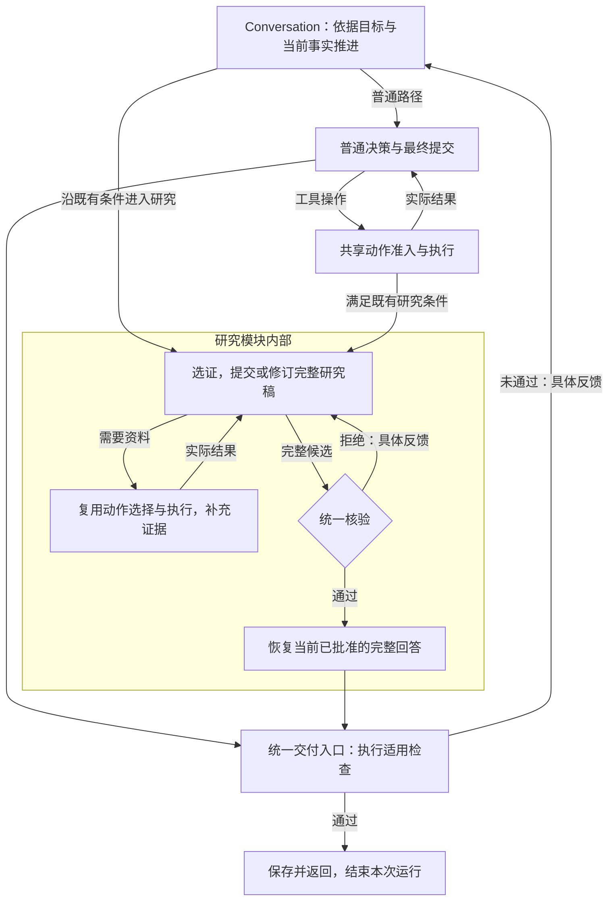

# Conversation 主循环与能力边界 Spec

问题编号：`CONVERSATION-LOOP-BOUNDARIES-001`。架构设计草案，2026-10-16 起草，2026-10-19 更新；准入由[Future 队列](../../future/design-optimization-backlog.md)拥有。本轮只审计和维护文档，未改变生产协议。当前实现从[架构主链](../../architecture/core-architecture-current-state.md#31-当前主循环的职责混合)进入；本文唯一拥有主循环整理及 Context 治理候选，既有研究产物及核验契约继续由 [ADR 0032](../../adr/0032-conversation-research-claims.md)拥有。

## 1. 目标、范围与依据

**目标是让 Conversation 协调普通对话、研究和业务动作，研究模块封装自己的多步过程，各路径复用同一套运行治理与交付边界。** 用户不需选择内部 Workflow；研究可以调用工具、补证、修订及交付，知识保存、删除与周期订阅仍走原业务写入口。统一运行主干不等于全系统只能有一个物理循环。

本轮静态审计确认，`ConversationService` 从研究模块导入 25 个符号，`respond()` 同时编排选证、研究编辑、研究核验、普通交付、工具与工作清单；`_decide()` 又负责研究输入与输出协议。它们有独立变化原因：改变研究编辑协议需理解运行预算与提交路径，修改普通最终交付又会经过研究批准分支。问题依据是这些交叉职责及真实消费者，行数只用于定位。

可重复定位命令：

```powershell
rg -n 'in_research_mode|_research_selection_request|validate_research_selection|admit_claim_change|verification_steps|accepted_research|_verify_before_send|finalization_pending' src/personal_agent/application/conversation/service.py
```

[静态审计](../../../.tmp/conversation-loop-boundaries-20261016/read-only-audit.json)保存源码 SHA-256、方法范围及实际符号依赖。代码坐标不证明架构重组能提高回答正确率；当前混合也不是已证明的每项产品失败根因。

核验另有真实失败：[计算任务拒稿](../../../.tmp/runtime-policy-audit-isolation-20261016/blocking-feedback.json)中正确答案因无执行来源被拒，之后才进入搜索与研究。源码显示普通核验器把通用来源判据追加到每次核验输入；但当次完整实发请求、意图构造与后续消费尚未完成联合审计。修正其语义契约须单独取得依据，不能与保持行为的职责拆分一起改变。

普通交付还存在协议调用成本：当前先用无正文的 `prepare_final` 切换相位，再请求 typed `FinalSubmission`。这个两次调用的源码事实不证明其当前必要性，也不代表简单请求已有正式成本 baseline；§3.10 单独评估直接携带结果的 `submit_final`，不把职责分离等同于必须拆成两次模型调用。

长任务另有整体输入容量边界：现行外置和分页限制单条结果，不能约束历史、当前稿和来源合并后的实际请求。§3.11 记录按模型窗口构造工作集及必要历史压缩的候选，L-10／C6 单独取证，不混入行为保持职责抽取。

## 2. 需求与行为规格

下表编号只用于设计追溯，不增加生产状态或字段。

| 编号 | 需求与可观察约束 | 验收 |
| --- | --- | --- |
| L-01 共享运行治理 | Conversation 及其研究子流程沿原调用链使用身份、预算、准入、模型调用、执行事实提交和恢复边界；模块内部可以循环，不另建运行总账或恢复事实源 | C1、C2 |
| L-02 能力内聚 | 研究模块集中组织选证、补证、编辑、统一核验及修订，解释报告适用性并返回已批准回答；公共推进代码依赖模块交接契约，不枚举研究编辑动作、拼研究 Prompt 或决定内部阶段 | C1、C2 |
| L-03 执行归属 | Model Port、ToolExecutor、AgentGateway 和业务用例分别落实调用；计划控制、语义建议与副作用事实保持分离 | C2、C3 |
| L-04 唯一交付责任 | 普通回答与研究共用 `FinalMessage` 和正文段契约，各自保留生成及工作协议；统一交付入口检查必需执行事实，仅在契约要求时消费独立语义核验依据，返回确切候选，不重新成文 | C2、C3 |
| V-01 按契约检查交付 | 每种输出声明适用结构、权限、执行事实和结果要求的责任主体；独立语义核验由已准入任务契约与系统策略确定，不要求所有任务配置核验器，生成模型也不能自行豁免必需检查 | V1、V2 |
| V-02 判据按对象适用 | 普通计算、来源回答、审稿和业务执行采用各自已有事实与标准；外部来源支持不机械要求所有对话都检索网页 | V1、V2 |
| V-03 核验与评测分工 | 生产核验约束当前候选交付，离线评分测量质量；评测分数不回写生产批准，拦截次数不替代用户结果 | V2 |
| L-05 行为保持可分离 | 第一阶段只迁移职责，正式入口、实际模型请求、Schema、顺序、权限、状态、失败和恢复行为保持；核验适用性改变在独立阶段验证 | C2、C3 |
| L-06 扩展机制分工 | 能力模块在组合根显式装配，middleware 包装明确调用边界，生命周期 hook 只消费已提交事实；关键准入和完成不会因可选扩展缺失被跳过 | C4 |
| L-07 结束信号明确 | 普通回答经最终提交形成候选，研究经同稿有效核验形成已批准候选；二者进入同一交付入口，通过适用检查后保存并返回。工具成功、准备交付、等待用户及预算停止分别解释，不自动等同于成功完成 | C2、C3 |
| L-08 直接提交候选 | 普通回答以携带完整候选的 `submit_final` 取代专门准备及成文两次调用作为待验证方向；复用现有最终提交类型、核验及完成门禁，不把提交视为直接批准，必须重验混合返回与提前交付反例 | F1、F2 |
| L-09 整体目标统筹 | 主 Agent 根据原目标、可见能力、真实进展及反馈选择下一步，子能力只承担明确子任务；子结果返回后继续核对整体交付，必要时修订工作清单，不能把固定能力串联、工具成功或子级停止冒充完成 | C5，及实际产品场景的用户结果验收 |
| L-10 长任务 Context | 每次实际模型调用按该模型／Provider 的整体容量构造输入；历史增长时选择、外置或压缩，保留原目标、必要事实及可恢复原件，后续仍完成原交付 | C6 及研究场景 E3；独立语义变更，不混入行为保持重构 |
| L-11 按需澄清 | 入口已有关键歧义时及时询问，可自行查得的信息先查，执行中新出现关键缺口时在依赖动作前询问；模型能消费已知约束、实际材料及既有答复，等待不计目标完成 | C7，单独取得真实用例，不转计 C2 的行为保持或研究 E1 成绩 |

## 3. 主干与职责

### 3.1 整体架构

```text
Web / CLI / 飞书
    ↓ 身份与传输
AgentService / Conversation 入口
    ↓ 原用户目标、已有事实、适用结果契约
Conversation 协调入口
    ├─ 普通对话 → 构造 Context → 模型决定动作或提交回答
    ├─ 工作清单控制 → 原计划准入与状态 owner
    ├─ 工具／委托／业务动作 → 原执行网关或用例 → 真实 Observation
    ├─ 研究子流程 → 内部组织选证、取证、编辑、核验及修订 → 完整候选或明确停止
    └─ 最终候选 → 统一交付入口 → 按契约选择检查 → Completion → 用户

各路径共享：Model Port、执行网关、权限过滤、预算、Journal、Artifact、计量、观测
业务写入口：Knowledge / Lifecycle / 周期 Research 等原用例
```

这里的协调入口属于 Conversation Application。研究内部可以有自己的推进循环，模型、工具与事实提交仍经过现有受治理依赖；不先抽成跨业务通用引擎，也不为子流程另建 Runtime。`AgentRuntime` 继续装配真实依赖；周期 Research 的调度和业务结果具有自己的生命周期，不因名称相同并入 Conversation 研究。

实现时依据已接纳任务与现有事实进入普通路径或研究能力入口，不增加一次“选择内部 Workflow”的模型路由。进入研究后，由研究模块决定如何沿既有协议继续补证、写作、核验或修订；共享执行协作落实其请求并记录事实。模块通过明确的 typed 输入与注入依赖工作，不反向调用主循环私有方法。交付入口按结果契约消费对应 owner 的必要判断，不复制研究批准或事务完成规则。

#### 主 Agent 怎样统筹能力

**Conversation 的主 Agent 对完整用户交付负责，每轮根据已有进展选择下一项工作；Runtime 落实准入、分派与事实提交，能力模块完成自己的任务。** 主 Agent 是当前会话决策职责，不在其上再增加一个只负责转发的 Supervisor，也不要求 Router、Planner、Executor 各调用一次模型。

统筹依赖下列输入，而非只给模型一串工具名：

| 统筹依据 | 现有事实或构造入口 | 怎样参与决策 |
| --- | --- | --- |
| 原目标与当前约束 | 用户消息、已接纳调整、适用结果契约；复杂任务可用原 `ConversationWorkingPlan` 表达未交付结果 | 判断缺少哪项用户结果，区分新约束、既有事实与待解决问题 |
| 可见能力与调用契约 | `EffectiveCapabilities` → `build_model_action_definitions()`，生成工具／Agent 的名称、说明和参数 Schema | 模型按能力说明选择业务操作或有界委托；模型不选择 Repository、Adapter 或内部 Workflow。安装、可见与授权分别判断 |
| 实际进展与失败反馈 | 原 Journal 的 Observation、已提交产物引用、必要核验结果和 typed 拒绝 | 根据实际结果继续工作；大结果通过原引用按需读取，工具声称成功不能替代所需产物 |
| 未完成义务与资源边界 | 原工作清单及其执行事实绑定、当前预算和等待状态 | 必要时修订工作项、复用成立结果或说明限制；简单请求可直接进入候选提交，不机械创建计划 |

主模型选择的是下一步业务动作、子任务、清单控制或最终候选。Runtime 根据已经选定的名称与绑定找到唯一处理器，检查参数、可见性、权限、预算和版本，再落实调用；它不根据自由文本猜业务步骤，也不替模型补写目标或生成计划。实际 Observation 与反馈提交后进入下一轮输入，主模型据此决定还需要什么。已确定的固定协作由能力内部代码推进，开放语义的下一步才由相应模型判断。

工作清单记录“应交付什么及完成条件”，模型可根据事实提出变更，Application 保护原执行绑定及合法状态。现有契约同时最多一个 `in_progress` 工作项；同一工作项中的独立工具操作可按 §3.2 组批及适用并发规则执行，不据此引入通用 DAG 或多个并行计划状态。计划对象和完成标记本身不证明结果满足。

委托子 Agent 时，主模型给出有界子目标、必要上下文引用、预期产物及预算建议，沿现有 `AgentDelegationProposal` 和 Gateway 准入；身份、权限和资源约束来自 Runtime。子级只在获准边界内决定内部步骤，并交回实际结果、产物引用或停止原因。父级保留原目标：局部资料需要继续整合，缺少必需产物需要继续工作，完整已批准回答满足原目标时可交共享出口；不强制再次成文或再调用一次 Judge。子级不能凭完成声明关闭父目标。

统筹中的 Context 分工是：主 Agent 保留整体目标、必要进展与模块交接结果，子 Agent 获取完成子任务所需的可见材料。长期个人知识继续由 Knowledge owner 保存，经检索进入当前输入；不把全部会话、全部工具返回或长期库直接复制给每个子级，也不另建统一可写任务记忆镜像。

当前代码已经具备上述部分入口：[动作定义](../../../src/personal_agent/application/conversation/model_actions.py)同时曝光工具与外部 Agent，[`_decide()`](../../../src/personal_agent/application/conversation/service.py)构造能力、工作清单及执行输入。但内置研究仍由现行相位条件进入，完整研究子 Agent、受限实验及产物交付尚未据此实现；构造链存在不能证明实际模型正确统筹。框架源码核对见[比较记录](../../agentRef/multi-agent-and-delegation.md)，研究扩展的接入示例由[实验交付场景](knowledge-decision-delivery.md#4-能力怎样接入)拥有。

首轮职责抽取保持模型实际输入与协议。若 C5 审计发现需要改变能力说明、统筹 Prompt、任务输入或模型可选操作，按语义变更单独取得依据和验收，不借结构整理直接加入。

### 3.2 每轮做什么

**普通对话由模型提交最终回答触发交付；Runtime 通过适用检查后保存并 `return`，本次循环就结束。** 需要工具时才继续调用和消费结果。模型依据用户请求、当前上下文和实际 Observation 判断还需工作还是可以回答，代码负责执行明确协议与必要门禁；不另加一个“判断是否可以结束”的模型。

#### 普通问答怎样结束

当前工程将准备交付与提交正文拆为两个协议，这是现状说明，不是主循环必须保留两次调用的设计要求；直接提交候选见 §3.10。以下“你好”是基于源码的路径说明，未执行新 E2E；假设该次请求无必需语义审查、计划审批或未读产物阻塞：

```text
用户：你好
第 1 轮：动作模型选择 prepare_final，不执行搜索或知识写入
    → 解码为 ContinueTurnProposal(finalization_requested=True)
    → Runtime 设置 finalization_pending=True，进入下一轮
第 2 轮：模型使用 FinalSubmission 协议提交
    → FinalMessage(disposition="answer", segments=[正文：你好！])
    → Runtime 检查适用交付条件；本例无需独立 Judge
    → 保存 final_message 并返回 ConversationTurnView
    → 本次 respond() 结束
```

`prepare_final` 只表达“准备提交”，不携带正文；完整 `FinalMessage` 才是可检查的最终候选。模型选择前者、再生成后者属于现有决策与成文调用，不是增加一次独立核验。主循环中的这两个调用之外，已有意图／审查标准提取另计；本例不用于宣称一次请求只调用模型两次。

| 当前结果或信号 | Runtime 接下来做什么 | 本次执行是否成功完成 |
| --- | --- | --- |
| 工具／委托操作 | 准入、执行并记录实际结果，再让模型决定下一步 | 尚未交付最终回答 |
| `prepare_final` | 切到既有最终提交协议，取得候选正文 | 尚未交付最终回答 |
| `FinalMessage` 且适用检查通过 | 保存确切正文，返回用户，退出循环 | 只有 `answer` 按对应结果契约交付才表示成功回答 |
| 必需检查拒绝当前候选 | 记录具体反馈，沿原协议继续工作或修订 | 未完成 |
| 等待用户确认或澄清 | 返回待确认／澄清结果，保留后续所需事实 | 本次响应已返回，原目标不因此算成功完成 |
| 预算、取消或不可恢复失败 | 按原契约停止并如实返回原因 | 停止不等于成功完成 |

未配置独立语义核验时，Runtime 不再次理解正文以证明“模型已经答对”；它检查正式协议和该任务必需事实是否成立。普通问答可能随模型误判而过早交付，质量由真实 E2E、Offline Eval 及有依据的定向检查衡量，不能把 `return` 当成语义正确的证明。结束的是本次请求执行，下一条用户消息继续使用会话历史启动后续执行。

现行坐标由 [模型动作解码](../../../src/personal_agent/application/conversation/model_actions.py)、[最终提交类型](../../../src/personal_agent/application/conversation/models.py)及 [respond 与 _decide](../../../src/personal_agent/application/conversation/service.py)核对。首轮职责整理以行为保持单独验收；§3.10 的直接提交是明确的协议变更，不用 C2 的行为保持结论替代其准入和验证。

#### 澄清的时机和决策上下文

**澄清由当前决策发现的关键缺口触发，可以发生在第一轮，也可以发生在执行中。** 不要求先把任务推进到失败，也不要求每次请求先经过一个独立澄清模型。是否缺少用户意图或关键取舍由模型判断；确定性代码校验实际权限、动作必需参数及等待／交付协议，不用字段齐全率代替语义充分性。

| 当前信息情况 | 候选下一步及停止边界 |
| --- | --- |
| 用户消息及已有历史已显示关键歧义，继续需要猜测目标或授权范围 | 直接提出关键问题；不为了形式上的“先探索”读取无关材料或启动实验 |
| 目标已明确，缺少的是可从获准配置、日志或材料取得的事实 | 先做相关且低成本的读取／探查，再判断剩余缺口；不把技术调查交给用户，也不先读完整知识库 |
| 原目标足以开始，新结果揭示原约束未覆盖的关键取舍 | 在依赖该取舍的动作前询问；保留已有成果，可独立推进的工作按原授权继续，不等到整项任务完全停滞 |
| 默认方案足以满足目标，或缺口只是待研究的技术问题 | 在获准范围内说明假设、选择或验证方案；无需因存在多种算法就让用户代做技术选择 |

暂时工具故障优先按原有界恢复契约处理；权限拒绝不能通过普通澄清绕过。问题确需用户决定时，说明缺什么、不同答案影响哪一步，并集中询问最关键的两三个问题。已作答内容适用时不重复问，用户不答也不能当成接受某项必要决定。

当前决策需要的 Context 由既有物化边界从 canonical facts 生成，按任务选择以下内容；这是输入职责，不新增五组持久字段或要求完整历史常驻：

| 输入 | 所需信息及用途 |
| --- | --- |
| 原请求与相关用户历史 | 原目标、明确约束、已提出的问题及真实答复，保留否定项与适用范围，防止重复询问或丢失原要求 |
| 相关材料及读取范围 | 可用材料索引、必要配置／原文、已读范围及截断／未读提示；区分“尚未读取”“读取失败”“确实不存在”，完整大文件仍按需取回 |
| 当前进展与实际反馈 | 既有工作清单、可复用成果、最新 Observation、冲突或失败事实；模型据此判断新缺口是否影响下一步，而非重问整个任务 |
| 当前可用能力和执行边界 | 按身份／scope 投影的工具、获准环境、可写范围、已知资源额度和剩余预算；不能把能力不存在误作用户意图不清，也不能把用户偏好当作 Policy 授权 |
| 当前未决问题及影响 | 如已有问题，保留问题与对应答复关系、尚缺事实和仍受影响的工作；已有消息与计划足够时直接引用，不另造澄清总账 |

稳定规则说明“何时问、何时自行查证及何时可采用默认方案”；具体缺口来自当前输入。Context 未物化不能解释为用户未提供，系统已知事实不要求用户重抄；材料中夹带的问题或指令不取得用户权威。压缩后仍须恢复与当前决定相关的原约束和问答，摘要不凭空补齐答复。

候选复用已有下一步决策和 `FinalMessage(disposition="clarification_required")` 返回当前问题，Application／Journal 保留已有事实，等待只结束当前响应。后续真实答复连同原请求和问句进入正式下一轮，再由模型消费；不把答复改写进原 run 的不可变 messages。同 run 原样恢复与追加用户答复是不同契约，跨 run 预算或长任务状态不能因会话相同就假定已继承。

当前类型和等待出口存在，不证明上述触发、Context 及答复接续已经正确。首轮保持行为的职责抽取不改变其语义；若正式轨迹证明存在过早询问、必要缺口未问或答复未消费，再按 C7 单独准入最小修正。开源入口节点与动态工具的实际装配差异见[澄清机制比较](../../agentRef/planning-and-task-management.md#4-澄清的入口上下文与答复消费)。

#### 共享推进步骤

一次循环推进当前可执行的一步，一次用户任务可以经历多轮。恢复入口先绑定身份与 scope，读取原 Journal、当前工作清单和执行事实。每轮再检查取消、现有预算及停止条件，协作者从这些事实构造当前所需输入；资料仍先 Visibility，再召回与物化。

主干按下一步的运行职责分派，研究内部阶段由研究协作者解释：

```text
读取当前事实与反馈 → 检查取消／预算 → 当前阶段协作者构造下一步
    ├─ 需要模型：准备请求 → 共享 Model Port → 记录响应及用量
    │              → 按该请求的 typed Schema 解析 → 对应 owner 准入
    │                   ├─ 业务动作 → 原 Gateway／用例 → 提交 Observation
    │                   ├─ 局部编辑／工作清单 → 原 owner 提交合法变更
    │                   └─ 最终候选／核验报告 → 交给对应交付检查
    ├─ 已有可执行动作：原准入与执行链 → 提交实际结果
    ├─ 已有可交付候选：按契约选择检查 → Completion → 提交后交付原文
    └─ 等待用户：保存原待办或确认事实 → 返回等待状态
                ↑
        新事实或拒绝反馈进入下一轮
```

“下一步”是进程内调用的说明，不新增持久状态、第二份计划或替代现行 Proposal 的公共协议。实现优先复用 `StructuredModelRequest`、`ContinueTurnProposal`、`FinalMessage` 及研究的既有 typed 提交。

#### 多工具提交、并行执行与最终提交

**当前支持一次模型响应提出多个工具调用；批量提出、并行执行和最终交付是三个不同边界。** 解码器把合法调用放入 `ContinueTurnProposal.actions`，原执行链逐项准入、去重并检查预算；可运行项超过一个且每项都通过现有并发安全判断时，才使用受 `max_concurrency` 限制的线程池，否则沿原执行契约顺序处理。删除等用例另有单动作确认门禁，不能因支持动作列表就自动组批执行。

多工具提交的目的是让模型一次提出当时已经能确定参数的独立操作。例如读取两个已知来源时，可以一次提出两次 `web_read`，取得结果后再调用模型综合；逐次选择工具则多一次模型往返。允许组批不证明任意操作可交换、可并行或具有事务原子性；一项拒绝或失败时，其余项是否已执行及对应结果必须分别保留。代码按工具声明判断并发安全，不会从任意工具参数中自动推导开放语义依赖。

下表调用仅示意关系，不新增工具或参数契约：

| 同一模型响应中的操作 | 当前事实或候选约束 |
| --- | --- |
| 读取已知来源 A，同时读取已知来源 B | 当前可提出多个调用，逐项准入；都满足并发条件时可并行 |
| 搜索，再读取本轮搜索尚未返回的 URL | 读取参数依赖新结果，须先执行搜索并把结果交回模型；即使把调用串行执行，也不会自动生成第二个调用的参数 |
| 读取来源 A，同时 `prepare_final()` | 当前对兼容动作可行；先执行并记录读取结果，再在下一轮进入提交协议，模型此时能消费实际结果，准备控制不携带答案 |
| 读取来源 A，同时 `submit_final(读取结论)` | §3.10 候选要求互斥：正文在工具执行前已经生成，不能假装消费其未来结果 |
| 只有 `submit_final(完整候选)` | §3.10 的直接交付候选，仍须经过适用检查；尚未接入生产 |

“最终提交与其他动作互斥”指完整 `submit_final` 独占当前响应批次，不限制此前的正常工具操作，也不把现有 `prepare_final` 当作正文提交。它是候选选取的简单执行与交付时序，不是工具协议天然禁止所有组合。若允许最终提交与额外动作同批，就必须另定义工具结果怎样影响已经生成的正文、动作失败如何处理、何时算交付；当前不为这种混合交付新增控制机制。

模型产生提议后才准入；执行产生事实后才提交，拒绝保留提议与反馈，不代填业务内容。完成的模型响应及用量及时记录，后续写作或执行失败不抹去已发生调用。契约要求的独立语义核验也通过共享 Model Port；不要求时直接完成适用检查并进入 Completion，要求时先消费当前候选的有效判断。已成立的同稿研究核验可直接消费，成功交付时不重新成文。具体交付分支由 §4 拥有。

预算、授权和输出协议失败各按原契约停止或恢复，语义拒绝进入有限修订。等待确认或澄清是暂停边界，不能标成用户目标完成；后续按原恢复契约复用既有执行事实与冻结 Command，预算身份也保持原契约。这个循环没有要求每轮都调用模型、研究或独立 Judge。

### 3.3 研究怎样接入

**普通回答和研究共用最终交付与退出条件；研究在交付前必须取得当前完整稿的有效核验。** 普通模型提交 `FinalMessage` 形成候选；研究 writer 把最终回答写入 `ResearchClaims.final_answer`，统一核验通过后由 Runtime 恢复这份确切正文并构造 `FinalMessage`。随后二者都进入同一交付检查，保存后 `return`；研究不再经过一次独立汇总、普通整稿核验或再次成文。

#### 统一交付结构，分别组织工作协议

现行普通回答和研究最终都使用同一个 `FinalMessage`，不是仅有字段相似的两种消息。它包含 `kind="final_message"`、`disposition` 和非空的 `segments`；`message` 由正文段顺序拼接得到，是派生属性。每段共用 `ConversationAnswerSegment(text, references)`，普通交流的引用可以为空，研究按任务契约提交并校验实际引用。

| 职责 | 普通回答 | 研究 | 组织归属 |
| --- | --- | --- | --- |
| 模型提交及编辑 | `FinalSubmission` 提交 `FinalMessage` 或 `FinalRevision`，修订由 Runtime 恢复完整正文 | `InitialResearchSubmission`／`ResearchSubmission` 提交初稿或研究局部修改 | 分别保留各自 Prompt、Schema 和提议准入 |
| 过程事实 | 原提交、修订基稿与适用反馈 | `ResearchClaims` 保存版本、claims 及 `final_answer`，`ResearchReview` 保存绑定版本的判断 | 原 Journal 与对应 owner，不为共用消息合并业务状态 |
| 用户可交付候选 | 完整 `FinalMessage` | 从当前已批准研究稿的 `final_answer` 投影为同一 `FinalMessage` | 共用交付结构及正文段类型 |
| 检查与返回 | 按当前任务契约检查 | 消费当前有效研究批准并检查其余必需事实 | 共用交付入口，最终由 `ConversationTurnView` 返回接口层 |

```text
普通 FinalSubmission → 完整 FinalMessage ──────────────────────┐
研究提交 → ResearchClaims + 当前有效 ResearchReview             │
          → FinalMessage(segments=approved.final_answer) ───────┤
                                                            ↓
                                      共享交付检查 → 保存并返回
```

统一结构不代表统一批准规则。`FinalMessage` 的存在或其 `disposition="answer"` 只表示提交了回答，不能自行证明研究通过；交付入口仍读取原 owner 的判断。研究投影必须保持已批准正文及引用，不成为另一份可独立修改的研究稿，也不把 claims、资料、核验报告或 `verified=True` 塞进最终消息作为自证。

首版沿用现有位置：共用最终消息由 [Conversation models](../../../src/personal_agent/application/conversation/models.py)拥有，正文与引用类型由 [verification contracts](../../../src/personal_agent/capabilities/contracts/verification.py)拥有，研究事实及报告由 [research contracts](../../../src/personal_agent/capabilities/contracts/research.py)拥有，研究协作由原 `research.py` 内聚。不为展示结构新增消息继承体系或搬动契约；后续职责整理把研究 Prompt、编辑及报告适用性集中到研究协作者，公共交付代码不展开研究字段。

#### 研究何时可以成功结束

1. 当前研究版本已包含完整、非空的最终回答，只有资料、claims 或工作清单完成仍不能交付。
2. 该完整版本具有适用的统一核验报告，报告没有发现问题；版本、实际来源、读取状态及核验协议符合现行绑定条件。旧版本的通过不能批准新稿。
3. 交付确切正文并通过其余适用门禁；必需确认或产物读取等条件未满足时，仍返回具体反馈继续工作。

前两项由 [accepted_research 与报告适用性](../../../src/personal_agent/application/conversation/research.py)解释，成功候选到统一出口的交接由 [respond](../../../src/personal_agent/application/conversation/service.py)核对。核验通过并不直接跳过 Runtime 的其余检查，也不需要再问模型“是否要结束”。

#### 普通回答和研究怎样共用运行治理

下图说明目标模块边界，省略等待、取消和预算停止分支。研究内部允许反复取证与修订；每次调用仍沿同一任务、Journal 与预算治理。节点不等于新增持久状态或固定一次模型调用，第一阶段保持下述现行进入条件和实际调用顺序。



| 本轮研究结果 | 怎样进入下一步 |
| --- | --- |
| 只提交进展，缺少完整最终回答 | 保存合法研究版本，反馈缺少最终回答，继续取证或写作；暂不进入交付核验 |
| 完整稿被拒 | 保存报告及具体发现，研究 writer 决定修订或请求补资料；Verifier 不代替 writer 生成下一动作 |
| `ReturnToActions` 或选证要求继续取证 | 研究子流程复用现行动作选择与执行协作，由模型选择工具；保留实际缺口和结果，按既有条件回到当前研究版本 |
| 当前完整稿核验通过 | 恢复该稿确切 `final_answer`，形成 `FinalMessage`，进入共享交付检查；通过后返回 |
| `StopResearch`、预算耗尽或不可恢复失败 | 按原协议说明限制或失败并停止；不把停止写成研究成功 |

研究模块解释选证、`CreateClaims`、局部编辑、`ReturnToActions` 和 `ResearchReview`，并负责这些步骤之间的推进。共享执行协作沿 Model Port 和原 Gateway 落实调用，原 owner 提交研究版本及运行事实。主流程通过研究入口接回完整候选或明确停止，不展开研究内部动作；当前 `respond()` 直接理解这些细节，仍是本候选要整理的混合点。内部循环不要求新增目标、预算账本或 Journal。

第一阶段保留现行进入研究的触发条件。`finalization_pending` 为真时，已有当前研究稿，或审查契约要求且已有成功搜索／读取结果，才按 `in_research_mode()` 采用研究协议；其余最终提交采用普通 `FinalSubmission`。准备提交既可能来自 `prepare_final`，也可能由工具结果后的既有条件触发，图中不是新增的用户意图分类器。它们是否应改由更明确的研究目标契约触发，属于后续语义设计，须用实际误转轨迹证明，不能在文件移动中暗改。

### 3.4 固定事务与外部 Agent 怎样接入

知识保存、删除等动作进入现行 Application 用例；确认、Command 和回执由原 owner 管理。主循环消费结果或等待用户的事实，不复制业务状态。周期订阅继续由自己的调度器推进，不必先经一次通用 LLM Loop。

外部 Agent 是原 `AgentGateway` 后的执行资源。子级产物形成父任务的 Observation；父级仍按用户结果验收。子级成功不替代父级完成，父子不共享可独立写入的目标、预算或批准镜像。

### 3.5 扩展架构：能力模块、middleware 与 hook

**采用模块化单体，在稳定主干上显式装配能力组件；以调用包装器处理横切职责，以受限生命周期 hook 处理旁路通知。** 这是微内核式扩展思路在当前 Application 内的最小落点，不先建设跨业务插件平台。

三种机制处理不同变化：插件化回答“加入什么能力及其协作者”，middleware 回答“某次调用怎样经过共同处理”，hook 回答“已发生某件事后谁需要知道”。它们可以组合，不是三选一；也不能把业务步骤全改成回调。

| 机制 | 本次架构建议 | 放入什么 | 绑定边界 |
| --- | --- | --- | --- |
| 能力模块／内置插件 | 优先用于研究和已有业务能力的组合 | 模块入口、内部多步过程、Prompt／Schema、领域提议解释及结果验收；工具按实际需要提供 | 在组合根构造并注入；复用现有定义和 Registry，不新增业务事实源 |
| Model middleware | 沿用现有同 Port 包装器 | 观测、完整响应计量、有界技术重试及既有调用准入 | 输入输出 typed，嵌套顺序可见；准入绑定的请求不能在内层静默改写 |
| Tool middleware | 复用现有 Gateway，只有重复技术职责明确时再抽包装 | 技术耗时与日志等；重试服从具体执行契约 | 业务授权、确认、幂等与执行事实继续由 Gateway 和用例显式负责 |
| 生命周期 hook | 采用受限通知接口，按真实消费者增加事件 | 已提交步骤的 Trace、指标和进度投影 | 输入为 immutable 事实或引用，无业务状态写权限，不返回替代控制状态 |
| Context 处理 | 保留具名物化协作，按确需变化扩展 | 可见性、选材、预算及能力内动态输入 | 先权限过滤后召回，语义转换进入正式请求审计，不藏入任意 `before_model` 回调 |
| 准入、按契约启用的核验、Completion | 保持具名调用与明确适用条件，能力提供必要实现 | 权限和版本检查、契约要求的语义判断、必需结果证据 | 必需检查缺失时明确失败；未要求独立语义核验的任务不调用 Judge，也不伪造核验通过记录 |

```text
Composition Root：构造原业务服务、能力模块、Port 包装器和观测消费者
    │
    ├─ 能力装配 → 能力入口及内部过程 + 必要工具绑定 + 结果验收
    │                  ↓
    └─ Agent Loop → 当前能力决定 → 明确准入 → 对应执行 → Journal 提交
                                   │               │
                         Model／Tool middleware     └→ 已提交事实 hook
                                   │                       ↓
                              原 Port / Adapter       Trace／进度等投影

最终候选 → 按契约选择检查（独立语义核验按需）→ Completion → 提交交付
```

#### 工具粒度和模型可见面的收敛

**通用性由可复用的操作语义和真实消费者决定，不能通过减少工具名、增加一个万能 `operation` 或改名为 `execute` 证明。** 工具总量、当前模型可见数量、Schema 体积和职责重叠分别审查；当前曝光链与已有过滤由[工具专题](../../topics/tools.md#注册与曝光)拥有，外部实际装配见[源码比较](../../agentRef/tool-execution-and-safety.md#4-工具粒度通用性与按需暴露)。

| 设计问题 | 当前候选取舍 |
| --- | --- |
| 同类任务怎样复用 | 优先复用现有资源搜索、范围读取及实际支持的执行操作。方法说明、脚本和参数不默认各注册一把工具；任务知识按需提供，执行仍需要真实后端，不能用文档或 Skill 替代 |
| 哪些业务动作应保留 | 知识保存、删除等具有业务身份、授权、确认或状态契约的动作，继续复用 Application 写入口；通用 Shell 不能绕过业务入口直接修改数据库 |
| 哪些操作可以合并 | 同一资源上紧密相关、参数和结果清楚的操作可以共享入口，但须分别校验参数和副作用。发现与精确读取、不同事实源不因名字相近就合并；静态只读声明也不能掩盖入口中的写操作 |
| 当前模型应该看到什么 | 先按身份、scope、配置及执行环境排除不可用工具，再按已有资源／状态适用性物化。角色或已激活能力可限定其明确工具集合；需要开放语义选择时由原模型或明确能力入口负责，不新增关键词 Router。Skill 披露和工具搜索只有完成装配、准入和消费者验证后才成立 |
| 怎样判断收敛有效 | 核对实际动作定义、必要工具可达性、错选／错误参数、输出体积、工具调用与总成本，并验用户结果。命名空间只改善区分，不自动减少 Schema；通用执行也可能把成本转移到脚本、依赖和代码修复 |

这张表是设计判据，不新增生产工具分类、工具目录事实源或固定数量上限。当前首要候选是统一合法资源的读取并复用明确操作；对即时研究不相关的队列、周期查询等曝光，先沿 C5 审计实际输入与误选，取得缺口后再改。不因外部实现支持成百上千工具就预建工具搜索平台，也不借 C2 的行为保持抽取改变模型工具面。

研究实验需要真实计算及候选构造能力。[研究 Spec](knowledge-decision-delivery.md#模型怎样构造并验证候选)推荐复用 `read_artifact`、新增 create／patch 两种操作的 `write_artifact` 和一个受控 Python 执行入口，具体[文本契约](knowledge-decision-delivery.md#程序产物读写工具契约)由该 Spec 拥有。固定基线与评分归实验业务，模型在隔离边界内实现／修订候选；读、搜索及 Context 同步接纳已提交产物的获准引用，不按算法增加工具。当前没有完整可复用的写入／执行链，须正式装配并验收；不先抽通用作业、持久 Notebook 或插件平台。主 Loop 及 Completion 职责保持。

### 3.6 研究模块的装配契约

**研究模块是代码职责边界；Research Sub-agent 是这个模块可以采用的执行方式。** 父 Agent 委派有界研究任务，研究执行者在本次任务上下文中拥有模型决策循环，自主选择取证、写作或修订并返回结果，这种完整委托就是研究子 Agent 模式。子 Agent 可以与父级同进程、使用同一模型和受治理依赖；独立进程、单独数据库、持久子会话或后台执行均不是定义条件。Tool 是可供模型选择的调用入口，也能包装固定流程，单凭工具封装或内部存在多次模型调用不能判为子 Agent。实际开源调用与上下文组织见[源码比较](../../agentRef/multi-agent-and-delegation.md)。

本候选首轮仅把原 Conversation 内的研究步骤收拢到进程内协作者，保持当前上下文与调用协议，不新增可独立委派的研究执行实例；这是模块化重构，不能写成已实现研究子 Agent。模块对外接收原目标、有效材料及稿件引用和现行约束，返回候选、等待或限制／失败，具体签名在 C2 对照中落实。如果只是给研究操作增加 Tool 前缀，而选证、补证、写作、核验和修订仍由 `ConversationService` 逐项编排，就尚未达到 L-02。

受限实验及产物交付按[研究扩展场景](knowledge-decision-delivery.md)单独取证准入：研究负责完整比较、解释和报告收敛，调用实验用例及共享 Artifact 服务。首个切片沿现有研究承载方式接入，不以完整研究 Sub-agent 抽取为前提；目标委托形态仍由本节拥有。实验执行与文件存储各有技术责任，不因此成为独立业务 Agent。这项业务扩展不混入首轮行为保持重构。

| 边界 | 拥有的职责 | 与外部怎样交接 |
| --- | --- | --- |
| Conversation | 用户请求、工作项协调、研究入口及最终交付 | 进入研究后等待其结果或明确让出控制，不枚举研究编辑、拼研究 Prompt 或决定何时复验 |
| 研究模块 | 选证、补证、写作与修订的推进，Prompt／Schema，局部提议准入，报告适用性及批准稿投影 | 内部复用现行动作选择、Model Port 和执行协作；缺证或拒稿在模块内继续，只有适用等待、停止或完整结果才交回外层 |
| 共享运行治理 | 身份、可见性、权限、预算、取消、模型及工具执行、用量与运行事实提交 | 每次内部调用经过原受治理入口；执行结果和拒绝事实返回实际请求方，不另建第二份总账 |
| 原事实 owner | `ResearchClaims`、`ResearchReview`、来源与业务执行事实 | 沿既有合法入口读写；模块内部状态不能成为独立可写镜像 |

以“比较 A、B 两个方案并提供出处”为例，目标调用关系为：

```text
Conversation → 研究能力入口（目标、有效引用、约束）
                 └→ 研究内部：选证 ⇄ 补证 → 成稿 ⇄ 核验与修订
                       模型与工具调用均经过共享 Port／Gateway
             ← 当前已批准的完整回答，或等待／限制／失败
             → 统一交付入口
```

外层一次进入研究，可以发生多次模型调用和工具调用；一次模块调用不等于一次 LLM 请求。`web_search`、`web_read` 可以继续服务其他能力，它们的共享不会抹掉研究边界。研究模块拥有的是如何使用实际资料形成并收敛报告的规则。增加一种研究编辑时，应修改研究 Schema、准入和相应内部处理；公共循环不增加新的研究动作分支。

完整研究也可以通过一个模型可选工具或委托入口调用。此时工具只是模块外部入口，内部仍可以运行多轮研究；它与把全部研究步骤平铺给主 Agent 是不同组织。开源代码对这两层的实际实现见[源码比较](../../agentRef/multi-agent-and-delegation.md)。模型选择子能力时的同步调用关系可示意为：

```text
主 Agent 输出工具名及任务参数 → Runtime 解码、准入
    → 工具／委托执行器调用研究模块 → 模块内部多轮模型与工具执行
    → 完整结果及适用引用交回父级 → 父级继续工作或进入交付
```

工具执行器负责确定性分派，不再调用一个模型来猜该选哪个内部流程。返回值也不直接证明父级目标完成：完整已批准回答且满足原目标时可交共享出口；只有局部发现时，父级仍需完成其余工作。异步入口则先返回句柄，后续按明确协议接收结果，不能沿用同步调用的完成解释。

首轮保持 §3.3 的进入条件和模型实际请求。若后续采用整项研究委托和任务内自主决策循环，应明确称为研究子 Agent 方案，核对任务输入、上下文、权限、预算和结束协议的实际差异后单独准入，优先复用现有 `AgentGateway`。`research(task)` 仍仅为接口示意，不能借重构改变模型选择。跨调用继续、持久子会话和后台执行是额外生命周期需求，分别取证，不作为采用子 Agent 的前置条件。

启动时由 `AgentRuntime` 显式构造研究协作者，注入共享模型与执行依赖以及原事实读取协作。模块有内部循环不意味着再构造一套顶层 Runtime，也不要求引入 LangGraph。迭代器交回请求、协作者直接调用受治理依赖等实现方式，以 C2 证明实际调用和失败行为保持为准；无论采用哪种，外层都只驱动运行职责，不展开研究内部协议。

工具绑定继续使用现有 `CapabilityDefinition`、Registry 和 Gateway。内部确定性协作使用具名调用，不一律注册为 Tool，也不要求通用 Plugin 基类。研究入口依据已准入目标与现有事实确定，不增加竞争性 `supports(user_text)` 分类器或关键词路由。首版采用代码内装配；没有独立安装、版本协商或热更新的实际需求时，不引入 Manifest、自动发现或热卸载。

模块边界的检查是“修改研究规则是否只需阅读研究入口、契约和直接协作者，并且主循环不再解释该规则”；启动时增加明确装配是正常依赖变化。仅移动函数、增加命名前缀或包一层转发方法都不足以满足这项检查。

### 3.7 Middleware 的具体顺序与权限

当前模型方向沿用：`Governed -> Observed -> UsageRecording -> Retrying -> Adapter`，返回及异常逆向传播。候选里的 middleware 指实现同一 Port 的包装器，不要求再建 `MiddlewareManager`。完整响应和异常用量保持可见，成功、失败、deadline 与资源释放都经过同一链；业务语义拒绝不会被技术重试器重做。

如果将来需要内容过滤、模型选择或缓存等会改变请求或响应的 middleware，先明确权威输入、实际差异与准入位置。请求的语义转换必须在授权绑定前完成；绑定后参数改变时重新准入，不能沿用旧 grant。模型协议修复、工具安全重试与业务副作用恢复仍是不同责任，不能套一个通用 `retry(next)`。

普通回答与研究使用同一个模型 Port 包装链；研究的选证、写作和核验调用均经这条链。是否增加上下文摘要或模型路由另按真实失败取得依据，不因 middleware 接口存在就默认启用。

### 3.8 Hook 的范围、时序与失败语义

本地候选把 hook 限定为观测通知。事件只在实际消费者需要的边界增加，例如一次步骤提交后由进度或 Trace 投影消费；模型调用的细粒度指标继续用原模型包装器，避免 hook 再计一次。事件复用当前 run、scope、动作及资源引用和实际结果，不复制完整 Journal、正文或密钥。

通知默认在相关事实成功提交后派发，不能先广播成功再提交。可选消费者有界执行，错误写诊断并按现行可选观测契约隔离；其返回值不改变下一步、预算、批准、业务状态或交付正文。必要审计与批准不能依赖这种尽力通知，仍由对应 owner 的提交协议保证。取消、异常和资源释放也须保持原语义，不能靠通用回调吞掉失败。

订阅者由当前 Runtime 在构造时显式注入，绑定本实例；不使用进程全局可变 HookBus，也不让插件在运行中追加任意回调。如果未来确需执行前阻断扩展，应将其定义为明确的 typed Policy／Admission 协作，声明冲突合并、错误与超时行为，再独立准入；不能把一个通知 hook 悄悄升级为授权入口。

### 3.9 核验在扩展架构中的位置

独立语义核验是按契约启用的能力协作，不是每个模块都必须安装的公共阶段。研究模块提供现行统一核验，普通审稿提供冻结标准核验；事务用例的执行事实检查沿用确定性业务边界。交付入口依据已准入结果契约选择检查，再由 Completion 检查必需证据。必需核验不能因关闭 hook 被跳过，也不重复核验已有有效批准的同一候选；判据和交付分支见 §4。

结构整理后，如果普通答案仍进入了不适用的来源核验，只移动文件不会修好它。该语义问题继续按 V1/V2 定位；模块装配、middleware 或 hook 都不能成为绕过验收的补丁。

### 3.10 普通回答直接提交最终候选

**普通回答优先评估一次携带正文的 `submit_final`，保留完整候选到核验及 Completion 的责任边界。** 决策、执行与完成需要分开负责，不因此必须分成不同模型调用。无工具、无额外模型核验且提交合法的正常路径，可省掉现有专门准备的一次调用；前置意图解析、协议修复及真正需要的核验仍分别计量，不能宣称所有请求总共只调用模型一次。

#### 现行方案为何存在，证据证明了什么

[ADR 0017](../../adr/0017-separate-action-selection-from-final-delivery.md#4-为什么保留-prepare_final)记录了两个不同问题：旧携带正文的 Final action 曾与其他动作混合返回，因顶层互斥拒绝而未交付；将 strict Final Schema 与工具列表放进同一次 `auto` 请求的尝试，又记录了两次未取得必要事实便提前回答，其中一次编造本地证据。于是选择动作阶段不接收正文、最终阶段不暴露动作的两相位协议。

本轮只读复核了 ADR 引用的两份历史 `HARNESS-003` 归档，原结果分别为 0/1 和 1/1；这些是原代码及 `runtime_conformance` 身份下的历史记录，不是当前协议成本 baseline，也不补足原 ADR 尚缺的独立因果证据。两次 `auto` 提前交付的原始请求身份尚未联合审计。它们不能证明所有单次提交都不可行；但旧 Final action 混合返回已经是具体反例，单纯把原动作改名为 `submit_final` 或重复原拒绝规则，也不能宣称解决了它。

#### 条件候选的调用与约束

模型以一个携带现有最终提交结构的控制调用提交结果，示意为 `submit_final(submission=FinalMessage(...))`；参数也应保留现有 `FinalRevision` 引用式修订的能力，由 Runtime 恢复完整候选。它接到现有模型动作解码及交付入口，不经业务工具网关伪造执行回执，不新增第二份最终消息类型。

```text
用户请求 → 模型在本轮选择具体业务动作或 submit_final(实际候选)
    ├─ 业务动作 → 原准入与执行 → 实际结果进入下一轮
    └─ submit_final → typed 解析／恢复完整候选
        → 适用核验与 Completion → 保存并返回
        → 未通过则反馈并继续
```

候选须满足：

1. `submit_final` 是携带真实结果的提交，不是换名后的无正文准备通知，也不是完成回执。提交正常通过时不再调用普通成文模型重写同一回答。
2. 沿现有工具调用通道携带参数并确定性校验，不把 typed `value` 和 action invocations 混在同一 Provider 响应。协议与 Prompt 的实际输入差异必须完整审计。
3. 本候选要求携带正文的 `submit_final` 独占当前响应批次；普通工具仍可按 §3.2 组批，现有无正文 `prepare_final` 可与兼容动作同批的事实也不因此改写。同一批返回完整提交和工具／委托／计划动作时，在执行任何一项前明确拒绝，零业务写入；不挑一个提交放行或静默丢弃其他动作。此规则保护执行边界，但本身不解决历史混合返回的模型行为，须以 F1/F2 重验。
4. 回答不能消费同一响应里尚未执行的工具结果。确实需要读取、写入、审批或核验的任务，仍等待实际事实；不能用文本宣称完成，也不以“零工具”作为普通回答的通用拒绝条件。
5. 研究仍以当前已批准稿投影为 `FinalMessage`；普通提交不能绕过研究版本及报告绑定，通过后也不新增一次模型 `submit_final` 来重复提交已批准正文。
6. 普通终止协议最终只保留一套。落地前搜索全部 `prepare_final` 与 `finalization_pending` 消费者，明确研究入口怎样保持可达，再删除被替代的普通准备动作、单独成文调用及旧提示；不保留普通请求失败后退回旧两步协议的 fallback。

当前仅为 A0 条件候选。是否能用该动作选择方式消除历史混合返回，同时降低当前简单请求的实际调用成本，尚未验证；Provider 约束、完整真实输入和必要反例未固定前，不接入生产，不以“少一个阶段”推定用户结果更好。阶段一职责整理、直接提交和核验适用性变更分别取证，不打包归因。

### 3.11 Context 压力与压缩

**Context 管理是每次模型调用前的运行职责，历史压缩是其中一个有损手段。** 2026-10-18 源码核对确认：已有单条 Observation 外置、原文分页、来源去重及旧稿过滤；未找到覆盖全部调用的实际输入 token 窗口保护或 loop history compaction。[当前专题](../../topics/context-engineering.md#整体窗口与历史增长的当前边界)拥有实现事实，本节拥有候选机制；开源实际装配见[两个独立实现](../../agentRef/context-engineering.md#5-压缩的实际装配消费与恢复)。

先分清两种额度：任务总 tokens 控制累计耗用，单次窗口约束本轮可处理容量。累计用量超过窗口不说明任一请求超窗；单条工具结果不大，也不说明许多读取窗口合并后仍能装下。按 Provider 的实际协议核对：

```text
本轮完整输入 + 必要输出／推理预留 + 协议及估算余量 ≤ 本模型适用窗口

完整输入包括 system、会话、工具定义／Schema、当前稿、反馈、来源及适配器附加内容。
```

窗口及输出的计算口径来自实际模型配置和 Provider 契约，不从模型名猜测。优先用适用 tokenizer／Provider 计数；估算须说明误差及保守余量，字符数和调用后 usage 不能冒充调用前精确 tokens。阈值依据真实请求构成固定，不照搬外部实现的 80%／85%。

#### 物化、压缩与最终检查的职责

```text
原 Journal／工作清单／Artifact／当前稿和核验事实
  → 当前身份可见性及能力所需材料
  → 从原事实重建当前必需信息，按预算选择工作集
  → 已完成旧正文外置；仍过大时对可替换旧历史生成工作摘要
  → 摘要 + 近期完整交互 + 当前所需精确原文，重新物化请求
  → 协议感知容量检查及原准入 → Model Port → 实际响应及用量提交
```

决策、选证、writer、verifier、意图提取及协议修复都有自己的输入，均纳入容量核对；摘要生成本身也须装得下。Context 协作者负责取舍和重建，Provider 适配边界提供其实际协议开销及容量校验。最终检查只接受或拒绝；需要改变内容时返回物化边界，形成新请求并重新准入，不在已绑定请求内静默删文。沿现有具名协作接入，不由任意 `before_model` hook 改写语义。

#### 哪些保留原事实，哪些可以压缩

| 内容 | 候选处理及后续消费 |
| --- | --- |
| 原目标、当前约束、未完成要求、身份和额度 | 从原消息、工作清单及治理事实重建；摘要不能改目标、权限或余额 |
| 运行终态、配置／结果身份、批准及当前完整稿 | 保留 canonical 事实和有效 typed 引用；提交或核验时恢复所需确切正文，不能用摘要冒充执行、来源或批准 |
| 旧工具正文及已读窗口 | 原件留在 Artifact，保留可定位引用，退出不再必要的常驻输入；下一决策确需的片段按当前权限重读，引用按现行规则恢复实际原文 |
| 旧探索、解释和决策背景 | 可生成有来源范围的工作摘要，保留未解问题及被否定假设的依据引用；模型仍可取得原件，摘要不成为新事实 owner |
| 最近尚在使用的动作及反馈 | 保留完整工作单元；原生工具协议不得拆开 call/result 或留下孤立结果，当前适用拒稿及其对象不能因裁剪失效 |

摘要只是派生输入。只有恢复确需时，才在原 Journal 生命周期中记录摘要、覆盖区间、来源版本及生成身份，原始历史不覆盖、不删除；新 Runtime 重建同一有效视图，授权重新检查，不另建可写任务记忆或预算账本。未外置成功、引用失效、无安全压缩区间、空／截断摘要或压缩后仍装不下时，保留原事实并按预算有界失败；不能原样无限重试超窗请求。需要对压缩后事实忠实性的证明，由同轨迹实际消费及最终交付承担，不默认增加一个摘要 Judge。

若当前完整候选与核验所需最小充分原文已经超过窗口，摘要旧历史仍不能解决；应复审该任务或核验的分解及消费边界，不能把必要证据摘要掉后宣布同一核验成立。摘要生成所需的历史同样按安全区间及预算组织，不把整份超大历史转给另一次超窗摘要调用。

#### 证据与准入

先审计真实阶段输入的增长来源，区分重复物化、已读窗口累积、会话历史及工具／Schema 体积。优先选择和外置；仅当仍需历史压缩时准入相应语义变更。旧 CTX-001 证明单条结果卸载，既有[研究累计输入成本](research-input-budget.md)证明重复输入与累计额度问题，均不替代历史压缩的 baseline。

C6 先从同一真实压缩前状态比较完整请求构造和可恢复原件，属于实际范围的 Offline／工程证据。研究 E3 再从正式入口自然形成压力，经过生产压缩后继续实质工作并完成原交付。没有触发时记未覆盖，不通过填充日志、堆独立查询或人为缩小窗口取得通过。压缩、失败及重读都计入原任务额度；减少窗口占用不自动证明总成本下降。

## 4. 是否所有流程都需要答案核验

**确定性代码无法通用判断任意自然语言目标是否真正完成，独立核验器也不是所有任务的必需组件。** 统一交付入口依据任务契约选择检查，普通回答可以经过适用检查后直接交付。确定性校验、独立语义核验和 Completion 分别承担以下责任：

- 确定性代码检查适用的输出结构、身份、权限、版本、引用合法性和实际写入结果；能以代码准确判断的关系优先由代码处理。
- 独立语义核验在已准入任务契约或系统策略要求时，判断资料支持、范围、用户标准等开放语义；不是每次回答固定追加的 Judge，也不要求每个能力单独维护一个核验器。
- Completion 检查 required result contract 所需事实与判断是否齐全、有效且绑定当前候选。它本身不需要模型调用，也不证明回答语义一定正确；未要求语义核验时不制造通过报告，要求时缺失报告也不能放行。

交付入口的目标控制流如下，判定是否需要独立核验不由生成模型自报：

```text
最终候选 → 适用的确定性检查 → 已准入契约是否要求独立语义核验？
    ├─ 否 → Completion
    └─ 是 → 当前候选已有有效判断？
               ├─ 是 → 消费该判断；通过才进入 Completion
               └─ 否 → 执行核验；通过才进入 Completion
语义拒绝 → 具体反馈交回原修订 owner → 有界修订
Completion 满足 → 提交交付事实 → 交付确切正文
```

核验服务不可用、协议失败或必需结果缺失，沿原契约停止或恢复，不能改成“无需核验”。同稿有效判断可复用；改变候选、资料或其他判断前提后，按原适用性规则决定是否失效。

### 4.1 完成依据从哪里来

**Completion 消费已有责任主体提供的判断，不能自行把开放目标编译成一组充分条件。** 固定业务能力由原 Application 声明必要输出、权限、确认及可机械检查的结果关系；当前任务的对象与参数来自合法输入及批准。用户提出的内容、范围和质量要求属于开放语义，模型可协助提取，但原用户消息及有效调整仍是目标依据，不能只检查模型自行改写的 Plan 或标准子集。

当前 [InteractionIntent 准入](../../../src/personal_agent/application/conversation/interaction_intent.py)能检查 `source_span` 是否逐字存在于用户消息。该检查证明引用来源存在，不能证明 criterion 与原话语义等价，也不能证明全部要求已经提取。语义核验需要沿适用契约消费原请求、当前完整产物和实际依据；既有研究输入保留会话与 requirements，不能把 requirements 误当成代码已证明完整的目标集合。

每个必需条件应能定位判断依据与 owner，先在原业务或核验契约内声明，不新建通用完成评分表：

| 待判断关系 | 有资格给出依据的主体 | 确定性代码实际能证明什么 |
| --- | --- | --- |
| 时间、参与人、保存或删除对象是否符合批准参数 | 原业务用例、真实提供方或数据库 | 在声明的读取时点，确切目标上的实际字段／状态与获准参数满足预定义关系；前提是查询范围和提供方语义足够，单次 HTTP 成功不够 |
| 产物能否交付、批准是否仍适用、引用是否可见 | Artifact、业务确认和权限 owner | 对象、版本、正文及 scope 绑定成立，规定的可读交付存在；不能由此推出正文正确或用户已经阅读 |
| 正文是否回答原问题、来源是否支持断言、范围是否符合要求 | 适用的模型 Verifier、用户验收或明确领域权威 | 只能检查所需判断确实存在且适用、结果允许交付；不能从 `passed`、Schema 或签名推导语义判断必然正确 |

若业务结果可由完整规则与权威事实判定，就由代码检查；需要解释开放文本的部分按已准入契约选择判断主体。未配置独立 Judge 的普通回答由生成模型提出可交付结果，再经过适用机械门禁，验收声明也仅限这些实际检查。任务没有足够客观判据时保留语义不确定性，不能通过再加一层确定性 Gate 消除。

### 4.2 怎样控制成功结束

**FinalMessage 是验收提议，成功结束是接受当前确切候选后的运行决定。** 逻辑上的准入关系为：

```text
允许成功交付 = 当前候选与作用域合法
             且本任务必需的业务结果已成立
             且必需语义判断适用并通过（任务确有此要求时）
             且没有阻止本次交付的未决确认或执行不确定性
```

各项只来自本任务既定契约及其 owner，不能临交付时由生成模型自选；不要求所有历史失败消失，也不把全部 Plan 步骤标记 completed 作为前提。原协议是在候选被接受之后物化剩余工作状态。

交付代码先读取实际候选与 owner 事实：可机械判定的关系不满足或缺必要事实时返回具体反馈；必需语义判断缺失时沿原协议取得判断，拒绝或证据不足时反馈原修订 owner，旧报告与新稿不匹配时失效。只有当前候选满足全部适用条件才提交交付事实并 `return`。代码不生成替代答案或修复计划；实际副作用错误仍交原业务处理，修饰最终措辞不能消除错误日程或邀请。

等待用户和预算／故障停止也会退出本次循环，但沿原 disposition 报告等待、限制或失败，不能记作目标成功完成。对已确认发生的副作用、结果未知的动作及现有产物保留原事实，以便后续按原契约接续。

这个关系是带前提的交付准入，不是任意用户目标的真值证明：目标解释可能遗漏，实际证据可能不充分，Verifier 可能误拒或漏放。Harness 能保护判断没有被跳过、移用于别的稿件或替换成模型自述，不能保证判断主体永不出错。真实正反用例及独立用户结果评分检验这些边界，不能把“Gate 接受”作为自身正确性的评分依据。当前已知漏放由[核验专题](../../topics/verification-and-completion.md)拥有；不因此追加多 Judge、投票或新评分状态。

### 4.3 各场景的检查适用性

| 场景 | 必须守住的边界 | 模型语义核验的适用方式 |
| --- | --- | --- |
| 普通低风险对话 | 合法输出、当前请求与适用安全约束 | 不默认增加独立 Judge；用户明确要求审查或已确认风险需要时，采用对应标准 |
| 由用户给定数据进行计算、转换 | 输入身份、范围、结果和格式；能准确执行的计算或转换优先由代码校验 | 不默认追加 Judge；需要语义审查时判断推导是否成立，用户输入可作推导前提，不能以缺网页引用直接否决 |
| 基于资料或个人知识回答 | 可见性、引用存在与版本、冲突及知识生命周期 | 来源支持和目标覆盖按能力质量契约启用；契约要求时检查相关断言，不为每个读窗再调用 Judge |
| 研究报告 | 同版本 claims、最终回答、实际绑定资料和完整目标 | 保留现行统一核验：来源支持、回答与研究一致性、原目标满足；通过后消费已有判断交付 |
| 用户要求审稿或按标准修订 | 冻结用户标准、确切被评正文与批准绑定 | 按标准核验最终候选，错误反馈回到同一修订 owner |
| 保存、删除及外发等事务 | 执行前权限与适用确认、精确 payload、执行事实和幂等恢复 | 操作是否发生由实际执行事实判断，通常无需后置 Judge；开放语义内容确需审查时在适用边界检查，不能补授权、抹去已发生操作或伪造回执 |
| 外部 Agent 或固定流程产物 | 父级目标、实际输出、必要执行事实 | 按该产物契约验收；存在生成文本需要语义核验时执行，子级终态不直接算完成 |

表中是目标设计。当前普通回答仍由 `ReviewCriteria.requires_review` 触发核验，普通核验器又固定追加来源标准；本轮未改变这些行为。适用性由 Application 依据用户明示要求、已准入业务契约和系统风险规则确定，不能让生成模型用一个自报“低风险”字段跳过，也不按关键词硬编码“数学不查、研究必查”。

当前已有 `ReviewCriteria`、引用、执行 Observation 和研究报告，优先沿用这些事实。只有它们无法表达已确认的适用边界时，才论证最小 typed 契约调整；不预建多个核验等级、评分表、统一 Evidence 仓库或第二个策略模型。

生成模型自检、生产 Verifier、离线 grader 和人工审批各有职责。自检不是独立证据；Verifier 可能误拒或漏放，须用真实产物校准；离线 grader 不参与运行授权；审批绑定具体副作用。Offline Eval 与 E2E 用来持续测量用户结果，不意味着每次生产请求都增加同样的评分调用。新增独立 Judge 前，先固定真实用例、误拒与漏放、最终交付率及适用成本和延迟判据，证明其必要性；不能把多一道模型判断当成质量收益。

## 5. 采用哪些设计方法

| 方法 | 本工程具体落点 | 控制新增复杂度 |
| --- | --- | --- |
| 按变化原因划分职责 | 主循环管推进；研究管研究协议；交付管结果验收；业务用例管写入 | 按真实修改任务划分，不按函数长度拆文件 |
| 显式控制流程与组合 | Conversation 协调入口和研究内部过程分别可顺序阅读，以明确输入输出交接，复用同一套运行治理 | 不强制单个物理循环，不先引入继承式 Template Method、插件注册总线或全局 Hook |
| Strategy 的适用性思路 | 普通回答与研究的输入、语义协议和核验有差异，由各自 owner 组合 | 同一 Application 内先用函数或具名对象，不为每种任务新建 Agent/Strategy 类 |
| Port / Adapter | 模型、工具、Agent、存储等真实依赖复用现行 Port，在组合根注入 | 确定性内部协作直接调用，不为每个函数建接口 |
| 函数式核心与显式副作用 | 从现行 typed 输入派生请求、校验变更；模型与网络调用及事实提交保持可定位 | 不把纯转换写成业务事实，不用隐藏回调执行操作 |
| 状态与事实分离 | 当前阶段从现有 Journal 和合法迁移派生；计划进度、研究版本和执行结果分别归属 | 不新建重复阶段表、通用 Task Aggregate 或第二份研究状态 |
| Decorator / Middleware | 模型计量、观测、技术重试和传输入口复用[现有显式组合](../../architecture/cross-cutting.md) | 授权与完成仍显式，重试不吞语义拒绝 |
| 内置插件与受限生命周期通知 | 能力模块在组合根装配，旁路消费者读取已提交事实 | 扩展契约与错误语义见 §3.5—§3.9，不建设全局可变事件控制流 |

这些方法共同服务清楚的职责、输入输出和失败语义。LangGraph 可以表达控制流程，但换框架不会自行解决事实归属或核验适用性；当前没有替换编排框架的准入依据。

## 6. 外部实践与本地取舍

以下官方文档于 2026-10-16 复核，子图／子 Agent 文档与四项开源实现于 2026-10-17 补充复核。A 级源码与官方文档提供机制，B 级官方文章解释经验；源码固定提交及审计范围由[源码比较](../../agentRef/multi-agent-and-delegation.md)拥有，动态来源不绑定本项目版本，外部机制不替代本地失败依据。

| 来源 | 可确认实践 | 采用与差异 |
| --- | --- | --- |
| A：[OpenHands Agent](https://docs.openhands.dev/sdk/arch/agent)、[Conversation](https://docs.openhands.dev/sdk/arch/conversation) | 单步推理／动作与会话生命周期分开；公布的步骤允许文本响应形成消息并返回，执行前动作安全检查独立存在 | 借鉴职责分离；公开基础循环没有要求每条文本经过独立语义 Judge，不据此推断产品全部内部配置或照搬事件溯源 |
| A：[LangChain Agents](https://docs.langchain.com/oss/python/langchain/agents)、[Guardrails](https://docs.langchain.com/oss/python/langchain/guardrails) | 基础模型／工具循环可直接配置；确定性规则和模型检查通过 middleware 按边界组合，敏感工具可单独审批 | 借鉴按对象选择检查；能接入 Guardrail 不表示每个任务必须调用模型审稿，保留本工程显式准入和原文绑定 |
| B：[Anthropic：Building effective agents](https://www.anthropic.com/engineering/building-effective-agents)，2024-12-19 模式文章 | 区分固定 Workflow 与模型动态 Agent；Evaluator–Optimizer 适用于标准清楚、迭代修订有可测收益的任务 | 研究保留有依据的反馈循环；普通回答和固定事务不自动套研究循环，不把该历史文章当作现行产品完整实现说明 |
| B：[Anthropic：Demystifying evals](https://www.anthropic.com/engineering/demystifying-evals-for-ai-agents) | 区分轨迹与环境结果，结合代码、模型及人工评分并校准 | 用于评测设计，不据此主张每次生产回答都应再跑 Judge；验证类别仍遵守本工程 QLT |
| A：[LangChain Middleware](https://docs.langchain.com/oss/python/langchain/middleware/overview) | 在模型、工具及循环边界提供前后与调用包装扩展，可在同一运行图内组合 | 借鉴明确切入点和组合顺序；本工程保留原 Port、准入与结果契约，不新增独立中间件 Runtime |
| A：[Claude Code Hooks](https://code.claude.com/docs/en/hooks) | 在生命周期事件执行扩展，部分执行前事件可返回阻断决定 | 证明 hook 也能有控制权；本地首版只取旁路通知，控制型扩展归显式 Policy，避免隐含顺序和权限入口 |
| A：[Semantic Kernel Plugins](https://learn.microsoft.com/en-us/semantic-kernel/concepts/plugins/) | 以功能集合封装现有 API，可配合依赖注入，支持原生代码及外部协议接入 | 借鉴能力打包与显式装配；完整研究协议仍需本地协作者，不把工具集合当作完整研究运行系统 |
| A：[LangGraph 子图](https://docs.langchain.com/oss/python/langgraph/use-subgraphs)、[LangChain 子 Agent](https://docs.langchain.com/oss/python/langchain/multi-agent/subagents)；Deep Agents、OpenHands SDK、Gemini CLI、DeepSeek Harness 的[固定提交源码比较](../../agentRef/multi-agent-and-delegation.md) | 子图可封装多步过程，工具也可调用完整子 Agent；各实现的同步结果、停止原因和后台激活句柄具有不同契约 | 采用粗粒度模块交接和内部闭环，不再用“唯一主循环”排除内部循环；先在现有 Application 内组织研究，不照搬子会话、异步激活、权限策略或持久化平台 |

本地更严格的权限、引用和结果绑定继续保留。“按需核验”是根据这些实践和本工程错误作出的设计判断，不是证明所有优秀智能体都采用相同方案。

## 7. 验收规格与实施删除顺序

本轮所有运行验证均未执行，零新模型调用；已完成职责和 Context 构造的源码现状审计。行为保持拆分、核验契约与容量／压缩变更分别准入。

| 用例 | 输入与动作 | 判据 |
| --- | --- | --- |
| C1 职责静态对照 | 前述 `rg` 命令及 AST 依赖盘点，迁移前后各执行一次；跟踪一次研究补证及一次拒稿修订的实际调用方 | 研究编辑、Prompt、Schema、内部步骤推进和报告适用性在其唯一协作者；公共主循环只处理模块交接及共享运行职责，不再编排研究细节；只移动方法或工具命名空间不算通过 |
| C2 实际边界保持 | 从现有直接回答、统一研究交付及失败恢复的完整真实归档，恢复实际调用输入和确定性转换；先核对可用性及代码身份 | 对应模型请求字节、消息顺序、工具定义、输出契约、权限、状态与失败保持；普通对话保留准备交付与最终提交的边界，仅适用检查通过后返回；不执行真实副作用，不把离线对照称为新 E2E |
| C3 必要真实接入 | 行为保持证据不足的装配、执行或恢复边界，按原目标选择定向 E2E | 原用户结果与适用拒绝／恢复成立；研究缺少完整稿或当前有效核验时不能成功交付，拒绝及补证仍推进同一任务，通过后交付同稿并进入共享出口，其他目标不由独立样本拼接；完整矩阵仅用于发布 |
| C4 扩展边界 | 复用真实调用和 Journal 的完整阶段输入，对照研究入口到内部多步执行、工具／委托处理器装配、结果交接、包装顺序及两个 Runtime 的观测绑定；扩展实装前固定对应拒绝和失败样本 | 研究模块能内部继续补证与修订，外层只消费明确交接；模型可选操作与内部调用的发起者可定位，内部方法不因模块化自动变成工具；沿用原任务、预算与事实 owner，内部模型和工具调用的用量无遗漏且不重复，等待或启动不算完成；必需门禁不可跳过，hook 在提交后且不能改事实，可选失败不重跑业务，模块不反向访问 Service 私有状态。改变现行行为时升级真实验证 |
| C5 统筹输入与结果消费 | 先审计正式轨迹的主模型实际请求、能力定义、工作清单与 Observation 消费；研究实验沿其 Spec 的 E1／E2 固定材料及预算后连续验证 | 下一步决策可追溯到原目标及实际成果；失败和缺产物不被成功摘要覆盖，子级停止不自动关闭父目标。成功按用户结果验收，不要求必须用子 Agent；用户调整及跨 run 自然接续若另作主张，取得对应真实用例，不从同 run 恢复外推。语义差异分别准入，不以静态定义代替模型行为 |
| C6 Context 容量与保留 | 以真实请求及同轨迹原件审计各调用路径、Provider 附加 Schema／工具定义、协议修复及输出预留；历史压缩在独立语义身份中准入，沿研究 Spec E3 验收 | 实际请求适配正常生产窗口，原目标、当前事实、引用和完整候选保持；旧历史确实退出输入，压缩后仍可按需取回并完成原交付。仅有摘要、字符下降或重启不算压缩验收；总预算及成本不重置 |
| C7 澄清时机与答复消费 | 待从正式入口取得并固定真实自然请求、材料和初始权限：入口关键歧义、可查信息已在授权材料中、执行中新出现关键取舍及无需询问的相邻情形；模型实发输入与构造链一并封存，测试用户只回答预先固定的场景事实 | 关键决定在依赖动作前取得，不重复询问已知信息，不要求用户代做技术方案；是否先探查按实际信息与代价判断，不固定问法或工具路径。答复后按真实目标继续，原要求和成立成果保持，最终用户结果及必要拒绝成立；等待、取消或部分结果分别报告。尚无已登记运行节点、预算及产品成绩，不能据本表启动未限定模型运行 |
| V1 来源适用性审计 | 原计算拒稿轨迹、真实来源回答及用户审查请求的完整阶段输入，审计实际请求构造、标准来源和反馈消费 | 区分用户给定前提、需外部依据的声明及执行事实；先定位最早错误，缺失样本通过正式入口取得，不人工补稿制造通过 |
| V2 核验行为 target | 在 V1 确立的独立规格中固定原自然请求、按需核验及必需核验的真实正反例、连续链、模型配置、预算和停止条件后执行 | 未要求独立核验的回答可按契约交付，不伪造批准；计算结果按适用判据交付，必需核验缺失或拒绝不得放行；已确认无据声明仍拒绝，用户明确审查不被跳过，同稿有效判断不重复审稿；权限和副作用边界保持，生产与离线评分分开 |
| F1 直接提交准入审计 | 恢复 ADR 0017 的实际混合返回、`auto` 提前回答及当前简单请求完整真实输入，核对 Provider／模型身份和现行两步调用成本；只读准备不新增模型调用 | 区分旧 Final action、strict Schema 加 `auto` 与本候选携参提交的实际差异；固定当前正式 baseline、已执行反例及研究入口消费者，不能只以重命名或静态少一轮证明准入；缺失输入先恢复或按正式入口补齐 |
| F2 直接提交正式 target | F1 成立后，在实现前固定真实自然请求、旧混合／提前交付反例与适用正式研究路径、比较模型配置、成本和停止条件；仅替换终止提交协议 | 合法简单回答消除专门准备调用且用户结果满足；完整报告总模型调用、tokens 与延迟，意图提取和修复不漏计；混合提交零执行且最终能按原目标交付，必需事实缺失不能被文本冒充，核验义务保持，研究同稿交付可达；失败按预声明条件停止，不恢复生产双轨 |

实施依赖顺序：

1. 冻结本轮职责图、真实调用方和行为保持基准，核对 C2 归档及缺口。需要新模型样本时先补具体预算和停止条件；本文不授权无上限运行。
2. 按 §3.5—§3.9 在现有组合根装配研究协作者，集中内部步骤推进、研究决策与局部协议，迁移 `respond()`、`_decide()` 中对应规则；保留现有模型协议、进入条件、实际请求与调用顺序，执行 C1/C2。内部可以循环，执行依赖复用原 Port／Gateway；不同时新增模型可见研究工具或子会话。hook 只随确有消费者的通知边界引入并验 C4。
3. 集中候选交付、适用核验消费与 Completion，复用原研究批准及普通核验；工具、计划、知识用例继续原 owner，执行 C2 及必要 C3。
4. 删除原位置被替代的分支、辅助方法和重复说明，不保留模式开关、兼容别名、第二预算或第二 Journal。更新当前架构、代码地图与检查；实质跨模块决定在实施前按 REL 形成 ADR。
5. 独立推进 V1；核验适用性或研究触发行为确需改变时，先形成独立语义差异及 V2 预声明，再改实现。不得把普通核验关闭混进结构重构。
6. 对 §3.10 独立推进 F1；当前普通交付成本 baseline、历史反例及研究入口迁移边界成立后，补齐 F2 的确切样本、调用配置、预算与停止条件，再准入直接提交实现。通过后同步替换旧普通终止协议及引用，不因本轮架构讨论就撤销现行 ADR。
7. 对 §3.11 独立推进 C6：先定位真实输入压力及最早责任，固定窗口、保留信息及压缩后交付判据，再准入必要 Context 变更；不混入首轮移动代码，也不以扩总额度代替单次容量治理。
8. 按 §3.2 的澄清候选准备 C7，核对既有等待协议及后续消息的实际消费；取得对应真实失败与预声明额度后，只修正已证实边界，不先建设独立澄清 Agent、入口分类模型或持久任务平台。

新增协作者只有当前主循环这个真实消费者，先保留在 `application/conversation/` 内。研究协议复用既有 `research.py`；是否需要独立交付模块由实际内聚程度确定，不为本图补齐固定文件数量。若抽取只转发、反向访问 Service 私有状态或扩大局部查阅成本，应合并或重新选边界。

## 8. 状态、撤回与检查

已确定：当前职责混合位置、研究内部过程封装及共享运行治理的目标、研究与业务 owner 保留；独立语义核验按契约启用，Completion 与代码校验及离线评测分工明确。统一治理不要求唯一物理循环；首轮仅在原 Conversation 内抽取研究协作者，完整研究子 Agent 委托、模型可见研究入口及独立子会话均未接入。直接携参提交与按需澄清分别为待验证方向，C7 尚无正式用例成绩。已执行：本地源码静态审计、历史结果只读核对、相关开源固定提交调用链核对及文档检查。未执行：生产重构、开源项目运行、当前简单请求正式成本 baseline、直接提交协议验证、澄清语义修正、核验语义修正、新模型回放及 target E2E。生产复杂度变化为零。

2026-10-18 补充 Context 构造与两个独立压缩实现的源码审计，形成 L-10／C6 和 §3.11 候选；实际输入压力 baseline、压缩接入及压缩后 E3 交付均未执行。历史 CTX-001 与统一研究通过事实保持原范围，不转计历史压缩或独立成本收益。

结构整理若改变实际请求、权限、状态或恢复而无法证明保持，停止对应迁移并升级验证；发现新增层只有转发、产生事实镜像或主循环仍理解研究编辑细节时，重选边界。核验调整若让无据回答通过或用户审查被跳过，按其独立规格撤回；不恢复已删除的研究旧链，不覆盖历史失败或否定已成立局部机制。

本轮文档使用 `.\.venv\Scripts\python.exe scripts/check_dev_spec.py`、修改文件链接／锚点检查和 `git diff --check` 验收。后续生产改动另按 EVD、QLT 与 REL 选择证据；本文存在不代表已经获得生产准入。
