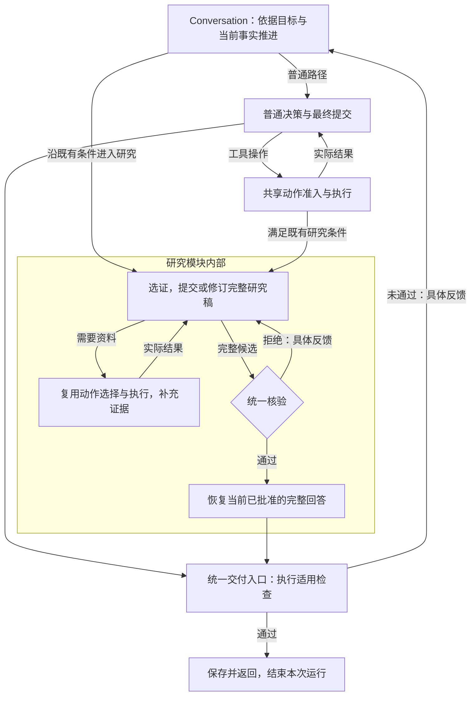

# Conversation 主循环与能力边界 Spec

问题编号：`CONVERSATION-LOOP-BOUNDARIES-001`。架构设计草案，2026-10-16 起草，2026-10-24 更新；准入由[Future 队列](../../future/design-optimization-backlog.md)拥有。主体整理仍为设计候选；研究必需容量边界、§3.12 拒绝事实反馈及 §3.15 原生动作对象载荷已进入最小实现，完整验收未完成。当前实现从[架构主链](../../architecture/core-architecture-current-state.md#31-当前主循环的职责混合)进入；本文唯一拥有主循环整理及 Context 治理候选，既有研究产物及核验契约继续由 [ADR 0032](../../adr/0032-conversation-research-claims.md)拥有。

2026-10-24 的 Schema 统一重设由[独立唯一正文](conversation-loop-schema.md)拥有，源码已替换，真实生成与完整 E2E 待验收。本文涉及两步提交、旧阶段和模型类型的段落说明改前实现；不作为当前 wire 契约，当前传输统一见 [ADR 0045](../../adr/0045-native-intent-loop-and-recorded-model-output.md)及 [Runtime](../../topics/runtime.md)。

## 1. 目标、范围与依据

**目标是让 Conversation 协调普通对话、研究和业务动作，研究模块封装自己的多步过程，各路径复用同一套运行治理与交付边界。** 用户不需选择内部 Workflow；研究可以调用工具、补证、修订及交付，知识保存、删除与周期订阅仍走原业务写入口。统一运行主干不等于全系统只能有一个物理循环。

本轮静态审计确认，`ConversationService` 从研究模块导入 25 个符号，`respond()` 同时编排选证、研究编辑、研究核验、普通交付、工具与工作清单；`_decide()` 又负责研究输入与输出协议。它们有独立变化原因：改变研究编辑协议需理解运行预算与提交路径，修改普通最终交付又会经过研究批准分支。问题依据是这些交叉职责及真实消费者，行数只用于定位。

可重复定位命令：

```powershell
rg -n 'in_research_mode|_research_selection_request|validate_research_selection|admit_claim_change|verification_steps|accepted_research|_verify_before_send|finalization_pending' src/personal_agent/application/conversation/service.py
```

[静态审计](../../../.tmp/conversation-loop-boundaries-20261016/read-only-audit.json)保存源码 SHA-256、方法范围及实际符号依赖。代码坐标不证明架构重组能提高回答正确率；当前混合也不是已证明的每项产品失败根因。

核验另有真实失败：[计算任务拒稿](../../../.tmp/runtime-policy-audit-isolation-20261016/blocking-feedback.json)中正确答案因无执行来源被拒，之后才进入搜索与研究。源码显示普通核验器把通用来源判据追加到每次核验输入；但当次完整实发请求、意图构造与后续消费尚未完成联合审计。修正其语义契约须单独取得依据，不能与保持行为的职责拆分一起改变。

普通交付还存在协议调用成本：当前先用无正文的 `prepare_final` 切换相位，再请求 typed `FinalSubmission`。这个两次调用的源码事实不证明其当前必要性，也不代表简单请求已有正式成本 baseline；该问题经 §3.10 纳入整个 Loop 的统一设计，不把职责分离等同于必须拆成两次模型调用。

长任务另有整体输入容量边界：现行外置和分页限制单条结果，不能约束历史、当前稿和来源合并后的实际请求。§3.11 记录按模型窗口构造工作集及必要历史压缩的候选，L-10／C6 单独取证，不混入行为保持职责抽取。

## 2. 需求与行为规格

下表编号只用于设计追溯，不增加生产状态或字段。

| 编号 | 需求与可观察约束 | 验收 |
| --- | --- | --- |
| L-01 共享运行治理 | Conversation 及其研究子流程沿原调用链使用身份、预算、准入、模型调用、执行事实提交和恢复边界；模块内部可以循环，不另建运行总账或恢复事实源 | C1、C2 |
| L-02 能力内聚 | 研究模块集中组织选证、补证、编辑、统一核验及修订，解释报告适用性并返回已批准回答；公共推进代码依赖模块交接契约，不枚举研究编辑动作、拼研究 Prompt 或决定内部阶段 | C1、C2 |
| L-03 执行归属 | Model Port、ToolExecutor、AgentGateway 和业务用例分别落实调用；计划控制、语义建议与副作用事实保持分离 | C2、C3 |
| L-04 唯一交付责任 | 普通回答与研究共用 `FinalMessage` 和正文段契约，各自保留生成及工作协议；统一交付入口检查必需执行事实，仅在契约要求时消费独立语义核验依据，返回确切候选，不重新成文 | C2、C3 |
| V-01 按契约检查交付 | 每种输出声明适用结构、权限、执行事实和结果要求的责任主体；独立语义核验由已准入任务契约与系统策略确定，不要求所有任务配置核验器，生成模型也不能自行豁免必需检查 | V1、V2 |
| V-02 判据按对象适用 | 普通计算、来源回答、审稿和业务执行采用各自已有事实与标准；外部来源支持不机械要求所有对话都检索网页 | V1、V2 |
| V-03 核验与评测分工 | 生产核验约束当前候选交付，离线评分测量质量；评测分数不回写生产批准，拦截次数不替代用户结果 | V2 |
| L-05 行为保持可分离 | 第一阶段只迁移职责，正式入口、实际模型请求、Schema、顺序、权限、状态、失败和恢复行为保持；核验适用性改变在独立阶段验证 | C2、C3 |
| L-06 扩展机制分工 | 能力模块在组合根显式装配，middleware 包装明确调用边界，生命周期 hook 只消费已提交事实；关键准入和完成不会因可选扩展缺失被跳过 | C4 |
| L-07 结束信号明确 | 普通回答经最终提交形成候选，研究经同稿有效核验形成已批准候选；二者进入同一交付入口，通过适用检查后保存并返回。工具成功、准备交付、等待用户及预算停止分别解释，不自动等同于成功完成 | C2、C3 |
| L-08 直接提交候选 | 普通回答通过原生 `submit_final` 提交实际正文，删除准备及另一次普通成文；内部 FinalMessage、核验及完成边界保持，wire 契约与反例由[统一设计](conversation-loop-schema.md)拥有 | F1、F2 |
| L-09 整体目标统筹 | 主 Agent 根据原目标、可见能力、真实进展及反馈选择下一步，子能力只承担明确子任务；子结果返回后继续核对整体交付，必要时修订工作清单，不能把固定能力串联、工具成功或子级停止冒充完成 | C5，及实际产品场景的用户结果验收 |
| L-10 长任务 Context | 每次实际模型调用按该模型／Provider 的整体容量构造输入；历史增长时选择、外置或按真实压力反复压缩，保留原目标、必要事实及可恢复原件，后续仍完成原交付；压缩不重置任务额度 | C6 及研究场景 E3；独立语义变更，不混入行为保持重构 |
| L-11 按需澄清 | 入口已有关键歧义时及时询问，可自行查得的信息先查，执行中新出现关键缺口时在依赖动作前询问；模型能消费已知约束、实际材料及既有答复，等待不计目标完成 | C7，单独取得真实用例，不转计 C2 的行为保持或研究 E1 成绩 |

## 3. 主干与职责

### 3.1 整体架构

```text
Web / CLI / 飞书
    ↓ 身份与传输
AgentService / Conversation 入口
    ↓ 原用户目标、已有事实、适用结果契约
Conversation 协调入口
    ├─ 普通对话 → 构造 Context → 模型决定动作或提交回答
    ├─ 工作清单控制 → 原计划准入与状态 owner
    ├─ 工具／委托／业务动作 → 原执行网关或用例 → 真实 Observation
    ├─ 研究子流程 → 内部组织选证、取证、编辑、核验及修订 → 完整候选或明确停止
    └─ 最终候选 → 统一交付入口 → 按契约选择检查 → Completion → 用户

各路径共享：Model Port、执行网关、权限过滤、预算、Journal、Artifact、计量、观测
业务写入口：Knowledge / Lifecycle / 周期 Research 等原用例
```

这里的协调入口属于 Conversation Application。研究内部可以有自己的推进循环，模型、工具与事实提交仍经过现有受治理依赖；不先抽成跨业务通用引擎，也不为子流程另建 Runtime。`AgentRuntime` 继续装配真实依赖；周期 Research 的调度和业务结果具有自己的生命周期，不因名称相同并入 Conversation 研究。

实现时依据已接纳任务与现有事实进入普通路径或研究能力入口，不增加一次“选择内部 Workflow”的模型路由。进入研究后，由研究模块决定如何沿既有协议继续补证、写作、核验或修订；共享执行协作落实其请求并记录事实。模块通过明确的 typed 输入与注入依赖工作，不反向调用主循环私有方法。交付入口按结果契约消费对应 owner 的必要判断，不复制研究批准或事务完成规则。

#### 主 Agent 怎样统筹能力

**Conversation 的主 Agent 对完整用户交付负责，每轮根据已有进展选择下一项工作；Runtime 落实准入、分派与事实提交，能力模块完成自己的任务。** 主 Agent 是当前会话决策职责，不在其上再增加一个只负责转发的 Supervisor，也不要求 Router、Planner、Executor 各调用一次模型。

统筹依赖下列输入，而非只给模型一串工具名：

| 统筹依据 | 现有事实或构造入口 | 怎样参与决策 |
| --- | --- | --- |
| 原目标与当前约束 | 用户消息、已接纳调整、适用结果契约；复杂任务可用原 `ConversationWorkingPlan` 表达未交付结果 | 判断缺少哪项用户结果，区分新约束、既有事实与待解决问题 |
| 可见能力与调用契约 | `EffectiveCapabilities` → `build_model_action_definitions()`，生成工具／Agent 的名称、说明和参数 Schema | 模型按能力说明选择业务操作或有界委托；模型不选择 Repository、Adapter 或内部 Workflow。安装、可见与授权分别判断 |
| 实际进展与失败反馈 | 原 Journal 的 Observation、已提交产物引用、必要核验结果和 typed 拒绝 | 根据实际结果继续工作；大结果通过原引用按需读取，工具声称成功不能替代所需产物 |
| 未完成义务与资源边界 | 原工作清单及其执行事实绑定、当前预算和等待状态 | 必要时修订工作项、复用成立结果或说明限制；简单请求可直接进入候选提交，不机械创建计划 |

主模型选择的是下一步业务动作、子任务、清单控制或最终候选。Runtime 根据已经选定的名称与绑定找到唯一处理器，检查参数、可见性、权限、预算和版本，再落实调用；它不根据自由文本猜业务步骤，也不替模型补写目标或生成计划。实际 Observation 与反馈提交后进入下一轮输入，主模型据此决定还需要什么。已确定的固定协作由能力内部代码推进，开放语义的下一步才由相应模型判断。

工作清单记录“应交付什么及完成条件”，模型可根据事实提出变更，Application 保护原执行绑定及合法状态。现有契约同时最多一个 `in_progress` 工作项；同一工作项中的独立工具操作可按 §3.2 组批及适用并发规则执行，不据此引入通用 DAG 或多个并行计划状态。计划对象和完成标记本身不证明结果满足。

委托子 Agent 时，主模型给出有界子目标、必要上下文引用、预期产物及预算建议，沿现有 `AgentDelegationProposal` 和 Gateway 准入；身份、权限和资源约束来自 Runtime。子级只在获准边界内决定内部步骤，并交回实际结果、产物引用或停止原因。父级保留原目标：局部资料需要继续整合，缺少必需产物需要继续工作，完整已批准回答满足原目标时可交共享出口；不强制再次成文或再调用一次 Judge。子级不能凭完成声明关闭父目标。

统筹中的 Context 分工是：主 Agent 保留整体目标、必要进展与模块交接结果，子 Agent 获取完成子任务所需的可见材料。长期个人知识继续由 Knowledge owner 保存，经检索进入当前输入；不把全部会话、全部工具返回或长期库直接复制给每个子级，也不另建统一可写任务记忆镜像。

当前代码已经具备上述部分入口：[动作定义](../../../src/personal_agent/application/conversation/model_actions.py)同时曝光工具与外部 Agent，[`_decide()`](../../../src/personal_agent/application/conversation/service.py)构造能力、工作清单及执行输入。但内置研究仍由现行相位条件进入，完整研究子 Agent、受限实验及产物交付尚未据此实现；构造链存在不能证明实际模型正确统筹。框架源码核对见[比较记录](../../agentRef/multi-agent-and-delegation.md)，研究扩展的接入示例由[实验交付场景](knowledge-decision-delivery.md#4-能力怎样接入)拥有。

首轮职责抽取保持模型实际输入与协议。若 C5 审计发现需要改变能力说明、统筹 Prompt、任务输入或模型可选操作，按语义变更单独取得依据和验收，不借结构整理直接加入。

### 3.2 每轮做什么

**普通对话由模型提交最终回答触发交付；Runtime 通过适用检查后保存并 `return`，本次循环就结束。** 需要工具时才继续调用和消费结果。模型依据用户请求、当前上下文和实际 Observation 判断还需工作还是可以回答，代码负责执行明确协议与必要门禁；不另加一个“判断是否可以结束”的模型。

LongDS 首轮正式基线发现，局部 Artifact 正文会被旧自动研究条件误当作进入最终成文的信号。按 [ADR 0017](../../adr/0017-separate-action-selection-from-final-delivery.md)恢复模型的 `prepare_final` 责任，工具成功后继续动作相位；实际请求、最小删除及本轮验收由[研究 Spec](verify_results/longds-analysis.md#11-l1-结果与首个因果切片)拥有。研究核验、Final 独占和预算停止不变，不把本次相位修正记为旧语义问题已解决。

#### 普通问答怎样结束

当前工程将准备交付与提交正文拆为两个协议，这是现状说明，不是主循环必须保留两次调用的设计要求；直接提交候选见 §3.10。以下“你好”是基于源码的路径说明，未执行新 E2E；假设该次请求无必需语义审查、计划审批或未读产物阻塞：

```text
用户：你好
第 1 轮：动作模型选择 prepare_final，不执行搜索或知识写入
    → 解码为 ContinueTurnProposal(finalization_requested=True)
    → Runtime 设置 finalization_pending=True，进入下一轮
第 2 轮：模型使用 FinalSubmission 协议提交
    → FinalMessage(disposition="answer", segments=[正文：你好！])
    → Runtime 检查适用交付条件；本例无需独立 Judge
    → 保存 final_message 并返回 ConversationTurnView
    → 本次 respond() 结束
```

`prepare_final` 只表达“准备提交”，不携带正文；完整 `FinalMessage` 才是可检查的最终候选。模型选择前者、再生成后者属于现有决策与成文调用，不是增加一次独立核验。主循环中的这两个调用之外，已有意图／审查标准提取另计；本例不用于宣称一次请求只调用模型两次。

| 当前结果或信号 | Runtime 接下来做什么 | 本次执行是否成功完成 |
| --- | --- | --- |
| 工具／委托操作 | 准入、执行并记录实际结果，再让模型决定下一步 | 尚未交付最终回答 |
| `prepare_final` | 切到既有最终提交协议，取得候选正文 | 尚未交付最终回答 |
| `FinalMessage` 且适用检查通过 | 保存确切正文，返回用户，退出循环 | 只有 `answer` 按对应结果契约交付才表示成功回答 |
| 必需检查拒绝当前候选 | 记录具体反馈，沿原协议继续工作或修订 | 未完成 |
| 等待用户确认或澄清 | 返回待确认／澄清结果，保留后续所需事实 | 本次响应已返回，原目标不因此算成功完成 |
| 预算、取消或不可恢复失败 | 按原契约停止并如实返回原因 | 停止不等于成功完成 |

未配置独立语义核验时，Runtime 不再次理解正文以证明“模型已经答对”；它检查正式协议和该任务必需事实是否成立。普通问答可能随模型误判而过早交付，质量由真实 E2E、Offline Eval 及有依据的定向检查衡量，不能把 `return` 当成语义正确的证明。结束的是本次请求执行，下一条用户消息继续使用会话历史启动后续执行。

现行坐标由 [模型动作解码](../../../src/personal_agent/application/conversation/model_actions.py)、[最终提交类型](../../../src/personal_agent/application/conversation/models.py)及 [respond 与 _decide](../../../src/personal_agent/application/conversation/service.py)核对。首轮职责整理以行为保持单独验收；§3.10 的直接提交是明确的协议变更，不用 C2 的行为保持结论替代其准入和验证。

#### 澄清的时机和决策上下文

**澄清由当前决策发现的关键缺口触发，可以发生在第一轮，也可以发生在执行中。** 不要求先把任务推进到失败，也不要求每次请求先经过一个独立澄清模型。是否缺少用户意图或关键取舍由模型判断；确定性代码校验实际权限、动作必需参数及等待／交付协议，不用字段齐全率代替语义充分性。

| 当前信息情况 | 候选下一步及停止边界 |
| --- | --- |
| 用户消息及已有历史已显示关键歧义，继续需要猜测目标或授权范围 | 直接提出关键问题；不为了形式上的“先探索”读取无关材料或启动实验 |
| 目标已明确，缺少的是可从获准配置、日志或材料取得的事实 | 先做相关且低成本的读取／探查，再判断剩余缺口；不把技术调查交给用户，也不先读完整知识库 |
| 原目标足以开始，新结果揭示原约束未覆盖的关键取舍 | 在依赖该取舍的动作前询问；保留已有成果，可独立推进的工作按原授权继续，不等到整项任务完全停滞 |
| 默认方案足以满足目标，或缺口只是待研究的技术问题 | 在获准范围内说明假设、选择或验证方案；无需因存在多种算法就让用户代做技术选择 |

暂时工具故障优先按原有界恢复契约处理；权限拒绝不能通过普通澄清绕过。问题确需用户决定时，说明缺什么、不同答案影响哪一步，并集中询问最关键的两三个问题。已作答内容适用时不重复问，用户不答也不能当成接受某项必要决定。

当前决策需要的 Context 由既有物化边界从 canonical facts 生成，按任务选择以下内容；这是输入职责，不新增五组持久字段或要求完整历史常驻：

| 输入 | 所需信息及用途 |
| --- | --- |
| 原请求与相关用户历史 | 原目标、明确约束、已提出的问题及真实答复，保留否定项与适用范围，防止重复询问或丢失原要求 |
| 相关材料及读取范围 | 可用材料索引、必要配置／原文、已读范围及截断／未读提示；区分“尚未读取”“读取失败”“确实不存在”，完整大文件仍按需取回 |
| 当前进展与实际反馈 | 既有工作清单、可复用成果、最新 Observation、冲突或失败事实；模型据此判断新缺口是否影响下一步，而非重问整个任务 |
| 当前可用能力和执行边界 | 按身份／scope 投影的工具、获准环境、可写范围、已知资源额度和剩余预算；不能把能力不存在误作用户意图不清，也不能把用户偏好当作 Policy 授权 |
| 当前未决问题及影响 | 如已有问题，保留问题与对应答复关系、尚缺事实和仍受影响的工作；已有消息与计划足够时直接引用，不另造澄清总账 |

稳定规则说明“何时问、何时自行查证及何时可采用默认方案”；具体缺口来自当前输入。Context 未物化不能解释为用户未提供，系统已知事实不要求用户重抄；材料中夹带的问题或指令不取得用户权威。压缩后仍须恢复与当前决定相关的原约束和问答，摘要不凭空补齐答复。

候选复用已有下一步决策和 `FinalMessage(disposition="clarification_required")` 返回当前问题，Application／Journal 保留已有事实，等待只结束当前响应。后续真实答复连同原请求和问句进入正式下一轮，再由模型消费；不把答复改写进原 run 的不可变 messages。同 run 原样恢复与追加用户答复是不同契约，跨 run 预算或长任务状态不能因会话相同就假定已继承。

当前类型和等待出口存在，不证明上述触发、Context 及答复接续已经正确。首轮保持行为的职责抽取不改变其语义；若正式轨迹证明存在过早询问、必要缺口未问或答复未消费，再按 C7 单独准入最小修正。开源入口节点与动态工具的实际装配差异见[澄清机制比较](../../agentRef/planning-and-task-management.md#4-澄清的入口上下文与答复消费)。

#### 共享推进步骤

一次循环推进当前可执行的一步，一次用户任务可以经历多轮。恢复入口先绑定身份与 scope，读取原 Journal、当前工作清单和执行事实。每轮再检查取消、现有预算及停止条件，协作者从这些事实构造当前所需输入；资料仍先 Visibility，再召回与物化。

主干按下一步的运行职责分派，研究内部阶段由研究协作者解释：

```text
读取当前事实与反馈 → 检查取消／预算 → 当前阶段协作者构造下一步
    ├─ 需要模型：准备请求 → 共享 Model Port → 记录响应及用量
    │              → 按该请求的 typed Schema 解析 → 对应 owner 准入
    │                   ├─ 业务动作 → 原 Gateway／用例 → 提交 Observation
    │                   ├─ 局部编辑／工作清单 → 原 owner 提交合法变更
    │                   └─ 最终候选／核验报告 → 交给对应交付检查
    ├─ 已有可执行动作：原准入与执行链 → 提交实际结果
    ├─ 已有可交付候选：按契约选择检查 → Completion → 提交后交付原文
    └─ 等待用户：保存原待办或确认事实 → 返回等待状态
                ↑
        新事实或拒绝反馈进入下一轮
```

“下一步”是进程内调用的说明，不新增持久状态、第二份计划或替代现行 Proposal 的公共协议。实现优先复用 `StructuredModelRequest`、`ContinueTurnProposal`、`FinalMessage` 及研究的既有 typed 提交。

#### 多工具提交、并行执行与最终提交

**当前支持一次模型响应提出多个工具调用；批量提出、并行执行和最终交付是三个不同边界。** 解码器把合法调用放入 `ContinueTurnProposal.actions`，原执行链逐项准入、去重并检查预算；可运行项超过一个且每项都通过现有并发安全判断时，才使用受 `max_concurrency` 限制的线程池，否则沿原执行契约顺序处理。删除等用例另有单动作确认门禁，不能因支持动作列表就自动组批执行。

多工具提交的目的是让模型一次提出当时已经能确定参数的独立操作。例如读取两个已知来源时，可以一次提出两次 `web_read`，取得结果后再调用模型综合；逐次选择工具则多一次模型往返。允许组批不证明任意操作可交换、可并行或具有事务原子性；一项拒绝或失败时，其余项是否已执行及对应结果必须分别保留。代码按工具声明判断并发安全，不会从任意工具参数中自动推导开放语义依赖。

下表调用仅示意关系，不新增工具或参数契约：

| 同一模型响应中的操作 | 当前事实或候选约束 |
| --- | --- |
| 读取已知来源 A，同时读取已知来源 B | 当前可提出多个调用，逐项准入；都满足并发条件时可并行 |
| 搜索，再读取本轮搜索尚未返回的 URL | 读取参数依赖新结果，须先执行搜索并把结果交回模型；即使把调用串行执行，也不会自动生成第二个调用的参数 |
| 读取来源 A，同时 `prepare_final()` | 当前对兼容动作可行；先执行并记录读取结果，再在下一轮进入提交协议，模型此时能消费实际结果，准备控制不携带答案 |
| 读取来源 A，同时 `submit_final(读取结论)` | §3.10 候选要求互斥：正文在工具执行前已经生成，不能假装消费其未来结果 |
| 只有 `submit_final(完整候选)` | §3.10 的直接交付候选，仍须经过适用检查；尚未接入生产 |

“最终提交与其他动作互斥”指完整 `submit_final` 独占当前响应批次，不限制此前的正常工具操作，也不把现有 `prepare_final` 当作正文提交。它是候选选取的简单执行与交付时序，不是工具协议天然禁止所有组合。若允许最终提交与额外动作同批，就必须另定义工具结果怎样影响已经生成的正文、动作失败如何处理、何时算交付；当前不为这种混合交付新增控制机制。

模型产生提议后才准入；执行产生事实后才提交，拒绝保留提议与反馈，不代填业务内容。完成的模型响应及用量及时记录，后续写作或执行失败不抹去已发生调用。契约要求的独立语义核验也通过共享 Model Port；不要求时直接完成适用检查并进入 Completion，要求时先消费当前候选的有效判断。已成立的同稿研究核验可直接消费，成功交付时不重新成文。具体交付分支由 §4 拥有。

预算、授权和输出协议失败各按原契约停止或恢复，语义拒绝进入有限修订。等待确认或澄清是暂停边界，不能标成用户目标完成；后续按原恢复契约复用既有执行事实与冻结 Command，预算身份也保持原契约。这个循环没有要求每轮都调用模型、研究或独立 Judge。

### 3.3 研究怎样接入

**普通回答和研究共用最终交付与退出条件；研究在交付前必须取得当前完整稿的有效核验。** 普通模型提交 `FinalMessage` 形成候选；研究 writer 把最终回答写入 `ResearchClaims.final_answer`，统一核验通过后由 Runtime 恢复这份确切正文并构造 `FinalMessage`。随后二者都进入同一交付检查，保存后 `return`；研究不再经过一次独立汇总、普通整稿核验或再次成文。

#### 统一交付结构，分别组织工作协议

现行普通回答和研究最终都使用同一个 `FinalMessage`，不是仅有字段相似的两种消息。它包含 `kind="final_message"`、`disposition` 和非空的 `segments`；`message` 由正文段顺序拼接得到，是派生属性。每段共用 `ConversationAnswerSegment(text, references)`，普通交流的引用可以为空，研究按任务契约提交并校验实际引用。

| 职责 | 普通回答 | 研究 | 组织归属 |
| --- | --- | --- | --- |
| 模型提交及编辑 | `FinalSubmission` 提交 `FinalMessage` 或 `FinalRevision`，修订由 Runtime 恢复完整正文 | `InitialResearchSubmission`／`ResearchSubmission` 提交初稿或研究局部修改 | 分别保留各自 Prompt、Schema 和提议准入 |
| 过程事实 | 原提交、修订基稿与适用反馈 | `ResearchClaims` 保存版本、claims 及 `final_answer`，`ResearchReview` 保存绑定版本的判断 | 原 Journal 与对应 owner，不为共用消息合并业务状态 |
| 用户可交付候选 | 完整 `FinalMessage` | 从当前已批准研究稿的 `final_answer` 投影为同一 `FinalMessage` | 共用交付结构及正文段类型 |
| 检查与返回 | 按当前任务契约检查 | 消费当前有效研究批准并检查其余必需事实 | 共用交付入口，最终由 `ConversationTurnView` 返回接口层 |

```text
普通 FinalSubmission → 完整 FinalMessage ──────────────────────┐
研究提交 → ResearchClaims + 当前有效 ResearchReview             │
          → FinalMessage(segments=approved.final_answer) ───────┤
                                                            ↓
                                      共享交付检查 → 保存并返回
```

统一结构不代表统一批准规则。`FinalMessage` 的存在或其 `disposition="answer"` 只表示提交了回答，不能自行证明研究通过；交付入口仍读取原 owner 的判断。研究投影必须保持已批准正文及引用，不成为另一份可独立修改的研究稿，也不把 claims、资料、核验报告或 `verified=True` 塞进最终消息作为自证。

首版沿用现有位置：共用最终消息由 [Conversation models](../../../src/personal_agent/application/conversation/models.py)拥有，正文与引用类型由 [verification contracts](../../../src/personal_agent/capabilities/contracts/verification.py)拥有，研究事实及报告由 [research contracts](../../../src/personal_agent/capabilities/contracts/research.py)拥有，研究协作由原 `research.py` 内聚。不为展示结构新增消息继承体系或搬动契约；后续职责整理把研究 Prompt、编辑及报告适用性集中到研究协作者，公共交付代码不展开研究字段。

#### 研究何时可以成功结束

1. 当前研究版本已包含完整、非空的最终回答，只有资料、claims 或工作清单完成仍不能交付。
2. 该完整版本具有适用的统一核验报告，报告没有发现问题；版本、实际来源、读取状态及核验协议符合现行绑定条件。旧版本的通过不能批准新稿。
3. 交付确切正文并通过其余适用门禁；必需确认或产物读取等条件未满足时，仍返回具体反馈继续工作。

前两项由 [accepted_research 与报告适用性](../../../src/personal_agent/application/conversation/research.py)解释，成功候选到统一出口的交接由 [respond](../../../src/personal_agent/application/conversation/service.py)核对。核验通过并不直接跳过 Runtime 的其余检查，也不需要再问模型“是否要结束”。

#### 普通回答和研究怎样共用运行治理

下图说明目标模块边界，省略等待、取消和预算停止分支。研究内部允许反复取证与修订；每次调用仍沿同一任务、Journal 与预算治理。节点不等于新增持久状态或固定一次模型调用，第一阶段保持下述现行进入条件和实际调用顺序。



| 本轮研究结果 | 怎样进入下一步 |
| --- | --- |
| 只提交进展，缺少完整最终回答 | 保存合法研究版本，反馈缺少最终回答，继续取证或写作；暂不进入交付核验 |
| 完整稿被拒 | 保存报告及具体发现，研究 writer 决定修订或请求补资料；Verifier 不代替 writer 生成下一动作 |
| `ReturnToActions` 或选证要求继续取证 | 研究子流程复用现行动作选择与执行协作，由模型选择工具；保留实际缺口和结果，按既有条件回到当前研究版本 |
| 当前完整稿核验通过 | 恢复该稿确切 `final_answer`，形成 `FinalMessage`，进入共享交付检查；通过后返回 |
| `StopResearch`、预算耗尽或不可恢复失败 | 按原协议说明限制或失败并停止；不把停止写成研究成功 |

研究模块解释选证、`CreateClaims`、局部编辑、`ReturnToActions` 和 `ResearchReview`，并负责这些步骤之间的推进。共享执行协作沿 Model Port 和原 Gateway 落实调用，原 owner 提交研究版本及运行事实。主流程通过研究入口接回完整候选或明确停止，不展开研究内部动作；当前 `respond()` 直接理解这些细节，仍是本候选要整理的混合点。内部循环不要求新增目标、预算账本或 Journal。

普通 Web 研究保留现行进入条件：`finalization_pending` 为真时，已有当前研究稿，或审查契约要求且已有成功搜索／读取结果，才按 `in_research_mode()` 采用研究协议；其余最终提交采用普通 `FinalSubmission`。准备既可能来自 `prepare_final`，也可能由工具结果后的既有条件触发，图中不是新增的用户意图分类器。2026-10-20 的实验接入新增了原 Journal 已绑定部署的分支；真实 E1 暴露每批动作后因历史正文重复进入选证，已在[研究设计 推进、结束与恢复](research-experiment-protocol.md#4-推进结束与恢复)单独准入最小修正：该分支由模型显式准备进入研究，内部修订、同稿批准及恢复发布保持。它是有真实输入依据的行为变更，不能计为本方案的行为保持职责抽取；普通 Web 的进入条件不随之更改。

### 3.4 固定事务与外部 Agent 怎样接入

知识保存、删除等动作进入现行 Application 用例；确认、Command 和回执由原 owner 管理。主循环消费结果或等待用户的事实，不复制业务状态。周期订阅继续由自己的调度器推进，不必先经一次通用 LLM Loop。

外部 Agent 是原 `AgentGateway` 后的执行资源。子级产物形成父任务的 Observation；父级仍按用户结果验收。子级成功不替代父级完成，父子不共享可独立写入的目标、预算或批准镜像。

### 3.5 扩展架构：能力模块、middleware 与 hook

**采用模块化单体，在稳定主干上显式装配能力组件；以调用包装器处理横切职责，以受限生命周期 hook 处理旁路通知。** 这是微内核式扩展思路在当前 Application 内的最小落点，不先建设跨业务插件平台。

三种机制处理不同变化：插件化回答“加入什么能力及其协作者”，middleware 回答“某次调用怎样经过共同处理”，hook 回答“已发生某件事后谁需要知道”。它们可以组合，不是三选一；也不能把业务步骤全改成回调。

| 机制 | 本次架构建议 | 放入什么 | 绑定边界 |
| --- | --- | --- | --- |
| 能力模块／内置插件 | 优先用于研究和已有业务能力的组合 | 模块入口、内部多步过程、Prompt／Schema、领域提议解释及结果验收；工具按实际需要提供 | 在组合根构造并注入；复用现有定义和 Registry，不新增业务事实源 |
| Model middleware | 沿用现有同 Port 包装器 | 观测、完整响应计量、有界技术重试及既有调用准入 | 输入输出 typed，嵌套顺序可见；准入绑定的请求不能在内层静默改写 |
| Tool middleware | 复用现有 Gateway，只有重复技术职责明确时再抽包装 | 技术耗时与日志等；重试服从具体执行契约 | 业务授权、确认、幂等与执行事实继续由 Gateway 和用例显式负责 |
| 生命周期 hook | 采用受限通知接口，按真实消费者增加事件 | 已提交步骤的 Trace、指标和进度投影 | 输入为 immutable 事实或引用，无业务状态写权限，不返回替代控制状态 |
| Context 处理 | 保留具名物化协作，按确需变化扩展 | 可见性、选材、预算及能力内动态输入 | 先权限过滤后召回，语义转换进入正式请求审计，不藏入任意 `before_model` 回调 |
| 准入、按契约启用的核验、Completion | 保持具名调用与明确适用条件，能力提供必要实现 | 权限和版本检查、契约要求的语义判断、必需结果证据 | 必需检查缺失时明确失败；未要求独立语义核验的任务不调用 Judge，也不伪造核验通过记录 |

```text
Composition Root：构造原业务服务、能力模块、Port 包装器和观测消费者
    │
    ├─ 能力装配 → 能力入口及内部过程 + 必要工具绑定 + 结果验收
    │                  ↓
    └─ Agent Loop → 当前能力决定 → 明确准入 → 对应执行 → Journal 提交
                                   │               │
                         Model／Tool middleware     └→ 已提交事实 hook
                                   │                       ↓
                              原 Port / Adapter       Trace／进度等投影

最终候选 → 按契约选择检查（独立语义核验按需）→ Completion → 提交交付
```

#### 工具粒度和模型可见面的收敛

**通用性由可复用的操作语义和真实消费者决定，不能通过减少工具名、增加一个万能 `operation` 或改名为 `execute` 证明。** 工具总量、当前模型可见数量、Schema 体积和职责重叠分别审查；当前曝光链与已有过滤由[工具专题](../../topics/tools.md#注册与曝光)拥有，外部实际装配见[源码比较](../../agentRef/tool-execution-and-safety.md#4-工具粒度通用性与按需暴露)。

| 设计问题 | 当前候选取舍 |
| --- | --- |
| 同类任务怎样复用 | 优先复用现有资源搜索、范围读取及实际支持的执行操作。方法说明、脚本和参数不默认各注册一把工具；任务知识按需提供，执行仍需要真实后端，不能用文档或 Skill 替代 |
| 哪些业务动作应保留 | 知识保存、删除等具有业务身份、授权、确认或状态契约的动作，继续复用 Application 写入口；通用 Shell 不能绕过业务入口直接修改数据库 |
| 哪些操作可以合并 | 同一资源上紧密相关、参数和结果清楚的操作可以共享入口，但须分别校验参数和副作用。发现与精确读取、不同事实源不因名字相近就合并；静态只读声明也不能掩盖入口中的写操作 |
| 当前模型应该看到什么 | 先按身份、scope、配置及执行环境排除不可用工具，再按已有资源／状态适用性物化。角色或已激活能力可限定其明确工具集合；需要开放语义选择时由原模型或明确能力入口负责，不新增关键词 Router。Skill 披露和工具搜索只有完成装配、准入和消费者验证后才成立 |
| 怎样判断收敛有效 | 核对实际动作定义、必要工具可达性、错选／错误参数、输出体积、工具调用与总成本，并验用户结果。命名空间只改善区分，不自动减少 Schema；通用执行也可能把成本转移到脚本、依赖和代码修复 |

这张表是设计判据，不新增生产工具分类、工具目录事实源或固定数量上限。当前首要候选是统一合法资源的读取并复用明确操作；对即时研究不相关的队列、周期查询等曝光，先沿 C5 审计实际输入与误选，取得缺口后再改。不因外部实现支持成百上千工具就预建工具搜索平台，也不借 C2 的行为保持抽取改变模型工具面。

研究实验需要真实计算及候选构造能力。[研究 Spec](research-experiment-protocol.md#22-模型怎样构造并验证候选)推荐复用 `read_artifact`、新增 create／patch 两种操作的 `write_artifact` 和一个受控 Python 执行入口，具体[文本契约](program-artifact-contract.md#1-程序产物读写工具契约)由该 Spec 拥有。固定基线与评分归实验业务，模型在隔离边界内实现／修订候选；读、搜索及 Context 同步接纳已提交产物的获准引用，不按算法增加工具。当前没有完整可复用的写入／执行链，须正式装配并验收；不先抽通用作业、持久 Notebook 或插件平台。主 Loop 及 Completion 职责保持。

### 3.6 研究模块的装配契约

**研究模块是代码职责边界；Research Sub-agent 是这个模块可以采用的执行方式。** 父 Agent 委派有界研究任务，研究执行者在本次任务上下文中拥有模型决策循环，自主选择取证、写作或修订并返回结果，这种完整委托就是研究子 Agent 模式。子 Agent 可以与父级同进程、使用同一模型和受治理依赖；独立进程、单独数据库、持久子会话或后台执行均不是定义条件。Tool 是可供模型选择的调用入口，也能包装固定流程，单凭工具封装或内部存在多次模型调用不能判为子 Agent。实际开源调用与上下文组织见[源码比较](../../agentRef/multi-agent-and-delegation.md)。

本候选首轮仅把原 Conversation 内的研究步骤收拢到进程内协作者，保持当前上下文与调用协议，不新增可独立委派的研究执行实例；这是模块化重构，不能写成已实现研究子 Agent。模块对外接收原目标、有效材料及稿件引用和现行约束，返回候选、等待或限制／失败，具体签名在 C2 对照中落实。如果只是给研究操作增加 Tool 前缀，而选证、补证、写作、核验和修订仍由 `ConversationService` 逐项编排，就尚未达到 L-02。

受限实验及产物交付按[研究扩展场景](knowledge-decision-delivery.md)单独取证准入：研究负责完整比较、解释和报告收敛，调用实验用例及共享 Artifact 服务。首个切片沿现有研究承载方式接入，不以完整研究 Sub-agent 抽取为前提；目标委托形态仍由本节拥有。实验执行与文件存储各有技术责任，不因此成为独立业务 Agent。这项业务扩展不混入首轮行为保持重构。

| 边界 | 拥有的职责 | 与外部怎样交接 |
| --- | --- | --- |
| Conversation | 用户请求、工作项协调、研究入口及最终交付 | 进入研究后等待其结果或明确让出控制，不枚举研究编辑、拼研究 Prompt 或决定何时复验 |
| 研究模块 | 选证、补证、写作与修订的推进，Prompt／Schema，局部提议准入，报告适用性及批准稿投影 | 内部复用现行动作选择、Model Port 和执行协作；缺证或拒稿在模块内继续，只有适用等待、停止或完整结果才交回外层 |
| 共享运行治理 | 身份、可见性、权限、预算、取消、模型及工具执行、用量与运行事实提交 | 每次内部调用经过原受治理入口；执行结果和拒绝事实返回实际请求方，不另建第二份总账 |
| 原事实 owner | `ResearchClaims`、`ResearchReview`、来源与业务执行事实 | 沿既有合法入口读写；模块内部状态不能成为独立可写镜像 |

以“比较 A、B 两个方案并提供出处”为例，目标调用关系为：

```text
Conversation → 研究能力入口（目标、有效引用、约束）
                 └→ 研究内部：选证 ⇄ 补证 → 成稿 ⇄ 核验与修订
                       模型与工具调用均经过共享 Port／Gateway
             ← 当前已批准的完整回答，或等待／限制／失败
             → 统一交付入口
```

外层一次进入研究，可以发生多次模型调用和工具调用；一次模块调用不等于一次 LLM 请求。`web_search`、`web_read` 可以继续服务其他能力，它们的共享不会抹掉研究边界。研究模块拥有的是如何使用实际资料形成并收敛报告的规则。增加一种研究编辑时，应修改研究 Schema、准入和相应内部处理；公共循环不增加新的研究动作分支。

完整研究也可以通过一个模型可选工具或委托入口调用。此时工具只是模块外部入口，内部仍可以运行多轮研究；它与把全部研究步骤平铺给主 Agent 是不同组织。开源代码对这两层的实际实现见[源码比较](../../agentRef/multi-agent-and-delegation.md)。模型选择子能力时的同步调用关系可示意为：

```text
主 Agent 输出工具名及任务参数 → Runtime 解码、准入
    → 工具／委托执行器调用研究模块 → 模块内部多轮模型与工具执行
    → 完整结果及适用引用交回父级 → 父级继续工作或进入交付
```

工具执行器负责确定性分派，不再调用一个模型来猜该选哪个内部流程。返回值也不直接证明父级目标完成：完整已批准回答且满足原目标时可交共享出口；只有局部发现时，父级仍需完成其余工作。异步入口则先返回句柄，后续按明确协议接收结果，不能沿用同步调用的完成解释。

首轮保持 §3.3 的进入条件和模型实际请求。若后续采用整项研究委托和任务内自主决策循环，应明确称为研究子 Agent 方案，核对任务输入、上下文、权限、预算和结束协议的实际差异后单独准入，优先复用现有 `AgentGateway`。`research(task)` 仍仅为接口示意，不能借重构改变模型选择。跨调用继续、持久子会话和后台执行是额外生命周期需求，分别取证，不作为采用子 Agent 的前置条件。

启动时由 `AgentRuntime` 显式构造研究协作者，注入共享模型与执行依赖以及原事实读取协作。模块有内部循环不意味着再构造一套顶层 Runtime，也不要求引入 LangGraph。迭代器交回请求、协作者直接调用受治理依赖等实现方式，以 C2 证明实际调用和失败行为保持为准；无论采用哪种，外层都只驱动运行职责，不展开研究内部协议。

工具绑定继续使用现有 `CapabilityDefinition`、Registry 和 Gateway。内部确定性协作使用具名调用，不一律注册为 Tool，也不要求通用 Plugin 基类。研究入口依据已准入目标与现有事实确定，不增加竞争性 `supports(user_text)` 分类器或关键词路由。首版采用代码内装配；没有独立安装、版本协商或热更新的实际需求时，不引入 Manifest、自动发现或热卸载。

模块边界的检查是“修改研究规则是否只需阅读研究入口、契约和直接协作者，并且主循环不再解释该规则”；启动时增加明确装配是正常依赖变化。仅移动函数、增加命名前缀或包一层转发方法都不足以满足这项检查。

### 3.7 Middleware 的具体顺序与权限

当前模型方向沿用：`Governed -> Observed -> UsageRecording -> Retrying -> Adapter`，返回及异常逆向传播。候选里的 middleware 指实现同一 Port 的包装器，不要求再建 `MiddlewareManager`。完整响应和异常用量保持可见，成功、失败、deadline 与资源释放都经过同一链；业务语义拒绝不会被技术重试器重做。

如果将来需要内容过滤、模型选择或缓存等会改变请求或响应的 middleware，先明确权威输入、实际差异与准入位置。请求的语义转换必须在授权绑定前完成；绑定后参数改变时重新准入，不能沿用旧 grant。模型协议修复、工具安全重试与业务副作用恢复仍是不同责任，不能套一个通用 `retry(next)`。

普通回答与研究使用同一个模型 Port 包装链；研究的选证、写作和核验调用均经这条链。是否增加上下文摘要或模型路由另按真实失败取得依据，不因 middleware 接口存在就默认启用。

### 3.8 Hook 的范围、时序与失败语义

本地候选把 hook 限定为观测通知。事件只在实际消费者需要的边界增加，例如一次步骤提交后由进度或 Trace 投影消费；模型调用的细粒度指标继续用原模型包装器，避免 hook 再计一次。事件复用当前 run、scope、动作及资源引用和实际结果，不复制完整 Journal、正文或密钥。

通知默认在相关事实成功提交后派发，不能先广播成功再提交。可选消费者有界执行，错误写诊断并按现行可选观测契约隔离；其返回值不改变下一步、预算、批准、业务状态或交付正文。必要审计与批准不能依赖这种尽力通知，仍由对应 owner 的提交协议保证。取消、异常和资源释放也须保持原语义，不能靠通用回调吞掉失败。

订阅者由当前 Runtime 在构造时显式注入，绑定本实例；不使用进程全局可变 HookBus，也不让插件在运行中追加任意回调。如果未来确需执行前阻断扩展，应将其定义为明确的 typed Policy／Admission 协作，声明冲突合并、错误与超时行为，再独立准入；不能把一个通知 hook 悄悄升级为授权入口。

### 3.9 核验在扩展架构中的位置

独立语义核验是按契约启用的能力协作，不是每个模块都必须安装的公共阶段。研究模块提供现行统一核验，普通审稿提供冻结标准核验；事务用例的执行事实检查沿用确定性业务边界。交付入口依据已准入结果契约选择检查，再由 Completion 检查必需证据。必需核验不能因关闭 hook 被跳过，也不重复核验已有有效批准的同一候选；判据和交付分支见 §4。

结构整理后，如果普通答案仍进入了不适用的来源核验，只移动文件不会修好它。该语义问题继续按 V1/V2 定位；模块装配、middleware 或 hook 都不能成为绕过验收的补丁。

### 3.10 普通回答直接提交最终候选

**本项已于 2026-10-24 并入[整个 Loop 的模型交互契约统一设计](conversation-loop-schema.md)，不再维护单独的提交 Schema 候选。** 新设计覆盖原生动作、正文、引用修订、计划、能力内 typed 输出、反馈、错误、恢复及压缩；字段依据、旧路径删除和验收由该唯一正文拥有。

旧候选此前停留在 A0，后续 Python、工具历史和参数优化没有实现这部分；不是删除后又重新加入。本轮按统一设计替换源码，prepare_final、独立 FinalSubmission 及相位字段已删除，真实生成和完整 E2E 尚待验收。

原 [ADR 0017](../../adr/0017-separate-action-selection-from-final-delivery.md#4-为什么保留-prepare_final)记录的混批、提前回答和未完成计划纯文本反例保留原身份。新的设计采用成熟 Agent 的原生调用承载动作和实际候选，在执行前验证整批；不把旧严格 Final Schema＋tools＋auto 试验等同于所有原生完成工具，也不把收到普通文本当成 Completion。

本节保留原锚点供历史引用；新机制、范围、实现及验收统一见新设计 §4／§10。

### 3.11 Context 压力与压缩

2026-10-21 用户已明确授权[ADR 0038 实施例外](../../adr/0038-history-compaction-before-natural-pressure.md)：先接入历史压缩，保留自然压力 baseline、C6／E3 及多次自然触发未覆盖。下文“实现须先取得自然压力”的限制仅在该例外期限和范围外适用，其余防护保持。实施顺序为：typed 检查点与原件投影 → 容量拒绝后的有界摘要及费用提交 → 决策／Final／选证投影与读取授权 → 真实阶段 Offline、恢复及静态检查；没有自然压力不记产品通过。

**Context 管理是每次模型调用前的运行职责，历史压缩是其中一个有损手段。** 2026-10-21 已依 ADR 0038 接入 `HistoryCompactor`、typed 检查点和版本化中文摘要契约；主决策／Final 和研究选证在原容量拒绝后消费其投影。原 Journal、Artifact、预算及 Provider guard 仍拥有原职责。[当前专题](../../topics/context-engineering.md#整体窗口与历史增长的当前边界)拥有实现事实，本节唯一拥有历史压缩设计；开源实际装配见[两个独立实现](../../agentRef/context-engineering.md#5-压缩的实际装配消费与恢复)。代码接入不代表自然压力或最终交付验收通过，实际回放范围在 ADR 记录。

先分清两种额度：任务总 tokens 控制累计耗用，单次窗口约束本轮可处理容量。累计用量超过窗口不说明任一请求超窗；单条工具结果不大，也不说明许多读取窗口合并后仍能装下。按 Provider 的实际协议核对：

```text
本轮完整输入 + 必要输出／推理预留 + 协议及估算余量 ≤ 本模型适用窗口

完整输入包括 system、会话、工具定义／Schema、当前稿、反馈、来源及适配器附加内容。
```

窗口及输出的计算口径来自实际模型配置和 Provider 契约，不从模型名猜测。优先用适用 tokenizer／Provider 计数；估算须说明误差及保守余量，字符数和调用后 usage 不能冒充调用前精确 tokens。阈值可先参考外部实现的 80%／85% 作为初始设计值，说明计数口径及主要适用条件，再按真实请求和运行结果调整，执行 [EVD 初始采用规则](../../devSpec/change-evidence.md#61-先参考采用再按实际调整)。

#### 物化、压缩与最终检查的职责

```text
原 Journal／工作清单／Artifact／当前稿和核验事实
  → 当前身份可见性及能力所需材料
  → 从原事实重建当前必需信息，按预算选择工作集
  → 已完成旧正文外置；仍过大时对可替换旧历史生成工作摘要
  → 摘要 + 近期完整交互 + 当前所需精确原文，重新物化请求
  → 协议感知容量检查及原准入 → Model Port → 实际响应及用量提交
```

决策、选证、writer、verifier、意图提取及协议修复都有自己的输入，均纳入容量核对；摘要生成本身也须装得下。Context 协作者负责取舍和重建，Provider 适配边界提供其实际协议开销及容量校验。最终检查只接受或拒绝；需要改变内容时返回物化边界，形成新请求并重新准入，不在已绑定请求内静默删文。沿现有具名协作接入，不由任意 `before_model` hook 改写语义。

#### 研究部署的容量准入候选

2026-10-20 真实研究基线的实际 Provider 为 `token-plan-cn.xiaomimimo.com`、模型 `mimo-v2.6-flash`。[官方订阅资料](https://mimo.mi.com/docs/tokenplan/subscription)及[模型目录](https://example-files.cnbj1.mi-fds.com/example-files/configs/model-catalogs.json)给出窗口 `1,048,576`、技术最大输出 `131,072`；输出包括 reasoning，不再重复预留一份。下述容量配置、末端检查及研究用量异常链已接入，实际请求审计及剩余产品条件由研究 Spec T4 记录；E1 后续超时没有证明超窗，不能把它当作历史压缩的失败 baseline。

本研究部署在装配实验能力前须显式提供与 Provider host／model 匹配的 typed capacity 配置：窗口、Provider 技术最大输出、工程协议预留。通用客户端配置保持可选；缺失时拒绝本研究能力准入，不令其他既有 Provider 全局启动失败。请求输出仍受原部署政策及本次显式额度限制，不能因技术最大输出更大就扩大授权。

具体配置为 `kernel.config_models.ModelCapacityConfig`，由 OpenAIConfig／StructuredConfig 的可选 `capacity` 引用；环境变量 `OPENAI_MODEL_CAPACITY`／`STRUCTURED_MODEL_CAPACITY` 读取严格 JSON。对象只含 `provider_host`、`model`、`context_window_tokens`、`max_output_tokens`、`protocol_reserve_tokens`（默认 8,192），其余字段无默认；本部署分别固定上述 host／model、1,048,576 和 131,072。输出上限加预留须小于窗口；配置不能适用于不同 host 或模型。未显式传输出额度的请求保持原 Provider 默认语义，但检查保守预留完整技术最大输出，记录 requested 为 None，不暗写 SDK 参数。

在最终 SDK body 构造完毕后、每次发送前检查，覆盖 schema、tools、repair 和支持的 extra_body；未知媒体或扩展不得当零开销。首版文本估算固定为 `ascii_json_bytes_v1`：完整 body 的 NFC 副本按稳定 ASCII JSON 序列化后的字节数作为估计输入，原 body 摘要及实发内容保持。协议额外预留 `8,192` tokens，属于本工程政策；方法和结果始终标记 `estimated`，不称精确 tokenizer 计数或数学上界。估计输入＋本次输出额度＋预留不得超过窗口，本次输出另不得超过技术上限和原政策额度。运行前冻结该值，不能为过样本临时调低。

容量检查记录 operation、host／model、原 payload 摘要、估算版本、输入估计、输出／协议预留和窗口，沿现有受限观测保存，不新增预算事实表。修复每次重新检查；拒绝不发送、不自动重试、不裁文，前面已收费响应仍沿原 usage 链提交。typed 容量拒绝须穿过意图业务修订和 Conversation 两处通用捕获，不能退成普通回答或默认为无需核验。

Model Port 的 `ModelCapacityCheck` 唯一定义上述记录，区分 `requested_output_tokens` 与实际用于检查的 `output_reserve_tokens`；`ModelCapacityRefused` 带稳定 reason、可用 check、当前已收费 response 及尚未交给 Application 的 prior_responses。当前逻辑请求的协议修复费用只在 response，更早逻辑请求费用只在 prior_responses，包装器不得重复计费。稳定拒绝原因包括窗口、输出、profile 不匹配和不支持的 payload；不归入 Provider transport／timeout。检查 helper 位于 infra 的具名模块，在共同 SDK 发送入口调用；当前文本 profile 只接受已核实的 thinking 扩展，extra_body 覆盖 model／messages／tools／schema／输出等受管字段直接拒绝，不改变其他未配置容量客户端的既有协议。

删除 ModelCallIntent／ModelInvocationGrant 中没有实际计数消费者的 `max_input_tokens` 及 metadata 的 128,000 默认镜像；权限 grant 继续绑定用途、scope、egress 和原输出政策，最终 body 的输入容量只由上述检查负责。该删除不扩大既有输出授权。

估算准入不承担累计费用硬保证。本次不建事前 token 预约框架；已知累计达到任务额度后停止新增调用，响应丢失的消费保持 unknown。当前已准入调用及其原重试结束后仍有未知消费时，停止新增付费逻辑请求并把预算判为 inconclusive，不能将未知记零后宣称未超额。全路径真实 usage、窗口和外部墙钟分别验收。模型真实 `prompt_tokens` 若超出该估计与预留，停止依赖本估算的完成结论并重审策略；E3 历史压缩仍须真实自然压力准入。

研究绑定 run 的每个新逻辑调用（意图及其业务修订、选证、writer／动作、核验）先核对原 deadline、当前 committed usage 和容量配置可用性；普通未绑定对话保持现有策略。意图首次响应用量未知时不继续第二次业务修订；研究路径的 Provider 失败及携带已收费响应的 StructuredOutputFailure 均不能由意图通用 fallback 吞掉。三类 typed 异常统一区分当前 response 与更早逻辑 prior_responses 并只提交一次，transport 消费不明时将原 usage 标 unknown；仅容量拒绝不新增调用。预算停止沿 `application_budget` 的 typed reason（run_deadline_exceeded／model_usage_unknown／model_token_budget_exhausted）返回原 limitation，保留已提交成果，不能转成完整 answer。已接受动作的恢复和不新增模型费的交付补齐优先于该检查，不重置原额度。

#### 哪些保留原事实，哪些可以压缩

| 内容 | 候选处理及后续消费 |
| --- | --- |
| 原目标、当前约束、未完成要求、身份和额度 | 从原消息、工作清单及治理事实重建；摘要不能改目标、权限或余额 |
| 运行终态、配置／结果身份、批准及当前完整稿 | 保留 canonical 事实和有效 typed 引用；提交或核验时恢复所需确切正文，不能用摘要冒充执行、来源或批准 |
| 旧工具正文及已读窗口 | 原件留在 Artifact，保留可定位引用，退出不再必要的常驻输入；下一决策确需的片段按当前权限重读，引用按现行规则恢复实际原文 |
| 旧探索、解释和决策背景 | 可生成有来源范围的工作摘要，保留未解问题及被否定假设的依据引用；模型仍可取得原件，摘要不成为新事实 owner |
| 最近尚在使用的动作及反馈 | 保留完整工作单元；原生工具协议不得拆开 call/result 或留下孤立结果，当前适用拒稿及其对象不能因裁剪失效 |

摘要只是派生输入。原始历史不覆盖、不删除；新 Runtime 从原 Journal 重建同一有效视图，授权重新检查，不另建可写任务记忆或预算账本。摘要忠实性由同轨迹实际消费及最终交付验证，不默认增加摘要 Judge，也不以摘要替代任务本身适用的检查。

若当前完整候选与核验所需最小充分原文已经超过窗口，摘要旧历史仍不能解决；应复审该任务或核验的分解及消费边界，不能把必要证据摘要掉后宣布同一核验成立。摘要生成所需的历史同样按安全区间及预算组织，不把整份超大历史转给另一次超窗摘要调用。

#### 触发、工作集与多次压缩

首个纵向切片复用现有末端容量检查作为触发，不另建一套输入估算器或按固定轮数压缩。具名 Context 协作者在原调用的 Application 边界接收 `ModelCapacityRefused`：只有 `context_capacity_exceeded`，且实际请求中存在可退出的旧历史时，才进入以下流程。profile 不匹配、输出超限或不支持的 payload 仍按原原因拒绝；初始用户材料、当前完整稿或必需 Schema 本身过大，也不能冒充可压缩历史。

当前文本 profile 使用 estimated 口径，因此触发证明的是固定生产配置下的容量准入压力，不等于已经撞上 Provider 的精确 token 极限。C6／E3 同时保存该口径、完整请求及可取得的实际 usage，不能为触发压缩临时改变估算或余量，也不把这类触发外推成模型窗口不足。

1. 先保存该异常携带的已收费 response／prior_responses，沿原用量链去重提交；核对原 deadline、累计额度及 unknown 消费。容量拒绝所拦住的当前发送没有网络调用，不重复登记为收费响应。
2. 从原 typed messages／inputs 选择已闭合的历史工作单元，先取消重复物化和不再必需的旧正文；原用户要求、当前工作清单、执行状态和有效资源引用从各自 canonical owner 重建。不能解析拼好的 Prompt 字符串来猜哪些内容可删。
3. 仍超容量时，模型生成这段历史的工作摘要，Runtime 校验来源覆盖和引用后提交派生检查点。再用摘要、未覆盖的近期完整单元及当前必需原文重建请求，重新经过原权限、用量和末端容量检查；Provider 不在原 body 内自行裁剪或改写。
4. 新请求仍过大时，只能处理此前未覆盖的其他安全旧单元；同一来源覆盖、摘要和请求身份没有进展时立即停止该路径。没有安全区间或剩余预算不足时返回明确容量／预算限制，保留已有成果，不补完整成功。

“闭合”仅表示该交互单元已有对应反馈或确定终态，允许退出常驻输入，不表示它满足用户目标。当前在途执行、未决授权、尚在修订的提交及其最新反馈不进入可替换区间；原生 call/result 对保持完整。最近仍在消费的单元保留完整，不靠固定“最后 N 条”推定其余都可删。

同 run 可以发生多次压缩，不设置 5 次或其他独立次数上限。每次由新的实际窗口压力、尚未完成的工作及原额度共同决定；压缩次数不是进展或完成条件。后一次摘要消费上一份有效摘要及新增闭合历史，覆盖关系继续定位到最初原件；常驻输入只保留最新有效摘要和未覆盖历史，不叠加全部旧摘要。原目标、执行事实、预算和当前稿每次仍从原 owner 重建，不能仅靠“摘要的摘要”传递。持续遗忘、无新覆盖或必需事实已无法装入时停止复压并重审边界，不能为完成任务不断挤掉必要信息。

#### 摘要契约、原件恢复与提交

实施入口放在 `application/conversation/` 的具名历史 Context 协作者，负责选择、摘要及请求视图；现有请求构造者消费其 typed 投影，Model Port 继续调用模型，原 Journal 继续提交。只有实际调用链需要时才抽出 `history_compaction.py`，不建设第二个 Agent 循环、任务记忆库、全局 middleware 或 Provider 专用压缩后端。

版本化中文 Prompt `conversation.history_compaction` 要求模型保留：已尝试方案及真实结果、据此成立或被否定的判断、未解问题与下一步可选方向，并绑定可恢复来源。它不替模型决定后续实验，不生成已执行、已批准或已完成事实。摘要模型不挂业务工具，输出严格 typed 内容；确定性端只校验形状、覆盖、引用和容量，不能声称由此证明语义无损。

##### 非思考摘要的局部修正（2026-10-22）

本段保留旧 DeepSeek profile 的实现依据与历史验证身份。2026-10-23 用户在切换 MiniMax 后明确要求统一开启思考并设为 `low`，现行政策由[统一思考参数契约](../../env.md#统一思考参数2026-10-23)拥有；取消摘要的请求级关闭覆盖，继承同一部署配置。下述非思考通过不改写为 MiniMax／low 的通过，原件、激活、计量及自然压力验收边界保持。

MiniMax／low 的完整真实摘要 SDK 阶段已在相同消息和原 8,192 输出上限下返回合法、未截断正文，实际 HTTP 参数为 `adaptive + low`；它关闭本次参数冲突，不重新证明摘要激活、后继消费或自然压力。当前参数来源已从摘要局部覆盖统一为部署配置；实际结果与成本见[评测登记](../../evals/02-current-case-inventory.md#2026-10-23-minimax-统一思考与-low-验证)。

原真实阶段摘要请求在 105,081 输入、8,192 输出 tokens 后以 `length` 停止，输出全部用于 reasoning，未生成可激活正文。本次按用户要求先采用非思考摘要，目标只恢复该真实输入的完整摘要输出及后续消费，不修复研究报告的语义判断，不宣称自然压力或摘要语义稳定性通过。参考[已核对的独立压缩实现](../../agentRef/context-engineering.md#5-压缩的实际装配消费与恢复)中摘要调用独立配置、保留原件和后续消费的责任划分；DeepSeek 的[官方协议](https://api-docs.deepseek.com/guides/thinking_mode/)明确支持 `thinking.type=disabled`。外部实现的默认 8,192 可先作为初值；关闭 thinking 是本次用户选定的调用政策，不推断两个参考实现均默认关闭。

架构保持 `ConversationService → HistoryCompactor → StructuredModelRequest → 原 Model Port／Provider Adapter`。摘要用途和调用政策由 `HistoryCompactor` 拥有，沿现有请求级 `extra_body` 传 `thinking=disabled`；适配器按既有规则合并请求级和部署级配置，结构化转换及一次既有格式修复均保留该覆盖。摘要仍使用同一模型、原 Prompt、Schema、输入和 8,192 输出上限；主决策／Final 继续使用原配置。原 Journal、Artifact、检查点、权限、费用与容量拒绝触发保持，不增加模型路由、全局开关、服务、Port 或持久字段。其他供应商能否消费该参数按其真实协议核对，本次证据只覆盖源 DeepSeek profile。

| 局部需求 | 预声明验收 |
| --- | --- |
| NS-1 摘要参数隔离 | 以原 revision 70 和原失败 SDK 请求做零 HTTP 实际构造对照；除 thinking 开关外，摘要首发消息、模型、Schema、输出上限及其他 body 字段一致。主调用仍使用原 thinking 配置 |
| NS-2 完整生成与连续消费 | 一次实际非思考摘要形成非空、未截断、typed 合法正文并激活；其确切内容经生产投影进入同分支下一次真实主决策请求，旧覆盖区间退出输入。后继调用给出合法动作提议，不执行业务动作；报告实际请求长度及 usage，不把缩短等同语义通过 |
| NS-3 原件与恢复 | 原输入、实际执行记录、报告稿和累计用量保持；新 FileJournal／Artifact 实例恢复同一检查点和投影、授权读取同一原件，零额外摘要／模型调用；费用只累计本次真实响应。摘要与原件独立审读，不把旧模型错误纠正当作本次隐含义务 |

实施顺序：先封存原失败请求、revision 70、profile、当前源码和本设计；修改摘要请求的一处覆盖并完成零 HTTP 对照；再执行一条“真实摘要 → 恢复与投影 → 真实主决策”Offline 旅程，最后审读并更新当前事实。正式入口为 `python -m evals.provider_diagnostics.history_compaction --prepare/--run --output-dir ...`，源码复用现有源 profile、正式 Web 装配及 SDK 观察，不复制 Runtime。原 `ctx-compact-20261021-1` 及原付费截止保持关闭。

本次是用户新授权的独立局部身份，输出放在 `.tmp/ctx-compact-no-thinking-20261022/`。一个真实来源、一次候选旅程，最多两个逻辑调用／四次物理发送（每逻辑最多保留原一次格式修复，SDK／transport 重试为零）；新增累计 1M tokens、从准备起 20 分钟、单请求沿源 profile 的 480 秒。发送前按完整实际 body 的 ASCII JSON 字节估计加 8,192 协议预留及本次最大输出预约，结合已结算 usage 检查余量；计数是保守估计，不作为 tokenizer 精确值。隔离副本仅把已过期的历史 deadline 映射到本次截止，原业务额度和已消耗值保留，额外 1M 只是新评测上限，不写回原 run。空／截断、无覆盖进展、非法输出、未知费用、容量／原额度／新上限不足、来源或配置漂移均停止，不换提示、不加额度或重跑求通过。该范围检验输出可用性和消费机制，不属于语义判断准确率修复，不启动各 10 次语义组。

整体 critic：最小原因差异为摘要 thinking 覆盖；价值是让已有 8K 额度用于摘要正文；事实 owner、主调用、工具权限及已成立原件机制保持。原始输入的旧错误仍保留，真实摘要必须被真实后继消费；本地时间映射和未执行工具的边界明确。阻断项是首发实际 body 不一致或原件闭包缺失，均须零 HTTP 解决后再付费；自然触发、多次压缩及完整 E3 继续独立未覆盖。

本次已按预声明完成一条局部旅程：摘要非空且未截断，确切内容进入真实主决策，检查点与原件由新实例恢复；原输入和执行事实保持。摘要仍沿用旧报告的错误计数，没有保留其与工具结果的冲突，故机制通过不扩为语义保真。独立评审发现的四项评测缺口已在付费前修正；原初始化失败、各次零 HTTP 准备、实际两次调用及费用分别保留。用量与成绩由[当前评测盘点](../../evals/02-current-case-inventory.md#2026-10-22-非思考摘要的局部验证)拥有，[本次报告](../../../.tmp/ctx-compact-no-thinking-20261022/final-report.md)保存范围和原件；不追加付费样本。

原 Journal 增加一份当前有效的 strict／frozen 历史摘要检查点，语义字段限定如下，具体命名由实现沿用现有 identity、`ResourceRef` 和 `ContentDigest` 类型：

| 字段职责 | 约束与消费者 |
| --- | --- |
| 原始来源绑定 | 原 run、来源 Journal revision、messages／inputs 的半开覆盖区间及稳定内容摘要；多次压缩记录累计原始覆盖，不以摘要文本重造来源身份。Context 协作者据此判定哪些历史可退出 |
| 摘要及生成身份 | 工作摘要正文、Prompt 版本、实际模型／响应身份，以及被替换检查点的 ContentDigest；由原模型响应产生，恢复不再次采样。已经提交的历史 revision 保留旧检查点 |
| 有效原件引用 | 仅保存已由来源取得并校验的 typed 引用，Artifact 原字节及原 Journal 仍是 owner；摘要文字中抄写的路径或标识不取得读取资格 |

摘要生成费用先提交原 usage，检查点再按生成费用提交后的预期 Journal revision 原子提交，使用现有同 run 排他及冲突机制。激活前重新核对所覆盖原文摘要、当前身份／scope、近期保护单元及当前必需事实未失效；冲突不覆盖新历史或别的检查点。失败仍保存已经发生的费用，不用旧 revision 回写用量。摘要为空、被截断、引用损坏或校验失败时不激活，原历史与已有有效检查点保持。

下一模型请求必须能辨别“派生工作摘要”和“当前事实／原文”。模型需要核对旧推断或引用具体实验时，沿 `read_artifact`／`search_action_output` 用有效引用取回确切原件。已有 Artifact 外置内容复用原引用；只存在 Journal 的待压缩单元，由 Context 协作者先按原序确定性导出带来源区间的 UTF-8 原文快照，经现有 Artifact owner 写成不可变只读投影，并绑定确切引用及摘要。该投影从原 Journal 重建，不成为独立可写历史。

正式读取准入须显式消费同一 run 已提交检查点中的这些引用，重核当前 Visibility，不能沿用“只接受旧 Observation 外置引用”的限制却宣称任意历史可恢复，也不能把摘要里的任意路径当授权。原件导出、读取契约或确切字节校验未成功时，相关历史不得退出输入。当前请求向模型提供必要的原件引用及来源索引，模型可按需搜索、分页；摘要和历史快照均不自动成为 ArtifactSourceInput、论文来源或已读原文证据，未向模型实际返回的正文不能记作已读。不新增历史读取工具或开放直接读 Journal 的旁路。

新 Runtime 先验证原检查点绑定与当前权限，再重建视图；失效时从原件重建或明确受限，不把旧摘要带入别的 run／主体。恢复复用仍有效摘要，保留原 deadline 和累计消费，不重新生成同一摘要来制造接续成绩。摘要请求自身也经过相同容量及消费准入；单次装不下时沿真实闭合来源区间分批摘要并计入同一额度，摘要调用内不递归启动自动压缩。无安全分块、空／截断结果、无新覆盖或未知消费时停止，而不是原样无限重试。

#### 证据与准入

先审计真实阶段输入的增长来源，区分重复物化、已读窗口累积、会话历史及工具／Schema 体积。优先选择和外置；仅当仍需历史压缩时准入相应语义变更。旧 CTX-001 证明单条结果卸载，既有[研究累计输入成本](research-input-budget.md)证明重复输入与累计额度问题，均不替代历史压缩的 baseline。

C6 先从同一真实压缩前状态比较完整请求构造和可恢复原件，属于实际范围的 Offline／工程证据。实施前固定原始请求、容量 profile、保护项、覆盖区间、后续需要的原件及预算；实际摘要输出连续进入下一次模型决策，不注入理想摘要。反事实覆盖无可压缩旧历史、原件失效／越权、空或截断摘要、容量仍不足、无覆盖进展、提交冲突及原额度停止；实际材料未覆盖的分支如实记录，不能用镜像实现的单元测试补成绩。

研究 E3 再从正式入口自然形成压力，经过生产压缩后继续实质工作并完成原交付。分别记录每次容量拒绝的未发送请求、摘要请求／响应、激活覆盖、压缩后实发请求、原件重读及后续动作／成果。若同轨迹自然发生至少两次压力并继续交付，才报告“多次压缩已覆盖”；一次只证明一次，未自然复压不否定成立的单次证据。恢复后的检查点复用另按实际到达报告，不从持久字段存在推定通过。

没有触发时记未覆盖，不通过填充日志、堆独立查询或人为缩小窗口取得通过。压缩、技术修复、失败、分批摘要和重读均计入原任务 deadline、实际模型请求及累计 tokens；没有独立赠送额度，也不把减少窗口占用自动写成总成本下降。截至2026-10-21，原真实压力baseline、上述C6及E3交付均未完成；实现准入受本节开头的ADR 0038例外约束。

2026-10-21 接续实施前，对现有研究归档按各自实际容量配置进行[只读输入审计](../../../.tmp/context-compression-research-20261021/historical-pressure-audit.json)：取得 86 份去重的已记录候选 body，当前策略下历史容量拒绝为 0，最大 estimated 输入为 385,769。候选 body 包含诊断和正式采集，不能合并为 86 个 E2E 样本；累计费用及较长耗时也不构成窗口压力。该审计零模型调用、零原件修改，只支持继续取得真实压力的决定，尚不准入历史压缩实现。接续研究验收仍沿原自然 E1，由实际请求决定是否触发，不改变窗口、估算或正文以制造失败。

2026-10-25新增LongDS真实证据：同一固定1M／estimated生产配置下，本地容量检查在第30、31、34、35、36轮自然拒绝未发送的请求，后续激活摘要并继续分析，最终36轮全部交付。原C6的实际原件、激活、后继消费和费用边界已有[第31轮审计](../../../.tmp/loop-schema-redesign-20261024/v4-natural-compaction-audit.md)，不能从该源没有pending推定非空未决保护反事实。第17→18轮恢复早于压缩，压缩后跨进程检查点复用未覆盖；官方27/36也不满足完整业务正确性。该证据关闭本地自然触发与多次续跑的未覆盖说明，仍不证明Provider实际token极限、全文语义保真、净成本收益或原E3完整业务结果；逐项结果见[统一Loop设计§16](conversation-loop-schema.md#16-完整运行结果与实际边界)。

### 3.12 动作协议拒绝的事实反馈

#### 2026-10-22 必填参数恢复候选

本轮是恢复已有工具协议的缺陷修复，局部目标为让模型消费可定位的拒绝后重新提交合法动作。依据是[当前研究 E1 的完整输入审计](verify_results/research-experiment.md#inputs-漏参的-context-与反馈审计2026-10-22)：模型收到第一份拒绝后仍遗漏必填 `inputs`，原 Schema 与七个所需引用都已可见；没有容量截断。只证明反馈定位不精确、作用域表达含混以及实际修复失败，未证明它们是唯一原因。

架构分析先于落点：`model_actions` 是原生 Schema 解码与确定性诊断 owner；从 `required` 和被校验对象推导缺失属性路径，不解析第三方英文报错，不推断参数值。`ConversationService._provider_action_feedback` 把该异常与同次完整调用投影到唯一 Journal；Prompt 注册表拥有中文修订说明。现有 Context 物化器仍运输该事实，正式 Web Composition Root 的既有链路可达。没有新增能力、Port、存储、状态或执行入口，`execute_python` 的 Schema、授权及重复失败停止线保持。

工具 Context 的取舍依据[固定源码与官方契约比较](../../agentRef/context-engineering.md#6-参数错误回传与工具历史配对)：先采用精确且可行动的错误、保留原调用及错误身份。原生调用／结果配对值得单独设计，但本轮不把孤立的 `role=tool` 插到原三条消息中；那会改变跨供应商 Port、Journal 重建及推理记录运输，超出本次最小修复。历史体量与角色布局作为待证问题，不与本轮效果混称。

候选只有一个反馈表达组合变量：必填错误从父对象路径细化到确切缺失属性；当前反馈的只读范围用 `context.messages/context.inputs` 指明；版本化修订说明区分历史事实与本轮调用参数，要求依据当前 Schema 补齐必填字段。其余错误类别保持，重复缺失诊断去重；保留字段披露配置、整批拒绝和原调用内容。删除原笼统的“已有输入不可修改”表述，不自动填 `inputs`、猜文件、放宽必填或强制业务工具路线。组合通过也不能分别宣称三个改动的因果贡献。

验收与预算在实现前固定。唯一关键阶段取封存 E1 的 `88e788d420f6438d9acba52c758bfa97` 完整实际 SDK 请求，前置坏响应为 `cd1483043eda4efea3087b750f89f80d`。零 HTTP 先经生产 decoder／反馈构造器重放两次实际漏参、此前合法 Python 调用及同轨迹其他原生调用，核对诊断、原提议不变和拒绝／接受边界；候选反馈必须由前置真实坏响应实际产生，再只替换对应最后一项观察，保留原 decision_turn，其前 113 项、完整消息及 20 个工具声明和参数不变。基线使用封存原请求；不裁剪、不补理想引用、不重生成前置错误。

随后在 `.tmp/action-parameter-repair-20261022/` 独立身份执行十对交错调用，顺序 baseline-01、candidate-01 至 baseline-10、candidate-10；每次只消费同一原失败，不消费其他样本输出。沿源 DeepSeek 模型、thinking enabled、temperature=0、max_tokens=32768、timeout=480；SDK／协议／语义重试均为零，每项一次物理调用。20 次物理上限、已知累计 4M tokens、整组 3600 秒；逐次按完整 ASCII JSON 字节数加 8192 协议预留及最大输出预约，余量不足不发送，未知用量、Provider 故障、截断或候选协议失败立即停止，保留未执行项，不改候选或重跑求通过。

局部判据：生产 decoder 与原 Schema 接受完整动作集合，且不以被拒提议虚构执行事实或改变用户目标。候选须 10/10；基线也全通过时不主张相对改善。Python 若被选择，单列其必填参数、文件绑定格式、名称与可见引用覆盖；模型合法改选其他推进动作可计协议恢复，但不能计 Python 参数恢复。每份实际代码及选择均审读，路径、引用或业务动作仍未执行不能记为执行成功；本轮零业务动作，不检验统计语义、沙箱执行或完整 E1。该阶段直接消费真实坏响应后产生的反馈，属于真实阶段 Offline Eval，不是 Product E2E。

实施计划：先保存来源、改前源码和上述规则；再细化诊断与当前反馈／Prompt，完成零 HTTP 对照；冻结代码、Spec、实际请求和比较差异后执行整组；最后同步结果及未覆盖项。失败撤回未经准入的反馈措辞候选，保留成立的确定性诊断和证据；同一阻塞再现时按 EVD 复审，不追加提示补丁。执行前的设计、307份来源及完整请求已冻结于独立归档。

实际结果：候选第1项即协议失败，按预声明停止；baseline／candidate各执行1次，协议分别1/1、0/1，18项未执行。两次物理调用均完整，已知246,709 tokens、未知0、43.782秒、工具执行0。baseline选择创建另一份融合配置，没有Python调用，不能算Python修复样本。candidate提交Plan与Python；后者把6份合法可见文件绑定放入 `$.arguments.program.inputs`，正确位置 `$.arguments.inputs` 仍缺失，同时违反program的oneOf。只在诊断副本移动该字段后Schema错误为0；没有把改写载荷送入模型或执行，不能把该反事实当作模型修复。原生响应、逐份审读及准确边界见[局部报告](../../../.tmp/action-parameter-repair-20261022/final-report.md)。未完成10+10，也未证明改善概率。

处置：撤回service的scope字段措辞和修订Prompt v2，保留原Prompt v1；只保留确定性缺失字段定位。最终源码仅 `model_actions.py` 相对本轮改前增加17行，无新增概念、Port、持久事实或Schema。18份真实原生响应在隐藏／披露两种设置下各回放36次，改前、候选与最终保留版的12份接受／6份拒绝一致，合法提议逐值相同；两次inputs遗漏及一次Plan双缺失得到精确路径。两种披露不是两个独立模型样本。本轮关闭的是诊断信息过粗，自动补参及整个E1仍未修复。

失败后的整体critic：本轮反馈并非完全未被注意，实际绑定被生成但层级错误，继续追加“请填必填字段”没有新的准入依据。外部机制仍指向保留调用／结果关系、具体错误及有界恢复；另核对[DeepSeek严格模式契约](https://api-docs.deepseek.com/guides/tool_calls/)要求beta端点，当前实发虽20份声明均 `strict=true`，源端点却是稳定路径，不能据此宣称Provider强制Schema已启用。该事实与本地oneOf等方言约束需要在Adapter／模型Port边界审查，不能直接切端点或削弱canonical Schema。用户随后要求优先审查Schema与描述，实际输入审计新增了字段局部说明缺失及内部程序来源层级的依据，独立候选改由[Python接口唯一设计](python-data-analysis-tool.md#31-schema与描述的外部对照复审2026-10-22)拥有；该接口已实施并完成10+10局部组，因Python覆盖不足撤回，本反馈候选仍关闭。原生工具历史／整批拒绝配对及Provider强约束保留为独立架构审查，不与该接口候选同时改变；本节不追加付费样本或完整E1重跑。

研究 E1 v2 的两份真实 SDK 响应错误地向 `control_working_plan` 传入 `arguments` 字符串。当前同一 ModelActionDefinition 的根字段及严格解码正确，整批均未准入；但 `_provider_action_feedback` 丢掉了已有 `field_paths/error_types`，也未向下一轮返回被拒的 `ModelActionInvocation`。实际下一轮请求只有通用拒绝，不能定位并恢复原提议。依据见[研究 v2 封存](../../../.tmp/research-capability-20261020/t5/e1-v2-final-seal.json)及[实际协议审计](../../../.tmp/research-capability-20261020/t5/action-control-protocol-reference.md)。首次只准入反馈修复；后续统一载荷的隔离候选由 §3.14 拥有。反馈缺口不被推断为 Provider 超时的根因。

Conversation 的 `DecisionFeedback` 继续是唯一持久反馈。新增 `action_diagnostics: tuple[ActionProtocolDiagnostic, ...]`，每项只有 typed `field_path/error_type`，逐对投影原解码异常，不增加开放语义判定；新增 `rejected_action_invocations: tuple[ModelActionInvocation, ...]`，原样取同一次模型响应中已通过结构读取的全部调用，保留 call_id/name/arguments，说明整批拒绝。原调用参数是 Provider 拥有的外部内容，沿既有 typed Port 保存，不作为新权限或执行事实。尚未结构化的非法 JSON 没有可恢复 invocation，反馈明确不保证恢复它；不从异常文字猜原提议，不解包、不自动修正。

诊断沿现有字段名披露配置产生，不新增隐私旁路；合法参数仍以当次完整原生 Schema 为准，不复制第二份允许字段清单。`conversation.action_protocol_repair` 的版本化中文通用指令要求依据诊断和当前声明重新提交，禁止把回显的原调用视为已执行。当前 action Prompt 同步版本并说明该输入是被拒数据。已有材料、用户消息、业务结果与事实不被反馈改写。保留完整原调用，容量不足时沿原末端 guard 显式拒绝，不静默裁剪。恢复同一 Journal 后仍可读取相同事实。

先用 v2 两份实际坏响应，经原严格 decoder 及生产反馈构造链，核对拒绝路径／类型、原调用字节等价、完整物化及 Journal 往返；相同有效 Schema、整批拒绝和零执行保持。此确定性 Offline Eval 只证明事实传递，不能声明模型修复成功率。若主张反馈解释／修复效果，须按 QLT 在执行前固定基线与候选各 10 次独立真实阶段调用，消费每次实际输出的连续修复链，报告 20 次全组判据、成本与未执行；整组完成前只报告已实现边界。确定性检查已完成：v2 的两份坏响应各按隐藏／披露未知字段名回放，共四次投影，严格拒绝、完整物化及新 Journal 恢复均通过；不计四个独立模型样本。原文件摘要保持。随后放行以下一次完整阶段组，完整产品验收仍由原 E1／P1 及资格顺序拥有。

阶段组执行前固定：原坏响应 f4fda4399ff14313861b1fe8dd2c5e49、94b6b7e8d5444611aee3ab31b3fe38c8 分别绑定下一次真实 SDK kwargs 13af41d2af064e5f802f9a1e9a727f7a、4dea3aac339141c2afbfc45751adda4c。每个条件各 5 次、基线／候选各 10 次，顺序按重复序号、上述两条轨迹、基线再候选固定交错。基线保留真实原请求；候选仅将原拒绝投影成本文确定的完整反馈，使用当前 action Prompt 对应静态改动，其余材料、业务 Schema、参数和轨迹保持。两个条件都使用当前 configured 480 秒，同模型／thinking／输出额度；不对前置坏响应重新生成，不把条件阶段回放外推为完整新轨迹。

每项只执行一次真实 SDK 请求，SDK／语义重试均为 0，零工具动作；消费原失败事实后，沿原 Provider 结构解析和 Application decoder 检查完整实际输出，并以原声明 JSON Schema 独立核对参数。原调用／诊断须完整保留，候选 10／10 提交合法兼容的下一步、无虚构执行事实或改变用户目标，才可声明本反馈切片验收；允许模型选择其他合法推进，不强制生成同一个 Plan。基线如也全部合法，仍报告实际结果，不主张相对提升；逐份阅读实际选择及 think 核对语义，不另造答案 Judge。

已知费用上限 600,000 tokens，整组进程监督 1,800 秒（原完整响应约 6—76 秒、20 项约 2—26 分钟，按该实际范围预声明），每项发出前同时核对余量与完整 payload 估算。任一次 Provider 失败、消费未知、候选协议失败或越预算停止新增调用并保留未执行；这是数学不可达／安全早停，未完成整组时不得声明修复。不得在样本之间改代码、Schema 或 Prompt、挑选重跑；结束后保留完整来源、20 项计划、实际输入输出、用量、停止原因及校验和。无论结果怎样，本组不计 E1／P1、评分资格或 target 通过。

阶段组 `action-feedback-model-1` 已依停止线结束：6／20 已执行，基线／候选各 3 项、协议各 2 项通过；其余 14 未执行。6 次完整、已知 115,290 tokens、未知 0，398.718 秒，监督进程 406.438 秒已停止，冻结源码无变化。候选第 3 项（sample-06）未返回原生工具调用，finish_reason=stop，226.062 秒／23,336 tokens，且在实际 think／正文中把已提供原件和可用工具判断为不存在；没有工具动作或真实实验。不能声明反馈修复通过或相对改善。原反馈的事实完整性仍由确定性检查成立，但它不足以保证该模型按工具协议推进。

重复阻塞已重新核对完整请求及同轨迹 think，并在新增候选前复审外部机制。MiMo [兼容接口](https://mimo.mi.com/docs/zh-CN/api/chat/openai-api)当前只承诺 auto，非 auto 的 tool_choice 会被服务端移除；发送 required 不等于强制动作。其[工具调用 FAQ](https://mimo.mi.com/docs/zh-CN/quick-start/faq/api-integration)提示思考模式可能使工具调用不稳定，建议工具调用关闭思考。启用思考时 temperature 也会被服务方固定为 1.0，所以仅发送 0 并不构成确定性实验。这些是当前 Provider 的公开约束，不证明 sample-06 的唯一原因。

固定源码复核 OpenHands agent.py（6530325e）实际从 state view 构造历史、调用 llm.generate 并将 FunctionCallValidationError 作为下一轮事件；ActionEvent 保存原 tool_call、reasoning_content 与 error。Gemini client.ts（ed96faed）维护真实 functionCall／functionResponse 历史并保护相邻顺序。两者都不能替本项目把 required 变为 Provider 支持的能力，也不授权解析 think 文字执行动作。源码与当前官方页面快照见[复审归档](../../../.tmp/research-capability-20261020/t5/action-mode-reference-1/)。当前不引入整套历史协议、JSON 动作替代路径或新的工具兼容层。

下一步只放行一次模式 pilot：完整复用 sample-06 对应的已封存 context-1-candidate SDK kwargs，仅把 extra_body.thinking 从 enabled 改为 disabled，其他输入、Schema、max_tokens、Provider 及当前 480 秒截止不变；最多 1 个物理请求、SDK／语义重试 0、动作 0、估算输入加输出上限不超过 120,000、进程监督 500 秒。记录实际原生调用、原 decoder／声明 Schema 校验、完整 usage 和耗时；未知或协议失败立即停止该诊断，不同输入挑成功重跑。有效超参也可能随此模式变化，结论只指这一实际模式配置。即使成功也只支持后续预声明 10+10 组，不直接准入生产按阶段覆盖 thinking，不改变全局配置或声称端到端修复。

模式 pilot 已执行：1 次实际请求，29.391 秒，16,794 tokens（reasoning_tokens=0），仍向 control_working_plan 提交 arguments 包装，原 decoder 报 $.arguments／extra_forbidden；没有动作，未知费用为 0，不能准入关闭思考作为修复。该失败保留，不追加同模式重跑。

实际 think 审计显示 sample-02／04 曾明确理解 Plan 无包装、业务工具有包装；sample-05 的旧反馈不足以解释具体错误，sample-06 却忽略全部既有可用能力。不能把所有失败归于同一确定原因。在下一项协议候选前，只准入一次同轨迹中立追问：保留模式 pilot 的原完整输入、原原生提议，并将实际整批解码拒绝作为每个原 call_id 对应的未执行反馈；询问其参数组织方式具体依据了哪些收到的消息或声明，不提示正确参数、不执行提议。当前仅为只读输入审计，允许文字解释；tool_choice 使用 Provider 支持的 auto，其他工具定义保留；max_tokens=2048、原 disabled 模式、480 秒截止／500 秒监督、最多 1 物理请求、重试 0、估算输入加输出不超 120,000。完整源／反馈／回答及用量独立封存。模型解释只提供定位线索，不作为因果真值或修复成绩；失败或未知即停止，不借此延长原阶段组。

复杂度只增加一个两字段诊断值对象和两个反馈字段；模型看到原有事实，权限、执行入口、Plan 及 Completion 不增加状态。移除原英文通用修复文字，不保留双轨反馈。

#### 未声明动作名称的确定性反馈修复

`APF-UNKNOWN-1/2` 已按既定同轨零模型判据闭合并[固化](../completed/unknown-action-name-feedback.md)。当前未知名反馈的唯一契约、原停止边界、决定性证据及重新打开条件均由该记录拥有；模型消费后的自纠错与研究用户结果仍独立验收。

#### 具体未知名反馈的模型消费验收

状态：该组已按候选失败停止，未通过阶段验收。要验证的是模型消费具体拒绝对象后能否提交符合现行协议的下一步，不重新打开已闭合的事实投影问题。前置坏响应固定为真实 v9 e5，下一阶段完整 baseline 为同轨 7f；candidate 只消费生产反馈物化后的具体 `action_name`。两份输入已由同轨反事实证明，其余全文、19 个原生声明、Schema、调用名、原目标、Plan、业务材料、执行事实及预算快照相同。已停止的旧 v2 反馈组不重评、不续号；本组属于当前统一对象协议下的新真实失败条件，仍保留其累计失败取舍。

`APF-CONSUME-1`：基线／候选各 10 次独立逻辑阶段，按重复序号固定基线再候选，共 20 项。每项沿完整 `OpenAIModelClient.generate` 的原 native 链，保留至多一次缺调用／非法 JSON 结构修复，并连续消费其本次实际输出；不能预填修复响应或把首请求／修复算两个独立样本。SDK transport 重试为 0，业务准入／派发为 0。两组使用原实际 `mimo-v2.6-flash`、disabled thinking、32,768 输出及 configured 480 秒；不切模型或加入新指令。按原声明和生产 decoder 检查完整下一步提议，原未知名称／字符串仍拒绝，不替换它们。

候选须 10／10 提交合法兼容提议、未知用量为 0，完整组结束并逐份审读实际提议后，才可声明这一固定真实阶段的协议消费通过。允许合法读取、工作清单或实验选择，不强迫执行某个实验／冻结；仅提及正确名称不算合法调用。wire／typed 协议、是否有效推进、是否虚构执行及完整用户结果分别报告，结构通过不证明后者。基线通过率如实记录，不要求必须失败，不推导总体成功率或具体字段的概率收益。

原 7f／fae 连续阶段为 2.844＋27.984 秒、116,473 tokens；按这一实测保留 20 项及可能修复的容量，组上限 4,000,000 known tokens／1,800 秒、最多 40 物理请求。每次物理请求前核对完整 payload 容量估算、输出预留、已知消费和剩余时间；单次 configured 截止保持且不超过组剩余监督。任一 Provider 失败、用量未知、候选协议失败或预声明预算不可容纳时停止新增，保留原始失败、未执行及在途未知。不得在项间改变代码、输入、Provider 参数、评分或重跑挑成功。当前生产／评测源码及输入先封存再冻结，实际 SDK／HTTP／用量全部归档。

该组不是 E1／P1 或评分资格，不执行工具，也不自动准入新整例。独立 critic 已核对具体错误回送的外部真实消费者；当前修复没有业务选择或通用恢复器。MiMo [2026-09-27 的重复调用说明](https://mimo.xiaomi.com/blog/mimo-v2-6-tool-call-repetition)另说明 API 同名模型已在 9 月 25 日更新，但公开训练前后结果不能证明本地 API checkpoint 或本轨错误根因，本组不据此变更模型／停止规则。若本组停止，保留全部已成立机械边界，先审查新实际失败，不以别名、Prompt 同义扩充或同配置整例重跑替代。

该组已[终态封存](../../../.tmp/research-capability-20261020/t5/unknown-action-consumption-group-1-final-seal.json)：4／20 项、16 未执行，基线 2／2、候选 1／2 协议合法；5 物理／5 完整、295,576 tokens、零新增未知。组内 112.890 秒、监督进程 120.203 秒后实际停止，314 项源码／ZIP、原 v9 和机械回放原件保持。候选首项缺 native calls，经原一次结构修复产生合法的 Artifact 草稿写入提议；候选第二项再次发出 `tool_control_working_plan` 和 JSON 字符串，严格 decoder 拒绝后依原计划停止。没有业务准入／执行，没有完整用户结果；不能将草稿保存提议、读取或重复 RRF 提议计作实际成果。该组失败不否定已固化的确定性对象保真，也不证明具体字段导致失败。源码冻结已解除，下一候选依 EVD 重复阻塞 critic 重新准入；本组及同向 disabled 整例不续跑。

#### 同轨名称及参数依据的中立诊断

当前失败的五份实际响应均没有 `reasoning_content`。未知名来自旧被拒调用、工具命名规律推断，还是未消费拒绝，尚无依据区分；先前 v7 中立诊断只解释 4d 的能力否认，不能代替这一新问题。独立重复阻塞 critic 推荐先做一次依据诊断，再决定模型选型或其他候选；不续跑已失败的组。

本轮只读隔离诊断固定原 sample-04／15daf 的完整 SDK kwargs 和原响应，作为不可执行的审读数据。该响应之后由生产严格解码器形成的拒绝另行封存，不放入诊断请求，以免将后置校验冒充原决策已见依据；原请求内本来已有的 e5 拒绝完整保留。以独立说明指令和中立问题询问动作名称及参数形状各自依据哪些收到的明示声明或原文，区分自行推断和无法定位项，允许维持或修正解释；不提示正确名称、理想参数、预期类别或要求承认错误，不索取补写隐藏推理。数据中的全部 Schema、原调用、原目标和反馈保持，实际诊断不提供可执行工具，不当作原动作阶段回放。

使用原实际 `mimo-v2.6-flash`／disabled、configured 480 秒，8192 输出、一次物理请求、SDK／结构修复均为 0；完整 wire 先检查 1M 窗口及保守输入加输出／协议预留不超过新 300,000 tokens，进程监督 600 秒。先密封输入、脚本和完整源码，运行中冻结。一次完整答复／异常／未知即结束，不同义补问；实际用量及物理 HTTP 独立封存。依据定位与原件逐项核对；不能定位、遗漏或相互矛盾如实保留。答复只提供事后可核解释，不能证明原隐藏原因、服务方内部 parser、模型恢复或用户结果。

生产机制与已成立成果保持，当前不切模型、不叠加 Prompt、不改名称映射或重试额度；若诊断不增加信息仍按一次边界关闭。下一候选须依据新材料单独决定。独立[重复阻塞 critic](../../../.tmp/research-capability-20261020/t5/unknown-action-consumption-stop-critic.md)已落盘且对上述收窄方案无阻断；root 据此仅准入这一次诊断，不放行付费组或 E1。

首次零模型准备的实际完整 payload 估算为输入 269,735，加 8192 输出和 8192 协议预留共 286,119，原 240,000 声明不足，预检已拒绝且没有调用。保留该准备身份后，仅将隔离诊断上限修正为 300,000，并建立新准备身份；模型输入与一次实际调用额度保持，不以截取原件缩减估算。这是本轮一次有界工程修正，下一准备仍不满足则停止，先复审而不继续试补。

该诊断已[结束封存](../../../.tmp/research-capability-20261020/t5/unknown-action-basis-neutral-2-final-seal.json)：一次物理／一次完整、66,257 tokens、28.563 秒、零新增未知，314 份源码／ZIP、原组与拒绝准备原件保持，实际进程已停。答复指出当前合法声明与原坏调用的名称不一致，也指出对象声明与字符串形状的区别；同时又称缺完整 Schema、合法性无法确定，与实际完整目录矛盾。没有由此确认新的输入缺项、原隐藏原因或 parser 身份；按一次边界关闭，不补问、不据此添加提示。完整用户结果及原模型消费组保持未通过，后续仅可按[研究 Spec 的独立选型分支](verify_results/research-experiment.md#另一实际模型的协议筛选)重新讨论能力筛选。

### 3.13 已停止的直接参数候选

此前只准入隔离实验，生产从未迁入直接参数。pilot-1 为 19.578 秒／16,520 tokens，Plan 根参数正确，但业务调用采用 canonical 名而非声明的 tool_ wire 名；原结果 failed／StopIteration 保留。按原 EVD 独立阻塞条件，只修候选的模型名称投影并移除多余 canonical 身份标签后执行 pilot-2：12.812 秒／16,554 tokens，名称及 Plan 正确，业务 action 却是 JSON 字符串，声明的 oneOf 分支要求对象，整项仍失败。两例均 0 reasoning／动作／未知费用，没有10+10组或生产准入。

停止直接参数候选，不继续同类试补。最初判断业务包装层无必要，需要按新证据修正：SGLang 公开 MiMoDetector 的参数转换按最外层显式 type 处理；oneOf／$ref 但无直接 type 的参数会落到字符串。直接暴露复杂业务参数会增加这种投影风险。实际 API 后端是否使用该代码未知，不能把 SDK 字符串全部归因模型生成。源码固定到 sgl-project/sglang@eb4b167d2749840eae18167fe9e0a608308e45aa，官方 mimoagent 固定到 c3df8469f250b15e7906487a6d52be4c1827a509，实际装配及区别见[参考归档](../../../.tmp/research-capability-20261020/t5/mimo-parser-reference-1/)。

对两份真实 SDK 参数／Schema 进行零模型机制核对：只提取并执行上述固定源码的原函数，参数 metadata 由原 SDK 声明投影，没有替换模型输出。未声明的 Plan.arguments 及无显式 type 的业务 action 都保持字符串；显式 object 后相同 JSON 原文恢复为对象并通过原完整 Schema，2／2 成立。原件与代码摘要保留在[机制审计](../../../.tmp/research-capability-20261020/t5/mimo-parameter-codec-audit-1/)。它证明公开实现的机制，不证明实际 API 的部署身份、唯一根因或新请求必定成功。旧候选的完整设计仅作[历史记录](../../../.tmp/research-capability-20261020/t5/direct-candidate-design-withdrawn.md)，现行候选改由 §3.14 拥有。

### 3.14 统一显式对象载荷的隔离候选

状态：仅隔离 pilot，未修改生产协议。重新审视后推荐复用已有 arguments 对象作为**全部原生动作的同一外层载荷**。所有动作只声明一个必填 arguments，其显式 type=object；业务 Tool、Plan、Agent 及 prepare 的各自参数都在该对象内，prepare 的 arguments 为空对象，不携带草稿或业务正文。复杂 oneOf／引用／可空值位于对象内部，外层原生参数解析只需要恢复一个 JSON 对象；具体业务类型仍由原 ArgsSchema／Application 校验。该选择适配已观察的结构风险，不引入新的 JSON 动作通道、通用修复器或厂商专用执行框架。

候选只保留这一种 wire 结构。缺 arguments、非对象、额外顶层字段直接拒绝；不得自动 JSON.loads 非法字符串、不补默认对象，也不同时接受旧直接控制参数。Plan 等控制归一化时去掉唯一外层对象后再进入原 typed Proposal；Tool 的内部 ToolCallProposal.arguments 本来已是业务对象，继续保持。模型决定实际业务内容，Runtime 继续绑定原 call_id、target、scope、权限、Command、费用与完成。既有 accepted request 的规范化内容不变，历史原 SDK 仍属旧代码身份；如果候选获准生产，须同一变更替换所有生成／解码／Prompt／文档，不留兼容分支。

同一 ModelActionDefinition 还拥有模型面绑定：policy 的 name 必须等于该次原生 function.name；capability_id／agent_id 仅作为内部执行事实的关联身份，不能作为第二个调用名。去除 function description 中多余 canonical 名称标签。历史 Observation 的身份与内容不改，不对模型返回的未知名称自动加前缀或猜别名。首次名称错误的实际依据由 §3.13 保留。

先只执行一次真实阶段 pilot：源为 v2 的 f4fda4399ff14313861b1fe8dd2c5e49 原 SDK 请求（第一次坏 Plan 的真实前置输入），保留完整自然目标、许可材料和实际已有读取结果，不预放正确计划或实验参数；该状态尚无协议拒绝反馈，不制造历史反馈与新 Schema 的冲突。业务 Tool Schema 保持原对象包装，Plan／Agent／prepare 用同一既有包装函数投影；模型动作说明同步唯一载荷及当前名称。使用原 configured enabled thinking、实际480秒和32768输出；不将之前 disabled 的结果混算到该身份。

真实调用使用当前完整 Native Adapter.generate 链（SDK transport 重试0，保留其原本最多一次缺动作／非法JSON的同 Schema 协议修复），不能把裸 SDK 的首次无动作直接等同该链最终失败。整次最多2物理请求、已知240,000 tokens、500秒进程监督；每次 SDK 前按当前完整 payload 估算核对剩余额度与窗口，任一用量未知或超限禁止下一次物理请求，0工具动作。响应按候选完整Schema核验，只有在严格通过后才将控制动作的唯一外层对象映射给原纯decoder；Tool保持原结构。该映射仅用于隔离验证，不进生产，不替模型填参数。原旧坏 Plan.arguments 字符串在新 Schema 下仍必须拒绝。

预声明通过条件：完整响应形成精确当前调用名、唯一对象载荷的兼容提议，规范化业务参数与实际模型对象逐字等价，目标与执行事实没有被改写；记录原生修复次数、每个物理请求及完整usage。失败或未知保留并停止该候选，不原样追加；成功也仅支持另行固定基线／候选各10次组，不直接准入生产或计E1／P1。

整体 critic：该方案利用现有包装函数和 canonical Proposal，不新增持久状态、业务工具、权限或事实 owner；一次决定负责当前函数名与参数，不再让模型在四类顶层载荷间切换。代价是控制动作多一层明确对象，换来同一模型协议及复杂参数的明确外层类型。与直接参数相比，它避免为各类 $ref／oneOf／nullable 参数创建推断器或私有兼容规则；与自动解包错误字符串相比，它要求新提议严格符合声明，不接纳原非法响应。仍有 Provider 可忽略工具选择、模型误读及总耗时风险，原 Native 有界修复与业务／Completion 门禁保留；完整价值须由真实研究与普通工具结果验收，不能以本次局部协议通过宣称上线。

#### 统一载荷 pilot 结果及重复组准入

uniform-action-object-pilot-1 已通过该阶段局部条件：31.109 秒，1 次物理、0 Native 协议修复，输入15,147／输出1,248／合计16,395 tokens，未知0；精确 wire 名、arguments 对象及规范化提议均有效，原旧字符串提议仍被拒。没有工具执行，源码保持，进程正常停止。它不证明完整用户交付或API后端身份，生产协议仍未切换。

据该实际耗时，只放行一次完整阶段组：使用同一 f4 首次坏 Plan 前的真实完整输入，基线使用当前 v21 Prompt／原混合 Schema，候选使用本节统一载荷及明确名称投影；其他材料、可见业务、目标、当前 enabled thinking、temperature请求、输出上限和实际480秒相同。10次独立重复，每次基线后候选，分别10项，共20个逻辑阶段；不复用 pilot 当样本。每项使用原完整NativeAdapter，最多一次原生协议修复、transport重试0，不执行业务动作；基线及候选都按各自声明和原规范化owner检查，不能用新decoder解释旧响应。

通过判据先固定：候选10／10产生当前合法、互相兼容且不改写用户目标／执行事实的提议，原生修复不超1、未知0、全组20项均归档后才能声明该阶段验收。逐份只读审查实际Plan／动作及think；不用额外Judge，不要求创建Plan或固定某项实验。基线实际通过率如实报告，不要求它必须失败，也不外推总体成功率。旧反馈组6／20及其他pilot的失败身份全部保留，不并入本组分子。

全组已知费用600,000 tokens、进程1,800秒（pilot约31秒，20项预计约10分钟，并为原生协议修复预留至30分钟）；每次物理SDK前核对已知消费、完整payload估算及剩余墙钟，任一未知、Provider失败或候选协议失败停止新增；基线已知协议失败不停止组。原生修复的每次实际输入／输出单独记录，不隐藏重试成本。数学不可达／安全早停保留未执行，未完整达到门槛不宣称修复；不在组间改任何生成／解析／Prompt代码，不挑成功重跑。完成后还须按准入类别更新唯一生产设计／ADR、同一变更迁移所有消费者，并用当前生产实现逐份回放这些真实输出核对与隔离规范化完全一致，再执行正式研究与受影响普通调用验证。

#### 统一载荷重复组的原始停止结果

uniform-action-object-group-1 已按预声明停止：2／20逻辑项、2物理，18未执行，已知35,165 tokens、未知0，153.969秒，进程实际停止且源码保持。基线1／1合法；候选0／1：模型选择了精确的两项实验及对象载荷，但提交 arguments={operation, request}，Tool 的现行ArgsSchema还有一层action字段，因此声明Schema报额外operation／request及缺action。原失败不改为通过，不原样追加。控制统一对象及名称在该项没有失败，但它们不足以闭合完整模型工具面，不能进入生产。

### 3.15 显式业务载荷映射的审查候选

历史状态（2026-10-21）：生产候选已实现，有限真实阶段通过；完整用户结果未验收。该包装与 payload_field 协议现已由 [ADR 0043](../../adr/0043-direct-code-agent-tool-parameters.md) 及 [Python Spec §3.7](python-data-analysis-tool.md#37-code-agent-直接参数的接入与验证2026-10-24) 替换，以下只保留旧决定及证据身份。原问题不是模型选错 BM25／dense，而是模型面仍要求携带无业务内容的 `action` 参数封装。实际两项 `operation`／`request` 已表达全部业务输入；直接把旧非法 payload 补成合法执行会越过协议，所以不能在 Admission 中补 `action` 或支持两种形状。以下按依赖顺序保留预声明与实际证据，当前迁移决定由本节末及 [ADR 0036](../../adr/0036-explicit-native-action-payload.md)拥有。

推荐审查一个明确、唯一的编码契约：保持 §3.14 的外层 `arguments:type=object`；仅对已有真实失败的 `retrieval_experiment`，模型在其中直接表达 `ExperimentAction`。其 canonical `ExperimentToolArgs` 只有 `action`，显式声明 `payload_field=action` 的结构映射。其他 Tool 保持 identity，包括 `write_artifact` 的原 `arguments.request`；该工具实际为 `WriteArtifactArgs.request`，此前将两者都写成 `action` 的描述错误，已删除。

wire Schema 从同一 canonical ArgsSchema 选取 `action` 的原完整 Schema 及 `$defs`，不复制业务字段、范围或操作枚举。先完成整个 wire Schema 的最后一次 `strictify`，再在 `arguments` 节点补等价的 `type=object`；各合法分支本来都是对象。此后不再 `strictify`，避免在没有 `properties` 的 `oneOf` 节点上附加 `additionalProperties=false` 而拒绝所有分支。

`ModelActionDefinition` 拥有 frozen、Runtime 绑定的可选 `payload_field: Literal["action"] | None`，由 Conversation 对这一现有工具明确声明，模型不能提交或更改它。发送和解码消费同一 definition：先严格校验完整 wire Schema，再将 `arguments` 的原对象无损编码为 canonical `ToolCallProposal.arguments={action:payload}`；identity 工具原样传业务对象。Plan／Agent／prepare 只去掉统一外层后进入原 typed Proposal。它不选择 `operation`、补业务参数或修复非法字符串；Admission 仍接收唯一 canonical Proposal，原 Args owner、权限、规范化摘要及持久接受请求不变。

严格 wire 校验归模型接口 decoder，采用现有 `jsonschema` 依赖及原声明，错误位置保留 `$.arguments` 下的实际 wire 路径，整批原调用仍由 §3.12 反馈。未知工具名、非对象、额外顶层字段、旧 `action` 包装、错误或缺失业务字段都在映射前拒绝，不引导模型补内部 `action`。后续业务语义、权限和执行拒绝继续原 owner。原归档与失败判据不重评，新反事实单独归档；若进入生产，同一变更迁移生成、解码、Prompt、policy 名称与权威引用，删除混合控制载荷，不接受双形状。

最小性与整体 critic：独立审查已核实 `request`／`action` 的区别、完整校验和最后一次 Schema 归一化三个阻断点；据此收缩为一个 typed 投影字段及一项实际消费者，不展平 Artifact、不建 codec 插件。修改 canonical ToolArgs 会波及工具、服务、Journal 与 digest；新增 JSON 动作通道会形成第二决策协议；只补 Prompt 不能消除实际多余封装。当前方案复用唯一业务 DTO 与 Proposal，保留模型的实验选择权和原授权、执行、完成责任。结构映射不主张开放语义判断概率收益，因此不机械沿用已失败的 10+10 组，也不修改其结果。

下一步仅准入零模型实际值反事实：使用 group-1 的两项真实调用，核对旧声明仍拒绝、新声明合法、canonical Args 与值完全等价；以同一真实 scope／action_id 与业务请求核对原规范化 digest 不变，并验证改业务参数或绑定时摘要变化。读取同轨迹实际已有正常工具调用，核对 identity 工具 Schema 与业务值保持。原坏字符串仍拒绝，零动作／费用。成功并封存后再在本节固定新完整 Native 阶段计划；当前未准入新付费调用或生产实现。

#### 独立审查闭合与有限阶段准入

[独立审查](../../../.tmp/research-capability-20261020/t5/payload-field-design-review.md)三项问题已按本节修正。零模型反事实 `payload-field-counterfactual-3` 已完成：同一真实响应的两项失败业务值通过新声明、旧声明仍拒绝；恢复 canonical 值与原已接受请求一致，同 scope／action_id 的原 digest 相等，新 call_id 或合法不同参数的 digest 不同。4 项真实 `read_artifact` 调用的 Schema 与业务值保持。旧包装／字符串均拒绝，原归档摘要保持，零模型／动作。前两次采集器失败保留：第一次用越界的 99 作变参，被原 `Depth>=100` 拒绝；第二次误把已失败 SDK 的异常归档按完整响应读取。第三次使用合法 101 并显式列出不可回放的异常记录，不改变生产规则。

现只放行一个完整真实阶段逻辑调用，隔离身份 `payload-field-native-stage-1`：来源仍为 f4 首次坏 Plan 前完整输入，沿 group-1 的当前 v21 静态输入边界；变量仅为本文的统一载荷、精确名称及 retrieval 单字段投影。业务描述保留原契约，接口说明同步各自当前 Schema，不提供理想 Plan 或实验参数。当前 configured enabled thinking、480 秒、32768 输出、transport 重试 0；完整 Native Adapter 保留原最多一次协议修复。最多 2 物理请求、240,000 已知 tokens、500 秒监督；估算、窗口、未知用量与新增请求停止规则同 §3.14 pilot，零工具动作。

阶段验收是完整新 wire 合法、canonical 结构无损、业务目标／执行事实保持；模型若没选 retrieval，映射消费记未到达，不能脚本补调用或无限增加样本。失败／未知停止并复审，成功只支持同一生产候选的生成／解码整体迁移及真实输出对照，不主张概率、稳定性或端到端收益。生产迁移须同步 ADR、当前工具／Runtime 说明及实际消费者，回放新阶段全部真实输出并核对拒绝反馈；研究完整交付仍执行原 E1／P1、资格及 target，不减原用户结果条件。

有限阶段已通过：`payload-field-native-stage-1` 为 1 物理、0 Native 修复、53.937 秒、17,688 已知 tokens、未知 0，源码保持、监督进程已停止。模型实际选择两个开发实验，分别 BM25／dense、深度 200；声明中没有预置这两个参数。完整 Schema 合法、canonical 值无损，实际 think 识别了开发选择／冻结／最终评测及交付义务，没有把未执行当成果。它只证明这一次完整输入的模型接口可消费。

据此准入生产候选整体迁移：`model_actions.py` 继续单一拥有模型接口，新增的 descriptor 只在同轮 Definition 中消费；服务先生成 definitions，再把同一对象的精确名称投影到 policy，独立 Prompt 构造仍调用同一生成器。严格校验先于所有动作解码，反馈位置是当前 wire；plan／agent 的 typed 校验位置加 `arguments` 前缀。删除旧直接控制入口、重复未知字段检查及 canonical 调用名描述；业务 Args、权限、接受／恢复协议保持。生成时遇到非单字段或非对象分支明确失败，不猜测字段或重写其他消费者的 strictify。实现后消费本次真实响应和已封存普通／控制产物核对生成、解码、反馈、Journal 及最终 SDK Schema，再执行原用户结果验收；尚未完成这些检查。

生产候选已同步 Model Port、生成／解码、服务构造顺序、action Prompt v22、现行诊断输入及工具／Runtime／ADR。实际输入回放 `production-payload-replay-3` 核对完整 `_chat_kwargs` 与有限阶段实发请求相同、实际响应的 canonical Proposal 相同、4 项普通读取保持；真实合法 Plan 的新外层反事实通过、旧直接 Plan 拒绝。两份原坏响应在两种披露模式共 4 次反馈物化及 Journal 恢复通过。首次脚手架误用不存在的 SDK helper、第二次忽略 `max_completion_tokens`，均在零付费前失败并保留；修正采集器消费真实 `_chat_kwargs`，没有为其修改生产规则。工程检查通过，仍待完整正式用户结果和普通调用验证。

### 3.16 当前轮自主推进与响应后后台生命周期

状态：真实阶段重复组已通过、生产指令已接入；正式入口接续待验收。E1 新资格准备 `e1-preparation-3` 在真实 HTTP 入口返回 limitation：1 物理请求、3,028 tokens、33.641 秒，无未知用量、动作阶段或实验，进程 40.859 秒已停止，源码保持。实际 `InteractionIntentProposal` 将“按给定预算自行推进，缺关键条件再问我”作为后台证明；同次 think 将多步长任务、自主推进及系统以后向用户追问，推断为响应结束后独立运行及用户稍后查询。该原话并未要求本轮响应结束后继续运行。它是意图边界误判，原生动作协议没有在本例到达，不能归因于 §3.15。

已有 `INTERACTION-INTENT-DELEGATION-BOUNDARY-001`／后台正控历史发生相同误判；双 span、对比提示及 delivery-boundary tagged union 曾撤回，见[原盘点的 Conversation 与 Knowledge](../../evals/02-current-case-inventory.md#1-conversation-与-knowledge)。本轮不复活这些结构，不删后台保护，也不重建 Investigation Project。Admission 的逐字来源检查只证明片段存在，无法证明它表达跨响应生命周期；模型仍拥有语义决定。E1 的完整封存见 [v3 seal](../../../.tmp/research-capability-20261020/t5/e1-v3-final-seal.json)。

重复阻塞已在下一候选前复核外部实际实现。固定 Gemini CLI ed96faed 的 `ShellToolInvocation.execute` 按明确 `is_background` 参数将真实进程转后台，返回 PID；OpenHands SDK 6530325e 的 `LocalConversation.run` 持续执行到结束，`pause` 是独立方法。两者区分自主多步循环和显式生命周期操作，不能由任务复杂度推导后台运行，也不证明本工程分类已可靠。实际源码与 SHA 见[参考归档](../../../.tmp/research-capability-20261020/t5/background-boundary-reference-1/)，原始位置为 [Gemini shell](https://github.com/google-gemini/gemini-cli/blob/ed96faedfd5571f055c44f2c9509d62321d1138d/packages/core/src/tools/shell.ts)及 [OpenHands local conversation](https://github.com/OpenHands/software-agent-sdk/blob/6530325e9dd0ea1b6b4f1994d7dab52764cfc3f1/openhands-sdk/openhands/sdk/conversation/impl/local_conversation.py)。本次仅采纳主体与生命周期的明确区分，不移植后台执行系统。

BG-01：只有最新用户原话明确要求本轮响应返回后仍继续实际运行，或交付必须依赖用户随后对持续任务查询／领取／调整，才提出后台要求；任务的自主性、步骤数量或运行系统向用户澄清均不能单独证明该要求。BG-02：显式真实后台要求仍按 [ADR 0015](../../adr/0015-withdraw-investigation-project.md)在启动业务前返回 capability_missing；不把它改成前台执行。BG-03：相位、requirements、已有来源校验及一轮背景来源修复保持原责任，不新增分类字段、判定模型、关键词分支或幂等状态。

最小候选是将既有完整意图指令等义整理为中文，并明确谁在何时运行／查询／询问信息；其余相位与要求提取沿原契约。验收拆解 RV-08 的细化候选仍由[目标覆盖规格](research-goal-coverage.md#102-最小改动与保留条件rv-08)拥有，本次不叠加它或重评旧 D1。候选先保存在隔离文件，真实生产 `derive_interaction_intent` 经一个显式 Model Port 包装器只替换既有指令及其版本，实际输出、Admission 和已有修复直接消费；不向模型注入期望判定、旧答复或推理。若获准迁入，注册同一版本化 Prompt、删除内联旧指令与硬编码版本；旧要求、背景修复和消息保持唯一来源。

#### BG 重复验收预声明

本项属于局部模型语义修复，按 QLT 固定两个完整真实意图阶段输入：B1 为 E1 v3 的完整 messages；B2 为后台正控 `protocol-release-comparison` 的原真实 HTTP Trace messages，来源 `data/e2e_traces/product_baselines/background-continuation-limitation-001/target/20260828T040549.277683Z-16536-62154762/`。B2 当前请求由原生产意图构造器恢复，声明为完整消息重建，不能冒称已保存历史 SDK；意图阶段除消息和固定契约外没有其他 Context。准备时核对来源 checksum、消息完整性、当前构造链，B1 基线首个完整 SDK body 须与 v3 原件相同。

每个输入的基线／候选各 10 次，共 40 个独立逻辑判断；按重复序号、B1 后 B2、每条件基线后候选固定顺序。基线为当前生产 v2 内联指令；候选仅为中文主体／时间边界指令及版本，其他 Schema、原消息、实际 MiMo／enabled thinking、32,768 输出、480 秒及原结构修复／背景来源修复保持。transport 重试 0，每个实际物理请求及首响应／恢复后判定分别记录，重试不计独立次数，零业务动作。

预声明候选 B1 10／10 `background=false`、空背景 span、ordinary；B2 10／10 `background=true`、有效且实际表达响应后生命周期的原话 span、ordinary；全部来源／相位契约合法，无虚构执行或新增要求。完整 40 项归档并逐项审读前不得声称修复；原 stage 及旧历史不凑次数。已知上限 200,000 tokens、监督 1,800 秒（B1 实测约 34 秒，40 项约 23 分钟，留原有界修复余量）；每物理请求前核对完整 payload 估算、剩余额度／墙钟，任一未知消费、服务失败、候选语义或输出契约失败立即早停并保留未执行。不挑成功重跑，不在组间改代码或 Prompt。未达门槛撤回该候选，先复审而非同义补丁；达到门槛再准入生产及原 E1 接续，后台实际拒绝按受影响正式入口验收。

整体 critic：本次根据实际 think 中的查询主体和时间推断修正输入契约；不把“自主研究”降级为写文档，不增加执行能力、默认通过或第二判断层。前台与后台正控同时保留，避免用减少误拒换取越界启动；需要承担中文整理对既有条件提取的影响，故全实际输出留存并审读。未验证前保持生产不变，原 E1／P1、资格、权限和交付条件不变。

#### BG 组结果与生产接入

`background-boundary-group-2` 已完整执行 40／40、41 物理、85,982 已知 tokens、未知 0、1,560.343 秒；监督进程 1,568.016 秒停止，源码保持。B1 基线背景正确 9／10、相位正确 8／10、整项 7／10；失败是两次把新任务标成旧工作收尾，及一次把“缺关键条件再问我”误作后台证明。B1 候选首响应／最终均 10／10。B2 基线首响应／最终 10／10；候选首响应可用 9／10，一项引用用省略号拼接被拒，经原一次背景来源修复后最终 10／10，没有结构修复或业务执行。成本已包含该额外调用，不把它计独立样本。

[机械审计](../../../.tmp/research-capability-20261020/t5/background-boundary-mechanical-audit.json)验证 315 项来源、全部首 SDK 输入、原 typed 解析／Admission、逐物理费用和全组归档；[语义审读](../../../.tmp/research-capability-20261020/t5/background-boundary-semantic-review.json)逐项检查全部 20 个候选的背景关系、原话、相位及未虚构执行，最终判据 20／20。criteria 的合并与任务主体是否重述不作条目数量门槛，也不证明 RV-08 完成；原用户目标、部署和完整结果契约继续约束 E1。结论限定这两个真实输入及原有界修复链，不推总体稳定率。

据预声明已完成生产迁移：注册 `conversation.interaction_intent:v3-background-subject-time-zh`，原 `derive_interaction_intent` 的初次／背景来源修复共同读取正文与版本；删除内联旧指令和硬编码版本，修复追加规则、Schema、消息、requirements 冻结与 Admission 保持。六个实际评测／诊断消费者同步读取注册版本或正文，停用单元测试保持只读。

当前字节的[生产接入回放](../../../.tmp/research-capability-20261020/t5/production-intent-replay-4/result.json)逐项消费 20 个真实候选结果，21 个完整 SDK body 与实发请求相等，包含一次实际背景来源修复；原 typed parser／Admission 的结果保持。零新增模型、零业务执行，不增加原组样本数。[注册接入时的限定审查](../../../.tmp/research-capability-20261020/t5/intent-prompt-implementation-review.md)未发现阻断项；§3.17 仅修改同模块的动作／普通提交模板后，本回放重新封存当前源码摘要，不改原审查或旧归档。接续按研究 Spec 的新 E1 身份、原自然请求和预算执行；后台正式拒绝边界仍须对应正式入口确认，不能只凭阶段组称产品已通过。

### 3.17 已有运行截止的模型可见投影

状态：确定性事实投影已接入，真实阶段构造反事实、限定实现审查及 E1 v5 的实际 SDK 到达检查通过；完整交付仍未通过。E1 v4 的[封存](../../../.tmp/research-capability-20261020/t5/e1-v4-final-seal.json)保留九笔物理请求、八份完整响应、386,479 已知 tokens 与一笔未知消费；900 秒整例截止后进程停止，无冻结、test 或完整交付。三项开发实验均成功；模型自行修复了 RRF 的结果引用，不能把该已恢复错误继续当当前阻塞。

完整实际请求及同次 think 显示一个确定的事实缺项：`build_interaction_system_prompt` 只投影剩余轮次／工具／委派／tokens，没有从现存 `InteractionTrace.run_deadline_at` 投影剩余墙钟。在 `bf56547e9aaa4281bfd82f10e1b59df2` 请求前，模型按两项实验约 233 秒推算“还剩约 650 秒”；该决策请求实际已距正式 POST 开始约 546 秒，原运行截止只余约 354 秒。同笔模型调用本身耗时 257.203 秒，之后 RRF 成功时已接近截止。缺少事实不等于已证明失败的唯一原因：Provider 延迟、反复读取单行逐查询 JSON 和模型自行扩大分析仍需分别归因，不能声称一个投影必然解决交付。

候选只补事实传递：Conversation 在每次构造决策输入时，从同一 Trace 的既有 UTC 截止与当时 UTC 取非负剩余秒数，经 typed `RemainingInteractionBudget` 只读投影，随原 `remaining` 进入 action／ordinary final Prompt。原四项额度保持；无绑定运行截止时不增加时间字段。投影不持久化、不新增 deadline owner、状态、分档、提前 Final 或实验顺序；实际 Admission、模型／工具／执行硬截止、未知消费和原预算不变。研究 writer 原有独立输入不在本次改动中；不能声称已投影到全部模型阶段。[外部预算装配复核](../../agentRef/runtime-recovery.md#3-预算可见与硬停止必须分层)支持保留硬限与模型提示分层，不证明本候选有质量收益；不采用超限宽限或按比例强制收尾。

由现行输入物化函数拥有投影结构和 JSON，ConversationService 只提供当前已计算的剩余秒数；字段 `wall_seconds_at_input` 必须有限且非负，明确是本次输入物化时的快照、单位秒，后续模型生成、工具与交付仍持续计时，不是保证可用的动作时长。该事实说明由同一注册 Prompt 组件供 action／ordinary final 条件使用；普通无截止时组件为空。升级受影响 Prompt 版本，搜索全部构造器调用方；普通未绑定调用的实际正文必须保持。候选不加入“赶紧结束”、固定耗时预估、倒计时分类或特定实验指令，模型仍决定工作取舍。

[累计切片 critic](../../../.tmp/research-capability-20261020/t5/deadline-projection-slice-critic.md)已闭合，支持先补既有事实；没有证据要求绑定逐查询分析工具或改机读格式。它不承诺解决慢调用、大输入或完整交付，原 E1／P1、资格／故障及成本条件保持。以原 v4 完整阶段请求做零模型构造反事实：原四额度不变，只加入从同次付费前容量审计时刻重建的剩余时间及版本，不能冒称历史输入已有该值；确认过期截零、普通输入无新字段、源截止不重置。该确定性投影不是语义分类器，不新增意图式 40 项判断组，也不靠理想模型输出证明效果。实现和接入审查后，才按原请求／900 秒额度决定一个新 E1 身份；本段尚未准入付费重跑、第四实验操作或通用分析执行器。

当前实现使用 action v23／ordinary final v21 及共用快照组件；新增一个只读 typed 投影、一项可选字段和一个共用事实说明组件，无新持久事实、Port 或业务操作。不增加字段的调用仍保留原正文。[真实阶段构造反事实](../../../.tmp/research-capability-20261020/t5/deadline-projection-replay-1/result.json)按原请求 payload 摘要定位实际容量审计时刻，重建 354.047456 秒快照。无时间值时系统正文与实发 8,227 字符完全相同；有值时原四额度、后续消息、工具和其他参数相同，容量检查通过；当前真实已过期的原截止截零，原 deadline 不变。两个模板的空条件插槽与密封旧模板相同。零新模型／业务执行，这是物化边界和 SDK body 反事实，不是新 SDK 实发或效果验收。

当前原生协议的[实际值回放](../../../.tmp/research-capability-20261020/t5/production-payload-replay-6/result.json)仍通过：原阶段 wire／canonical 结果、四项读取、Plan 传输反事实与四项拒绝反馈恢复保持。它使用密封阶段消息，不冒称重建新时间值的完整 `_decide`；本节单独核对预算输入。补充回放的首次驱动在相对 `__file__` 的最终来源摘要记录失败，旧目录保留；改用绝对入口的新身份均完成封存，没有改生产或新增付费。

[限定实现审查](../../../.tmp/research-capability-20261020/t5/deadline-projection-implementation-review.md)核对回放脚本及三个生产文件的当前四项摘要，无阻断项；确认单一截止、快照条件注入、普通空路径和 writer 独立性。结论只覆盖实现及构造反事实，真实模型收到时间事实和完整用户结果由下一正式入口分别判定，不提前声明已修复长任务交付。

E1 v5 已结束并[封存](../../../.tmp/research-capability-20261020/t5/e1-v5-final-seal.json)：8 次实际动作输入均含本字段，最后两次剩 61.017896／15.166899 秒，模型原 think 也识别为剩余时间。原截止不变，3 项开发实验和 RRF 冻结成功，900 秒后仍无 test 或完整交付。字段到达的局部问题已关闭，不再追加该投影补丁；研究读取效率与实际模型延迟由研究 Spec 继续定位。9 物理／8 完整、344,967 已知 tokens 与 1 笔未知分别保留，不把新旧单条随机轨迹当策略收益消融。

### 3.18 DeepSeek 思考模式的原生动作编码

该确定性协议问题已通过完整真实请求反事实、独立审查及新正式 E1 的实际接受与消费验证，已按问题关闭。采用方案、原 400、内部 required／单次修复防护及重新打开条件由[固化记录](../completed/deepseek-thinking-action-choice.md)唯一拥有。研究报告、成果恢复和历史压缩仍按各自已确定用例验收。

## 4. 是否所有流程都需要答案核验

**确定性代码无法通用判断任意自然语言目标是否真正完成，独立核验器也不是所有任务的必需组件。** 统一交付入口依据任务契约选择检查，普通回答可以经过适用检查后直接交付。确定性校验、独立语义核验和 Completion 分别承担以下责任：

- 确定性代码检查适用的输出结构、身份、权限、版本、引用合法性和实际写入结果；能以代码准确判断的关系优先由代码处理。
- 独立语义核验在已准入任务契约或系统策略要求时，判断资料支持、范围、用户标准等开放语义；不是每次回答固定追加的 Judge，也不要求每个能力单独维护一个核验器。
- Completion 检查 required result contract 所需事实与判断是否齐全、有效且绑定当前候选。它本身不需要模型调用，也不证明回答语义一定正确；未要求语义核验时不制造通过报告，要求时缺失报告也不能放行。

交付入口的目标控制流如下，判定是否需要独立核验不由生成模型自报：

```text
最终候选 → 适用的确定性检查 → 已准入契约是否要求独立语义核验？
    ├─ 否 → Completion
    └─ 是 → 当前候选已有有效判断？
               ├─ 是 → 消费该判断；通过才进入 Completion
               └─ 否 → 执行核验；通过才进入 Completion
语义拒绝 → 具体反馈交回原修订 owner → 有界修订
Completion 满足 → 提交交付事实 → 交付确切正文
```

核验服务不可用、协议失败或必需结果缺失，沿原契约停止或恢复，不能改成“无需核验”。同稿有效判断可复用；改变候选、资料或其他判断前提后，按原适用性规则决定是否失效。

### 4.1 完成依据从哪里来

**Completion 消费已有责任主体提供的判断，不能自行把开放目标编译成一组充分条件。** 固定业务能力由原 Application 声明必要输出、权限、确认及可机械检查的结果关系；当前任务的对象与参数来自合法输入及批准。用户提出的内容、范围和质量要求属于开放语义，模型可协助提取，但原用户消息及有效调整仍是目标依据，不能只检查模型自行改写的 Plan 或标准子集。

当前 [InteractionIntent 准入](../../../src/personal_agent/application/conversation/interaction_intent.py)能检查 `source_span` 是否逐字存在于用户消息。该检查证明引用来源存在，不能证明 criterion 与原话语义等价，也不能证明全部要求已经提取。语义核验需要沿适用契约消费原请求、当前完整产物和实际依据；既有研究输入保留会话与 requirements，不能把 requirements 误当成代码已证明完整的目标集合。

每个必需条件应能定位判断依据与 owner，先在原业务或核验契约内声明，不新建通用完成评分表：

| 待判断关系 | 有资格给出依据的主体 | 确定性代码实际能证明什么 |
| --- | --- | --- |
| 时间、参与人、保存或删除对象是否符合批准参数 | 原业务用例、真实提供方或数据库 | 在声明的读取时点，确切目标上的实际字段／状态与获准参数满足预定义关系；前提是查询范围和提供方语义足够，单次 HTTP 成功不够 |
| 产物能否交付、批准是否仍适用、引用是否可见 | Artifact、业务确认和权限 owner | 对象、版本、正文及 scope 绑定成立，规定的可读交付存在；不能由此推出正文正确或用户已经阅读 |
| 正文是否回答原问题、来源是否支持断言、范围是否符合要求 | 适用的模型 Verifier、用户验收或明确领域权威 | 只能检查所需判断确实存在且适用、结果允许交付；不能从 `passed`、Schema 或签名推导语义判断必然正确 |

若业务结果可由完整规则与权威事实判定，就由代码检查；需要解释开放文本的部分按已准入契约选择判断主体。未配置独立 Judge 的普通回答由生成模型提出可交付结果，再经过适用机械门禁，验收声明也仅限这些实际检查。任务没有足够客观判据时保留语义不确定性，不能通过再加一层确定性 Gate 消除。

### 4.2 怎样控制成功结束

**FinalMessage 是验收提议，成功结束是接受当前确切候选后的运行决定。** 逻辑上的准入关系为：

```text
允许成功交付 = 当前候选与作用域合法
             且本任务必需的业务结果已成立
             且必需语义判断适用并通过（任务确有此要求时）
             且没有阻止本次交付的未决确认或执行不确定性
```

各项只来自本任务既定契约及其 owner，不能临交付时由生成模型自选；不要求所有历史失败消失，也不把全部 Plan 步骤标记 completed 作为前提。原协议是在候选被接受之后物化剩余工作状态。

交付代码先读取实际候选与 owner 事实：可机械判定的关系不满足或缺必要事实时返回具体反馈；必需语义判断缺失时沿原协议取得判断，拒绝或证据不足时反馈原修订 owner，旧报告与新稿不匹配时失效。只有当前候选满足全部适用条件才提交交付事实并 `return`。代码不生成替代答案或修复计划；实际副作用错误仍交原业务处理，修饰最终措辞不能消除错误日程或邀请。

等待用户和预算／故障停止也会退出本次循环，但沿原 disposition 报告等待、限制或失败，不能记作目标成功完成。对已确认发生的副作用、结果未知的动作及现有产物保留原事实，以便后续按原契约接续。

这个关系是带前提的交付准入，不是任意用户目标的真值证明：目标解释可能遗漏，实际证据可能不充分，Verifier 可能误拒或漏放。Harness 能保护判断没有被跳过、移用于别的稿件或替换成模型自述，不能保证判断主体永不出错。真实正反用例及独立用户结果评分检验这些边界，不能把“Gate 接受”作为自身正确性的评分依据。当前已知漏放由[核验专题](../../topics/verification-and-completion.md)拥有；不因此追加多 Judge、投票或新评分状态。

### 4.3 各场景的检查适用性

| 场景 | 必须守住的边界 | 模型语义核验的适用方式 |
| --- | --- | --- |
| 普通低风险对话 | 合法输出、当前请求与适用安全约束 | 不默认增加独立 Judge；用户明确要求审查或已确认风险需要时，采用对应标准 |
| 由用户给定数据进行计算、转换 | 输入身份、范围、结果和格式；能准确执行的计算或转换优先由代码校验 | 不默认追加 Judge；需要语义审查时判断推导是否成立，用户输入可作推导前提，不能以缺网页引用直接否决 |
| 基于资料或个人知识回答 | 可见性、引用存在与版本、冲突及知识生命周期 | 来源支持和目标覆盖按能力质量契约启用；契约要求时检查相关断言，不为每个读窗再调用 Judge |
| 研究报告 | 同版本 claims、最终回答、实际绑定资料和完整目标 | 保留现行统一核验：来源支持、回答与研究一致性、原目标满足；通过后消费已有判断交付 |
| 用户要求审稿或按标准修订 | 冻结用户标准、确切被评正文与批准绑定 | 按标准核验最终候选，错误反馈回到同一修订 owner |
| 保存、删除及外发等事务 | 执行前权限与适用确认、精确 payload、执行事实和幂等恢复 | 操作是否发生由实际执行事实判断，通常无需后置 Judge；开放语义内容确需审查时在适用边界检查，不能补授权、抹去已发生操作或伪造回执 |
| 外部 Agent 或固定流程产物 | 父级目标、实际输出、必要执行事实 | 按该产物契约验收；存在生成文本需要语义核验时执行，子级终态不直接算完成 |

表中是目标设计。当前普通回答仍由 `ReviewCriteria.requires_review` 触发核验，普通核验器又固定追加来源标准；本轮未改变这些行为。适用性由 Application 依据用户明示要求、已准入业务契约和系统风险规则确定，不能让生成模型用一个自报“低风险”字段跳过，也不按关键词硬编码“数学不查、研究必查”。

当前已有 `ReviewCriteria`、引用、执行 Observation 和研究报告，优先沿用这些事实。只有它们无法表达已确认的适用边界时，才论证最小 typed 契约调整；不预建多个核验等级、评分表、统一 Evidence 仓库或第二个策略模型。

生成模型自检、生产 Verifier、离线 grader 和人工审批各有职责。自检不是独立证据；Verifier 可能误拒或漏放，须用真实产物校准；离线 grader 不参与运行授权；审批绑定具体副作用。Offline Eval 与 E2E 用来持续测量用户结果，不意味着每次生产请求都增加同样的评分调用。新增独立 Judge 前，先固定真实用例、误拒与漏放、最终交付率及适用成本和延迟判据，证明其必要性；不能把多一道模型判断当成质量收益。

## 5. 采用哪些设计方法

| 方法 | 本工程具体落点 | 控制新增复杂度 |
| --- | --- | --- |
| 按变化原因划分职责 | 主循环管推进；研究管研究协议；交付管结果验收；业务用例管写入 | 按真实修改任务划分，不按函数长度拆文件 |
| 显式控制流程与组合 | Conversation 协调入口和研究内部过程分别可顺序阅读，以明确输入输出交接，复用同一套运行治理 | 不强制单个物理循环，不先引入继承式 Template Method、插件注册总线或全局 Hook |
| Strategy 的适用性思路 | 普通回答与研究的输入、语义协议和核验有差异，由各自 owner 组合 | 同一 Application 内先用函数或具名对象，不为每种任务新建 Agent/Strategy 类 |
| Port / Adapter | 模型、工具、Agent、存储等真实依赖复用现行 Port，在组合根注入 | 确定性内部协作直接调用，不为每个函数建接口 |
| 函数式核心与显式副作用 | 从现行 typed 输入派生请求、校验变更；模型与网络调用及事实提交保持可定位 | 不把纯转换写成业务事实，不用隐藏回调执行操作 |
| 状态与事实分离 | 当前阶段从现有 Journal 和合法迁移派生；计划进度、研究版本和执行结果分别归属 | 不新建重复阶段表、通用 Task Aggregate 或第二份研究状态 |
| Decorator / Middleware | 模型计量、观测、技术重试和传输入口复用[现有显式组合](../../architecture/cross-cutting.md) | 授权与完成仍显式，重试不吞语义拒绝 |
| 内置插件与受限生命周期通知 | 能力模块在组合根装配，旁路消费者读取已提交事实 | 扩展契约与错误语义见 §3.5—§3.9，不建设全局可变事件控制流 |

这些方法共同服务清楚的职责、输入输出和失败语义。LangGraph 可以表达控制流程，但换框架不会自行解决事实归属或核验适用性；当前没有替换编排框架的准入依据。

## 6. 外部实践与本地取舍

以下官方文档于 2026-10-16 复核，子图／子 Agent 文档与四项开源实现于 2026-10-17 补充复核。A 级源码与官方文档提供机制，B 级官方文章解释经验；源码固定提交及审计范围由[源码比较](../../agentRef/multi-agent-and-delegation.md)拥有，动态来源不绑定本项目版本，外部机制不替代本地失败依据。

| 来源 | 可确认实践 | 采用与差异 |
| --- | --- | --- |
| A：[OpenHands Agent](https://docs.openhands.dev/sdk/arch/agent)、[Conversation](https://docs.openhands.dev/sdk/arch/conversation) | 单步推理／动作与会话生命周期分开；公布的步骤允许文本响应形成消息并返回，执行前动作安全检查独立存在 | 借鉴职责分离；公开基础循环没有要求每条文本经过独立语义 Judge，不据此推断产品全部内部配置或照搬事件溯源 |
| A：[LangChain Agents](https://docs.langchain.com/oss/python/langchain/agents)、[Guardrails](https://docs.langchain.com/oss/python/langchain/guardrails) | 基础模型／工具循环可直接配置；确定性规则和模型检查通过 middleware 按边界组合，敏感工具可单独审批 | 借鉴按对象选择检查；能接入 Guardrail 不表示每个任务必须调用模型审稿，保留本工程显式准入和原文绑定 |
| B：[Anthropic：Building effective agents](https://www.anthropic.com/engineering/building-effective-agents)，2024-12-19 模式文章 | 区分固定 Workflow 与模型动态 Agent；Evaluator–Optimizer 适用于标准清楚、迭代修订有可测收益的任务 | 研究保留有依据的反馈循环；普通回答和固定事务不自动套研究循环，不把该历史文章当作现行产品完整实现说明 |
| B：[Anthropic：Demystifying evals](https://www.anthropic.com/engineering/demystifying-evals-for-ai-agents) | 区分轨迹与环境结果，结合代码、模型及人工评分并校准 | 用于评测设计，不据此主张每次生产回答都应再跑 Judge；验证类别仍遵守本工程 QLT |
| A：[LangChain Middleware](https://docs.langchain.com/oss/python/langchain/middleware/overview) | 在模型、工具及循环边界提供前后与调用包装扩展，可在同一运行图内组合 | 借鉴明确切入点和组合顺序；本工程保留原 Port、准入与结果契约，不新增独立中间件 Runtime |
| A：[Claude Code Hooks](https://code.claude.com/docs/en/hooks) | 在生命周期事件执行扩展，部分执行前事件可返回阻断决定 | 证明 hook 也能有控制权；本地首版只取旁路通知，控制型扩展归显式 Policy，避免隐含顺序和权限入口 |
| A：[Semantic Kernel Plugins](https://learn.microsoft.com/en-us/semantic-kernel/concepts/plugins/) | 以功能集合封装现有 API，可配合依赖注入，支持原生代码及外部协议接入 | 借鉴能力打包与显式装配；完整研究协议仍需本地协作者，不把工具集合当作完整研究运行系统 |
| A：[LangGraph 子图](https://docs.langchain.com/oss/python/langgraph/use-subgraphs)、[LangChain 子 Agent](https://docs.langchain.com/oss/python/langchain/multi-agent/subagents)；Deep Agents、OpenHands SDK、Gemini CLI、DeepSeek Harness 的[固定提交源码比较](../../agentRef/multi-agent-and-delegation.md) | 子图可封装多步过程，工具也可调用完整子 Agent；各实现的同步结果、停止原因和后台激活句柄具有不同契约 | 采用粗粒度模块交接和内部闭环，不再用“唯一主循环”排除内部循环；先在现有 Application 内组织研究，不照搬子会话、异步激活、权限策略或持久化平台 |

本地更严格的权限、引用和结果绑定继续保留。“按需核验”是根据这些实践和本工程错误作出的设计判断，不是证明所有优秀智能体都采用相同方案。

## 7. 验收规格与实施删除顺序

本轮所有运行验证均未执行，零新模型调用；已完成职责和 Context 构造的源码现状审计。行为保持拆分、核验契约与容量／压缩变更分别准入。

| 用例 | 输入与动作 | 判据 |
| --- | --- | --- |
| C1 职责静态对照 | 前述 `rg` 命令及 AST 依赖盘点，迁移前后各执行一次；跟踪一次研究补证及一次拒稿修订的实际调用方 | 研究编辑、Prompt、Schema、内部步骤推进和报告适用性在其唯一协作者；公共主循环只处理模块交接及共享运行职责，不再编排研究细节；只移动方法或工具命名空间不算通过 |
| C2 实际边界保持 | 从现有直接回答、统一研究交付及失败恢复的完整真实归档，恢复实际调用输入和确定性转换；先核对可用性及代码身份 | 对应模型请求字节、消息顺序、工具定义、输出契约、权限、状态与失败保持；普通对话保留准备交付与最终提交的边界，仅适用检查通过后返回；不执行真实副作用，不把离线对照称为新 E2E |
| C3 必要真实接入 | 行为保持证据不足的装配、执行或恢复边界，按原目标选择定向 E2E | 原用户结果与适用拒绝／恢复成立；研究缺少完整稿或当前有效核验时不能成功交付，拒绝及补证仍推进同一任务，通过后交付同稿并进入共享出口，其他目标不由独立样本拼接；完整矩阵仅用于发布 |
| C4 扩展边界 | 复用真实调用和 Journal 的完整阶段输入，对照研究入口到内部多步执行、工具／委托处理器装配、结果交接、包装顺序及两个 Runtime 的观测绑定；扩展实装前固定对应拒绝和失败样本 | 研究模块能内部继续补证与修订，外层只消费明确交接；模型可选操作与内部调用的发起者可定位，内部方法不因模块化自动变成工具；沿用原任务、预算与事实 owner，内部模型和工具调用的用量无遗漏且不重复，等待或启动不算完成；必需门禁不可跳过，hook 在提交后且不能改事实，可选失败不重跑业务，模块不反向访问 Service 私有状态。改变现行行为时升级真实验证 |
| C5 统筹输入与结果消费 | 先审计正式轨迹的主模型实际请求、能力定义、工作清单与 Observation 消费；研究实验沿其 Spec 的 E1／E2 固定材料及预算后连续验证 | 下一步决策可追溯到原目标及实际成果；失败和缺产物不被成功摘要覆盖，子级停止不自动关闭父目标。成功按用户结果验收，不要求必须用子 Agent；用户调整及跨 run 自然接续若另作主张，取得对应真实用例，不从同 run 恢复外推。语义差异分别准入，不以静态定义代替模型行为 |
| C6 Context 容量与保留 | 以真实请求及同轨迹原件审计全部实际调用、协议修复与输出预留；按 §3.11 核对触发、来源覆盖、检查点恢复、容量／权限／预算及无进展反事实，再沿研究 E3 验收 | 实际请求适配正常窗口，必要事实及原件保持，旧历史退出输入且后续仍完成原交付；单次、多次压缩和恢复分别按实际到达计分。摘要、字符下降或重启不单独算通过，额度不重置 |
| C7 澄清时机与答复消费 | 待从正式入口取得并固定真实自然请求、材料和初始权限：入口关键歧义、可查信息已在授权材料中、执行中新出现关键取舍及无需询问的相邻情形；模型实发输入与构造链一并封存，测试用户只回答预先固定的场景事实 | 关键决定在依赖动作前取得，不重复询问已知信息，不要求用户代做技术方案；是否先探查按实际信息与代价判断，不固定问法或工具路径。答复后按真实目标继续，原要求和成立成果保持，最终用户结果及必要拒绝成立；等待、取消或部分结果分别报告。尚无已登记运行节点、预算及产品成绩，不能据本表启动未限定模型运行 |
| V1 来源适用性审计 | 原计算拒稿轨迹、真实来源回答及用户审查请求的完整阶段输入，审计实际请求构造、标准来源和反馈消费 | 区分用户给定前提、需外部依据的声明及执行事实；先定位最早错误，缺失样本通过正式入口取得，不人工补稿制造通过 |
| V2 核验行为 target | 在 V1 确立的独立规格中固定原自然请求、按需核验及必需核验的真实正反例、连续链、模型配置、预算和停止条件后执行 | 未要求独立核验的回答可按契约交付，不伪造批准；计算结果按适用判据交付，必需核验缺失或拒绝不得放行；已确认无据声明仍拒绝，用户明确审查不被跳过，同稿有效判断不重复审稿；权限和副作用边界保持，生产与离线评分分开 |
| F1 直接提交准入审计 | 恢复 ADR 0017 的实际混合返回、`auto` 提前回答及当前简单请求完整真实输入，核对 Provider／模型身份和现行两步调用成本；只读准备不新增模型调用 | 区分旧 Final action、strict Schema 加 `auto` 与本候选携参提交的实际差异；固定当前正式 baseline、已执行反例及研究入口消费者，不能只以重命名或静态少一轮证明准入；缺失输入先恢复或按正式入口补齐 |
| F2 直接提交正式 target | F1 成立后，在实现前固定真实自然请求、旧混合／提前交付反例与适用正式研究路径、比较模型配置、成本和停止条件；仅替换终止提交协议 | 合法简单回答消除专门准备调用且用户结果满足；完整报告总模型调用、tokens 与延迟，意图提取和修复不漏计；混合提交零执行且最终能按原目标交付，必需事实缺失不能被文本冒充，核验义务保持，研究同稿交付可达；失败按预声明条件停止，不恢复生产双轨 |

实施依赖顺序：

1. 冻结本轮职责图、真实调用方和行为保持基准，核对 C2 归档及缺口。需要新模型样本时先补具体预算和停止条件；本文不授权无上限运行。
2. 按 §3.5—§3.9 在现有组合根装配研究协作者，集中内部步骤推进、研究决策与局部协议，迁移 `respond()`、`_decide()` 中对应规则；保留现有模型协议、进入条件、实际请求与调用顺序，执行 C1/C2。内部可以循环，执行依赖复用原 Port／Gateway；不同时新增模型可见研究工具或子会话。hook 只随确有消费者的通知边界引入并验 C4。
3. 集中候选交付、适用核验消费与 Completion，复用原研究批准及普通核验；工具、计划、知识用例继续原 owner，执行 C2 及必要 C3。
4. 删除原位置被替代的分支、辅助方法和重复说明，不保留模式开关、兼容别名、第二预算或第二 Journal。更新当前架构、代码地图与检查；实质跨模块决定在实施前按 REL 形成 ADR。
5. 独立推进 V1；核验适用性或研究触发行为确需改变时，先形成独立语义差异及 V2 预声明，再改实现。不得把普通核验关闭混进结构重构。
6. 对 §3.10 独立推进 F1；当前普通交付成本 baseline、历史反例及研究入口迁移边界成立后，补齐 F2 的确切样本、调用配置、预算与停止条件，再准入直接提交实现。通过后同步替换旧普通终止协议及引用，不因本轮架构讨论就撤销现行 ADR。
7. 对 §3.11 独立推进 C6：先定位真实输入压力及最早责任，固定窗口、保留信息及压缩后交付判据，再准入必要 Context 变更；不混入首轮移动代码，也不以扩总额度代替单次容量治理。
8. 按 §3.2 的澄清候选准备 C7，核对既有等待协议及后续消息的实际消费；取得对应真实失败与预声明额度后，只修正已证实边界，不先建设独立澄清 Agent、入口分类模型或持久任务平台。

新增协作者只有当前主循环这个真实消费者，先保留在 `application/conversation/` 内。研究协议复用既有 `research.py`；是否需要独立交付模块由实际内聚程度确定，不为本图补齐固定文件数量。若抽取只转发、反向访问 Service 私有状态或扩大局部查阅成本，应合并或重新选边界。

## 8. 状态、撤回与检查

已确定：当前职责混合位置、研究内部过程封装及共享运行治理的目标、研究与业务 owner 保留；独立语义核验按契约启用，Completion 与代码校验及离线评测分工明确。统一治理不要求唯一物理循环；首轮仅在原 Conversation 内抽取研究协作者，完整研究子 Agent 委托、模型可见研究入口及独立子会话均未接入。直接携参提交与按需澄清分别为待验证方向，C7 尚无正式用例成绩。已执行：本地源码静态审计、历史结果只读核对、相关开源固定提交调用链核对及文档检查。未执行：生产重构、开源项目运行、当前简单请求正式成本 baseline、直接提交协议验证、澄清语义修正、核验语义修正、新模型回放及 target E2E。生产复杂度变化为零。

2026-10-18 补充 Context 构造与两个独立压缩实现的源码审计，形成 L-10／C6 和 §3.11 候选；实际输入压力 baseline、压缩接入及压缩后 E3 交付均未执行。历史 CTX-001 与统一研究通过事实保持原范围，不转计历史压缩或独立成本收益。

2026-10-21 补齐 §3.11 设计，并按用户授权 ADR 0038 接入具名协作者、原件导出／恢复、typed 检查点、费用提交及当前证据与核验反馈保护。定向实现审查发现的三项 Important 已修正并静态闭合；自然压力、自然多次触发和压缩后 E3 仍未覆盖。研究首轮暂不接入 claim／语义 verifier，其实施范围由[当前先完成的闭环](research-experiment-protocol.md#1-当前先完成的闭环)拥有；压缩协作者只处理实际存在的调用，不因通用设计列有 writer／verifier 而强制增加这些阶段。

结构整理若改变实际请求、权限、状态或恢复而无法证明保持，停止对应迁移并升级验证；发现新增层只有转发、产生事实镜像或主循环仍理解研究编辑细节时，重选边界。核验调整若让无据回答通过或用户审查被跳过，按其独立规格撤回；不恢复已删除的研究旧链，不覆盖历史失败或否定已成立局部机制。

本轮文档使用 `.\.venv\Scripts\python.exe scripts/check_dev_spec.py`、修改文件链接／锚点检查和 `git diff --check` 验收。后续生产改动另按 EVD、QLT 与 REL 选择证据；本文存在不代表已经获得生产准入。
