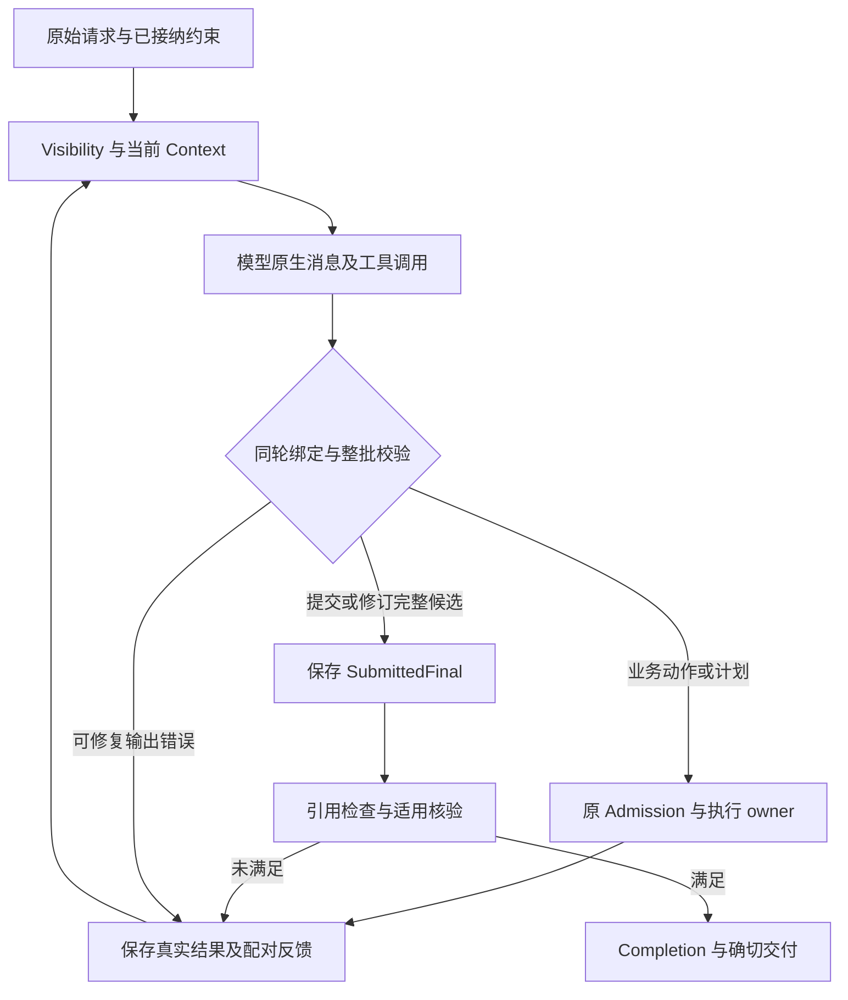

# Conversation Loop 的模型交互契约统一设计

状态：2026-10-25，统一协议已接入生产链路。主终答固定10/10、内部意图固定40/40通过；新LongDS中文36/36轮完成交付并通过第17→18轮真实Web恢复，官方独立评分27/36。当前direct／none的流程已验证，语义结果未全部达标；完整结果和边界见§16。本文唯一拥有主循环Schema流程的替换方案，问题归属CONVERSATION-LOOP-BOUNDARIES-001；能力组织与治理仍由[主循环边界](conversation-loop-boundaries.md)拥有，架构从[工程入口](../../architecture/README.md)阅读。

## 1. 目标、范围与真实依据

**主模型按 Code Agent 的原生消息和工具调用表达意图，业务参数只承载模型需要决定的内容；Runtime 绑定身份、执行、持久状态与完成事实。** 删除空 `prepare_final` 与另一次强制 JSON 成文，不把内部 Pydantic 聚合对象直接作为所有模型调用的输出目标。

本设计覆盖意图提取、动作、计划、工具和委派、最终回答与修订、writer／核验、反馈、历史与压缩、异常呈现及恢复。已有业务算法、Python 沙箱、权限、Command、claims 语义与 Verifier 适用条件继续由原 owner 拥有。用户暂放 claim／核验语义问题、未来做 claim 消融、当前 direct＋none、不做下载打包、用量未知不停止的决定保持。

本工程已有事实：

- [LongDS 新轨迹](../../../.tmp/usage-nonblocking-longds-20261024/report.json)完成 13 轮交付，独立评分 11/13；第 14 轮已通过 Python 得到结果、接纳空准备动作，然后两次最终提交请求都得到 Markdown。首次和修复响应完整、HTTP 200、`finish_reason=stop`，JSON 解析失败；两次已知消费合计 426,799 tokens。此事实说明交付协议未闭合，不以此归咎 MiniMax 的一般 Agent 能力。
- 实发最终请求为 34 条消息，包含通用 JSON Schema、最终提交 Prompt、原生历史和 typed inputs。Final union 还包括修订、完整 ResourceRef 及 owner/revision；同一请求的 typed inputs 有 219 个 Artifact 菜单项和 44 个工具结果。规模和重复投影是待处理输入事实，长度本身不是失败因果证明。
- 底层已区分 `ModelInvocationUnavailable`、`StructuredOutputFailure` 和 `ModelCapacityRefused`，应用却把最终解析失败也称为“模型暂不可用”，REST 统一 503、SSE 统一 unavailable，隐藏了实际失败边界。
- 旧[§3.10](conversation-loop-boundaries.md#310-普通回答直接提交最终候选)曾提出直接提交，但没有落地。不能把“设计已提出”当成 `prepare_final` 已删除。

### 1.1 需求与验收关系

| 编号 | 可观察要求 | 对应检查 |
| --- | --- | --- |
| S-01 | 主循环只用一套原生动作协议；工具名表达意图，参数为直接业务参数，无通用 Decision／Final JSON 外壳 | P1、P3 |
| S-02 | 模型一次提交正文即可形成完整候选，不存在空准备动作、第二次普通成文或旧协议 fallback | P1、P4 |
| S-03 | 模型不生成 owner、scope、revision、digest、批准或完成事实；已有身份只选择当前合法引用 | P2、P3 |
| S-04 | 用户正文可正常使用 Markdown；引用、已存稿修订和程序产物保持原文、权限及实际执行绑定 | P2、P4 |
| S-05 | 参数拒绝、工具执行失败、外部请求失败、模型输出无效和本地程序异常分别处理 | P3、P5 |
| S-06 | 完整原生交换与实际失败均可追溯；恢复不依据 token／轮数猜相位，不补造 tool result 或重执行 | P2、P6 |
| S-07 | direct／claims 继续可替换，required／none 独立；同一完整候选经过适用核验和 Completion | P4、P6 |
| S-08 | Context 只含当前需要的正文和事实投影；大产物按引用重读，压缩服从完整配对及受保护事实 | P2、P6 |
| S-09 | 内层确需 typed 结果的能力采用经核对的输出策略，不把正文 JSON 模式当作全循环默认 | P1、P3 |
| S-10 | 所有现行调用方、Prompt、恢复、文档同步迁移；旧两步协议及无消费者类型删除 | P0、P6 |

## 2. 采用的参考与本工程差异

实际装配、固定提交和限制见[参考比较](../../agentRef/model-interaction-protocols.md)。以下每项采用决定均来自已读源码或已有工程契约，未验证结果保持待验收。

| 决定 | 参考与依据 | 本工程适配及未采用部分 |
| --- | --- | --- |
| 原生消息＋工具调用作为主循环语言 | S1 ToolCallingAgent、S2 Turn、S3 response_dispatch | 沿现有 ModelActionDefinition 与同轮绑定解析；普通文本可作说明，不能在当前受治理契约下静默冒充完成 |
| 完成动作直接带正文 | S1 final_answer、S3 FinishAction.message | 采用携带正文的 `submit_final`；保留原 disposition 和引用选择，因为本项目必须区分交付、等待和限制，并校验来源 |
| 内层typed按职责选择输出策略 | S4 ToolStrategy → OutputToolBinding；§15核对的PydanticAI PromptedOutput → 文本校验 | 意图采用提示式JSON，其余已接入能力保留native；同一canonical类型／原Admission，不把内部输出工具暴露为业务执行或替换Runtime |
| 计划与文件操作是各自能力 | S2 write_todos／write_file、S3 TaskTracker／FileEditor | 原 Plan 与 Artifact owner 保持；持久 ID、执行绑定与权限不交给模型重写，不把第三方文件路径直接作为授权 |
| 反馈进入原生 tool result | S1 AgentToolCallError、S3 AgentErrorEvent、S4 ToolMessage | 同一 call ID 配对；整批合法性在执行前检查。S1 检查终止独占较晚、S3 截断 finish 后动作的顺序不采用 |
| 历史保存实际协议，压缩完整单元 | S2 原生历史、S3 reasoning／response-ID 重建、MiniMax 官方工具文档 | 保留完整原始响应；Visibility、原件与最新未决状态先保护，不能由摘要覆盖执行或批准事实 |
| HTTP 只是 Adapter 的错误投影 | S3 分层错误、RFC 9110、FastAPI 异常处理 | 公有机器字段保留原因和阶段，上游 HTTP 状态单列；不将本地解析错误改叫外部服务不可用 |

MiniMax 的 Agent 行为以原生工具调用为设计起点。Provider 参数支持核对只负责适配，不用作怀疑模型能力或延迟统一设计的理由；不再把兼容 API 路径等同于默认强制 JSON。保留当前已批准的模型、thinking 和预算，不借此调整模型能力配置。

## 3. 架构、事实归属与完整流程

正式入口仍为 Interface → AgentService／Conversation → 既有能力与 Model Port；外层 Adapter 实现 Provider 协议，Runtime 显式装配。模型拥有动作选择、业务参数、代码、计划语义和候选正文；Admission 只接纳或拒绝；执行器产生执行事实；Verifier 判断语义；Completion 消费 required result contract。Journal 与 Artifact 继续是各自唯一写入口。



保存候选不等于批准，模型调用 `submit_final` 不等于 Goal 完成。已有审批、未决执行、未读 required result、计划审阅和研究版本绑定仍须成立；不增加“必须先用某个工具”或“零工具必失败”的通用规则。

主循环采用S3实际分类优先级：有原生工具调用时按调用处理；无调用且有完整可见assistant正文时交给回答模块形成候选；仅reasoning／空输出不能作为正文。普通正文与显式带属性提交同属一套原生assistant消息协议，归一到同一个FinalMessage及后续出口；不增加第二轮成文、传输fallback或模型生成的kind外壳。

### 3.1 三类数据边界

| 数据 | 模型可见与可输出 | Runtime 内部事实及消费者 |
| --- | --- | --- |
| Provider 消息 | 真实 role、content、tool_calls、tool_call_id、存在的 reasoning 字段 | Adapter／Journal 保留原响应及来源；call ID 来自 Provider，不让模型在业务参数重复生成 |
| 业务选择 | 工具直接参数、代码、待办内容、合法资源 ID、证据坐标、候选正文、语义结果 | 通过唯一 typed 参数契约校验，恢复既有 Proposal；没有第二份可写语义镜像 |
| 执行及治理 | 只投影影响下一步的状态说明、剩余额度、有效引用和错误反馈 | principal、scope、Command、digest、revision、Receipt、核验绑定和 Completion 由原 owner 产生，内部保持 typed |

不从内部聚合对象整包导出模型 Schema。业务参数 DTO 是该动作的唯一参数契约；执行对象在接纳后加入 Runtime 事实。禁止为了改名把完整聚合对象再包一层给模型。

## 4. 主循环的意图与参数

### 4.1 动作、计划和委派

主模型继续看到当前可见能力的原生 function 声明，业务参数直接进入 `function.arguments`。不再要求同时输出 `kind/action_id/tool_name/actions/finalization_requested` 等通用 Decision 对象；这些内部字段由同轮声明和真实调用恢复。具体 wire 名沿现有唯一命名与绑定函数生成，不做无依据的全工具重命名。

普通工具可按现行兼容关系组批。参数 JSON、工具名、call ID 或批次关系不合法时，任何成员均未准入；反馈覆盖实际被拒集合。最终提交／修订与业务动作、委派或计划控制混批时，在执行任何成员前拒绝整批，不挑选一个结束、不截断剩余动作。

| 意图 | 模型参数 | 代码绑定与约束 |
| --- | --- | --- |
| 调用业务工具 | 既有业务参数，如 `execute_python(code,input_files[{name,resource_id}])` | 复用 ADR 0043／0044。资源从当前允许集合恢复；不补漏参，不生成计算答案 |
| 修改计划 | `goal`、必要 `grounding`、步骤 `description/status`、`wait_for_user`；已有步骤选择 `step_id`，新步骤省略 ID | Plan ID、revision、完成动作绑定不进入模型参数。完整列表更新参考 write_todos；已绑定步骤不能因改序失去执行事实 |
| 等待计划审阅 | 计划操作的 `wait_for_user=true` | 保留显式等待意图，原 Plan owner 返回 `plan_ready`，无业务执行，不计目标完成。删除计划参数中兼任最终正文的 message；一般追问通过提交的 clarification disposition 表达 |
| 委派 | 现有有界子目标、可见上下文引用、预期产物和预算建议 | 目标 Agent 来自同轮动作定义；有效身份、预算和子运行由 Runtime 绑定。子结果不关闭父目标 |

计划适用性与原意图语义不借本次重写。默认计划审阅、一个活动项、幂等计划不算推进、已批准计划继续及最终交付后才关闭生命周期的契约保持；未完成项是否真的满足结果要求仍由原完成 owner 判断。

计划参数的边界固定如下，避免完整列表更新静默丢失执行事实：

- `wait_for_user` 默认 false；默认交互模式的新计划仍必须显式为 true，且整批不能包含执行动作。auto 模式也允许 true，表示本次仍要等待；等待时所有未完成项为 pending，不允许活动项。false 只表示本轮不请求等待，不赋予执行权限。
- 步骤 `step_id` 可省略或为 null，表示新项；Runtime 在接纳时分配并在结果中返回。非空 ID 必须属于当前计划，不能由模型给新项造 ID；后续更新用返回的 ID 保持同一项，不按描述模糊匹配。
- 步骤状态只保留现有 pending／in_progress／completed，至多一个活动项；completed 不新增“必须有非空执行动作”的门槛。保留 EXE 已有的同一 step ID 根据新证据重开能力，历史 execution 绑定不因重开删除，最终是否满足由原 Completion 判断。完整更新必须包含当前未被既有生命周期 supersede 的全部步骤；漏项、重复 ID 或将已绑定项改作另一任务均拒绝，不把漏项推断成取消。本次不增加删除／取消状态；整体替换计划沿既有 supersede 生命周期保留旧事实。

### 4.2 新回答直接提交

普通新回答直接使用原生assistant正文，Markdown原样进入回答模块形成answer候选。需要明确选择澄清／限制等意图或绑定行引用时，仍可使用现有原生`submit_final`携带这些业务属性；模型无需先调用它才能使用普通正文。该操作表达“提交这一份候选”，不表达已获批准：

```json
{
  "message": "## 结论\n完整用户正文，可包含 Markdown 表格、代码或说明。",
  "disposition": "answer",
  "references": ["d2:37-40"]
}
```

| 参数 | 唯一含义与依据 |
| --- | --- |
| `message` | 模型新生成的完整正文，采用 S1/S3 的直接答案参数；无需 model 生成 submission、kind 或段数组外壳 |
| `disposition` | 沿用既有 answer／clarification_required／limitation／failed。模型选择沟通意图；模型自述失败或完成不覆盖确定性执行事实 |
| `references` | 可省略，默认为空；只选择当前合法文档／行范围坐标。沿现有 citation binder 验证，不输出 owner、revision 或来源原文副本 |

Runtime 将新普通正文及它的引用构成现有 `ConversationAnswerSegment`，再形成同一个 `FinalMessage`。这属于原模型允许的完整正文段形态，不通过分段猜测、文本分类或重新成文改变内容。已存多段稿、claims 稿及其逐段引用保持原结构，不在交付时拍平。

普通交流、计算及当前 direct＋none 路径不被迫输出内部 Final union。文件、表格、程序和统计结果通过现有执行／文件工具产生实际 Artifact；最终正文按需要解释结果和引用真实产物。不自动创建报告文件、ZIP 或用户下载包。

### 4.3 已存稿修订与引用保真

已有完整稿使用原生 `revise_final(base_resource_id,edits)`：只选择最新可见 SubmittedFinal 的资源 ID，并提交现有段落编辑操作。Runtime 从同一主体／run 的权威集合恢复完整 ResourceRef、基稿及未改段；得到完整候选后进入同一个提交／核验／Completion 流程。不要求重抄 owner/revision，不重发整份基稿。

仅在确有当前可修订稿时暴露该操作；新正文与修改已有稿是两种业务操作，共用一种原生控制协议和一种完整候选出口。删除模型侧 `FinalSubmission` 大 union；内部 `FinalRevision` 及原编辑校验只承担恢复完整候选的职责，不作为另一套生成协议。

### 4.4 主模型的普通文本

按S3的原生响应分类，存在tool_calls时优先校验、接纳或拒绝工具批次；同轮content仅是说明，不能先交付再执行工具。非法工具调用即使伴随正文也不能降为文字答案。有完整、合法的assistant响应、没有tool_calls且正文非空时，普通正文是第一类回答候选，默认沟通意图为answer；仅reasoning、空白、无效role、截断或Provider过滤不构成该候选。

主请求的action_choice由现行required改为auto，使实发Provider契约与正文合法性一致；不是先强制调用、失败后再接正文。内层native_tool保持required及单输出操作。正文保真覆盖Adapter取值、首次REST／SSE返回、SubmittedFinal与resume：判断是否空白可以检查strip结果，canonical正文和交付不得用strip结果或重新拼写的副本替代。

正文从已保存原响应的assistant content恢复，保留空格、换行和Markdown；不对它做JSON解析、分段推断、追加引用或重写。Adapter保留Provider消息事实，AnswerResult模块解释为FinalMessage，主循环继续同一SubmittedFinal、引用、适用Verifier和Completion流程。无原生call ID时不伪造工具调用或tool result；修订反馈按原生assistant消息与后续反馈保存。

候选不等于任务完成。默认计划审阅、审批、未决执行、实验required result及claims版本等原门禁保持；claims当前适用时，普通正文不能绕过选证／claims操作，包括尚无current claim的首次写作。已有多段稿仍沿原引用／修订恢复，不因支持普通正文而拍平。显式submit_final继续承担沟通意图／引用属性，和普通正文汇入同一个业务提交契约；它不再是所有新正文的强制前置。

## 5. 能力内部的 typed 输出

确有程序消费者的结果仍采用类型校验。循环内意图、writer、Verifier、压缩不共用一个大 union，也不通过全局 JSON 成文模板来表达下一步动作。

按实际职责采用已核对的输出策略：仍用原生输出工具的能力沿S4由原参数形成typed结果；意图判断的§15候选沿PydanticAI PromptedOutput／文本parser机制直接消费JSON文本。输出工具不进入业务网关、不产生Command，提示式JSON也不直接写业务事实；两者均经同一原类型与各自实际消费者。策略在请求前显式选择，不能因失败换承载重跑；Provider原生Schema功能只可在已核对支持的装配中使用。

| 能力 | 模型决定 | 由代码恢复或推导 |
| --- | --- | --- |
| 意图及冻结标准 | 原 requirements、phase、background 语义及对应原始用户来源选择 | 来源采用当前请求中可见的消息／行引用，恢复原文；来源范围存在不代表语义正确。移除需要模型重抄用户原文的 source_span 协议，原后台／阶段语义须按完整真实用例重验 |
| direct writer | 原生assistant正文，或带业务属性的submit_final／已有稿revise_final | 同一完整候选、引用绑定及提交身份；无独立普通成文阶段 |
| claims writer | 已有 create/edit/recheck/return/stop 等真实操作、当前完整 final_answer | 只暴露当前稿状态允许的操作，不导出全部阶段 union。保留版本、证据和批准绑定；批准后恢复确切稿进入共享出口，不再额外调用 submit_final 重写 |
| Verifier | 现有逐 criterion 的 status、feedback 及必要 revision_feedback | 原标准正文、输入范围、整体 verdict、digest、Receipt 均由原 owner 恢复／推导；none 不生成通过记录 |
| 历史摘要 | 仅 working_summary | 覆盖项、来源 digest、原件位置、前序检查点和激活由 Runtime 计算，摘要不是执行或批准证据 |

### 5.1 内层输出策略的装配与调用方

采用请求级结果策略，不能修改共享_structured_client的全局模式。Model Port唯一typed别名拥有native_tool／prompted_json，StructuredModelRequest与StoredModelRequest复用；None保留原deployment profile。非None只用于structured且不能混response_format或业务动作声明；主tool_calling请求保留None。prompted_json已按§15实现，其实际模型验证状态由该节拥有。

build_structured_model_client继续装配同一Provider、观测、计量与技术重试。native_tool从原Pydantic类经既有公共转换导出唯一工具parameters，保留原required／optional／default和strict=false；prompted_json将原Schema放入指令、按§15直接读取原content并严格校验，不发送API格式或工具参数。两者仍用原output_type，首修复同承载，原件与费用同owner，无新loop或失败fallback。仅已证实的意图能力迁入新候选，其余native和Knowledge／Graphiti／LangExtract等非Loop默认profile保持。

| 生产者 | 本方案结果策略与真实消费者 |
| --- | --- |
| 主动作、direct 成文、claims 写作 | 主循环原生正文／业务工具及同稿出口；原独立Final／ResearchSubmission请求退役，AnswerResult解释正文或自己贡献的参数 |
| 研究选证 | §5.3 的非空原生业务操作；原 `_research_selection_request` 退役，不另保留一套内部选证调用 |
| 研究 unified support | 内层 native_tool；既有逐项支持结果由 ResearchReview 消费，保留实际 max_output_repairs=2 |
| direct cited support 与普通语义核验 | 各自内层 native_tool；引用支持结果和逐标准判断仍进入原 Verification 消费者，不由主模型自判通过 |
| intent／后台要求修订 | §15候选prompted_json；既有意图Admission消费§5.2来源参数，保留原有界grounding修订，canonical DTO不变 |
| history_compaction | 内层 native_tool，仅返回 working_summary；原 HistoryCheckpoint／投影／后续主决策消费 |

### 5.2 用户来源的精确参数

这是本工程 typed 文本引用规则的适配，不声称第三方恰好使用同一 DTO。用 `UserTextReference{message_index,line_start,line_end}` 替换模型输出的 source_span：message_index 为本次请求原始 conversation 数组的零起始索引，必须指向 user；行号从 1 起，闭区间。Context 从原始字符串的换行边界给出只读索引和允许范围，恢复时切取原字符串，不改空格、换行或标点。索引绑定当前 projection，不成为跨请求身份；Runtime 恢复原文后才进入既有 AdmittedInteractionIntent。

`requirements[].source` 必填，可选择当前输入中的历史 user 消息；不接受空引用。`phase_source`、`background_source` 默认为 null：ordinary 对应 phase_source 必须为 null，非 ordinary 必须引用最新 user；background=false 对应 background_source 必须为 null，true 必须引用最新 user，且仍只允许 ordinary、无 phase_source。继续保持原有互斥条件及后台修订边界。

非 user、越界、反向范围、引用不在当前 projection 或缺少必填来源均进入原 grounded-intent 拒绝／修订契约，不猜来源、不将要求默默视为已接纳。行范围合法只证明原文可恢复；来源能否支撑 criterion／阶段／后台请求仍属于模型语义，并在真实阶段单列验收。

### 5.3 claims 的入口、选择和同稿出口

direct／claims 与 required／none 仍由既有 AnswerResultConfig 和 Composition Root 绑定；主循环只调用模块提供的动作定义与解释器，不写 claims 业务分支。claims 的可达条件沿用 current claims，或 requires_review 且已有成功 web_search／web_read，并保持 experiment_run 排除；删除其中 finalization_mode 条件。来源出现只使真实写作操作可用，不自动开始写作。

claims 模块先提供 `select_research_evidence(next_step,needs,reason)`：参数复用既有 ResearchEvidenceSelection，保留全量冻结 criterion 恰好一次、当前 claim_ids、合法 references、缺口及 write 必须有证据的 Admission。它提交真实选证内容，不是换名的空准备动作。接纳事实保存在同一 ModelDecisionRecord／Journal；Runtime 绑定当前标准、claims 版本及可见证据范围，恢复时由该事实判断适用性，不建设另一份可写选择缓存。

- next_step=acquire 返回现有取证缺口，继续正常业务动作；limit 交回既有 StopResearch／limitation，并沿共享停止出口。
- next_step=write 且选择仍适用时，模块提供既有 create／edit／recheck／return／stop 操作，各操作独立参数，不导出 ResearchSubmission 大 union。base_ref 改为选择当前 base_resource_id，完整版本由 Runtime 恢复。选证约束继续用于接纳 claim 引用。
- claim 版本或证据范围改变后，旧选择不再用于下一次写作准入；先消费本次编辑所需的已绑定选择、保存新版本、运行适用核验，再由新的选择或普通动作继续。核验通过时直接恢复同稿 final_answer，形成共享 FinalMessage；none 使用当前合法稿，不能伪造核验通过。均不再另调 submit_final 重写已存稿。
- 每轮最多一个选证或 claims 操作，独占响应批次；与取证、计划、另一次编辑、提交混批时，在任何成员执行前整体拒绝。这保留现有 writer 的单操作时序，避免先交付再执行批中剩余项。

claims 适用时不提供普通 submit_final(answer)，同轮绑定也拒绝该绕过；clarification／limitation 等原合法停止意图继续可用。模型不选择 writer 配置。后续 claim 消融固定同一传输、主循环、Verifier、上下文策略和评分器，以写作模块为预声明变量；本轮只迁移协议，不将未解决的 claim 语义写成已修复。

该限制在尚无 current claims 的首次写作同样成立：普通提交的 disposition 范围排除 answer，普通 revise_final 不作为 claims 的修改入口；最终接纳还核对该 writer 的当前适用性及确切稿，不能只检查“当前是否已有 claim”。继承已有 claim 的引用范围沿同一个 selected_citation_ids binder 展开，连续行不能被动作 Schema 误当成未返回引用；Schema 与实际接纳共享范围依据。

## 6. Context、工具结果与拒绝

输入由一次统一物化产生：原始目标和已接纳约束、必要历史、当前 Plan／预算／候选／能力摘要、当前工具与资源菜单。相同正文只有一个当前承载位置。已在原生 tool result 中出现的正文不再随全量 typed inputs 重复；旧 Artifact 只按需列 ID、可读名称、类型及读取入口，不将整个对话的所有回执和正文每轮重发。

Visibility 先于召回和预算选择。合法资源菜单来自 Artifact／Journal 的只读投影；可用 ID 由同一状态绑定，模型不重写类型、owner、revision、digest。大结果沿已有分页、搜索、read_artifact 及原件引用重读；不得为了缩短输入把数字、原文或缺失状态改写。

工具结果沿原 call ID 返回。模型只需成功／失败状态、影响下一步的输出、合法资源定位、必要计数与范围、可操作的错误。内部 Receipt、Command 摘要、权限和执行字段保留在 Journal；不把整个内部对象递归展开到正文。业务结果结构由具体工具拥有，不新建包含所有结果类型的通用大 union。

可修复拒绝至少给出：原调用配对、错误字段与原因、哪些动作尚未执行、当前合法值／资源、允许修复方向。不得只给错误码，也不得回传密钥、完整系统 Prompt、任意异常栈或无关原始数据。完整原提议保留；反馈不补模型的业务参数和计算结果。

主循环的参数与提交修复统一归 Application 决策循环：删除 Adapter 对主循环输出进行隐式语义重生成的第二条修复链。沿现有“同一无效动作连续两轮停止”的边界计数，每个修复决策计入预算；不增加次数。能力内部 typed 输出沿各请求现行 max_output_repairs，由该能力调用唯一拥有并计量：默认 1，research_support_request 为 2，不能统一误改为 1；不在外层因同一格式错误叠加重试。连接／限流等传输恢复继续由原请求重试 owner 负责。

## 7. 失败分类与 HTTP 边界

底层已有的请求失败、输出失败和容量拒绝保留独立语义。应用公用异常采用中性 Conversation failure 契约，复用既有 reason_code、failure_stage、retryable 及有界诊断；不把所有错误命名为 unavailable。Web／SSE 共用同一安全投影，不把 HTTP 状态加入业务决策或执行事实。

| 事实 | 循环行为 | 对外呈现 |
| --- | --- | --- |
| 参数／业务输入不合法 | 未准入，按真实调用返回可修复反馈；不能执行一部分后补拒绝 | 客户端请求本身无效仍按原 422，资源／冲突按原契约 |
| 模型输出不合当前协议 | 保存完整实际输出和用量，按允许次数反馈；耗尽则明确输出失败 | 输出契约错误可投影 502；reason/stage 与请求失败分开，不称外部 HTTP 失败 |
| Provider 连接／HTTP 拒绝／超时 | 原有界传输策略；未知费用继续保留，不单独停止 | 超时 504、请求链失败 502；有证据的临时过载可 503。上游实际状态独立为 provider_status_code，不用本地状态代填 |
| 模型生成的 Python／业务工具执行失败 | 返回真实 Receipt、stdout/stderr 和可恢复信息，模型按原规则修正 | 不把普通程序失败变成整个入口的 HTTP 服务不可用 |
| Runtime 实现异常、不变量或持久化失败 | 原异常及已发生事实保留，不伪造模型可修复参数错误或成功回执 | 本地内部错误 500；不通过捕获任意 ValueError 把程序错误伪装成用户 422 |
| 未决外部执行 | 原 reconcile／同 Command 恢复；不盲目重放 | 明确执行状态未决，与模型费用未知分开 |

REST 的 status 属于本地响应，安全 detail 保留 message、reason_code、failure_stage、retryable 以及实际可得的 provider_status_code／provider_response_complete。SSE 已发响应头后用相同错误内容发 error 事件，不伪称更改 HTTP 状态。公有结构不含完整模型正文或内部原始异常；维护日志沿现有脱敏事实取证。

现有 SSE 界面消费服务端 error 事件中的同一安全 message，真实网络断开才显示原通用中断文案；前端不重复推导 reason／HTTP 状态。REST 未消费 detail 的调用者无需为本次新增一套错误解析器。

明确由用户输入校验产生的错误使用既有边界内的 typed `ConversationInputError`，Web 仅把该类映射 422；不以其 ValueError 基类捕获所有程序错误。本地实现和持久化分别使用 application_runtime／application_persistence 阶段，保留最早失败位置，不冒充 Provider 请求阶段。

## 8. Journal、恢复与压缩

每次完整模型响应先保存原件和实际费用，再记录输出解码／接纳结果，随后执行。既有 ModelDecisionRecord 需要覆盖“收到完整输出但未形成合法动作”的真实状态，不再只保存成功动作；复用现有 Journal 和 Artifact，不新建第二响应表或收费账本。合法 assistant/tool 交换按原 ID 配对；无合法 ID 时只记录原件与协议失败，不补造 ID 或结果。

完整请求／响应只由原 Journal 保存一次，调用记录持有 typed 原件引用和 digest，不能把每次完整 messages／model_history／raw payload 嵌入之后每个全量 Trace revision。FileJournal 使用本 run 下具名 model_invocations 原件目录，InMemoryJournal 使用同 owner 的原件映射；这是既有 Journal 的技术后端，不是独立可写事实源。请求引用包含 invocation／operation／projection／请求 digest、输出类型及 schema digest、原修复策略；响应引用绑定 invocation／attempt／原件 digest 和原次序。读取经 Journal 校验并恢复 StoredModelRequest／ModelResponseRecord，模型不见文件位置。

只有 structured 请求存在被消费的 output_type／输出 Schema。主 tool_calling 通过同轮 action_definitions 绑定，text 只返回文本；二者的请求摘要和恢复不调用占位 BaseModel 的 model_json_schema，也不为计量另造空业务 DTO。原 kind 与真实工具声明仍参与绑定。

原件写入和 Trace 引用提交之间发生崩溃时，恢复须从该已存 invocation 的有序完整原件核对未记入引用的尾项，补交同一实际响应及一次费用，再解码；不能忽略已写原件重新付费。重复／冲突次序明确拒绝，不按文件修改时间猜顺序。无完整原件的临时文件不当作响应。该恢复也由原 Journal 负责，不设扫描全目录的第二响应 owner。

Adapter → Port 的缺口不能靠扩大成功决策表掩盖。采用具名的逐响应记录边界：`generate(request, response_sink=..., continuation=..., before_send=...)` 接受调用级 typed 记录者、续接数据及原新增请求准入。各现有 Port 包装器原样传递。Conversation 的调用 owner 提供绑定当前 scope／operation 的记录者，Adapter 每收到一份完整响应，**在 typed 解码及输出修复前**交付 immutable ModelResponseRecord，记录者经原 Artifact／Journal 唯一入口提交。非 Loop 调用者可不提供这些参数；共享 client 不保存当前 run 的可变全局字段。记录失败则停止解码／执行，作为本地持久化失败暴露。

ModelResponseRecord 包含 Runtime／Adapter 生成的本地 attempt_id、请求／projection 绑定、provider_host／requested_model 装配绑定、实际 Provider 响应身份（如有）、原始消息／payload 和实际可得用量；requested_model 是实发别名，不能用返回 model 猜测请求配置。恢复核对原记录与当前装配，Provider／model 改变不能嫁接原调用。外部 raw 内容保持外部数据，内部键及范围 typed。StructuredModelResponse 和已有失败对象携带本调用完整响应的有序记录序列，raw_response 仅派生为最后一项，不再独立写入；汇总用量从这些记录推导。Journal 按同一 attempt_id 幂等提交，异常传播不得再次收费。未收到完整响应的传输失败只记实际诊断和费用未知，不造响应或零用量。

ModelDecisionRecord 引用相应响应原件；有可解析的真实 assistant 就保存，否则允许没有 assistant，保留实际协议诊断，不填一份合法示例。有效 call ID 的失败通过原生 tool result 反馈；缺失／重复 ID 或坏 envelope 的原件以明确标记的失败输出材料及诊断进入修复 Context，不作为指令、不伪造配对消息。内层修复也消费每份实际坏输出，不能仅将解析器错误附在旧请求。恢复从已记录失败及剩余次数继续，不重新免费获得整组修复预算。

续接接口和次序固定如下：

1. 调用 owner 在首次发送前生成 invocation_id，连同原始请求引用、operation、projection／请求 digest、原修复额度写入现有 Journal 的调用记录。扩展现有 ModelDecisionRecord 的记录范围覆盖内层调用和未完成输出；无响应时 assistant／响应引用可以为空。它与已接纳的控制事实分别表达“发生了什么调用”与“接纳了什么”，不建设第二响应表。相同 projection 的有意再次调用生成新 invocation_id，不能把内容摘要当调用身份。
2. `ModelInvocationContinuation` 只承载该已存 invocation_id、原请求绑定和已记录 ModelResponseRecord 有序序列。初次调用序列为空；重启时 owner 恢复原请求和同一未完成记录后交回 generate，禁止把新请求嫁接到旧调用。每条响应带 invocation_id 和 attempt_id，解码／修复状态和剩余额度由有序原件及原策略重建。
3. Adapter 优先重新解码已付费原件，重建实际错误及配对反馈。已有合法输出则直接返回，无新 HTTP；无效输出按原 max_output_repairs 扣除已发生的输出修复，再决定是否允许下一次发送。崩溃发生在“已保存、尚未解码”之间时同样先消费原件。最终解码结果由 owner 提交；调用记录的 consumed 事实与该实际消费同步提交，覆盖“已返回、消费者尚未提交”窗口。有意再次调用须在前一结果已消费后分配新 ID；意图首轮与后台语义修订分别使用 interaction_intent／interaction_intent_revision，不能把不同请求混成一次续接。已接纳／已执行的动作恢复沿其既有事实，不重执行。
4. 本地记录去重只按实际 attempt_id，不能按响应正文去重；同文的两次真实收费响应仍是两次。未记录完整响应的传输未决保持未知，不声称能够恢复未曾取得的远端输出。

同 operation 可服务多个真实消费者，不能仅凭操作名续接。既有 typed 请求增加 Runtime 专用 consumer_key，由调用 owner 绑定本次消费位置，不进入模型消息／工具参数。主决策和未完成摘要各有本 run 单一在途消费位置；意图按初次／修订区分；多段 cited support 绑定整稿／段序及该段证据输入，语义核验和研究支持绑定当前完整输入。Journal 用 operation＋consumer_key 查未消费调用，匹配后恢复原请求，不把变化的预算快照当新调用；不同段或证据输入不能取到上一段结果。有意重查在前一结果已消费后生成新 invocation_id，不用 operation 或正文摘要替代它。

调用中各响应、已接纳处置及消费事实不可改写；解码状态、末响应 assistant 投影和已发生的协议交换允许随同一未完成调用的真实后续响应推进。续接有剩余修复且先前修复发生传输失败时，不能将 invalid 投影提前冻结为终态；新原件只追加、协议交换前缀保持，已消费结果不回退。持久化或恢复不变量错误向外传播，意图派生不得用通用 except Exception 转成空条件继续执行。

预算门禁针对新增付费请求，不能阻挡解码已付费原件或恢复无需新模型的同稿交付。Application 先恢复完整尾项／待消费调用及候选，再决定是否有新增模型工作；Adapter 仅在真正发送前调用 `before_send: Callable[[], None]`，由原 owner 读取最新 Journal 执行原预算／截止准入。内层每次输出修复及技术重试同样经过此准入，读取旧记录不调用它；拒绝保留原本地失败，不能变成 Provider 故障或技术重试理由。它是已有调用准入的精确发送边界，不是任意业务 hook。所需新核验／执行仍守其原权限与预算，不因付过模型费用就绕过。

恢复依据已提交的动作接纳、执行事实、当前 SubmittedFinal、核验和最终交付决定下一步。删除 pending_finalization 及通过 `usage.model_turns` 是否等于最后 decision.turn_index 猜相位的逻辑。已保存候选而未核验时恢复同稿；已执行动作不再调用模型重造参数；未知执行先恢复；已交付返回同稿。旧失败归档继续只读，不能改成新协议成功轨迹。

压缩沿现有完整交换和批次原子组：未决执行、最新拒绝、当前修订稿与反馈、必要来源和正在消费的引用受保护；先封存可还原原件，再激活摘要覆盖。被移出的正文不能从另一套 raw history 绕回模型；摘要不能替代执行、权限或核验依据。不更改已批准容量和压缩阈值来制造自然压力或通过结果。

逻辑决策轮、协议修复和物理 HTTP 尝试分别记录。当前 model_calls 不是物理发送数，调用收益必须用真实 SDK 发送记录核对；未知 token 保留，不填 0，不复活未知即停止门禁。

## 9. 代码落点、删除与准入

依据现行架构，沿既有模块改契约，不新增 Supervisor、通用 Workflow、插件总线、统一资源目录或第二 Agent loop：

| 责任 | 既有落点与受影响消费者 |
| --- | --- |
| 主循环业务／控制参数、整批绑定 | model_actions.py、models.py、working_plan.py；复用现有声明与 Admission，内部 kind/ID 不再由模型回传 |
| 模型调用、唯一修复及交付 | service.py、answer_results.py；主循环接纳原生提交，writer 交回同一个完整候选 |
| Provider 适配及内层 typed 输出 | capabilities/contracts/model.py、infra/structured_model.py、model_response.py；保持 Port 方向与原生响应，不向 Application 引入 SDK 或 HTTP |
| 引用与完整修订稿 | citations.py、final_revisions.py、Artifact；按合法 ID 恢复原内部引用，未改文本保持 |
| 原始响应、拒绝、执行及恢复 | journal.py、models.py、model_history.py、history_compaction.py；同一事实唯一写入口 |
| 公有错误 | application/conversation/errors.py 与 Web／SSE Adapter；本地响应和上游状态分开，迁移全部现行捕获者 |

实现前同时维护相关 ADR 和当前架构；设计接受不等于生产迁移完成。检查现有正式 Journal 是否有活跃消费者；没有兼容事实时按根规范破坏式替换。真实外部客户端或活跃存量 run 需要兼容时另按 REL 记录，不能猜补历史响应或在旧 run 中换协议。

必须删除：prepare_final 声明、Prompt 与调用；普通独立 Final 成文分支；模型侧 FinalSubmission／FinalRevision 大 union；ContinueTurnProposal.finalization_requested、ModelCallDisposition.prepare_final、pending_finalization 及相关阶段提示；主循环隐藏输出修复；全局 unavailable 呈现。内部合法 FinalMessage、引用修订、候选持久化和必需核验不能随之删除。检索实验 Final／claims 的专有业务字段有真实消费者，按各自模块迁移输出通道，不以普通字符串替换它们的结果契约。

## 10. 验收与整体复审

设计与实现审查已闭合，源码已接入；以下为实施前固定的验收计划。当前已完成静态检查、部分真实产物机械回放及 P1 两组各 10 次生成；完整长任务尚未重跑。不以参考源码、文档检查或机械回放证明模型能力改善。

真实采集器是 Model Port 的现行消费者，须原样透传 before_send 等发送参数，不改变 wire 或代执行准入。正式 LongDS 用例中已过期的“未知消费即停”反事实说明同步为保留未知且允许继续；参考答案、官方语义评分及原始封存成绩不变。

| 检查 | 输入、判据与执行边界 |
| --- | --- |
| P0：静态完整性 | 全部生产者／消费者、模块装配、Schema／Prompt／本地校验一致；删除清单逐项归零，无旧协议 fallback；依赖、lint、文档检查 |
| P1：真实生成阶段 | 从第 14 轮 prepare_final 之前的完整真实决策输入开始，对旧协议 baseline10／新协议 candidate10；连续消费实际动作直到候选或原停止边界。合法选择其他工具不判参数失败；不能注入预期 finish、正文或程序。候选组要求 10/10 达到合法完整提交及实际下一消费者，首响应／修复分别报告，完整原请求和失败保留。其他改变的语义边界按下表固定真实输入、重复组和实际消费者，不能用此组代替 |
| P2：确定性恢复与原文 | 用现有完整真实 Journal／Artifact 阶段验证 ID→原引用、权限拒绝、引用失效、既有稿修订、无重复执行、配对历史和压缩恢复。声明的外部拒绝／故障反事实单列，不建立逐函数单元测试 |
| P3：错误与反馈 | 第14轮完整双响应回放为输出错误、无服务端503；已有实际传输故障保持请求失败。混批提交、坏参数、纯文本、未知／重复call ID、Python失败与本地故障分别走声明路径；拒绝发生在执行前，合法修复消费实际反馈 |
| P4：业务结果与可替换模块 | 原 direct 两轮及来源／稿件修订真实阶段，确认用户正文、引用、计划审阅和合法停止；claims／required／none 装配不能换身份、伪造通过或绕过当前版本。普通模式新消息单段承载的引用行为必须对照真实引用任务，不凭类型可解析宣布等价 |
| P5：公开接口 | REST／SSE 对相同真实失败给出相同原因与阶段；本地HTTP状态与可得上游状态独立；敏感信息不外露。该确定性边界不启动付费模型 |
| P6：完整长任务 | 局部及独立审查通过后，新身份执行原36轮／17→18新进程恢复／原材料／同模型配置／独立官方评分；旧13轮不能拼入新协议分母。完整交付、语义分数、自然压缩、恢复和机制检查点分别报告 |

### 10.1 生产者、真实阶段和验收消费者

| 改变的边界 | 真实阶段来源与实施前取证 | 判据及实际下一消费者 |
| --- | --- | --- |
| 主动作→普通提交 | LongDS 第14轮原生决策请求 `c16db4bc30c74188bd057c2a13ff5639`，以及双失败响应；完整路径由本节 LongDS 归档 report 定位 | P1 连续候选提交→原引用检查／Completion；合法非终止动作不算参数失败 |
| 用户来源→意图／后台 | 同一 LongDS 实际 intent 请求及已封存后台／计划真实输入，按原消息数组恢复 user 原件 | 来源可恢复且满足原历史／最新范围；实际 AdmittedIntent→工作模式／冻结标准；越界／非 user 反事实单列，不能只测 DTO |
| 计划更新／等待 | 原 HARNESS-003、auto 提前回答及默认计划审阅轨迹；实施前核实原件身份，不以叙述代原输入 | 完整实际主决策→Plan Admission→真实等待或下一步；ID 保持、漏项拒绝与无副作用单列 |
| 选证→claims 操作 | [真实研究阶段审计](../../../.tmp/final-criterion-reference-20261002/stage-audit.json)及其原 Journal／模型请求；先核对完整原件能否被当前 owner 消费 | 原标准和证据→真实选证→真实建稿／修订→同稿提交，连续消费实际输出；current claim／scope 变化和混批拒绝单列 |
| cited support／unified support／语义核验 | 上述完整研究稿／核验阶段及现有 direct 引用阶段，分别固定真实调用上下文 | 各自产生的原字段由既有 ResearchReview／Verification 消费；协议迁移不更改既有语义标签，不把模型判定差异当作传输收益 |
| 摘要→恢复后主决策 | [原无思考压缩实际阶段](../../../.tmp/ctx-compact-no-thinking-20261022/report.json)的原摘要请求、原件和真实消费者请求 | 真实摘要→新进程恢复／引用重读→真实主决策；原文覆盖与语义检查分开，自然触发另由 P6 判断 |
| 完整失败→Port／Journal／REST／SSE | 本节双输出失败、已封存传输失败及实际工具失败 | P2／P3／P5 确定性真实产物回放；响应逐份留存、计费一次、阶段不串，不为该机械边界新调模型 |

该表是覆盖义务，不是已完成的输入清单。实现前准备产物必须把每行落为精确文件、上游真实输出、SHA-256、当前转换及下游消费坐标；缺少完整阶段时先恢复原件或取得同入口 baseline，不用手造理想结果填空。老版本原件只能作为其实际边界证据，不能混入当前版本通过数。

第14轮历史阶段的 run deadline 已过，不能修改原 Trace、许可或已执行 Command 的时间／digest 来绕过。该 Offline 组在独立进程中将相关服务的时间读取绑定到“原次决策实发时刻＋本样本 monotonic 已过时长”，baseline 与 candidate 使用同一锚点；Python 执行沿其现有 clock 参数绑定相同时钟。具体锚点须从原发送日志定位并冻结，真实 wall clock 和阶段 clock 分别记录，第一请求剩余预算须对照原件。该环境替身不替模型、工具结果、权限或业务决策，不增加生产 Clock 配置／通用 hook；不能据此宣称真实时间恢复 E2E 通过。P6 新完整任务不使用此阶段时钟。

准备已定位原输入 wall_seconds_at_input=3499.912667，对应阶段锚点 2026-10-24T08:21:11.496185Z。装配／物化期间保持该锚点，首次真实模型发送时启动 monotonic 计时，之后模型和工具实际耗时正常扣减。替换仅限隔离进程中 Conversation service、intent 及 Python sandbox 的 deadline 时间读取；PythonService 复用现有 clock 注入，SDK／Docker 等真实 I/O 和耗时使用真实时钟，不改全局 datetime。

原阶段还依赖前13个已完成 run 的累计消费、计划和来源。候选准备只对这些**已完成历史**使用只读事实投影：完整原 Trace／原生控制／SDK 原件另存并校验，当前消费者所需 usage、计划、执行／来源、messages、Final 原值保持；不把历史 prepare_final 偷换为新 answer_result，不增加生产兼容枚举。历史模型决策若不属于本阶段真实消费者，可留在该原件而不放入候选活跃 Journal；记录精确差异及读取范围，不将此称为旧协议恢复或兼容通过。当前0010的已执行 Python 决策与完整 assistant/tool 历史必须按实际 SDK 机械恢复，不得删减。核对全量历史消费仍为14,613,580已知tokens，原许可60M不变；若发现消费者真实依赖被投影移出的字段，先恢复该真实消费，不能以空值继续。

该已执行 Python 的旧请求还声明了未被选择的 prepare_final。完整原 wire 另存；候选已消费记录的请求元数据仅作只读投影，移除这一已退役、未执行的声明，不将其内部 kind 改称 answer_result。实际 Python 原调用及结果完整保持；投影请求不能作为原请求无损续发证据，也不重发已执行历史。新的首个当前模型请求仍须消费完整过去交换及其余真实阶段材料，投影差异逐项归档。

各独立样本同时使用独立 data 目录和同一现有本机 Postgres 实例内的独立 evaluation database，仍由正式 Store／Gateway 初始化；不以共享 public search_path 充当隔离，不改 principal／run／授权 digest 来规避幂等。仅创建本实验明确命名的新数据库，不覆盖现有库或表。原主体的 Knowledge／Notes／Review／Lifecycle 初始业务数据已在准备期只读取证21表合计0；这是当前准备事实，不冒充原发送时的 DB 备份。必要的同 scope 治理／执行资料继续从原真实 Journal／存储按读范围冻结，组间不共享新增事实；若真实消费者需要尚未恢复的旧存储事实，先补取，不用空值假装已隔离。DB 名与非敏感身份写入归档，凭据不入报告。正式 P6 使用全新任务身份，不受本历史样本投影限制。

改变模型语义边界的生成组按 QLT 固定最低10次；不是对每个函数机械增加10次。内层仅传输迁移的 typed 解析和费用边界以真实响应回放验收，仍需连续验证真实生产者到消费者；涉及意图、选证或主模型可见实质变化的边界另执行固定重复组。正式运行前在原用例中冻结精确阶段、代码、模型、输出预算、各现行修复次数及收尾入口。资源先复用原每 run 10M／40决策／256工具／4委派、结构请求480秒及原输出额度，任务60M已知tokens／36小时；第14轮原两次最终响应约0.427M，仅用于估算组开销，不保证后续成本。局部组与新完整任务使用独立身份及归档，禁止无界补样；未知消费不单独早停。用户已授权设计闭合后直接落地，执行仍须先完成该准备和对应准入。

P1 的 baseline10＋candidate10 共用 60M 新增已知 tokens／36小时生成墙钟上限，分两次命令执行不重置该组上限；每个样本仍守原任务和 per-run 许可。候选命令显式接收减去已完成基线消费／时间后的剩余额度，报告命令级和组合计数；不通过拆命令增加许可。P6 的新完整任务使用自己的原 60M／36小时许可，不将 P1 历史样本复制成新完整任务。

主提交两组结束后，来源参数与 Plan 协议的剩余固定组复用该局部验证许可的未用余额，不增加总上限：已用 9,659,782 tokens／815.719 秒，两项各预留最多 25,170,109 新增已知 tokens／64,392.1405 秒；未用额度不等于实际消费。各组先完成零模型准备，冻结精确阶段、最低10次及合法消费判据后才发生成请求；实际原件不可得时保留未覆盖，不替换为理想数据。后台／Plan 的开放语义误判仍按用户决定暂放，与参数合法性及消费事实分别报告，不以它们额外停跑独立的 P6 direct＋none。

来源参数组固定四个已物化完整输入各10次：P6首轮、原第14轮27条会话、B1预算非后台、B2显式后台，共40次。每次当前原生生成后消费到实际Admission与冻结；后台分支另消费实际可用性判断，不伪造后台作业成功。P6从真正0001的零响应状态开始新生成，已付费0004／0005仅作独立原件续接对照；其余完整旧消息装配为新stage，不称旧run恢复。B1／B2的开放语义选择单列，不因误判改本组参数判据或修模型语义。

P6首轮intent请求不含remaining／时间字段。其原deadline为2026-10-24T13:06:44.688774Z、原turn许可3600秒；本组隔离阶段时钟以原run创建时刻2026-10-24T12:06:44.688774Z为锚，首次实际HTTP后按monotonic推进，仅替换service／interaction_intent时间读取，SDK和真实耗时不变。它不是精确first-send锚；已知capacity日志到毫秒为12:06:44.799Z，不能虚构更精确发送时刻。原deadline／许可不改，模型请求digest仍须与原件一致。其他三项装配新stage，不为其虚构旧deadline或历史时钟；这也不替代P6真实时钟恢复。

Plan准备已核实auto active／terminal完整阶段，原24／25个inputs与计划／执行绑定可由当前typed owner读取，原预算6M tokens／64决策／96工具、无deadline或Command／Python许可。旧stage未绑定AnswerResult；候选仅由当前owner显式绑定direct＋none，报告为当前配置消费旧真实阶段，不称旧wire或全部行为保持。模型可合法选择其他动作，工具选择与Plan参数是否合法分别计分；未产生Plan更新不能算已验证ID／等待。默认首次审阅的现存归档仅有最终Trace，尚缺早期Journal／首轮请求，保留该来源完整性缺口，不删最终计划或改mode制造首次审阅输入。

旧auto阶段4份web_search结果没有当前消费者要求的query；按相同call ID／run／thread在原web-process.log实际tool.audit.input定位的query／limit作明确只读阶段投影，不能猜查询、重搜或改返回正文。原Trace、执行digest和结果原件单独保留，逐字段记录投影来源／SHA及当前消费边界，不称原结果逐字等价。旧read窗口若另缺当前metadata，也仅在原件可唯一恢复时适配；不可恢复的材料继续记缺口，不以默认值通过。

后续逐项预检确认这两个stage共享11个内部search调用结果，实际当前消费错误为keyword缺失；旧regex／result_offset取值也未保存，不能用当前默认值代填。原Trace、SDK及外部tool.audit均未保存对应内部调用参数；resource_id／content_digest／eof_position可恢复也不能替代这些缺项。因此24／25-input两项保持not-ready、0新增模型，不反猜参数。同轨迹更早0004可另行核对为新的独立完整阶段，不能替换这两项的身份或通过分母；默认首次审阅的来源缺口仍单列。

0004独立阶段已由正式service零模型物化当前主请求：完整3个inputs（原反馈、两次实际web_search）、计划rev1及原usage26,846／turn3保留；仅从同调用audit恢复两份query／limit，生产Artifact owner可重读原件。该新身份固定10次当前原生生成并连续消费至真实Plan接纳／等待／下一步或原合法结束／停止边界，合法其他动作与未触达Plan单列，不注入Plan结果。首请求10次的保守byte＋输出估算为617,450，原剩余61决策的完整journey可能更大且输入会增长；原25,170,109／64,392.1405秒组上限不保证全部10次必能执行，耗尽如实保留未执行，不重置许可或补样。

历史 HARNESS-003 混批、auto 提前回答和未完成计划时纯文本的反例必须在实施前核对原始身份。尚未联合取证的历史描述不作新的成功分子，也不凭描述断言单次提交不可行。现有真实阶段及必要责任边界反事实优先复用，不能为增加门槛另造无关场景。

整体复审：价值在于让模型用熟悉的原生意图通道工作，减少重复表达与协议相位；架构保留事实和权限 owner；真实 E2E 不被脚本或理想中间结果替代；评估同时观察原始用户结果与 Harness 检查点；框架只治理，不代模型编程、计算、挑结果或批准自己。Schema 改善不预设语义正确，也不将外部成熟实现当成本工程效果证据。

独立可实施性审查已完成：claims 入口、请求级输出装配、逐响应 Port、用户来源坐标、计划等待及阶段覆盖六项已明确；后续核查的 Plan 重开与稳定调用续接两项也已闭合。实现后的整体代码审查发现 5 项重要问题，一次修正后由同一审查者复核，剩余重要问题为 0，见[审查报告](../../../.tmp/loop-schema-redesign-20261024/whole-code-review.md)。该结论不替代真实模型和产品验证。

本轮审查切片相对实施前工作树为 25 个代码文件、增加 2,180 行／删除 1,285 行，净增 895 行；不把继承的未提交修改算入本轮。主循环删除一个成文相位，新增代码主要承担逐响应原件、续接及安全接口投影。模型侧协议减少不等于总代码减少；新增维护成本由本节真实消费者与恢复反事实约束。

P1 两组均完成 10/10 合法交付并消费到实际 Completion，见[逐样本比较](../../../.tmp/loop-schema-redesign-20261024/p1-comparison.json)。旧协议为 23 次物理请求、5,251,796 已知 tokens、未知 0、420.094 秒；新协议为 18 次、4,407,986 已知 tokens、未知 0、395.625 秒。新协议 2/10 首响应直接提交，其余 8/10 首次返回普通正文，收到真实 provider_action_missing 反馈后一次修复完成；不把反馈成功写成首响应成功。新协议请求数减少 21.7%、已知 tokens 减少 16.1%，生成墙钟仅作本次观察值，不据顺序运行证明延迟因果收益。

原第14阶段已达到实施前固定的候选10/10判据，该局部结论保留；不追加样本直至获得更好首响应数。新完整任务第17轮复现同类通道拒绝后，主循环终答问题重新打开，按§11复审再准入修订。两组都成功，不能声称提高成功概率，更不能把历史失败改写为成功。P1合计新增9,659,782已知tokens／815.719秒，完整原件、首响应及反馈按各自身份保留。

已执行的真实产物回放包括逐响应保存／付费解码续接、预算耗尽后的本地同稿完成、用户来源坐标恢复、五项审查修正及安全错误投影；均未调用新产品模型，不能计为新语义生成通过。其边界、原件身份与未覆盖项由[实施计划](../../../.tmp/loop-schema-redesign-20261024/implementation-plan.md)及对应报告记录。

新增一次当前真实 intent 完整阶段回放：P6 首轮已付费原件经原生解码、Admission、实际提交冻结14条条件，与原冻结业务事实一致，下一真实主请求消费同组条件；原3,879 tokens未重复计量，新增模型为0。它只有一个实际 producer，不能拼成10次新生成；来源／Plan／claims／摘要的覆盖与剩余组见[逐边界盘点](../../../.tmp/loop-schema-redesign-20261024/remaining-stage-coverage.md)。

P5 已消费原双完整输出失败及一次实际传输失败，经正式 REST／SSE 注册路由完成 4 次 ASGI 请求，见[结果及边界](../../../.tmp/loop-schema-redesign-20261024/p5-interface-replay.md)。REST 为本地 502；SSE 保持已发出的 200 响应头并发送相同安全 error 内容，输出与传输原因／阶段分开，上游状态未代填。新增模型、网络连接、tokens 和工具执行均为 0。该 Offline 使用显式异常重放接缝，不证明完整鉴权、数据库、真实网络或未发生的超时／500 分支。

P6新身份于北京时间2026-10-24 20:06:33启动，第17轮terminal_limitation结束：17请求、16交付、19未执行，115次物理生成、15,273,815已知tokens、未知0；未到第17轮交付／新进程恢复，未自然压缩。独立官方评分16份原始回答，15/16正确；新Judge16次、67,111已知tokens、未知0，复制的历史资格用量不计新增。原件和完整分段结果见[本次报告](../../../.tmp/loop-native-e2e-20261024/complete-audit/report.json)。模型、thinking、direct＋none及原60M／36小时许可未变，本次完整任务仍未通过。

本次第14轮已交付，HTTP 200、disposition=answer，未重现旧双JSON成文失败；其5次物理请求／973,290已知tokens中包含一次主动作输出无效后成功修复，并非首响应全无错误。该检查点只关闭本轮已到达的提交问题，不代表36轮、语义评分或重启恢复已经通过。

P6 的本次正式目标沿用户决定保持 direct＋none。该分支的固定局部判据和共享工程边界通过后，继续其新身份完整任务；不将与其无依赖关系的 claims／required 新语义组变成额外停跑门槛。这些模块的覆盖义务仍按 §10.1 单列，未执行不得计为通过；当前任务通过也不证明全部 writer／Verifier 组合已通过新协议验证，claim 机制增益留待原定消融。

## 11. 第17轮后的终止协议复审与修订准入

真实第17轮的两次Python均成功，随后两个完整模型响应都是普通正文、没有tool_calls；现行model_actions解码器按provider_action_missing拒绝两次，最终生成安全limitation。没有SubmittedFinal，也不是Provider拒绝、未知费用或程序执行失败。P1候选8/10需一次同类反馈已暴露通道摩擦；第17轮证明仅保留强制finish工具仍不能闭合用户交付。原件封存，不重写成新成功。

复查固定S2/S3实际消费者：OpenHands classify_response优先tool_calls，其后是非空可见content，_handle_content_response发送MessageEvent并结束模型轮；finish工具也合法。Gemini普通content进入响应事件，无pending tools时按自身next-speaker机制决定接续。本工程采用其原生消息分类与单一正文出口，保留已有Verifier／Completion，不复制额外next-speaker模型或把正文自述当完成事实。首版只强制采用finish工具而排除正文，是参考采用不完整；本次纠正该选择。

架构改动限制在现有Model Port消息投影、AnswerResult解释和Conversation同一提交入口。原响应、计费、身份及消费标记仍由原Journal拥有；没有新返回模块、Final阶段、传输策略开关或独立完成状态。内层typed结果仍经原类型与各自消费者；主模型的正文入口不放宽该契约，意图的新承载候选见§15。普通正文零引用不推导证据；需要引用及沟通属性时使用原显式操作，原文引用和已存稿修订机制保持。

修订代码前先闭合整体critic，评估价值、字段归属、代码可达性、混合响应与claims防绕过、费用和真实验收。对应验证固定如下：冻结第17轮第一次普通正文之前的完整真实阶段及请求／响应／Journal；零新增模型回放原件到当前新正文解释和实际提交／Completion，保留原文及费用；固定10次新模型连续生成至合法完整候选与原实际消费者，合法其他工具不判参数失败，不注入终答。必要反事实覆盖有调用＋正文的优先级、非法调用不降为文字、空白／reasoning-only／截断、claims首稿绕过及原预算下付费原件消费，限定实际来源与邻接控制。

原第17轮首正文请求的required及其invalid／consumed均为历史事实，不能改digest为auto或在production从StructuredOutputFailure.error.response降级。零模型辅助回放可在完整原阶段上物化当前auto请求，由显式录制响应边界读取真实旧SDK envelope；新回放身份必须同时记录旧wire／body SHA和当前协议差异，仅证明原真实正文在当前消费者的处理，不声称旧required请求等价续发、新Provider请求或新增费用。正确的当前请求—响应绑定由后续10次真实生成验收，不由该录制回放替代。

新生成组固定P6第17轮0027：完整270个inputs、33条messages、16个初始Artifact引用，原usage556,350／3模型调用／2逻辑轮／2次Python。首输入剩余38决策／254工具／4委派／9,443,650 tokens／3,421.744739秒；原deadline为2026-10-24T13:46:35.053571Z，对应隔离阶段anchor为12:49:33.308832Z。按原阶段clock规则复用实际send后的monotonic，不改原deadline、许可或已执行事实；真实SDK／工具耗时不替换。只复制该Trace实际引用的model_invocations及前16完整头、Artifact，不复制或读取目标首正文55e7cc响应来生成候选；付费组不能由录制回放替模型。

完整任务采集器的第17轮_checkpoint也使用同一原文契约：baseline直接append正式返回的原message，checkpoint须逐字比较原FinalMessage，不对单边strip。准备新P6时已定位旧比较对合法首尾空白会误拒恢复；仅迁移这一消费者，不改答案或恢复条件。验证使用上述完整第17录制回放中的真实whitespace邻接归档，经实际_checkpoint保存恢复输入；修正前应拒绝、修正后应保留34条消息及原正文，0新增模型／业务执行。旧封存归档不回改，新的源码身份包含该一行迁移。

新完整36轮只在上述修订准入后按原模型、材料及许可另起身份；不拼旧16轮，也不在未闭合前整轮重跑。Plan native-only付费准备暂停，源码改变后原preflight失效须重冻；独立inner intent固定40继续原判据，不受主终答修订影响。局部验证仍共用原60M／36小时family，先扣P1和intent实际消费，取消未启动旧Plan的预留后再冻结新修订组的准确剩余额度，不以新身份增加许可。

## 12. 原生typed输出的修复反馈保持同一承载

固定来源组的真实失败已显示独立责任：B2首响应确实调用structured_output，但把int坐标写成字符串、把可空来源写成空字符串，严格Schema拒绝正确；随后Adapter用structured.repair.system要求“只返回完整JSON对象”，模型遂返回content JSON、没有原生输出调用，再次被native_tool解析器拒绝。原第14输入的失败也消费了同一修复形式。反馈已经送达，冲突在修复指令与当前返回承载之间，不将其笼统归为模型不修复。

按S4的OutputToolBinding／ToolMessage机制，修复必须继续调用本次唯一输出工具、修正其参数；工具名由同一当前声明恢复，不由模型猜，也不在反馈中切到正文JSON。Adapter根据request.output_transport选择版本化修复指令：native_tool用原生输出工具契约；原JSON／JSON-Schema消费者沿现有JSON指令，非Loop字节保持范围单列。保留实际字段错误、原assistant／tool配对和完整原件；不改Schema、强度或现行max_output_repairs（默认1、原research2），不叠加另一轮Application重试。

承载判断使用原始逻辑request：现实现会先replace为tool_calling并擦除output_transport，再将chat_request交给修复helper，不能从这个已擦除字段分派。调用方须把原native承载及同一输出声明显式交给helper，按原call ID构造ToolMessage；声明、反馈和下次实发保持同一工具。

本修订只涉及现有infra.structured_model的修复请求构造与kernel/prompt_templates/runtime.py的注册Prompt，沿原Model Port、Journal、计费和消费者，没有新传输fallback或返回模块。修订准入与§11同轮critic；来源固定40先完整结束并保存旧版本结果，源码不在原组中途变化。随后以原失败首响应／完整初始状态固定同四输入各10次候选，真实生成→Admission→冻结，初次／修复、shape／范围及B1/B2语义分别计分；既有序列的费用／续接与非Loop JSON对照采用完整真实产物回放。候选仍要求40/40完成声明的协议消费者，不补成功样本，预算从同一60M／36小时family实际余额冻结。

整体critic已支持§11／12两项已证修订，新增设计阻断0；实发auto、原正文全链保真、原native承载显式保留三项必须约束已纳入，见[critic报告](../../../.tmp/loop-schema-redesign-20261024/v2-design-critic.md)。修复涉及Verifier原draft／receipt digest及service比较时也必须保持同一原文，不能只修显示而核验另一份strip副本。

## 13. 流式结构角色按元数据聚合

单次已授权接口诊断保留原失败SDK kwargs，实际HTTP body逐字节相同：21个SSE JSON帧中20个delta.role都是单一assistant，OpenAI SDK 2.36.0的accumulate_delta却将普通字符串相加，最终role为assistant重复20次。HTTP200、1次物理请求、1,737已知tokens、无重试，见[原始诊断](../../../.tmp/loop-schema-redesign-20261024/intent-role-diagnostic-01/report.json)。这证明兼容流中的结构常量被SDK按文本累加；不是模型生成了20次角色字符串。历史坏聚合结果与原SSE不改写。

沿S4实际OpenAI适配器[_convert_delta_to_message_chunk](https://github.com/langchain-ai/langchain/blob/b15a385cb1aa4507b86a3ba1e6430748b0c4ae4b/libs/partners/openai/langchain_openai/chat_models/base.py#L554)将role作为消息类别、content／arguments作为增量文本的机制，在既有_create_chat_completion聚合入口区分结构角色与文本。实现限于交给SDK累加器的消费副本：按choice index保留首次实际role，相同合法role的后续重复作为同一结构字段处理，不让其文本相加；原chunk及HTTP字节观察不改。content、reasoning、tool ID／name／arguments、finish reason和usage继续沿原路径逐值保留。

不从坏聚合字符串反猜或替换成assistant，不为没有实际role的流补角色；实际角色冲突／非法角色不得规整为合法assistant，应保留协议失败。完整响应已取得时仍先存原件后校验，未取得完整响应的失败如实保留不完整与未知用量。已有非流式响应及真实role不改；不新增Provider开关、模型调用或返回事实owner。

有界critic已支持该补项，新增设计阻断0，见[角色补项critic](../../../.tmp/loop-schema-redesign-20261024/v2-role-design-critic.md)。非法／冲突必须sticky，例如先空字符串后assistant不能因SDK最终拼成assistant而通过；不能只检查最终字符串，也不能在冲突处提前丢弃后续完整usage。

为使该实际流事实经过先保存后校验和paid continuation，复用原ModelResponseRecord增加typed、immutable的stream_protocol_failures元组，默认空；元素ModelStreamProtocolFailure只含choice_index、role_missing／role_invalid／role_conflict原因及最多两个原始角色标量的JSON串，每choice仅保留首个失败。唯一producer是本响应的流聚合guard，唯一持久owner仍为原响应record／Journal；即时解码及重启解码都读取同一事实，失败不被后续chunk清除。它不能由SDK最终role唯一推导，缺少它会在恢复时丢失已证明的冲突，故不是独立可写状态镜像。

既有_create_chat_completion内部用私有typed_ProviderCompletion携带SDK payload及该事实，_receive写入原record并sink后由同一完整响应检查读取；不向SDK对象私塞属性或将自有字段藏进Provider raw JSON。SDK合法枚举也不表示assistant答复，完整message.role须为assistant；该校验在完整原件保存后执行，历史坏SDK对象不补正。保护方法的实际观察器调用方须搜索并显式透传／读取payload，wire及费用不变。新增一项typed技术事实及内部载体，模型可见字段、业务状态、完成规则和独立存储均不增加。

实际调用方迁移包括正式retrieval_acceptance_server观察器，以及现行artifact_reference_replay、python_action_replay、model_transport_diagnostics三个独立CLI；它们显式读取payload并透传同一carrier。旧override遗漏的before_send在该受影响签名同轮补齐且只执行原准入，不顺带修改原用例、Schema或工具业务。封存的一次诊断脚本不回改；没有旧SDK返回形状fallback。静态、CLI入口及具备完整真实输入的零模型回放按实际边界验证，不运行单元测试。

全调用方搜索还命中retrieval_http_server、provider_diagnostics/python_result_analysis_capture两个现行观察器的SDK读取／签名，以及python_result_analysis_inputs的捕获前停止签名，纳入同一最小迁移。捕获边界没有真实发送时不提前执行before_send；真正发送仍按原owner执行一次。loop_schema_journey已有关键字透传且原样返回，无需改写。历史诊断显式加载旧源码时使用其旧契约，当前分支显式使用carrier，不以运行时形状猜测兼容。

该补项已按有界critic实施，不将尚未证明因果的$defs／dereference布局差异绑改。同一原21帧SSE经同SDK重聚合，候选role为assistant、其余字段逐项相同、原chunk不变；7项角色控制在record持久往返及paid continuation后仍拒绝，包括先空字符串后合法值的sticky情形，见[回放报告](../../../.tmp/loop-schema-redesign-20261024/v2-role-stream-replay-report.json)。均为零模型机械反事实，不是新生成样本。

三项修订、终止完整性及checkpoint消费者修正相对v2前源码为17文件、增加311行／删除89行；既有响应record增加typed流失败事实，无模型可见字段或新业务状态。全阶段第17录制回放的新carrier4组及首次SSE通过，原4437字、空白邻接、paid resume及本地cap完成保持正文／费用／执行事实；旧required与当前auto协议差异明确标记，不称旧wire续发等价。见[当前主回放](../../../.tmp/loop-schema-redesign-20261024/v2-main-body-replay-03/report.json)、[首次SSE回放](../../../.tmp/loop-schema-redesign-20261024/v2-sse-first-replay-03/report.json)。6个实际消费者迁移的[SDK原SSE回放](../../../.tmp/loop-schema-redesign-20261024/v2-carrier-consumer-migration.md)也已完成；未运行历史旅程与当前required完整语义路线仍单列。

整合代码审查发现唯一重要项V2-I01：SDK在正常EOF／[DONE]但choice没有实际finish_reason时也返回快照；主auto新正文通道可能将其提交。该问题由当前SDK及生产控制流定位，不冒称新模型已真实复现，见[代码审查](../../../.tmp/loop-schema-redesign-20261024/v2-code-review.md)。沿原_check_complete_response，在原响应record保存及sink后、候选解码前拒绝缺失终止finish_reason；EOF、非空正文和usage均不能替代终止事实，不补stop、不加状态／模型／重试。原始payload已有该事实，费用和paid continuation沿同一记录恢复。

修正前后各运行一次同源机械反事实：保留完整真实第17轮请求和4437字原响应，只在新诊断副本将finish_reason置空；另对原21帧SSE仅去掉终止choice帧，经同SDK聚合。两者均须保留原件／可得usage，候选不得成为FinalMessage，paid continuation同样拒绝且不重发；完整原响应仍合法。该有界验证不新造理想答案、不计入固定10／40生成。修正已完成：缺终止副本在首次处理及paid恢复均拒绝，原完整响应保持合法，原文与可得usage不变；[baseline](../../../.tmp/loop-schema-redesign-20261024/v2-finish-baseline.json)和[candidate](../../../.tmp/loop-schema-redesign-20261024/v2-finish-candidate.json)均为0新模型、0网络、0新增费用。初次scratch使用SimpleNamespace导致本地序列化失败，改为显式SDK对象后执行完整对照，不计为生产失败。同审查者有界复核已关闭该项及checkpoint迁移，Critical 0／Important 0，17文件hash一致；源码重新冻结。

第17轮新候选固定10已完成：[整组原始结果](../../../.tmp/loop-schema-redesign-20261024/main-generation-v2-01/report.json)为10/10合法交付并进入实际Completion，12次物理模型请求、3,283,517已知tokens、未知0、510.375秒，父进程已退出且整组seal有效。完整初始270项及原预算未变；合法补充工具仍由模型自行决定。此结果关闭本次第17轮终止通道局部问题，不等同独立语义评分或完整36轮通过。

来源40已按[新准备](../../../.tmp/loop-schema-redesign-20261024/intent-preparation-v2-02/preflight.json)完成并封存：[原始结果](../../../.tmp/loop-schema-redesign-20261024/intent-generation-v2-01/report.json)19/40，P6首轮10/10、LongDS第14输入9/10、B1及B2均0/10；65次物理请求、550,719已知tokens、未知0、901.391秒，无补样。父进程已退出、seal有效，完整独立账本审计进行中。截至已封存组，局部family累计13,949,426 known tokens／3,164秒，余额46,050,574／126,436秒；后续只扣实际消费，不重置总许可。完整36轮待本节类型阻塞按下节有界修正达到原判据后启动。

## 14. 重复类型错误的Schema导出复审

新的固定40组已完成19/40，未达原判据。B1-01／B2-01的[完整审计](../../../.tmp/loop-schema-redesign-20261024/intent-v2-first-failure-audit.json)显示：首响应与修复响应都具有合法assistant角色和structured_output调用；反馈承载已修正，但source的整数坐标仍为字符串，B2的可空phase_source仍为""。保留整个原40组，不补样、不在组内改Schema；整组独立审计结束后才准入候选。主终答10/10及其独立闭环不因此重开。该阻塞不能再仅通过增加修复措辞或重跑完整任务处理，先核对实际Schema、反馈及同轨迹依据，再闭合本节复审。

两份完整wire的整数约束位于parameters.$defs.UserTextReference.properties；requirements.items经$ref到ReviewRequirement，再经source到UserTextReference，phase／background是anyOf[$ref,null]。修复实际保留同一Schema和原call ID配对反馈。原24／19项错误被既有2000字符上限截断，但前3条requirement的9个整数错误完整可见；候选仍全部24／18个整数为字符串，B2空串也不变，故截断不能充分解释已明示错误也未修正。本轮不绑改反馈额度。首响应think仅可确认其业务／来源判断，修复think为空，不能宣称模型已理解类型错误或故意忽略。

重新核对S4的完整装配发现具体参考差异：OutputToolBinding先把Pydantic Schema放入StructuredTool，再由OpenAI适配器的public convert_to_openai_tool转换。其转换实际调用dereference_refs并删除$defs／definitions、清理title；本机已安装langchain-core 1.3.3具有同一实现。本工程native输出工具当前直接使用model_json_schema，未经过这层转换。见[固定源码的转换入口](https://github.com/langchain-ai/langchain/blob/b15a385cb1aa4507b86a3ba1e6430748b0c4ae4b/libs/core/langchain_core/utils/function_calling.py#L120)及[BaseTool实际分派](https://github.com/langchain-ai/langchain/blob/b15a385cb1aa4507b86a3ba1e6430748b0c4ae4b/libs/core/langchain_core/utils/function_calling.py#L330)。该事实只证明成熟wire导出步骤遗漏，尚不能证明$ref单独造成远端字符串。

候选采用已有依赖的public convert_to_openai_tool，对request.output_type这个Pydantic类导出parameters，再放入既有唯一structured_output声明；名称、描述、strict=False、32,768输出、修复一次及实际本地typed校验均保持。不能把已格式化function dict再传入该函数冒充转换，因为其dict分支会原样接受；也不自己编写$ref展开器。模型仍自行决定要求与来源，不把字符串坐标强转整数或把空字符串补为null。

候选准备不能继续要求新wire与旧原始Schema wire全等；以当前组4份完整首wire为对照，只允许唯一输出工具的parameters变为该公共函数从同一Pydantic类导出的结果，其余messages、名称／描述、strict、模型、思考、额度及修复数逐项保持。正式Root物化及实际首次发送各校验一次，记录原、新wire与转换来源hash；这项明确差异不写回旧准备身份，也不把旧坏SDK继续解析当作新生成正例。

架构责任限定如下：原Pydantic输出类型拥有canonical契约，Application仍只构造类型与输入；Infra OpenAI适配器拥有向Provider导出的函数Schema，复用现有langchain-core，不新增业务字段、配置、模型相位、存储或返回模块。仅_generate_structured的native_tool分支采用该公共转换，修复继续消费同一个output_definition；非Loop JSON、主动作Schema与_generate_chat保持。这一落点直接服务intent、摘要及已有研究／Verifier的native消费者；后两者语义覆盖仍按原范围单列，不能由intent通过外推。

[整体critic](../../../.tmp/loop-schema-redesign-20261024/v3-schema-design-critic.md)新增重要设计阻断0，支持这一个候选及下述main复用方案。32,768／修复一次仅指本次intent原冻结值，通用Adapter保留各请求自身额度与次数，不改变摘要8,192、research 131,072等现行配置。导出步骤同时展开引用并清理title等Schema元数据，效果归属整套成熟wire投影，不把后续结果单独归因于$defs。

准入顺序：当前40整组结束并封存→审计完整请求／反馈与原类型错误→本节整体critic闭合→才允许候选代码及新付费组。先以全部实际原参数对照转换前后Schema与原Pydantic校验，证明拒绝错误类型和合法参数契约保持；首响应和修复的wire声明必须同一。候选仍固定同4类完整输入各10次、实际Admission／冻结／后台消费者、40/40原判据，不新增样本或调整语义标签。一次有界候选若仍未通过，停止该路径并重审机制，不叠加另一轮提示或重置计数。family只扣当前组实际消费后分配下一组余额。

新变更若严格限制在native结构化输出，主终答第17阶段已消费intent且不再调用该分支；可用完整首请求物化逐字相同、_generate_chat及主解码／提交消费者源码不变、差异仅native导出路径的确定性审计复用已关闭的main10证据，不把无关全库hash相等升级为产品门禁。复用必须显式记录原、新源码和差异边界，任何不满足上述条件的变化重新按实际影响验收。完整P6的prefix／suffix仍必须同一新源码与配置；旧准备身份不改写。该复用边界须经critic，不以文本声明代替审计。

实施与验证状态：上述成熟导出已接入，唯一生产改动为一个文件增加公共函数导入及native parameters投影（+4／-1）；[有界代码审查](../../../.tmp/loop-schema-redesign-20261024/v3-schema-code-review.md)Critical 0／Important 0，其余488文件与主消费者AST不变。[全部实际参数对照](../../../.tmp/loop-schema-redesign-20261024/v3-schema-contract-report.json)消费65原响应中的61份tool参数：19份合法、42份严格拒绝在raw Schema／公共导出／原Pydantic类上保持一致，4份无工具响应未重解，0新模型。参数Schema由1677增至1995字节，不主张节省tokens。[其余native真实原件核对](../../../.tmp/loop-schema-redesign-20261024/v3-native-contract-replay.md)只证明各自实际Schema／typed保持，历史研究完整输入缺字段及未覆盖语义仍单列。

[main10复用审计](../../../.tmp/lv2/main10-reuse-v3-01/report.json)已通过：新正式Root首wire与原788,332字节逐字相同，12份原真实主请求均为tool_calling、native分支不可达，0模型／Judge；保留原main10身份及费用。新来源40按[当前准备](../../../.tmp/loop-schema-redesign-20261024/intent-preparation-v3-01/preflight.json)启动，四份完整wire仅function.parameters改变，489源码／34来源及依赖hash核对一致，冻结同family余额46,050,574／126,436秒。该组已完整结束20/40，整数错误消失但phase_source空对象仍阻断20份末响应；不能把导出修正视为充分解决。原组已封存、无补样，后续只按下节复审后的新候选推进。完整P6只做了纯准备，仍未准入或启动。

## 15. 内部意图判断采用提示式JSON的候选

### 15.1 重复阻塞与选择依据

上一固定组已结束并封存：[完整结果](../../../.tmp/loop-schema-redesign-20261024/intent-generation-v3-01/report.json)20/40，70次物理请求、637,001已知tokens、未知0、1,012.093秒；父进程实际退出、seal有效。[完整审计02](../../../.tmp/loop-schema-redesign-20261024/intent-generation-v3-audit-02.md)确认SDK／Journal／报告一致、源码与原件无漂移。70份响应没有int_type；20个末失败全部为phase_source={}缺坐标，其中12个同时有background_source={}。因此成熟wire导出仍不能闭合该typed能力，停止继续调整Schema布局、修复措辞或重试数。审计初版遗漏背景grounding修订及无call系统反馈，误报已按真实owner路径更正，旧报告保留，不修改模型原件或样本。

[只读机制复审](../../../.tmp/loop-schema-redesign-20261024/nullable-structured-output-research.md)已核实PydanticAI固定e3aba7ad的PromptedOutput实际装配：Schema进入instructions，普通文本进入Pydantic，错误消耗有限retry；其OpenAI适配器仅在profile明确支持时发json_object。OpenAI默认profile把该能力设为true，不能盲套MiniMax。本工程未取得M3.1对nullable工具参数或服务端JSON Schema强制遵循的保证；开源M3 parser只能说明可能存在参数转换层，不能证明闭源服务本次{}的原因。

本次选择提示式JSON文本作为意图判断的显式结果策略：完整Schema指令→普通模型响应→原Pydantic与来源Admission。它可直接表达JSON整数/null，避开工具参数承载；仍可能输出坏JSON、{}或错误范围，必须用新真实组验证。主Agent的动作／正文已闭环，不改其原生协议。内部判断与外部行动统一职责和事实归属，不要求同一种承载。

不采用的路径及原因：多种非null输出工具需要拆业务变体及单一映射，改动更大；未核实服务能力时不能启用API json_schema/json_object约束；没有依据继续试anyOf顺序或客户端coercion。旧inner JSON记录确实到过冻结消费者，但使用旧source_span字符串，不能证明当前整数/null已通过，也不能拼入新分母。

### 15.2 架构、契约与最小实现

现有StructuredModelRequest的output_transport新增prompted_json值，表示“提示约束JSON文本，不请求服务端格式功能”；沿现有请求级策略，不增加Provider名称分支、全局开关或失败后自动fallback。枚举由Model Port唯一拥有，StoredModelRequest复用该typed声明，原件／continuation保留策略。Application仍只依赖typed Port，Infra决定实际API wire与解析；这不是HTTP传输或业务事实。现部署只把已复现的interaction_intent及其原背景来源修订切到该模式；其他native实际消费者保持，不把一个组件的失败扩大为全局迁移或未验证收益。

Infra复用现有structured.system的通用Schema指令与structured.repair.system的同承载反馈，抽取现有JSON Object Adapter的共同消息构造，保留其原API行为。prompted_json投影为text请求，内部清空输出策略标记及response_format；实发wire不得有tools、tool_choice或response_format，也不从OpenAI默认profile推定支持。首响应与修复使用同一模式；原始assistant及可得reasoning完整保存，只有真实call ID才可配对反馈。请求的32,768输出、一次输出修复、既有grounding修订、思考medium、预算与费用owner均保持。

若合并后的config／request extra_body含上述冲突字段，新物理请求须在发送前显式拒绝，不静默删配置或错误归因为Provider失败。该检查只服务尚未发生的发送；不能放在会阻止paid原件先行解码的初始化路径。已有合法原件恢复不依赖未使用的新API配置，确实需要首请求或修复重发时才校验有效wire；不增加内部隐藏metadata标记。

本地仍用唯一structured_parse及原Pydantic类型。新模式只允许完整JSON对象，可去外层代码fence标记；不得走现有lenient路径补括号、抽取正文中的对象或合并多份JSON。为唯一解析入口增加显式禁止语法修补的策略参数，旧消费者默认行为保持；类型严格性不变，{}、空串或字符串坐标不能被客户端改为合法值。错误由原一次模型修复处理，最终仍无效则保留失败。非预期工具调用不执行、不解释为JSON结果，反馈沿原事实配对规则处理。

严格边界从取值开始：prompted_json直接读取实际SDK choices[0].message.content，要求原值为str，并在解析前拒绝非空或非法tool_calls。不得先走旧_structured_chat_message／_unwrap_structured_content，因为后者会lenient加载并解包双重编码JSON、内层chat-completion envelope或把非str转换为JSON；最终再strict loads不能弥补这层预处理。新模式使用原request识别解析策略，内部chat投影清空标记不改变它。原始content／record保留，quoted JSON、内层completion包装、非str等明确故障副本须被拒绝；旧默认JSON路径保持原行为。

意图Prompt仅将“通过输出工具返回”改为承载中立的输出要求并升版，保留原任务、message_index／L#、来源、相位、requirements及后台语义，不添加具体题目提示。Canonical InteractionIntentProposal、UserTextReference、Admission、冻结及后台能力判断均不改变；主_generate_chat、业务工具、回答模块及Completion不改。唯一新概念为既有请求字段的一种成熟输出策略；无新模型阶段、业务字段、持久状态或存储。模型仍需遵守JSON格式；缺少服务端强制保证的风险由新组验收，不能事先声称更可靠。JSON工具投影和通用Schema指令仍由同一Infra拥有，不另造一套意图解析器。

### 15.3 准入、连续验收与退出

本节整体critic闭合后才实施；先记录当前501b源码及相关生产者快照。零模型验收消费当前完整真实阶段及原参数，分别验证新模式的首／修复wire、原件先保存、paid continuation不重发不重计费、严格JSON拒绝和原严格类型／来源消费者。明确载体不同的录制回放只证明实际机械边界，不把旧工具参数伪装成新content生成成功。必要故障反事实用真实原件副本，覆盖{}／字符串仍拒绝、去掉终止／JSON闭合仍拒绝、双JSON和非预期call；不造理想语义或单元测试。

然后按同四个完整输入各10次、新身份固定40，连续消费实际输出至原Admission／冻结／后台消费者，原40/40判据、语义标签、合法自主决策及费用规则保持。首响应／修复、typed／来源、后台语义分开报告，不补样、不从旧paid响应起跑。当前family累计14,586,427 known tokens／4,176.093秒，候选仅分配剩余45,413,573／125,423.907秒；未知用量仍如实记录，不单独停止。

main10仍不重开，但复用必须按实际新差异重做当前正式Root首wire等价、主生成／解码／提交／Completion保持及已消费intent不可达的0模型审计；不能复用只接受501b差异的旧proof来放通新源码。旧P6准备身份只读，后续用新的短路径身份冻结新源码，prefix／suffix保持同一配置及源码，不拼接旧回答。只有局部原判据与复用审计闭合才启动完整36轮／17→18真实新进程／独立官方评分。

这是重复阻塞后的一次有界实施，固定局部判据已闭合。后续真实用例若复现同类终点失败，保留已成立机制并按最早责任重新打开，不靠措辞、coerce、采样、次数或改标签继续。研究／required语义及压缩收益仍按各自证据验收，不能由类型通过外推。

§15的[整体critic](../../../.tmp/loop-schema-redesign-20261024/v4-prompted-json-design-critic.md)已闭合：唯一重要补项为严格解析须绕过取值前的旧lenient解包，现已同步本节；剩余Critical 0／Important 0。候选已按六文件最小切片接入（+66／-35），[整合代码审查](../../../.tmp/loop-schema-redesign-20261024/v4-code-review.md)Critical 0／Important 0；489源码已冻结，[新固定40次组准备](../../../.tmp/loop-schema-redesign-20261024/intent-preparation-v4-02/preflight.json)完整通过，[真实模型组](../../../.tmp/loop-schema-redesign-20261024/intent-generation-v4-01/report.json)已完整40/40通过，各组10/10，40次物理请求均首响应有效、0格式修复，313,228已知tokens／未知0／757.859秒。父进程实际退出、seal和当前源码一致；[独立账本审计](../../../.tmp/loop-schema-redesign-20261024/intent-generation-v4-audit.md)qualified、无重要异常，SDK／Journal／报告用量相等，40份均非顶层空对象、无canonical缺省收益。Port的13项真实副本机械控制及完整App五段实际consumer回放均通过，0模型／HTTP；其positive由旧native参数移入新content录制载体，不能计为新文本生成或原wire等价。不能把设计／机械准入当作效果通过。

当前实施与原件边界见[Port回放](../../../.tmp/loop-schema-redesign-20261024/v4-port-replay-02/report.json)及[完整App消费](../../../.tmp/lv4/intent-app-replay-02/report.json)。V3唯一stop原content是Markdown，严格JSON拒绝正确；未将其当作新模式正例。

[本轮main10复用审计](../../../.tmp/lv4/main10-reuse-v4-01/report.json)已通过：当前正式Root实际物化的788,332字节首wire与原件逐字一致，全部12份旧main请求由当前类恢复后payload／digest相同；本轮六文件差异及已消费intent范围核对成立，0新模型或Judge。复用原main10身份与费用，不计为新的V4样本或完整P6通过。

新完整任务身份为p6-v4-fce3040b95ac40d086ba2ae13598d242，[局部准入](../../../.tmp/lv4/local-gates-admission.json)及[启动身份](../../../.tmp/lv4/l2-launch-identity.json)绑定同一冻结源码。保持原36轮、60M／36小时独立完整许可、medium、direct／none。局部family累计14,899,655已知tokens／4,933.952秒，剩余45,100,345／124,666.048秒；完整任务费用另按原许可归集，旧失败与费用不清零。

## 16. 完整运行结果与实际边界

[完整生成、恢复及官方评分报告](../../../.tmp/lv4/complete-audit/report.json)已封存，生成器与评分观察器均实际退出。第1—17轮交付后退出旧Web进程32500，从同一检查点启动新Web进程22592并完成18—36轮；原messages、Python许可、配置及源码一致。全部36轮以普通assistant正文形成最终候选，未调用旧prepare或强制外层Final JSON。

| 验收对象 | 实际结果 |
| --- | --- |
| 正式中文入口的完整流程 | 36请求／36交付／0未执行；201次真实生成请求，26,423,421已知tokens／未知0，3,995.375秒 |
| 独立官方答案评分 | 27/36（75%）；新增Judge36次／157,527已知tokens／未知0，复制的历史资格5,735不计新增 |
| 工具执行及反馈 | Python41次成功／22次失败；新增参数拒绝3次，原始错误保留，后续仍完成交付；不把有回执等同于答案正确 |
| 本地自然预算压缩 | 第30、31、34、35、36轮各有激活并消费的检查点；5个逻辑摘要共6次物理请求，第30轮包含一次格式修复 |
| 实际服务端输入 | 最大单次prompt_tokens为298,355；本地容量估算与该实数分开记录 |

[原件统计](../../../.tmp/loop-schema-redesign-20261024/v4-e2e-generation-statistics.json)按201个唯一attempt去重计量。完整报告的模型／operation候选计数包含5次未发送的本地容量拒绝，不能把206份候选当作206次HTTP或收费。36轮真实入口中仍有一次意图格式修复，不能把固定40次全首响外推为任意输入零错误。

[第31轮自然压缩审计](../../../.tmp/loop-schema-redesign-20261024/v4-natural-compaction-audit.md)固定完整实际输入：ascii_json_bytes_v1估算960,170＋输出预留32,768＋协议预留8,192＝1,001,130，超过原100万窗口1,130；该候选未发HTTP、未新增费用。这证明固定生产配置下的本地准入压力，不是Provider实际token极限。真实摘要95,195输入＋2,397输出，先保存计费、再激活，随后实际main逐字消费相同摘要与快照引用；原件、未覆盖交换和最新工具事实保持，费用未重复。

本次覆盖多次本地预算触发后的继续分析与交付；第17轮恢复发生在压缩之前，不能当作压缩后检查点跨进程复用。源时刻没有非空未决执行，不能声称覆盖其保护反事实。语义9轮未达标，既不能由流程通过宣称完整研究正确，也不能把后继错误直接归因摘要；全文语义保真、净成本收益、原C6未覆盖分支及required／claims消融保持各自边界，不追加本轮门槛或自动重跑。

## 17. 终答入口的框架分析与职责收窄候选

### 17.1 问题、事实与状态

2026-10-25 按用户要求分析框架组织。状态为已完成源码分析、生产协议未改；§4 仍描述当前实现，§16 已成立验收不重新打开。本节不把双入口本身判成两个结果系统，也不以外部框架允许双入口直接证明本工程应保留重复职责。

实际调用为 Runtime 装配 `DirectAnswerResult`／`ClaimAnswerResult` → `ConversationService._generate_chat` → 原生响应分类及同轮动作绑定 → 回答模块解释 → 同一个 `FinalMessage` → 保存、核验及 Completion。`answer_results.py` 的 `decode_assistant_message` 将无调用正文恢复成 answer；`decode_operation` 将 `submit_final` 解析成同一类型。`SubmitFinalArguments` 允许 `disposition=answer` 且 `references=[]`，这时两种输入表达同一新正文提交。它们没有独立持久 owner 或第二条完成链，但确有重复的模型选择和解码入口。代码身份见[只读核对](../../../.tmp/framework-finalization-analysis-20261025/local-source-identity.json)。

此前第 14 轮失败来自强制 Final JSON，第 17 轮失败来自只接收结束调用；修订后 36 轮全用普通正文交付。因此保留正文有真实依据，恢复强制结束工具不进入本候选。当前 E2E 未证明双入口已经造成新的产品失败，也未证明删入口会提高答案正确率；本节将职责重叠作为需收敛的框架设计问题。

### 17.2 参考与候选取舍

外部装配及差异由[交互参考 §4](../../agentRef/model-interaction-protocols.md#4-终答入口与框架职责的组织)拥有。S1 正常步骤显式终答，S2 分离内容事件与回合控制，S3 同时接收内容和 Finish。不能将三者归纳为必须只有一种 Provider 消息形态，也不能把其结束状态直接替换本工程的 Goal 完成。

推荐沿用原生正文和调用的外部协议，在 Application 内保持唯一结果契约，收窄等价业务操作：普通新答案使用正文；显式提交只承担正文之外的既有业务属性；已有稿修订及原件恢复分别表达其真实操作。与单纯删除 `submit_final` 相比，这保留已有引用和沟通意图消费者；与所有答案强制工具相比，这保留已验证的普通正文路径。当前不增加替代解析开关、第二轮写作、通用结束对象或新框架依赖。

### 17.3 框架职责与装配

| 责任 | 现有 owner、输入输出与安排 |
| --- | --- |
| 外部模型协议 | Model Port 及 Infra Adapter 保留真实 content、tool_calls、role、reasoning 和结束事实；不按正文是 JSON 或 Markdown 选择业务协议，不解释完成语义 |
| 原生响应分派 | Conversation 的 `_generate_chat` 与 `model_actions.py` 按同轮声明区分动作和无调用正文，校验调用及独占关系；不另建 Dispatcher／Supervisor，非法调用不降为正文成功 |
| 回答形成与合法性 | `answer_results.py` 继续解释正文、受约束提交、当前稿修订及 writer 特有操作，交回同一种完整候选；对已存原件的恢复复用 Artifact Port，不增加另一套可写结果对象 |
| 回答组织方式 | Composition Root 继续通过 `AnswerResultConfig.writer` 装配 direct／claims；模型不选择 writer，传输形态不切换 writer。当前 claims 首稿和修订守卫保持 |
| 核验与完成 | `verification=required／none` 与 writer 独立，原引用、计划审阅、未决执行和 Completion 消费相同候选；结束调用、正文和“全部步骤完成”均不直接关闭 Goal |
| 保存、恢复与展示 | 原 Journal／Artifact 拥有原生来源及候选，REST／SSE 投影同一已接纳结果；保留有无 call ID 的实际差异，无调用正文不补造 tool result |

JSON 是参数或数据编码，Markdown 是正文表达，两者不作为结果模块的分层依据。内部意图、Verifier 等 typed 输出由各自消费者选择已验策略，不因终答采用正文就取消其类型约束。当前依赖与装配方向保持，无新增 Service、Port、Registry、状态、数据库或模型阶段。

### 17.4 操作分工与可观察要求

以下是下一候选的职责约束，尚未修改当前 Schema／Prompt。它不要求统一 Provider 所有外部消息形式，而是删除向模型重复提供的等价业务操作。

| 编号 | 触发与必须行为 |
| --- | --- |
| F-01 普通答案 | 新生成、无显式引用和特殊沟通属性的完整答案只使用普通正文；正文保留原文及现有失败判断，直接生成同一 `FinalMessage` |
| F-02 属性提交 | 复用现有 `submit_final` 名称；用于带有效行引用的答案，或既有 clarification_required／limitation／failed。候选中 `answer` 必须有非空有效 references；纯正文加空引用的 answer 不再是可选替代提交。Schema 投影、参数校验、反馈及说明同步迁移，不依赖 Prompt 单独约束 |
| F-03 现稿修订 | `revise_final` 只在当前完整基稿存在时可达，选择既有稿件及编辑内容；未改内容和引用按当前版本恢复，仍形成完整候选，不重写全文来迎合传输 |
| F-04 原件成稿 | 研究 Spec §10 的原件提交仍为独立候选，其依据是已有报告原文恢复及身份保真，不是增加另一种新文本编码。模型选择真实原件而非重复生成正文，全文读取、权限和同一完成出口保持；未实现前不暴露该操作 |
| F-05 完成一致 | 所有合法候选共用当前保存、引用、核验、Completion 和恢复；claims 适用时，普通答案和原件选择均不能绕过当前 writer，既有带属性限制同样生效 |

若 F-02 的成熟 Schema 投影及实际模型输入不能清楚表达合法参数，先重审这个最小操作的必要性和承载，不叠加大 union、新结束工具或字符串猜测沟通意图。回复需要澄清还是限制仍由模型明确提出，不由 Runtime 从正文分类推断。F-01／02 说明职责，不能强制模型生成额外的无意义动作，也不能以多一次属性提交再要求第二次成文。

### 17.5 证据、实施顺序与退出

本轮仅核对七份固定外部源码、当前解码／装配／消费链及已有真实 E2E 产物；零新增模型、第三方执行和产品测试。当前结论为框架分析和候选收窄，不是生产优化效果通过。

若推进 F-02，先按真实消费者登记普通正文、带引用答案、澄清／限制、当前稿修订及 claims 防绕过的完整实际阶段输入，固定本次 Schema／Prompt 差异、通过判据及付费预算。模型可见协议变化按 EVD／QLT 连续验证：消费模型实际选择和参数、原 Admission、实际提交及结果，不注入理想 finish 调用；每个关键真实语义输入按既有至少十次的基线／候选要求执行，错误及恢复全部保留。没有真实阶段输入的边界先补产品用例，不能以手工构造参数凑语义验收。

纯格式与共用消费链核对使用已有真实原件的对应离线边界，不新增逐函数单元套件。新候选通过其预声明用例后关闭对应问题；完整任务仅按实质影响决定是否重跑，不为设计分析追加原 36 轮的门槛。变化不得复活旧 Final JSON、强制 finish 或改写原评分。若属性提交收窄增加无法恢复的协议摩擦，保留失败原件并复审候选；不以保持字面唯一为由损失已验证正文、合法引用或沟通意图。

### 17.6 工具选择参数的语义与历史有效性

2026-10-25 补充只读核对，当前生产主请求仍为 `action_choice=auto`。API 的 `tools` 字段声明工具，`tool_choice` 表达本次生成的选择要求；工具定义最终属于模型输入，不等于由本工程手工拼接一段工具介绍。当前 Infra 将原 action definitions 投影成 function declarations，并将 action choice 写入请求参数。参数声明、SDK 实际出站、服务端遵循和本地拒绝是不同事实，不能互相替代。

[OpenAI 工具选择契约](https://developers.openai.com/api/docs/guides/function-calling#tool-choice)的 `required` 表示调用一个或多个可用工具，指定函数则是另一种选择模式。工具表同时有 Python、读取和提交时，`required` 不保证调用 `control_submit_final`。要求下一次直接调用提交函数，与允许继续工作、但最终只接受某个提交操作，也是不同契约。当前 Model Port 的 action choice 只声明 `none／auto／required`，没有已接入的指定函数对象模式；不能将未来支持写成改一个配置值即可。

§11 的两次真实失败已沿原件重新审计：内部请求均声明 `required`，原始响应却均没有工具调用。快速识别、具体反例及证据边界归入[MiniMax required 排查经验](../../experience/minimax-tool-choice-required.md)，原件与校验和仍由[历史审计](../../../.tmp/tool-choice-boundary-20261025/required-history-audit.json)拥有。当时端到端没有建立强制调用保证；缺少实际 HTTP 出站抓包，不能直接归因服务端或外推全部 MiniMax 模型。

若后续产品决定要求特定终答操作，先以同 endpoint、模型、thinking 和完整输入，对比 auto、required、供应商实际支持的指定函数选择或只开放目标工具的方式。保存真实 SDK／HTTP 出站与原始响应，分别检查参数是否发出、调用是否存在、函数名是否匹配、参数是否合法及恢复行为；本地拒绝、提示后改正、单次碰巧调用均不直接证明服务端硬约束。该供应商协议诊断按其实际边界计证，不冒充 Agent 产品 E2E。本轮零新增模型请求，未改主循环策略，也未执行这些新对照。
