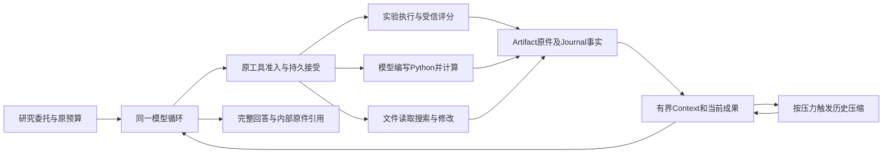

# 研究能力增强与实验交付 Spec

问题编号：`KNOWLEDGE-DECISION-DELIVERY-001`。本文只拥有目标、总体职责、专题协作和推进顺序。方案、验收与验证结果各有唯一正文，按下表阅读；正式成绩及发布资格由评测盘点拥有。

## 1. 目标、价值与范围

**当前目标是让 Agent 依据真实数据与执行成果持续分析，并完成有依据的回答。** SciFact E1 保留为受约束实验闭环；LongDS task2 官方英文及 task3 历史中文用例检验跨轮定义、程序和结果的正确接续。前者的实验选择由模型承担，后者按公开的逐轮请求改变分析条件，分别验收，不把多轮用户请求称为一次委托后的自主研究。2026-10-22用户明确排除用户资源下载和结果打包；HTTP下载、ZIP、导出清单及外部CLI复现不属于当前Agent能力门槛。原始工具数据仍归Artifact，实验和Python实际执行仍归Journal，供模型读取、恢复及工程审计；不在完成时复制成一套用户交付文件。

目标用户需要在获准材料上完成实验比较或持续数据分析。SciFact 用例面向知识／RAG 开发者；LongDS 用例面向反复调整条件、核对敏感性并形成市场建议的数据分析者。Agent 自行选择工具、编写及修订程序，消费真实输出，再回答当前问题。公开题目是能力验证材料，不把公开数据结论用于当前私人知识库或实际商业决策。

已有方法和结论是方案起点。[历史检索评测](../../evals/retrieval-benchmark-20260709.md)已有 Open／Galileo 的局部比较，现有 [Graph 策略](../../../src/personal_agent/memory/graphiti/search_strategies.py)也提供混合检索实现；它们的材料、实现和产品消费边界各按原身份解释。本任务据已知方向完成指定委托的工程验证与交付，交付质量看选中方案实际可运行、配置及结果一致、用户可复用，不以再次介绍 BM25／向量／混合检索或必须发现新算法结论验收。当前 E1 使用 SciFact，验收对象是该实验方案；当前个人知识库的效果由其正式读取链及真实问题另行验收，不将公开实验配置自动装入该链。

直接价值是由Agent完成必要实验、消费证据并给出可追溯结论；减少多少人工协调、时间或成本，需要与满足同一契约的脚本加普通模型比较后再作主张。

本例以材料、环境、权限和预算已准备齐全为起点。预期用户无需替 Agent 选择下一项实验、提供中间计划或整理执行结果，就能取得有实际依据的完整交付；运行中出现关键缺失事实时沿 [输入不明确时怎样澄清](research-experiment-acceptance.md#13-输入不明确时怎样澄清) 澄清。检索程序负责一次配置的准确执行，Agent 负责将多次执行、分析和交付组织成闭环。具体行为由 [推进、结束与恢复](research-experiment-protocol.md#4-推进结束与恢复) 说明，达到 [评估标准及评分资格](research-experiment-acceptance.md#4-评估标准及评分资格) 判据即验收本例自主交付能力。

本方案分别检验自主交付、持续推进、决策行为、业务收益和机制贡献：

| 验收目标 | 达到怎样的表现即成立 |
| --- | --- |
| 自主完成实验研究交付 | E1 的实际执行、分析、最终评测和回答满足原请求；初始条件充分后由 Agent 连续推进，任务中用户业务指挥介入为 0；下载、打包和 CLI 不参与当前能力计分 |
| 持续推进及恢复 | E2 验同 run 中断后接续；LongDS L1／L2 验同一对话中连续新请求的分析状态继承；L3 另验进程恢复。各自消费真实成果及原额度，不能互相替代 |
| 长上下文机制 | C6／E3 验真实容量压力下摘要、原件及后继实质工作；LongDS 仅在实际触发时增加相应证据，没有触发不否定已成立的跨轮分析结果 |
| 证据驱动的 agentic 能力 | 至少一处实际新证据支持的实质选择，能定位当时合法选项、模型选择、后续执行及交付后果；可选择必要验证，也可有据停止追加 |
| 业务收益 | 同预算、同结果契约下，完整交付率及预声明的人工介入、时间或成本比较达标 |
| 特定 Harness 机制收益 | 同模型、同工具及同结果契约下，沿 [能力、机制和业务收益分别比较](research-experiment-acceptance.md#3-能力机制和业务收益分别比较) 单变量比较量化目标机制在质量、成本、重复工作或恢复上的贡献 |

Harness 提供可靠执行、可恢复事实、当前工作集和必要反馈，研究模型据此承担实际取舍。有效推进包括找出互补性并验证、否定假设、保留 BM25 或及时交付；必要工作由真实证据和原目标决定。固定程序承担基线及独立评分，受控程序使模型可以将分析变为实际候选；研究自主性由“成果进入下一次选择、程序或实验，并影响后续工作”的实际链路验收。

首版已有的受限实验、模型自主计算和回答链按 [当前先完成的闭环](research-experiment-protocol.md#1-当前先完成的闭环)、[整体架构、增强顺序与本轮切片](#3-整体架构增强顺序与本轮切片) 保留。跨run分析接续由[LongDS 长程数据分析 Spec](longds-analysis.md#longds-长程数据分析-spec)设计，现已接入并完成上述LongDS流程；业务语义仍按独立评分解释。Context容量与历史压缩继续由主循环及ADR 0038拥有。独立研究子 Agent、任意 Shell、跨天后台仍在当前切片之外。旧 CSV 分析候选已并入本主线，原始来源及历史归档保留。

## 2. 专题正文与阅读路径

| 阅读任务 | 唯一正文 |
| --- | --- |
| 理解总体目标、分层及增强顺序 | 本文 |
| 修改受限检索实验、候选执行与完成协议 | [受限检索实验执行协议](research-experiment-protocol.md) |
| 核对 SciFact 自然请求、R 需求、验收与评分 | [研究实验请求与验收](research-experiment-acceptance.md) |
| 修改源码／JSON 工作产物、快照及 patch | [共享程序产物契约](program-artifact-contract.md) |
| 理解 LongDS 连续分析与跨进程恢复用例 | [LongDS 分析 Spec](longds-analysis.md) |
| 维护跨轮执行目标、每轮前置处理及目标调用上下文 | [执行目标维护 Spec](analysis-goal-maintenance.md)；目标工具单一正文契约的局部简化见[固化记录](../completed/conversation-goal-contract.md)，剩余目标语义及核验问题按子 Spec 与[实际结果](verify_results/analysis-correctness.md#29-单一目标正文与取消成果引用后的前三轮)推进 |
| 设计精度、自检、计算成文和原件提交 | [结果成文候选](analysis-result-correctness.md) |
| 反查原文要求、口径继承及语义核验的既有方案 | [长程语义候选与记录](longtask-semantic-consistency.md)；新目标维护契约由上一行子 Spec 拥有 |
| 反查已执行验证、诊断及当时计划 | [verify_results](verify_results/README.md) |

## 3. 整体架构、增强顺序与本轮切片

沿现有架构：Conversation 拥有同一用户任务、模型循环和完成流程；检索实验 Application 拥有实验协议、受信评分、冻结及复现；独立 Python Application 执行模型选择的分析代码；两者共享沙箱技术及执行额度。Artifact 拥有原件，原 Journal 拥有接受／命令／执行事实。已接入的[目标维护子方案](analysis-goal-maintenance.md#4-事实归属与最小契约)由主模型通过工具提交工作解释，原 Journal 保存成功操作，后续从同一事实恢复当前目标；它不改变用户原话的权威。Context 物化和历史压缩消费这些事实，不另建研究平台、CodeAgent、第二个 Plan 或独立可写目标库。数据按合法 Artifact 引用交接，不以工具调用次数代替研究决策。



各机制已取得的证据及未验证边界见[验证记录](verify_results/analysis-correctness.md#6-拆分时的机制证据边界)。当前方案只按各自声明的用户结果和适用反事实推进，不把执行、恢复或压缩通过等同语义正确。

目标维护使用[执行目标维护与读取](analysis-goal-maintenance.md)：同一主模型每轮先维护目标并执行业务，当前完整目标逐次进入输入。历史[子 Spec §9.5](analysis-goal-maintenance.md#95-维护工具扁平化与分支分离)将完整维护参数扁平化、沿用独立为无参数工具，由 Runtime 绑定版本，当时还强制回答前读取；该轮前三轮全部交付、独立 2/3。其后 §9.8 已取消强制读取，§9.9 已将目标合并为一个正文；现行契约及各轮证据由子 Spec 拥有，不以旧读取要求约束新实现。[长程语义记录](longtask-semantic-consistency.md)保留旧尝试。已关闭的范围删除、历史组织和执行基础保留，原件提交与 claim 消融分别比较；正式成绩及成本由评测正文拥有。

2026-11-01 按用户恢复目标核验范围，在隔离副本将当前维护的完整 goal 交给既有单一核验。全量和最小充分输入均未识别第三轮的目标错误，后者放行错误结果；第一轮正确稿接受。按核验漏放门禁停止正式准入，生产代码及 direct/none 轨迹保持，不启动新整轮；设计与原始证据由[目标维护 Spec §9.6](analysis-goal-maintenance.md#96-当前执行目标接入既有目标核验)拥有。

2026-11-02的[§9.7](analysis-goal-maintenance.md#97-核验聚焦本轮问题与回答修复)已保留跨问题问答／核验／修复历史，原两轮交付及读取阻塞由[§27](verify_results/analysis-correctness.md#27-跨问题回答核验与修复历史)保留。随后按用户要求在[§9.8](analysis-goal-maintenance.md#98-移除回答前强制读取并重新验证)取消强制读取，完整目标仍逐次提供，读取仅按需使用；独立缓存交接修正后，新前三轮全部交付、独立[1,0,1]，第三问6轮回答／判决接续并实际修复，第二问仍未通过评分。目标核验Prompt及判据未改，不恢复criteria，不接claim或来源核验。结果由[记录 §28](verify_results/analysis-correctness.md#28-取消强制读取后的前三轮与缓存交接修正)拥有。

用户后续授权的 v4 将目标维护、执行与交付核对明确衔接，并支持目标不明确时按原话再次修订；此前新前三轮因参数格式终止，取消来源索引后仍有其他数组阻塞。随后补齐双语字段描述与通用示例，该阶段新空会话前三轮全部交付、独立评分 2/3；实际 Schema 与滚动历史通过，两次参数错误均恢复，但第三轮仍将集中度方向反转并补入不合格市场。该次既定验证已结束，原六轮及此前失败保持，具体状态由子 Spec §9.1 及验证记录 §21 拥有。

用户随后指出 v4 含固定任务描述。按子 Spec §9.2 删除主任务、目标包装及字段元数据中由样本症状固化的业务指引，中英文同步通用版；类型、准入及接续保持。新前三轮交付 3/3、独立评分 1/3，二十份实际请求确认通用资源生效；第二轮主名单范围及第三轮补位仍失败。通用性纠正成立，语义未验收，旧成绩和失败不改判；停止追加任务专用提示，当前结果由验证记录 §22 拥有。

既有 Python 切片的架构改动限于原工具面新增一次有界 Python 执行、共享原沙箱、原 Journal 的 typed 接受分支与统一额度、原 Artifact 输出及交付消费；其详细接口和检查点只在 Python Spec 维护。新增目标操作、前置准入及当前视图的候选边界由目标维护子 Spec 拥有。原检索领域保留自己的评分和候选协议；Composition Root 只映射当前许可的执行配置。被替代的沙箱定义及旧隐式文件名协议保持删除，不恢复已经撤回的固定统计／Context 注入路径。

## 4. 能力怎样接入

2026-11-03按用户要求拆分目标核验、主循环回答及回答核验，当前设计由[目标维护Spec §9.14](analysis-goal-maintenance.md#914-分离目标核验与回答核验的职责及历史)拥有。目标核验只审任务定义并接续目标提交／判决／修订；回答核验只审实际交付并接续回答／判决／修复。两者从原Journal筛选、保留完整用户原话，主循环继续累计完整原生历史。旧统一核验及第一轮误拒保持历史身份，新连续前三轮已交付，原分[1,1,1]、预声明用户结果通过／通过／失败，实际边界见[记录§34](verify_results/analysis-correctness.md#34-分离目标与回答核验的空会话连续前三轮)。

随后按用户全量请求保持生产实现，从空会话连续运行原task2的34轮计划；实际交付2轮、原分[1,0]，第三轮重复修订参数错误后停止，后31轮未执行。两类历史分离及主循环接续成立，第二轮候选范围错误仍被两类核验漏放，未取得全量或语义通过；见[记录§35](verify_results/analysis-correctness.md#35-当前实现的task2全量连续运行)。

再按用户要求采用smolagents式反馈后原循环重新生成，取消普通回答按段修订工具；新空会话连续前三轮3/3交付，原分[1,1,0]、用户结果通过／通过／失败。真实SDK无旧工具，主循环及两类历史审计成立；三份回答各一次通过，拒稿后重新生成未自然触发，第三轮仍以比利时补第三名额。该次边界由[记录§36](verify_results/analysis-correctness.md#36-普通回答改为原循环完整重提的连续前三轮)拥有，不将协议清理当作语义修复。

**保持一个受治理主干，业务能力内聚，运行事实各有唯一 owner。** 主 Agent 统筹整体目标，研究职责组织比较、解释及报告收敛；实验能力执行明确配置；共享治理处理权限、额度、调用和提交。首轮按 [当前先完成的闭环](research-experiment-protocol.md#1-当前先完成的闭环) 解开对 claim／verifier 的前置依赖，完整研究 Sub-agent 抽取按主循环 Spec 独立准入。

```text
正式请求及授权材料
  → 恢复原目标、未完成工作、已提交事实和额度
  → Context：当前权限 → 所需材料 → 有界工作集／必要压缩
  → 同一主循环先维护目标并执行业务，需要时按需读取目标
  → 模型选择下一动作
       ├─ 读取／运行实验 → 准入 → 实际执行 → 提交事实和产物引用
       │                                          ↓
       │                           下一轮消费结果，继续分析或调整
       ├─ 提交完整候选 → 适用核验 → Completion → 交付确切正文
       │                      缺口反馈 → 回到当前任务
       └─ 缺关键条件、资源不足或不可恢复失败 → 返回等待／限制及实际进展
```

模型判断下一项必要工作、实验假设及何时提交；代码检查权限、容量、版本和不变量，执行端产生事实。计划完成、工具成功或模型说“已完成”都不能直接关闭目标。普通问答与研究沿原 `FinalMessage` 出口组织交付，所需检查按各自契约适用；本例沿现行提交协议，直接携参提交候选由主循环 Spec 另行验证。

## 5. 扩展机制与开源取舍

业务模块在 Composition Root 显式装配，复用现有 Registry 和调用协议；middleware 沿 Model Port／Gateway 包装计量、追踪及适用技术重试；hook 通知已提交进展，不拥有目标、执行或完成的写权限。Context 语义变换属于具名协作，不能藏入任意 hook。这些职责不要求先建跨业务插件平台。

执行与文件工具的固定源码比较见[原采用依据](verify_results/analysis-correctness.md#7-原执行与文件工具的采用依据)；组件参考继续从[工具执行与安全](../../agentRef/tool-execution-and-safety.md)定位。

压缩的两个独立源码比较由[Context 参考](../../agentRef/context-engineering.md#5-压缩的实际装配消费与恢复)拥有，完整子能力调用由[委托比较](../../agentRef/multi-agent-and-delegation.md)拥有。外部机制只支持候选取舍，不能代替本例失败和收益证据。

## 6. 当前范围、继续条件与完成边界

已实现的 Python 执行、原件读取、跨轮交付、容量压缩和限定进程恢复保持各自证据；它们不等于长程分析正确。当前核心缺口是用户约束被重解释、默认／临时／历史口径混用，以及正确工具结果在成文时改变。具体依据见[分析审计与设计复审](verify_results/analysis-correctness.md)，正式结果见[评测盘点](../../evals/02-current-case-inventory.md)。

1. 原实验初步闭环按[受限实验协议](research-experiment-protocol.md)返回确切正文；下载、ZIP、导出清单及用户外部 CLI 复现已经退出 Agent 完成门槛。内部执行、冻结／test、权限、原件及原预算保持。
2. 目标维护已按 [ADR 0048](../../adr/0048-conversation-goal-maintenance.md)接入并完成真实连续六轮，前置及上下文通过、语义未通过，按[子 Spec 当前状态](analysis-goal-maintenance.md#9-整体设计复审与当前状态)保留成立边界，后续变更先复审真实目标和回答。压缩后消费未触发，单列未覆盖。原话展示不能继续作为尚未实施的新方案；既有结果由[SEM 记录](longtask-semantic-consistency.md)反查。目标核验只按子 Spec §9.7 的现行范围接入，不恢复独立 criteria 或其他核验，不把工具顺序或原话到达当成目标理解正确。
3. [NUM 成文候选](analysis-result-correctness.md)的原件提交、claim 消融和其他机制收益单独比较，不能与 SEM 捆绑后分别声称收益。
4. 用户结果、执行事实、恢复、压缩、agency 和 Harness 贡献分别判定。局部达到原判据即关闭；完整任务未达标保持未完成，不重写旧分数或追加已关闭边界的义务。

当前架构由[架构入口](../../architecture/README.md)拥有；Python、Loop Schema 和历史压缩继续引用原专题。准入状态唯一登记于[Future 队列](../../future/design-optimization-backlog.md)，各子 Spec 不再复制队列或正式成绩表。

统一核验按§9.11完成接入及真实空会话前三轮；原LongDS分[1,0,1]，用户结果通过／失败／失败。第三问原评分忽略额外不合格市场，不能代替完整用户目标验收；目标与回答均漏放，机制、输入保真与语义效果分开报告。当时明细和停止边界由[记录§31](verify_results/analysis-correctness.md#31-统一目标与回答核验的空会话连续前三轮)拥有。

当前按[Spec §9.12](analysis-goal-maintenance.md#912-单正文的任务定义与四项内容核验)完成单字段四段正文和四项目标核验，从空会话连续前三轮原分[1,0,0]、用户结果通过／失败／失败。原生历史持续累计，但第二问名单范围错误与第三问多选仍漏放，第一问正确初稿被误拒；接入完成不代表语义通过。原分、实际输入、费用和停止边界见[记录§32](verify_results/analysis-correctness.md#32-单正文四项内容契约的空会话连续前三轮)。

第二轮核验重新设计由[目标维护Spec §9.13](analysis-goal-maintenance.md#913-按用户要求逐项比较的统一核验)唯一拥有：以具体用户要求与当前提议逐项比较替换四项总体评分，复用单次调用及有序历史；已接通逐项报告；新链在第一轮目标误拒后耗尽主决策，正常答案0、后两轮未执行，语义验收失败；原成绩保持，实际结果见[记录§33](verify_results/analysis-correctness.md#33-逐项用户要求核验的空会话连续前三轮)。

用户再次要求完整task2，后改第三轮后暂停：保持§9.16生产版本，前2轮正常交付，第3轮经历30次回答退回后达到40主决策限制，未交付；第4—34轮未执行，独立评分暂停。原始输入和上下文绑定成立，完整稿重生成自然触发但未收敛；已停止封存，后续从真实现场定位而非跳过终态或重采，见[记录§37](verify_results/analysis-correctness.md#37-原循环重生成实现的task2在第3轮后停止)。

随后按用户要求，以保留完整反馈历史的候选从空会话重跑原 task2 全量。实际交付 4 轮、第五轮容量失败，原分 `[1,0,0,0]`；第四轮复现跨 run 同号回执遗漏，历史保留范围重新打开，下一修正先重审身份和完整交互压缩边界。原运行、旧离线回放及已成立的工具配对保持原身份；实际结果及停止决定由[记录 §38](verify_results/analysis-correctness.md#38-完整反馈历史候选的-task2-全量连续运行)拥有。
