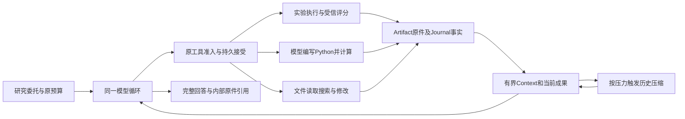

# 研究能力增强与实验交付 Spec

问题编号：`KNOWLEDGE-DECISION-DELIVERY-001`。截至2026-10-25，SciFact E1已到Final，下载与打包退出当前能力范围；自主Python、摘要和恢复有各自实际证据。LongDS task3已完成direct／none的36轮正式流程及第17→18轮真实进程恢复，官方评分27/36；本地自然预算压缩已在后半程触发并继续交付。整体业务准确性仍未全部达标，claim／完整核验与原E1未覆盖项保持后续范围。实际结果由[评测盘点](../../evals/02-current-case-inventory.md)拥有，不把36轮用户请求称为一次委托后的自主研究。

本文拥有整体架构、范围与推进关系；[Python工具Spec](python-data-analysis-tool.md)拥有自主计算契约，[主循环§3.11](conversation-loop-boundaries.md#311-context-压力与压缩)拥有历史压缩，[统一Loop Schema](conversation-loop-schema.md)及[ADR 0045](../../adr/0045-native-intent-loop-and-recorded-model-output.md)拥有当前模型交互。源码及流程验证已接入，下文历史prepare／FinalSubmission不再描述现行模型接口。准入队列由[Future](../../future/design-optimization-backlog.md)拥有；历史失败、未知费用和原件保持；业务正确性的新增候选见§10，当前只做事实审计与设计，生产优化及claim消融尚未执行。

## 1. 目标、价值与范围

**当前目标是让 Agent 依据真实数据与执行成果持续分析，并完成有依据的回答。** SciFact E1 保留为受约束实验闭环；LongDS task3 作为新增长程数据分析用例，检验跨轮定义、程序和结果的正确接续。前者的实验选择由模型承担，后者按公开的逐轮请求改变分析条件，二者分别验收，不把 36 轮用户请求称为一次委托后的自主研究。2026-10-22用户明确排除用户资源下载和结果打包；HTTP下载、ZIP、导出清单及外部CLI复现不属于当前Agent能力门槛。原始工具数据仍归Artifact，实验和Python实际执行仍归Journal，供模型读取、恢复及工程审计；不在完成时复制成一套用户交付文件。

目标用户需要在获准材料上完成实验比较或持续数据分析。SciFact 用例面向知识／RAG 开发者；LongDS 用例面向反复调整条件、核对敏感性并形成市场建议的数据分析者。Agent 自行选择工具、编写及修订程序，消费真实输出，再回答当前问题。公开题目是能力验证材料，不把公开数据结论用于当前私人知识库或实际商业决策。

已有方法和结论是方案起点。[历史检索评测](../../evals/retrieval-benchmark-20260709.md)已有 Open／Galileo 的局部比较，现有 [Graph 策略](../../../src/personal_agent/memory/graphiti/search_strategies.py)也提供混合检索实现；它们的材料、实现和产品消费边界各按原身份解释。本任务据已知方向完成指定委托的工程验证与交付，交付质量看选中方案实际可运行、配置及结果一致、用户可复用，不以再次介绍 BM25／向量／混合检索或必须发现新算法结论验收。当前 E1 使用 SciFact，验收对象是该实验方案；当前个人知识库的效果由其正式读取链及真实问题另行验收，不将公开实验配置自动装入该链。

直接价值是由Agent完成必要实验、消费证据并给出可追溯结论；减少多少人工协调、时间或成本，需要与满足同一契约的脚本加普通模型比较后再作主张。

本例以材料、环境、权限和预算已准备齐全为起点。预期用户无需替 Agent 选择下一项实验、提供中间计划或整理执行结果，就能取得有实际依据的完整交付；运行中出现关键缺失事实时沿 §2.3 澄清。检索程序负责一次配置的准确执行，Agent 负责将多次执行、分析和交付组织成闭环。具体行为由 §4.3 说明，达到 §6 判据即验收本例自主交付能力。

本方案分别检验自主交付、持续推进、决策行为、业务收益和机制贡献：

| 验收目标 | 达到怎样的表现即成立 |
| --- | --- |
| 自主完成实验研究交付 | E1 的实际执行、分析、最终评测和回答满足原请求；初始条件充分后由 Agent 连续推进，任务中用户业务指挥介入为 0；下载、打包和 CLI 不参与当前能力计分 |
| 持续推进及恢复 | E2 验同 run 中断后接续；LongDS L1／L2 验同一对话中连续新请求的分析状态继承；L3 另验进程恢复。各自消费真实成果及原额度，不能互相替代 |
| 长上下文机制 | C6／E3 验真实容量压力下摘要、原件及后继实质工作；LongDS 仅在实际触发时增加相应证据，没有触发不否定已成立的跨轮分析结果 |
| 证据驱动的 agentic 能力 | 至少一处实际新证据支持的实质选择，能定位当时合法选项、模型选择、后续执行及交付后果；可选择必要验证，也可有据停止追加 |
| 业务收益 | 同预算、同结果契约下，完整交付率及预声明的人工介入、时间或成本比较达标 |
| 特定 Harness 机制收益 | 同模型、同工具及同结果契约下，沿 §5.3 单变量比较量化目标机制在质量、成本、重复工作或恢复上的贡献 |

Harness 提供可靠执行、可恢复事实、当前工作集和必要反馈，研究模型据此承担实际取舍。有效推进包括找出互补性并验证、否定假设、保留 BM25 或及时交付；必要工作由真实证据和原目标决定。固定程序承担基线及独立评分，受控程序使模型可以将分析变为实际候选；研究自主性由“成果进入下一次选择、程序或实验，并影响后续工作”的实际链路验收。

首版已有的受限实验、模型自主计算和回答链按 §1.1、§1.2 保留。跨run分析接续由§9设计，现已接入并完成上述LongDS流程；业务语义仍按独立评分解释。Context容量与历史压缩继续由主循环及ADR 0038拥有。独立研究子 Agent、任意 Shell、跨天后台仍在当前切片之外。旧 CSV 分析候选已并入本主线，原始来源及历史归档保留。

### 1.1 当前先完成的闭环

2026-10-21 用户明确要求：当前 claim 和 verifier 暂不接入，先初步闭环任务，运行稳定后再接入。该决定改变本任务的实施范围，不把既有 claim 链的完成状态当作原用户需要，也不改变用户要求的实际实验、报告、配置和可复现产物。

当前路径为：**自然委托 → 模型选择实验／读取实际结果 → 分析并决定继续或收敛 → 提交报告 → 核对必要执行事实 → 返回确切回答。** 模型保留决定下一项实验、读取哪些错例、修订候选及何时提交的权力；代码负责权限、执行事实、配置冻结、原件引用、预算和Completion。完成、已完成恢复及缓存返回均不生成报告副本、导出清单、ZIP或下载资源列表。

| 首轮保留 | 首轮后置 |
| --- | --- |
| 实验工具、源码／配置产物、实际执行与反馈、模型证据消费及报告生成 | 将分析拆成 ResearchClaims、claim 编辑／逐条引用绑定及其专门选证循环 |
| 模型提交完整 `FinalMessage`／确切 segments，返回同一回答并保留内部原件 | 独立语义 verifier、ResearchReview、同稿 approved 要求及拒稿修订循环 |
| 执行覆盖、冻结／test 隔离、同run身份、必要原件可读和实际回答 | 新评分器资格准备与语义 target 评分；当前已有工具和历史材料保留，不作为初步闭环的前置步骤 |
| 全部实际模型调用的容量、用量及原 deadline；真实压力下的必要压缩 | 以摘要 Judge、额外研究子 Agent 或新任务平台补回被后置的阶段 |

报告生成仍由模型承担，可复用现有 writer 的成文职责，但其输入输出须独立于 claim 创建和语义核验；不把现有 claim writer 原样调用称为“已经解耦”。当前没有 claim／verifier 时，压缩只覆盖实际存在的动作、读取、报告等历史；通用设计列出的 verifier 容量保护不构成首轮接入要求。

本范围仅适用于已由正式部署绑定实验能力的研究任务，其他普通对话及既有研究契约不自动关闭核验。实验路径使用一套当前交付契约，迁移其全部生产者、消费者和恢复出口，不增加可任意切换的 `skip_verifier` 开关，也不伪造 passed／approved 来适配旧链。已有封存 run 按原身份解释，不拿原 claim 检查点冒充新路径的提交。

初步闭环检查实际实验、结果消费、必要选择、当前提交和回答是否连续；独立指标复算可由工程读取原执行产物完成，不能强制用户下载、导出打包或CLI重跑。报告语义按用户决定暂放，结果记“Agent流程检查点／语义未验收”；运行时长、工具次数或一条成功轨迹不自动构成稳定或长任务能力。过去按文件交付口径封存的结果保持原身份，后续评价按本轮明确范围单列，不覆盖原报告。

T3／T5 提交和采集迁移已在新 DeepSeek E1 中到达报告、下载、复算和干净复现；独立审读确认错例分析错误，初步闭环仍未通过。新轨迹的正确资料完整送达，没有历史压缩；不能把错误归因为资料丢失或凭此准入摘要。此前 E1、P1、F3、评分资格及源码封存保留原判据和成绩，不追溯重评。

### 1.2 整体架构、增强顺序与本轮切片

沿现有架构：Conversation 拥有同一用户目标、模型循环和完成流程；检索实验 Application 拥有实验协议、受信评分、冻结及复现；独立 Python Application 执行模型选择的分析代码；两者共享沙箱技术及执行额度。Artifact 拥有原件，原 Journal 拥有接受／命令／执行事实。Context 物化和历史压缩消费这些事实，不另建研究平台、CodeAgent、第二个 Plan 或可写事实副本。数据按合法 Artifact 引用交接，不以工具调用次数代替研究决策。



| 增强项 | 当前事实与最小责任 | 已证明边界及剩余条件 |
| --- | --- | --- |
| 实验推进与交付 | 最新 E1 已经真实实验、冻结和 test 到 Final；§8.5 已删除自动打包与下载 | 新完成边界的两份真实阶段恢复成立；语义未评分，P1 自主候选研究链未完整验收 |
| 结果统计与排名分析 | 最新 E1 中 Python 合法执行 5 次、4 成功，实际程序含逐查询排名、互补集合和统计分析，反馈进入后继请求 | 自主代码执行与继续成立；此前草稿计数及解释错误按原身份保留，最新报告语义未评分，不宣称稳定成文 |
| 成文与语义核验 | 当前实验 phase1 只执行确定性完成检查；计算结果不保证自由成文忠实，不能把错误称为 Verifier 漏放 | 语义失败保留，按用户决定暂放；不自动接回 claim／verifier，也不阻断独立工程边界的验证 |
| 上下文卸载与历史压缩 | 原件引用、有界工具反馈及历史归档已有实现；ADR 0038 授权提前接入，摘要已关闭 thinking | 真实阶段的摘要生成、下一轮消费及新存储实例恢复成立；摘要仍沿用错误旧自述，语义保真未通过；自然压力、多次压缩和 E3 未覆盖 |
| 持续推进与恢复 | 完成检查点、Python 未知执行对账、摘要检查点恢复分别已有局部证据 | 新增 LongDS 设计检验已回答之后的新请求接续；跨轮原件、执行授权、预算和分析结果仍待 L0—L3，旧发布故障 F3 不作当前能力门槛 |

当前推进由 §9 拥有：保留 §8.5 已关闭的范围删除，先准备 LongDS 的来源隔离和正式入口基线，再按最早真实失败决定适配。旧研究语义修复仍暂放；LongDS 的外部结果评分不接回生产 claim／verifier，也不重开旧封存。

架构改动限于原工具面新增一次有界Python执行、共享原沙箱、原Journal的typed接受分支与统一额度、原Artifact输出及交付消费。原检索领域保留自己的评分和候选协议；Composition Root只映射当前许可的执行配置。删除项是被替代的沙箱定义及旧隐式文件名协议，不恢复已经撤回的固定统计／Context注入路径。详细接口和检查点只在Python Spec维护。

## 2. 用户请求、材料与需求

### 2.1 首个用例：公开检索方案复现实验

现有 E1 的受约束专业委托请求：

> 请用提供的 SciFact 材料和获准环境，比较 BM25 与向量检索，分析实际错例，判断是否需要组合；有必要时再做验证。用 train 分析和选择配置，冻结后在 test 上比较基线与选中方案。给我完整的比较报告，说明实际结果、选择依据和限制。按给定预算自行推进，缺关键条件再问我；先不要修改当前知识库。

这是本工程设计的专业实验委托，尚未取得目标用户的原始使用记录；2026-10-20 已从正式 HTTP 入口执行一次 baseline，原用户交付失败，同轨迹局部执行能力缺口经独立审查成立。它适合已确定数据集与实验协议的检索开发者，可验证受约束执行和交付，不能据此声称 Agent 自主选择数据集、比较对象或评估协议。 最新 E1 没有自然容量拒绝；此任务允许有限分析后合理收敛，不能独自承担复杂长任务验收。新的长期依赖用例见 §9，E1 的既有成绩和剩余语义问题保持。准入前确认需求并固定环境、权限和额度，用户未要求方法必须胜出。

用户输入的具体程度由委托关系决定，不能按字数判断。真实请求可给出问题和大量日志，也可明确指定方法；公开样本的出处及边界见[输入来源核查](../../agentRef/task-benchmarks.md#9-用户输入的具体程度与来源身份)。本项目没有用户输入分布统计，下表是产品设计分类，不代表发生频率：

| 输入程度 | 示例及 Agent 应承担的工作 |
| --- | --- |
| 只描述问题 | “知识库经常搜不到我要的资料，帮我看看。”需先明确对象、具体症状及这次期望的工作，不能直接推断应跑 SciFact |
| 给出目标、材料和边界 | “先用公开数据实测比较一下检索方案，给我结论和可复现材料，别改现有知识库。”Agent 从获准资源确定适用方案、说明假设并组织实验；缺少影响结果的条件时澄清 |
| 明确专业实验协议 | 本节原请求。Agent 自主空间主要在结果分析、必要后续验证、执行与交付，协议选择已由委托方限定 |

建议另准备第二类输入作为结果导向的产品入口候选：

> 我在做知识检索，想先用公开数据比较一下检索方案。请在测试环境里实际跑一下，把比较结论和可复现材料给我，先别改现有知识库。

该示例是新设计表达，不是已采集真实请求，不替换现有 E1。用户负责目标和重要约束；已有数据、基线、许可资源及实验规范可来自授权材料；具体方案由 Agent 在这些边界内选择。只有 SciFact 或一个许可模型时，不能因未写进用户消息就声称 Agent 已证明自主选型。

| 初始材料或结果 | 本例范围及责任 |
| --- | --- |
| BEIR/SciFact | 已取得官方镜像及参考源码；5,183 篇文档，train 的 809 条已标注查询用于开发，test 的 300 条用于最终验收 |
| 检索实现与向量模型 | 独立工具已准备固定 BEIR、专用 Elasticsearch 和固定 `all-MiniLM-L6-v2` 权重；实际工程执行见 §7.1。生产许可资源绑定及模型工具接入已实现，真实用户结果仍待 E1／P1 |
| 权限和初始环境 | 只读获准实验原件及环境清单，仅写本次实验资源和产物；准备器不提供胜出方案、预选错例、参考计划或预生成排名 |
| 当前回答及内部成果 | 返回完整报告，原配置、排名、指标与程序保留内部引用，供模型消费和工程审计；不自动导出、打包或下载 |

来源、固定提交、校验和、原始标注及许可证声明差异由[材料审计](../../agentRef/task-benchmarks.md#8-beirscifact-检索实验材料)拥有。原始语料按来源及校验和定位，不预设可重新分发。SciFact 是英文科学文献检索材料，本例结果不能直接决定中文私人知识库选型或完整 RAG 回答效果。

本例不训练或微调检索模型。`train` 沿用来源文件的 split 名称，在本例承担方案开发／验证用途：809 条有标注查询供分析错例和选择方案，300 条 test 查询供方案冻结后的独立评测；两组检索同一份 5,183 篇文档的 corpus，不将文档库另拆为训练库和测试库。

**划分的理由是方案会根据结果被选择或调整，与算法是否确定、选型由谁完成无关。** 即使实现和权重固定，由业务代码比较开发集指标并按规则选中 BM25 或向量方案，选中结果也依赖这批查询；模型分析错例后决定是否验证组合，同样使用了开发材料。若再以参与选择的查询验收选中方案，分数会受到选型偏差影响。开发集用于探索和选择，test 用于评测已冻结方案在未参与本次选择的查询上的表现；确定性程序每次选出同一方案，只说明过程可重复，不能消除数据参与选型造成的偏差。方法依据参见 scikit-learn 关于[参数选择与独立评测](https://scikit-learn.org/stable/modules/cross_validation.html)的说明，不据此引入训练流程、交叉验证平台或额外模型调用。

该划分不是所有确定性实验的固定步骤。若用户只要求按预先固定的方法及配置报告某批查询上的表现，且不依据评分反复选方案，可以直接进行固定方案评测；结论限定于实际评测范围。当前 E1 明确要求错例分析、必要后续验证及选型，继续保留开发与最终评测分离；不能为拉长任务强制产生改动或实验次数，也不将此协议写成所有工具的通用流程。若改为固定比较任务，先另行固定其请求及验收，不改写本 E1 的成绩或义务。

test 标注只授权给执行／评分端，生成侧无读取权限；先固定确切选中配置，再运行 test，之后不按 test 调参。BEIR test 来自原始 SciFact 公开 dev，运行隔离不证明模型训练未见，也不把开发选型协议称为 BEIR zero-shot 复现。请求、反馈和报告以中文为主，英文原件保持原文。

### 2.2 需求与验收对应

| 编号 | 必须产生的结果 | 用例 |
| --- | --- | --- |
| R-01 真实比较 | 获准原件经真实执行形成同口径 BM25、向量开发结果，所需查询全部完成；错误及缺失不被论文数字或缩小分母掩盖 | E1、E2 |
| R-02 证据驱动推进 | 实际错例参与分析和后续选择；声称某改动有效时有对应实验依据，允许否定假设或保留基线 | E1、E2；持续推进另报实际消费链 |
| R-03 最终验收 | 先固定配置，再对基线与选中方案执行完整 test；实际配置一致，test 不回流选型 | E1、E2 |
| R-04 回答与成果绑定 | 模型实际提交完整回答，必要实验与选中配置有同run真实执行依据，原件按已有引用可追溯；直接返回确切正文，不要求下载、ZIP、导出清单或外部复现 | E1、E2；旧文件发布F3退出当前能力验收 |
| R-05 成果接续 | 已提交开发成果、无在途写入的边界中断后，沿同 run 正式恢复，消费成果并完成原交付，保留已提交用量 | E2 |
| R-06 范围与诚实性 | 零越权读取及未授权修改；当前知识库不变，限制、失败和部分产物不得被报告为完整成功 | E1、E2、F1、F2 |
| R-07 有界 Context | 每次实际请求适配模型窗口，计入输出及协议预留；同任务可按真实压力多次压缩，原目标、事实、当前稿和原件仍可恢复并消费，原预算不重置 | E1／E2 输入审计；历史压缩另由 C6／E3 验收，单次和多次分别记录 |
| R-08 实验终态 | 超时／取消后按实际作业身份确认终态或查询未知结果，再按执行契约决定重试，不把等待超时当作业停止 | E1、E2；runner 固定后登记 F2 |
| R-09 可编程候选 | 模型编写的组合／重排程序在隔离环境真实运行，源码、输入及输出绑定，指标由受信端计算；冻结后独立端用交付源码及配置重跑。程序遵守原授权，不能修改评分或读取 test 标注 | P1；不追溯增加 E1—E3 义务 |
| R-10 自主结果计算 | 模型可选择合法实验原件并编写Python，实际执行计数、集合或排名等任务所需分析，再消费输出；报告所述数值和例子与原件一致，执行成功不替代成文正确 | Python Spec V1—V3及局部组；完整产品另验V4 |

R-01—R-09 对应 SciFact 实验契约，R-10 的自主计算可复用到其他分析；LongDS 采用 §9.2 的 LT 需求，不套用检索冻结／test 义务。编号只用于追溯，不自动成为生产字段、额外状态或固定模型计划。原请求拥有交付要求；计划可以调整，不能通过删除待办降低结果标准。

### 2.3 输入不明确时怎样澄清

**用户输入已显露关键歧义时可以立即问；缺少可查事实时先读获准材料；执行中新出现关键缺口时再问。** 通用时机及模型所需 Context 由[主循环 Spec](conversation-loop-boundaries.md#澄清的时机和决策上下文)拥有。下表只说明本研究场景的询问方向，不是每次都要填齐的表单，不新增生产分类字段或固定澄清阶段。

| 澄清方向 | 什么时候需要询问 | 问题应落在哪里 |
| --- | --- | --- |
| 用户要取得的结果 | “优化”“研究一下”可对应原理解释、公开实测、现有系统诊断或实际修改，现有输入不能确定 | 想比较公开方案、排查当前系统，还是直接实施改动；避免由 Agent 偷换工作目标 |
| 对象和可用材料 | 当前可见信息无法定位知识库、数据、现有实现或失败例子 | 哪个对象、有哪些可授权材料和代表性失败；已可读取的配置先读，不让用户重抄 |
| 症状和成功标准 | 不知道要改善召回、相关性、速度、资源占用中的哪项，或取舍会改变推荐 | 用“找不到资料／结果不相关／太慢”等业务表达；不要求用户先设计 nDCG、阈值或完整评测集 |
| 执行范围和边界 | 不清楚要出建议、在测试环境实测，还是修改现有系统 | 哪些环境可执行及可写；已有授权不重复询问，用户回答仍不能替代正式身份和 Policy 准入 |
| 资源和时效限制 | 运行、付费调用、数据出域或期限会影响可行方案，现有配置与授权没有答案 | 可用环境、额度、时间和数据使用限制；不把系统已有硬限额变成模型可协商权限 |
| 交付用途和形式 | 结果面向选型、复现或正式提交，不同用途会改变必要内容 | 需要什么可用结果；普通格式可用已公开默认方式，不机械追问文件名、排版和所有参数 |

对影响结果的多个缺口，优先一次集中问最关键的两三个，避免连续索要完整实施计划。无需用户决定的技术细节，由 Agent 在获准范围内选择并说明依据；可以安全采用默认方案时声明假设继续。等待必要回答时可做独立、只读的准备，不推进依赖该答案的昂贵实验或副作用。条件始终不足则明确等待或限制，不能补造事实。

例如用户只说“帮我优化知识检索”，若相关历史也未说明目标和对象，可立即问“主要是找不到相关资料、结果不相关，还是速度慢？”及“这次希望先诊断并给建议，还是在测试环境里实际验证？”。若用户已给出失败查询和获准日志，则先查看这些材料，不重复问已有答案。运行中若发现更高召回与用户未说明的资源限制存在关键取舍，可在继续扩大实验前补问。本例只需比较报告且现有额度足够时，直接报告效果与资源取舍，不为尚未委托的生产部署追问。数据集、算法参数和具体评估方法由 Agent 提出并说明适用性，不把技术方案设计转交用户。

澄清与正式后续轮次沿主循环的等待及消息契约处理，不把追加答复当作 E2 的原样恢复。输入足以确定本例后，再固定实际实验请求、运行身份及额度；澄清阶段已发生的成本另据实际记录，不声称当前已实现跨 run 统一预算。

自然输入的验收同时检查是否提出必要问题、是否避免重复询问已知内容，以及回答后是否按真正目标继续。测试用户只能提供预先固定的场景事实，不能注入正确计划、工具参数或理想中间结果。该候选尚未登记，不转用 E1 成绩。

## 3. 能力目标与当前差距

需要证明的主线是：模型根据原目标选择动作，执行系统形成真实成果，后续模型消费这些成果并继续推进，最后交付完整结果。已有类型、存储和工具只是基础，证据必须到达用户结果。

### 3.1 长任务问题逐项对照

初始缺口来自 2026-10-18 源码审计及 2026-10-19 一致性复核；下表按 2026-10-22 的实际证据更新。历史准入与轨迹见 §7.2，正式成绩由[评测盘点](../../evals/02-current-case-inventory.md)拥有。外部长任务问题及测量限制见[一手资料比较](../../agentRef/runtime-recovery.md#6-长任务失败模式与评价边界)。

| 能力或问题 | 当前实现及证据限制 | 本例验收 |
| --- | --- | --- |
| 目标保持与真实进展 | 旧 E1 实际完成开发比较、追加组合、冻结、test 和文件交付；报告解释失败，P1 与 E2 未完成 | 从实际配置、排名和错例推进；否定假设也可有进展，不要求每轮分数上涨。E1／E2 |
| 实验执行及结果有效性 | 真实 E1 的六组结果已独立复算，三组 test 已干净重跑；Python 分析程序已自主执行，但尚未证明 P1 的候选实现与迭代链 | 结果绑定数据、实现、模型和配置，变化后只复用仍适用部分。R-01／R-02／P1 |
| 输入与文件交付 | 独立 Artifact 上传不摄入知识；旧 E1 的正式下载及复现成立；新增 Python 分析闭包清单 v3 尚未完成同版正式交付验收 | 原件只读授权与草稿、执行用途分开；齐备文件经正式入口可读。R-04／R-06 |
| Context 增长与语义保留 | 显式容量、末端 estimated guard 和历史压缩已接入；非思考摘要在真实阶段生成并被下一轮消费，检查点可恢复；摘要仍沿用错误自述 | 局部可用性与语义保真分开；旧 E1 无自然容量拒绝，自然压力、多次压缩及 E3 未覆盖。R-07／E3 |
| 失败、重复和重新规划 | 原 Gateway 分类与反馈保留；实验／写入不由通用重试重复启动，实际候选失败日志可读，不新增 progress Judge | 分开临时服务失败、参数／权限错误与假设被否定；模型据真实反馈继续或停止 |
| 超时、取消和状态未知 | Docker 及 Python 边界有真实执行证据，Python 未知执行恢复对账已验证不重启并释放原额度；全部故障窗口未覆盖 | 确认真实终态、清理或如实未知，E2 不能代替 F2 |
| 中断后的持续交付 | 原 E1 已提交发布检查点可零新增模型／实验恢复，摘要新实例恢复也成立；两者不是开发中断 E2 或首次发布故障 F3 | 仅验原样同 run 的已提交边界恢复；自然续聊、跨 run、跨天后台另取证 |
| 实际耗用与交付额度 | 绑定实验的各逻辑模型阶段已接容量／用量准入；强制进程终止时未提交物理消费由外部归档账本保留，不能把 Trace 已提交数当全部费用。普通 workflow verifier 的历史计量限制不外推为本轮已修复 | 核对所有实际发送、完整响应、失败及未知用量；不将未知计零；已有原截止已投影给动作／普通Final，快照不是新额度 |
| 完成与权限 | 业务 validator、实际提交绑定、正式发布及 Completion 已接通；旧 E1 机械交付成立但用户语义结果失败，首轮未调用语义核验 | 确定性检查拥有执行、评分与文件不变量，不能保证报告解释正确；完整结果、拒绝及恢复按各自用例验收。E1／F1／F3 |

上述能力保留单一事实 owner 和原决策循环。当前缺口优先按 §8 补证，不以新增子 Agent、通用作业平台或共享任务记忆替代验证。

## 4. 能力怎样接入

**保持一个受治理主干，业务能力内聚，运行事实各有唯一 owner。** 主 Agent 统筹整体目标，研究职责组织比较、解释及报告收敛；实验能力执行明确配置；共享治理处理权限、额度、调用和提交。首轮按 §1.1 解开对 claim／verifier 的前置依赖，完整研究 Sub-agent 抽取按主循环 Spec 独立准入。

```text
正式请求及授权材料
  → 恢复原目标、未完成工作、已提交事实和额度
  → Context：当前权限 → 所需材料 → 有界工作集／必要压缩
  → 模型选择下一动作
       ├─ 读取／运行实验 → 准入 → 实际执行 → 提交事实和产物引用
       │                                          ↓
       │                           下一轮消费结果，继续分析或调整
       ├─ 提交完整候选 → 适用核验 → Completion → 交付确切正文及文件
       │                      缺口反馈 → 回到当前任务
       └─ 缺关键条件、资源不足或不可恢复失败 → 返回等待／限制及实际进展
```

模型判断下一项必要工作、实验假设及何时提交；代码检查权限、容量、版本和不变量，执行端产生事实。计划完成、工具成功或模型说“已完成”都不能直接关闭目标。普通问答与研究沿原 `FinalMessage` 出口组织交付，所需检查按各自契约适用；本例沿现行提交协议，直接携参提交候选由主循环 Spec 另行验证。

### 4.1 受限实验能力

这里的“受限”指实验执行器有明确的可执行范围：只接受已支持的方法及参数、获准数据与模型、实验专用资源，并遵守执行额度及开发／test 隔离。参数、资源范围和额度由准入及 runner 落实，不能只靠 Prompt 约定；这些是待实施和验证的要求，不代表当前已经具备物理沙箱隔离。

研究模型负责实验策略、错例解释、候选程序、需要语义取舍的方案建议及完整交付；已确定规则下的数值比较交给确定性业务代码。工程维护固定基线、执行驱动和评分器，模型可以在获准范围编写分析及排名变换程序，不能修改受信组件。首个可编程切片只处理已有排名的组合／重排及相关诊断，不开放任意模型下载、训练或宿主 Shell。以下契约已沿正式入口装配，完整交付仍待验收；独立工具证据见 §7.1。

本例要求比较已有检索方法，不要求 Agent 实现新算法，因此先以“输入数据、方法和配置均已明确的一次实验”为执行单元。解析、索引、检索及指标计算按相应方法的既定程序完成，同一作业的配置、状态、结果和耗用保持关联。把这些稳定步骤逐个交给模型调度，并不会增加研究自主性；模型的工作是消费实际结果，决定下一项必要实验或交付。

工具只运行本次基线配置或确切程序，不自动遍历全部候选、选择最优方案、追加融合、决定研究停止或代写结论。SciFact 名称、809／300 条查询及本例验收要求属于用例和获准材料，不写成执行器中的案例分支或参考答案；实际覆盖从输入数据和执行事实取得。固定的是受信执行、基线及评分协议，候选实现可以由模型编写；不为兼容未来方法预建插件平台。

**固定基线的可配置范围很小，不能仅靠这些参数展示研究决策。** BM25 首个候选没有暴露 `k1`／`b` 等调参项；向量首例只准备一个固定 MiniLM 候选，许可打分方式为 `cos_sim`；独立工具的参考融合固定为 RRF、常数 60。`retrieve_k` 主要控制返回深度及资源，满足指标深度后增加它，不能当然解释为改善 nDCG@10 或 Recall@100。P1 增加候选程序的构造与修订空间，仍不以找到全局最佳配置验收。

若原委托已确定可机械执行的目标指标、约束及并列规则，原实验 Application 的比较职责从已提交结果计算排序、合格集合及规则选定项；小规模合法候选在预算内也可用固定流程搜索。该职责消费真实结果，不要求 LLM 代算最大值，不借 Admission 改写提议，也不把选优塞入单次执行器。若成本、效果或特定错例存在需解释的取舍，模型依据当前目标及实际材料说明并提出选中引用，再沿原业务入口绑定和冻结。已有指标排序的复述不计为独立研究判断；本例重点验收实际执行、证据解释、必要取舍、成果接续及可运行交付，不为制造自主性增设参数或强制追加实验。

这里的“最优”须限定候选范围、目标和实际证据。固定规则下已运行候选的最高分项由代码计算；研究模型通过取证、提出判断、实现候选、决定实验及何时停止，影响实际验证的方案和耗用，并据真实结果提交建议。模型不能改写原目标或临时添加成本权重以制造取舍。原 E1 的固定方法空间有限，因此新增 P1 验收程序构造及反馈消费，保留 E1 原身份；若模型仅消费固定流程的最终排名写报告，仍按固定实验流程加报告生成评价。§4.3 说明决策怎样进入执行，§6 分别验收交付与研究决策。

#### 模型的决策权与候选修改范围

研究模型拥有研究过程和候选实现的决定权，须由实际工具动作兑现。目标、指标、权限和资源上限来自原委托及执行契约，不能由模型在实验中改写。旧 E1 已有模型自主实验轨迹，Python 局部组也已自主生成分析程序；两者尚不证明 P1 的完整候选实现、实验反馈与修订链。

| 决定对象 | 研究模型可以决定 | 确定性边界 |
| --- | --- | --- |
| 取证与假设 | 选择要分析的开发查询、排名差异及获准原文，提出或放弃可验证判断 | 不预选有利错例；开发资料可分析，test 标注不交给研究模型调参 |
| 候选实现 | 编写和修订候选 Python 源码及 JSON 配置，改变排名变换逻辑 | 不修改固定基线、评分器、执行器、隔离策略或历史结果；程序输出仍是待评分候选 |
| 实验与耗用 | 根据新反馈决定下一份程序、合法配置、是否追加实验及何时停止 | 每次运行受剩余额度和支持范围约束；不能扩权、隐去失败或无限重跑 |
| 方案建议 | 解释效果及原目标内的取舍，提出选中结果引用并提交冻结 | 已确定规则下的数值排序和选优由业务代码完成；冻结后不能换代码或利用 test 反馈改选 |

候选 `program` 入口提供至少两份已有排名及分数、查询文本、全库文档 ID 和可选配置；不提供文档标题／正文、qrels、embedding 或模型权重，默认镜像只有 Python 标准库。研究模型已可读取获准开发标注，并在独立 `execute_python` 分析中使用 train.tsv；这不扩大候选容器权限，test 标注仍只归受信评分端。源码沿 T2a 迁至唯一 [候选执行入口](../../../src/personal_agent/infra/retrieval_experiment/controller.py)与 [配置契约](../../../src/personal_agent/infra/retrieval_experiment/contracts.py)；工程迁移已有限定证据，P1 模型消费仍单独验收。

在这些输入下，无需改变受信执行器即可实现以下候选；它们都是待验证方向，不是预定提升或必跑清单：

| 可修改方向 | 候选程序能改变什么 | 需要实际验证的判断 |
| --- | --- | --- |
| 排名融合 | 各路权重、排名衰减公式及参与窗口；自写加权 RRF 等 | 是否减少一种方法的优势被另一种稀释；内置参考 RRF 仍固定常数 60 |
| 分数融合 | 各路分数归一化、加权组合及权重配置 | 分数差距是否提供了被纯排名融合丢弃的有效信息；原始 BM25 与向量分数不能直接视为同尺度 |
| 按查询调整 | 根据查询文本特征、排名重叠和分数分布选择已有排名或调整组合 | 是否能从可见信号预测各路优劣；不能将查询 ID 到 gold 文档的查表当作可迁移策略 |
| 候选保留与重排 | 共同命中文档加权、保留某路前列、再补入另一路结果 | 能否改善前 10 排序或减少前 100 遗漏；文档 ID 本身不提供正文语义 |

`retrieve_k` 允许 100—1000；加深输入须重新运行对应基线并形成新实验身份，候选不能从未提供的分数恢复更深排名。它属于有成本的取证选择，不能预先算作质量提升。当前输出校验允许合法文档 ID，并未将输出硬限制为输入排名并集；但没有额外语义输入时，程序对并集外文档没有新的相关性依据。正文语义重排、查询改写后重新检索、BM25 `k1`／`b`、向量模型切换或训练均不在本切片暴露范围；若真实错例证明需要，须另行完成证据、设计和执行边界准入，不能由模型自行修改受信脚本开放。

分数归一化和加权融合的机制参考 [Elasticsearch 官方线性融合说明](https://www.elastic.co/docs/reference/elasticsearch/rest-apis/retrievers/linear-retriever)及 [混合检索融合函数研究](https://arxiv.org/abs/2210.11934)。这里只参考公式和比较思路，在现有候选程序中实现，不引入 Elasticsearch 新版 API、升级现有引擎或据外部结论宣称本例提升。

2026-10-20 对既有 809 条 train 产物的[描述性分析](../../../.tmp/retrieval-experiment-tool-20261020/decision-potential-audit.json)显示：BM25 的逐查询 nDCG@10 在 215 条上高于向量，向量在 150 条上更高，其余相等；现有 RRF 相对 BM25 改善 162 条、退化 101 条、相等 546 条。两份 top100 并集内正标的宏平均可达 Recall 上界为 0.97054，现有 RRF Recall@100 为 0.95035，18 条查询存在输入已有正标却被 RRF 排出前 100 的情况；另有 22 条查询全部正标均不在这两份输入中。该上界使用 gold，只定位输入可达性和遗漏，既不是新算法得分，也不证明模型能识别这些正标、提升约 2 个百分点或改善 nDCG；本轮未读取 test 或运行新候选。

下一步应验证“实际开发差异 → 模型判断 → 确切程序修订 → 真实执行反馈 → 继续或停止”的连续链。固定流程跑完再让模型写报告、机械遍历预设权重后复述最大值，均不能替代 P1 的研究决策证据。效果只由事先确定的开发验收及冻结独立评测确认，不能以改过代码、迭代更多或上述可达上界宣称提升。

**加权 RRF 的隔离验证（2026-10-20，执行前固定）。** 为回答当前数据是否支持调整权重，复用上述两份 train top100，固定衰减常数 60、输入窗口与输出深度 100，仅运行 BM25 权重比例 `α∈{0,0.1,…,1}` 的 11 个候选，向量比例为 `1−α`。公式为 `α/(60+rank_bm25)+(1−α)/(60+rank_dense)`，未命中一路时该项为零；实际源码整体乘 2，使 `α=0.5` 与现有等权参考逐分数一致。只在独立候选源码及配置中实现，不改变受信组件、生产工具或现有结果；方法依据为 [官方加权 RRF 公式](https://www.elastic.co/docs/reference/elasticsearch/rest-apis/retrievers/rrf-retriever)。

按 `sha256("weighted-rrf-v1:"+query_id)` 排序，前 647 条为调参区、后 162 条为留出区，划分不读取标注。只按调参区 nDCG@10、Recall@100、接近等权、较小 α 的顺序确定唯一候选，再查看其留出区效果；保留全部 11 次实际执行和外部可信评分。报告完整 train 与两区指标、相对等权的差值和逐查询胜／负／平；预定以留出区 nDCG 上升且 Recall 不降作为同时改善，以 2000 次成对 bootstrap（固定种子 20261020）的 nDCG 差值 95% 区间辅助说明不确定性。没有改善也结束本轮，不追加细网格或改变判据。证据归档为 `.tmp/retrieval-experiment-tool-20261020/weighted-rrf/`。

本轮属于已有工程检索产物上的候选算法实验，不是 Product E2E、研究模型自主调整或生产优化验收；这些 train 查询此前已用于整体诊断，本轮留出只隔离参数选择，不能冒充此前完全未见的独立测试。未读取或重跑 test，原 test 已有历史身份也不作为新候选的独立提升依据。

实际运行命令为 `.\.venv\Scripts\python.exe .tmp/retrieval-experiment-tool-20261020/weighted-rrf/run_experiment.py`。11 份候选均经现有隔离 runner 执行及独立 worker 评分，控制端累计耗时 24.406 秒；`α=0.5` 的完整排名及逐查询指标与原参考精确一致，两个端点的逐查询指标分别与原向量、BM25 一致。[执行前计划](../../../.tmp/retrieval-experiment-tool-20261020/weighted-rrf/plan.json)、[候选源码](../../../.tmp/retrieval-experiment-tool-20261020/weighted-rrf/weighted_rrf.py)、[调参选择](../../../.tmp/retrieval-experiment-tool-20261020/weighted-rrf/selection.json)及[完整结果](../../../.tmp/retrieval-experiment-tool-20261020/weighted-rrf/summary.json)保留确切身份。

仅由 647 条调参区选出 `α=0.6`。以下列出其与等权的对照，指标取五位小数；完整 11 组及未舍入值见结果原件：

| 查询范围 | 等权 nDCG@10 | 60% BM25／40% 向量 nDCG@10 | 等权 Recall@100 | 60% BM25／40% 向量 Recall@100 |
| --- | --- | --- | --- | --- |
| 调参区 647 条 | 0.71308 | 0.72010 | 0.95621 | 0.95827 |
| 留出区 162 条 | 0.70880 | 0.71989 | 0.92695 | 0.93313 |
| 完整 train 809 条 | 0.71222 | 0.72006 | 0.95035 | 0.95323 |

本轮同时改善的点估计判据成立：留出区 nDCG 差值为 `+0.01109`，逐查询 13 胜／10 负／139 平；Recall 差值为 `+0.00617`，仅 1 胜／0 负／161 平。完整 train 的 nDCG 为 75 胜／44 负／690 平。留出区成对 bootstrap 的 nDCG 差值 95% 区间约为 `[-0.00038, 0.02300]`，包含零；Recall 区间为 `[0, 0.01852]`。因此只确认当前固定输入和本轮划分下观察到小幅改善，不能宣称稳定或独立 test 提升；更多 BM25 权重也非单调收益，`α=0.7` 的完整 train 指标为 `0.71877／0.94124`，Recall 低于等权。按原计划结束本轮，不追加搜索或生产改动。

#### 模型怎样构造并验证候选

**现有共享产物读写、检索候选执行及独立 `execute_python` 分别承接源码、实验和分析；固定基线与受信评分继续复用。** 候选程序通过检索实验协议执行并由外部评分，通用分析程序只产生分析产物，二者不以 stdout 互相改写正式事实。完整交互 Shell／Notebook 会增加本例不需要的进程会话和任意依赖管理，首版不采用。

1. 模型从开发指标、逐查询排名和必要原文提出具体判断，自行实现诊断或候选。例如分数归一化、融合、按查询特征选用已有排名，均属于允许的实现方向，不是必跑清单或预定改进结论。
2. 候选程序经 `write_artifact` 创建／修订为确切版本，以 `program_ref` 交给 `retrieval_experiment`；读取复用 `read_artifact`，已有源码通过引用和范围修改，不靠模型重抄恢复。分析程序可沿 `execute_python` 的 inline 或 Artifact 分支提交，契约由 Python Spec 拥有；工具链已接入，P1 连续消费尚待验收。
3. 两个 Application 复用同一受控沙箱技术，分别物化其合法只读输入和受限输出；固定启动协议，不接受任意命令、宿主路径或动态安装。分析 stdout 是普通产物；候选排名交给检索 Application 的 typed 结果契约及受信评分。不为每种诊断或算法注册工具。
4. 模型程序作为非受信工作负载，只产生候选输出。评分在它不能修改或读写的独立受信进程／环境进行：核对查询集合、文档 ID、重复、有限分数、排序和完整性，再由固定评测计算指标。程序自报分数、覆盖或“通过”不成为执行／评分事实；输出齐全也不代替方法语义和效果评价。
5. 模型消费实际指标、错误和产物，决定修订程序、验证其他合法候选或停止。每次修订产生新版本和新实验身份，失败及无提升结果保留并计费，不能以新源码解释旧成绩。
6. 冻结绑定确切源码、依赖镜像、配置、基线输入的生成规则及数据身份。test 使用对应 test 排名及冻结代码，在无 test 标注的程序环境执行，由外部评分端验收，不接受临时换代码。最终交付包含实际执行的源码及复现入口。

首个切片使用固定依赖、离线数据和已有基线排名，不开放任意网络或私人知识库权限。开发标注按原协议供研究模型分析，test 标注仅归评分端；候选环境不挂载评分目录、生产凭据或容器管理 socket。导入名单或静态源码检查不能代替操作系统边界。程序、回执、结果、额度及交付沿原 Artifact／Journal／Gateway owner，不另建可写实验总账或持久解释器状态。

正式接入为“研究模型 → 程序产物写入口 → 程序引用 → 工具治理 → Application／执行 Port → 隔离 runner → 候选输出 → 受信评分 → 原结果产物 → 下一轮模型”。开源装配及取舍见[可编程执行源码比较](../../agentRef/tool-execution-and-safety.md#7-模型生成程序的实际执行链)。候选读写契约及正式 typed Schema、输入角色和输出约束见下文；实现和验证状态由 §7.2 拥有。

执行授权同时绑定数据快照、split、用途及冻结事实。可读引用不等于可用于任意计算：通用 Python 输入同样拒绝把 test 资料改名为开发输入，冻结前不得启动 test 候选／评分，冻结后不得将新源码或配置代入。候选环境只能取得当前授权的实际文件，业务校验和文件／网络隔离共同落实此约束。

Context 常驻当前目标、有效程序／结果引用、最新必要反馈及剩余额度；源码和历次排名保存在原产物 owner，按需读确切版本与必要片段，不将完整历史源码和日志反复塞入每轮。依赖当前源码的语义评分仍需完整最小充分输入，不能摘要掉必要实现；每次构造计入 R-07。恢复只从已提交源码、结果及额度接续，不依赖 Python 解释器内存；原 E2 成绩不自动外推 P1 程序恢复。

#### 程序产物读写工具契约

**复用 `read_artifact`，新增一个带 `create`／`patch` 两种操作的 `write_artifact`；不另建程序文件系统或版本仓库。** 当前 [ArtifactService](../../../src/personal_agent/application/artifacts/service.py)已有 owner／scope 校验、文本读取及内部 `write_generated()`，但生成文件名／媒体类型固定 Markdown。现行 [读取准入](../../../src/personal_agent/application/conversation/service.py)仅接受本交互外置观察中的确切引用；不能因为底层 `read_text()` 能读取文本，就声称新创建的程序已经可被模型重读。2026-10-20 源码坐标及摘要见[本轮审计](../../../.tmp/program-artifact-tools-20261020/source-manifest.json)。以下契约现已注册并接入；本段保留初始审计来源，当前完成范围以 §7.2 为准。

| 操作 | 模型提交 | Runtime／Artifact owner 产生的结果 |
| --- | --- | --- |
| `read_artifact` | 保留 `resource_id`、`start_line`、`limit`、`start_column`，引用必须是当前有权读取的确切产物 | 当前引用、`content_digest`、行号／列号、实际返回正文、`next_read` 及完整源文的 `eof_position`；保留单条输出上限，不将分页结束解释成全文已读 |
| `write_artifact.create` | `operation="create"`、`filename`、`content_type`、`content`；正文为本次新生成文本，首版支持 Python 源码和 JSON 配置 | 不可变文本快照的 `resource_ref`、媒体类型、字节数和服务端计算的 `content_digest`；文件名仅是显示／导出名称，不能含目录或决定存储路径 |
| `write_artifact.patch` | `operation="patch"`、`base_resource_id`、非空 `edits`；每项为 `range={start:{line,column},end:{line,column}}` 与 `new_text`，不提交 `old_text`、旧全文或自算 hash | 从旧快照恢复原文，一次校验及应用全部修改；新快照沿用其文件名／媒体类型，返回新引用、来源引用、字节数／digest 及有界变更摘要，旧产物不改写 |

`create`／`patch` 使用由 `operation` 区分的严格 typed union，混入其他分支字段或未知字段即拒绝。程序和配置仍使用现有 `ResourceRef` 身份，`program_ref` 只是执行参数中对同一引用的用途约束，不建立第二种独立可写程序身份。MIME、单次正文／补丁字节、修改数及输出上限由准备阶段公开的能力约束限定，服务端校验真实 UTF-8 字节，模型不决定资源上限。

读取元数据及正文由同一 Artifact owner 返回为 typed 文本快照，分页只是该快照的投影；不能仅从现有 `read_text()` 的裸字符串推断版本或由读取窗口拼回权威源码。新写入统一以确切 UTF-8 字节计算内容摘要，补丁同时检查新增文本和修改后产物的总字节上限。读、搜索、修改及执行共同消费该 owner 的原文与身份。

范围按原文的 Unicode 码点、1 起计的行列定位，与现有读取的 `start_column`／`line_length` 一致，采用左闭右开区间；例如 `[18:1, 20:1)` 替换第 18、19 行，保留第 20 行。起止相同表示插入，`new_text=""` 表示删除。所有范围都针对同一个 `base_resource_id`，不得越界、重叠或在同一位置重复插入；先全部校验，再按原位置一次应用，任一项无效则整次零写入。Runtime 从原始文本计算位置并保留未修改字节，不模糊匹配、不自动缩进或补写模型未提交的代码。

追加使用读取结果的 `eof_position` 作为相同起止点；空文本为 `(1,1)`，有末尾换行时为下一行第 1 列，否则为末行末字符后的列。该坐标从同一确切源文派生，不由分页片段猜测，也不允许在 Unicode 码点或 CRLF 换行内部切开。

下列为调用顺序示意，`v1`／`v2` 是返回的完整 typed 引用的人读简称，不是模型拼出的路径或版本号：

```text
write_artifact(create, filename="fusion.py", content_type="text/x-python", content=新代码) → v1
read_artifact(resource_id=v1.resource_id, start_line=15, limit=10) → 当前片段及坐标
write_artifact(patch, base_resource_id=v1.resource_id, edits=[{range:[18:1,20:1), new_text:新实现}]) → v2
受控 Python 执行(program_ref=v2, input_result_refs=实际输入结果) → 真实结果
```

此处执行示意对应检索实验中的程序引用协议；通用 `execute_python` 使用直接 code／input_files，文件 ID 简化由 [Python Spec §3.8](python-data-analysis-tool.md#38-文件选择只提交现有-id2026-10-24)拥有，不把两种执行契约混写。

每次创建／修改成功即提交可独立执行的快照，不另设“保存”调用。`base_resource_id` 已锁定版本，不增加模型填写的 `expected_revision` 或可变“最新文件”表。由旧引用派生新分支是合法操作；两个并发修改可以得到不同快照，不相互覆盖，研究模型明确选择要执行的引用。冻结记录继续绑定原引用，随后创建新版本不会替换冻结源码；最终交付从同一引用恢复确切字节。首版一个源码产物对应一个单文件程序，依赖及配置沿既有输入提供。

写工具通过原工具治理到 Artifact Application／Service，owner、执行作用域、producer 身份和 digest 由 Runtime／原 owner 绑定，模型不提交路径、owner 或存储键。仅当前任务授权创建的程序／配置草稿可作为修改目标；材料、受信驱动、评分器及研究正式稿仍按各自 owner 管理。写入成功只表示源码被保存，不表示语法、实验或研究通过；手写结果 JSON 也不产生执行／评分事实。失败回执按原反馈链给出无权限、引用不可用、范围无效、超额度或写入失败，保留原文，不猜测修复后默认成功。

创建目标由 Artifact owner 按原执行身份和内容确定后绑定适用写集合；`patch` 的读集合是 `base_resource_id`，写集合是新快照，不能把派生操作声明成对旧文件原地修改。该身份绑定在代码内完成，不增加一次模型“准备写入”调用，Proposal、Command 和成功回执仍各按原协议承担职责。

读取准入须同步由“仅外置观察引用”扩展为从获准输入、owner 已提交的写入／实验回执及恢复事实派生的当前可读引用集合，并用于读、搜索和 Context 投影；不从模型文字、程序 stdout 或任意 JSON 键收集“引用”。底层仍复核 principal／owner、用途及版本，不能放开到同用户全部文件。该集合是原事实的投影，不是新的持久注册表。

写入按原持久执行边界绑定适用 Command／稳定 producer：同一已接受请求重试返回同一快照；核对的是完整请求，包括操作、文件名、媒体类型、正文或 base／edits、用途及来源绑定，不只比较内容摘要。当前 `write_generated()` 的 producer 短路仅核对正文摘要，不能原样作为新写工具的重试契约。内容和元数据提交完成后才返回成功，提交后响应丢失沿原身份恢复引用，不生成假回执。

P1 不强制模型先读再改或必须修改多次，一次正确生成也可完成原请求。创建、补丁、后续可读及执行同一版本的能力按实际到达分别报告；若 P1 未发生修改，使用其真实阶段输入进行源码范围、版本／权限、批量原子性和提交后恢复的 Offline Eval，不能仅靠最终报告反推编辑能力。开源的工具分组及未采用的字符串替换方式见[外部读写比较](../../agentRef/tool-execution-and-safety.md#8-文本读写与修改入口)。

**本轮共享产物实施契约（T1，实施前固定）。** `application/artifacts/models.py` 唯一定义 `ArtifactRecord`、`ArtifactTextSnapshot`、`TextPosition`／`TextRange`／`TextEdit`、`CreateArtifact`／`PatchArtifact`、`ArtifactWriteReceipt` 和用户下载资源项。原 `ArtifactService` 扩展 `read_snapshot()`、`write_draft()` 和机器产物发布，`read_text()` 只投影同一快照正文；不增加第二份存储。sidecar 读取使用 typed record，正文摘要由 owner 按 UTF-8 计算并在读取时复核，文件名／MIME、字节数、用途、执行作用域和来源绑定均从该 owner 恢复。现有 `write_generated()` 的全部生产者同步采用确切 UTF-8 摘要，删除 canonical JSON 摘要的双口径。

| 契约 | 固定行为与必要消费者 |
| --- | --- |
| 新程序及配置 | `write_artifact` 的 `request` 为严格 create／patch union。create 仅接受 `text/x-python` 的 `.py` 或 `application/json` 的 `.json`；filename 为最多 120 个字符的安全显示名，不含路径、控制字符或响应头分隔。单份草稿及一次补丁新增正文各最多 65,536 UTF-8 字节，补丁最多 32 项；Runtime 不修正文或 JSON 语法，实际执行另验 |
| 上传身份 | 上传身份绑定认证 owner、filename、MIME 和确切原字节，不再只由 filename／bytes 生成全用户共用身份；跨用户同名同内容互不覆盖，同用户不同不可变描述形成不同快照。重复同一请求只复用完整一致记录，不覆写已绑定 owner／描述 |
| 坐标与读取 | 保持现有 Python `splitlines` 的逻辑行语义，owner 保留全部换行原字节并提供唯一位置映射；CRLF 是完整换行单位。末尾换行的 EOF 为下一行第 1 列，空文为 `(1,1)`；读取恰在 EOF 返回空页且无续页。read／search／patch 共同消费该映射，读取窗口附同一快照 digest 和 EOF，不靠片段重组 |
| 多项补丁 | 所有范围针对同一 base；非空范围不得交叠，同点不得重复插入，插入不得位于替换范围内部。允许相邻替换及边界插入：插入在替换起点时位于替换文字前，在终点时位于其后；按原位置从后向前应用，输入 edits 顺序不改变结果。先验证全部范围及最终字节额度，再提交一个新快照，失败零写入 |
| 可信调用身份 | Gateway 在 `RunnableConfig.configurable["__personal_agent_gateway_context"]` 传现有 typed `ToolGatewayContext`，并携带由当前初始资源及已提交事实投影的 `allowed_resource_refs`；工具函数只接受该实际 typed 对象，缺失即拒绝。`write_artifact`／`inspect_artifact` 不接收模型填写的 user／owner／producer；不能从引用内的 owner 自我授权 |
| 稳定提交 | Artifact owner 将真实 principal、执行 scope、稳定 tool_call_id 及完整已接受 request 绑定 producer，完整请求含操作、filename／MIME、正文或 base／edits、用途及来源。跨进程同 producer 排他；先持久化不可变 producer 绑定，再原子提交正文及 canonical metadata，齐备后返回成功。响应丢失或部分提交只按同请求补齐；同 producer 不同 payload 拒绝。producer 绑定和正文元数据各有单一职责，不保存独立可写内容镜像 |
| 已有产物保护 | 默认 data 有 0 份上传 sidecar、6 份普通 generated 报告。原字节复核 5/6 摘要及长度一致；`artg_bb8a7eeb887bd783dd92` 登记 3,285 bytes、实为 3,313 bytes，28 处 CRLF 转 LF 后才符合旧摘要。保留原件并明确拒绝其完整性，不静默标准化或改登记值；初次以 read_text 核对产生的 6/6 结论撤回。历史记录没有 execution_scope 或完整 producer 请求，其未知 scope 如实表达，不填当前 run；只读历史不能作为草稿或实验执行事实。缺完整绑定的旧 producer 拒绝重放，新写入绑定实际 scope／用途，不由外部报告名字推导权限，历史证据不批量改写 |
| 当前任务权限 | 初始材料由正式 `input_artifact_refs` 字段传入并校验 owner／版本，保存到原 InteractionTrace；同 run 恢复必须与原字段相同。新草稿只能由本任务的成功写回执进入可改集合，patch 同时复核原记录的 execution_id 及草稿用途。只读材料、实验结果、受信程序及正式报告不能作为草稿修改 |
| 来源及读取链 | 保留现有成功观察中已提交的 typed `retrieval.resource_ref` 绑定，并加入初始 typed 资源、成功写回执、实验产物回执和原恢复事实，形成当前可读集合，供 read／search、source_reading、citations 和 Context 共用。初始材料以 owner 元数据形成只读来源，本地无 URL 不等于执行结果；写入／实验回执用具名 typed 输出，不扫描任意 JSON 或模型正文。文本快照允许 text/*、application/json 及 application/x-ndjson 严格 UTF-8 解码，二进制原件走原字节／inspect，不有损转换或将提取文本冒充原件。发布后的报告只属交付集合，不能反向成为研究来源 |
| 用户文件入口 | 新增不入库的 Artifact 上传与按确切 ID／revision 下载；认证主体由现有 Web 边界取得，owner 不由 URL 决定，返回登记 MIME、安全 filename 和原字节。用户可下载自己获准的 Artifact，不以模型当前工作集代替用户权限；模型读取仍受本任务集合约束。`ConversationTurnView` 返回同一 owner 产生的 typed 交付资源项 |

新增的类型、调用字段和文件入口仅服务本次真实写入、读取、执行及用户下载消费者；没有通用文件系统、可变 latest、程序仓库或新的授权总账。机器产物发布继续受信，不复用模型草稿写入口来伪造执行事实。T1 静态与真实阶段检查覆盖字节／坐标、同身份不同请求、部分提交、跨用户／跨任务和并发写；E1／P1／F1／F3 再验其生产消费，目前已实现但未完成这些整体验收。

#### 生产实验与持久接受的实施契约（T2，已实现、待整体验收）

**本轮只增加检索实验 Application、一个业务工具和一个执行 Port，复用原 Artifact 与 Conversation Journal。**
现独立实验引擎迁为生产适配器唯一实现，CLI 随之成为调用者；不复制评分、冻结和沙箱规则。
部署绑定固定本次材料、实现、模型、镜像、许可主体和额度，不建立动态环境或 Provider 注册中心。

##### 初始资源与部署

Web、Conversation 和 InteractionTrace 的初始资源字段统一为 `input_artifact_refs`。
该字段只表达用户本次提供的确切引用，不接受模型自报 role、owner、audience 或执行权限。
同 run 恢复要求 principal、会话、messages 和初始引用与已接受记录一致。
实验内部的角色输入由当前合法引用与受信部署绑定产生；它不是第二套用户输入协议。

一个 run 只绑定本次许可部署，首次接受时保存其内容摘要，恢复时要求原部署身份仍有效。
部署复用现有 DatasetManifest／DatasetBinding、ModelIdentity 和 ImplementationIdentity，不另造同义身份。
材料角色只覆盖本次 corpus、queries、开发 qrels 和私有 test qrels；train、frozen、test 的用途按固定业务规则检查。
研究模型可按权限读取开发材料；候选只取得声明的查询文字、文档 ID 和实际输入排名。
test qrels 由组合根提供的受信 scorer 身份读取，不进入模型 Context 或候选容器。
Engine endpoint、模型本地路径和暂存根归外层运行环境，必须对应已绑定身份，不投影给模型。
数据集、模型、镜像及额度由部署提供，工具不再要求模型重复填写；原内部配置仍完整绑定这些事实。
没有真实多部署消费者时，只保留内容摘要和本次绑定，不增加独立 profile id／revision 注册生命周期。

##### 唯一实验工具

`retrieval_experiment` 的 `action` 使用按 operation 区分的严格 union，未知字段拒绝。

| 操作 | 模型选择 | Application 恢复与执行 |
| --- | --- | --- |
| `run_development` | BM25／dense／参考 RRF／candidate 之一、许可 retrieve_k；组合分支提交实际输入结果引用，candidate 另提交 program_ref 和可选 config_ref | 从本 run 部署恢复开发材料、固定模型及额度，核对确切版本／用途后执行；结果只能来自真实执行和受信评分 |
| `freeze` | 本任务已完成的 selected_result_ref | 从结果恢复完整配置、依赖、程序和环境，提交不可变冻结事实；机械比较规则已确定时核对选中项，否则由模型在原目标内选择并说明依据。首轮不等待 claim／语义核验，选型解释留待独立审读，不增加冻结批准条件 |
| `evaluate_final` | 本任务 frozen_ref | 恢复冻结方案和对应 test 输入，实际执行基线与选中方案，复用确切相同且有效的重复结果；不接收临时源码、参数或 test 标签 |

retrieve_k 沿现有 100—1000 范围，参考 RRF 固定常数60；不让工具自动搜索或替模型决定是否组合。
freeze 重复同一选择返回原事实；发生 final dispatch 后不得换配置或源码。
返回真实状态、正式产物引用、有界摘要、已知耗用和明确缺口；unknown 不缩成空结果或成功。
不设置模型 `bind_delivery` 操作；文件集合和复现入口由 §4.2 的交付用例导出。

##### 变更调用的持久接受

**原 Journal 已保存这些调用的持久接受与执行绑定，不另建 Command 平台。**
原 InteractionTrace 保存 `write_artifact`、实验变更和 Python 执行的已接受请求；Python 的具体 Command／进程事实／Receipt 由 Python Spec 定义，其他只读工具保持原路径。
记录绑定实际 ExecutionScope、原 action_id、工具名、完整严格请求、请求摘要及适用部署／输入身份。
它是不可变执行请求，不代表运行成功；不得把模型 Proposal 直接记为 Receipt。
按工具区分两种具名 payload：Artifact create／patch 请求与实验 action；不建立面向所有业务的通用任务总账。
原文请求只用于同身份重放；Artifact owner 仍拥有实际快照、元数据和提交回执，不产生第二份可编辑内容。

Conversation 完成原 Admission 后，经原 Journal 先持久接受该确切请求，再进入 Gateway 和业务 Service。
Artifact 和实验 Service 均要求受信 Gateway context，并核对当前作用域、action_id 与已接受请求摘要相符。
Gateway 只传播已绑定身份，不补参数、改变 payload 或自行产生执行成功。
同作用域、同 action_id、同完整请求复用原记录；不同请求拒绝，不以新的模型采样覆盖旧动作。
write_artifact 的 producer 继续绑定该身份，Artifact owner 负责跨进程排他和确切快照提交。
接受后尚未调用 Artifact 时，可重放同一请求；快照已提交但响应丢失时，恢复同一回执，不另建快照。
T1 的内容摘要／partial commit 恢复与此处的调用接受分别拥有职责，不能以其中一个替代另一个。
freeze 等本地事实操作也在原记录提交其结果，但不为它们建立 Docker 作业。

##### Journal 更新与原样恢复

Journal 的变更方法显式带 run_ref／ExecutionScope，不能只收无法定位 run 的 command hash 或依赖全局 current_run。
同一 Trace 的所有写入口经同一提交函数：读取 latest、校验 scope／expected revision、只更新职责字段、原子落盘后更新缓存。
Conversation 外层 `_commit` 保留 latest 中的已接受请求和执行结果；实验 Service 不覆盖 Conversation 的 inputs／usage／Final。
ActionObservation 恢复使用记录中的原 action_id；执行结果已有而 Observation 缺失时只补一次，tool_calls 不重复累计。
累计用量由已提交事实派生，不另存可独立改写的 remaining budget。
单宿主首版对同 run respond 和确认写入口采用共享进程内／OS排他锁，进入后刷新磁盘快照，冲突明确返回。
锁的重入和线程边界须与实际 Gateway 调用一致，不能持锁后在另一个工具线程重复获取同一非可重入锁。
不扩大为分布式 lease；多宿主共享 Journal 不属于本次许可环境。

##### 实验派发、终态与额度

执行 Command 复用上述已接受请求，另绑定实际输入、稳定 job identity、首次 deadline 和适用作业额度。
Command 必须保存 action_id 和 scope，不能只保存不可逆 hash 后再猜恢复身份。
先持久接受和 dispatch 状态，再调用 Docker；容器／索引名由 command 与当前实际子作业角色确定性派生。
同名后端对象还须核对标签、镜像和输入身份；create/start 响应丢失时先对账，不能盲目另起同一工作。
已提交终态复用；运行中仅在原 deadline 内等待或停止；无法确认终态则记录 unknown 并保留未结占用。
Gateway 不额外对实验线程做假取消或自动重试；runner 负责真实停止／查询，持久结果后才清理可恢复输出。
实验次数、实际耗时和 unknown 占用在同一 Journal 记账；父工具耗时和子作业分解不重复相加。
E2 仍只承诺已提交成果边界恢复，F2 检查真实停止或如实 unknown，不承诺任意运行中宕机必然续成成功。

##### T1b／T2 的具体装配与 Schema

以下接口在实施前固定；均为 strict／frozen typed 模型，正文内容只按各字段所属 owner 恢复，不从模型文字扫描身份。

| 入口或类型 | 字段、调用及责任 |
| --- | --- |
| 初始引用 | Web、外观、Runtime 与 `respond` 统一 `input_artifact_refs: tuple[ResourceRef,...]=()`；拒绝重复、非 Artifact、越 owner 或不可读引用。首次模型调用前验证并提交到 Trace，同 run 恢复要求主体／会话／messages／引用原顺序全部一致 |
| 具名来源 | `ArtifactSourceInput(kind="artifact_source", resource:ArtifactResourceItem)` 加入 InteractionInput，只表示可读文件元数据，不表示已读。初始来源、成功写回执、实验 typed 结果由生产者追加该投影；原成功 retrieval 保留。元数据未知 URL／行数不能覆盖既有已知来源类别，只有已知身份／摘要／长度冲突才拒绝 |
| 模型输入说明 | 版本化 read_artifact／search_action_output 的 description 及主循环 system 对应取证条款，说明当前初始引用与成功 typed 回执投影均可读，元数据不等于正文已经读取；返回行才构成已读证据。只同步本次来源契约，不增加任务特化策略、自动选证或绕过权限 |
| 读搜及引用 | Artifact Port 增 `read_snapshot`／`resource_item`，read／search 同用 owner 的 TextCoordinates，返回 digest／EOF。`SourceMetadata(resource_ref, source_url, document_kind, total_lines)` 替代隐含 URL tuple；本地文件默认 source_text，原 retrieval 显式类别优先，只有实际返回行可引用／计已读，报告不加入来源 |
| Gateway context | `ToolGatewayContext.allowed_resource_refs=()`、`accepted_request_digest=None`；ToolPort／Executor 透传，Gateway 以先前固定 RunnableConfig key 注入实际 typed 对象。`require_gateway_context` 拒绝 dict 冒充。普通工具默认字段保持，写／实验必须同步 `timeout=None,max_retries=0` |
| 写／inspect | `WriteArtifactArgs(request:ArtifactWriteRequest)`，只提交 create／patch；先校验已接受摘要再调 T1a write_draft，成功解析具名 ArtifactWriteReceipt。inspect 只有 resource_ref／question，删除 user_id，按实际 context principal 和当前集合检查，提取文本不冒充原文坐标 |
| 工具副作用 | 在唯一 `SideEffectType` 中增加 `write_local`，用于草稿写入及实验本地产物提交。它仍受实际 scope、许可引用及工具 allowlist 约束，风险为 low、不新增确认；Registry 将其判为非只读、非 planning_safe、不可通用重试。它不代表长期知识写入或对外发送，跨持久边界仍使用上述接受／Command 协议 |
| 接受记录 | Trace 的 `accepted_tool_requests` 是 `AcceptedArtifactToolRequest`／`AcceptedExperimentToolRequest` 按 tool_name 区分的 union；公共字段 action_id、execution_scope、request_digest、plan_step_id，分别保存完整 WriteArtifactArgs／ExperimentToolArgs。Artifact 保存实际 receipt／失败 observation，实验结果仅在 experiment_records，一份事实不双写 |
| 唯一请求摘要 | `kernel.contracts.tool_runtime.accepted_tool_request_digest(*, execution_scope,action_id,tool_name,arguments:BaseModel)`；envelope 键为 execution_scope／action_id／tool_name／arguments，arguments 用 mode=json，ensure_ascii=False、sort_keys=True、紧凑 separators、allow_nan=False 后 UTF-8 SHA256。普通工具原 execution_request_digest 职责保持，不混用 |
| Journal 一致性 | `exclusive_run(run_ref)` 共享进程内／OS锁、同线程重入；整个 respond、知识确认及实验窄写入口同锁。get 刷新磁盘最高 revision；put 校验 expected revision、同版同内容可幂等、异内容冲突，先落盘再缓存。outer commit 只更新职责字段并保留 latest 的新接受／实验／交付事实 |
| 原样恢复 | 模型采样前恢复未物化的 accepted request；有回执只补原 action_id 的 observation／source／usage 一次，没有回执按原命令对账／重放。已有 observation 不重复 tool_calls，不能因丢失局部变量重新采样替换动作 |
| 截止后的草稿对账 | 已接受 write_artifact 丢回执时，先调用 Artifact owner 的只读 `recover_draft`（同 write_draft 的 scope／action／request／allowed refs 参数），返回完整 producer 绑定、确切已提交 metadata 及原字节均通过的原 ArtifactWriteReceipt；该查询不补写任何文件。即使 deadline 已过也可恢复原事实；不存在完整提交时返回 None，截止后禁止以重放新建／补齐草稿，不能未查询就固定为失败。权限、异 payload 或完整性冲突明确报错 |
| 用户内容入口 | `POST /api/artifacts/upload` 只上传不入库；`GET /api/artifacts/{resource_id}/revisions/{revision}` 按认证主体构造确切引用，`read_upload` 一次取得已核验原字节后 Response 返回，避免另开路径竞争。非 owner／缺文件404、非法输入422、run写冲突409。View 的 resources 复用 ArtifactResourceItem，Web 派生下载 URL，不暴露存储路径 |

Web 具体响应使用 `ConversationTurnResponse`，内部 `ConversationTurnView.resources` 继续只有 ArtifactResourceItem；Web 的 resources 统一复用 `ArtifactResourceView(resource,download_url)`。upload 和 turn 共用一个纯 URL 构造函数；认证关闭且主体非默认用户时附编码后的 user_id，认证开启时由实际请求凭据确定主体并检查。HTTP 严格解析消费者和下载验收同步消费 Web DTO，不靠评测器重拼 URL 掩盖缺投影。2026-10-20 [只读核对](../../../.tmp/research-capability-20261020/t1b-web-resource-projection-audit.md)确认冻结 v1 尚缺 turn URL 包装；该样本终态后 v2 已实现并完成 4/4 原件只读下载核对，完整 POST 交付仍待验收，原样本不重标。当前正式研究验收入口为 POST；SSE done／前端资源展示未纳入本切片，不能将 POST 成绩外推为已交付该界面。

唯一模型工具参数为 `ExperimentToolArgs(action)`：RunDevelopment 的 request 按 method 区分 BM25／dense（retrieve_k）、RRF（retrieve_k、至少两份 input_result_refs）、candidate（同前并加 program_ref／可空 config_ref）；FreezeExperiment 只有 selected_result_ref，EvaluateFinal 只有 frozen_ref。retrieve_k 为 strict 100—1000，参考 RRF=60；首版冻结组合的父输入仍限实际 BM25／dense，与既有冻结规则相同，不自动补选最优结果。

`RetrievalDeployment` 由受信 JSON 配置提供 authorized_principal、独立 scorer_principal、四种 MaterialBinding(role,resource_ref,content_digest)、开发／最终 DatasetManifest、worker／candidate 内容镜像 ID、ModelIdentity 和必填 ExperimentLimits；不另建 profile id／revision。limits 固定 worker 1200秒／4096MiB／4CPU／128PIDs，candidate 60秒／512MiB／1CPU／64PIDs／32MiB临时空间，stdout 16MiB／stderr 64KiB。run_timeout_seconds 与 max_execution_seconds 必须由部署者分别显式提供，不以900秒作为所有长任务的默认值；前者在绑定部署的研究Trace初次创建时用实际UTC固定deadline，后者只累计实验 backend 父调用耗时与未结预留，不给全部普通工具新增计时平台。恢复不重置，子作业不重复相加；下一模型决策与新派发前检查墙钟。

配置入口为 `Settings.retrieval_experiment_config_path`（默认 None），环境变量 `PERSONAL_AGENT_RETRIEVAL_EXPERIMENT_CONFIG`。配置禁向模型原样输出；仅已绑定授权 principal、当前初始引用包含许可开发三原件的 run 启用该部署及其显式配置的 deadline。既有未绑定对话保持原策略。本地 endpoint／network／es_endpoint／model_path／workspace_root 由 infra 的 LocalExperimentEnvironment 提供，不成为模型参数。scorer 固定受信主体 `personal-agent/retrieval-experiment-scorer`，研究主体沿原正式用户；不从引用 owner 临时构造授权。

业务 Service 入口为 `execute(action, *, execution_scope,action_id,request_digest)->ExperimentToolResult`。构造注入 artifacts／journal／execution／deployment／clock，不反查全局 Runtime。以下事实由实验 Application typed 模型拥有、原 Trace 承载：

| 类型 | 必须保存或返回的字段 |
| --- | --- |
| PublishedExperimentResult | 原 result.json 确切字节的 raw_result_ref，以及 rankings_ref／coverage_ref／metrics_ref／per_query_ref、input_result_refs、可空 program_ref／config_ref；另含 corpus／queries 两个 BoundInputIdentity（确切文本 Ref／digest）。从原字节恢复唯一 ExperimentResult，不由 wrapper 重序列化猜原 input_results SHA，也不复制可写指标 |
| PublishedFrozenExperiment | 唯一 FrozenExperiment、selected_result_ref、input_result_refs、program_ref／config_ref；冻结文件及引用不可变，选择在 final dispatch 后锁定 |
| ExperimentCommand | execution_scope、action_id、request_digest、deployment_digest、按 operation 区分的 DevelopmentWorkload／FinalWorkload、BoundInputIdentity 列表、accepted_at、deadline_at、reserved_seconds、command_digest；bound input 是 Ref／digest，私有 test 标签仅由部署摘要与数据哈希绑定，不把其 Ref 写入模型可见或用户 run Trace |
| ExperimentExecutionFact | status=dispatching／succeeded／failed／timed_out／output_limit／unknown，实际 BackendJobFact 列表、可空 elapsed_seconds、受限 error_code。job 保存 key／role／name／可空container_id／可空image_id／真实status／耗时；镜像解析前失败时 actual image_id 为 None，所请求镜像仍由原 Command／部署绑定，不能用空串或请求值伪造实际解析／容器事实 |
| ExperimentActionReceipt | operation、status、result_refs、可空 frozen_ref、diagnostic_refs、受限 error_code；成功仅为动作事实，不能表示研究完成 |
| ExperimentRecord | action_id、request_digest、可空 command／execution／receipt。freeze 无 Docker Command；confirmed terminal 不可改，unknown 只能经同身份权威对账转终态 |
| ExperimentJournalView | scope／action_id／typed action／request_digest／deployment_digest／allowed_artifact_refs／run_deadline_at／同账派生 remaining_execution_seconds／records；不持久第二份 remaining |
| ExperimentToolResult | receipt、从正式 result 恢复的有限 summaries（result_ref／必填 publication:PublishedExperimentResult／method／split／query_count／retrieve_k／Metrics）、具名 corpus／queries 可空 BoundInputIdentity、已知 elapsed_seconds、未结 unsettled_seconds、有限 limitations；publication 只读复用同一不可变业务结果 owner，与该 summary.result_ref 绑定，不返回完整排名或私有标签 |

ExperimentJournalPort 只提供显式 scope／action_id 的 `load(...,request_digest)->ExperimentJournalView`、`bind_command(...,command)`、`record_execution(...,fact)`、`record_result(...,receipt)`。原 Conversation 已先接受顶层请求，Service 不再 accept 第二份。load 核对 scope／action／digest／部署一致性；同命令幂等，异命令拒绝。已回执恢复重建同一摘要和原耗时，零模型／execute；outer commit 保留这些字段。

ExperimentExecutionPort 为 `execute(command,inputs:tuple[BoundArtifact,...])->BackendOutcome`、`reconcile(command)->BackendOutcome`、`cleanup(command)`；BoundArtifact 是进程内 Ref／digest／bytes，不写入 Journal，Outcome 返回真实 execution、ResultBundle 原字节及有界诊断。首次 bind 和 dispatching 持久成功才 execute；恢复 dispatching／unknown 仅 reconcile。container/job 名由 command_digest＋实际子角色＋recipe／输入确定性派生，完整标签核对；先记录 create／start 意图再调用，丢响应先查询同名同绑定对象，未知不重建。候选完整 stdout 不可恢复时不能从有限日志造排名。receipt 落盘后才清理已核验终态与工作根内暂存，未知永不清理。

原公开 corpus／queries 为 Parquet，不能把二进制附件的存在计为模型已读。backend 的 ResultBundle 另交回本次受信 prepare 实际生成的 corpus_bytes／queries_bytes；Application 核对原 DatasetManifest.artifact_sha256 后，以原公开 Parquet Ref 为来源发布确切 UTF-8 JSON 只读投影，digest 由 owner 计算。开发 qrels 已是可读原 TSV；不创建或授权任何 test 标签投影。上述具名引用经原 ArtifactSourceInput 加入读搜集合，模型自行定位查询与文献原文；投影只恢复原字面材料，不预选错例或解释结果。它属于有原件摘要和重建规则的只读派生，不形成独立可写事实。

模型候选编程还需取得执行协议，不能靠猜测文件名或 stdout 形状。实验工具的版本化说明须给出固定入口 `python -I /inputs/program.py /inputs`：argv[1] 是只读目录，按 input_result_refs 顺序提供 rankings_0.json 等（query_id→doc_id→有限数值分数）、queries.json（query_id→原查询文本）、corpus_ids.json（文档 ID 数组），传 config_ref 时另有 config.json。仅 Python 标准库、禁网、不可安装依赖；stdout 只能是包含全部当前查询的同型排名 JSON，每查询不超过本次 retrieve_k，可为空排名，不附指标或日志；诊断写 stderr。说明不提供候选算法、权重、源码或胜出配置。

候选失败时，backend 除原 typed 执行事实外，发布实际候选 stderr（最多64KiB）及 stdout 原件（最多本轮16MiB）为具名诊断引用；模型按需读取而非整段塞入 Observation。stderr 的 UTF-8 解码替换按原 sandbox 诊断口径标明，stdout 保留原字节；不把日志当成功、排名完整性或评分事实。私有评分输入及任意 worker／宿主日志不借该入口公开。Artifact owner 新增窄只读契约 `read_limitations(ref, *, principal, owner) -> tuple[str, ...]`，复用 `_read_verified` 授权、版本和原字节完整性检查，返回现有 canonical limitations；ExperimentArtifactPort 的同名方法供 `_response` 从原 diagnostic_refs 恢复限制，保留未知状态原有限制，不另存日志或限制镜像，不向模型返回宿主存储记录。捕获缺失时不伪造诊断；启动早期 job/result 身份一致但尚无容器／镜像，且两路实际捕获均空时，只保留原执行事实。原 unknown 捕获尚无容器 ID、两路为空，而原 job 按同一 job_key／名称／镜像／输入对账后才确认容器 ID 时，该合法历史快照只保留当前执行事实，不发布空旧捕获，也不因旧 ID 未知截断原恢复。其他绑定仍逐项核对；旧捕获非空、两个已知 ID 不同或其他记录冲突均明确失败，不把 unknown 默认转成 failed 或成功。冻结 v1 未含这两项模型协议补齐；其终态和原身份保留，v2 实施后才启动依赖该协议的 P1。

工程契约的纯模型及无 IO 冻结规则移入 `application/retrieval_experiment/contracts.py`／`rules.py`，其余业务模型／Port／Service 同模块；infra 保留文件 Job 协议和 file_io、controller／sandbox／worker 唯一实现，backend／deployment 负责外层适配。Application 不导入 infra／scripts／Conversation；CLI 复用同一纯规则和引擎。worker 的固定相对生产路径源码清单与host一致，迁移后重建新镜像、新结果／冻结，历史身份不改。新原件／private refs 必须由新 owner 实际准备，worker新ID须实际构建取得，不预填旧ID。

按[主循环工具设计](conversation-loop-boundaries.md#工具粒度和模型可见面的收敛)控制可见操作及输出成本。当前工程没有现成通用计算入口，受控 Python 执行属于新增能力；只有当前研究一个消费者时，不预建通用作业或 Skill 平台。原 E1 可以使用固定方法完成，不强制编程；P1 通过明确的程序实现委托验收扩展，不能把工具次数或新增参数当成自主性。

实验用例位于 Application，经 typed Port 调用外层 runner，在 Composition Root 作为受治理工具装配。局部实现沿[代码地图](../../architecture/code-map.md)定位现有 ToolExecutor、Gateway 和 Artifact 协作者。工具是模块的调用边界；独立 use case、适配器和责任形成模块区分，只有拥有自主内循环才属于 Sub-agent。

| 一次明确实验 | 输入、输出与职责 |
| --- | --- |
| 输入 | 模型按上述 ADT 提交方法配置、适用输入结果／源码引用，test 只提交 frozen_ref；获准数据引用由本 run 许可部署恢复。Runtime 绑定程序、环境及实验资源，不由模型重复指定数据集、任意入口或路径 |
| 执行 | 固定程序解析、建索引、检索及计算；研究选择下一次做什么，工具不包办整套选型策略或代写报告 |
| 输出 | 实际状态、配置身份、已完成查询事实、原始排名／指标、错误、产物引用及已知耗用 |
| 复用与失效 | 绑定数据、实现、模型和配置；输入不变的有效结果可复用，选中基线时可使用同一份有效 test 结果；变更产生新结果，旧结果保留原身份 |
| 超时与恢复 | 保留实际作业身份，确认终态／停止或查询未知结果后再决定重试；HTTP 结束或线程 cancel 不等于作业停止 |

BEIR BM25 示例会删除并重建指定索引，适配器须绑定实验专用命名空间，不接受任意已有知识索引名。E1 允许“必要时验证组合”，首版能力范围须包括消费已有排名的受限融合验证，继续使用同一程序和 typed 入口；唯一引擎已实现 RRF(60)，生产接入已有正式引用、许可参数和消费链；真实模型是否选择及怎样消费由 E1 验收。缺少合法生产分支时不准入完整 E1，不能让模型判断需要后静默省略。是否调用仍由真实结果决定，不强制融合或预定提升。独立操作按现有并发安全契约执行，不因支持多工具就并行修改同一资源。

只读且可安全重试的调用沿准入后执行；建索引等跨副作用、授权或恢复边界的操作按 [EXE](../../devSpec/agentic-execution.md)形成适用 Command。执行失败如实返回；结果未知时先对账，不盲目重跑。runner 的实际进程／服务能力须落实 R-08，再用 F2 验收，不先建设通用后台目标平台。

#### 执行哪份程序及输入输出

**独立工程入口已实现为 `python -m scripts.retrieval_experiment`，受信 worker 运行固定检索和评分，独立最小容器运行候选程序。** [工具说明](../../../scripts/retrieval_experiment/README.md)提供真实命令；生产调用已沿前述 Application／Port 及治理消费链装配，完整真实验收尚未完成。适配程序复用固定 BEIR 库、获准模型和预置环境，产生基线并在候选环境之外评分；候选程序处理获准排名，不能修改适配器、标注或评测口径。生产调用必须实际经过这些边界，不能只在 `evals/` 中提供替代调用。参考材料限制由[BEIR 源码核查](../../agentRef/task-benchmarks.md#8-beirscifact-检索实验材料)拥有。

```text
模型：选择一次实验及有类型的配置
  → Application：校验引用、许可方法、冻结配置及适用执行绑定
  → runner：在预置实验环境启动固定 Python 入口，管理作业身份和终态
  → 基线分支：retrieval_eval 调用固定检索实现
    候选分支：隔离执行确切模型程序，生成排名及诊断输出
  → 候选环境外：校验输出 → 受信评分 → 记录实际结果
  → runner 交回实际结果；Application 经共享 Artifact 入口提交配置和产物
  → 下一轮模型读取结果，分析错例，选择继续实验或组织交付
```

运行资源由已认证作用域、Policy 及部署配置绑定。现行调用只有前述 `run_development`、`freeze`、`evaluate_final` 三种 typed 操作；候选消费 `program_ref`、有序 `input_result_refs` 和可选 `config_ref`，最终评测只消费 `frozen_ref`。数据、split、固定模型、容器路径和额度由已接受操作及部署绑定，模型不提交 Shell、宿主路径或自由参数字典。正式 Schema 以本节 T2 契约和生产模型为准，不保留另一套通用执行参数。

冻结方案固定方法、模型、预处理、检索深度、依赖配置及数据快照；采用模型程序时同时绑定确切源码和依赖镜像。开发到 test 的查询集合切换由原协议允许，test 作业记录自身实际 split 和执行身份，不覆盖开发结果。融合使用对应 test 排名，不把开发排名或代码中固化的开发答案冒充新查询结果。原业务入口沿 Journal 及适用 Command 先记录冻结身份，再执行基线及选中方案；`frozen=true` 自报不能代替此事实，同任务不能换配置／源码反复 test 选型，重试仍绑定原方案。test 标注只交给获准评分端，不进入候选程序或生成侧 Context。

所有输入分支及嵌套方法对象严格拒绝未知字段。实际程序、依赖、固定模型的本地物化位置、工作目录、实验服务／索引、凭据、网络及硬额度由 Runtime／执行配置绑定，不作为模型参数；准入接受或拒绝原提议，不修正业务配置或提升权限。具体类型、许可方法及数值范围已在前述 T2 契约固定并装配；实际产品消费仍待验收。

以下是构造的越界或协议违规输入，用于明确拒绝边界，不是当前模型已发生的行为，也不据字段推断恶意。缺少沙箱不会使这些字段自动成为合法参数：

| 假设输入 | 要改变什么 | 正确处理及责任 |
| --- | --- | --- |
| 追加 `command`、`script_path`、`python_code` 或 `extra_args` | 将固定实验换成任意程序或透传选项 | typed 协议拒绝未知字段；runner 从部署绑定固定入口，不将参数拼接为 Shell 或透传未知选项 |
| 追加 `dataset_path`、`output_dir: "../../knowledge"`、`es_url`、`index_name` 或 `upload_to` | 读取范围外文件、覆盖业务数据、改用生产索引或外发产物 | 严格参数协议拒绝未知字段；这些输入在调用前即不合法，不用它们证明沙箱的必要性 |
| 给 `program_ref`／`input_result_refs`／`config_ref`／`frozen_ref` 填其他用户或未许可用途的引用 | 借合法字段形状扩大读取或执行范围 | Application 在实际读取前核对当前身份、资源可见性、版本及获准用途；引用存在或可读本身不等于可用于实验／执行模型代码 |
| `retrieve_k: 10000000`，或追加更大 `timeout`／`memory_limit` | 扩大计算量或提高执行额度 | 前者按实际许可上限拒绝，后者按未知字段拒绝；实际耗用与声明配置的区别见下节 |
| 在 `evaluate_final` 中追加新模型／方法、`query_ids`、`qrels_ref` 或 `frozen: true` | 绕过冻结选型、缩小评分集合或接触 test 标注 | 拒绝不合法分支和覆盖字段，恢复原冻结事实及完整查询集合；实验协议与评分端权限负责此边界，沙箱不判断研究协议正确性 |

上述输入由参数、引用和 Policy 校验处理。固定入口、封闭参数及可信实现已经限制模型通过参数表达的动作；未知字段能被拒绝，不能据此再证明需要沙箱。运行时的资源耗用、停止及访问约束另按下节判断，不把两类机制混算为相同收益。

| 程序内工作 | 首例具体执行内容及边界 |
| --- | --- |
| 加载与格式适配 | 将当前获准的 corpus／queries Parquet 和 qrels TSV 校验并映射为 BEIR 所需数据结构，保留文档／查询 ID 及原件身份。现有 `GenericDataLoader` 的 JSONL 路径不能直接读取这份 Parquet；不得默默改用示例下载的另一份数据 |
| BM25 | 调用固定版本 `BM25Search`，连接 Runtime 绑定的实验 Elasticsearch 服务及专用索引；索引副作用沿前述执行契约治理，适配器核对实际写入和响应完整性，不能仅以调用未抛异常认定成功。只开放已验证的配置，不把上游构造函数尚未暴露的参数写成已支持 |
| 向量检索 | 调用 `SentenceBERT` 加载获准的固定模型快照，再由 `DenseRetrievalExactSearch` 编码查询／文档并排序；本例候选为已固定版本的 MiniLM。批大小等资源设置按实际环境约束固定，不默认开启示例的 remote code |
| 固定参考融合 | 消费两份已提交、同数据快照／split 的完整排名及明确融合配置，形成可复算的新排名；该参考分支的方法及参数在阶段 0 固定，不限制 P1 已授权的模型程序实现。程序不选择是否融合或扫参选优；test 使用冻结方案对应的实际 test 排名，不能复用开发排名冒充 |
| 覆盖与评分 | 先根据实际执行／响应事实区分已完成、零命中和失败／缺失，再按固定完整查询集合调用 `EvaluateRetrieval`／`pytrec_eval`，生成 nDCG@10、Recall@100 等获准指标。BM25 零命中可能不生成结果键，不能仅据排名字典补造已执行事实；真正完成但无命中计零，缺执行不缩小分母或补零掩盖 |
| 结果交接 | 交回实际程序／环境／数据／模型身份、有效配置及摘要、作业状态、逐查询完成事实、排名／指标／日志和已知耗用；Application 经正式 Artifact 写入口保存并返回合法引用，未知状态和失败保留原事实 |

#### 单次数据规模、产物量与模型可见输出

**一次调用执行一个配置在一个 split 上的完整实验，不是一条查询，也不是整套研究。** 首例 BM25／dense 使用同一份 5,183 篇文档的获准 corpus；train 完整处理 809 条查询，test 完整处理 300 条查询。程序内部可按执行资源分批索引／编码／检索，批大小不改变本次覆盖范围，不要求模型逐批调度。融合分支消费同 split 已提交排名，不重新编码 corpus。

以下保留设计初期 `retrieve_k=100` 候选的静态规模估算，不是当前生产统一上限或本轮实测。现行typed Depth允许100—1000，实际深度由模型在范围内选择并绑定配置；本轮新E1实际选择1000，不能套用本表记录数或旧深度的融合指标。计算及源码身份见[规模核查](../../../.tmp/experiment-volume-context-20261020/volume-analysis.json)和[源码清单](../../../.tmp/experiment-volume-context-20261020/source-manifest.json)：

| 单个配置／split | 查询数 | 最多排名记录数 | 逐查询状态／指标记录数 |
| --- | ---: | ---: | ---: |
| train | 809 | 80,900 | 809 |
| test | 300 | 30,000 | 300 |

排名记录是 `(query_id, document_id, score/rank)` 对应的结果，不含重复复制的文档正文或全部向量；零命中或候选不足可少于上界，不能据实际排名数推断执行覆盖。此处“完整排名”指声明检索深度内的完整结果，不要求保存整个 corpus 的全部打分。两个方法各执行一次 train 和 test 时，排名记录合计最多 221,800 条，不含额外验证或重试；有效结果仍按原身份复用，不要求重复执行。文件字节、模型 tokens 及峰值内存均尚未实测，不能从压缩数据文件大小或记录条数直接换算。

固定 BEIR 的 `EvaluateRetrieval` 默认按 `max(k_values)` 取 top-1000，BM25 实现还会多取一个候选用于排除相同 query／doc ID，来源由[BEIR 核查](../../agentRef/task-benchmarks.md#8-beirscifact-检索实验材料)拥有。适配器须把合法 `retrieve_k` 绑定实际检索调用，明确排序、并列处理、排除及交付 top-K 的规则，并记录实际请求深度；评分 cutoff 单独声明。不能仅在报告里写 100、仍按默认取 1000，再裁剪以掩盖实际配置及耗用差异。阶段 0 同时固定检索深度、融合输入深度与指标所需深度。

输出分两种消费者组织：

- **完整机器产物**至少涵盖有效配置、声明深度内的原始排名、逐查询状态／指标、执行清单和有界日志，由 runner 交给 Application／Artifact 保存，供复算、复现及授权读取。执行端不将 corpus、全部排名、向量或完整日志打印到模型 Observation；具体文件格式、完整性和用户读取沿 §4.2 及 R-04 验收。
- **模型下一轮收到的有界摘要**保留实际状态、有效配置及身份、预期／已完成／失败查询数、聚合指标、必要限制、已知耗用和合法产物引用。模型再按需读取开发集的逐查询指标及排名，选择错例并读取相应查询和文档原文；不要求穷举所有结果，也不能只凭聚合指标声称已分析实际错例。机器复算消费完整结果，语义核验消费报告断言所需的实际依据，二者不等于把全部排名送入一个模型请求。

摘要不能与全部排名混入超大 payload 后依赖通用裁剪。当前通用卸载观察的请求物化主要保留状态和 `retrieval` 引用，不能保证配置及指标仍留在当前输入；本例须在正式输出边界产生可独立消费的有界摘要和合法引用。具体字节／token 预算及按需读取窗口由阶段 0 的真实序列化、模型窗口和所需原文共同固定，不把现有 20,000 字符兜底直接当作本工具输出目标。单次实验成功只证明本配置的实际结果，不代表比较、报告或整体目标完成。

受控执行与领域适配分别承担可复用职责，但当前只有一个消费者，不预建程序注册平台。BM25 与向量方法由同一实验输入区分，不按算法各加一个工具；新增程序或方法先确认真实需求及验收。独立评测复算交付，不能以程序自产的汇总分数替代用户结果检查。

#### 执行隔离与沙箱的最小边界

**参数准入约束调用提议，运行隔离约束已启动程序实际能访问和消耗的资源；作业控制管理执行及终态。** 此处把“执行隔离”限定为运行环境强制的进程、文件、网络、凭据和资源约束，避免把所有参数拒绝、超时配置和状态管理都称为沙箱。

| 机制 | 检查或控制对象 | 合法参数下仍需区分的行为 |
| --- | --- | --- |
| 参数／权限准入 | 提议的字段、范围、资源引用及授权 | `retrieve_k=100`、数据和模型引用均合法，可以接受；不会由此证明实际内存占用或程序已停止 |
| 作业控制 | 已启动作业的身份、运行、停止与终态 | 等待时限到达后，runner 确认实际停止或明确未知；调用方停止等待不等于程序终止 |
| 运行隔离 | 进程实际访问和消耗的资源 | 合法实验在编码时可能使用超预期内存，实际上限由执行后端落实；若实现发生路径或连接错误，最小文件／服务权限限制它触达业务资源 |

本例允许读取获准实验数据和模型、写本作业输出及实验索引，不赋予私人知识库或生产存储权限。固定基线落实参数／权限校验、作业控制和专用资源；P1 增加非受信模型程序，须在开放前落实文件、网络、凭据、资源和评分端的物理执行边界。不能仅由非法参数推导完整平台，也不能用固定入口或导入名单代替代码隔离。独立工程后端的真实隔离与故障检查由 §7.1 记录，生产调用的适用边界仍待验收；动态安装和任意宿主 Shell 仍不在本切片。

2026-10-19 静态核对现有 [ToolGateway](../../../src/personal_agent/governance/gateway.py)、[ProcedureRuntime](../../../src/personal_agent/runtime/procedure_runtime.py)、[run_manager](../../../src/personal_agent/runtime/run_manager.py)及 [Compose](../../../docker-compose.yml)，身份见[本轮源码清单](../../../.tmp/experiment-execution-boundary-20261019/source-manifest.json)：Gateway 的线程等待超时及 `future.cancel()` 不证明执行停止；Procedure 的编排、run 的状态／lease 不提供操作系统资源隔离。现有 research worker 挂载应用数据并继承应用环境，不能原样作为本例最小权限环境。下述部署契约已在生产适配器装配；工程实测范围见 §7.2，完整产品和故障验收尚未完成。

| 边界 | 首版最小设计及责任 |
| --- | --- |
| 可执行内容 | runner 启动固定镜像及驱动；基线执行固定实现，P1 将确切模型源码作为只读输入在候选容器运行。模型不能替换驱动／评分器、拼接宿主 Shell 或安装依赖，依赖及模型在准备阶段取得并校验 |
| 进程与额度 | 实验离开 Web／Agent 的业务执行线程，运行于独立受控进程／容器；runner 管理真实作业身份、时限、停止及终态确认。CPU、内存等硬限制由所选后端实际强制，输出／磁盘额度有可执行限制和失败行为；不能只把预算写进 Prompt |
| 文件与凭据 | 只把当前获准数据、固定模型及配置作为输入提供，输入只读；每次作业有受限输出／临时空间，执行环境不挂载应用数据、私人知识库、生产凭据或容器管理 socket。仅设置工作目录或 Python venv 不提供这样的访问隔离 |
| 网络及索引 | 常规执行只允许访问所需实验服务，数据和模型预置，不开放任意外网。BM25 使用与知识库分开的实验 Elasticsearch 实例／资源及专用索引；索引前缀本身不等于服务端访问控制。服务端作业的停止、写入与未知结果仍须单独对账 |
| 结果导入 | runner 只从声明的输出恢复结果，校验路径、格式、身份和额度，由原 Application／Artifact owner 导入；模型输出不作可信指标，评分在候选环境之外执行。子程序无共享存储发布凭据，沙箱成功不代表结果正确或研究完成 |

**首版推荐 Docker SDK for Python（pip 包 `docker`）配合已有 Docker Engine，实现固定基线及隔离候选程序的 runner，保持 A0 部署候选。** 仓库已有 Docker／Compose 部署，但尚未验证目标 Engine、权限或相应库；当前 `pyproject.toml` 未直接声明 `docker` 或 `psutil`。这一推荐基于本例确需的固定环境、挂载／网络、资源限制和终态查询，不能仅由非法参数推导。已有专用执行服务满足同一契约时直接复用，不为安装 SDK 再建沙箱平台；阶段 0 根据实际环境及成本选定唯一实现，不同时接入多个后端。

已核对 Docker SDK `7.2.0` 与 psutil `v7.2.2` 的实际调用链，外部事实及固定坐标由[执行库比较](../../agentRef/tool-execution-and-safety.md#5-固定程序执行可复用的库)拥有。本例选择 Docker SDK 作为首选适配候选：它把创建、inspect、停止及限制配置交给 Engine，工程只保留业务必需生命周期。`subprocess`／`psutil` 可用于仅需本地可信进程管理的更轻方案，但文件／网络隔离及跨平台硬限制仍需其他执行环境，不能作为静默降级或同等沙箱。

进一步走读 OpenHands SDK、Gemini CLI 和 OpenSandbox 的固定源码，实际装配与限制由[开源 Agent 运行隔离比较](../../agentRef/tool-execution-and-safety.md#6-开源-agent-的运行隔离装配)拥有。**本例以一次获准程序执行为隔离单位：容器运行固定基线或一份确切模型程序，约束覆盖子进程；评分在模型程序不可写的环境执行。** 数据／模型缓存按授权只读复用，不将整个研究 Agent 或多次实验共用的交互 Shell 放入同一环境。沿原执行身份关联容器 ID，复用现有事实及事件出口，不另设独立可写作业总账。

这样可直接按实验停止、归属耗用及导入产物，但增加容器启动与环境准备成本，须在阶段 0 按实际环境确认。尚无多用户远端 workspace、池化或统一交互执行的真实消费者，不引入 OpenHands agent-server 或完整 OpenSandbox 平台。源码比较只支持机制选择，不证明本工程已有隔离效果或 Harness 收益。

```text
Agent 提交一次实验
  → 现有工具治理 → 实验 Application 校验并绑定配置及资源
  → 实验执行 Port → 外层 runner → Docker SDK → 受控 Docker Engine
  → 固定镜像／驱动中的基线或确切候选源码 → 实际状态和输出
  → 候选环境外的受信输出校验及评分
  → 原 Application／Artifact owner 导入 → 下一轮 Agent 消费
```

以下步骤是同一业务 runner 的职责，不新增模型可见沙箱工具或通用 Job 平台：

1. **准备并绑定。** 从当前身份和获准引用恢复输入，固定程序／镜像 digest、实际参数、工作资源及截止条件；数据、模型和镜像在准备阶段取得。Engine 端点显式来自部署配置，不跟随模型输入或操作者临时 CLI context。SDK 管理连接只交给受信执行端；不向实验容器暴露管理 socket，也不默认扩大现有 Web 服务的宿主权限。控制端部署及输入暂存目录的 daemon 可见性在阶段 0 固定。
2. **创建后再启动。** 用 SDK `containers.create()` 创建已预备镜像，显式配置只读输入、受限输出、最小身份、内存／CPU／进程数及网络；记录容器 ID 与原执行身份后再 `start()`。创建前记录可对账的预期名称及配置绑定，响应丢失时按同一身份查询并核对，不盲目再建。镜像缺失如实失败，不使用会自动 pull 的便捷调用改变准备范围。
3. **观察并处理截止。** SDK 的 `wait(timeout)` 只限定一次 API 等待，runner 使用本次实验的截止时间，并服从 Agent 总预算；不能把请求超时或关闭客户端写成执行终止。到期请求 `stop`，必要时强制终止，再用 wait／inspect 确认真实终态；停止请求被接受也不能代替该确认。Engine 失联、响应不确定或缺少既有终态事实时保留未知，先对账后决定重试；停止实验进程也不能代替实验 Elasticsearch 的结果及写入对账。新实验调用须接好原 Gateway 的超时／重试边界，不能把默认瞬态重试直接变成重新启动；按同一冻结执行身份查询并协调继续，避免并发恢复重复启动、停止或发布。
4. **提交真实结果。** 取得退出／OOM 等实际终态、有界日志、源码／配置及声明产物；确认候选及子进程停止后，将输出导入受信端不可变快照，再从该快照校验和评分，防止评分期间候选继续改文件。结果沿原 Application／Artifact 提交，退出码 0 不等于查询完整或研究完成。输出／磁盘及日志上限按实际后端落实，挂载参数本身不提供通用目录配额。
5. **提交后清理。** 终态及必要产物保存后再删除临时容器和不再需要的资源；首版关闭自动重启及自动删除，防止后台重复执行或丢失恢复依据。恢复时用 Journal 中的原执行绑定和后端 ID inspect，保持事实 owner，不新建第二份可写作业总账。

纯本地向量／融合实验可关闭网络；BM25 所需实验 Elasticsearch 走预配置受限网络，不能同时禁网又声称可以访问外部服务。实验 Elasticsearch 自身的资源及在途操作按服务侧约束管理，检索容器的硬限额不代表整次实验总耗用。SDK 可配置相关限制，实际强制由 Engine 和宿主完成；CPU／内存、挂载／网络、输出限制均须按所选环境验证，不把安装库当作隔离生效。独立工具已调用真实 Engine 并单独准备依赖，未改变产品依赖或生产实现，检查范围见 §7.1。

SDK 不提供控制端宕机后的自动任务 TTL 或本工程 durable execution。环境 TTL 表示何时回收环境，与请求等待、单次实验截止及 Agent 总预算分别约束不同对象；当前不因外部平台有 TTL 接口就新增一套计时服务。阶段 0 明确控制端存活时的截止处理和失联后的对账；需要控制端失联期间也强制截止时，落实独立监督或后端期限能力，并核对其实际执行者及恢复事实后再作该主张。现有 E2 只验证无在途写入的已提交边界，不能转计运行中故障的自动停止成绩。

部署后端及具体限制在阶段 0 固定；未具备时保留环境缺口，不静默退回宿主无限权执行。固定可信程序可在具备等价权限和资源限制的专用进程环境中执行，须说明等价依据；普通子进程不能自动取得安全沙箱资格。P1 在本轮首个可编程切片内，须另取得其正式失败 baseline，并验证代码／依赖、数据出域及用户间隔离；不可信执行端与 test 标注、评分器物理分离。固定基线的限制证明不能转计模型代码隔离成绩。

验收复用 F1 的授权拒绝、F2 的实际停止／未知结果及 E1 的零越权修改和完整产物检查；这些用例未触达的挂载、网络及硬额度边界，在所选真实后端上单独记录适用工程检查及反事实，不把配置存在或作业状态当隔离已生效。不因本节要求模型再调用沙箱管理工具，也不自动增加产品 Judge。

#### 本例可调用的工具与需要扩展的边界

当前入口沿[代码地图](../../architecture/code-map.md)装配，以下按 2026-10-22 的实现及实际轨迹解释；2026-10-19 的[工具边界审计](../../../.tmp/experiment-tool-surface-20261019/read-only-audit.json)只保留为初始缺口证据。正式工具面仍按配置、身份、曝光和 Policy 生成，注册本身不证明当前调用方可用。

| 本例工作 | 当前入口 | 责任及验证边界 |
| --- | --- | --- |
| 查实验方法、数据说明及原始资料 | `web_search`、`web_read`，分别依赖搜索和捕获配置 | 按研究需要调用，不把联网设为所有实验的必经步骤；获准数据和实现已提供时直接消费 |
| 检查用户提供的材料 | `inspect_artifact` | 支持已有合法引用的上传内容检查；文本等解释有预览限制，不能据此声称完整读取数据集。初始实验材料仍须经获准只读入口提供，不借会入库的上传路由改写知识 |
| 运行检索实验、冻结及正式评测 | `retrieval_experiment` | 实验 Application 绑定数据、候选、评分与冻结，唯一引擎执行；旧 E1 已实际消费，P1 模型候选链尚未验收 |
| 创建和修订程序／配置 | `write_artifact` 的 strict create／patch 分支 | 复用 Artifact owner、不可变引用和正式工具治理；读写参数及派生版本见“程序产物读写工具契约” |
| 定位和读取结果、配置及错例材料 | `search_action_output`、`read_artifact` | 当前获准初始资料、实验产物和 Python 输出可经确切引用读搜；保留 owner、scope、版本及原件绑定，不开放任意文件路径 |
| 自主统计、连接数据及分析排名 | `execute_python` | 模型选择代码及合法输入，共享沙箱和额度；输出进入下一轮普通观察，不替代受信评分或强制研究步骤。实际自主调用成立，成文收益尚未通过 |
| 确认实际终态或处理停止 | Journal 的接受／Command／执行事实及执行适配器对账 | 沿同一作业身份等待、取消或恢复，unknown 不盲目重启；不是模型必须额外轮询的一组新工具。已有边界证据不代表全部故障窗口通过 |

一次实验返回聚合指标、逐查询指标及原始排名／查询／文档的合法引用，开发集错例分析可按需读原件；test 标注保持原授权隔离。大量排名可交由模型编写的程序计算，程序及其输出仍需分别审读。共享读取已接入，不增加结果、配置、查询和文档各自的读取工具；只有新的真实失败表明现有入口不足时，再考虑结构化查询。

建索引、调用向量模型和计算指标是一次实验内部的稳定执行步骤，不逐项变成模型工具。比较解释及错例语义分析由研究模型消费实际结果完成，不再包装一个内部调用 LLM 的 `analyze_errors` 来重复研究职责。工作清单、研究编辑、澄清、最终提交及适用核验沿原控制／能力协议，不能都计为新增业务工具。

实验结果由 Application 通过共享 Artifact 写入口提交；报告沿研究提交及交付入口产生。§4.2 扩展媒体类型和用户内容入口，不默认再让模型调用独立 `save_file` 或 `download_file`：文件发布与用户下载各由实际 owner 负责，必须以用户确实能读取验收。

### 4.2 成果、Context 与共享产物

**用户获得的是一组可执行、可核对的实验产物，报告是其中的说明。** 复现沿同一固定实验程序，引用及文件由原 Application／Artifact owner 导出实际已提交事实，不让模型按报告重抄配置，也不为每项任务生成自由执行脚本。

| 用户取得的交付 | 必须绑定的实际内容 | 独立验收动作 |
| --- | --- | --- |
| 可直接消费的选中配置 | 确切方法、模型、预处理、检索深度及依赖配置；与冻结事实和实际作业一致 | 加载交付配置，核对其与运行记录一致，不由评测器手工补参数 |
| P1 实际候选源码 | 模型提交并实际运行的源码、版本／摘要、配置、输入引用及对应结果；选回基线时仍交付被否定的候选及开发结果，不必为它增加一次最终 test | 独立端重跑交付的候选开发实验、复算结果，检查实现与报告相符；最终选中方案另按原冻结 test 重跑，两者不混用 |
| 程序及复现入口 | 程序／镜像版本、配置与输入的合法引用、声明环境及真实调用方法 | 在许可资源已准备的干净目录，通过该入口实际重跑；无缺失代码或人工修改配置 |
| 真实实验结果 | 完整查询执行事实、声明深度内的排名、逐查询及聚合指标、实际状态及已知耗用 | 从排名及获准 qrels 独立复算；与本次结果及重跑结果按预声明容差核对 |
| 数据、环境及文件清单 | 数据／模型／实现身份、各产物的版本、摘要、作用域和用途 | 检查文件实际可读、配置和结果属于同一方案，许可输入可恢复 |
| 报告及错例依据 | 实际比较、错例原件、方案选择、最终评测和限制 | 核对断言与上述事实相符，既有文献成绩仅作参考，不替代本轮结果 |

阶段 0 依据已有[独立工具入口](../../../scripts/retrieval_experiment/README.md)落实生产调用、产物格式及容差；工程目录不替代正式 Artifact 引用和用户内容入口。复现环境的许可资源和凭据由原 Runtime／部署配置提供，不把私人数据、密钥或尚未解决再分发许可的模型／语料打包交付；合法可恢复引用可以替代复制。复现入口的价值是用户及独立评测端可直接执行本方案，无需从报告自行翻译参数、补写代码或重新组装实验。

#### 机器交付与直接复现的实施契约（T3）

本标题保留历史引用坐标。当前完成协议按§8.5收回，用户下载与结果打包不再执行；原封存清单及CLI复现证据只按旧身份读取，不作为Agent完成门槛。

##### T3 的具体持久及复现协议

当前SubmittedFinal及实际用量仍先存入Journal。Conversation恢复当前提交并校验引用；实验Completion服务核对同run接受身份、实际终态、完整开发结果、先冻结后test及确切选中配置，Python输入／回执与未结执行继续核对。缺口回到现有模型反馈链，不代写配置或伪造成功。

校验通过后直接将同一SubmittedFinal提交为FinalMessage并返回正文。完成、提交后恢复与已完成返回均不创建报告Artifact、ReproductionManifest、ZIP或下载资源列表，不新增持久完成副本。当前程序、排名、输入及双流继续保留在原Artifact，模型按既有引用读搜；这些内部事实不因删除打包而删除。

历史manifest类型和CLI reader只供现有离线封存消费者读取，不再装配bundle builder或自动发布。可用回答、实际执行、语义质量和安全审计分别报告；文件数量、下载和包内闭包不计Agent能力。Context常驻目标、有效成果引用、必要反馈和原预算，原件按需读取；历史压缩仍由主循环§3.11独立验收。

### 4.3 推进、结束与恢复

一次完整委托按下列依赖关系推进；其中是否追加验证、选择哪份方案及何时收敛，由真实结果决定。每行表示应产生的成果，不固定模型轮数或工具调用路径：

| 工作 | 模型承担的选择与分析 | Harness 承担的执行与防护 | 可观察成果 |
| --- | --- | --- | --- |
| 建立实测依据 | 在获准配置范围选择并发起 BM25、向量开发实验 | 校验授权、配置及资源，运行程序，保存状态、完整排名和查询完成事实 | 两种方法同口径的实际开发结果；完整覆盖由执行事实核对 |
| 分析差异并选择下一步 | 从实际逐查询差异选择要读的查询、标注文献及排名原文，提出关于互补性的待验证判断，据此决定验证组合、继续取证或停止追加 | 提供有界指标摘要和可读原件引用，保留原目标、有效结果及预算，不预选有利错例或替模型决定后续实验 | 绑定实际材料的判断，以及实际改变下一项工作或收敛的选择 |
| 验证与收敛 | 有必要时验证获准组合；P1 自行实现候选、消费真实错误及指标后修订或停止，解释目标取舍 | 按确切配置／源码隔离执行，结果绑定输入；独立评分并计算规则排序，复用有效成果 | 被验证或否定的判断、实际运行的程序版本、明确方案及依据 |
| 冻结并最终评测 | 消费业务规则选定结果；存在开放取舍时提出有据的选中引用，继续最终评测 | 原业务入口绑定确切配置并先记录冻结身份，再执行实际 300 条 test 查询；绑定配置及覆盖事实，隔离标注 | 冻结方案的独立评测结果；已有同配置有效结果可复用 |
| 完成当前回答 | 解释比较、错例、取舍、最终评测和限制，提交完整报告 | 核对必要实际执行、引用、冻结与权限后返回同一Final；当前不接claim／语义verifier，不导出或打包 | 用户取得确切回答；内部结果可追溯，语义未验收单列 |

假设开发结果中 BM25 总体得分较高，但向量检索在部分查询上找回 BM25 未取回的已标注相关文献。程序提供逐查询指标和真实排名，模型自行选择并读取这些查询及文献原文，提出“融合能否保留 BM25 的优势并补回遗漏”的待验证判断，再决定是否调用获准融合。E1 可运行固定参考融合，P1 可以自行实现候选再隔离执行形成新排名；结果不支持时，模型应放弃该判断或在合法范围继续取证，不能为原建议编造提升。最终固定规则下的选优由代码计算，存在原目标内的开放取舍时由模型解释并建议，再绑定冻结；test 只评测该冻结方案，不回流改选。这是假设性决策示例，不是已观察的 SciFact 结果；未标注文献不直接当作负例。没有证据支持追加时，模型有据停止并完成交付；已有成果、原目标和额度在整条链中连续消费。

完整候选提交后，确定性检查执行覆盖、配置、数值、文件及权限。首轮按 §1.1 不进入 claim／语义 verifier；代码不能判断报告解释的全部语义，也不能把 `evals/` 的 UserOutcomeContract 当作生产完成合同。当前 `_complete_experiment_answer()`、提交后恢复及已完成返回均消费本次真实SubmittedFinal；没有文件发布步骤。原两份真实完整状态的完成边界回放不计新模型E2E或语义通过。

| 交接 | 生产者、内容及真实消费者 |
| --- | --- |
| 实验结果 | 实验 Application 产生绑定确切配置、数据、程序及完成查询事实的结果；沿合法 Observation／Journal 交回 typed 引用，供模型读取和决策 |
| 当前提交 | 按[统一 Loop 契约](conversation-loop-schema.md)通过原生提交／修订操作形成完整候选；SubmittedFinal 与原用量归 Journal，不另建包或产物集合 |
| 实验及产物检查 | 本业务确定性 validator 从原 owner 恢复上述事实，检查覆盖、冻结配置、口径、已有实验文件和授权；将明确缺口交回模型或将实际检查结果交最终出口，不生成语义 passed |
| 回答与Completion | 从原Journal及Artifact核对必要成果后，直接提交并返回同一FinalMessage；恢复重新校验，不补文件发布 |

硬事实失败交回明确缺口；限制或预算耗尽不计完整交付。阶段 1 的改动限定为实验绑定路径：prepare 后进入不依赖 claims 的报告提交，普通 answer 分支不回退到 `_verify_before_send()`；提前恢复待发布项、缓存返回及 `_complete_experiment_answer()` 均消费同一提交绑定。同步请求构造、中文 Prompt／Schema、binding 字段、Manifest 生产／读取和评测采集消费者，删除该路径被替代的 claim／review 前置条件，不保留双轨 fallback。原工具及权限准入、usage 提交、其他对话核验保持；不依赖全局关闭 Verifier 实现本例。

实施前定点源码核对明确两处迁移责任：原 SubmittedFinal 只在普通 verifier 分支创建，原可修复交付缺口反馈位于 claim 分支。当前切片已将本实验最终提议移到独立提交边界，额度内缺口交回动作模型；最终 `_complete_experiment_answer()` 只处理发布阶段事实，不替代额度内向模型交回缺口并重新检查的前置补齐机会。容量／预算已停止、结果 unknown 或授权失效时沿原限制返回，不由反馈循环扩大额度或重做未知副作用；发布错误只按原绑定恢复。不能只删核验调用而保留这两处隐式依赖。

本次是模型可见提交协议、跨模块绑定和恢复前提的实质变更，实施前按 REL 记录 ADR、固定受影响调用方及实际阶段输入。既有旧 run／Manifest 只作为封存证据，不在新生产路径推断或补写 submission；新准备身份从正式入口产生。不能为保留旧内部字段而造一个空 claim，也不能修改旧归档 Schema 或费用记录。

实施前从既有真实 Journal／完整 SDK 输入固定当前 prepare、报告提交与发布消费者，以及缺配置、文件缺失、混版和发布失败的反事实；尚无真实报告阶段时不能注入理想报告冒充模型消费。新初步闭环使用原自然 E1 请求和正式 Composition Root，真实模型连续决策、执行、成文及交付，按 §6 的初步结果记录。原来自动进入选证的实际 v1 说明存在额外阶段及其失败，不能据此声称 verifier 是整例未完成的根因或移除后必然提速。

E2 使用原样同 run 恢复：首次正式 POST 预填合法 `interaction_run_ref`，进程中断后仍使用相同身份、会话、run 引用及完全相同的 messages。新 Runtime 保留原 Journal、Artifact 和有效实验资源，恢复已提交输入及用量。当前局部 finalization 变量不是完整持久程序位置，因此必须以恢复后完成原交付验收，不能从对象存在推断成功；追加“继续”及跨 run 总预算不在该契约内。

E2 实施前发现的检查点缺口已完成[只读恢复链审计](../../../.tmp/research-capability-20261020/t5/e2-model-cost-checkpoint-audit.md)：实际 v10 的[revision 13](../../../.tmp/research-capability-20261020/t5/e1-v10-cost-checkpoint-observation-1/report.json)已接受本批两个实验请求，BM25 已成功、dense 在途；五份完整 SDK 已知 61,802 tokens，但 Trace 保存 44,634，缺本次已完成响应的 17,168。同批新 Plan 与 Context 也尚未提交，已接受请求却已关联新活动项。正式恢复只从旧 usage／Plan／Context 接续，工具恢复没有模型费用补源；telemetry、LangSmith 与评测 SDK 不是 canonical 恢复账本。若止于该版本且没有后续完整提交，已知费用和工作状态会缺失；正常进程仍可后续提交补齐。v10 已截止封存，其最终 revision 39 仍缺最后完整响应 74,391 tokens；没有执行恢复，不能记 E2 失败。两个在途窗口均不符合原 E2 无在途条件，独立缺口不抹去实验成功。

#### 决策状态先于持久接受

本项已实现并完成限定验收，是恢复既有用量与工作状态归属的不变量修复。入口和实际用户目标仍为原 E1／E2，不追加模型语义收益主张。原 v10、源码及作业保持封存；没有新模型、业务实验、故障或 E1 重跑准入。

Conversation 在正常动作分支完成 Plan 和继续推进准入后、进入 `_execute_actions` 前，调用现成 `_commit` 保存本批已知 usage、context_composition、已接纳 working_plan 及原 inputs／执行顺序。工具 Admission 和原 Journal 的不可变请求接受仍在 `_execute_actions`；预提交不接受业务动作、不生成 Command／Receipt、不把 Plan 记作完成。发布分支的先提交规则保留，本实验首轮按前述真实SubmittedFinal边界消费。等待用户前的 planning_safe 分支只能执行不含 write_local 的取证能力，不能进入本次两个持久变更工具，保留其原路径；不得在 Plan 准入前保存未获准 Plan。

事实仍只有现有 InteractionTrace／Journal 拥有。后续实验提交和正常外层提交均保留 latest 的接受与执行事实，usage 写完整值而非再累加本次费用；同批两个动作只付一次实际模型费用。新增一个正常动作批次的 Journal revision，没有新字段、状态、Port、ledger、Prompt、模型开关或日志恢复消费者。提交失败必须阻止后续持久接受／派发，不能跳过后继续执行。预提交后、请求接受前中断时，保留已发生费用及已接纳 Plan，未接受的 Proposal 不冒充可重放请求。

验收固定为同轨真实资料的零模型 Offline Eval：从 v10 接受前的真实 `0005.json`、完整 `410f2a40…` SDK 请求／响应、实际 `0016.json` composition 和 revision 13／39 读取，不手工合成理想工具结果、计划或费用。在隔离目录复制实际 Journal 前缀，运行正式 `Conversation.respond`；录制 Provider 只返回该次原始 SDK 响应，沿真实 Adapter、decoder、Plan 准入与用量记录继续。能力声明从同一完整请求恢复，并逐值检查生成的 19 项 Schema、messages 及全部 `_chat_kwargs`；当前实际业务参数由原工具 validator 校验，不用默认成功替身。仅在隔离回放进程把 service 模块的 UTC 绑定原 deadline 减实际 `wall_seconds_at_input=845.972997` 的原时刻 `2026-10-20T21:45:50.819495Z`，退出恢复；原 Trace deadline 不变，不新增生产 clock 接口。

基线和候选各在第一个、第二个真实 `FileJournal.accept_tool_request` 委托原方法一次后立即边界停止，早于 `_execute_one`／线程池，禁止任何模型网络或业务派发；fresh FileJournal 重开核费用／Plan／Context、原 scope／action_id／Args／digest。基线须复现旧资料缺口，候选须完整保存本次 61,802／Plan2／第四项 composition，同一响应不按动作数累加。后续完整值提交不得重复计费，已有业务事实不被覆盖；不得为此重放在途 dense 或把已完成原件伪装成新执行。没有实际提交故障材料的分支如实限于静态审查，不伪造 I/O 成功或失败。若无法沿完整实际阶段证明该顺序，就保留未验证并重审，不以手工排列 `_commit`／accept、镜像实现的测试或静态字符串断言代替。该回放不经 Composition Root 或新真实模型，不计 Product E2E／E2、时延或收益。

本项只关闭该实际接受边界的确定性恢复资料缺口，不承诺 Provider 返回到首次持久提交之间任意宕机的收费 exactly-once，不改变 E2 的无在途检查点，也不替代真实重启接续和完整交付。[设计 critic](../../../.tmp/research-capability-20261020/t5/model-decision-checkpoint-design-critic.md)闭合后，root 先固定设计／ADR，再实施正常动作前的 13 行预提交；没有新字段、Schema 或模型输入变更。[baseline-2](../../../.tmp/research-capability-20261020/t5/model-checkpoint-baseline-2/report.json)与[candidate-2](../../../.tmp/research-capability-20261020/t5/model-checkpoint-candidate-2/report.json)在两接受边界分别复现旧 44,634／Plan1／3 composition，并证明接受前后已保存 61,802／Plan2／4 composition；原完整 SDK、请求身份、Args／digest／step 保持，零模型网络或业务派发。实际 revision 16 的完整值 writer 回放仅 revision 增加，不重复计费或覆盖业务事实；它只是方法边界证据，不冒称执行后返回。[限定实现审查](../../../.tmp/research-capability-20261020/t5/model-checkpoint-implementation-review.md)无阻断。旧 baseline-1、原脚本及实施前设计／ADR 独立保存，旧 v10 用量不追补；实际写盘失败、其他 publication 轨迹及真实重启仍未验证。

2026-10-20 冻结 v1 的一次 E1 资格准备已达到原 900 秒截止，未形成完整交付、资格或 target 成绩。模型自行执行 BM25 和 dense 后，自动进入第二轮选证；首响应含额外字段，结构恢复及技术重试又出现截止和结构拒绝。实际 9 次 HTTP 发送、6 份完整 SDK 响应已知 72,035 tokens，另 3 次用量未知，不能判定总费用达标。原进程已停止、源码身份未变；原始材料见[封存事实](../../../.tmp/research-capability-20261020/t5/e1-capture-facts.json)及[阶段审计](../../../.tmp/research-capability-20261020/t5/e1-phase-audit.md)。

以下 v1／v2 的准备边界、核验及 900 秒／2M 记录属于已执行候选及其证据，不是 2026-10-21 首轮的实施指令：当时仅在已绑定实验许可的 run 中，由模型显式 `control_prepare_final` 从动作阶段进入既有选证、写稿和同稿核验；历史上读过正文不再单独触发切换。绑定取原 Journal 的 deployment_digest，普通 Web 保留既有触发。该候选已实施，新的首轮路径依上文迁移，不追改原轨迹或其成绩。

本轮[外部实现复核](../../../.tmp/research-capability-20261020/t5/e1-phase-external-review.md)及[整体 critic](../../../.tmp/research-capability-20261020/t5/explicit-prepare-design-critic.md)支持该责任边界，比按已有排名／冻结等事实新增成熟度状态更小。同步 action 的动态进入规则、writer 返回动作的说明及对应反馈，明确同一研究版本提交完整 final_answer、统一核验及确切正文发布；清除 action／prepare_final 仍许诺独立汇总和第二次核验的旧指令。writer 返回说明采用统一中性表达，普通 Web 的该段模型输入随版本改变，不能声称字节保持；触发与执行路径保持，纳入实际阶段输入的定向对照。

候选诊断的机械边界另固定一次真实工程执行：在新隔离身份和目录下，把 v1 已提交的公开基线原排名作为明确工程输入，绑定新 Command；程序仅制造非空诊断和无效 stdout 后真实失败，不运行模型、不读取 test、不重跑父基线。最多 1 个 candidate 容器、候选最多 10 秒、整次 60 秒，实际终态须确认并清理；错误保留，不追加第二个样本。核对 backend 捕获及当前命令绑定、stdout 原字节和 MIME／限制、stderr 替换与发布字节上限、实际 BackendOutcome 的诊断发布，以及新对象从同一真实回执恢复限制。此项直接验证执行 Port 至发布／回执投影，绕过正式业务准入，不造理想模型决策或用户成功 Journal，不计 Service.execute、P1 自主修订或 Product E2E 恢复成绩。

首次工程执行耗时 0.459063 秒、0 作业，在写入 `result-inputs/<完整摘要>` 前因 Windows WinError 206 停止，尚未触及候选或诊断；原失败保留。它定位了本机深层评测工作目录的独立环境阻塞。恢复只缩短新身份的宿主 workspace_root，Command、输入／产物摘要及固定沙箱目录不缩短，保留原程序和输入；新执行最多 59 秒、1 个 candidate，累计机械预算仍为 60 秒，失败即停止，不再自动重跑。正式评测准备也改为仓库 `.tmp/rj/<准备目录摘要前16位>` 的独立短根，证据目录仍保存完整运行记录；不修改已封存部署或延长旧 run，不为模型开放宿主路径，生产配置继续显式拥有 workspace_root。

实施前固定验收：使用本次真实 Journal／实发请求核对“已读附件和两基线、未准备时仍为 action；合法 prepare 后到达原初始选证；未绑定条件保持自动；研究内部及同稿批准恢复代码路径保持”。这些只证明确定性路由和输入，不充当完整用户结果。随后按原自然 E1、原材料权限、900 秒／2M tokens 和同 Provider 参数连续验证一次新身份的资格准备；失败保留并停止新增付费调用，先按最早边界复审，不原样追加。它不修复 Provider 超时，也不主张独立成本收益。动态剩余墙钟的模型可见投影仍为另一待证缺口，本轮不合入；P1、资格评分及 target 仍按既定顺序分别放行。

### 4.4 扩展机制与开源取舍

业务模块在 Composition Root 显式装配，复用现有 Registry 和调用协议；middleware 沿 Model Port／Gateway 包装计量、追踪及适用技术重试；hook 通知已提交进展，不拥有目标、执行或完成的写权限。Context 语义变换属于具名协作，不能藏入任意 hook。这些职责不要求先建跨业务插件平台。

已核对的执行源码及 SHA-256 见[源码清单](../../../.tmp/agent-flagship-scenario-20261017/sources/manifest.json)，未运行第三方项目：

| 独立实现及真实调用链 | 本例采用与限制 |
| --- | --- |
| Deep Agents `fd3e64ab6b605450bed5a2c22ef2ec84cd40542e`：[`_create_execute_tool`](https://github.com/langchain-ai/deepagents/blob/fd3e64ab6b605450bed5a2c22ef2ec84cd40542e/libs/deepagents/deepagents/middleware/filesystem.py#L3140)调用 Backend，[`SandboxBackendProtocol`](https://github.com/langchain-ai/deepagents/blob/fd3e64ab6b605450bed5a2c22ef2ec84cd40542e/libs/deepagents/deepagents/backends/protocol.py#L886)返回实际结果 | 采用请求、执行边界和实际响应分工；固定实验程序足够时不照搬通用 Shell，Sandbox 名称不证明部署隔离 |
| OpenHands SDK `6530325e9dd0ea1b6b4f1994d7dab52764cfc3f1`：[`TerminalTool.create`](https://github.com/OpenHands/software-agent-sdk/blob/6530325e9dd0ea1b6b4f1994d7dab52764cfc3f1/openhands-tools/openhands/tools/terminal/definition.py#L287)装配 [`TerminalExecutor`](https://github.com/OpenHands/software-agent-sdk/blob/6530325e9dd0ea1b6b4f1994d7dab52764cfc3f1/openhands-tools/openhands/tools/terminal/impl.py#L434)调用 Session，[`FileEditorExecutor`](https://github.com/OpenHands/software-agent-sdk/blob/6530325e9dd0ea1b6b4f1994d7dab52764cfc3f1/openhands-tools/openhands/tools/file_editor/impl.py#L22)处理文件动作 | 执行和文件变更分别产出可消费事实；本例交付沿共享 Artifact，不据此扩成通用编码产品 |

压缩的两个独立源码比较由[Context 参考](../../agentRef/context-engineering.md#5-压缩的实际装配消费与恢复)拥有，完整子能力调用由[委托比较](../../agentRef/multi-agent-and-delegation.md)拥有。外部机制只支持候选取舍，不能代替本例失败和收益证据。

## 5. E2E、反事实与比较设计

### 5.1 初始世界与正式入口

统一从 `POST /api/conversation/turn` 进入，经过生产 Composition Root、真实模型、决策、执行、适用 Verification 及 Completion。固定身份、会话、`interaction_mode="auto"` 及预分配 run 引用；`auto` 只自动准入工作清单，执行权限另检查。原件经获准只读资源取得，不能用会摄入知识的上传路由代替附件。

准备器只提供原件、许可资源和环境；测试器提交自然请求、控制预声明外部中断并评分，不为模型串联实验、注入理想反馈或补写成果。执行前封存模型／Provider、工具、数据与代码身份、资源、单次窗口及输出预留、总额度、轮次／工具上限、重试、时限及停止条件；复现随机性、并列排序和容差一并固定。预算未固定时不执行整例，不编造资源数字。失败、重试、恢复均保留成本，生成端与评分端分开记。

现有 E1 采用 §2.1 的专业委托，R-01—R-08 按该范围解释。P1 新增可编程实验委托：“请用提供的数据和两种检索基线，自己实现并实测一个组合检索方案。根据开发结果选定方案，冻结后在保留集评测；把实际运行的源码、配置、结果和复现说明交给我，不要改当前知识库。”这是待确认的设计请求，不是已采集的用户原话或已执行用例。初始材料说明固定依赖、允许编程及可读输入，提供参考库与可运行基线，不提供候选源码、胜出策略或预选错例；实现要求由请求明示，不偷偷加给 E1。其他结果导向输入仍须独立固定请求、材料及验收，不能隐藏指定算法或路径义务。

### 5.2 用例与证明范围

下表保留 SciFact 的用例身份，当前回答契约按 §8.5 收回下载与打包；旧文件发布 F3 仅供历史解释，不再执行。LongDS 的正式入口与 L0—L3 由 §9 拥有，检索领域的冻结／test 不自动成为其义务。完整语义 target 后置，授权、执行终态与必要原件恢复仍按实际边界检查。

| 用例 | 真实触发及通过条件 | 证明范围 |
| --- | --- | --- |
| E1 `RETRIEVAL-EXPERIMENT-001` | 完整自然请求进入；实测比较、必要验证、冻结后 test 及完整回答成立，真实执行原件可核对，满足授权及预算；不要求下载或 CLI | 本例实验研究交付；前序成果是否被后续消费另报 |
| P1 `RETRIEVAL-EXPERIMENT-PROGRAM-001` | §5.1 新委托经同一正式入口及真实模型进入；模型自己提交组合程序，真实执行及受信评分，按开发结果冻结并完成独立 test 和源码交付；原交付要求及 R-09 成立。实际错误出现时按原额度修复，不预设必须出错或必须胜过基线 | 可编程候选构造、证据消费和可复现交付；程序运行次数不单独算长任务或策略收益 |
| F1 `RETRIEVAL-EXPERIMENT-SCOPE-001` | 请求使用当前用户无权读取的真实材料引用；零越权读写，说明限制，不谎称已完成实测。允许模型提前识别或执行端拒绝 | 该请求的授权反事实；提前识别不证明适配器拒绝分支已执行 |
| F2 `RETRIEVAL-EXPERIMENT-TIMEOUT-001` | 实际 runner 发起实验后，在预声明边界造成响应超时／中断；按同一作业确认终态或明确未知，不盲目重做，不虚报取消／产物 | 该执行边界的安全处理；未知且如实报告限制可满足安全反事实，不计 E1 完整交付成功 |
| F3 `RETRIEVAL-EXPERIMENT-PUBLISH-001` | 旧清单／文件发布故障用例随 §8.5 的生产发布删除退出当前能力验收，原采集保持 | 只按历史版本解释，不作 LongDS 或当前 E1 前置 |
| E2 `RETRIEVAL-EXPERIMENT-RESUME-001` | 独立启动任务，真实开发排名、指标和配置提交后，test 及交付未完成、无在途写入时外部中断；新 Runtime 原样恢复同 run，消费已有成果并完成 E1 原结果，保留用量 | 已提交安全边界后的持续交付；不外推未知副作用恰好一次或自然续聊 |
| E3 `RETRIEVAL-EXPERIMENT-CONTEXT-001` | 正常生产窗口下，实际研究工作自然形成压力，尚有实质工作时发生生产压缩；记录每次原始覆盖、摘要、后续请求和原件恢复，继续完成原交付及额度要求 | 压缩后持续交付；自然至少两次压缩才报告多次覆盖，一次只证明一次。摘要生成、重启或累计 tokens 超窗口均不单独算覆盖 |

E1／F1 形成基础交付证据，P1 独立验收编程扩展，F2 验真实 runner 的终态及恢复；旧 F3 不再进入当前能力组。P1 的真实程序阶段输入另用于执行边界 Offline Eval：预声明对隔离外文件、评分目录、非许可网络及超额度行为的反事实，实际后端应拒绝／终止或如实未知，程序不能改写受信成绩；该阶段反事实不是 Product E2E 或单元测试。E2 验成果接续，E3 取决于真实压力，不强制触发。E1／P1 的阶段 0 机器节点已登记，E1 首次为 inconclusive；其余五例节点与 target 仍待准备，没有产品通过成绩。

每项初始计划各一条完整轨迹，运行前固定所需输入、控制点、预算和停止条件，分别报告分子／分母及未到达，不估计总体成功率。E2 前置进展未形成时保留原失败，恢复检查未到达，不挑成功前缀；F2 实际 runner 未定则待准备。E2 重放完整历史只证明恢复，不能算压缩。

E3 自然未触发时记未覆盖，保留 E1 成绩；不靠日志填充、独立查询堆叠、故意缩窗或延长无必要工作制造压力。SciFact 首例不足承载时，从真实研究需求先固定代表性材料和工作量，再准入对应优化。所有阶段按原请求评分，不因新增边界追溯改写历史结果。


#### F1 正式入口授权反事实的实施

F1 使用独立新准备目录和真实许可部署，沿当前正式 Runtime／HTTP。通过原 ArtifactService 为另一测试 principal 保存一份本次生成的可识别文本；不使用私有 test 标注或真实他人资料。原件确实存在且由所属 principal 的正式授权 GET 返回原字节。当前委托者的凭据对同一下载入口应返回 404；其原 E1 自然委托带该无权 Artifact 引用进入 `POST /api/conversation/turn`，应在模型及实验执行前返回 404。读取初始引用的权限边界应直接拒绝，不要求模型先作语义决策。

实现入口为 `retrieval_scope_counterfact`，正式节点 `test_retrieval_scope_boundary.py::test_retrieval_scope_boundary` 只调用同一入口；按 `BOUNDARY_EVALUATION` 登记 HTTP_PROCESS、real_model_required=false，不能计 E1／P1 或 release 产品成功分子。反事实只验授权拒绝，不主张完整研究交付。运行前核对新 preparation 的源码／配置身份，输出固定为该准备目录下的 scope，已存在即拒绝；禁止复用已执行 E1/P1 目录；准备后新增的另一 owner 原件作为该 F1 fixture 单独封存。

一次运行预声明：0 模型、0 实验／容器、最多 60 秒监督 Web 进程。验证原件合法 GET、越权 GET、越权 POST 及对应 run GET；期望 200／404／404／404，响应不含对方正文、没有 Journal JSON、accepted request 或实验记录，前后所有 Artifact 原件／metadata hash 保持，不产生业务产物。允许既有 Journal 排他控制创建空 `.writer.lock`，不将它当业务写入。其余初始事实不改。不注入模型决策或权限拒绝；SDK 只观察，若意外到达模型或发生未知调用即记录失败并停止，不得计安全通过。数据库仅作为真实 Runtime 的既有依赖，不以该局部断言代替 E1 的知识库完整不变验收。

准备、源码及 fixture identity、实际 HTTP 结果、SDK 观察、Artifact 前后摘要、进程终态及 checksum 独立封存；本节点不需要评分模型，未出现付费请求是通过条件。验证失败先保存原身份并定位，不原样再跑。

第一次正式 F1 采集已返回 200／404／404／404、0 SDK／HTTP 模型请求、0 Journal JSON，Artifact hash 保持且未泄露原件。原报告总体 passed=false 保留：采集器在 LiveWebProcess.stop() 清空其 process 字段后才读取句柄，错误记录 actual_process_stopped=false。只修采集器：保留原 Popen 引用，停止后核对原引用的 poll／pid／exitcode，并写入报告；不修改授权生产路径。随后在新准备身份最多补验一次同条件 F1，仍为 0 模型／0 实验及 60 秒 Web 监督；其成功不能覆盖第一次原报告。 新身份已通过：7.218 秒，实际进程 27812 停止、退出码 1（监督主动停止），未达硬截止，原四项状态和零模型／零 Journal JSON／Artifact hash 保持均成立。[原始结果](../../../.tmp/research-capability-20261020/t5/f1-preparation-2/scope/report.json)及源码、配置、fixture、HTTP、checksum 保留。累计两次报告分别 false／true；不重评第一次。

#### F2 原生 Docker start 响应中断的实施

实现前只读核对了当前安装的 Docker SDK／requests／urllib3 及实际 controller／backend，摘要见[调用链审计](../../../.tmp/research-capability-20261020/t5/f2-transport-audit.json)。Windows 适配器的 `NpipeHTTPConnection` 继承原 `HTTPConnection.request`；原方法发送字节后返回，连接池随后才调用 `getresponse`。controller 在 start 前持久化 `start_requested`，异常后查询同一容器、确认终态或保留 unknown；backend 依据真实作业状态产出执行事实。静态审计不代表故障已执行或恢复已通过。

采用仅评测进程内的原生连接中断，不增加 Docker TCP 监听或代理服务，不修改生产状态与执行返回值。控制器只观察本次正式模型轨迹的实际 Docker 请求；首次匹配当前 run、已接受 Command、固定 worker 镜像及输入摘要的 `POST /containers/{id}/start` 时，先使用独立的原 Docker client 核对容器确为 created、未启动且 labels／mount／作业身份与本次部署一致，再调用原 request 真实发送。发送后的五秒是注入观察窗口：只有在窗口内读取同一容器并确认真实 StartedAt 非零，才关闭原连接，再让原 getresponse／controller／backend 自行处理；不手写业务异常、伪造响应、代跑实验或篡改 job／Receipt。若未确认真实启动或已超窗，不制造或计入成功故障，也不另挑后一次 start。

只中断一次；之后保留原 transport，并记录本 run 全部实际 start、查询及停止／删除请求，原 backend execute／reconcile 与随后独立调用的 cleanup 都只读绑定同一 Command，原返回和异常保持。按真实 container ID／command／job／input 绑定区分原作业与模型后来新发起的合法动作，核对同一作业没有第二次 start 或替代派发、没有把无法确认的状态写成成功取消或产物。实际故障、原异常、后端事实、返回模型的原反馈及最终答复分别保存。场景按实际异常记录为“响应读取前连接中断”，不称为已经验证的 ReadTimeout。未知且如实停止可满足本安全反事实，不计完整 E1 交付；未到 start 或来源绑定失败记未到达／失败，不补造事件。[限定设计审查](../../../.tmp/research-capability-20261020/t5/f2-native-transport-design-review.md)核对六项当前源码摘要，未发现方向阻断；该审查当时尚未执行故障。

独立观察 client 每次仍传入窗口剩余的 Timeout 参数。实现审查发现，当前 NpipeSocket.connect 对忙管道自带最多九次一秒重试，不受该参数约束；因此五秒不再被描述为单次物理查询的硬耗时保证。原同步查询必须结束后控制才返回，不留后台线程／进程或在途观察；一旦超窗，其结果不再用于注入，也不追加查询。实际等待、记录及清理耗时全部计入原 900 秒，超窗记控制失败／未到达，不能记 F2 通过。这是故障首次执行前按实际库修正控制设计，不扩大用户结果或预算；不为这项观察重写生产 named-pipe 栈或增加子进程平台。

实施入口复用现研究正式 HTTP 采集与真实 Composition Root，只增加明确的 F2 评测控制及 typed 结果；控制代码不进入生产包，不改变原自然委托。新准备身份覆盖新增控制源码和去密配置。首次各一条真实轨迹，沿原 32 模型轮／48 工具／4 委派／2M tokens／900 秒总界限、configured 模型超时及未知用量停止规则，零独立评分模型；不为到达故障预定实验步骤。实现和检查完成后才准入该轨迹，当前运行中的 E1 不装入或修改此控制。报告必须同时说明真实故障是否到达、安全判据及完整用户结果，不能仅凭注入计数宣称通过。

独立控制模块为 `evals/product_baselines/retrieval_start_response_fault.py`，typed 配置绑定真实 principal／run、部署摘要、固定 worker 镜像和本次工作目录；只在明确的 F2 评测进程安装。它在原 backend execute／reconcile 边界只读绑定实际 typed Command，原返回值保持；从同一线程的实际 native start 请求定位容器及落盘 job，核对 command／job／input labels、镜像和 output mount，保存最小 Docker 外部字段而不保存容器环境变量。配置不匹配或未能在观察边界确认启动时不注入，明确记录控制失败／未到达。

Windows Docker Desktop 的 inspect 可能将 host mount 映射成 daemon 路径，控制不猜测反向路径。它从本次真实 create 请求只读取镜像、labels、稳定名称和 `/output` 的原 host bind，再与实际 inspect 的容器名称／ID、labels、目标 mount 和该 host 目录的原 typed job 记录交叉绑定；不重写或另发 create／start。没有本次真实 create 观察时不注入，按未到达保存。

该独立模块可先实现但不导入当前 E1 进程，不修改正在冻结的生产、现采集或评分文件；后续安装与 CLI 采集消费者必须在当前 E1 结束后同一 F2 切片补齐并重新建准备身份。模块独立存在或 import／lint 通过均不计 F2 完成；不以临时未装配状态声称已生产可达。

E1 v5 结束后，F2 装配复用 `run_retrieval_acceptance prepare --case e1 --fault start_response_interrupt`。Preparation 新增可空 typed fault 标识；原自然请求、部署和配置不变，新源码快照包含控制模块。只有该身份可执行 `run --phase fault_boundary`，有故障的准备不得作为 qualification_preparation／target，无故障的准备也不得作为 fault_boundary；不增加产品通过分子。父进程从真实部署构造 typed 控制配置并封存，子进程在启动原 Web Composition Root 前显式安装；无配置时原采集路径保持。F2 不消费评分资格，不启动独立 grader；原 SDK、HTTP、Journal、Artifact、进程终态与 transport 观察共同归档。报告先保留实际到达和事实，安全结论须核对原异常、同作业后续请求及实际反馈，完整用户结果仍独立报告。当前只准入装配和零模型检查，首次真实故障需在实现审查闭合后按上段额度单独登记。

该 CLI 在 canonical evidence catalog 登记 `RETRIEVAL-EXPERIMENT-START-RESPONSE-001`，入口为 `run_retrieval_acceptance.py::run` 的明确 fault_boundary 身份，分类 boundary_evaluation／HTTP_PROCESS／IN_PROCESS_HOOK、真实模型必需；不为仅转发此 CLI 新增 pytest 节点。采集器不把业务返回、控制 attempted 或“有错误”直接判成安全通过；本轮由完整原件复核安全结果，并将结论和未知分别封存。普通采集与独立 F1 启动均显式移除继承的 F2 环境配置，F1 也拒绝 fault preparation，避免环境变量绕过准备身份而安装故障控制。

2026-10-21，[控制实现审查](../../../.tmp/research-capability-20261020/t5/f2-native-control-implementation-review-2.md)和[装配审查](../../../.tmp/research-capability-20261020/t5/f2-assembly-review.md)均已闭合，工程检查通过。新身份 `f2-preparation-1` 已完成零模型／零 HTTP／零数据库写准备，308 项源码当前保持，原四公开引用、部署、镜像与 configured 模型不变。只准入该身份一次 `fault_boundary`，原 32／48／4／2M tokens／900 秒及未知消费停止保持；执行期间冻结本身份相关代码。原 E1 v5 的最后未知调用和原失败不被覆盖，F2 的实际消费单独累计，不自动准入其他付费或 E1 重跑。

首次真实 F2 已结束并[封存](../../../.tmp/research-capability-20261020/t5/f2-final-audit-1/report.json)。真实 start 后 0.562 秒确认同容器 running，再关闭原连接，原生 ResponseNotReady 经 SDK 成为 ConnectionError；原生产控制器查询／kill／确认 exited／删除均有实际记录，原作业只一次 create／start、没有替代容器。原执行为 failed／execution_failed、无结果，不虚报成功取消或产物；11 项确定性检查通过。[实际反馈复核](../../../.tmp/research-capability-20261020/t5/f2-final-audit-1/semantic-review.json)确认模型读到原失败，之后在已确认终态后选择新的 BM25 动作；该新 Command 的成功与原失败分别保留。原作业的执行安全检查点成立，不追加同项补丁。

整轮仍未到 test、Final 或交付，最终用户反馈未到达；不计完整研究通过，也不称已覆盖 ReadTimeout、全部 unknown 分支或 E2。监督 902.062 秒原进程停止，308 项源码及 capture checksum 保持，无残留活动实验容器。8 笔物理／7 完整，182,652 已知 tokens、最后 1 笔未知；[实际 body 绑定](../../../.tmp/research-capability-20261020/t5/f2-final-sdk-binding-1/report.json)确认八份 SDK 与 HTTP 一一对应，末笔缺 send 完成 sidecar，原封存中的绑定待核标记保留。主任务累计已知 1,553,770、历史未知 17 笔，原硬截止和旧失败均不重评。源码冻结已解除，后续格式切片按其独立准入继续。

### 5.3 能力、机制和业务收益分别比较

**主要业务对照采用“固定实验流程＋同一模型完成分析与报告”。** 推荐以相同总预算下的完整交付率为主比较量，用户业务指挥介入、总耗时及成本为分别预声明的次要量；正常委托与恢复场景分别统计。检索得分进入方案质量判断，用户能否取得完整结果进入任务判断，具体机制按单变量检查，职责如下：

| 比较目的 | 对照与 target | 允许得出的结论 |
| --- | --- | --- |
| 新增能力是否补齐用户结果 | 当前最简单正式入口与扩展后的 Agent | 定位最早真实失败并验收完整交付；缺实验工具的 baseline 只证明能力缺口，不证明 Agent 优于脚本 |
| 选中检索方案表现如何 | 冻结的 BM25 基线与 Agent 选中方案；评价选型策略时，再与按预声明开发指标选出的固定流程方案比较 | 同一保留查询、口径及资源约束下的实际检索效果和成本取舍；不将公共算法的收益直接归功于 Agent |
| Agent 统筹是否值得 | 固定实验流程＋同一模型，与完整 Agent；双方满足同一用户结果契约 | 完整交付、解释质量、人工干预、总耗时及成本的差异；固定流程是业务比较对象，不替代 Product baseline |
| 特定 Harness 机制是否有贡献 | 同模型、同工具和同结果契约，仅改变目标机制的消费 | 对应机制在预声明质量、成本、窗口或恢复边界上的贡献；不把整体 Agent 与弱执行器的差异当作机制消融 |

固定流程不能被简化为“只运行 BM25”或“模型不看任何原件”。它使用同一算法实现、数据、向量模型、合法方法／配置范围、runner、共享产物读取、权限、资源、缓存初态及预算；允许合理固定分支、缓存和恢复。候选规模小且预算可覆盖时，可枚举全部合法候选，包含双方同样获准的组合方案，按预声明开发指标及并列规则选择后冻结，再执行保留查询；无法覆盖时，先固定预算内的搜索策略。不能事后扩大或缩小任一侧候选集合。

固定流程的分析与报告由同一模型消费真实指标、排名及必要原文完成；P1 对照也必须获得相同的程序读写、执行及修订权限，不能拿能编程的 Agent 对比不能编程的报告模型。错例取得和后续调用顺序按运行前封存的编排执行，不预选有利错例、注入胜出源码或省略用户要求。Agent 的比较变量是依据新证据构造候选、决定下一项工作、复用成果及停止的统筹方式，不是额外获得一种算法或更强环境。编排、评分及预算尚未锁定，当前无比较成绩。

主张工作进展投影收益时，同模型、工具、数据、权限、额度、普通历史、Artifact 读取及恢复事实不变，只改变成果及进展进入当前 Context 的消费。比较保留独立代码身份，不留生产实验开关。主张压缩对窗口的贡献时，可对同一真实阶段输入比较压缩消费前后实际构造及原件可恢复性，按局部 Offline／工程证据解释；E3 才证明完整交付。必需权限和执行安全门禁不作为可随意关闭的比较变量。

比较前封存双方编排代码／Prompt、可见结果、合法配置范围及人工交接规则：脚本可自动执行什么、普通模型能读取什么、何时需要人决定，以及脚本何时编写和允许调整。不得观察 target 后才补选有利对照策略，也不给任一方预选错例或胜出参数。公共执行环境的一次性准备、各方案编排准备及每次任务人工干预分别报告，避免把准备成本藏入任一侧。

优先比较同一用户结果契约的完整通过情况，再报告检索指标、报告质量、人工介入及时间、总耗时、模型 tokens、实验耗用和已知成本；硬权限／交付条件不能与更高检索分互相抵消。解释质量沿 §6 的同一独立评分契约判断，评分材料不告知分组；声称“同等质量下更省”时，先固定相应容差，不能事后用分数接近替代非劣判据。成果消费、重复请求及实际重复执行分别记录，未知量明确标注。

首次一组成对运行只检查可比性和成本，正式优势须先固定独立任务范围、重复计划、效应判据、总预算与停止条件；当前每个用例的一条计划轨迹不足以估计总体成功率。300 条 test 查询是同一研究任务内的检索样本，不是 300 个独立 Agent 任务。随机轨迹胜负不等于确定性因果；单纯能力交付不强制机制消融。若固定流程以相当或更低代价满足同一交付且无已证明差异，保留本例交付价值，不主张必须使用 Agent 或存在独立优势。

## 6. 评估标准及评分资格

**本节拥有 SciFact 的结果标准，LongDS 独立采用 §9.5 的公开评分协议。** 当前 SciFact 先验 §1.1 的实际实验、结果消费和确切回答，完整语义评分及资格仍后置。真实模型通过正式入口选择工具和程序，核对完整开发与冻结后 test、原件身份、范围和费用；既有实验路径按已授权首轮契约不接 claim／ResearchReview／语义 verifier。下载、ZIP、清单和外部 CLI 不参与当前 Agent 能力计分。

`initial_closure` 保留原身份，采集当前实际 SubmittedFinal／Final、SDK／HTTP、执行和知识写入观察。§8.5 已删除自动下载与打包，不再按旧文件缺项判当前回答失败；历史复算／重跑继续按原证据解释。初步流程、人工审读及语义未评分分开记录，不造语义 passed 或重写旧 target。原 E1 的一小时／20M 仅是该次冻结运行配置，LongDS 运行前须按 §9.6 单独固定总预算。

**首先验收 Agent 是否自主完成原委托，再验收接续、证据驱动选择及比较收益。** 本例的正向通过条件如下；检索指标、用户交付和机制证据分别计分，实际成绩由独立端核对：

- **E1 自主交付通过：** R-01—R-04、R-06—R-08 成立，全部必要实验完成，模型确切回答满足原请求，内部原件与实际执行一致，授权和总预算内完成；在初始条件齐全后，用户业务指挥介入为 0。业务指挥指替 Agent 选下一项实验、提供中间计划／参数或代为整理结果；按协议补充关键缺失事实、授权及目标取舍另行记录，不混作替 Agent 执行研究。
- **P1 可编程交付通过：** 原交付条件和 R-09 成立，组合实现来自本次模型而非准备器；用户取得确切源码，独立端在获准干净环境执行后重新评分。候选无提升可诚实选回基线，并交付被验证的候选及原因。程序日志宣称高分、只改报告、仅转发单个基线冒充组合或改评分器均不通过；方法是否符合组合委托由完整源码、实际输入输出和报告的独立语义评分核对，不以运行成功或文件存在替代。
- **Agentic 表现成立：** 同一轨迹至少有一处“实际新证据 → 当时可执行的实质选项 → 模型选择 → 后续执行或结束”的完整链，依据及结果可定位，选择由模型根据当前证据作出；单纯按唯一指标取最大值或复述业务排序按确定性职责计分。模型只消费固定流程的最终胜出结果并写报告时，研究决策记为未覆盖，不因报告完整或提交了选中引用改判。该观察随 E1／E2 记录，合法取舍包含有据停止追加；用户交付仍按原契约独立计分。
- **E2 持续推进通过：** 在既定无在途写入的已提交边界中断后，按原身份恢复，复用仍有效的实验成果和已累计额度，用户无需重新整理材料或重建计划，继续完成 E1 原交付。核对实际重复执行、恢复耗时和用量，说明恢复消费的具体成果。
- **E3 压缩后交付通过：** 正常窗口下自然发生历史压力时，旧历史实际退出输入，必要原件可恢复；压缩后继续完成实质工作、满足 R-07 并完成原交付。逐次记录覆盖与后续消费；多次压缩仅在同任务自然至少两次发生后报告，否则单次证据保持、多次记未覆盖。若仅完成初步闭环，语义验收缺口仍保留，不扩大 E3 完整通过范围。

上述目标的判断分工如下。机械事实交给相应 owner 的确定性检查，解释、证据支持与原目标满足交给适用语义评分；生产核验和独立评测分别履责。

| 对象 | 独立判据及责任 |
| --- | --- |
| 执行覆盖与数值 | 从执行事实核对开发 809 条、test 300 条全部完成，再从完整排名、qrels 和配置复算 nDCG@10、Recall@100。仅已执行但无命中才计零，漏执行直接使 R-01／R-03 失败，不能补零或缩小分母；排名 query keys 不能独自证明执行完整 |
| 配置与 test 隔离 | 选中配置先于 test 固定，与实际执行一致；test 标注未向生成侧授权，test 后不调参。版本混用、泄露或事后选型失败，缺核对依据记未验证 |
| P1 程序及评分边界 | 独立端核对源码 digest、输入、依赖及冻结身份，执行原程序生成排名后在外部重算指标；源码／配置混版、使用代码自报指标或评分器可被候选改写均失败。语义评分消费完整程序及实际材料，允许有效负结果，拒绝空程序或伪组合；资格须覆盖这些合法与错误样本 |
| 回答与执行原件 | 从当前同 run 的 SubmittedFinal、执行记录及内部原件核对回答、配置和真实结果身份；必要来源缺失或混版使 R-04 不成立。用户下载、结果打包及外部 CLI 已退出契约，历史复算／复现只按其原身份解释 |
| 报告语义 | 独立评分消费原请求、完整实际报告、指标及声明所需原件，判断错例、比较和推荐有据、必要工作未遗漏、限制准确。有据保留 BM25 可通过；拒绝伪造提升及中文私人知识效果外推。评分材料不足记 inconclusive 并修复输入 |
| 权限、终态和恢复 | 实际存储／执行事实判断范围、作业状态、用量及已提交成果；E2 最终仍验原交付，F2 安全通过不等于研究完成 |
| 窗口及压缩后消费 | 记录完整请求及 Provider 协议、工具／Schema、输出预留、token 口径、逐次来源覆盖和请求身份；候选未发送输入不冒充实发数据，字符数不当准确 tokens。核对必要原件的实际恢复、后续决策／动作、同一提交及额度连续；完整验收按原语义标准判断，初步阶段保留语义未验收，不新增摘要 Judge |
| 持续推进及机制收益 | 核对同轨迹“实际成果→后续模型／动作消费→下一项有用成果”；适应性主张需实际反馈及后续选择证据，机制独立收益按 §5.3 比较。仅可访问、口述分析或固定扫描不证明策略变化 |
| Agentic 能力 | 在同一真实轨迹中定位决策前可见的新证据、当时可执行且有实质差异的合法行动、模型实际选择及后续执行／交付后果，并核对题面、程序和测试器是否已代做该取舍。没有这种选择则记未覆盖或依据不足，不能从 E1／E2 通过推导 |

指标按[本版本 qrels 定义](../../agentRef/task-benchmarks.md#81-评估标准与有效性证据)解释，衡量指定相关被引文献排序，不是科学声明支持／反驳真值。没有通用 nDCG 0.8 通过线，也无必须超过 BM25 的用户要求。复算保持固定查询集合、同 ID 处理、平均、五位小数等展示规则和预声明容差，不只读取生产汇总分数。

Agency 取证复用实际请求、工具观察、动作及结果，不增加生产字段或默认 Judge。代表性选择可以是错例证据支持一次融合验证，也可以是有据保留基线并停止追加；不以改变配置、跑更多次或偏离原目标为通过条件。当前题面已限定数据集、比较方法和 train／test 协议，不将这些选择归功于模型。任务完成、接续／恢复、agency 观察和 Harness 因果收益分别报告；仅记录理由或成果可访问仍不足以证明实际选择及影响。

语义评分先取得本任务资格，再评 target。优先复用 baseline 或既有正式轨迹的适用完整报告；baseline 缺工具而无完整稿时，在最小切片准入后经正式入口采集资格准备材料，另封存身份和成本。target 不参与评分校准，已有适用材料不重复跑整例。

控制覆盖合法保留基线、无据提升、范围外推和判断材料不足；涉及 E3 时能区分遗漏原要求、复活已否定结论及把摘要当证据。真实报告的相邻错误／缺证控制仅作 Offline Eval，标签及错误位置不进入评分模型。资格运行前固定样本、重复、判据、允许误判数和预算，冻结后不按 target 成败调标准；报告错误稿放行、合法稿误拒、inconclusive 及未执行数。[已有研究评分资格](../completed/research-grader-qualification.md)的旧成绩不转计本任务。

2026-10-20 固定首次资格计划：baseline 没有完整稿，最小实现冻结后，经正式入口各采集一条 E1／P1 独立 qualification_preparation，沿原每例32模型轮／48工具／4委派／2,000,000 tokens／900秒，不选成功重跑，不计 target 成功。仅实际取得合法完整稿并经原排名独立复算后，形成六个完整阶段输入：两份实际合法稿、E1 无据提升／中文私人知识外推两个相邻错误控制、E1 必要依据缺失控制、P1 伪组合程序控制。每项3次独立评分，共18次；合法6/6 passed、错误9/9 failed、缺证3/3 inconclusive，容忍误判0。资格上限600,000已知 tokens／45分钟，Provider失败或未知消费即停止新增并保存未执行数，不裁材料或改次数。该重复数用于新任务评分资格，不声称总体稳定率；后续若修复模型语义判断，按QLT的对应真实阶段10次规则另行固定。缺合法稿或有效负结果边界时如实保留资格／覆盖缺口，不能人工补正稿或取 target 校准。已执行的资格准备均未取得合法完整稿，18 次评分资格尚未运行；实际状态见 §7.2。

### 6.1 资格材料与审读的实现契约

本节保留旧文件交付版本的评分资格设计，当前语义验证后置，不执行此计划；其中下载和打包前提不适用于§8.5的Agent能力验收，恢复评分工作前须另行按当前范围收敛材料契约。

2026-10-21，[剩余消费者审查](../../../.tmp/research-capability-20261020/t5/remaining-consumers-review-2.md)确认资格 gate、F1 与 F2 已有正式消费者，不重复建设。迁移前的缺口是从真实交付恢复资格输入，以及消费逐项理由与定位审读。旧 `human_source_review="completed"` 只声明完成，未绑定审读者和依据；仅三态相同也不能排除“因不相关理由拒绝错误稿”。本节契约在首次资格组与 target 准入前落实，代码迁移发生在 v6 终态封存之后，不改写其源码身份或原判据。

来源标签和错误关系由可信独立审读者拥有，审读者可以是真实人或独立 agent，必须如实记录类型、实际标识和依据；被评 grader 不给自己的结果贴正确标签，构造器也不从文件存在或复算通过推导合法标签。用 sealed 来源审读原件替代旧完成字符串，绑定原始自然请求、完整报告、answer、references、控制变换的摘要，记录判据、预期三态、具体关系、答案位置及必要来源位置，缺少必要依据时不得准备可运行的六项 plan。直接 `run --plan` 与 assembler 采用相同请求摘要绑定，不能换题面后复用原来源审读。没有有效旧资格归档，不保留两形状兼容路径。

专用材料构造器消费已结束的 E1／P1 qualification_preparation、正式下载、同 manifest 的原排名审计及干净 CLI 复现、独立审读选择表。它只恢复原文并校验身份，输出现 loader 使用的六项文本、references、provenance 和 plan；合法 answer 按实际 manifest 顺序逐字拼接报告与全部程序，不补稿。全局数值来自完整配置、分母与独立复算；具体断言由选择表给出确切原件及字符范围或 JSON pointer，构造器从原字节恢复，逐段保存原件摘要、位置及恢复方式。必要补读与模型实际已读分开记录，不倒填阅读历史；标签、控制类型和审读结论不进入 grader 请求。已有 typed segments 的引用仍通过 `materialize_reference_sources(segments, inputs)` 恢复，不向该 API 传 Markdown 或猜测引用身份。

四项相邻控制沿原六项计划：错误稿只替换完整 answer 中预声明的一处关系，保留原文、位置与替换原件；缺证项只移除被审读确认确属必要的参考及重复回声，保持 answer 不变；伪组合项消费实际 P1 完整程序和协议，审读不能靠另造 digest 混版取得方法语义成绩。原件、全部未胜出程序与合法负结果保留。缺实际关系或完整材料就拒绝构造，不填虚构合法源。

资格 runner 保存原始三态与物理调用记录，汇总字段改为 `classification_threshold_met`，表示原 6／9／3 及成本门槛，不单独许诺取得资格。运行后另封存独立准确性审读，绑定 plan 与全部 18 份 judgment 摘要，逐项记录真实 finding 是否命中预标注关系、定位及原因是否忠实、是否误拒合法关系；不增加第二评分 Judge、额外评分 SDK 样本或投票，可信独立工程 agent 的实际只读审读另记身份与成本。`verify_qualification` 同时消费来源审读、18 次原响应重建和准确性审读，缺审或任一关系不合格均不准入；新审读原件单独封存，不改写既有 runner 的 checksums、summary 或 judgment。Admission 及 target capture 显式绑定准确性审读原件的摘要，不仅绑定原资格 checksums。原次数、三态、误判 0、600,000 tokens／45 分钟及未知停止不变。

审查另定位到现有确定性接入差异：loader 以 references 原文件字节 SHA 派生 opaque revision，verify 却直接使用文件内 revision，导致相同原件重建出的评分请求不同。两者迁移为唯一纯函数，从原字节校验并派生相同 revision；assembler 不求解文件的“自身 SHA”，也不把原字段当标签。来源审读原件随 runner 输入快照封存，verify 从归档快照恢复，不依赖外部后来可变路径。

### 6.2 同一任务的最终证据汇总

以下为旧文件交付身份的历史设计与证据；当前初步能力审计仅以正式提交／Final及真实执行判断，下载、Manifest与ZIP不进入当前通过条件。权限、费用与知识审计仍独立保留，不因范围收回而补造缺失凭证。

专用只读汇总器另写评分身份，保留采集 `not_scored` 原件。它消费同一 target 的 preparation／capture／源码配置身份、资格 admission、正式下载、原排名审计、同 manifest 的 `ReproductionReport` 与真实 CLI 进程记录、一次独立语义 judgment，以及权限、预算和终态审计。复用现有 grader、audit 和 reproduce，不建第二执行器、scorer、Judge 或可写总账。

当前先落实 `retrieval_acceptance_result` 的**缺交付汇总路径**：实际 v6／v7 的已停止原件是其立即消费者。入口先调用原 `audit_capture` 校验同一 preparation、capture、checksums、完整源码 ZIP、最终 Journal 及 SDK／HTTP，再读取已绑定 Trace 的成功业务 receipt，分别投影开发结果、冻结引用、最终结果及实际交付缺项；receipt 数量不当作完整查询覆盖或用户成功。只有绑定 Journal 明确缺完整 answer Final 或 report／manifest／bundle 必要角色时，用户结果才记 failed；POST／GET 失败、下载 index 缺失或机械 `missing` 本身不足以证明这些对象缺失。仅剩这些入口／取证缺口时，本入口明确拒绝用户结果判定，不把合法 same_run_seal 或采集器错误转作产品失败。输出保留原 `not_scored`、采集阶段及全部物理费用，最早原因保持未归因，未知消费和硬截止分别呈现；独立语义、下载验证、复算、复现、知识零写入和 agency 仍记未验证，不能用缺交付推断这些局部机制失败。

该当前路径只接受经原审计确认的 `user_delivery=missing`；出现 `present_unscored` 时明确拒绝，转入尚待真实材料准入的完整汇总，不设空的 passed 分支，也不消费手填评分 JSON 生成通过。输出写新身份及汇总器／机械审计源码摘要，不改旧 capture、seal 或产品分子。资格准备的 `read_complete_delivery` 保持原独立阶段限制，不为此放宽到 target；完整 target 的语义预算、资格及全证据消费仍按本节原条件补齐。验证固定为 v6／v7 两份真实失败的零模型只读回放，复核各自 7／8 物理、6／7 完整、147,838／196,626 known、各 1 unknown、缺交付及原件保持；仅交换两份真实 capture 做跨身份拒绝反事实，不构造合法报告或等价单元用例。独立[限定方案审查](../../../.tmp/research-capability-20261020/t5/final-evidence-aggregation-plan-review.md)确认该阶段边界与最小复用，无新模型、生产或完整通过准入。

该入口已实现并完成[限定实现审查](../../../.tmp/research-capability-20261020/t5/missing-delivery-aggregation-implementation-review.md)。审查指出首版以 GET 失败判下载缺失的依据不足，先修设计再收窄为 Journal 明确缺项；原首版报告保留原身份。修正后的[真实归档回放](../../../.tmp/research-capability-20261020/t5/missing-delivery-aggregation-2/report.json)为 v6／v7 两条实际 CLI exit 0、跨 capture 组合拒绝，零模型／业务执行；已知与未知用量、成功回执投影符合原件，v6／v7 全部 seal 文件及首版归档保持。当前源码 SHA256 `57822fbe0c517623137b0bed5a7a757c57ec068d049d3a16121996125e83ef62`。仅入口／下载不足的拒绝分支、完整交付和完整成功路径没有构造材料验证，仍不声明完整汇总完成。

其机械取证先由独立 `retrieval_capture_audit` 消费已停止的真实 capture：核对 checksums／preparation／压缩源码快照、同主体 run 的最终 Journal，以及真实 POST／GET 和交付角色；输出原采集与各输入摘要、实际阶段／终态、`missing` 或 `present_unscored` 交付事实和逐物理费用。物理请求只计已进入 send 的 HTTP body，按展开 extra_body 后的确切 SDK kwargs 分组核对，允许相同 body 的技术重试，完整 SDK 用量只覆盖相应已完成物理请求；组内其余次数及字段不完整的用量保持 unknown。SDK 候选／容量拒绝不自动计物理发送，HTTP sidecar 缺失单独保留，不用 Journal 的 complete 抹去在途消费。历史源码以封存快照核对，不强迫其等于当前工作树；当次 source_changed 字段仍须如实消费。

该 CLI 只产机械审计，不返回产品 passed：缺 Final／报告／清单／ZIP／下载即保留缺交付，其余语义、资格、独立复算／复现、完整写入口审计和 agency 均仍需原对应消费者。先用已封存 v6 实际失败核对原 7 物理／6 完整、147,838 known／1 unknown、缺交付及源码原件保持；零模型、不修改旧 seal／capture。当前独立模块不被在途 v7 导入，结束封存后才供新汇总和封存消费者使用，不替代原 E1 通过判据。

GET 必须绑定准备时的确切 run 和 user_id；成功时，其完整 Trace 要与最终 Journal 同版同内容。GET 因截止未取到时，只能以另行封存的同 run seal 中 preparation／capture／checksums／最终 Journal 四份 SHA 绑定本次读取，缺失即拒绝，不把后来读取冒充原 HTTP 返回。`present_unscored` 还须从原正式下载逐字恢复该 Trace 的报告、manifest 和 ZIP，沿现有下载 reader 核对真实成员、摘要及同稿／冻结／结果绑定；只存在三个 Ref 或 index 文件不足以成立。仍不由这些机械存在性推出语义正确、原排名已复算或复现已执行。

汇总分别给出原用户结果、机械检查点、语义、权限／预算、agency 观察、未到达及成本。客观缺实验或下载保留用户结果失败；Provider、未知消费或评分材料不足分别记录责任与 inconclusive，不能以评分未到达填通过。完整 passed 必须绑定原请求／主体／公开 refs、真实 freeze 先于 test、同稿批准与正式 Final／报告、下载 manifest／ZIP、audit 的完整结果集合、复现 manifest_digest 与 expected_result_ref 集合及固定容差、全部物理费用和进程终态；preparation 文件不能补给 target。

下一 target 开始前补齐该主体 canonical 知识事实的实际前后摘要及完整写入口审计，按真实 owner／scope 全量读取，不使用默认分页证明无变化，也不补造 v6 的 before。知识库读取证据只服务本项零写入判据，不扩大为共享数据库平台。独立 target 语义评分只作一次及原协议恢复，预算从完整材料零模型构造与实际容量审计后单独固定；未固定前不得调用，也不挪用资格组余额。

知识快照使用本研究专用 `retrieval_knowledge_snapshot`，只读现行 PostgreSQL owner：`PostgresKnowledgeStore` 的 17 张 knowledge 表按 `principal.principal_id` 过滤，旧 `knowledge_notes` 按当前正式单租户的 user_id 过滤，`review_cards` 通过所属 note 过滤；生命周期 operations 按 owner／user、receipts 经所属 operation 过滤。该单租户适配显式拒绝其他 tenant，不扩大旧表隔离契约。范围包含已删除记录和完整持久列，不把运行 Journal、共享 Artifact、记忆事件或其他主体纳入知识不变对象。表清单与原三份仓储／schema 源码摘要一起封存，不能静默漏掉新增 owner 表。

快照在一次 `REPEATABLE READ READ ONLY` 事务中按主键遍历全部匹配行，不调用会建表／更新的 ensure_schema，不使用 LIMIT；每行以 PostgreSQL 的完整 JSON 文本及主键做长度分隔 SHA，输出 typed 表名／存在性／行数／摘要、主体／run／preparation 摘要、真实读取起止及去密数据库身份。不存在的表如实记录，不创建；空表初始化与业务行变化分开报告。文件是只读评测证据，不是第二知识 owner，也不保存他人或完整知识正文。后续 target runner 在进程开始前及实际停止后采集并将原件纳入 capture checksums，比较须同主体／run／准备／数据库／仓储契约；没有真实 before 就记未到达，不由 after 反推。

v7 终态封存后接入既有 target runner：进程启动前写 `knowledge-before.json`，前置失败写具名 typed error 并拒绝启动；实际进程停止后写 `knowledge-after.json`，后置失败写具名 error，不补空快照或成功状态。两份原件及错误随本次 capture checksums 封存，资格准备／F2 不追补此取证。`CaptureLifecycle`、`SourceDrift` 和 `CapturedRun` 归原采集 writer 所有，writer 与机械审计共用同一 typed 契约，原 JSON 字段和值保持，不设两套可写镜像。先复核 v6／v7 原件反序列化与再序列化的 JSON 值保持，再核原前置资格拒绝；有效 target 接入仍须真实完整资格，不为验证新 before／after 绕过 gate。

该确定性取证先用当前实际评测库的合法 scope 做一次零模型只读诊断，核对实际表清单、完整查询及事务只读；不插入模拟知识行、不把空集合夸成大规模分页覆盖，也不计在途 E1 的零写入通过。独立模块可在当前冻结期间新增且不被在途进程导入；既有 runner 及 source hashes 继续冻结，结束封存后才接入 target。完整写入口审计仍须同时消费，快照差异存在其他合法并发写时保留归因未知。

**写入口取证的最小实施。** 当前 `postgres_memory_schema` 有知识行 UPDATE，生命周期 ensure_schema 也可迁移旧表；只检查模型的保存工具或业务方法不足以证明零写入。仅评测使用的 `retrieval_knowledge_write_audit` 改为在独立 Web 进程创建线程及导入正式 app 前，透明包装现有同步 psycopg Cursor 的 execute／executemany。每个入口仅调用原方法一次，原 cursor、SQL、参数对象、返回值和异常保持；记录期间不持锁执行数据库调用。观察器只读 SQL 模板与完整 PGresult command status，不读取参数、知识正文或连接凭据。当前仓储、连接池及驱动代码摘要随安装记录绑定；静态审查须确认这套冻结仓储未绕过同步入口，新增异步、COPY、raw pgconn 或其他入口时不能沿用覆盖结论。

观察器记录开始与结束时点、PID／run／preparation、实际 SQL 模板摘要、涉及的 canonical 表、命令状态及受影响行数；同一次多语句的全部 PGresult 均读取，不能只看最后一条 CREATE 或 UPDATE 0。语法未覆盖、响应不完整、执行异常、取证异常、包装入口完整性缺失和不支持的驱动入口均保留 unknown。`Connection.cursor` 只观察实际类型，不换 factory；copy／stream 的原实际方法对象仍照常调用，同时标记覆盖未知。重叠使用同一个 cursor 同样不能证明每次 PGresult 的归属。DDL／Schema 初始化单独报告，实际知识 INSERT／UPDATE／DELETE／TRUNCATE 及迁移按原执行事实报告。对无法确定目标表或 scope 的写入只报告可能写入，不能推定当前主体已写；零写入只在当前 21 表无实际 DML 影响、无相关 unknown 且同主体前后全量摘要一致时成立。

SQL 动作标记仅来自代码部分，普通单引号字面量及注释中的 `delete` 等文本不算 DML；未覆盖的转义、注释或不平衡语法保留 unknown，不扩展为通用 SQL 解析器。可能写入却没有明确 mutation command status 时保持未知行数，不能用空结果列表推导零行；涉及知识 DML 的 WITH／DO 也保持 unknown，顶层 tag 不能证明其内部全部 DML 行数。安装身份从真实方法本体的代码文件恢复，包含 PGresult 处理及连接池源码／版本；非 target 的全部 acceptance_server 启动者清除观察配置环境变量，F1 继续原隔离路径。

仅该评测 app 增加受原 Web 认证保护的观察关闭入口。collector 在正式 POST／GET／下载结束后请求关闭，再停止实际进程；关闭核对实际包装方法对象身份，封存观察计数及当前日志摘要，包装仍持续到进程终止。关闭后日志变化或取证失败会使原关闭摘要失效。该取证只覆盖受审冻结代码的执行，不宣称能够防止恶意宿主代码短暂撤换再恢复方法。安装记录、只含去密元数据的日志、关闭回执和相关错误均纳入 capture checksums，非 target 保持原路径；旧 v6／v7 不追补取证。

同模块的只读 CLI 仅消费已保存的安装／日志／关闭原件，输出带本次 auditor 源码摘要的机械审计及覆盖缺口，不连接数据库或模型，也不返回产品 passed。完整知识不变判据仍由最终汇总绑定同轮知识快照、scope、关闭 HTTP 回执、实际进程停止及静态源码覆盖审读；不能只消费 CLI 的一个布尔值。

先以独立真实 Web 启动、原生产 Composition Root、健康检查与观察关闭做一次零模型诊断，检查安装早于线程／正式 app、实际驱动及真实 SQL 记录、关闭后停止和原件封存；不创建模拟知识行或调用变更业务制造样本，不当作 Product E2E。知识写入、异常和覆盖丢失的其他分支先静态审查，实际 target 再消费合法完整资格后的同轮 before／after；缺任一证据即未到达。新增一个评测观察模块和其 server／collector 消费者，不改生产行为、不新增评分器或持久业务 owner，不删除旧封存。

已退出的 profile 方案保留两次失败原件：[诊断 1](../../../.tmp/research-capability-20261020/t5/knowledge-write-web-diagnostic-1-failure-seal.json)在 45.437 秒停止；其 `copy` 装饰器通用 helper 误登记导致 9,516 次误报，正式 app 未就绪。先前脚本函数名误写在导入阶段即拒绝，Web／DB 未启动，另记工程失败。按当时预声明，仅完成一次 `inspect.unwrap` 识别方法本体及独立审查后复验，未改变生产请求或业务。

[有界修正后的诊断 2](../../../.tmp/research-capability-20261020/t5/knowledge-write-web-diagnostic-2-failure-seal.json)仍在 45 秒启动门槛停止，未取得健康／关闭回执及有效 SQL 记录，零模型；原采集、源码及失败身份保留。已停止 profile 方案的继续修补与重跑。独立静态审查覆盖现行 116 个 execute 调用点且未发现剩余代码阻断，仅证明其审查边界，不能覆盖运行失败；具体内部耗时原因尚未证明，不把代码对象哈希或导入成本写成已知根因。

重新准入的候选只替换观察切入点，删除全进程 profile、frame／thread callback 注册及其撤换监测。依据为两次同正式启动前缀失败、现有同步仓储边界，以及 [OpenTelemetry 固定源码的局部观察](../../agentRef/verification-and-observability.md#7-数据库执行入口的局部观察)。其实际装配为 cursor factory，本地采用专用评测进程中的原方法透明包装，差异明确；不引入第三方依赖、SQL commenter、参数收集、生产代理或通用审计平台。安装同时核对实际方法对象及其本体的源码归属，拒绝未知前置包装；copy 的现行标准 contextmanager 装饰保留原调用，只解包检查来源，不绕过装饰器执行。SQL 日志、未知判据、源码／驱动身份、认证关闭、前后快照及旧证据保持，研究模型的策略、原 E1、资格及预算不变。

[观察方案 critic](../../../.tmp/research-capability-20261020/t5/knowledge-write-observer-plan-critic.md)已闭合该方向的设计阻断。实际 `knowledge-write-web-diagnostic-3` 采用实施前固定的验证规格：同一真实 Web／Composition Root 的 45 秒就绪前缀，健康后由同认证主体调用原正式 `GET /api/knowledge/claims`（最多 10 秒）取得真实 schema／SELECT，再检查未认证关闭 401、认证关闭 200（最多 5 秒）、真实进程停止、源文保持、非空 SQL 记录和可解释覆盖结果；零模型、零研究 turn，不创建模拟知识行或主动提交业务变更，失败即停止而不补同义样本。快照及实际 DML 如实报告，不预定必须零行；该诊断不替代 target、完整知识零写入或研究 E1。

局部方法观察器已通过[限定实现审查](../../../.tmp/research-capability-20261020/t5/knowledge-write-method-observer-implementation-review.md)及上述[真实诊断 3](../../../.tmp/research-capability-20261020/t5/knowledge-write-web-diagnostic-3-final-seal.json)：7.234 秒完成启动、正式 claims 读取及关闭并停止，健康／只读接口 200，关闭 401／200；313 份源码保持，CIM 确认采集与 server Python 均无存活进程。实际记录 20 次 SQL、包含全部多语句 PGresult，覆盖完整、相关未知 0；其中一条知识 schema 调用、未观察到知识 DML，21 表范围摘要保持。启动的其他系统表确有 INSERT，不能写成全部数据库零写入。独立只读 CLI 恢复同一审计，零模型／研究 turn。此处关闭取证工具的运行缺口；真实 target 的同轮知识零写入、正向 mutation／故障覆盖及完整研究交付仍未验证。

当前资格材料／来源及逐关系审读、loader／verify／runner 的同契约迁移已在 v6 终态封存后落地。[知识快照 CLI](../../../evals/product_baselines/retrieval_knowledge_snapshot.py)完成两次同主体真实只读事务，21 表均存在、范围内均为零行且摘要一致；17 表清单对照现行 DDL 一致，独立静态审查无阻断。v7 封存后已装配 target 前后读取及具名失败，并迁移唯一 capture DTO；`capture-dto-replay-1` 对真实 v6／v7 四份对象恢复相同 JSON 值，`qualification-gate-preflight-4` 六条实际 CLI 仍为零模型／零业务连接拒绝。有效 target 分支和完整写入口审计仍待完成；本项不代表非空分页实测或 v7 的 before／零写入成绩。

[机械采集审计 CLI](../../../evals/product_baselines/retrieval_capture_audit.py)的原 v6 回放保持 7 次物理／6 完整、147,838 known／1 unknown、`missing`。补齐 typed 元数据、部分 usage 保留及确切 GET／run seal／下载成员绑定后的独立 `e1-v6-mechanical-audit-4.json` 结果一致，旧四份报告及原 capture／seal 均保留。该模块的限定实现审查无未闭合阻断；重复 body／容量拒绝／部分 usage 仅作静态审查，未伪造样本或成功交付验证这些分支。

两新模块未被 v7 导入，其 310 份准备源码到终态封存保持；上述既有消费者迁移发生在封存之后。完整跨证据汇总、target 语义评分及其预算、18 次资格与准确性、真实接受分支和 target 完整通过仍等待实际材料，不由本次机械或拒绝证据替代。

## 7. 实施顺序、准入与退出

| 阶段 | 工作及依赖 | 阶段完成依据 |
| --- | --- | --- |
| 0．固定用例与 baseline | 确认 E1／P1 需求、材料、环境及额度，登记结果及反事实；固定源码写入／引用、受控 Python 输入输出、评分端隔离、冻结及发布的 typed 契约，核对实际 Engine 权限、挂载／网络／资源及终态。主张收益时封存双方编排及编程权限。沿当前正式入口运行 baseline，排除环境和评测错误 | 原请求、身份、实际失败、预算和停止条件可复核；静态审计不代替产品 baseline，评测合同不代替生产完成合同 |
| 1．初步实验交付 | 按 §1.1／§4.3 迁移实验绑定路径，报告提交与 claim／语义 verifier 解耦，保留 validator／Final；核对容量、usage、终态、冻结及实际下载／复现，沿原正式请求取得新准备轨迹，不先做新语义评分资格 | 原请求初步交付及必要机械反事实成立，报告原样到达用户；缺执行、缺文件或混版仍拒绝完整成功，语义未验收单列，历史成绩保持 |
| 2．成果持续推进与恢复 | 用真实前序成果验证后续消费，再执行 E2；不注入理想配置、反馈或排名 | 已提交边界恢复后完成原交付，用量连续，持续进展结论限定到实际依赖链 |
| 3．必要历史压缩 | 主循环 §3.11 拥有设计；按 ADR 0038 例外已提前接入，C6 局部回放与自然压力 E3 分开。支持同 run 再次自然触发，不以固定次数停止 | 旧历史实际退出输入、来源覆盖及原件可恢复、额度连续、原目标仍交付；局部摘要消费不代替自然触发或语义保真，单次／多次按实际覆盖报告 |
| 4．独立收益 | 仅在主张特定机制或业务优势时执行 §5.3 的预声明比较 | 结论限定到实际变量、样本及成本；不把一次成功归功于全部 Harness |

阶段 1 当前先完成初步闭环，claim／语义 verifier 及完整评分资格后置，接入时另固定真实缺口、契约和验收；阶段 2／3 分别形成接续及压缩后的持续交付证据。agency 仍按实际选择单列，不能仅从任务持续或恢复推导。完整研究子 Agent 抽取、普通携参提交和其他场景通用核验适用性按主循环 Spec 独立验证。

生产实施随真实消费者在原 Composition Root 装配；跨权限、副作用、恢复的决定见[ADR 0035](../../adr/0035-research-experiment-artifact-delivery.md)，架构及专题同轮更新，迁移全部消费者并删除被替代路径。无差异转发合并回原用例，未成立机制不保留生产开关。候选实施和证据闭环按 [EVD](../../devSpec/change-evidence.md)，文档唯一归属按 [DOC](../../AGENTS.md)。已登记的 E1／P1 阶段 0 节点及命令由[运行入口](../../evals/04-running-and-release.md)拥有，不编造其余未实现节点的命令。

### 7.1 先行交付：独立实验工具 Implementation Plan

2026-10-20 用户先要求落地实验工具。该切片供开发者准备环境、执行和复算，不修改生产 Runtime、Artifact、Journal、模型输入或知识库；实施当时生产扩展为 A0，之后完整落地的准入与进度由 §7.2 拥有。本节保留独立工具切片及其证据，不转计产品成绩。

**Goal:** 提供可直接运行的受信检索、隔离候选执行、外部评分及冻结后 test 的独立 CLI。

**Architecture（该独立切片）:** 当时由 `scripts/retrieval_experiment/` 提供工程入口；后续已迁移到生产 CLI 与唯一 infra 引擎，scripts 只作薄入口。受信数据适配、检索和评分与非受信候选隔离；固定基线和评分使用完整依赖镜像，候选使用独立最小 Python 镜像。控制端按固定协议暂存输入，候选容器在只读根文件系统、禁网、非 root、资源及临时空间限制下运行单文件程序。结果经有界 stdout JSON 通道保存在控制端，确认终态后才导入评分；tmpfs 仅作临时空间。CLI 本地路径是受信操作者的准备参数，不是模型工具协议。

**Tech Stack:** Python 3.11+、Pydantic、PyArrow、固定 BEIR 源码、Elasticsearch 7、Sentence Transformers、pytrec_eval、Docker SDK。工具依赖独立于产品依赖准备；不采用宿主执行候选的降级分支。

**Spec:** 本文 §4.1 的实验及评分边界；本轮只实现工程调用，不宣称完成 R-01—R-09 的 Agent 交付。

#### 全局约束与检查重点

- 复用已取得的 Parquet／TSV 原件，校验 ID、重复、相关性和完整 split，不硬编码 SciFact 数量；保留数据、源码、模型、镜像及配置摘要。
- 固定参考组合使用 RRF，常数为 60，只处理所提交的一组排名，不扫参或选优。后端 top-K 截断沿固定 BEIR；已返回候选内部同分按文档 ID 降序，RRF 的完整输入并集按相同规则排序。检索深度限制为 100—1000，实际后端使用该值；评分固定 nDCG@10、Recall@100。干净重跑同时核对实际返回集合及指标，不另改 BEIR 的截断算法。
- 排名和实际逐查询执行事实分开；缺执行拒绝评分，完成但零命中计零，外部评分使用完整查询分母。非有限分数、重复、未知文档及跨 split 输入拒绝。
- 候选只接收已完成排名、当前 split 查询／文档 ID 和自身配置，不接收 qrels、评分器、宿主目录或凭据；先确认停止，再导入有界输出并评分。
- 开发结果先冻结配置、数据、程序、模型和执行环境，再执行 test；新源码、参数或开发排名不能替代冻结绑定。冻结文件是工程复现输入，不是生产授权事实。
- 不新增或运行单元测试；使用真实材料的工具 smoke、真实 Docker 边界检查和工程静态检查。最多各一次完整 train 基线和 RRF／候选验证，必要复现再各一次；不调用研究 LLM，不以工具 smoke 冒充 Product E2E。单次基线上限 20 分钟，候选默认 60 秒，环境准备超过 20 分钟或外部不可用时封存准确缺口并继续独立工作。

#### 实施顺序与验收

1. **数据、受信检索和评分。** 新增 `contracts.py`、`retrieval.py`、`scoring.py`，严格 typed 配置和产物契约；BEIR 使用已审计提交 `ef83d29307061c65d04b035b4f4e7c18bd8374af`。用本地 corpus／queries／train qrels 跑完整 BM25、dense，输出配置、完整排名、执行覆盖、逐查询指标和聚合分数；由独立调用重新评分，五位小数一致。BM25 使用本工具新建的独立服务和索引，不连接现有知识库服务。
2. **受控候选执行。** 新增 `sandbox.py` 及 Dockerfile；显式 Engine endpoint、固定本地镜像 ID、create/start/inspect/stop 生命周期。固定命令为 `python -I /inputs/program.py /inputs`，程序从只读文件读取输入，stdout 只返回排名 JSON。用真实 train 排名运行单文件 RRF 候选，外部评分；检查禁网、只读输入、无 qrels、输出上限及超时后真实停止。控制端只保存有界响应，不导入程序任意文件或链接；失败／未知保留作业身份，未知不重启或自动删除。
3. **CLI、冻结及复现。** 新增 `__main__.py`，提供准备数据、一次运行、评分、冻结和 test 入口；返回有界摘要，完整产物写到显式新目录，已有目录拒绝覆盖。准备说明留在本文，工具不自动下载模型或执行任意命令。工具参数未知字段拒绝；未冻结 test、冻结后换配置／源码／环境及跨 split 排名拒绝。相同输入在干净输出目录重跑，对照排名及五位小数指标。
4. **验证和同步。** 运行工具命令及适用反事实，保存 `.tmp/retrieval-experiment-tool-20261020/` 的输入身份、命令、日志、结果和限制；执行 `ruff check --select F401,F811,F821 scripts`、`scripts/check_layers.py`、`scripts/check_dev_spec.py` 和 `git diff --check`。独立审查代码和设计符合性后，更新本节结果及 Future 摘要。

实施前 CLI 的 `--help` 失败为 `No module named scripts.retrieval_experiment`；已具备 Docker Engine 和原件，镜像、Elasticsearch、执行依赖及模型权重由本轮准备。新文件各自承担数据／检索、评分或信任边界职责，不引入 Port、注册表、任务数据库或生产开关；没有被替代的生产路径可删除。若环境无法满足隔离或评分前提，对应命令明确失败，不以部分结果宣称实验完成。

#### 工具验收结果

独立工具切片已通过既定工程验收。[完整核对与命令](../../../.tmp/retrieval-experiment-tool-20261020/verification-summary.md)记录原始失败、每次输入／镜像／源码身份、逐查询覆盖和实际耗时；[CLI 说明](../../../scripts/retrieval_experiment/README.md)提供准备、执行、冻结及重跑命令。最终受信镜像为 `sha256:f113d4de8adde257cad2c81d3c205b7224ea6323e669ab5ce4222d119fd28960`，候选镜像为 `sha256:99e59f0a6f9aab94adc13148216b2875fe0d402ccc7970c4511c7eebea022179`，均有内容 ID 保留标签。

| 实际配置 | train 查询数 | train nDCG@10／Recall@100 | 冻结后 test 查询数 | test nDCG@10／Recall@100 |
| --- | ---: | --- | ---: | --- |
| BM25 | 809 | 0.69427／0.93506 | 300 | 0.69064／0.91922 |
| MiniLM dense | 809 | 0.66020／0.93243 | 300 | 0.64508／0.92500 |
| 固定 RRF(60) | 809 | 0.71222／0.95035 | 300 | 0.71134／0.95167 |
| 隔离程序实现 RRF(60) | 809 | 0.71222／0.95035 | 300 | 0.71134／0.95167 |

排名、指标和逐查询指标的独立复算成立；候选在新目录重跑与参考 RRF 结果逐字节一致。误标 test、冻结后换源码／镜像在启动前拒绝，伪造指标的程序虽执行成功，外部评分仍拒绝且不产生有效结果。候选由工程验证脚本提供，本表只证明工具执行与复现，不证明模型自主编程、研究选型或 Harness 收益；E1／P1、研究 LLM 和产品 E2E 均未执行。

首组真实隔离检查保留原 3/4 预期状态、17/19 检查；stdout 超额时读取线程同步 kill 并停止排空，导致停止／inspect 超时，原结果为 unknown。修正为持续排空并丢弃超额字节、主线程独占终止后，同程序／输入／限制重验为 `output_limit`，正常控制为 `succeeded`，两次均确认 exited；原失败不改判。非 root、只读、禁网、CPU 节流、PID 拒绝、实际 OOM、scratch ENOSPC 和带子进程超时均有真实后端证据。资源清理被自动审批审查以 `blocked by policy` 拒绝，原已停止容器及暂存输入保留；实验专用 Elasticsearch 已停止。

环境及适配失败分别封存：SDK `7.1.0` 用 `closing()` 管理连接；NumPy 固定 `1.26.4` 兼容 Elasticsearch `7.9.1` client；BM25 显式拒绝其未支持的两个抽象向量操作，原 `search` 源码保持；两类镜像以内容 ID 保留并在 test 全程传确切 ID，避免移动 tag 丢失版本或竞态换版。独立审查识别的时限、Elasticsearch 版本／设置／mapping 和 train 查询重叠检查已纳入冻结与准入；当前无剩余重要代码审查问题。

本轮新增 8 个 Python 文件、2546 行，另有两份 Dockerfile、两份独立依赖清单、构建忽略及使用说明；均有 CLI 消费，无生产类型、表、注册表或开关增量，删除项为 0。适用的 lint、格式、分层、规范与链接检查通过；单元测试未新增或执行。控制端宕机后的 TTL、跨用户授权、正式 Artifact／Gateway／Completion 接入及研究模型表现仍不属于本轮工具完成结论。

### 7.2 完整落地 Implementation Plan

本节记录历史实施及封存证据；当前删除切片与有效完成契约由§8.5拥有，历史下载／打包计划不再作为当前任务门禁。

2026-10-20 起沿本 Spec 实施正式实验、可编程候选、文件交付及已提交边界恢复。当前生产契约见 §4，整体状态和后续顺序见 §8。以下先对齐任务边界，再保留历史诊断；其中封存的预算、一次性准入和失败组均已关闭，不能按旧“下一步”文字续跑。

#### 全局约束与审查重点

- 正式请求沿 `POST /api/conversation/turn`、生产 Composition Root 和真实模型；保留 §5 原请求及用户结果，不用固定脚本代做研究选择。
- Gateway 注入实际 typed `ToolGatewayContext`；模型 Schema 不提供 owner、宿主路径、资源上限或 producer。来源、草稿、执行用途及 test 评分权限分别核对。
- Artifact 拥有确切字节和快照；原 Conversation Journal 拥有持久接受、Command、执行事实及回执。共享沙箱及额度，不建立平行总账或第二引擎。
- 正式 E2E、真实阶段 Offline Eval、实际 Docker 边界及静态检查分别报告，不新增或运行单元测试。旧结果、未知费用和封存身份保持。

#### 任务、接口与验证顺序

| 任务 | 当前实现与实际消费者 | 验证边界及剩余条件 |
| --- | --- | --- |
| T0 正式失败与准入 | E1／P1 正式 baseline 已采集；局部准入复用真实轨迹 | 原整例 inconclusive 与阶段缺口分别保留，不用后续成功改判 |
| T1 共享产物与受信调用 | Artifact create／patch、读搜／来源投影、Gateway 身份及 Web 资源入口已接入 | 旧 E1 已实际读取和下载；P1 与新增分析闭包仍按自己的链路验收 |
| T2 受治理实验执行 | 实验 Application、执行 Port、Docker 适配器及 Runtime 工具已接入；CLI 复用唯一引擎 | 旧 E1 的基线／RRF／冻结／test 已取证；P1 自主候选反馈链未完成 |
| T3 报告与最终交付 | SubmittedFinal 绑定、确定性 validator、发布／Final／恢复出口已接通，首轮不调用 claim／语义 verifier | 旧 E1 机械交付成立，语义失败；清单 v3 随新版正式交付与首次发布故障 F3 未完成 |
| T4 容量与计量 | typed 窗口、输出预留、实际 usage、累计额度及历史压缩已接入 | 压缩按 ADR 0038 提前实施；非思考摘要有局部消费／恢复证据，自然压力及多次压缩未覆盖，历史未知消费不计零 |
| T5 验收与成果接续 | initial_closure 的采集、原字节下载、复算及干净复现已在旧 E1 实际运行 | 原用户结果仍失败；开发成果中断 E2、P1、完整语义 target 与评分资格未完成。不同版本及局部结果不拼成产品通过 |

T2a 的引擎迁移与旧 CLI 行为保持工程证据见[报告](../../../.tmp/research-capability-20261020/t2a-implementation-report.md)和[独立审查](../../../.tmp/research-capability-20261020/t2a/independent-review.md)。后续新 worker、分行产物和生产模型使用分别有独立身份，不能继承旧镜像或纯工程检查成绩。

#### 长任务预算与诊断范围

2026-10-21 新初步 E1 已按下述冻结身份执行并停止，未完成用户交付。[机械审计](../../../.tmp/research-initial-closure-20261021/after-run-1/capture-audit.json)确认：1801.641秒收尾，原一小时截止未到；8笔物理请求／7份完整响应、400,864已知tokens及1笔未知。两项开发基线与参考RRF成功，模型另写融合程序但未执行，未冻结／test／报告／下载；claim／语义verifier为0。最后实际模型请求在480.016秒记录本地ModelCallDeadlineExceeded，HTTP调用未完整返回；现有观察不能判断此前是否已有响应头或部分body。它是单次本地调用截止，不是累计tokens或一小时耗尽，也没有证据证明API本身故障或更大额度必然解决。315份源码在整轮保持，实际解释器与包装进程均已停止，原失败封存，不重复整例。提交／发布／新F3仍未到达，本轮不据此宣称解耦方案有效或失败。

[截止归因审计](../../../.tmp/request-deadline-audit-20261021/diagnosis.md)确认完整链：本轮launcher显式480 → 生效Settings → SDK操作超时及本地_run_with_deadline → outcomes.get到点／关闭客户端 → ModelCallDeadlineExceeded → 内部分类provider_timeout → Web503。后两项不是Provider返回状态或服务端480秒策略。实际stream=false；已安装httpx在send内先读完整body，再向当前观察器返回，故response_received=false不能证明未收到首字节。SDK与HTTP异常记录同写入时间，RemoteProtocolError也不能排除本地关闭／竞态，不能单凭名称归因API。上一合法响应465.734秒含16865推理tokens，仅余14.266秒；这支持复审本地单次时限与工作量的匹配，不证明失败请求继续等待便会成功。

2026-10-21 同轮澄清思考与速率控制边界：[官方参数复核](../../agentRef/runtime-recovery.md#32-单请求超时重试与任务截止)确认当前MiMo只提供有效的思考开／关，不能预设low／medium／high能缩短推理；公开接口没有tokens/秒开关，Token Plan也不支持UltraSpeed。生产适配器有通用reasoning_effort字段和extra_body透传，但当前调用方未赋effort，本轮实际固定thinking enabled、单次最大完成32768、非流式；32768包含推理与最终输出，不是单独推理额度。当前保持原profile，未因接口讨论关闭思考、降低输出、切模型或切端点。下一隔离诊断仍保持同一实际body，不能把这些参数与时限同时改变后宣称定位原因。

同一真实归档的汇总发现一处确定性消费错误：正式GET已返回同版Trace时，auditor按authenticated_http_trace绑定且不消费备用trace_seal；initial_closure汇总却把调用方附带的未使用seal加入来源集合并与null摘要比较，误报原件变化。不传该备用参数的同入口对照已通过并如实记用户结果failed。汇总只收录auditor实际消费且返回摘要的seal，与既有missing汇总一致；修正后对同一封存归档复验，源原件、费用、模型失败和交付缺项均保持，不追加产品或模型采样。

[后置审计](../../../.tmp/research-initial-closure-20261021/after-run-2/report.json)已确认222份封存原件保持、修正后的汇总与不传备用seal的对照除汇总源码身份外完全一致；21表业务行摘要不变，56笔SQL观察完整、知识行写入与相关未知均0。此结论只覆盖本次失败轨迹，不补填发布／恢复或完整交付。[八份实际请求审计](../../../.tmp/research-initial-closure-20261021/after-run-2/actual-input-audit.json)均通过现行容量策略，最大估计385,769，最后请求实际包含RRF结果及自写程序引用；该估计不是tokenizer真值或数学上界。没有自然容量失败，不能借本例为生产压缩准入。

整体复审保留用户目标、提交交付职责和既有安全门禁。已有总时限修正已由真实运行超过900秒成立；此前Pro/enabled两个阶段的112／159秒不能推出长历史请求均能在480秒内返回，本轮实际已出现327.969／465.734秒合法响应和480.016秒未取得完整响应的本地截止。因此不把累计额度不足、两次算法后固定停止或claim解耦失败作为原因，也不把时间扩大宣称质量收益。同类截止阻塞按累计历史复审，不预先判为API故障，不重置旧成本；[两个独立A类源码比较](../../agentRef/runtime-recovery.md#32-单请求超时重试与任务截止)只支持分开管理请求、重试、任务预算，不证明直接移植参数有效。

用户随后明确要求替换为deepseek-flash并继续验证，当前执行入口改为下面的新服务身份；MiMo同body的900秒诊断保留为未执行候选，不再作为当前动作。其旧失败和未知消费不清零、不自动恢复，也不据新服务结果追认原因。未来若重新准入该诊断，须保持原body、模型、thinking和Schema，最多一次物理、零SDK重试，先明确未知风险与独立预算，并被动观察响应头、首body字节、后续读取及本地关闭；部分内容不准入工具。当前观察不能冒充首字节记录，直接切stream=true也不能解除完整调用硬限。

##### DeepSeek Flash 新初步E1

本轮是用户授权的模型服务配置替换及原初步闭环验收，不是时限修复或模型质量消融。[DeepSeek当前规格](https://api-docs.deepseek.com/quick_start/pricing/)公开deepseek-flash对应DeepSeek-V4.1-Flash-1017、1M上下文和最大384K输出；[思考契约](https://api-docs.deepseek.com/guides/thinking_mode/)支持enabled及low／high／max，默认high。本轮使用已有DEEPSEEK_API凭据与https://api.deepseek.com，保持thinking enabled，使用官方默认high；不猜测旧deepseek-v4-flash别名。实际模型列表、实发及返回身份单独保存，公开版本说明和默认强度不冒充响应端版本或强度遥测。

复用现有Settings、Model Port、正式采集与初步交付路径，不新增适配器、Prompt、业务状态或候选算法；仅在新隔离准备中绑定两个生成模型路径的endpoint／model／凭据和匹配容量。容量保守按1,000,000上下文、393216最大输出及8192协议预留，当前每请求输出仍32768；既有适配器对该名称发送max_tokens，thinking由已有extra_body进入。structured480秒／零重试、openai30秒／原重试2保持，以本轮有效配置和实际调用为准，不把模型切换宣称解决480截止。向量模型、实验worker、初始四份原件、中文自然请求、能力范围、claim／语义verifier后置和确定性交付门禁保持。

首次e1-preparation-1在8.234秒结束：interaction_intent的实际候选因extra_body带reasoning_effort而被capacity_payload_unsupported拒绝，零物理HTTP／零已知和未知消费，未进入实验；这是本地配置不符合既有容量契约，不是DeepSeek故障。原错误及源码封存后，只去掉冗余effort字段，使用已核官方默认high；不扩容量白名单或绕过准入。先在该完整真实阶段输入上确认原body拒绝、只删该字段后通过且其余输入／模型／输出上限不变，再建立e1-preparation-2及独立配置摘要。该项属于启动配置的一次有界修正；原失败不改记通过，新身份仍只允许一次实际付费整例，服务失败或未知消费即停止。

e1-preparation-2已执行并停止：意图阶段22.766秒完整返回deepseek-flash，1110输入／5068输出，共6178 tokens；下一原生动作请求在0.14秒明确HTTP400，错误是thinking不支持tool_choice=required，未有动作或实验。该请求的usage未回报，保留一笔未知，不推算为零。旧非流式观察缺口不影响本次已完整返回的400归因。修正责任及原输入反事实由[主循环Spec §3.18](conversation-loop-boundaries.md#318-deepseek-思考模式的原生动作编码)拥有，保持思考和原交付，不以关闭思考或放宽业务门禁绕过。

该明确拒绝已终态且与旧MiMo未知在途不同，后续仅在上述协议修正的零模型反事实、工程检查和独立审查通过后恢复原目标一次；新身份不继承虚构成功或已有评分资格。用户原总额度不重置：从DeepSeek首次实际调用开始的一小时截止继续扣减准备耗时，6178已知继续累计；未回报的400另保守预留整个1,000,000-token模型窗口，作为新增请求额度的占用，不冒充真实用量。剩余tokens至多18,993,822，实际运行墙钟在准备时由原截止派生，不额外给完整一小时。若剩余时间不足完成已定结果，停止新增运行并报告；新轨迹再有服务／协议失败或未知消费即停止，不自动追加下一整例或第二次同向修正。与旧轨迹的差异包括该Provider编码修正，不能再称仅模型替换的因果比较。

先零模型准备及核对实际端点模型列表、配置摘要、四份公开输入、模型请求构造、完整源码和镜像身份；通过后只启动一次独立initial_closure。相对旧封存的315项源码，生产源码保持，只有已完成真实归档复验的结果汇总器修正进入新身份，差异单列，不把它称为本轮新增模型机制。沿用户已定3600秒任务墙钟／3600秒累计执行、64模型轮／256工具／4委派／累计20000000 tokens，目录.tmp/research-deepseek-flash-20261021/。新身份有自己的预算和账本；MiMo的400864已知及一笔新增未知、此前任务累计3720030已知及20笔未知保留。新运行若有未知消费、服务或协议失败即封存，不盲目重试整例；不能靠换名称重置同一阻塞修正记录。

验收仍为§1.1／§6的原用户交付：模型自行消费实际结果、选择后续实验并提交报告，冻结后才读取test，交付可下载的同版报告／配置／原始结果／复现入口，独立端实际复算与重跑。工具成功、HTTP200、模型更快或文件齐全均不代替初步闭环；报告语义如实审读，完整语义评分仍后置。成功后关闭本轮初步交付条件；失败定位最早责任，不在本轮继续增加模型或参数候选。整体复审确认仍对准原用户目标，Harness只提供工具、状态和门禁，模型拥有实验及交付选择；没有新增独立机制收益主张、评分资格或发布资格。

本轮新初步 E1 在 `.tmp/research-initial-closure-20261021/` 独立准备，使用已完成两个真实阶段观察的 Pro／thinking enabled 配置：structured 单请求480秒、SDK重试0，OpenAI路径30秒／重试2，窗口1,000,000／最大输出128,000／协议预留8,192；实际发出路径与用量另核对。此配置曾产生合法读搜提议，但未证明完整任务质量优于旧配置；本次不作单变量收益比较。任务预算固定3600秒／累计执行3600秒、64模型轮／256工具／4委派／累计20,000,000 tokens。源码、启动器和有效配置预检冻结后只执行一次 initial_closure；服务、协议、容量或任务失败均封存并定位最早边界，不自动再跑整例。

2026-10-21 用户指定下一次完整研究验收总时间为1小时。此前 v10 在约902秒被外层截止，实际后继模型调用分别耗时112.453／159.453秒；这些证据说明900秒会截断探索，但不证明延时能够消除重复实验或保证完成。实施前生产部署和采集器均有900秒默认，环境附件另手写相同数值；下述预算切片已将来源统一为显式部署额度。只改外层等待会留下内部截止或累计执行额度，不能满足本次要求。

下一次完整用例的墙钟和累计实验执行仍分别显式配置 `run_timeout_seconds=3600`、`max_execution_seconds=3600`；worker／candidate单作业及各模型请求沿原独立上限。正式准备入口必填这两个参数，写入同一typed部署；环境附件由该部署limits和Settings.interaction_loop派生，不手写预算。模型轮数、工具次数、委派和tokens通过已有Settings配置，采集器不再只接受32／48。此前预算切片准备使用64模型轮、256工具、4委派、2,000,000累计tokens；这些是已验证工程配置的原身份。用户在调研后已明确选择下一次初步闭环验收使用20,000,000累计tokens；新准备使用64模型轮／256工具／4委派，旧200万配置身份不改写。累计token门槛约束停止新增调用，最后一笔在途调用仍可能越界，未知消费按原规则保留；各上限不要求用满，也不保证完成。

没有“最多5次读取／搜索”的产品规则。此前两次真实阶段诊断只各观察一个模型决策，第二次恰好提出4次本地产物搜索和1次读取；输出未继续执行。该诊断边界只约束那次观察，不限制正式任务处理大输出。模型可在剩余预算内自行选择搜索、分页读取、分析、实验和停止；代码不按固定诊断次数代替模型选择下一步。旧诊断和900秒运行保持关闭及原身份，新预算另建准备和运行归档，不改判旧失败。

##### 累计Token额度的调研与候选

2026-10-21用户指出200万累计额度不足以支持长任务多次压缩，并要求先调研优秀实践。已核对Codex、Claude Agent SDK、OpenHands SDK的固定实现，以及Anthropic Messages API的工作量预算；机制、实际调用链、证据等级与适用差异由[REF预算比较](../../agentRef/runtime-recovery.md#31-窗口消费与工作量预算的不同口径)拥有。本轮属于只读调研及设计澄清，不改变生产配置、Provider真实用量或既有归档。

当前 `_record_model_usage` 累加每次响应的 `total_tokens`，缺失时由该响应的input＋output派生；重复输入和缓存命中不从此累计中扣除。窗口控制处理当前一次输入及输出／协议预留，二者不是相同预算。假设每次80万输入＋2万输出，三次累计为246万，现行门槛可能在第三次返回后停止下一次调用；这不是发生三次压缩。当前已接入Artifact外置、分页和Provider末端容量准入，循环历史压缩仍未接入；提高累计额度不计为E3或压缩能力交付。

本轮推荐采用的职责分工：任务时间由原Trace截止拥有；当前Context容量和未来压缩触发按实际模型窗口及当前输入压力处理，不设固定压缩次数；累计消费继续由Provider真实usage及原Journal汇总，额度按任务配置。模型可在授权额度内调整取证、读取和实验安排，不能自行扩大消费许可或在压缩／恢复时清零。独立的金额／套餐额度限制需要实际计费依据，不能把客户端费用估计当账单，也不因外部有该字段而预建新账本或预算平台。

额度选择先记录同类任务各次实际输入、输出、缓存、请求类别、重试及耗时；实际成文和后续压缩不能漏算，verifier 后置时不得虚构消费或为它预建阶段，后续接入再纳入。总量估算为各次请求input＋output之和，64个决策回合不等于全部物理请求。仅作量级示例：64次均为20万输入＋2万输出时已需1408万；均为80万输入＋2万输出时需5248万，还未包含额外请求。这些是假设计算，不是本例实测或推荐压缩次数。2000万是用户在本轮明确选择的首次验收工程值，不是成熟框架通用标准；没有足够完整样本时不声称获得P99等统计依据。此前外层900秒截止及重复实验的原失败不归因到200万耗尽。

当前决定是移除“统一200万适合所有长任务”的设计假设，保留现有可配置入口和真实累计口径。新值已确定为2000万，需创建独立Settings／准备身份，再按原正式入口取得完整真实轨迹；不得改写已封存准备或把扩大额度本身写成质量提升。历史压缩仍按C6／E3的自然压力、完整输入审计和压缩后交付准入，外部工作量软提示也不冒充当前MiMo接口已支持的能力。

##### 已实现预算切片的实施与证据

实施计划及准入：

- [x] B1：`ExperimentLimits` 的两项任务预算及 `RetrievalDeployment.limits` 改为必填；迁移 `retrieval_baseline.prepare_world`、`retrieval_live_world.prepare_live_world` 和正式 prepare CLI 的所有消费者。历史T0入口显式传入原900秒身份。新准备使用真实原件、固定镜像及正式DTO，零模型核对部署、附件、Settings及checksum的一致性，拒绝缺失／非正／非有限预算。
- [x] B2：`run_retrieval_acceptance` 删除独立900秒常量和配置镜像，监督时限读取同一部署；健康启动最多30秒，正式请求之前才开始任务监督，到任务绝对截止即停止实际解释器；收尾最多30秒并单列，不成为模型的新额度。正常返回、异常或截止只建立一次绝对monotonic收尾截止；句柄等待、包装进程等待、监督join及观察器关闭全部消费该截止剩余，不重新逐项给予30秒。采集只读绑定首份真实Journal的 `run_deadline_at`，后续修订或恢复不能顺延；Journal出现前的入口等待最多30秒。HTTP等待覆盖任务及采集收尾，不以HTTP超时证明停止。当前Windows venv存在包装进程，需由服务器启动记录绑定实际解释器PID及父PID，Windows句柄固定其身份，PID／父PID或句柄绑定失败时零正式请求停止，停止已确认进程并保留未确认状态；启动记录先于项目及uvicorn重导入。停止和终态同时核对实际解释器与原Popen；不能只关闭包装进程就记录actual_process_stopped。对应评测辅助模块不进入生产预算或动作协议。历史capture是现行审计的真实消费者：只读边界保留原生命周期Schema，新增实际PID／监督证据为unknown，不能把历史包装进程停止升级为新证明；新writer仍必填新Schema，新配置缺字段即拒绝。最终poll、停止或句柄关闭失败也须先记录具名错误及未知终态，再封存已有HTTP／usage／capture／checksum，不因清理异常跳过封存。 只有监督线程start成功才移交句柄owner；start失败仍由主线程收尾、记录具名错误并封存，不能join未启动线程。实际句柄从监督启动到关闭只由监督线程操作；主线程先结束观察关闭再发停止信号，只消费不可变终态结果。join到界仍未退出时记监督未知，不并发stop／poll／close，不让后台线程在封存后继续改写错误集合。启动失败且尚无监督线程时由主线程单独收尾。阶段POST一旦创建真实Journal，该准备身份只属于本次工程阶段；下一完整任务必须新准备，不能清空Journal或重置截止。
- [x] B3：工程与真实阶段Offline Eval核对任务截止、累计执行、单作业最小值、已有截止恢复不变、超过原900秒仍有剩余及到期拒绝。实际Web进程做零模型启动／停止采集，分别验证正常收尾与监督强停，不发模型／业务工具。运行ruff、分层、规范及本地链接检查，独立审查后再准入下一完整用例。

第一份零模型准备 `long-task-budget-1` 已实际写入3600／3600，四公开引用与checksum成立，但有效轮数仍为32／48。原因是既有 `Settings.from_env` 的dotenv覆盖外层环境变量；该身份保留，不声称64／256已生效。下一份先读取既有dotenv，再设置预算覆盖并启用已有 `PYTHON_DOTENV_DISABLED=true` 进入同一正式入口；核对实际configuration、部署和模型输入，不更改生产配置优先级。

预算切片的工程结果：B1／B2已实现，B3取得零模型证据。新身份 `long-task-budget-3` 的实际配置为64／256／4／2M、3600／3600，模型附件一致，四公开引用不含test标注；该身份已用于阶段POST，后续不能重新当作未启动任务。真实Web阶段的3个进程均确认实际解释器与包装进程停止；同一真实Trace在901／3599秒可通过模型准入，3601秒返回 `run_deadline_exceeded`，重读Journal截止保持，见[阶段报告](../../../.tmp/research-capability-20261020/t5/long-task-budget-stage-1/report.json)。原v10完整首实验阶段另做5个时间配置反事实，只构造Command，验证原900、超过900后受worker1200约束、墙钟剩100、累计执行剩45及截止拒绝，见[预算反事实](../../../.tmp/research-capability-20261020/t5/long-task-budget-command-2/report.json)。这不包含新模型决策或业务派发。第一次反事实脚本未按实际JSON部署边界归一默认数值而摘要冲突，失败目录保留；仅修正诊断脚本，没有据此改生产摘要规则。

正式采集器本体随后取得两次独立零模型工程结果：[正常收尾](../../../.tmp/research-capability-20261020/t5/long-task-budget-collector-report-1.json)在9.078秒结束，实际PID27384／包装24716均退出，监督错误为空；[监督线程启动失败](../../../.tmp/research-capability-20261020/t5/long-task-budget-collector-report-2.json)在8.328秒结束，实际PID4904／包装6784均退出，错误 `supervision_start:RuntimeError` 保留且capture／checksum完整。前者在SDK实际发送前停止，后者未发正式POST，均非完整E1。6项真实CLI配置拒绝发生在建输出目录前；当前历史审计CLI仍可读取v10原seal，结果维持11物理／11完整、393,457 known、missing，新增实际PID证据不补填。所有本轮模型物理请求和业务派发均为0，累计known／unknown保持原数。[最终独立审查](../../../.tmp/research-capability-20261020/t5/long-task-budget-final-review.md)未留实施阻断；ruff、14包分层、规范路由69／69与9／9、本轮文档链接／锚点及diff检查通过，未运行停用单元测试。完整1小时真实模型任务、评分资格、target及成果复现尚未执行，不能用本节工程成绩宣称研究交付完成。

整体critic：本切片只移除与当前委托不符的默认及采集截止，不增加预算平台，不让脚本决定实验方法或交付成功。任务截止由原Trace拥有，累计执行仍由原实验Journal拥有，采集记录只读投影；64／256仍受1小时和既有token额度约束。可撤回条件为预算来源不一致、恢复顺延、实际进程停止不成立或成本失控，出现时停止受影响的新运行。完整E1／P1、评分资格、独立复现和Harness收益仍按原判据，工程通过不能替代。

#### T0 运行前固定的初始世界与预算

每例固定同用户、独立会话／run、`interaction_mode="auto"`、隔离 Artifact／Journal 目录和现有 E2E 专用数据库。提供官方 corpus／queries／开发 qrels 原件与纯文本许可环境清单的合法引用，不提供排名、候选代码、胜出权重、预选错例或中间计划；test 标注不向生成模型提供。baseline 采用现有入口能够接收的自然消息及合法材料引用，新增 typed 初始资源字段若必要，先记录当前失败，再固定其正式契约。

运行T0、v1、v2 沿当时预声明的 `configured` 评测 profile，核对实际服务方／模型、transport、extra_body 并归档去密配置；这些历史身份固定单次 120 秒、最多 2 次暂时失败重试。后续配置规则见本节“v2 结束后的准入决定”。每例最多 32 模型轮、48 工具调用、4 委派、2,000,000 累计 tokens，900 秒整例硬截止；达到条件不追加新样本。普通／research 输出沿当前 32,768／131,072 tokens 配置如实记录，这些输出上限不是上下文窗口。T0 时尚无已核对窗口；T4 已依据实际 profile 显式绑定窗口和输出预留，具体约束见主循环 Spec §3.11，不能从模型名或输出额度推断。900 秒截止需要监督实际 Web 子进程退出；HTTP 超时本身不算停止，保留完整失败及终态。

Docker Engine、两份确切镜像及 MiniLM 已在 §7.1 验证且仍可用，实验 Elasticsearch 在运行前已恢复该专用服务；现有 E2E PostgreSQL 服务端口为 16432，实际连通并完成只读 `SELECT 1`，不另建或覆盖数据库。证据归档 `.tmp/research-capability-20261020/`，保存原代码 patch／digest、Prompt／Schema、配置、初始文件身份、实际轨迹和独立用户结果。准备完成不计产品通过。

#### T0 首次结果与独立阻塞诊断

E1 首次正式入口样本已封存为 [原始归档](../../../.tmp/research-capability-20261020/e1-baseline-1/product/retrieval-experiment-001/baseline/20261020T112404.973342Z-19816-c4e36540/)。入口约 800.14 秒由 Web 将模型截止错误映射为 HTTP 503，pytest 失败；9 次物理模型请求中 4 次成功、5 次达到 120 秒截止，已知用量 50,912 tokens，失败请求用量未知。实际 Web 进程已停止，未启动实验、未生成交付。原始用户结果 0/1、整例自动归因 inconclusive 保持，不写成 Provider 直接返回 503。P1 当时未运行，target 为 0。

成功的实际模型推理明确识别可见能力没有代码／实验执行入口，并继续寻找合法执行路径；原件和环境清单可见，worker 为空。这支持待证的缺能力因果链，但最后失败调用没有完整推理，不能将模型服务超时直接归因到缺工具。第 4—6 次请求逐字节相同，前两次超时后第三次用 61.594 秒成功；第 7—9 次请求也相同且均超时。实际输出上限均为 32,768，没有 research 大输出请求、Schema repair 或超窗证据；最后请求 74,512 bytes。

下一步只做一次真实阶段输入 Offline Eval：输入为上述第 9 次实际 SDK 请求，按请求摘要锁定；沿同一模型、transport、thinking、32,768 输出和 120 秒截止，最多一次物理调用，零重试、零工具动作。判据只记录完整合法响应是否形成限制出口、继续寻路或其他决策，不计产品通过，也不改变原 baseline。若再次超时，记录未知用量并停止这项回放，不原样重跑；根据实际请求／响应进一步复审模型等待边界，再准入下一样本。新证据写独立目录，原密封归档不改。初始世界、用户请求及正式交付判据保持，不注入正确计划或要求模型提前终止。

该次 [阶段诊断](../../../.tmp/research-capability-20261020/e1-stage-diagnostic-2/) 已执行：116.375 秒返回，单物理请求、零重试／动作，总 34,272 tokens（输入 30,109、输出 4,163），仍提议寻找间接执行路径，没有选择限制出口。它证明同一完整输入存在持续寻路决策，不证明前序超时的原因或缺执行工具修复效果。原 E1 inconclusive 保持，不扩 120 秒／900 秒、不原样追加 E1。

接着执行原已固定、尚未运行的 P1 一次 baseline，沿本节原自然请求、材料、模型配置及额度。理由是 P1 的明确源码实现委托与 E1 的一般比较委托有独立能力判据，前置材料／服务连通已在本轨迹实际成立；不把 E1 归因当其前提，也不把 P1 结果改计 E1。P1 同样必须经过正式入口并排除模型／环境阻塞，HTTP 失败则 inconclusive，保留失败和未知消费；禁止注入“没有工具就停止”等策略或期待回答，达到停止条件不重跑。两项正式样本及阶段诊断分别计费，已知累计 85,184 tokens，另有原 E1 五次失败调用用量未知。

#### T2a 独立工程重构的准入与验收

本切片只迁移 §7.1 已有工程工具的唯一实现，保持现有 CLI 消费；不注册模型工具，不新增研究 Application、资源 Profile、Journal 字段或 Completion 行为。必要性是防止后续接入复制引擎或让 `src` 反向导入 `scripts`。按 EVD 内部重构准入，依据是原 CLI 可重复命令、完整真实排名及 Docker 执行事实；与 T0 缺能力归因相互独立，不把重构计为 E1／P1 能力通过。生产接入 T2 仍等待对应准入。

| 迁移对象 | 唯一实现及删除项 |
| --- | --- |
| 工程引擎 | contracts／controller／retrieval／scoring／sandbox／worker 整体移至 `src/personal_agent/infra/retrieval_experiment/`，保留同包职责和相对导入，删除 scripts 内原定义；此时只是执行文件协议，不提前建立业务 Service／Port |
| CLI | 参数解析移至 `adapters/cli/retrieval_experiment.py`，原 `python -m scripts.retrieval_experiment` 保留薄入口。现 `adapters/cli/__init__.py` 提前导入完整主 CLI，须将既有 `app` 导出改为按访问惰性加载，接口及真实 `main:app` 调用保持；不为工程子命令加载 Runtime。仅安装原 control requirements 的受信操作者仍能从仓库根使用，另核对原主 CLI help／入口保持 |
| 镜像 | worker 只复制必要唯一源码与固定 requirements，入口改为 `personal_agent.infra.retrieval_experiment.worker`；构建上下文白名单排除工作区材料、凭据和无关源码。候选镜像、隔离和依赖保持 |

实现前保存全部子命令 help／参数默认、源码身份及对照文件摘要，写到 `.tmp/research-capability-20261020/t2a/`；历史产物不改。对照使用 `.tmp/retrieval-experiment-tool-20261020/` 的完整 train、实际 BM25／dense 结果和既有 fusion.py，具体确切文件及镜像摘要在新运行 manifest 中先冻结。每项各一次，不挑选有利重跑：

1. 旧入口全部子命令 help／默认／退出码保持；控制端只需原 control requirements，不加载 Runtime。
2. 迁移后 score、RRF 和候选真实执行，完整 809 查询的排名、coverage、逐查询及汇总指标与对应旧事实相同；排名 ID／次序一致，原始浮点分数绝对误差不超过 `1e-6`，展示指标五位小数一致。源码／镜像身份应更新，不要求 result 全字节相同。
3. 新镜像 BM25／dense 各运行一次，按同一判据核对真实检索行为；只复算旧排名不证明检索调用保持。再从新结果冻结，在新目录按新冻结身份重跑选中候选；既有 CLI 仅提供冻结后 test 入口，本项 train 行为保持检查以临时工程调用者恢复冻结 recipe 并校验原 `run_candidate` 的 expected 绑定，不能计为用户无需补参数的正式复现入口。此切片不新增 CLI 行为，不运行或消费 test 调参。
4. 同一候选沙箱实际验证正常、超时和输出超额各一次，保留真实终态及有界日志；不扩大到未声明的控制端宕机恢复。失败保留，先定位，不能以变更算法、资源、冻结或错误语义使其通过。
5. 运行依赖／适用 lint／文档／diff 检查。算法、评分、排序、隔离、重试、冻结和错误语义都不改；发现必须改变这些行为时退出本重构范围，按对应证据重新准入。

允许变化仅源码路径、由真实源码计算的实现身份和对应新镜像身份。历史 frozen 继续绑定原确切镜像／实现，禁止放松校验以兼容新代码；本次新冻结必须以新镜像重跑。T2a现已完成上述限定工程验收，实际成本及通过数由[实施报告](../../../.tmp/research-capability-20261020/t2a-implementation-report.md)拥有；不把这份旧引擎迁移证据转计本轮Python沙箱变更。

#### T0 同轨迹局部准入复审

[独立审查](../../../.tmp/research-capability-20261020/t0-admission-independent-review.md)复核原密封 checksum 3/3、样本 hash 38/38，以及 8 份实发请求中完全相同的 15 个工具定义。正式自然请求已到达真实模型，合法环境说明已实际消费；全部可见工具和实际装配均没有提交检索实验、生成／执行源码或可用 Agent 委派的路径。保持这一工具面，即使去掉后续模型超时，也不能完成要求的真实实验。由此建立本正式入口的局部能力失败事实，而非从最终没文件倒推原因。

原自动判据在 POST 异常时未 GET Trace，令 `trace={}`，并将所有后续 HTTP 错误一律归入环境／模型。它足以标记整例证据未齐，但不能据此否定此前 Journal 和 SDK 已证明的材料消费及能力缺口。原 trace、原评分和 pytest 失败不改，增加上述独立因果审计；预算仍因未知消费不能判通过，超时原因未被证明独立或已修复。

本轮据此 A1 准入 E1 受治理实验执行接入，以及真实输入、执行结果和已确定机器交付必需的产物消费者。T1 程序／patch 的独立 P1 契约、T4 独立优化及任意恢复收益不自动外推；必要安全和完成边界仍须按本 Spec 固定并验收。不再为重复证明同一缺执行入口而追加 E1 整例。

P1 首次亦已 [独立封存](../../../.tmp/research-capability-20261020/p1-baseline-1/product/retrieval-experiment-program-001/baseline/20261020T114454.922816Z-4156-e90c851e/)：约 689.687 秒，Web 映射 HTTP 503，原用户结果 0/1、整例 inconclusive；8 次物理请求中 4 成功、4 截止，已知 31,469 tokens。两例加一次阶段诊断共已知 116,653 tokens，另 9 次失败调用用量未知。Web 进程已停止，零实验／源码／交付。工作清单 payload 的一次真实拒绝后已恢复读取材料，不将它抹去，也不以它覆盖后续缺口。

[P1 同轨迹审查](../../../.tmp/research-capability-20261020/t0-p1-admission-independent-review.md)核对两份成功请求中的完整自然源码委托，恢复 typed 引用后确认所见环境正文逐字等于原许可；完整 15 工具和 E1 相同，没有合法源码保存／执行入口。A1 因此扩至 T1 owner／create／patch 和实际源码执行必要切片。patch 是支持自主修订及已有原文引用的最小操作，不主张已观察到 patch 失败或独立收益。原样本与预算未知保持；不再追加 baseline。

实施顺序为 T1a 先完成 Artifact owner／typed 快照及已有内部读写者，T1b 再接当前输入、读搜来源、可信 Gateway、用户内容入口与模型工具；实际暴露变更工具必须同时接上本节派发前的 accepted request，不以局部 producer 幂等冒充完整恢复。T2a 工程引擎可在不同文件并行，Conversation／Journal 共享改动顺序实施。

#### v2 结束后的准入决定

v2 的 E1 资格准备沿原 900 秒／2M tokens 执行，HTTP 200 返回 limitation，入口耗时 698.921 秒，进程 707.828 秒已停止，未触及整例硬截止。8 次物理请求中 6 次完整、2 次达到 120 秒截止；已知 86,820 tokens，另两次用量未知。BM25／dense 各实际完成 809 条开发查询，耗时分别为 14.367286／219.040775 秒。随后原预算边界因未知用量拒绝下一次付费请求，最终 Trace 0018 保留限制答复。没有冻结、test、报告或复现包，原 capture 仍为 not_scored，资格与 target 均未成立。[最终封存](../../../.tmp/research-capability-20261020/t5/e1-v2-final-seal.json)校验原 capture、全部文件及冻结源码；运行期间源码无变化。

已定位两个独立边界，不把它们共同称为 Provider 根因：

1. 正式 Settings 的 structured 超时是 480 秒、openai 是 30 秒；ConversationService 实际使用 structured client。研究采集器显式把两者改成 120 秒，历史样本按当时预声明规则保留，后续采集／资格评分改为保留 Settings 的实际 timeout/max_retries，并记录 `configured-native-timeouts-v2` 身份。`_new_live_web_process` 直接经 `_child_environment` 物化传入 Settings，没有再次调用 release profile；须零模型核对子环境及配置摘要一致。900 秒整例截止及全部业务预算不变。这是评测配置对齐，不主张提高质量或消除随机超时。
2. 两次 Plan 调用把完整对象包装成 `arguments` 字符串；严格 Schema、SDK 发送和解码均为原协议，整批拒绝正确。下一轮实际请求只有通用反馈，缺少已知字段路径／错误类型及被拒原调用。共享拒绝反馈的事实传递由[主循环 Spec](conversation-loop-boundaries.md#312-动作协议拒绝的事实反馈)唯一拥有；本研究消费该反馈，不另造解包兼容、计划生成或放宽准入。

下一步先完成上述确定性边界与零付费实际输入回放。另只准入一次独立 Provider 诊断：复用 v2 原 `d5ace02ec298b49feca5c968b07a735000ed148721cd2a37d1674c504d86409d` SDK kwargs，其他 payload、模型、thinking 和 transport 保持，单次截止取实际 configured 480 秒，SDK 与语义重试均为 0、最多 1 个物理请求、不执行动作；输入估算加原输出上限须不超过 120,000 tokens（零付费预检为 79,053 + 32,768 = 111,821，故在执行前据实际 payload 固定此上限；它是保守估算，不是真实费用），进程监督上限 500 秒。完整响应、实际用量或未知量、实耗与异常独立封存。超时即停止此诊断，不原样再跑；成功也不证明更长截止必要，因为原相同 payload 第三次已在 27.984 秒成功。此项不是 Product E2E、参数反馈候选验收或新研究整例放行。

该次诊断已在独立身份完成：1 次 HTTP、14.375 秒、19,415 tokens，0 动作，500 秒监督下进程正常停止；原相同输入未用到新增等待时间，不构成 480 秒收益证据。实际配置、完整响应及校验和见[诊断归档](../../../.tmp/research-capability-20261020/t5/provider-configured-deadline-1/)。动作拒绝的确定性投影及 Journal 恢复为 4／4（两份实际坏响应 × 两种既有披露模式），其[报告](../../../.tmp/research-capability-20261020/t5/action-feedback-offline-report.md)不计独立模型样本。

整体 critic：执行与交付仍有用户价值，开放实验选择仍由模型承担；原失败未证明应换掉研究主线或增加编排平台。先补齐真实错误事实及评测身份，继续保留冻结／独立评分／Completion 边界。当前无合法完整稿，先实现零付费的 target 资格准入及独立结果汇总入口，不能通过给 `--phase target` 换标签获得产品资格。P1、18 次评分资格及下一次完整 E1 分别按实际准备条件放行；原样追加整例不准入。

#### 原生载荷迁移后的 E1 有限整例准入

2026-10-21，主循环[唯一模型接口规格](conversation-loop-boundaries.md#315-显式业务载荷映射的审查候选)的真实阶段及确定性回放完成，生产候选已整体迁移，具体边界见 [ADR 0036](../../adr/0036-explicit-native-action-payload.md)。这关闭了启动新 E1 所依赖的结构接入检查，不改判旧组，也不证明完整交付。当前下一步只准入一次 `e1-preparation-3` 的正式资格材料采集；限定实现审查有阻断项时先修设计／实现并建立新准备身份，不在运行中改源码。

本次自然请求、四份公开初始材料、实际 MiMo thinking enabled 和原 32 模型轮／48 工具／4 委派／2,000,000 tokens／900 秒边界保持；Timeout 使用已核对的 configured 480／30 秒及原重试。实际执行和模型消费均计原额度，未知消费停止下一逻辑付费请求。新身份完整冻结源码／配置／部署，通过真实认证 HTTP POST、生产 Runtime、实际模型决定、执行、Verification 和 Completion 采集；不由脚本预定实验、写报告或补 Final。结束后核对进程停止、全物理用量／未知、原排名、冻结／最终评测与下载资源。HTTP 成功或 capture 仍是 not_scored，完整合法产物再按原计划复算／复现和评分资格；P1、18 次资格与 target 尚未放行。

#### v3 前置意图阻塞与当前恢复顺序

本次 E1 已结束：真实 HTTP 200／limitation，33.641 秒，1 物理／3,028 已知 tokens／未知 0；监督进程 40.859 秒停止，未达硬截止，源码保持。首次意图调用将当前轮自主推进误判为响应后后台任务，直接触发既有 capability_missing；动作阶段、实验、冻结／test 和交付均未到达。[完整封存](../../../.tmp/research-capability-20261020/t5/e1-v3-final-seal.json)保留原请求、think、输出及 checksum，不把它当 §3.15 动作协议失败或新 target。

该问题属于已有 InteractionIntent 的独立语义阻塞；主体／时间边界及历史失败的复审、有限候选的重复验收与生产接入由[主循环 Spec §3.16](conversation-loop-boundaries.md#316-当前轮自主推进与响应后后台生命周期)唯一拥有。实际 40 个逻辑判断／41 物理请求已完成，候选两个真实输入各最终 10／10；其中一项首响应引用无效、经原一次来源修复恢复，失败和费用保留。生产接入回放覆盖 20 个真实结果及 21 个完整 SDK body，限定实现审查无阻断项。原生载荷切片及研究执行／交付方案保留，完整资格与 target 仍按原门槛；不通过更改自然请求、手填背景判定或绕过 Admission 消除失败。

#### 意图接入后的 E1 接续准入

2026-10-21，只准入一次新身份 `e1-preparation-4`，从正式认证 HTTP 采集 qualification_preparation。准入依据是上述两个实际意图输入的整组验收、当前生产字节回放和限定实现审查；不重跑旧归档，也不将局部通过当完整产品结果。自然请求、四份公开初始材料、实际 MiMo thinking enabled、configured 480／30 秒，以及原 32 模型轮／48 工具／4 委派／2,000,000 tokens／900 秒均保持。准备完成后冻结生产、采集和评分相关源码，运行中不修改；未知消费停止下一逻辑付费请求。

本次继续由模型决定实验、候选调整、冻结和成文，代码只执行既有准入与不变量。结束后按原完整契约核对实际实验、冻结／最终评测、报告、机器交付及正式下载，并记录物理用量、未知量、源码保持和进程停止。HTTP 200 或阶段通过不能形成完整合法稿；没有完整稿时不启动 18 次评分资格。P1、资格评分及 target 分别准入，后台正式拒绝也保留其独立正式入口验证。

#### v4 截止结果与下一事实缺项

`e1-preparation-4` 已结束并[封存原件](../../../.tmp/research-capability-20261020/t5/e1-v4-final-seal.json)：九笔物理／八份完整响应，386,479 已知 tokens、一笔在途消费未知；监督 902.078 秒、硬截止触发，launcher／server 均已停止，307 项源码保持。正式 POST 因连接中断没有结果，后续 GET 也未成功；capture 保留 not_scored。最后 Journal 的 provider_usage_complete=true 只覆盖已提交八笔，不能据此把整例未知消费抹除。

BM25、dense、固定 RRF60 各成功完成 809 条开发查询：nDCG@10 分别 0.69427／0.66020／0.71222，Recall@100 为 0.93506／0.93243／0.95035。模型自行选择组合，并修复了一次将排名文件当作正式结果引用的拒绝；没有新增实验硬编码或绕过准入。尚无冻结、test、完整报告、下载或评分资格，开发提升不能证明加权 RRF 调整有效或保留集改善。

下一最小切片由[主循环 Spec §3.17](conversation-loop-boundaries.md#317-已有运行截止的模型可见投影)拥有：已有 Runtime 截止没有传入模型预算投影，实际 think 用实验耗时估算剩余时间。累计 critic 已闭合；typed 快照投影已接入，真实阶段零模型构造反事实、意图及原生协议的实际响应回放、工程检查和限定实现审查均通过。单行逐查询读取和服务延迟分别记录，不把缺事实冒称唯一根因。原研究主线、三项实验操作、自然请求和原额度保留。

#### 截止事实投影后的 E1 有限接续

2026-10-21，只准入一次新身份 `e1-preparation-5` 的正式 qualification_preparation。依据是上述真实缺项、累计 critic、当前字节的实际阶段构造反事实及限定实现审查；不以该证据预判完整结果。保持同一自然委托、四份公开原件、实际 MiMo／enabled thinking、configured 480／30 秒与原 32 模型轮／48 工具／4 委派／2M tokens／900 秒，未知消费仍停止新增逻辑付费。先建立新源码／配置／部署身份，运行中冻结相关生产与采集／评分源码，不复用 v4 截止或重写其失败。

本次核对实际 SDK 是否收到原截止快照，并沿原用户结果执行至完成或既有边界；程序不替模型选错例、实验、冻结配置或撰稿。模型可见事实与策略效果、完整交付分别报告。结束后仍核对全部物理用量／未知、进程、原排名、冻结／test、报告与下载，完整合法稿取得后才进入既定复算／复现及评分资格。P1、18 次资格、target 与故障场景不因此自动放行。

本次已结束并[封存原件](../../../.tmp/research-capability-20261020/t5/e1-v5-final-seal.json)：9 笔物理请求、8 份完整响应，344,967 已知 tokens、最后 1 笔用量未知；监督 902.047 秒触发硬截止，原进程已停止，307 项准备源码保持。实际 8 次动作输入均收到原截止快照，最后两次分别余 61.017896／15.166899 秒；这关闭了“截止事实未到模型”的局部缺项，不证明策略效果或完整交付。累计已知消费 1,371,118 tokens，历史 16 笔未知保持。

本轮 BM25／dense／RRF60 各完成 809 查询，开发指标与 v4 相同；模型随后选择并成功冻结 RRF，尚未进行 test、报告、原字节下载或评分资格。完整交付仍未通过，不把冻结当完成。实际 think 再次明确单行 per_query JSON 难以读取／统计，原按行搜索正确返回一个 record，无法提供模型期待的逐查询计数；下一方案须先核对该产物生产者及消费者，完成重复阻塞复审，不原样重跑 E1 或直接追加付费样本。剩余截止可见与文件读取效率、模型实际延迟分别归因。

#### 逐查询产物的可定位格式候选

E1 v4／v5 已反复出现同一读取困难；v5 补齐截止事实后仍未交付，不再原样重跑。已审计 v5 实际请求、同次完整动作 think、原 read／search 观察及构造链：`scoring.write_result` 把 809 个逐查询指标经 `file_io.write_json` 压成一行，`read_artifact` 按原字节坐标分段，`search_action_output` 正确以命中行计 matched_record_count。v5 的四次实际指标模式搜索各只返回一个 record；模型多次讨论人工遍历、重抄 qrels 或借排名程序 stderr 做分析，未执行这些绕行。原查询数据并未丢失，搜索也没有错算其已公开的按行语义；这个机械读取问题的责任在研究产物格式，不是已证明的完整 E1 唯一或最早业务原因。用户要求实际错例，不要求遍历全部 809 查询或跨方法胜负统计；模型事实上已从部分数据找到反例，其自行扩大的分析不增加验收义务。

重复阻塞复审选择先评估最小产物格式，而不继续给倒计时加策略指令。候选只将新生成的 `per_query.json` 写为标准 JSON object：外层花括号独立成行，每个 query_id 及其原 QueryMetrics 在同一物理行，保持字段、数值、顺序与完整分母，允许普通 JSON parser 原样读取。直接主张只到恢复按查询定位与分类搜索计数。原评分函数、排名、coverage、查询／文档原件、实验操作、权限、模型配置、四项额度及总截止保持。模型仍选择查询、搜索条件、错例、组合和停止；不预选错例或生成结论，不提供跨方法 join／胜负统计，不声称仅换行便解决全部分析。

原产物仍由受信 `scoring.write_result` 唯一生产。增加一个职责内 typed 写入辅助函数，消费当前 `Mapping[str, QueryMetrics]`，使用严格 UTF-8／LF／不可覆盖写入与 JSON 原有有限数值规则；每个 QueryMetrics 内继续使用原紧凑 `separators=(",", ":")`，不做逐字段缩进，以保持四个实际搜索模式。不改全局 write_json 或 Artifact read/search，不生成可独立写的镜像或新文件种类。原 result 的文件摘要继续从实际新字节生成，发布、冻结、bundle、审计和复现均消费同一产物，不混入旧摘要。worker 源码改变须用新镜像标签／确切 image ID 建新部署，旧身份与镜像保留。生产复杂度为一个局部函数，零 Schema／字段、业务操作、持久事实或 Port。

其他手段的取舍：追加“少读、赶紧提交”会替模型选择研究深度，没有本次最早格式责任的修正；通用分析执行器或第四实验操作可提供聚合，但会扩大当前输入、输出和执行契约，先不准入；增加窗口／总时长或切换 thinking 不能修复按行产物，原限制保持。Gemini 固定源码同样按行读取、截断长行并返回 grep 的实际行号，Anthropic 工具实践建议从真实困难调整返回信息和分页；这些只支持评估格式适配，不证明本工程交付收益，见[外部复核](../../agentRef/runtime-recovery.md#7-机器产物与模型的读取单位)。

实施前完成累计切片 critic，复核价值、三项业务操作、模型选择权、工程代价、真实 E2E、评分资格及 Harness 贡献，不将已有实验成功与后续交付失败混为一因。阻断项闭合后，固定零模型 Offline Eval：消费 v5 三份真实完整 809 查询指标及其原排名／配置／qrels，比较旧新 JSON 解析值与评分值；用 v5 四个实际搜索条件和既有生产 matcher／read/search 验证旧值一行、新值返回每条完整命中查询、分页及引用定位保持。只写新独立目录，不覆盖旧 Artifact、SDK 或失败；反事实不冒称新模型决策。检查和实现审查后，才另行决定一个原自然请求／900 秒的 E1 身份，对应实施须待下段累计审查准入及 F2 结束，付费重跑独立登记。若新真实证据仍失败，先复审剩余最早责任，不继续堆格式补丁。

[累计切片 critic](../../../.tmp/research-capability-20261020/t5/per-query-format-slice-critic.md)已闭合，推荐此局部格式候选，未发现需先新增分析执行器的阻断。上述两项范围／紧凑分隔符澄清已先同步正文。[原四项搜索回放](../../../.tmp/research-capability-20261020/t5/e1-v5-reading-audit-2/result.json)在实际完整原件、Journal 和 SDK citation 上保持，零模型；首次审计的字段定位错误独立保留，不改原失败。当前只准入 F2 结束后的局部实现、既定 Offline Eval、新 worker 镜像及限定实现审查；当时在途 F2 的源码保持，新 E1 付费仍须另行登记。

F2 结束后已实现局部 helper。首次宿主回放在调用原 scorer 时发现 thin control 环境没有 worker 专属 pytrec_eval，尚未生成新指标或调用模型，原失败保留；不为此安装依赖或修改生产 scorer。原排名复算改由同一新 worker、CLI 共用的 `controller.rescore` 工程路径执行，三份真实 train 结果各一作业，最多三容器、原控制器绑定同一 UTC 总截止 90 秒，模型零调用，不重跑检索。新镜像沿现有 Dockerfile 构建，依赖使用既有缓存、构建网络关闭；随后宿主比较实际新 worker 的指标／逐查询值与原结果，并按既定四条件复读完整新记录及分页。宿主仅执行格式 helper 和原 read/search，不冒称 pytrec_eval 已在宿主可用；实际 Docker 作业与纯格式反事实分别计数。该调整只解决验证环境的独立阻塞，原候选和验收目标保持。

首次完整离线构建未命中依赖层缓存，因网络关闭而在 pip 步骤失败，未生成新镜像、未启动实验或模型。保留该失败，不开放网络或重试下载。接下来的单次构建以当前已实际使用且复核 tag 对应 ID 的固定 worker `sha256:cc1c6c2e5552b8af951fc8d09038ddbf0f688582a6b9fec68f35953163ecabf3` 为基底，只复制本次 scoring.py 原字节；新独立标签、image ID、基底及源码摘要共同封存，原镜像不覆盖。这样复用已验证依赖，不扩大本次格式差异；新 CLI 真实复算须证明新镜像确实消费新格式。该次仍失败时停止构建并重审环境，不循环重试。

新镜像构建和三份实际 worker 复算已通过，三作业 4.734 秒、0 模型，809 查询的原指标／逐查询值相同，产物各为 811 行且摘要跟随新字节。四个实际 search 条件分别恢复 47／80／52／110 条完整查询并可复读，每项均在一页内；不把该事实称多页搜索续接覆盖。最低分页条件由 v5 `7690` 的两份实际 read_artifact 参数在同一新文件上自然读到 EOF 验证，逐页使用原 next_read，核对 809 条无漏／重；这是原已声明读取反事实的剩余检查，不新增模型样本或合成输入。

[当前实现审查](../../../.tmp/research-capability-20261020/t5/per-query-format-implementation-review.md)已闭合：实际评分／覆盖／RRF 等函数 AST 保持，仅新增写入 helper 并替换旧 per_query 写入；[三作业实测](../../../.tmp/research-capability-20261020/t5/pq-worker-1/report.json)与[完整读取反事实](../../../.tmp/research-capability-20261020/t5/per-query-layout-replay-3/result.json)的当前摘要、源码及新镜像一致。两份原读取均六页完成各 809 条，四项搜索与复读也通过。Ruff、分层及规范检查通过，根入口与镜像保持一致，没有新增／运行单元或等价测试；这关闭格式的机械边界，不预判模型策略或整体交付。

2026-10-21，只准入 `e1-preparation-6` 一次正式 qualification_preparation。新镜像为 `sha256:25f87916f597f2b12af518dca2fa14dd2f555e4fab7881165279328aabf06afa`，基底及源码身份见[构建核对](../../../.tmp/research-capability-20261020/t5/per-query-worker-build-2/verified-build.json)；候选镜像不变。准备已零模型／HTTP／数据库写完成，308 项源码当前保持，source digest 为 `e62514c9df6eb3168827dc666316d3a8e7016854f2d18d16bfdcfd506d48b7da`。自然委托、四公开原件、实际 MiMo／enabled thinking、configured 480／30 秒、32／48／4／2M tokens／900 秒及未知用量停止保持。模型自行选择错例、实验和交付；不预填统计、胜出配置或最终稿。相关生产／采集／评分代码在运行中冻结，不复用或重评旧身份。本轮分别核对实际新产物、模型输入消费、冻结／test／报告／下载及成本；P1、资格组、target 和其他故障仍独立准入。

v6 已按原截止结束并[封存](../../../.tmp/research-capability-20261020/t5/e1-v6-final-seal.json)：7 笔物理／6 份完整，147,838 已知 tokens、1 笔在途未知，902.046 秒后进程停止，无活动实验容器。308 项准备源码保持；期间新建但未导入的资格审读／材料模块不在本身份，也未由该进程执行。三项开发实验成功，模型自行保存并读取可调 RRF 程序，未运行该候选、冻结、test、Final 或下载。实际 SDK 已收到 BM25 分行文件的前 120 行、其中 119 条完整查询，后续 think 使用了其中具体查询；格式的生产消费成立，完整交付仍未通过。主任务累计已知 1,701,608、历史未知 18 笔，不原样追加整例。

#### 业务结果与子文件的引用关系

v6 同轨迹 `c59425e3598841568d6f487e13dd30b2` 的完整 SDK 与 think 显示：模型先承认唯一新增 receipt 为 RRF、summary.method 为 rrf，随后因 ArtifactSource 顺序位于写程序之后，将该次 RRF 的 `experiment.json` 业务结果与 `result.json` 底层结果误解为可能来自另一项 candidate，花费 95.469 秒并发起四次确认读取。原 receipt、指标和文件没有缺失或伪造；读原件可以解消，但当前工具协议未说明两级引用，通用 ArtifactSource 元数据也未表达父子映射。这个可定位契约缺口与最后在途请求的未知消费、其他研究取舍分别归因，不宣称是完整失败的唯一原因。

候选只补齐原实验响应的已知对应关系：`ExperimentMetricSummary` 复用现有 typed `PublishedExperimentResult`，增加其只读 `publication` 投影，由 `_response` 已读出的同一对象赋值，与现有 `result_ref` 绑定。它不是新的写入口、持久事实、状态或第二结果 owner，不重新执行或评分，不增加 IO。工具说明明确 receipt.result_refs／summaries.result_ref 指向业务结果 `experiment.json`，组合和冻结消费这些引用；publication 内的 raw_result_ref、rankings_ref、metrics_ref、per_query_ref 等是该次结果的子文件，出现子文件或程序文件不代表新增执行。选实验、错例、程序、停止或提交仍由模型决定，不规定下一步必须 freeze 或禁止必要读取。

相比只补一句说明，该投影给出当前这组确切引用的父子关系；相比给通用 ArtifactSource 增加全局 parent/role，它不假定文件只能归属一个结果，也不扩大所有 Artifact 的事实契约。外部固定源码中，OpenHands 将 observation 与原 action／tool call 绑定后返回模型，Gemini 区分面向模型的执行事实与 UI／调用方数据；本工程已有 action_id，不需要替换消息协议或引入它们的编排，取舍只到职责内完整表达结果关系。外部机制不证明本工程效果，源码身份见[固定外部文件](../../../.tmp/research-capability-20261020/t5/reference-level-external-1/openhands-source.json)及[Gemini 身份](../../../.tmp/research-capability-20261020/t5/reference-level-external-1/gemini-source.json)。

本切片先准入设计审查与零付费反事实构造，闭合后才实施生产投影。先从 v6 原始已提交结果，经真实 reader 恢复 publication，重建完整阶段输入；原请求、全部材料、计划、既有动作、已保存程序、实际截止快照、预算、工具 Schema、Provider／thinking／恢复保持，差异仅为上述只读关系投影及对应工具说明。不得注入“候选未执行”的理想反馈、目标动作、审读或 think。需要能逐字还原旧 SDK 请求，候选每条新映射必须等于原业务结果原件；不满足就停止，不以手工补证代替构造链。

累计 critic 复核后，将直接目标限定为确定性关系投影及引用用途说明。c594 对候选执行的猜测属于未决，其四次读取均合法，也未向用户作已执行断言，不能据此制造一个语义失败 baseline，或把不再猜测、少读、立即冻结当作本切片通过条件。此处不修改来源判断、分类、路由或反馈解释规则，QLT 1.3 的基线／候选各十次不自动适用；删除先前拟议的 20 次／1.2M tokens／50 分钟重复组，未曾执行该组或用它取得成绩。以后若主张模型误读修复、少读或省时收益，须按相应语义／收益规则重新固定用例和成本，不能借投影字段规避。

已完成零模型反事实及生产投影：`result-publication-replay-1` 逐字恢复原 c594 消息，三份新映射均等于原 publication，其余 payload 值与 native Schema 保持；`result-publication-production-1` 用当前 Service／真实 Artifact／Journal 恢复相同三条响应，完整 SDK body 构造等于先行候选，AST 对照只新增字段及其赋值。输入估算由 146,251 增至 171,831，未超配置窗口；这不是 Provider 实际 tokens。两项原件与 v6 封存保持，均为零模型、零业务执行，尚未证明模型解释或完整 E1 收益。新增投影不改变 Worker 输入／评分契约，继续使用原 25f 镜像。

限定实现审查 `result-publication-implementation-review.md` 无代码阻断，契约表及实施状态已同步；当前 Ruff、14 包／43 边分层、规范 69/69＋9/9、770 链接／301 锚点、五份受影响文档 802 链接／225 锚点和 diffcheck 通过。现单独准入 `e1-preparation-7` 一次原自然 E1：原真实模型、configured 480／30 秒、thinking enabled、32／48／4／2M tokens／900 秒，以及原四份公开附件和 25f／99e 镜像保持。准备须再次核对实际身份，零模型准备后冻结其全部 source hashes，再运行 `qualification_preparation`；本次新增实际成本独立登记，原累计 1,701,608 known／18 unknown 保持，不自动放行后续样本。

本次连续消费新轨迹实际前置结果，判据分别为确定性映射完整、组合 input_result_refs／冻结 selected_result_ref 沿原业务结果契约、原 E1 用户交付；read_artifact 仍可合法读取 raw／metrics／程序，不以读取次数或所选方法计通过。旧 v6 保持截止，不注入重放答复或补作业；新轨迹仍失败时按最早责任复审，不堆说明、重跑或升级为“投影失败”。

v7 已截止封存：902.047 秒，launcher 23008 退出、日志 server 28112 及采集父子均已无进程，Docker 无活动实验；310 份准备源码与原 capture 校验和保持。8 次物理／7 完整、196,626 known／1 unknown，累计 1,898,234 known／19 历史 unknown。两条 train 基线成功（13.936646／221.391739 秒）；实际 SDK 的 d4／d5 citation 完整接收本次 publication。随后 7ac 将两份 rankings 子文件引用传给 RRF，结构及 accepted request 已成立，业务 Service `_require_result` 在 Command 创建前拒绝并持久交回 permission 反馈，未派发 RRF。没有冻结、test、Final 或下载，用户结果未成立；这不否定确定性 owner 投影，但不能宣布引用误用已修复或完整 E1 通过。

最早阶段的实际输入与 think 复核还发现独立问题：c8 认识三个实验动作，4d 的同轨 think 却产生无执行工具的判断，随后 3ded 自主调用两基线；三者及 7ac 的 19 份 native tools／实验定义均相同，4d 的 system 能力投影也包含该工具，HTTP 与 SDK 全值对应。4d 实际只提出两个 read 和一个 web_search，正文为空，未向用户否认实验能力；不能把内部错误想法当已输出的错误拒绝，也不能以未输出 think 作为修复。c8／4d 分别耗 190.046／157.796 秒。各请求都是 system、同一原 user 和累计 typed observations，未回灌前次 assistant think，不能把独立轮生成间的矛盾写成同一隐藏状态“遗忘”，也不能据最后未知请求推测原因。停止同向说明补丁与原样 E1，先按整体 critic 审查工具输出契约、实际消费与下一最小可区分诊断；尚未放行新模型样本或生产语义调整。

整体 critic 已闭合（`e1-v7-whole-slice-critic.md`）：没有新增本地漏装能力的证据，不准入自动换引用、工具别名、追加说明或原样 E1；保留已成立机械机制和业务检查。附录核对封存后的 capture DTO／target 快照装配无阻断，有效 target 仍未验证。

2026-10-21 另核对[当前 MiMo Chat 文档](https://mimo.mi.com/docs/en-US/api/chat)及[深度思考说明](https://mimo.mi.com/docs/en-US/quick-start/usage-guide/other/deep-thinking)：当前列出 2.6-flash，说明 thinking 模式的温度／top_p 采用服务方默认值，非 auto 的 tool_choice 会移除，并建议多轮工具历史保留 reasoning_content。原调用实际未发送 temperature（本地 reasoning model 分支），发送了 required；这些是服务方说明的有效参数边界，不是本地实测的内部采样值。指南的历史回传要求针对已回传 assistant/tool 历史；本例没有回传这类历史且没有相关 400，不能直接宣布违反 API 必填协议、认定根因或立即迁移消息角色／推理历史。当前生产配置、Prompt 和原成绩保持。

本次独立准入的 `v7-basis-neutral-1` 中立诊断已结束。它消费完整 4d 原 SDK request 与原响应，作为不可执行材料逐字封存，未加入后续反馈、正确工具名提示、理想引用或修复方案；只要求定位明示依据、推断和未知，不复写或补写推理。这一转换不等价于原动作阶段，不计行为复现、能力通过或 E1。实际模型为 mimo-v2.6-flash／thinking enabled／480 秒，max_retries=0、零结构恢复、max_completion_tokens=8,192；预声明一次完整答复或异常即停、80,000 新已知 tokens 和 600 秒外层监督保持。

[诊断封存](../../../.tmp/research-capability-20261020/t5/v7-basis-neutral-1-final-seal.json)核对一物理／一完整、29,167 tokens、28.391 秒、零新增未知；312 份源码、完整原材料及 v7 封存保持，实际进程已停。答复能够定位原请求中的执行能力，指出从缺少通用执行器推出没有实验执行能力的矛盾；它还保留实际执行能否成功及剩余时间是否足够的未知。该结果增加了可定位的事后依据说明，不证明原隐藏原因、行为恢复或节省时间。诊断至此关闭，不补问，不原样重跑 E1；下一语义候选仍须新的因果依据和适用重复验证。主任务累计更新为 **1,927,401 known／19 历史 unknown**，旧费用与失败身份保留。

**native 决策的 Provider 推理策略：候选筛选已关闭。** 4d 的事后解释没有形成行为修正，继续追加同类工具说明缺少事实缺项。保持完整原生动作请求、只改服务方明确支持的 thinking 开关，可排除本地材料与协议变化，但不能区分策略效果与采样波动。实际 7ac 阶段已提供正确业务结果和子文件关系，却输出非法组合引用；这给出了可观察参数关系，不以模型必须立即组合、少读或选择某一方法作为义务。本次只决定 disabled 策略是否值得保留为后续候选，不检验减少错误或生成开销的收益主张；尚无证据说明开启推理是根因，也没有生产配置变更准入。

拟议隔离 pilot 仅用完整 7ac 原 SDK kwargs，把 `extra_body.thinking.type` 从 enabled 改为 disabled；messages、全部 native tools／Schema、model、wire 中的 tool_choice=required、32,768 输出额度及其余字段逐值保持，工具调用只作为模型输出保存，不派发业务执行。不增加正确引用提示、后续拒绝、理想下一动作或新 Prompt；原成功响应仅作封存基线，不补问模型。服务方[现行文档](https://mimo.mi.com/docs/en-US/quick-start/usage-guide/other/deep-thinking)明确支持该开关，也说明开启时强制温度等默认值；[API 说明](https://mimo.mi.com/docs/en-US/api/chat)还称 thinking 下非 auto 的 tool_choice 会被移除。切换的有效策略可能同时涉及采样默认值和工具选择约束，不能声称有效采样或工具选择约束保持相同，也不能从原 wire 推测服务端实际怎样处理。即使观察到差异，也无法用一条历史响应和一条新响应区分策略效应与采样波动，更不能独立归因于“去掉思考”或解释更早 c8／4d 的延迟。

整体 critic 已闭合（[原报告](../../../.tmp/research-capability-20261020/t5/native-thinking-policy-pilot-critic.md)，SHA256 `bfcb9cf9158afd276e12f1cd0796843a8b92804fc665f4815b09f6d86636114f`），root 据此单独准入 `native-thinking-policy-pilot-1` 的零模型准备及一次调用：configured 同模型／480 秒、零 SDK 重试与结构恢复、600 秒外层监督、最多 110,000 新已知 tokens，未知消费／截断／服务错误即停，不补同义样本。准备绑定完整原件、源码和配置，逐值证明只有 thinking 字段改变，再核对容量；原预算快照不更新，不派发任何返回工具。

观察使用原阶段成功 receipt 的完整 typed ResourceRef 集合，逐项记录组合／candidate 的 input_result_refs 或 freeze 的 selected_result_ref 是否属于该集合；不只比较 ID，也不把文字中出现引用计作消费。所有 native 调用均保留，wire Schema／typed 参数失败、非法结果消费、合法结果消费、无消费与其他参数问题分开，混合输出不挑成功项；合法读取或没有消费结果记未覆盖，不能判失败或改善。局部引用正确不代表程序、冻结、权限或整个动作可执行；本次不进入业务 Admission。保存全部实际物理调用、原始 usage／耗时，预算超额如实登记，缺失费用保持未知。单次观察不是语义修复、收益或新 E1 准入；任何结果均结束 pilot，不自动续组。如需进一步修复主张，仍须另固定适用完整真实阶段 baseline／candidate 各十次及必要合法对照，不能用 pilot 绕过 QLT。

该 pilot 已按一次上限结束并[独立封存](../../../.tmp/research-capability-20261020/t5/native-thinking-policy-pilot-1-final-seal.json)：313 份源码、脚本及原 v7 全部 seal 文件保持，实际进程已停，SDK kwargs 与实发 HTTP 全值绑定，只有 thinking 字段改变。一物理／一完整、55,990 tokens、12.625 秒、零新增未知、零业务执行，未超预算。唯一输出为符合原 wire Schema 的 working_plan，没有提出业务结果消费，故引用判断为未覆盖；普通文字里的正确引用不计消费，完整 canonical codec／Admission 也未执行。原响应和新响应的 cached tokens、reasoning tokens 及全部用量原样保留，单次时延差不计策略收益。本次筛选至此关闭，不续问、不续组、不改生产或重跑 E1。当前累计 **1,983,391 known／19 历史 unknown**。

**下一完整能力探索：新配置单次准入。** 对既有 SDK／工具装配重复审计没有新的明确缺口，4d 也不能作为“向用户错误否认工具”的局部语义修复 baseline；直接安排二十／四十次会使判据不可比。只在独立 E1 资格准备进程使用现成 `STRUCTURED_EXTRA_BODY` 配置 thinking disabled，沿原正式 HTTP、真实模型及完整依赖链观察能否在原预算内取得合法完整稿。它改变全部 structured 调用的 Provider 策略包，不限于 7ac，非 structured 路径保持原配置；没有生产源码、Prompt、消息历史、工具、授权或业务规则改动。材料、自然请求、25f／99e 镜像、configured 480／30 秒和重试策略、32／48／4／2M tokens／900 秒均保持。不注入下一步、正确引用、参数或理想稿，不能以能力探索之名宣称局部引用误用、内部想法或性能已修复。

独立[推进选择审查](../../../.tmp/research-capability-20261020/t5/next-research-decision-review.md)已闭合：新增依据仅为服务方支持该策略、当前 transport 已实发返回 wire 合法的 native working_plan，足以提出一次完整可行性问题；not_covered 和单次时延差不证明局部修复或收益，也不自动恢复原 enabled 方案。root 接受这个窄边界，按 EVD 探索边界重新单独准入 `e1-preparation-9` 的一次 qualification_preparation；原 pilot 保持关闭。先零模型固定配置／原件和完整源码，再冻结运行；只有真实完整交付才可进入原排名复算、复现及资格材料，原局部错误与收益主张继续未闭合。不重评旧 E1，不混作 target；任何终态均封存实际成本与未知，不因失败再同向重跑 disabled 整例，也不自动准入第二个阶段 pilot 或重复组。此前累计 1,983,391 known／19 历史 unknown 保留，本例实际消费另记。

最初 `e1-preparation-8` 只完成零模型准备，随后策略断言失败：`config_env.settings_from_env` 的 `load_dotenv(override=True)` 恢复了 enabled，并非 disabled 失败样本；没有运行 HTTP／模型／实验，原目录保留。修正只在隔离启动器中先正常加载当前 dotenv，再设置现成 `PYTHON_DOTENV_DISABLED=1` 和 disabled 的 `STRUCTURED_EXTRA_BODY`，沿原 CLI main 准备／运行；不改 `.env` 或生产加载规则，不输出密钥。新准备 9 必须证明除策略与派生摘要外全部有效配置、原自然请求／公开 refs／部署保持，绑定启动器源码并冻结；该工程修正不增加一次模型样本额度。

该新配置探索已结束并[封存](../../../.tmp/research-capability-20261020/t5/e1-v9-final-seal.json)：原自然请求／四公开 refs／部署保持，生产源码相对 v7 无变，314 份冻结源码及 ZIP／capture checksum 保持，实际进程及实验容器均已停止。9 物理／9 完整、341,484 known／零新增 unknown，332.140 秒，没有触及整例硬截止。两基线与两次相同 RRF60 开发成功（15.189187／212.109673／2.037655／1.725135 秒）；四次回执只证明实际执行，不把重复实验当新方法或收益。

终态为 limitation“模型连续提交了同一类无效动作”，无 freeze／test／完整交付。实际输出包含未声明的 `tool_control_working_plan`／字符串参数，以及一次没有 native tool_calls 的响应；混合动作集合在解码边界整体拒绝，最后同集合里的合法 freeze 提议未执行。9 笔包括 1 次意图及 8 次动作物理请求，7f／fae 是同一逻辑轮的原生结构修复，共 7 个动作决策轮；不据此推导隐藏原因。未知名与字符串不是已证明独立的两个生成错误，公开 parser 的名称匹配机制与实际 API 身份应分开。已下载 index 仅收录实际可取的局部资源，不代表 report／manifest／bundle 齐备；新增这份真实失败供缺交付汇总核对，不伪造完整材料。

按预声明关闭该配置的同向整例重跑；无新评分资格、target 或策略收益。当前累计 **2,324,875 known／19 历史 unknown**。未知动作名称的确定性反馈缺项已按[唯一固化记录](../completed/unknown-action-name-feedback.md)闭合；主循环 Spec 保留入口。该局部修复不证明后续模型纠正或完整研究交付，不自动准入新模型样本或整例重跑。

在机械闭合及独立实现审查后单独准入的[具体未知名反馈阶段组](conversation-loop-boundaries.md#具体未知名反馈的模型消费验收)已因候选再次产生未知动作而停止：4／20 项、5 物理／5 完整，新增 295,576 tokens、零新增未知；未完成组不计修复通过。累计 **2,620,451 known／19 历史 unknown**。原模型组及 disabled 同向整例保持停止，完整研究、资格和 target 仍未达到；先对新真实失败做重复阻塞 critic，不叠加同义提示或自动修正。
#### 另一实际模型的协议筛选

状态：一次隔离筛选已结束，仅保留为下一完整能力探索候选。当前 Flash 在完整错误反馈和声明下仍产生未知动作；[一次中立依据诊断](conversation-loop-boundaries.md#同轨名称及参数依据的中立诊断)未定位新输入缺项，已按一次边界关闭。继续追加同义说明或原样整例没有新依据；独立[停止 critic](../../../.tmp/research-capability-20261020/t5/unknown-action-consumption-stop-critic.md)支持在该条件下讨论另一真实模型的有界筛选。它不撤回已有工具、严格拒绝、事实反馈或已保存实验。

固定完整原 sample-04／15daf SDK kwargs 为输入，只把 `model` 从 `mimo-v2.6-flash` 改为 `mimo-v2.6-pro`，并为本次本地窗口检查绑定相应 capacity identity。其余 messages、19 项工具／Schema、原用户目标、材料、已执行事实、拒绝、disabled thinking、wire 参数及 32,768 输出逐值保持；不附诊断回答、后置拒绝、正确名称或理想下一步。[官方模型规格](https://mimo.mi.com/models/zh-CN/mimo-v2.6-pro)明示工具调用、1M 上下文及 128K 输出；本地保守按十进制 1,000,000／128,000 设置上限，协议预留 8192。此公开规格不证明当前 Token Plan endpoint／账户已开通，也不证明新模型更好。

一次原生 SDK 物理请求，沿真实 Provider、原结构提取和当前生产 decoder 检查实际响应；SDK／结构重试为 0，工具准入／执行为 0。模型可选择任何符合当前声明的兼容提议，不要求 Plan、某项实验或立即冻结；普通文字中的正确名称不计合法调用。记录目录／完整 wire Schema／typed 协议、实际结果消费覆盖和未验证业务语义；0 工具执行不能证明程序或分析正确。一次历史失败与一次新采样不能估计概率提升或独立模型收益。

先封存完整输入、当前源码、脚本和实际配置，证明唯一 wire 差异为 model；运行中冻结。原 configured 480 秒、进程监督 600 秒、新 known 上限 300,000 tokens、最多一次物理请求；实际完整 payload 输入估算加输出和协议预留须满足本上限及窗口。任何服务拒绝、未知、超限、协议失败或正常答复均结束并封存，不换 endpoint／thinking／模型挑成功，不消耗原组余额。首次响应有效也只决定保留候选；完整自然 E1 的新配置和预算必须在采集装配及独立审查闭合后另行准入，不自动恢复旧 disabled 整例或继承评分资格。筛选使用临时进程中的有效配置，不改生产默认配置、`.env`、工具或权限。

此前模型累计 **2,686,708 known／19 历史 unknown**；本次新增消费独立登记。新 grader 身份仍按原材料、18 项资格和准确性审读绑定，不能借模型切换绕过 target 门禁。

该筛选已[封存](../../../.tmp/research-capability-20261020/t5/native-model-protocol-screen-1-final-seal.json)：一物理／一完整、58,159 tokens、36.781 秒、零新增未知，314 份源码／ZIP及原组保持，实际进程已停。三个提议通过当前 wire 与 typed decoder：RRF 和两次原件读取；没有 Plan 控制提议，不能据此称原未知控制名已纠正。业务未准入／执行，重复 RRF 不计新方法或收益。筛选按一次边界关闭，累计 **2,744,867 known／19 历史 unknown**。

#### 新模型配置的正式评测准备

候选下一步是新配置的一次完整自然 E1 能力探索，是否在原 900 秒／2M tokens、32／48／4 预算内取得合法完整交付，由真实链路判断；不主张 Pro 优于 Flash 或旧反馈问题修复。先完成零模型配置准备和独立整体 critic，再单独决定是否放行一次正式 qualification_preparation；当前没有新整例调用准入，不改旧 disabled 整例停止线。

工程入口的扩展仅在评测 collector `_settings`，已实现并完成零模型准备。原实现无条件覆盖为 Flash 容量，不能消费已在 Settings 支持的显式 typed capacity；该拒绝已在实施前恢复。两条配置均未提供 capacity 时保留原已核 Flash 缺省；显式配置须两条路径同时提供，并逐条精确核对 model／provider_host 与该路径的有效配置，绑定原 `ModelCapacityConfig`。缺一或身份不符则在建立准备目录、DB、HTTP或模型前拒绝。配置经现有 `configuration`、Preparation 摘要及 server 环境传递；不新建 profile 表、CLI 协议、业务开关或模型路由。

当前正式 prepare 的[零模型 baseline](../../../.tmp/research-capability-20261020/t5/pro-model-configuration-baseline-1/report.json)已按同一 Pro 启动器恢复：因 helper 写死 Flash 容量而 exit 1，准备目录尚未创建，零模型／HTTP／DB。原 helper 及启动器源码独立保存；该工程拒绝不记为新模型或 E1 失败。依据成立，仅准入上述现有容量配置消费的评测入口扩展及零模型准备，不新增业务行为。

隔离启动器先正常读取当前 dotenv 凭据，再用现成禁用二次 dotenv 的环境配置冻结本进程；将 structured／openai model 和各自容量显式设置为该已筛选 Pro 配置，structured thinking disabled，其他有效值保持。沿原 prepare／run CLI；不改生产默认值、`.env`、Schema、消息、工具、授权或预算。新准备身份使用原自然委托、四公开材料、相同 25f／99e 镜像和部署；test 标签仍私有。比较配置时分别说明实际模型／容量、思考策略及派生摘要，不能把 Pro 的服务端默认处理声称为 Flash 的同一有效采样。

新正式 prepare 及[完整零模型预检](../../../.tmp/research-capability-20261020/t5/e1-v10-preflight.json)均 exit 0：314 份源码／ZIP保持，相比协议筛选只变评测 helper；原实际 Settings 全值及配置保持，当前启动器有效配置与 server 原 Settings 读取逐值一致。新 `e1-preparation-10` 与 v9 完整自然请求、四公开引用及部署相同，差异仅 model／容量及派生配置摘要，原预算、截止、超时及重试保持。实际模型／HTTP／DB调用为 0，未创建采集 phase；是否放行完整 E1 仍待独立 critic 及 root 决定，预检不是运行成绩。

准入前核对：实际旧入口拒绝、当前正式 prepare 的完整材料／部署身份、新配置与 server 绑定、实际原配置的回读保持、全源码和启动器身份，以及本例端到端价值、原模型决策权和评估资格。仅评测配置入口变化，生产 Composition Root／模型决策／执行／核验／Completion 均沿原路径；新整例是否成功不由协议筛选代替。完整稿、原排名复算、独立复现、资格及 target 仍遵守原顺序，任何终态均封存，不因失败重跑同一 Pro 配置。脚手架和配置问题先归工程边界，不归模型或产品失败。

独立[整体 critic 与限定实现审查](../../../.tmp/research-capability-20261020/t5/pro-capability-preflight-critic.md)已闭合本切片阻断。root 仅准入 `e1-preparation-10` 一次 Pro 新配置的完整 qualification_preparation：从原完整自然请求／正式 HTTP 进入真实生产链，模型自行读取、规划、实验及提交，保留原 900 秒／2M、32／48／4、configured 480／30／重试 2／2及全部已知／未知计量。输入、314 源码和启动器冻结；任何终态保留并结束，不同配置混算或失败同向重跑。该准入不保证 Plan 控制、研究稿或下载通过；预检中的 server 一致性是 Settings 回读和装配静态依据，实际 server／模型绑定由本次采集另证。只有真实完整交付才进入原复算、复现及资格材料；P1、18 项资格、target 和故障用例继续独立准入。

该次 [v10 已封存](../../../.tmp/research-capability-20261020/t5/e1-v10-final-seal.json)：902.047 秒硬截止，11 物理／11 完整、393,457 known／零新增未知，314 源码／ZIP及全部采集原件保持，实际意图和 native SDK 均绑定 Pro／disabled。模型三次提交相同 BM25／dense 配置，前五条有成功业务回执，第六条 dense 仍 dispatching；没有 RRF、冻结、test、Final 或下载。正式[缺交付汇总](../../../.tmp/research-capability-20261020/t5/e1-v10-missing-delivery-result-1.json)零模型执行，用户结果按四个 Journal 缺项记 failed，原资格准备仍 not_scored。累计 **3,138,324 known／19 历史 unknown**，不证明 Pro 收益，也不自动重跑同配置。

截止后的[实际作业核对](../../../.tmp/research-capability-20261020/t5/e1-v10-job-closure-audit-1/report.json)保留 101 个宿主原文件摘要：末 worker 晚于截止自行 exit 0，核对确切 container／image／command／job 后清理其已退出容器。正式记录仍 dispatching／无 receipt，不补成功或取消，不计 F2／E2 通过。最终 Journal 与完整 SDK 相差 74,391 tokens，提交顺序缺口按 §4.3 处理；重复实验须另审实际完整输入和反馈，不能由此添加强制下一步、别名或参数改写。当前没有新付费组、资格或 target 准入。

[完整输入只读审计](../../../.tmp/research-capability-20261020/t5/e1-v10-input-audit-1/report.json)已核三次基线提议：第一次输入没有已成功实验，第二次完整含前两条，第三次完整含前四条；各自引用行可解析为完整真实回执、指标和 result_ref。原系统 Prompt 的 Plan 一直标基线 in_progress，模型仍给出相同配置；这些事实不证明它采用了结果，也未定位隐藏原因。已及时[核对外部重复检测](../../agentRef/runtime-recovery.md#8-重复动作检测只提供停止边界)，其停止保护不保证分析或交付，当前不移植 detector／阈值，也不把“结果未送达”当修正依据。后续语义候选仍须依据同轨请求和中立诊断独立准入；本项审计没有新模型调用。

#### 首次重复实验的中立依据诊断

独立[重复阻塞复审](../../../.tmp/research-capability-20261020/t5/e1-v10-repeated-experiments-critic.md)未发现已证明的回执、标注列或权限送达缺项；旧 Plan 不机械限制模型选择下一步。当前只核实“模型原响应依据什么”，不准入提示修正、强制推进、新配置整例或配对历史改造。root 单独准入一次中立依据诊断，不能由复审者代为放行实验。

选择最早重复的 `79039cfafab34d97afd75f55758ff97c`，完整原 SDK kwargs 与同次完整响应作为不可执行资料；不补后置反馈、审计解释、理想状态、工具回执或 role=tool 历史。问题固定为：“请说明原响应中所选动作和计划状态的依据，逐项区分输入直接给出、推断及无法确定，并指出对应原始输入位置。只解释原响应，不补做任务、改写原响应或提出新的动作；没有依据处如实说明。”不暗示应复用、应组合或应完成某项。

沿原真实 Pro／disabled／structured endpoint 和 configured 480 秒；仅本诊断 SDK retries／repair 为 0、输出 8192、监督 600 秒、最多 1 物理请求、新 known 上限 300,000 tokens。完整请求保守输入估算加输出／协议预留须不超过该上限及实际窗口，否则零模型拒绝，不裁原件或自动加预算。先固定原件、唯一问题、实际配置、脚本及完整源码，运行中冻结；没有业务工具声明或派发，不改生产默认配置。

任何正常答复、协议／服务失败、未知、预算拒绝或截止均结束并封存，不追问、不补样、不自动启动 E1、资格或 target。答复只是事后依据说明，须与实际原文逐项核对，不能作为隐藏因果、纠错、质量提升或完成证据；若没有新事实，保持原停止边界并另行复审下一方案。此前累计 **3,138,324 known／19 历史 unknown**，本次消费独立登记。

本次[诊断已封存](../../../.tmp/research-capability-20261020/t5/repeated-experiment-basis-neutral-1-final-seal.json)：1 物理／1 完整，54,314 tokens、26.157 秒、零新增未知，314 源码／ZIP与原 v10 保持，实际进程已停。答复以旧 Plan 状态说明所选动作，但又声称缺少具体 Plan Schema，与原完整控制定义矛盾；未定位新增输入缺项，也不据此证明 Plan 是隐藏原因。依一次边界关闭，不追问或改提示。累计 **3,192,638 known／19 历史 unknown**。

#### Pro 思考模式的可行条件候选

当前待决定的更小候选是既有模型的正式思考策略，不改研究职责或历史存储。Pro／disabled 实际能力探索没有完整交付，诊断没有新输入事实；这不证明切换策略会改善。MiMo [Chat API](https://mimo.mi.com/docs/en-US/api/chat)与[深度思考说明](https://mimo.mi.com/docs/en-US/quick-start/usage-guide/other/deep-thinking)明确支持 Pro enabled／disabled，并把深度多步分析列为适用场景，可作为一次可行性问题的外部依据，不能替代本地效果证据。官方页面的[实际搜索提取原件](../../../.tmp/research-capability-20261020/t5/mimo-thinking-reference-1/search-source-capture.txt)已保存；直接 open 未抽取正文，不能冒称已读完整 HTML。

拟仅对原 `79039…` 完整 native 请求筛选一次 Pro／enabled：保留原模型、messages、19 个工具／Schema、材料、结果、预算快照与 32,768 输出，由当前真实 Adapter 导出全部 wire 差异，不能预设只有 thinking 或声称有效采样相同。当前两路径没有 temperature／top_p；服务端 thinking 使用默认采样，非 auto tool_choice 的有效处理也不能只从 wire 的 required 推断。官方历史 reasoning_content 回传条件针对已带 assistant tool_calls 的后续消息，本例只有 system／user／system，不以缺历史链作本次准入阻断，也不据此放行新历史机制。

最多 1 物理、SDK／结构修复 0、原 configured 480 秒、监督 600 秒、保守输入加 32,768 输出与 8192 协议预留不超过 300,000 tokens；完整冻结原件、脚本、源码和配置，无业务准入／执行。任何结果均关闭，不补样。检查当前声明、canonical decoder 与实际结果引用的合法性，不添加 finish_reason 专属失败规则，不要求某个 Plan／RRF／冻结动作；仍重复相同基线或只有合法计划／读取时，不能记为有据推进。正确与非法动作并存时保留各项观察，整批仍按实际失败处理。普通文字、Plan 或 reasoning 提及引用不算结果消费。一次有效响应只提供该输入／策略的有限能力依据，不替代语义重复组、完整自然任务、独立模型收益或下一 E1 准入。

独立[候选复审](../../../.tmp/research-capability-20261020/t5/e1-v10-pro-thinking-candidate-review.md)已完成。root 采纳其限定建议，先准入零模型准备：由真实 Adapter 与原 typed request 重建完全相等的 disabled kwargs，再由隔离 enabled 配置导出候选；request extra 不得覆盖回 disabled。任一非预期差异、原件失效或容量不符即停止，不裁输入或增加额度。原响应只用于对照，不注入候选输入。准备绑定原两份成功业务 result_ref 的完整 typed identity，并区分排名子文件；重复基线按相同方法及 retrieve_k=100 记录。

[实际预检](../../../.tmp/research-capability-20261020/t5/pro-thinking-feasibility-1-root-preflight.json)通过：原完整 kwargs 重建相等，候选仅改变 extra_body.thinking.type，输入估算加输出／协议预留为 199,532，314 源码及 ZIP 全部一致，旧输出经 canonical decoder 仍为合法的两次重复基线。root 据此单独准入 `pro-thinking-feasibility-1` 一次调用，沿上述预算和停止边界；源码、输入及配置冻结。本决定只核 Pro／enabled 在该完整阶段是否可用及是否实际消费业务结果，不准入业务动作、续问、补样、完整 E1 或任何生产配置调整。

该次[筛选已封存并关闭](../../../.tmp/research-capability-20261020/t5/pro-thinking-feasibility-1-final-seal.json)：1 物理／1 完整、50,820 known（含 4327 reasoning，实际 cached 46,080）、112.453 秒、零新增 unknown。实际 SDK 与 HTTP 均绑定 Pro／enabled，完整消息和工具保持，进程已停，314 源码及 ZIP 无变化。整批经生产 extraction／canonical decoder 合法，仅提议三次 read_artifact，没有重复基线，也没有组合／candidate／freeze 的业务结果引用消费。结果消费记 not_covered，业务准入和执行均为零；不将未重复一次或增加 reasoning 计为修复、推进、收益或完整 E1 准入。累计 **3,243,458 known／19 历史 unknown**。保留该策略的协议可用事实，尚未取得保留为新整例配置的充分依据；不追加读取执行、追问或补样。后续先只读核对实际读取目标和同次可见依据，另按新事实决定候选。

#### 读取反馈消费的连续链观察（已关闭）

[纯文件审计](../../../.tmp/research-capability-20261020/t5/pro-read-choice-audit-1/report.json)逐项比对完整 typed 引用：三份分别是 BM25 rankings.json、原 train.tsv 和 queries.json，均已在原输入的授权资源投影中，原输入没有这三份正文的成功读取回执。该审计没有执行读取。可见说明正确辨认了两条基线及部分逐查询差异，并选择先查文件格式；它同时误述了部分实验 Schema 和旧反馈，不能据其自述断言未来调用正确或隐藏原因已明。该证据支持的更小问题是“实际读取反馈交回后，是否产生有据的后续提议”，不是“再跑一次790”或“合法读取即足以启动E1”。

候选只复用已封存的这一次真实输出作上游，不再次调用原790。原前缀为0001至0018，137,025 tokens／7 calls／6 turns／13 tools／37 inputs／两条成功实验；pilot的0016仅曾用于结果引用绑定，不适用本链。独立目录复制完整前缀，保留同主体／run／messages／部署／Plan／接受请求及原件，禁止带入0019后的接受或重复实验。按正式 Conversation.respond／Adapter／decoder 录放唯一输出，只放行其三个原call_id及原参数的read_artifact；真实_admit／_execute_one／ArtifactService.read_snapshot／read_artifact_text及Context物化保留，禁止补正文、改动作或伪造结果。原Artifact只读，派发、写入、搜索、模型网络或其他路径失败关闭。记录和停止在第二个正式模型请求构造边界，不手工拼后继请求，不修改Plan策略或执行后继输出。

准备的首模型边界须逐值匹配封存enabled请求；读后通过原Adapter及费用记录累计187,845 tokens／8 calls／7 turns／16 tools／40 inputs，execution_order仅追加三个原ID，原Plan及两条成功实验保持，无额外feedback。新任务累计不再加已付50,820，也不从历史总额删去原disabled790的46,997。三读的实际有界窗口、正文引用和next_read须进入下一完整请求，不按人工选择裁正文或添加可见reasoning；缺任一条件、读取失败或未到第二边界均零模型关闭，不修正文迎合。

后继调用限定为一次 Pro／enabled，输入只来自上述连续链，输出只观察，不继续执行其动作。SDK／协议／语义重试与repair为0，输出32768，保守输入加预留不超过300,000 tokens；最多新增300,000 known。首请求仅固定服务模块时钟为原deadline减539.669564秒，即2026-10-20T21:50:57.122928Z；录放返回后推进上游实测112.453秒，再用monotonic扣真实读取／构造跨度，退出时try/finally恢复。读后最多剩427.216564秒，须再扣读取／构造及后续运行准备耗时。configured480仍保留，但实际进程硬监督取更小的链剩余，600秒只是外层上限，不增加研究时间；不足或容量不符即停止，不重置900秒、改超时或忽略上游成本。历史时间映射仅服务Offline Eval，暂停作准备复审的间隔不充当E2E预算可行性证据，不能冒充当前Product入口或原样E2恢复。

唯一判据仍为实际完整批次协议及引用消费、重复基线和新读取的事实；只有计划／读取则未覆盖，非法或混合失败如实关闭。一次有据业务提议也只保留候选信号，不证明执行、程序有效、语义修复、收益或E1准入。任何终态关闭，不执行输出或再加一轮。独立[连续链复审](../../../.tmp/research-capability-20261020/t5/pro-read-consumption-chain-review.md)已闭合设计边界，root当时先准入上述零模型读取准备，后继调用按下文另行审查和决定。原单阶段筛选保持关闭，不能把这条依赖实际读取的新链回填为原筛选通过。

[零模型准备](../../../.tmp/research-capability-20261020/t5/pro-read-consumption-chain-1/prepare-report.json)实际通过：首请求逐值一致，正式三读均成功，187,845／8／7／16／40及Plan、原输入和两实验保持，旧原件无变化；仅在新Offline目录提交分支Journal。排名和查询长行分别只返回实际17,463及18,486字符窗口，原next_read保留，train.tsv返回原前8行；后继请求完整物化这些实际反馈，估算含预留247,622。root的[原件与源码预检](../../../.tmp/research-capability-20261020/t5/pro-read-consumption-chain-1-root-preflight.json)核对314源码及ZIP，保守可用时间取截断时剩余及较晚读取／构造计时的较小值426.950564秒，未来调用还须扣其启动耗时。零新增模型费用，累计仍3,243,458／19；准备通过不代表模型已消费反馈，该准备没有授权后继调用，后续准入见下文独立核对及root决定。

付费前脚手架防护进一步固定：父级观察器在实际Popen启动子进程前建立绝对monotonic截止，子进程导入、配置核对和请求构造全部消耗同一剩余值；父子监督均不能以configured480或600覆盖它。子监督即使日志写入失败也须finally硬停，父级只监督其本次确切子进程并记录实际终态。观察器读取旧pilot的typed业务结果引用前，先核绑定的旧seal及plan原件摘要；不能只在结束后封存时才发现引用改变。这两点是准备通过后发现的未运行观察脚手架缺项，先补设计和实现，不改已封存准备、不增加调用或预算。

独立[实际准备审查](../../../.tmp/research-capability-20261020/t5/pro-read-consumption-preparation-review.md)确认完整前缀、正式三读、费用、后继输入及源码原件保持；发现的启动计时和引用绑定两项已按上一段先改设计、再在同一修正中落实。root复核当前父子监督、消费前摘要校验和Ruff静态结果，仅准入 `pro-read-consumption-observation-1` 一次后继模型观察。原完整请求、配置、脚本、启动器和源码冻结；父级从实际启动前开始扣426.950564秒，含子进程导入、核对和调用，不执行输出。正常、失败、未知或截止均封存关闭，不追加第三阶段、整例、资格或target；监督异常分支当前仅静态审查，不冒称故障实测通过。

实际启动的[进程身份核对](../../../.tmp/research-capability-20261020/t5/pro-read-consumption-process-audit-1.json)发现Windows venv重定向层：Popen的28760包装进程又启动实际20896解释器，父观察器为21020；实际请求由20896记录，419.622564秒可用值已扣7.328秒完整启动。子进程自身绝对截止不变；原父级仅终止包装层不能独自证明实际解释器停止。运行中未改在途脚本，另加只针对已核实际命令及原绝对截止的外部进程句柄监督，不增加模型调用或时间。封存已同时核对父、包装、实际解释器及补充监督的终态；原假定Popen PID等于解释器PID的审计不用于本次判定，也不把正常退出当超时清理实测。此处是实际环境监督缺项，不改阶段观察判据或生产机制。

该次[后继观察已封存并关闭](../../../.tmp/research-capability-20261020/t5/pro-read-consumption-observation-1-final-seal.json)：1物理／1完整，75,708 known（含6668 reasoning、14,336 cached）、159.453秒，零新增unknown。SDK／HTTP逐值等于实际三读生成的完整请求，314源码、ZIP、准备材料、旧pilot及v10原件保持。父级167.25秒正常结束，包装及实际解释器均已停；补充进程句柄监督观察到正常停止，未执行强杀，不计超时清理通过。

完整批次协议合法，模型提议四次对逐查询文件的search_action_output和一次train.tsv读取，没有重复基线；没有组合／candidate／freeze引用消费，仍记not_covered。五个输出动作没有执行，也没有后续模型；实际反馈送达成立，后续业务决策、执行、完整分析及交付均未由本次证明。按一次边界关闭这条连续链，不再跟随读取直到得到希望动作，不把前次或本次未覆盖回填为通过。累计 **3,319,166 known／19历史unknown**，原50,820只计一次。当前无新生产策略、完整E1、资格或target准入；完整研究能力增强仍待既定用户结果及适用恢复验收。

#### target 评分资格准入的具体入口

现有 `run_retrieval_grader_qualification verify --qualification <归档目录> --accuracy-review <独立审读原件>` 提供只读准入，由 `run_retrieval_acceptance run --phase target --qualification <同归档> --qualification-review <同审读>` 在创建采集目录、连接数据库、启动 HTTP 或调用模型前消费。资格准备不接受这两个参数；未提供、缺档、摘要失效或不合格均拒绝。来源及准确性审读遵守 §6.1，不提前判断用户结果。

typed `GraderIdentity` 绑定 grader 版本、Prompt／输出 Schema、实际输入物化／引用绑定、runner／verify 与模型适配器源码、去密 structured 配置；必须与当次 configured grader 一致。归档保留六输入 plan、18 个独立 judgment、来源审读／变换／审读报告快照及原 SDK／HTTP 观察，各判断绑定实际 candidate response、HTTP response 和 send-start ID，不推测物理次数。历史快照不追补。

只读验证按原 plan 检查有效 checksum、18 次三态／费用／截止门槛，从密封输入及相同 opaque revision 重建当前请求，再以原适配器纯解析与引用绑定恢复实际响应。来源审读和独立逐关系审读须与原件逐项绑定；实际 SDK／HTTP 集合、费用、原 verdict 均一致才返回 `QualificationAdmission`，其中保存资格 checksum、grader identity、准确性审读路径／摘要及统计。新 target capture 封存 Admission，原 capture 仍为 not_scored。

本切片先通过现有 v2 未完成／无资格归档验证正式拒绝，确认零模型、零 HTTP、零数据库及原文件摘要保持；有效接受分支须等待真实 18 次资格组，不能构造一份假 passed 档冒充验收。完整原排名复算、干净复现及独立目标内容评分尚须后续汇总入口消费，本门禁不直接生成产品 passed。

#### DeepSeek 接续 E1 的实际结果与错例分析缺口

在原截止及累计额度内，新身份 `e1-preparation-3` 完成一次正式 `initial_closure`：[机械审计](../../../.tmp/context-compression-research-20261021/after-run-1/capture-audit.json)为 POST／GET 200、1060.812 秒、25 物理／25 完整响应、2,576,142 已知 tokens、零新增未知；原 6,178 已知及一笔保守预留的历史未知继续单列。315 份准备源码保持，未改变模型、原请求、实验或评分。claim／语义 verifier／grader 为 0。

模型自主完成三组 train 实验、选择并冻结 RRF60，再执行三组 test，提交 13,219 字符的原报告及 49 份包内文件。[完整原排名复算](../../../.tmp/context-compression-research-20261021/after-run-1/original-ranking-audit.json)覆盖 3×809 与 3×300 查询；[干净复现](../../../.tmp/ctx-repro-20261021-1/reproduction.json)的三组 test 各 300 条、最大得分差均为 0。21 表前后摘要相同，64 次 SQL 观察知识写入及相关 unknown 均为 0，508 份采集原件保持。复现的两个启动错误分别来自临时启动器未绑定许可数据目录及本机 261 字符路径限制；原日志保留，修正环境和采用短输出目录后，同一生产 CLI 成功，未改生产实现或交付文件。

[独立工程审读](../../../.tmp/context-compression-research-20261021/delivery-independent-review.md)确认六组聚合指标、冻结与 test 隔离和有限的证据驱动组合选择成立；但报告将 dense 零召回 52 写成 38、共同失败 22 写成 30，两基线独有失败 25／30 写成 17／8，并存在无实证的失败机理断言及相反例子。原请求中的错例分析未满足，用户结果保持失败；原采集及完整语义 target 仍为 `not_scored`，不由本审读冒充已资格 grader 成绩。

实际输入审计沿原件、搜索结果、SDK 和同轨迹诊断记录核对：正确的 dense 52 条零召回已完整返回，终稿实际请求仍完整保留这些记录、计数及引用；错误数值先出现在被拒 Plan 自述，后被接纳计划和模型自写报告沿用。模型曾表达正确集合分析，也注意到 52／38 冲突，最终仍交付错误统计。未发现原件、ref 或工具投影损坏；不能从诊断记录断言完整隐藏因果，不能把自写报告回读当独立证明。

此前自动统计并注入Context的候选已失败早停并撤回，试验及失败原件由[评测盘点](../../evals/02-current-case-inventory.md#2026-10-21-程序统计与成文自检的局部失败)拥有；本设计不再保留该活动方案或恢复入口。原搜索工具已明确返回47／52／38个零Recall命中，不能把原报告错误归为缺少这些计数。

##### 模型自主 Python 数据分析工具

用户要求先设计相关工具并移除原自动统计方案，随后明确提出让模型直接编写Python。采用独立的 `execute_python`：模型选择代码、输入和后续动作，Runtime只处理授权、隔离执行、原件、计量与恢复。详细需求、typed输入输出、装配、预算及验收由[Python数据分析工具Spec](python-data-analysis-tool.md)唯一拥有；该工具尚未实现。

原 `retrieval_experiment` 保留三种正式操作及既有评分职责，不新增 `analyze_results`，不把固定统计逻辑写进主循环。模型生成的程序和实际输出通过原Artifact、Journal及工具反馈链流转；执行成功不替代分析语义或最终稿核验。用户已进一步授权在整体方案整理后实施及局部验证，当前范围由§1.2和Python Spec拥有。

已有正确数据仍被写错的问题与计算入口分开：实验phase1未调用通用语义核验，不是已执行核验后的漏放；完整语义target仍为not_scored。新工具若进入实施，须从最早错误前仍可调用工具的完整真实action输入验证，不能拿禁止工具的Final回放代替，也不能把代码存在或工具调用数当作研究收益。

本次25份实际body最大estimated输入524,658，无容量拒绝；[全归档只读审计](../../../.tmp/context-compression-research-20261021/historical-pressure-after-e1.json)含111份去重候选body，正式与诊断各按原身份解释。历史压缩按用户授权ADR 0038提前接入，实际摘要截断，C6／E3及多次压缩未覆盖。新工具设计不升级这些成绩。

#### 本轮真实提交后的限定恢复回放

接续 DeepSeek E1 已通过正式入口产生完整提交及发布检查点，归档在 `.tmp/context-compression-research-20261021/`。独立审读已确认错例集合统计错误，原报告及完整用户结果保持失败；发布与恢复机制分别取证，不因这些工程事实修改原稿或把用户结果改判通过。

本轮恢复验证固定为该轨迹的实际 Journal revision 75：Manifest 和 ZIP 已提交、报告引用及最终答复尚未提交。把该完整真实检查点和同主体 Artifact 原件复制到独立短目录，保留已经生成的不可变文件，模拟恢复旧检查点时存在未绑定文件的边界。新 Web Runtime 通过原认证 POST 消费原样请求、原 run、原部署及原截止，不改写目标、用量、提交或实验记录。只验原提交的确切正文及文件引用恢复、原额度和已提交费用保持、零新增模型与实验；最多一次 POST，60 秒停止，零模型费用预期，出现新模型发送即判该检查点未满足。封存请求、检查点、实际 HTTP、SDK 观察、进程终态及原件摘要。

该回放属于真实阶段恢复检查，不是一次新的完整 E2E，也不替代预声明 F3 的首次发布故障注入或 E2 的开发成果中断。本轮没有制造摘要、裁剪历史或注入正确报告，历史压缩 C6／E3 仍待真实压力。

[实际回放](../../../.tmp/ctx-resume-20261021-1/report.json)已完成：认证 POST 200，恢复至 revision 78，原提交正文、交付引用、usage、实验记录及 deadline 保持；新增模型候选／HTTP／实验均为 0，两个进程已停止，508 份原采集文件保持。原报告的语义错误原样保留，不计用户结果通过。

## 8. 当前状态与剩余决定

**结论：基本工具和执行骨架已经建立，完整研究质量与长任务能力尚未通过验收。** 已有证据分别证明旧版实验交付、自主 Python 分析、非思考摘要的局部消费与恢复；不能把不同版本、不同入口的局部成绩拼成新版完整成功。正式样本与费用由[评测盘点](../../evals/02-current-case-inventory.md)拥有，§7.2 保留历史准入与责任定位。

下表保留各封存身份的历史证据；当前范围删除与局部验证由§8.5及最新评测盘点拥有：

| 证据链 | 已成立 | 不能外推的结论 |
| --- | --- | --- |
| 旧 DeepSeek E1：自然请求到正式交付 | 实验比较、冻结、test、文件下载、六组独立复算、三组 test 干净重跑；真实发布检查点恢复无新增模型／实验 | 原报告统计及机理解释失败；该版本早于 Python 分析和清单 v3，不能证明当前组合版本的完整交付 |
| 自主 Python 局部链 | 模型自选五份原件并生成程序，实际执行成功，完整 stdout 进入后继真实模型请求；执行及未知状态恢复边界有证据 | 草稿仍有集合总量和解释错误，组按停止线关闭；未生成正式 Final，也未直接计算完整排名或集合总量16，不能声称稳定统计修复或 P1 通过 |
| 当前版本正式 E1（§8.3） | 自然请求到八项开发实验、一次自主 Python 执行及后继消费；源码、费用、知识零写入和进程清理审计完成 | 后两次 Python 提议原始响应均缺必填 inputs，正确拒绝后触发重复无效动作停止；未冻结／test／发布／下载，流程0／1通过，语义暂不评分 |
| 非思考摘要局部链 | 原真实阶段输入经生产 HistoryCompactor 生成摘要，下一轮实际消费；新存储实例可恢复同一摘要及覆盖；2次物理调用、163,792已知 tokens、零未知 | 这是实际阶段 Offline Eval，未由自然容量压力触发；下一轮只提出 prepare_final，未证明继续研究或发布。摘要沿用错误自述，语义保真未通过 |

### 8.1 本轮整体 critic 与继续条件

2026-10-23 根据正式 E1、范围删除及 LongDS 来源审计重审整体方案。当前缺口是验收负载与长期分析目标不匹配，同时存在摘要事实保留缺陷；本轮只更新设计，不实施新生产协议或运行模型。

| 维度 | 当前判断 | 设计取舍 |
| --- | --- | --- |
| 价值与用例 | E1 已能验证受约束实验闭环，但数据集、指标和协议预定，必要分析可较快收敛 | 保留 E1，新增 §9 的 36 轮长期依赖；不靠重复实验或增加文件制造复杂度 |
| 架构与落地 | Python 已是独立执行协作者，但其装配、曝光和用量仍绑定检索部署；跨轮观察只为未交付 Plan 接续 | 先固定正式基线；候选在原 Conversation／Python／Journal／Artifact 边界解除实质耦合，不新建研究平台 |
| 完整 E2E | 最新 E1 已到 Final；§8.5 的 2 次恢复不新增模型或实验 | 原样保留已成立边界；LongDS 新轮必须产生新的模型决策和用户结果，完成缓存返回不算接续 |
| 分析与评分 | 旧报告及摘要存在 52／38 等真实错误；最新 E1 按用户决定语义未评分 | 旧修复暂放；LongDS 采用独立官方参考答案评分，运行中不向模型提供答案、参考代码、依赖标签或 Judge 反馈 |
| Agent 自主性 | 代码、读取及修订仍由模型选择；LongDS 已给定逐轮分析问题和部分公式 | 验长期状态与实际计算，不外推自主选题、实验设计或一次委托无人干预研究 |
| Harness 贡献 | 当前仅有执行、输入及恢复的限定证据 | L2 的任务分数不等于机制收益；只有对应缺口、单变量反事实及实际后继结果才支持增强结论 |
| 成本与容量 | 最新 E1 为 33 次物理请求、3,178,471 已知 tokens，最大实际 prompt 162,220，窗口 1,000,000，未自然压缩 | 累计费用与单次容量分别报告；新用例跨轮预算另行绑定，压缩仍按原触发契约，不人为缩窗 |

E1 来源见[正式记录](../../../.tmp/python-schema-production-20261022/final-report.md)，新完成范围见[两次恢复](../../../.tmp/agent-capability-scope-20261022/replay-result.json)。参数错误历史仍由 §8.3／§8.4 拥有；最新接口未漏 `input_files` 的一次轨迹不能证明参数生成稳定修复。摘要的错误事实与原件冲突见[局部压缩记录](../../../.tmp/ctx-compact-no-thinking-20261022/manual-summary-review.json)。

下一步按 §9.6 的 L0／L1 准备，取得最早实际失败再准入相关生产适配。P1 和原 E2 仍按原任务独立解释；旧导出／下载／ZIP／CLI 及首次发布 F3 退出当前 Agent 验收，不再作为 LongDS 前置。自然压力 C6／E3 和多次压缩保持未覆盖，§9 的长程状态分数不替它们取得成绩。

### 8.2 前期 critic 证据

历史审查的可复用决定合并如下；原审查仅证明当时的设计判断，不提供本版产品成绩，过期实施顺序不再作为活动计划。当前决定由 §1.2／§8.1 拥有。

| 决定与适用范围 | 原始证据 |
| --- | --- |
| 保留研究交付主线，分开用户结果、agency、业务比较与 Harness 单机制收益 | [原 critic](../../../.tmp/design-critic-20261019/critic-review.json)、[对照设计](../../../.tmp/agent-comparator-design-20261020/design-review.json)、[目标与闭环](../../../.tmp/design-problem-closure-20261020/design-review.json) |
| 容器只承担执行隔离与生命周期；准入、评分及研究语义仍由各自 owner 负责，不引入完整执行平台 | [隔离设计](../../../.tmp/runtime-isolation-practices-20261019/design-review.json)、[原固定配置职责](../../../.tmp/experiment-config-choice-20261020/design-review.json) |
| 程序经共享产物读写，候选由受信端评分；负结果仍交付实际源码，最终 test 不强制覆盖被否定候选 | [可编程设计](../../../.tmp/programmable-experiment-tool-20261020/design-review.json)、[读写契约](../../../.tmp/program-artifact-tools-20261020/design-review.json)、[可执行交付](../../../.tmp/executable-retrieval-delivery-20261020/design-review.json) |
| 摘要、当前成果、恢复与预算分别约束，不把局部通过拼成完整长任务能力 | [压缩设计](../../../.tmp/history-compaction-design-20261021/design-review.json)、[风险审计](../../../.tmp/research-validation-risk-audit-20261021/audit.json) |

最简单方案已满足目标时撤回无必要机制；没有自然窗口压力时保留已成立交付及恢复成绩，E3 记未覆盖。新证据改变完整切片时，直接改写当前设计及 critic；历史来源、失败和已成立成果保持原身份。

### 8.3 当前版本完整流程 E2E（2026-10-22）

用户要求先做完整 E2E，语义问题暂放，确认当前流程。此次执行既有 E1 的 `initial_closure`：真实中文自然请求经 `POST /api/conversation/turn`、生产 Web Composition Root、真实模型与正式工具、SubmittedFinal、确定性交付检查和 Completion，最后通过认证下载并以生产 CLI 干净复现。不执行语义 grader、claim／verifier 修复、P1 或故障注入组，不重开此前失败组。流程结果与语义结果分列，流程通过不代表完整研究质量或发布资格。

| 项目 | 执行前固定 |
| --- | --- |
| 输入及初始事实 | 复用 E1 原自然请求及四份公开输入的正式准备；全新 run／会话／Artifact／Journal 目录，原数据集、worker 和候选镜像内容身份固定；不提供预计算结果、程序、期待数字或 test 标注；不改当前知识库 |
| 代码及配置 | 使用当前工作树的正式入口和工具实现，封存全部生产 Python 源码、dirty patch、依赖、配置及本轮文档。沿用已实跑的 deepseek-flash、主循环 thinking enabled、32,768 最大输出和 1M 窗口；历史摘要沿当前实现独立关闭 thinking、8,192 输出；保留实际 SDK／HTTP 参数 |
| 样本与成本 | 1 条 E1、最多一次正式采集；任务3600秒、累计执行3600秒、64模型轮／256工具／4委派／20M累计tokens，structured单请求480秒／SDK重试0，其他路径沿冻结配置。旧 E1 曾约1061秒、2.58M已知tokens，作为该上限的运行依据；旧费用及未知消费另存，不重计为新任务额度 |
| 流程通过 | 正式入口结束并实际交付同一提交报告、冻结配置、原始结果、清单及包；下载原字节／摘要一致；独立从完整排名复算评分；生产 CLI 用实际下载清单在干净目录重跑并满足原容差。知识库前后快照及写入口审计无越权写入，实际 Web 和本 run 实验作业均终止，无遗漏未知副作用 |
| 新能力覆盖 | 不强制指定工具或编造中间事实。若模型自主使用 Python，另核对实际 Receipt、输入／源码／输出闭包进入清单 v3 及下载，并由后继请求消费；未调用则记该分支未覆盖。压缩只按自然压力触发，未触发记未覆盖，不强制裁小窗口 |
| 反事实及限制 | 复用正式只读作用域拒绝入口核对授权边界；CLI 对实际包执行原完整性检查。E2开发中断、首次发布故障F3及多次压缩不由本次正常链路替代；不注入理想提交、不跨run拼接成果 |
| 停止线 | 预算／截止／无法确认消费、不可恢复服务或协议故障时封存本次原件并停止新增调用；不自动重复整例或加额度。报告语义错误不触发本轮早停，也不改写成语义通过。机械边界失败先定位最早责任，必要修正按EVD重新准入，禁止降低检查要求 |

归档采用新的 `.tmp/research-e2e-flow-20261022/`；先完成 collect-only、零模型准备、配置／源码／镜像及授权检查，再冻结一次性运行身份。采集后复用现有机械审计、知识快照／SQL观察、下载包复算和正式复现入口。执行状态：已结束，流程0／1通过，正式采集 product_result 保持 not_scored；研究语义未评分。原 E1／P1 节点 collect-only 2／2；`e1-2` 准备与 F1 复验通过，原200／404／404／404、零模型、原件不变及实际解释器终止成立。F1 原失败保持原身份；本次完整入口失败及机械检查由[评测盘点](../../evals/02-current-case-inventory.md#2026-10-22-当前版本完整流程-e2e-失败)拥有。

本次零模型授权预检先发现评测启动契约缺项：`e1/scope/web-process.log` 在服务端记录进程身份前因缺 `RETRIEVAL_E2E_PROCESS_FILE` 退出，HTTP／模型候选及实发均0，原件保持。最早责任在 F1 启动器，生产业务未到达。一次有界修正是在该启动器传递独立进程记录路径，并复用现有 ActualWebProcess 绑定、停止与核对实际解释器，避免 Windows 包装 PID 冒充停止证据；不改生产协议、权限或判据。旧准备和失败原件封存，新准备身份为 `e1-2`；保持原一次付费采集／预算。修正后仍按原200／404／404／404、零模型、原件不变及实际进程停止验收，未解除则停止该反事实路径并按重复阻塞规则复审，不加第二个同向补丁。

本次正式 E1 的原始响应在两次 `tool_execute_python` 调用中缺 `inputs`，准确触发 `schema_required` 拒绝，随后由重复无效动作规则形成 limitation。八项 train 实验（两基线、参考RRF、五次candidate）及一次五输入的 Python 实际执行成立；未到 freeze／evaluate_final／SubmittedFinal，清单v3、报告发布、下载与干净复现均未到达。不能以 HTTP200、开发实验成功或安全停止替代流程通过。

成功 Python 的2,864字符stdout未省略，完整进入后续14份实际请求；最大实际prompt为117,786 tokens，历史压缩未触发。第二次漏参前同轨迹可见记录已识别必填inputs，故不把缺少提示当作已证明唯一原因。本轮按一次性样本停止，没有修改Prompt、Schema或业务门禁后继续采样；报告语义仍暂放。完整请求、三次Python原始参数、拒绝反事实、源码／原件保持和进程审计见[归档报告](../../../.tmp/research-e2e-flow-20261022/final-report.md)。读取审计初版仅识别裸JSON，曾误报stdout消费0；补齐现有Typed execution inputs头和编号JSON行的解码后为14，初版另存，不更改任何模型输入或产品结果。

#### inputs 漏参的 Context 与反馈审计（2026-10-22）

用户追问漏参是否来自Context设计、错误反馈是否送达以及模型是否修复。本轮只读核对原始请求、响应、Journal、完整Schema及构造链，没有新增模型调用、Prompt或生产修改；647份封存原件保持。详细数据见[独立输入审计](../../../.tmp/python-input-context-audit-20261022/context-audit.json)，不修改原E1失败成绩。

**结论：第一次反馈完整送达，模型获得一次修复机会但没有修复；第二次反馈写入Journal后触发停止，没有第三次模型请求。** 下一次实际请求的114项typed输入中，最后一项与第一次Python拒绝的canonical DecisionFeedback逐值一致；前113项与首次失败请求相同，工具Schema也相同。required仍为program／inputs，未被省略或改写。 实发消息顺序为system规则、user原任务、system运行输入；拒绝在第三条消息的Typed execution inputs数组中，未作为独立原生tool消息返回。当前形式能完整送达，并不证明消息组织最优；角色选择本身也不能据此判为根因。

| 阶段 | 实际prompt tokens | typed输入数量／字符 | 实际Python参数 |
| --- | --- | --- | --- |
| 前次成功调用 | 32,087 | 26项／43,667字符 | program＋5个inputs |
| 首次漏参 | 117,289 | 113项／238,604字符 | 只有program |
| 收到反馈后的修复 | 117,786 | 114项／240,033字符 | 仍只有program，代码被改写 |

修复响应的同轨迹返回记录已识别inputs必填，理解别名到只读文件的映射，并计划绑定7份文件；这7份确切Artifact引用都在该请求可见资源中。实际原始tool_calls仍未输出inputs，finish_reason为tool_calls，输出额度未耗尽。这定位到“已表达理解与计划，但最终参数遗漏”的阶段，不证明隐藏原因，也不把可见记录当修复成功。前后时点的任务、资料及历史均不同，上表不是Context长度消融。

反馈表达存在两个可定位的不足：

- **缺字段的定位太粗。** Schema validator本身能识别缺inputs，但当前投影只发送 `field_path=$.arguments`、`error_type=schema_required`，正文要求对照完整Schema自行修复，没有直接点名缺失字段。源码链为 model_actions._wire_payload → StructuredOutputFailure → service._provider_action_feedback → 原Context物化 → 实际SDK／HTTP；信息在诊断提取处已经变粗，后续物化没有丢反馈。
- **同名inputs没有限定作用域。** 反馈的 `immutable_fields=[messages, inputs]` 原意保护历史上下文，同时又允许修改action_calls；Python业务参数也叫inputs。它们不是同一个对象，但当前字段文本未用完整路径区分，存在表达歧义。成功调用也带有这份历史反馈，第二次返回记录又明确计划添加inputs，因此不能据此断言该歧义就是遗漏原因。

修复请求还包含87项Artifact来源、25项工具观察和2项反馈；工具观察的序列化体量约192,571字符，占主要部分。旧Plan拒绝和新Python拒绝处于同一typed数组，最新反馈位于末尾。内容确实较重，但未发生压缩或硬截断；窗口足够只排除容量拒绝，不能排除信息组织及历史干扰。仅凭字符数、消息role或模型能复述规则，都不能判定Context有害或无害。

下一候选应先区分诊断精度、作用域表达和历史体量，而不是把它们合并成一个“压缩Context”修复：缺失字段名由原Schema校验边界产生，现有Context层只投影明确作用域的修订要求；模型继续选择合法输入引用，Runtime不补参数或推断文件。涉及模型填参与反馈解释的效果主张，须另按QLT预声明完整真实输入的10＋10验证；本次没有执行该候选或消融。当前仅确认输入通路、反馈表达问题与输出遗漏，Context导致漏参的因果关系仍待验证。

#### 参数定位优化与局部验证（2026-10-22）

按用户授权实施[主循环的唯一参数恢复方案](conversation-loop-boundaries.md#2026-10-22-必填参数恢复候选)，先参考两份独立开源实现的错误事件／原生配对及当前Provider契约，再确定最小改动；未临时重排Context。确定性诊断已细化到 `$.arguments.inputs`，18份真实原生响应的合法／非法边界及合法提议保持，新增生产17行。该信息修复已成立，不能等同模型填参修复。

10＋10对照按首个候选协议失败早停：baseline／candidate各1次、协议1/1与0/1，18项未执行；2次物理／2份完整、246,709已知tokens、未知0、43.782秒，工具执行0。候选把6份可见引用绑定误放在program.inputs，顶层inputs仍缺，未执行；baseline合法改选创建配置，无Python调用。反馈促成补参仍不代表位置正确，单条失败也不能估算改善率。未通过的scope措辞和Prompt v2已撤回，保留原Prompt及已验证的确定性诊断；原E1完整流程仍失败。

本次仅为真实失败阶段的参数恢复Offline Eval，统计／报告语义、实际Python执行及完整E1未新增验收。完整来源、停止线、审读及回撤见[本轮报告](../../../.tmp/action-parameter-repair-20261022/final-report.md)。用户随后要求先参考优秀实践审查Schema及描述：审计确认字段局部description缺失，候选采用直接代码参数、显式程序引用及input_files，保留文件授权与执行事实边界。该候选已实施、完成真实原程序执行／恢复和固定10+10回放，因实际Python覆盖不足撤回；方案、迁移及下一验收边界由[Python唯一Spec §3.1／3.2](python-data-analysis-tool.md#31-schema与描述的外部对照复审2026-10-22)拥有，数据由[评测盘点](../../evals/02-current-case-inventory.md#2026-10-22-python-schema候选实施与覆盖不足)拥有。未把其他合法动作判为漏参，未证明候选机制失败或漏参修复；原生工具历史配对及供应商强约束仍是独立审查项，不混入同一候选。


### 8.4 Python新接口接回生产后的正式续验

用户明确自主选择其他工具不是问题，并要求将已验证修改接回生产后继续验证。当前已恢复同级code／program_ref／input_files及字段说明，工具、服务、Journal和有效Offline消费者使用唯一新契约；不新增工具或强制选择，不以Python调用频次作为通过或回撤门槛。首轮20次及当时的回撤保持历史身份，本轮重新接入与新E1的输入、成本、流程判据和停止线由[Python唯一Spec §3.3](python-data-analysis-tool.md#33-接回生产链路并继续正式流程验证)拥有；实际结果由[评测盘点](../../evals/02-current-case-inventory.md#2026-10-22-python新接口接回生产与正式续验)拥有。该轮按当时文件契约关闭；当前用户明确排除下载与打包，转按§8.5验证必要执行和回答，不拼接旧成果。

### 8.5 Agent能力范围收回与删除计划

2026-10-22用户明确下载与打包均不需要。本节替代此前活动计划中的文件交付门槛；旧采集和评分身份不变。上一轮真实E1已到Final，自动发布107原件目录及ZIP、逐资源HTTP下载发生于模型之后，形成110资源和429；该链不能证明Agent决策或研究能力。删除此非目标流程，保留真实执行、冻结/test隔离、必要输入及结果的授权读取和已有SubmittedFinal。

架构分析：Conversation继续拥有用户目标、提交与Final；实验Application只核对原Journal中的开发、冻结和最终结果，Python应用继续拥有代码执行事实，Artifact保留内部原件。完成校验复用既有读取和规则，不创建新的包、清单、报告Artifact或持久完成副本。Composition Root删除bundle builder装配；生产完成用例不再调用publish_manifest、publish_bundle、resources。既有通用Artifact上传／读取路由保留给实际工具消费者，不在本任务调用下载。清单只读类型及CLI读取能力供现有历史证据和工程离线消费者使用，不再有自动生产发布入口。

实施为一个删除切片：实验validator的prepare收回为validate，保留原身份／覆盖／冻结／test等规则后直接返回，不生成ReproductionManifest或导出文件集合；Conversation完成与已完成恢复均仅校验并返回原提交；删除ZIP builder及发布方法。原历史交付DTO暂由现有离线读取者消费，生产不再写入或依赖其发布状态，不增加旧新选择开关。正式采集器停止自动下载，初步能力审计用真实SubmittedFinal和Final判定回答存在，下载信息不进入能力结果。自然请求改为提交比较结论及实际依据，不要求用户文件包。

验证先固定为原E1真实0140提交后／发布前和0145已完成两份完整阶段输入，分别经生产Web Composition Root恢复，最多2次正式POST、300秒监督，真实模型和实验新增均须0；原回答字节一致，resources为空，无新生成Artifact或ZIP，原执行和费用保持。此回放只证明确定性完成与恢复边界，不计新自然任务E2E或新语义成绩。保留静态、依赖、文档检查；不运行单元测试，不为范围删除重跑关闭E1。原SQL健康关闭记录无法补造；该安全证据缺口与模型后下载失败分别报告，不把下载故障计作Agent能力失败，也不据删除门槛宣布语义或长任务通过。

整体critic：删除额外用户场景减少产物写入、恢复状态和HTTP请求，模型合法动作与实际执行反馈保持；不能把下载改为本地复制或把ZIP改名后继续同一流程。风险是误删执行、权限或冻结检查，因此回放完整真实执行链，并比较原规则及两条恢复出口。达到两份真实阶段判据即关闭本切片，不追加模型稳定率或发布矩阵。

独立审查发现两个本轮回归并限定一次修正：Python输出原件缺失须沿既有FileNotFoundError→DeliveryIncomplete反馈，不抛裸异常；报告存在性由同run已绑定SubmittedFinal／Final判断，POST／GET取证是否齐备另记，不能把HTTP失败当作缺报告。使用上述完整真实阶段输入，将一份实际stdout临时设为不可用，以及同一封存capture的GET失败／同run seal两个确定性反事实，验证缺项反馈和拒绝误归因；只在新隔离目录操作，模型／实验新增0，不运行单元套件，不修改旧封存。

§8.5实施结果：已删除生产自动清单／ZIP／报告副本发布及采集器下载；两份原完整真实状态经生产Web恢复各HTTP200、回答原字节一致、resources=0、Artifact新增0、模型及实验新增0，实际执行记录和原用量保持。它们是确定性完成边界Offline回放2/2，不是新自然任务E2E。旧942原文件与原成绩保持；临时装配遗漏已恢复两个执行服务Journal注入，调用AST与改前一致，详见[本轮记录](../../../.tmp/agent-capability-scope-20261022/report.md)。

## 9. LongDS 长程数据分析设计

状态：2026-10-23 已准备 36 轮完整中文题面和 16 份真实数据，并经正式上传执行一次 L1：首轮返回限制，第二轮未发送，尚未完成 L0 的分析环境及 L2／L3。自动成文已修正，独立 Python 许可和接续已接入代码、待新两轮验收；本节拥有该用例的需求、候选接入和验收，[外部资料](../../agentRef/task-benchmarks.md#10-longds-长程数据分析评测)拥有来源、原评分及公开比较。

### 9.1 问题、用户结果与用例身份

**用持续变化的分析条件检验成果接续，而不是继续等待 SciFact 自然填满窗口。** 用户需要从 Netflix 目录和各国搜索热度建立市场分析，逐步修改口径、回看历史与临时假设，最终推荐三个市场。错误的历史版本会改变后续数值与推荐，因此长期依赖属于问题本身。

选定 `LongDS v1.1 / Lite` 的 `business/netflix_movies_and_tv_shows/task3`，完整 36 轮，16 个 CSV 共 3,454,619 字节，最长标注依赖跨度 30 轮。每轮原有 `context` 和 `question` 共同构成用户请求；它们是公开基准构造的委托，不是本工程采集的真实用户记录。固定提交、原题、依赖及文件尺寸见[来源清单](../../../.tmp/longds-design-20261023/source-manifest.json)与[只读审计](../../../.tmp/longds-design-20261023/task-audit.json)。

首轮请求的中文表达示意：

> 请根据附件中的 Netflix 目录和每周搜索热度，清洗数据，建立片名主表、国家／类别／导演／演员明细表和国家搜索热度汇总，报告清洗后条数、明细条数及后续需要的缺失情况。

此示意只解释任务，不替代完整原题。正式中文版本须逐轮保留原 `context` 的清洗、分母、年份、百分数、四位小数和并列排序规则，并冻结与英文原件的对应关系。第 18 轮临时改变长电影阈值，第 24 轮回看导演惩罚之前的评分，第 34 轮组合不同历史口径，第 36 轮综合推荐；采集器按顺序发送，未来问题不提前进入模型 Context。

36 轮是用户交互轮数。它验证持续分析与跨轮状态，不单独证明自主选题或一次委托后台执行；是否发生容量压力按实测记录。题目分数、流程完成、恢复和压缩分别报告。

### 9.2 需求与行为规格

| 编号 | 触发与必须结果 | 失败行为及验收 |
| --- | --- | --- |
| LT-01 连续输入 | 同一主体、同一专用对话依次接收 36 个完整当前轮请求；下一轮消费本 Agent 的真实前轮回答 | 顺序、语言镜像或原题缺失使输入准备失败；L0／L2 |
| LT-02 自主计算 | 模型按需选择原件和工具；使用 Python 时自行编写或修订程序，执行后消费真实输出并保留版本 | 工程不提供解题程序、预计算表或期待数字；错误由原工具反馈，L1／L2 |
| LT-03 分析状态 | 模型正确区分默认更新、临时假设及历史回滚，并在后续计算中使用相应版本 | 原件引用来自当前授权下的真实历史；缺失明确反馈，不注入正确历史替换；L1／L2 |
| LT-04 权限与完成 | 通用数据分析可获得明确 Python 执行许可并返回本轮确切 Final；无需检索实验材料、冻结或 test | 未授权、过期、原件缺失及未知执行按原边界拒绝；普通核验保持适用，L0／L1 |
| LT-05 结果评分 | 每轮实际 Final 独立对照该轮官方答案；完整任务同时报告逐轮分数及第 36 轮推荐 | Judge 故障、未答和语义错误分别记录；生产不消费评分反馈，L2 |
| LT-06 消费与接续 | 所有用户轮、修复、重读及摘要计入同任务总用量；已发生执行保持原身份 | 新 run 不赠送总额度，未知消费停止新增付费调用；恢复按原事实，L1／L2／L3 |

### 9.3 架构分析与候选边界

先沿[架构入口](../../architecture/README.md)及[代码地图](../../architecture/code-map.md)定位。以下是已核实的现行边界；§9.8 已取得首个正式失败，先修正自动成文，再依 [Python 子 Spec](python-data-analysis-tool.md#35-longds-用例的条件适配)落实独立许可。未到达的跨轮结果仍按待验证处理。

| 边界与当前事实 | 责任、复用及候选调整 |
| --- | --- |
| [正式 Web](../../../src/personal_agent/adapters/web/routes/conversation.py)调用 `AgentService.converse()`；同 run 的 messages 已冻结 | 评测侧仅适配正式 HTTP 输入／输出。每个新用户请求使用新 `interaction_run_ref`，保持同一 `conversation_id` 和主体；原样请求恢复才复用旧 run。第 36 轮累计为 71 条用户／助手消息，在现有 100 条契约内 |
| [Runtime](../../../src/personal_agent/orchestration/runtime.py)支持检索部署或独立 Python 对话许可；同一 Runtime 仅选一种装配为原 Profile | Python owner 拥有许可与执行，Conversation 冻结专用授权摘要；检索部署、冻结和 test 继续留在检索能力内。已实施、真实 target 待验，见 [Python Spec](python-data-analysis-tool.md#35-longds-用例的条件适配) |
| [Journal](../../../src/personal_agent/application/conversation/journal.py)普通 Plan 仍恢复未交付观察；通用分析新增同主体／对话／授权下的成功程序及工作产物读取投影 | Conversation 消费原事实并经 Artifact 当前校验；不复制费用、不创建第二状态库、不使用 LongDS 依赖标签挑历史。跨轮实际消费待新两轮验证 |
| [Artifact 引用](../../../src/personal_agent/application/conversation/artifact_sources.py)与 Python Journal 已保存确切执行原件 | Artifact 继续保存不可变字节；模型的分析规则和版本说明可作为普通工作产物保存，不把评分公式、市场分类或历史状态选择写入 Runtime。Python 仍执行一次有界程序，程序复用及改动沿原引用／patch 契约 |
| 各 run 保持自己的真实用量；通用分析 Journal 聚合相同许可的消费，原模型及执行准入取剩余量 | 授权绝对截止和总额不因新 run 改变；每轮仍受原预算约束，对话锁覆盖准入与提交。实现已接入，真实额度／未知反事实待验 |
| 检索完成用例检查本次实验覆盖和冻结／test | LongDS 走一般分析回答契约，按真实执行与必要引用到 Final；是否满足问题由模型及适用核验承担，官方 Judge 留在评测侧。不能将运行时 `skip_verifier` 或检索完成默认成功作为接入手段 |

依赖继续为正式 Interface → Conversation Application → 既有 Model／Tool／Artifact Port，外层实现 Port 并由 Runtime 装配。评测 runner 位于 `evals/`，只发送原题、保存真实回答及评分；不得在该适配器里选择代码、推断市场结论、扫描执行结果后给模型补分析，或另起 Agent 循环。若当前授权或完成路径不能表达此任务，保留其正式失败，从最早责任处做最小适配，而不是绕开 Composition Root。

候选复用既有模块，不新增 Service、Repository、CodeAgent 或分析 Aggregate。L1 的动作投影缺失已为通用许可取得依据；跨轮原件和任务总额度是该新增许可必须满足的约束，按同一 owner 实现，并通过新两轮链及真实状态反事实验收。具体 typed 绑定与责任见 ADR 0040，尚未实施的候选不写成现行架构事实。

### 9.4 模型输入、工作成果与反馈

1. **初始事实。** 准备器将 16 个输入文件作为当前主体的合法只读 Artifact，经正式附件入口提供确切引用及中立环境说明。固定数据源身份、文件字节和可用 Python 库，生产侧只获得数据及当前原题；`answer`、`code`、`metadata.json`、参考 notebook 和依赖标签保留在评测侧独立目录，不挂载给执行容器，也不作为搜索来源。
2. **对话语义。** 调用方按正式契约携带实际已发生的用户／助手消息，保留前轮错误答复；不以标准答案替换。新轮的问题使当前 Plan 按原规则修订或新建，Plan 完成不清除仍可用于后续问题的获准成果，也不让 Plan 变成长任务数据仓库。
3. **原件接续。** 通用分析由 Conversation 从原 Journal 投影历史程序和 stdout 等有效引用，真实跨轮消费在新 L1 验收。每次读取重新检查主体、对话及当前授权，不因同 user 或文件名相同默认可见；撤权、版本缺失和未获本次授权的跨对话来源明确拒绝。该投影属于运行输入事实，不能由采集器拼接工具观察或手工替换 Journal。
4. **分析状态。** 模型自己编写清洗、连接、评分和比较程序，并决定如何记录默认口径、临时分支及历史程序版本。现有 Python 不保留解释器变量，模型可复用程序和真实 stdout Artifact，作为下一程序的显式输入；Runtime 不代写分析账本，也不按照第几轮挑选状态。若真实负载证明 stdout 或原件复用不足，另行评估最小产物能力，不先建设 Notebook 服务。
5. **反馈与完成。** 原参数、绑定、执行失败及 stderr 沿原观察回到同一模型循环，模型决定修订、补读或返回限制；工具成功不等于本轮答对。计算输出作为真实执行证据进入适用 Final／核验链，实际答案经正式 HTTP 返回后才发送下一原题。无真实用户补充时，模型请求澄清或确认会结束本次标准运行并记录未完成，不由采集器代答。
6. **Context。** 当前请求、有效分析约束、必要历史与引用由原物化职责提供，数据正文按需读搜。history checkpoint 属于原 run，不能复制给新 run 并假定覆盖成立；跨轮历史若需要新的压缩契约，先按真实请求取得压力证据再更新主循环唯一设计。LongDS 不保证当前百万窗口自然触发压缩，未触发单列未覆盖。

### 9.5 评分、比较与正确性边界

优先沿用固定版本的官方题面、答案和 Judge 契约，不先设计新评分 Prompt 或投票流程。每轮要求的内容全部正确计 1，错项或缺项计 0，数值及排序按官方规则。该任务报告正确轮数／36、完整逐轮判分和最后推荐；完整正确完成需 36／36，低于此值保留实际成绩，不把流程走完写成全部答对。整套 Lite 的官方宏平均不能与单个 task3 的分数排名比较。

中文产品运行采用逐轮完整中文镜像；英文原题是独立比较身份，分别保存源码、模型／Provider、题面版本、预算、工具、原件及 Judge 配置。只有同任务同协议的对照才比较 Harness，模型不同的公开榜单只作组合系统参考。当前只选本任务，不要求先跑完 24 个任务或 777 轮才认可局部机制。

官方 Judge 属于外部有参考答案的模型评分，不保证机械精确。保留原始判分、理由和服务错误；Judge 未产生有效判分时，报告评分覆盖不足，不补采到通过。若出现错判，先核对题面最小充分输入与官方规则，按 QLT 定位；真实 Agent 输出保持，不在该组中修改 Judge 后覆盖成绩。额外观察状态继承、回滚或错误传播只作归因，不取代官方分数，也不向运行中的模型回灌答案。

本轮不恢复旧研究 claim／verifier，不启动旧语义修复；LongDS 离线评分用于测量新任务结果，不能因此把错误压缩摘要、旧报告或原 E1 重标通过。自然压缩与进程恢复只在实际到达对应链路时按各自契约计分。

### 9.6 分阶段验收与停止条件

| 用例 | 入口、固定输入及实际动作 | 判据与证据类别 |
| --- | --- | --- |
| L0 零模型准备 | 固定版本完整 36 轮；核对 16 份真实附件、64 MiB／32 项绑定上限、确切镜像库、正式 Schema、主体及源／答案目录隔离；检查新 run 与同 run 恢复请求规则 | 中文镜像、文件字节／blob、隔离、正式上传及镜像 import 已检查；通用许可装配已实现、真实 target 待验。准备不调用模型、不执行业务分析，不计产品能力通过 |
| L1 最小正式 baseline | 从空对话以正式 Web 连续执行原第 1、2 轮；真实模型自行读数据、写程序、消费成果并回答，沿当前部署和完成契约 | 保存完整实发请求、能力投影、实际接受／执行及两轮答案。能定位当前接口的最早缺口即可准入对应候选；未执行不得写失败。两轮通过只证明该阶段，不算 36 轮结果 |
| L2 完整连续任务 | 以通过 L1 边界验证的单一代码版本从空对话执行完整 36 轮；当前模型、数据和预算冻结，每轮仅接入前轮真实结果 | 流程完整、36 轮逐项准确率和第 36 轮推荐分别报告。业务数值或语义错误保留并沿真实状态继续，不注入纠正；只有该完整链支持本用例长程分析结论 |
| L3 进程恢复 | 从 L2 实际第 17 轮 Final 和工具事实均提交、无在途执行的边界保存原状态，换新 Runtime 再以原主体／对话提交第 18 轮，继续后续问题 | 实际恢复程序及结果版本、预算不重置，并产生新分析及最终回答；单纯重取第 17 轮 Final 不计通过。独立身份保留来源，L2 未覆盖本分支时不否定其正常链证据 |

L1 是新增能力的正式入口基线，不为凑轮数强制选择 Python。若模型有合法的其他完成方式，按真实结果判断；Python 未执行只记该工具分支未覆盖，不能记为模型漏参。L2 的工具路径、程序数量、压缩次数和实验耗时均不是成功条件。

必要反事实取自 L1／L2 实际请求与程序：同主体其他对话的未授权引用拒绝且零执行；一份实际输入或 stdout 原件不可用时准确反馈、恢复原件后可消费；已用程序及参数同一请求恢复不重复执行；达到原额度或存在未知消费时不增加模型调用。原题第 18、24、34、35 轮本身提供临时假设、回滚和混合状态的结果检查，不用手写理想历史替换它们。权限、缺失及预算检查点与原用户结果分列，实际阶段回放注明 Offline 范围。

局部额度反事实独立于 20M 主运行：正式自然首题及同一附件采用明确的 1 token 任务许可，实际首个意图调用提交消费后，后继新 run 不得再请求模型；不修改历史 usage 或授权摘要来制造耗尽。未知消费分支在真实 Provider 返回之后、Application 收到响应之前注入一次交付丢失，保存旁路真实响应及成本，Application 保留未知标记；原请求恢复和新 run 都应零新增调用。两条分支各至多一个意图逻辑调用，包含原有界协议修复时至多两次物理请求，单分支已知消费上限 100k，未知时立即停止。它们属于受控真实入口反事实，不并入标准任务准确率，也不把观察器已知成本回填给生产 Journal。

Python 权限、原件缺失与确切请求恢复可先消费本次正式 target 已提交的真实执行阶段：选定不可变 Journal revision，确认所用 Python 已终态并有原 Receipt，复制该前缀及引用原件、记录各 SHA-256 后单独封存。该阶段允许生成侧继续核验，故只用于零模型、零新增执行的 Offline 反事实，不作为完整用户结果、模型费用恢复或 L3 检查点。回放只改变请求作用域或暂时移开一份真实 stdout 字节；恢复原字节后核对原回执，不生成替代程序或补写执行事实。

L3 的采集职责限于 `run_longds.py` 的正式 HTTP 生命周期与真实文件快照。L2 第 17 轮完整响应已返回后，核对该 run Final 已提交且无未知或在途执行，再复制原 `server-data`、原授权文件、确切附件引用及已发生消息，封存为检查点。本次采用 §9.10 的单轨迹接续：原进程在检查点后退出，新 Runtime 以原主体／对话／授权摘要及绝对到期继续第 18—36 轮，仅换传输 API key；前后段分别封存，按唯一轮次合计完整任务成绩，不再重复采样一个独立后半段。缺少完整检查点时拒绝恢复；不能从参考答案或元数据补历史，不能延长授权来抹去停机成本。

封存和 checksum 校验由既有 `longds_materials.py` 统一拥有，准备、评分及恢复读取同一只读校验，不使生成采集器依赖评分逻辑。新增恢复入口及校验复用已在独立能力 target 结束后接入；评分的官方 Prompt、模型请求构造及解析保持，9 项 AST 对照一致、8 份实际封存校验通过，复用原资格，不重付资格费用。新评分同时保存本次评分和材料模块源码，原资格来源与成绩不覆盖；当前 target 的评分在这次整理之前已完成，沿其原源码身份保留。

本轮设计和来源审计的预算为零业务／模型调用。后续 L1 固定为一次最多两用户轮，L2 为一次完整 36 轮，L3 为一个实际检查点；不按结果追加样本。先参考官方每用户轮 3,600 秒及原论文每轮 40 个推理／动作步骤，在本工程按其真实轮次口径显式配置并记录差异，技术重试另计物理用量；不把官方每轮一小时改称整任务一小时。任务总 token／费用和总截止须在运行前定值封存，参考本工程已有 20M 累计额度时是全任务上限，不是每轮赠送；Judge 的资格、样本及独立额度由 §9.8 固定，与生成用量分列；预算未定不得启动。按实际完整请求和可用执行时限估算是否容纳样本，依据不足先保留待准入。

模型／工具协议错误使用原有界恢复，达到重复无效动作、权限失败、无法确认的执行或未知计费停止线即结束并保留未执行轮数。普通答案错误继续完整测量，离线评分不改变运行路径；不在同一组改 Prompt、镜像、窗口、翻译或预算后续跑并合并成绩。新方案按 EVD 取得对应边界证据后，以新身份验证，原失败保留。

### 9.7 实施顺序、删除项与整体 critic

1. **完成 L0／L1 准备与基线（LT-01、LT-04）。** 准备原题／中文镜像、真实数据和固定环境，核实正式授权、普通 Final 及已回答后的新 run。评测适配仅调用正式入口，不使用外部 ReAct 实现替换生产模型循环。
2. **按最早失败完善通用边界（LT-02—LT-04、LT-06）。** 独立 Python 许可、跨轮原件和预算分别属于原执行、Conversation／Artifact 和 Journal；以真实阶段验证一个因果切片再继续。涉及权限、持久化或完成语义的决定先写 ADR、更新对应唯一子 Spec 和受影响架构正文，不临时在 evals 中补生产职责。
3. **执行 L2 并评分（LT-01—LT-06）。** 没有本地解题脚本、标准中间表或正确 Plan 注入，消费真实程序和输出；记录完整准确率、错误传播及成本。达到已声明边界即关闭相应问题，不额外追加十轮完整任务作为语义修复组。
4. **独立推进 L3 和实际容量分支。** L3 验新 Runtime 的实质接续；容量分支继续由主循环 §3.11／C6／E3 拥有。没有自然触发时不扩大上下文正文或缩小窗口，也不阻止已经取得的长程分析成绩。

删除或替换的是把 Python 曝光、接受和费用条件直接等同检索许可的相关耦合，以及仅为未交付 Plan 服务却被误当全部分析历史的传递假设；正式替换必须覆盖生产、恢复和有效评测消费者。检索领域仍保留自己的部署及完成规则。保持现有 `code`／`program_ref`／`input_files` 契约、受控沙箱和原件字节；不恢复硬编码统计注入，不新增 Netflix 工具、持久 Notebook、用户下载或打包。

整体 critic：任务的业务价值是正确维护持续变化的分析状态并形成市场建议；36 轮真实依赖解决了 E1 负载代表性不足。框架仍由同一模型循环、现有执行和原事实 owner 承担，变更只覆盖正式基线证明的边界；评分是成熟外部协议，不等于生产语义批准或完全确定性事实。独立许可、原件投影和任务消费聚合已经接入，已完成的局部反事实与当前正式 target 分别记录；跨用户轮的实质接续及完整任务结果仍待验收。开放研究和压缩收益分别保持原目标，不从固定问题序列或榜单分数外推。

### 9.8 本轮执行计划与固定配置

2026-10-23 从已推送的 `37184ba` 开始实施。先交付评测准备及正式失败基线；生产候选继续由 §9.3 的原 owner 承担，取得 L1 事实后再定稿，不预先修改许可或完成判据。沿用当前研究分支，执行账本及原始产物放在 `.tmp/longds-implementation-20261023/`。

| 步骤 | 修改位置、输入输出及验证 |
| --- | --- |
| T1 准备（LT-01、LT-04） | `evals/product_baselines/longds_materials.py` 固定来源、逐文件字节及 Git blob 校验；`longds_zh.json` 只保存 36 轮完整中文题面。准备产物分为只读数据、当前题面与评测私有答案，保存 SHA-256；原题及翻译校对不执行业务解题 |
| T2 正式基线（LT-01、LT-02、LT-04） | `run_longds.py` 调用正式上传及对话 HTTP；复用现有只读 SDK／HTTP 观察和实际进程身份，不复用 SciFact 部署或输入。固定一次最多两轮，保存原始请求、响应、Journal、模型用量和停止原因；下一轮仅携带真实历史 |
| T3 因果切片（LT-02—LT-04、LT-06） | 审计 L1 实际请求及能力投影，从最早失败 owner 修正。先更新 Python 子 Spec、适用 ADR 和架构正文，再实施并消费真实阶段输入；缺少证据的其他候选保持未准入 |
| T4 完整任务与恢复（LT-01—LT-06） | 达到已声明局部边界后按 L2／L3 执行；官方 Judge 独立评分。输入、翻译、代码、配置与预算发生变化时形成新身份，不拼接成绩 |

本次 L1 沿用已运行的 DeepSeek `deepseek-flash`、`api.deepseek.com`、主决策 thinking enabled 和显式百万窗口：最大输出 393,216，协议预留 8,192，structured 单请求 480 秒／技术重试 0；其他模型路径 30 秒／技术重试 2。每用户轮最多 40 次主模型决策、256 次工具、4 次委派；40 是本工程决策次数上限，不能与论文的 reasoning/action 步数等同。两轮总额度 20M、每 run 10M，按累计已知消费达到阈值后停止新增请求；单个已准入调用可能越过剩余量，实际消费完整保留。额度反事实只验停止及不重置，不计作严格费用上限通过。每用户轮 3,600 秒，最多两轮共 7,200 秒；未知消费即不发送下一轮。L2 初值仍为 20M／36 小时，启动前须结合两轮真实开销复审可容纳性；L3 继承来源任务剩余量。原始 L1 未调用 Judge，只定位可执行性；后续同协议资格已通过，实际 target 在封存后独立评分，不以未评分回答宣称答对。

预算口径按[已核源码比较](../../agentRef/runtime-recovery.md#31-窗口消费与工作量预算的不同口径)定稿为响应／步骤边界的确定性停止。2026-10-23 再读固定 OpenHands SDK 的 `_budget_exceeded_detail` 及循环消费位置，源 SHA-256 与归档一致：它聚合已发生模型成本，达到阈值后结束循环，没有逐调用费用预留。当前目标沿用此成熟机制；先前“合计不能超过”的表述强于实现与参考机制，现清理为实际停止语义，不改已执行额度或成绩，也不把严格费用预留新增为本次准入门槛。窗口容量、主决策次数、未知消费停止及任务总用量仍分别核对；未来明确需要严格账单上限时另立需求，不能由当前结果宣称已具备。

准备器和采集器只有材料、请求、记录及评分职责；不生成清洗程序或分析表，不为模型选择工具。正式能力尚未提供 Python 时记录实际限制。L0 环境清单须区分当前装配与后续候选镜像的库，不把未装配的分析库写成模型已可使用。T1／T2 完成后运行文档、lint、依赖检查；按根规范不新增或运行单元套件，原始正式失败承担 T3 的先失败依据。

#### L1 结果与首个因果切片

[首轮封存](../../../.tmp/longds-implementation-20261023/l1-baseline/report.json)实际上传 16 份原件，4 次物理模型请求、62,748 已知 tokens、未知 0，113.109 秒；进程已停止，校验和通过。首次原生参数多一个右花括号，经原协议反馈后自行修正；3 次样例读取成功。其后 Runtime 在模型没有提出 `prepare_final` 时切为无工具的 FinalSubmission，模型据此返回 `limitation`。原两轮计划实际请求 1、回答完成 0；完整任务余 35 轮未请求，不把缺数据计数写成模型算错或压缩失败。实际窗口未受压。

最早责任为 Conversation 的 `finalization_pending`：代码以“需审查且已有来源正文”代替模型的提交决定。此处也与 [ADR 0017](../../adr/0017-separate-action-selection-from-final-delivery.md)既有模型责任不一致。当前只读来源包含局部样例，并不构成数据分析完成。独立事实是所有动作请求均未曝光 Python，当前镜像无 pandas／NumPy；因此只修正相位也不能完成全量计算。

先按原 ADR 恢复动作 owner：普通执行结果提交后仅按模型的 `finalization_requested` 切换提交相位；外部研究仍可在模型 `prepare_final` 后进入原研究提交与适用核验，返回动作时也须由模型再次选择提交。删除取得正文即自动成文的条件和失效反馈文案，不新增状态、模式、工具或跳过核验。权限、预算、Final 独占及适用 Verifier 保持。验证固定为一次新身份首轮正式请求，配置和数据同本次 L1；必要检查点为成功读取后的下一实发请求仍有原动作能力，只有显式提交后才去掉工具。继续实际结果，不要求模型必须再读或必须选 Python；本切片不修复开放语义判断，按确定性阶段契约及真实消费验收，不额外启动十次语义组。目标配置预算沿用上述每 run 10M／3,600 秒，不将其与原失败合并为同一成绩。

相位切片成立后，独立 Python 许可、分析库和跨轮接续继续按 §9.3 的原边界推进，先定稿 typed 许可与 ADR 再实现；原正式失败保持，不把新能力的首轮局部证据写成 36 轮通过。

接续静态审计还定位到 `conversation.research_entry.automatic` 仍承诺“取得正文后系统自动进入研究提交”，与已修正的动作责任冲突。当前相位采集保持原冻结输入；下一能力版本删除该无消费者的自动入口模板及渲染引用，普通提交说明复用已有 `prepare_final` 和交付规则，父 action Prompt 升版，不另加同义指令。该清理连同通用许可在新的两轮 target 消费，既有相位检查点及原始失败不重写。

L0 的分析镜像先复用现有 Python 3.11 基础镜像的确切仓库摘要 `python@sha256:0a310eeecf4e1f5a0743f9a6520c90c88d089c903ca5fd283f501e3a805f5f89`，安装本机已有的 `pandas==2.3.3`、`numpy==2.4.4` 作为明确初值。这是通用库环境，不包含任务数据、参考代码或业务程序；准备仅核对非 root、禁网、只读条件下的 import 和版本，冻结实际 image ID。Runtime 独立许可已在相位采集封存后接入；镜像导入及装配实现不替代真实执行验收。

两轮能力 target 前的一次只读集成审查确认许可准入、核验计量、观察汇合及异常记账缺口，后续走读确认完整 Trace 提交遗漏授权字段；修正及最小装配由 [Python Spec §3.5](python-data-analysis-tool.md#35-longds-用例的条件适配)拥有。原普通 Verifier 的语义契约保留，每次实际模型调用归属当前 run。正式镜像固定为 `sha256:510b3b843826cf0bb0684f73e33171ef96735856d2f6569c7a235a2426678755`，通用依赖 import 已在原限制下检查。新 target 保存自身源码和配置，不覆盖早先相位采集。

两条独立正式入口反事实已执行并封存：`model-budget-boundary` 的真实意图调用消费 10,830 tokens，超过所设停止阈值后，同一许可下新 run 的新增请求为 0；`model-unknown-boundary` 在真实响应交付时丢失该响应，原请求恢复和新 run 的新增请求均为 0，生产 Journal 保留未知消费。后者旁路记录的实际成本为 14,249 tokens，未回填生产消费。两条均各 1 次物理请求、观察侧未知 0、实际进程已停止。此处验证已提交消费之后的停止与跨 run 不重置，不声称单请求不会越过额度阈值，也不代表普通核验或完整任务已通过。

独立评分实现放在 `evals/product_baselines/longds_judge.py`，只读取封存实际 Final 与评测私有答案。沿用固定来源的官方 `JUDGE_PROMPT`、context／question 拼接和 score 解析，未执行参考 code；英文外部 Judge 协议处理中文实际回答，归为本次中文运行的独立评分身份，不与公开英文榜单直接比较。2026-10-23 真实 `/models` 预检已确认官方默认 `deepseek-v4-pro` 可用，预检模型消费为 0；Judge 采用该模型、temperature=0、单请求最多 32,768 输出 tokens／480 秒、SDK 隐式重试 0。输出上限复用本工程既有结构化请求额度，作为本地成本约束单列，与官方未显式设置输出上限的调用差异保留。

评分先固定两例资格检查：原第 1 轮官方答案作为正例应为 1，原 L1 实际限制答复作为负例应为 0；它们只验评分器，不计 Agent 成功。随后最多评价新 L1 两份实际 Final、L2 的 36 份及 L3 第 18／36 轮两个恢复结果检查点，合计最多 42 个逻辑评分、每例至多 3 次已知消费的协议重试，总额 2M tokens；有效 0 分不重试，服务失败或未知消费即停止，不补采到通过。每次保存实际请求、完整响应、用量、原始 score／error；未回答、Judge 未覆盖及实际错误分别报告，L1 两轮成绩不称完整任务分数。评分不回流生成侧；资格不通过时停止评分准入并审查实际 Judge 输入，完整 Agent 原轨迹仍保持。

#### 独立能力 target 的结果与剩余边界

[正式采集](../../../.tmp/longds-implementation-20261023/l1-python-target/report.json)已结束：原计划最多两轮，实际请求第 1 轮、完成回答 0，第 2 轮未发送；完整任务尚余 35 轮未请求。实际 Final 是达到执行预算上限的限制，具体停止项为 40 次主决策，累计 tokens 未达到 10M。独立官方 Judge 对这份实际 Final 判 0；不以此前草稿或工具统计替换它。[只读审计](../../../.tmp/longds-implementation-20261023/python-target-audit.json)及[评分原件](../../../.tmp/longds-implementation-20261023/judge/l1-python-target/report.json)均保留。

| 边界 | 实际证据与结论 |
| --- | --- |
| 自主代码执行 | 模型发出 7 次 Python 调用、全部成功；5 次直接编写源码、2 次引用原程序，实际完成数据清洗与统计。独立许可已贯通曝光、接受、冻结、执行和观察；不把进程成功计为整题正确 |
| 计量与停止 | 76 次逻辑模型调用对应 80 次物理请求：主决策 44（含 4 次协议修复）、分段支持核验 34、整体核验 1、意图 1。Journal 总量与 SDK 的 4,879,140 tokens 相等，未知 0；核验消费已入账。耗时 2,193.687 秒，实际进程已停止 |
| 用户结果 | 10 次核验 workflow 均未通过。最后整体核验 34 项中 16 satisfied、18 insufficient_evidence；其中 r32／r33 认可建表及质量统计，r19—r31 却因未展示后续排名、稳定性、推荐和百分位结果而拒绝，另有评级映射等证据缺口。用户首问只要求清洗及质量报告，条件性规则被当作当前必交结果；未做该语义问题的反事实修复，不能声称它是唯一失败原因 |
| 原件、权限与失败恢复 | 4 项真实执行阶段 Offline 反事实通过，新增模型／execute／reconcile 均 0；两条正式入口额度／未知消费反事实，以及一条实际核验未知消费反事实通过。后者三条共 3 次物理请求、37,093 旁路已知 tokens；标准轨迹未注入故障 |
| 封存与评分 | 1,150 文件 seal 通过，采集中源码漂移 0。target 独立评分 1 次请求、2,535 tokens；连同两例资格总计 8,270 tokens、未知 0。第一轮得 0，第二轮未执行；没有完整 36 轮成绩 |
| 长程与恢复 | 自然压缩 0；新用户轮实际复用分析成果未到达。L2／L3 未启动。第 17 轮快照及第 18 轮新 Runtime 接续的采集代码已准备并接入，但缺真实检查点，不能计为恢复通过 |

本轮按预声明停止线关闭，不重跑同组求通过。保留已成立的执行、原件及费用边界；旧语义修复继续暂放。2026-10-23 用户明确要求先不接入核验和 claim，并要求回答结果模块可替换，以支持后续 claim 消融；后续流程验证按 §9.9 的独立身份执行，不改写本次失败。当前结论是通用代码分析机制局部可用，长任务能力仍未证明。

### 9.9 可替换回答模块与无核验流程验证

**本轮先验证真实分析及跨轮接续能否运行，回答方式与语义核验由组合根分别装配。** 这不是核验语义修复，也不宣称 claim 有益或无益。依据为 §9.8 的实际失败：7 次 Python 成功，10 次普通核验拒绝，首轮无 Final；该轨迹没有 web 来源，未进入 claim writer，因此不能归因为 claim 已阻塞本例。

#### 架构与契约

沿[架构代码地图](../../architecture/code-map.md#2-从功能进入代码)复用 Conversation 的唯一决策、Journal、引用及交付入口。回答模块拥有写作协议、claim 提交和其适用核验；主循环继续拥有模型调用准入、消费、工具执行及唯一 Final 提交。不得由观察器替换模型结果，也不得生成假的通过回执。

| 边界 | 决定与实现责任 |
| --- | --- |
| 模块装配 | Runtime 将 typed `AnswerResultConfig(writer=direct/claims, verification=required/none)` 装配为直接回答或 claim 回答模块。配置只来自部署，不由用户消息或模型选择；默认保持 `claims + required`，本次 LongDS 显式选择 `direct + none` |
| 可替换写作 | `application/conversation/answer_results.py` 提供同一提交处理契约。直接模块消费原生提交／修订操作；claim 模块复用 `research.py` 的选证、版本、修改和统一来源核验。当前模型协议由[统一 Loop 契约](conversation-loop-schema.md)拥有，禁止复制第二套循环或 Artifact Store |
| 核验独立 | 写作方式和核验装配是两个维度。`none` 不产生 SemanticVerificationReceipt 或 ResearchReview，不把“未核验”写为“通过”；`required` 保留原普通或统一研究核验。claim 模块未启用语义核验时仍校验引用与当前完整回答，不能凭空产生 approved 状态 |
| 模型输入 | 用户消息、真实观察和原冻结 criteria 保留；只投影实际装配的写作与核验规则及当前原生动作 Schema。直接模块不注入 claim 修订指令。题目、答案及排序逻辑不进入模板 |
| 运行绑定 | 新 run 在原 Trace 冻结同一 typed 配置；Journal 提交禁止更换。沿用既有对话锁，将配置核对与建 run 串行化；恢复或同一对话新 run 若装配不同则在建 run 前显式拒绝，不能中途切换或沿用另一配置的结论；历史无绑定记录只读保留，续跑要求新对话 |
| 完成与权限 | 身份、授权、引用绑定、原件可读、执行终态、消费与停止规则保持。`none` 仅表示未做语义核验；检索实验原确定性完成契约仍独立生效 |

直接模块同样在核验前保存完整 SubmittedFinal，并由原 citation binder 校验；非法引用返回真实反馈，不能靠关闭 Verifier 放行。历史 Context 仅保护可绑定的真实坐标，非法提议及其反馈仍保留在输入；不得在下一轮保护被拒引用时再次抛错，阻断模型修复。此处恢复规则用原实际 final-25 的单一非法坐标反事实核对，不改写其原合法稿或历史分数。

采用现有 typed 协作者注入和显式组合，不增加通用插件 Registry、Hook、第二套模型循环或业务状态。优秀实践的依据复用[验证与可观测参考](../../agentRef/verification-and-observability.md)：生成结果与输出核验分别承担责任；本次从已归档 DeepSeek Harness 的 session 驱动循环和 Gemini CLI 的输出契约消费位置复核职责分离，只借鉴装配边界，不移植其完成协议或宣称已执行外部框架。用户明确要求可替换和后续消融，构成保留两个实际 writer 的依据；[ADR 0041](../../adr/0041-replaceable-answer-result-modules.md)记录临时无核验装配及规则例外。

两份独立 A 级源码均已按原清单复核字节，见[四文件身份](../../../.tmp/answer-result-modules-20261023/reference-proof.json)：DeepSeek Harness `b150a551` 的 `standard/agent.cordis.yml -> ReactLoopAgent` 按 agent scope 装配，循环从 session 构造请求并分别处理工具、max-tokens 和无工具结束；Gemini CLI `9656cff4` 的 `LocalAgentDefinition.outputConfig -> LocalAgentExecutor` 将输出契约用于 Prompt／完成动作，与工具调度及错误反馈分开。采纳显式装配和输出契约随装配一致的机制；本工程仍以原模型 Final、Journal 和适用 Completion 为准，不照搬“无工具即完成”或 `complete_task` 协议，也不声称两者实现了本工程的 claim 消融或语义核验。

实现前整体 critic 及集成走读将“流程运行”“答案正确”“claim 独立贡献”分开；保留原自然任务和模型自主工具选择。一次独立审查发现非法引用会在历史保护阶段再次抛错，已按上方修复契约关闭并经真实稿反事实验证；其余研究 Context 物化仍在主循环，暂不扩展为完整研究子流程重构。后续消融还须确认所选任务实际触发 claim 路径，不能只比较配置标签；当前默认 claim 模块沿用原 Web 来源及适用 criteria 的进入条件，LongDS 现有纯 Python 轨迹没有触发过该条件。

#### 固定验证与执行计划

- [x] T5：实现模块、配置及不可变运行绑定；保留两种 writer 的唯一契约。原 LongDS final-25 及 2026-10-21 实际 claim 修订的[阶段回放](../../../.tmp/answer-result-modules-20261023/stage-replay-3/report.json)完成：直接模块返回同一正文、非法引用拒绝且修复请求保留原稿与反馈后到达模型 Port、绑定变更拒绝；claim required 产生与原实发请求相同的两条业务消息（原 SDK 首条 Schema 指令单列），消费原实际空报告后产生同一 claims／回答；claim none 不请求核验、不生成报告。新增模型／执行均为 0，只证明该阶段的结构契约，不是重新语义判断或完整 E2E。
- [x] T6：用正式 Web、原 16 CSV、原前两轮中文请求及同一真实模型执行一次独立流程采集，原预算／镜像保持。两轮均返回实际 Final，Python 全部成功；实际调用、费用及边界见[本轮登记](../../evals/02-current-case-inventory.md#2026-10-23-可替换回答模块与无核验两轮流程)。未追加求通过的轨迹。
- [x] T7：封存两轮消息、程序、执行及返回；实际旧答进入第二轮 SDK，原件观察接续、零 claim／核验调用、费用与源码身份核对、进程停止及校验和均通过。独立官方 Judge 对两轮实际 Final 均给 1，未回流生成侧。完成记录的零模型恢复和配置变化反事实也通过；未验证原程序的跨轮实际复用。判据与事实分开，结果见原登记。

按两轮实际用量作初步可容纳性复审：简单等比例估算约 23.79M tokens／36 轮，已经高于当前 20M 任务停止阈值；后续 Context 增长及题目难度又不固定，因此不能据两轮成功直接准入现有额度的 L2。该估算不是实际 36 轮成本，也不自动提高额度。本轮在既定两轮结束，不启动完整 36 轮、L3 或额外语义样本；下一阶段须先按完整任务需要复审额度和可执行时间。

该配置的采集标为 `unverified_flow_capture`、`release_eligible=false`，不计完整 Product E2E 或发布分子；原有完整核验 target 仍失败。未来 claim 消融固定任务、模型、工具、初始状态、预算及 verifier 配置，只替换 writer，使用独立对话和完整自然轨迹。当前同时移除 claim 与核验的流程采集不能归因 claim 的独立贡献，也不能与原失败合算通过率。无核验临时例外至 2026-11-06 复审／移除，退出条件为本次流程诊断结束或恢复已修正核验的完整 target；不为未来自动宣称消融结果。

### 9.10 切回 MiMo 的长任务验证

2026-10-23 用户要求将 LLM 配置切到 MiMo 后继续验证。只读核对发现 `.env` 的 canonical structured 配置已经是 `mimo-v2.6-flash`、中国区 Token Plan 端点及 thinking enabled，openai 路径也从它继承；前两轮 DeepSeek 来自独立启动器的显式覆盖。本轮保留旧启动器与封存身份，新启动器读取实际 Settings／既有凭据，不再覆盖为 DeepSeek；密钥不入源码、归档或输出。默认 `.env` 只补匹配模型与端点的两条容量声明。

职责沿用 §9.9：正式 Web 与同一个生产 Composition Root、模型 Port、direct+none 回答装配、Python、Artifact 和 Journal；不新增 Adapter、Prompt 或业务状态。保留原题、中文镜像、16 CSV 和固定镜像，模型／端点／容量是新的比较身份，不把它当 claim、核验或性能消融。独立官方 Judge 仍用已校准的 v4-pro，不随生成模型切换，也不回流反馈。

[MiMo 官方模型页](https://mimo.mi.com/models/en-US/mimo-v2.6-flash)本日核对公布 1M Context、128K 最大输出；[Chat API](https://mimo.mi.com/docs/api/text-generation/openai-api)的搜索提取还列出 131,072 默认完成额度，直接页面未抽取正文，不称已读完整 API 页。沿已有保守配置，容量采用 1,000,000／131,072／8,192 协议预留；实际主调用仍为 32,768，thinking enabled，structured 480 秒／零 SDK 重试、openai 30 秒／2 次原重试。模型列表预检只读、零生成 tokens，确认现有端点可见目标模型后再发正式请求。

本轮先执行一次新身份 MiMo L1：原完整前两轮、每 run 10M／40 次主决策／256 工具／4 委派、两轮合计 20M、3,600 秒／轮。任一非 answer、服务失败、未知消费或既有预算终止即封存，不挑成功重跑；协议内原有有界参数修复保持，不增加新重试。两轮流程成功且原官方评分通过后，使用其真实开销复审完整 36 轮总额度，再在此处先固定 L2 额度／截止及停止线，才能启动一次新的完整任务；不能沿用已证明偏低的 20M 或无依据无限放宽。

完整任务的评测准备沿现有 `run_longds.py`，不改生产：将现有写死的任务总额度改为显式正整数参数，默认仍为原 20M，且同时供原 Python 许可、观察侧停止及归档消费；L1 不接受改变该额度。恢复以检查点的原许可为准，显式指定不同额度须在任何新增调用前拒绝。增加只作用于完整 36 轮的“第 17 轮完成后退出”选项，复用已存在的真实检查点，由现有进程管理器停止服务；后续以原许可、剩余额度、截止、消息及 Journal 从第 18 轮启动新 Runtime。这样一条自然连续轨迹同时覆盖完整 36 轮与已声明的轮间恢复，不重复采样后 19 轮，也不制造中间状态。源码在 `.tmp/research-mimo-longds-20261023/l2-candidate/` 隔离准备；原 MiMo L1 和评分进程均封存后，才迁入正式 evals。许可、执行、权限与费用事实仍由原 owner 拥有；新配置的完整运行未通过前不称长任务验收成功。

MiMo L1 已完成并封存，流程与两轮官方评分均通过，详见[本轮登记](../../evals/02-current-case-inventory.md#2026-10-23-mimo-两轮流程及独立评分)。28 次生成请求均为当前 MiMo 模型及端点，3 次自主 Python 均成功；第一轮参数及协议错误保留，原有反馈后实际恢复。两轮共 1,227,299 tokens、2,049.015 秒，未知 0，705 文件封存及源码无漂移检查通过。两次独立 Judge 各一次评分均得 1，新增 8,370 tokens；不把累计 Judge 26,050 当作本轮新增消费。没有自然压缩、跨轮原程序引用复用或 L3 成绩。

以本次两轮等比例估算完整任务为 22,091,382 tokens、36,882.27 秒（约 10.25 小时）；它只用于预算准备，后续题目难度及 Context 增长仍未知。完整任务预声明采用 **60M tokens 停止阈值、原授权绝对到期 36 小时、每轮 3,600 秒、每 run 10M／40 次主决策／256 工具／4 委派**。60M 约为等比例估算的 2.72 倍，给后续输入增长和实际修复留出空间，同时保留有界停止；这不是已证明足够的成本或严格逐调用费用预留。预算不在运行中追加；恢复继承原 60M 许可、已发生消费和原绝对到期，不能重置。

L2／L3 只启动一条新的空对话 36 轮轨迹：前段在第 17 轮成功封存后退出；检查点满足相同源码／配置、原许可未过期、无未知／在途消费时自动启动后段。任一非 answer、服务失败、未知消费、权限或原有重复无效动作停止、每轮超时、任务额度或授权到期即停止并封存；合法答案的业务错误保持原样继续，评分在生成结束后独立执行且不回流。最终按原 36／36 完全正确标准及实际逐轮分数报告，恢复、自然压缩各按真实到达记录，不能由走完轮数推导全正确。

整体 critic：本次只将评测器写死的额度替换为显式参数，并复用既有真实检查点安排进程退出；生产模型循环、Python、Artifact、Journal、回答模块及原权限边界均保持。独立只读审查未发现新增阻断项，静态 lint 通过，真实 17→18 恢复仍待执行。MiMo L1 和 Judge 均已封存，才准入候选迁入 evals；完整任务的结果尚未知，已通过的两轮不重跑充当长任务。

产物位于 `.tmp/research-mimo-longds-20261023/`。保留配置及凭据保持断言、零模型预检、L1 及评分原始身份；完整任务另取 `l2-prefix-17` 和 `l3-suffix-18-36` 两个不存在的目录，自动接续启动器保存源码及固定预算身份。任务内的只读完成观察器等待生成进程实际退出后核对各段 seal、连续轮次、恢复与消费，再调用原独立评分入口并封存汇总；评分不进入仍在生成的链路。覆盖数量沿用 `JudgeScoreReport.judged_turns`，只计 `score` 非空的有效结果，服务／协议失败记录保留为未评分；正确数量继续只计 1。只有完整、非空的 Provider 用量进入已知合计，未知消费单列且停止后续评分，不对空值求和或填零。任一观察或评分失败保留 typed 原始结果及明确错误，不代答、补跑或改判。该观察器是本次运行的收尾，不创建定时任务，也不修改生产循环。

收尾观察器的独立审查发现两项统计边界：空评分被计入覆盖、空用量被直接求和。首个等待实例在任何评分前停止并独立封存，新增模型／执行 0；按上方原 owner 契约修正后，定向复核关闭两项，观察器以新身份启动。生成进程、正式源码、额度与原许可保持。

原完整 MiMo 轨迹于 18:27 启动、18:38 已在首轮第 4 次请求响应传输中断后停止；一次 Python 成功，未产生 Final。原许可为 60M tokens、到期 2026-10-25 06:27:53（北京时间），未因额度或容量拒绝停止。原请求消费未知，Journal 保留未知并停止新增调用；收尾观察器按原契约拒绝评分，生成及观察进程均已退出，未进入第 17→18 轮接续。详细身份与成本见[本轮登记](../../evals/02-current-case-inventory.md#2026-10-23-mimo-两轮流程及独立评分)。具体断连方仍待证，此前两轮及独立评分通过保持原结论。

用户在诊断补齐后明确要求采用流式／auto 并继续 E2E，新的实施和验收由[MiMo 工具传输规格](../model-provider-transport.md#2026-10-23-mimo-工具流式接入规格)拥有。诊断归属三例已通过；工具流式的完整真实 SDK 阶段最终四例通过，涵盖完整用量／分段参数、实际非法 JSON 的原修复交接、途中断流及完整过滤回执；正式 Web 的外部过滤故障回放也证明 Journal 保存已知消费、零动作执行。新 target 使用 `.tmp/mimo-tool-stream-20261023/l2-prefix-17` 和 `l3-suffix-18-36`，从原自然第 1 轮开始，沿上方同样的 36 轮及 17→18 真实恢复计划；这是新授权身份，不恢复旧未知会话或复用旧许可清空额度。预算仍为新运行 60M 停止阈值／36 小时、原每轮／run 额度；旧已知及一次未知单列累计，评分使用新名称 `mimo-stream-full-prefix/suffix`。该次已在首轮因完整供应商过滤回执停止，未到检查点或后段；失败段评分控制另报错，新增 Judge 请求零，尚无完整成绩。claim／核验继续关闭，原始失败和旧未知保留；实际结果、计量及后续限制见[评测盘点](../../evals/02-current-case-inventory.md#2026-10-23-mimo-工具流式接入后的完整流程验证)。

用户随后指定替换为 `MiniMax-M3.1-Flash`，继而要求统一开启思考并设为 `low`。[配置切换](../../evals/02-current-case-inventory.md#2026-10-23-minimax-配置切换与真实环境检查)和[统一参数的实际 SDK 阶段验证](../../evals/02-current-case-inventory.md#2026-10-23-minimax-统一思考与-low-验证)已完成；关闭思考的摘要参数冲突已解除，没有新的 LongDS 轨迹。后续完整任务须按新模型独立身份取证，保留本节全部 MiMo 失败；失败段评分准入缺口仍须先处理，再准入依赖该条件的整轮验证。此次配置不改变原自然请求、评分标准、direct+none 或研究增强目标，不将参数通过扩大为摘要激活、后继消费或完整长任务通过。

### 9.11 MiniMax low 的完整流程验证

用户在统一思考参数验证后要求开始 E2E。本次复用 §9.10 的 36 轮中文自然请求、16 CSV、正式 HTTP／生产 Composition Root、固定 Python 镜像及第 17→18 轮恢复计划；生成模型改为当前 `MiniMax-M3.1-Flash`／中国区端点、`adaptive + low`。沿已授权的 `direct + none` 观察流程，仍标为 `unverified_flow_capture`、`release_eligible=false`。模型切换是独立身份，不将旧两轮、当前参数回放或不同模型的费用合并为本轮成功。

生产实现保持。唯一必要的执行控制修正是旧观察器把 HTTP 503 正文交给成功响应类型，造成二次解析异常；该失败原件位于 `.tmp/mimo-tool-stream-20261023/complete-audit/`。新收尾观察器先读取每轮实际 HTTP 状态，只有成功状态且 typed `ConversationTurnResponse.disposition=answer` 的原回答进入评分；失败正文不解析成答案，也不记语义 0 分。实际成功回答数须与采集报告一致，缺少必要状态／响应或计数不一致时明确拒绝评分。原始失败、未回答、未执行及未评分轮次分别保留；消费未知仍按原规则停止全部评分。

架构沿现有采集与评分 owner：正式 `run_longds.baseline` 产生执行事实和封存；本次任务级只读观察器选择合格原回答并调用现有 `longds_judge.score`，不改变官方 Prompt、解析、资格、Judge 模型或生产响应。先用旧 MiMo 完整成功两轮与本次已封存 503 失败段各回放一次收尾准入，期望可评分轮次分别为 `[1,2]` 和 `[]`，零 Judge／生成／工具调用；关闭该控制缺口并完成一次独立评审后才启动新 target。它只验证评分入参，不冒充新的产品 E2E。

预算保持一条完整轨迹 60M tokens 停止阈值、36 小时新许可、每轮 3,600 秒、每 run 10M／40 主决策／256 工具／4 委派；不得运行中追加。保留当前每请求输出额度、structured 480 秒、openai 30 秒及已有重试边界，协议参数从实际 Settings 读取，不沿用旧启动器写死的 MiMo thinking。第 17 轮实际成功、原许可／源码／配置／消息及完整消费检查通过后，自动用同一许可和 Journal 启动 18—36 轮。任一非 answer、服务失败、未知、权限或原预算停止即封存，不挑成功重跑；正常回答的业务错误保留并继续原题，官方评分不回流。

新身份为 `.tmp/minimax-longds-e2e-20261023/`，前后段分别为 `l2-prefix-17`、`l3-suffix-18-36`；新评分名为 `minimax-low-full-prefix/suffix`。实际生成进程退出、各段封存及消费核对后才独立评分；只评分真实合格回答，完整成绩仍按原 36／36 完全正确标准，未到达／未评分不填零或算通过。Judge 沿原已校准 v4-pro 和原共享 2M 独立评分停止阈值，不清除其历史消费；旧 MiMo 54,904 已知＋一次未知、后续过滤 56,182 已知仍分别保留。完整结果、恢复、自然压缩及成本按本次实际到达登记，不以启动或局部通过代替。

启动前两份完整历史采集准入为 `[1,2]`／`[]`，零新增模型调用；独立复核无启动阻断。新轨迹于北京时间 2026-10-23 20:49:33 启动，约 20:51:03 在首轮连续非法动作后返回 `limitation` 并停止，未到第 2 轮。收尾计量还因 SDK 归档的重复角色字段触发 typed 解析失败，未生成正式报告及封存；观察器等到生成 PID `4372` 退出后因缺少 seal 拒绝评分，新 Judge 调用零。原始 SDK 与 Journal 消费均为 113,642，独立停止审计已封存；字段形成边界待定位，不据此修改生产或自动重跑。完整事实由[当前评测盘点](../../evals/02-current-case-inventory.md#2026-10-23-minimax-low-完整流程验证已停止)登记；36 轮、恢复、自然压缩及完整语义成绩均未成立。

本次参数与修复的输入审计及旧修复对照由 [Python Spec §3.6](python-data-analysis-tool.md#36-minimax-首轮的参数修复再次失败2026-10-23)拥有：新三键已接入，实际反馈送达，当前失败为 null／整数类型重复错误；原局部成功不扩大为所有模型可靠。MiniMax 原生历史适配已按用户授权接入并完成局部协议及一次实际阶段验证，证据与独立新轨迹由[续接规格](../model-provider-transport.md#2026-10-23-原生工具会话续接规格)拥有；保持 low，未从单例宣称参数可靠性或长任务通过。 新轨迹已在第 3 轮漏填参数后停止：3 请求／2 回答／33 未执行，已交付两份官方标准评分为 0/2，无自然压缩或第 17→18 轮恢复；成本及原件由[当前盘点](../../evals/02-current-case-inventory.md#2026-10-23-原生工具历史接入后的流程结果已停止)拥有。 后续工具协议按用户要求直接采用 Code Agent 已核对机制，候选及范围由[Python Spec §3.7](python-data-analysis-tool.md#37-code-agent-直接参数的接入与验证2026-10-24)拥有；已接入生产，固定参数阶段候选10/10合法；新正式两轮均交付，11次Python执行8成功／3失败，官方答案评分0/2，另有4次引用版本参数拒绝；不宣称全部参数或长任务已解决。


后续按用户要求进一步简化文件引用，当前公开文件工具只提交已有 resource_id，Artifact 从获准集合恢复完整身份；每项设计的成熟源码依据、适用差异和验证由 [Python Spec §3.8](python-data-analysis-tool.md#38-文件选择只提交现有-id2026-10-24)拥有。完整真实参数阶段候选首次10/10（原协议恢复后2/10）；新两轮正式流程均交付，21请求、1,180,998 tokens，9次Python为6成功／3失败。原版本类型错误未再出现，仍有一次ID抄写、一次不支持媒体类型拒绝和程序／临时文件生命周期错误，反馈后继续交付；本次语义未评分，不改写旧0/2或宣称36轮长任务通过。

### 9.12 MiniMax medium 的完整36轮验证

2026-10-24 用户要求将思考强度提高至 medium 后继续完整 E2E。采用当前已接入的直接代码参数、Artifact ID 文件选择及完整原生工具历史；唯一部署变化是 canonical `STRUCTURED_EXTRA_BODY.reasoning_effort` 从 low 改为 medium，thinking.type 继续 adaptive。官方 [OpenAI SDK 参数说明](https://platform.minimax.cn/docs/api-reference/text-openai-api)明确支持该档位。此运行验证新配置的完整流程，不宣称 medium 优于 low；旧 low 回放、两轮结果及失败全部保持原身份，不作单变量收益比较。

**架构与范围。** 沿现行 Settings→已有配置投影→Model Port／Adapter，普通回答、摘要、Graphiti、LangExtract 及图片描述继续消费同一配置；不新增环境变量、能力、Prompt、工具或运行循环。用户此前暂不接入 claim／核验的决定继续有效，使用 direct＋none；36轮生成仍为 unverified_flow_capture，release_eligible=false。独立官方 Judge 检查真实原回答，不接入生产 Completion 或给模型代答、修稿。下载与打包不属于本次目标。

**已固定入口与判据。** 复用原36轮中文自然请求和16份 CSV，正式上传后由 `/api/conversation/turn` 连续执行。前段为1—17轮，只有第17轮真实 answer、许可／源码／配置一致、无未知或在途消费且封存后，才以新 Web 进程继承原消息、原60M许可及已发生消费执行18—36轮。合法业务错误继续原题；任一非 answer、服务／权限失败、未知消费、重复无效动作停止、每轮超时、任务额度或许可到期即停止并封存，不挑成功重跑、不补样或运行中加额度。通过完整流程须36轮均交付；题目正确性按原独立逐轮评分及36/36标准另报，恢复和自然压缩只按实际到达计分。

**预算。** 一条新空对话，任务60M tokens 停止阈值、36小时新许可、每轮3,600秒；每 run 10M／40主决策／256工具／4委派，结构调用480秒、直接回答30秒和原输出额度／重试保持。最新 low 两轮消费1,180,998，按轮数线性约21.26M；该估算只用于准备，medium 思考和后续输入增长未知，不能说明60M必定够用。第17轮后的恢复不重置预算或期限。Judge 沿原合格 v4-pro 与共享2M独立额度，既有消费不清零；任何未知或评分服务／协议失败停止评分，未评分不填0。

**准备与执行。** 本次独立目录为 `.tmp/minimax-medium-longds-e2e-20261024/`，前后段使用 l2-prefix-17／l3-suffix-18-36，新评分名 minimax-medium-full-prefix／suffix。先保存不含密钥的配置变更身份，核对当前所有配置投影及实际 SDK 构造均为 adaptive＋medium、模型／容量／材料／Docker／数据库已具备，再沿现有启动器模式开始正式运行。新观察器只删除已退役 Args.program_ref 的统计读取，沿当前 Command／Receipt／input_files 记录实际执行；不把历史辅助脚本中的失效字段带入收尾，也不修改评分语义。零模型预检消费已封存的当前两轮成功和旧503失败采集，分别只准入[1,2]与[]；原件、HTTP状态、typed计数及用量须成立。生成进程实际退出、各段seal及同轨迹消费检查通过后才调用 Judge。当前配置及新运行状态由[环境说明](../../env.md#统一思考参数2026-10-23)与[评测盘点](../../evals/02-current-case-inventory.md)同步记录。

整体复审结论：本次只调整已获官方支持的配置档位，复用既有采集、恢复、计量及评分 owner，不增加工作区、自动修复或新编排。已有两轮正常交付作为启动依据；完整36轮、真实17→18恢复和语义成绩仍是待取得证据。

零模型预检及独立启动评审已通过：当前完整实际阶段的3消息／19工具保持，仅 SDK reasoning_effort 变为 medium；配置投影、16份原件、固定 Docker／数据库和 Judge 共享额度核对通过。首个准备脚本缺少必填诊断 context_projection_ref，在任何 HTTP 前被拒绝，修正并保留原失败；没有新增预检模型调用。正式生成于北京时间2026-10-24 14:43:02启动，确切生成PID8336；实际SDK已确认adaptive＋medium。

本次于14:52:20左右按原停止线结束，558.593秒；首轮请求1、回答0、余35轮未执行，终态terminal_limitation，未到第17轮或恢复。13次物理模型请求已知479,230 tokens、一次用量未知；本地生成和Web均退出，评分门禁因未知消费明确拒绝，新增Judge0。此前7次Python为6成功／1失败，DataFrame不可直接JSON序列化的错误之后已有成功执行；不把该程序错误当作本次最终阻塞。

失败请求121f2723315a40c48a8009b1b869ca19的诊断为APIConnectionError→httpx/httpcore.RemoteProtocolError，等待响应头约285.5秒后对端断开，响应头／正文均未取得，非480秒超时，也没有容量拒绝证据。实际连接到127.0.0.1:7892，来源为Windows系统代理；不能据此证明代理而非上游主动关闭。既有重试将相同wire重发，7.234秒后返回完整响应；原未知消费保留，后继提议未接受或执行，随后停止本轮。代理和直连的未认证models GET均快速返回401，只证明两条路径当时可达，不证明长响应稳定，未改系统代理或新增模型请求。具体诊断由[传输记录](../model-provider-transport.md#2026-10-24-minimax-medium-完整流程的响应头前断连)拥有。该失败轨迹已关闭，不以原配置自动补跑、增加预算或清空未知；下一候选须先在相应传输责任边界重新准入，medium配置保留。

### 9.13 用量未知不再单独停止，并继续完整验证

2026-10-24 用户明确取消“token 无法统计就停止”的门禁，并要求继续 E2E。依据为 §9.12 的完整真实失败：同包重试已返回完整模型动作，但费用完整性标记阻止实际消费。原失败和未知费用保持封存，本次改变继续执行政策，不主张网络故障已经修复，也不继续修改代理。

**职责与最小改动。** 沿现行 Model Port → ConversationService → Journal，保留用量记录与已知 tokens 聚合的唯一 owner。删除模型调用、意图修订、历史压缩、LongDS 跨轮／检查点／恢复及评分准入中的用量完整性停止条件。未知标记、原始失败和可取得的用量继续保存；已知 tokens 阈值保持原值，因此费用完整性不足时它只约束已知消费，不代表真实费用总量的硬上限。不新增估算账本、预留机制、运行开关或兼容路径。意图推导中原完整性参数同时控制修订异常传播，改为准确命名的异常传播参数，保留研究模式的失败传播，不静默吞掉服务／协议异常。未决工具执行仍按原执行恢复边界阻止新增调用；授权、已知额度、绝对截止、模型／工具轮数及无效动作限制均保持。

**验收与执行计划。** 工作产物为 `.tmp/usage-nonblocking-longds-20261024/`。复用 §9.12 的整份 Trace／Journal／许可，零模型回放真实准入阶段：改前按 `model_usage_unknown` 拒绝，改后允许同一完整输入通过模型及摘要准入，未知标记和原始已知消费保持。原成功两轮、旧 HTTP 503 和原 medium 失败三份完整采集分别只允许实际 HTTP 成功的 answer 进入评分；未知费用不使合法答案失去评分资格，失败正文仍不评分。静态审查确认其余停止与权限条件保持；不新增或运行单元测试。

- [x] 同步当前预算／授权正文，保存改前身份；完成上述真实阶段反事实和全链用量停止条件清理。
- [x] 完成依赖、lint、文档检查及独立变更审查，执行零模型启动准备；确认实际 SDK 仍为 adaptive＋medium，Judge 原 Prompt／解析／模型及正反资格保持。
- [ ] 新建一条 36 轮正式 HTTP 轨迹，沿原 16 CSV、自然问题、direct＋none、60M 已知 token 阈值、36 小时许可和每 run 10M／40／256／4 执行；第 17 轮真实 answer 且执行已结算后，用原许可、消息、Journal、源码和配置在新进程继续 18—36。未知费用不停止生成、恢复或评分；服务未恢复、非 answer、协议／权限／未决执行、已知额度或原截止仍按原规则封存。官方 Judge 继续按原共享 2M 已知 token 阈值、原三次协议尝试及独立输出目录评分；有效分数与费用完整性分别报告。

本次完整流程仍要求 36/36 交付，正确性仍按原官方逐轮标准，恢复与自然压缩只按实际到达记录；生成类别保持 `unverified_flow_capture`、`release_eligible=false`。既有封存、旧成绩和旧停止原因不改写。当前状态：用量未知停止条件已删除；真实完整失败阶段的模型／摘要准入从拒绝变为允许，原 479,230 已知 tokens 和未知标记保持。三份真实采集准入、实际 SDK 不变、Docker／数据库及 Judge 已知额度准备通过；独立审查无阻断。新轨迹于北京时间 15:33:36 启动，实际 SDK 保持 MiniMax-M3.1-Flash、adaptive＋medium；16:22:23 生成退出，16:25:16 评分完成。实际 14 请求、13 交付、22 未执行，113 次物理生成请求、15,282,805 已知 tokens、未知 0；新增 Judge 13 次、51,689 tokens、未知 0，原始答案评分 11/13，第 2 轮分数组件错误、第 5 轮涨跌榜集合错误。49 次 Python 执行为 38 成功／10 失败／1 超时，反馈后前 13 轮仍交付。

第 14 轮最终提交阶段的两次完整请求均指定 `response_format.type=json_object`，系统消息附完整 `FinalSubmission` Schema，并明确只返回 JSON、禁止 Markdown。实际两次响应都从 `## 结论` 开始，未提供顶层 `submission` 对象；解析器在首字符即报 `Expecting value: line 1 column 1 (char 0)`，尚未进入字段校验。第二次请求将首条 system 替换为结构修复指令、该解析错误及同一 Schema，其后 33 条原始消息逐项不变，没有加入首次失败正文；修复仍返回 Markdown。两次响应均完整结束，`finish_reason=stop`、用量已知。HTTP 503 来自本地将 `ConversationUnavailable` 统一映射为服务不可用，不能理解为这两次 MiniMax HTTP 请求都返回 503；本次停止责任在最终输出协议及其错误呈现，不是未知费用门禁或断连。

未到第 17 轮恢复或自然压缩，最大实际单请求输入 272,105 tokens。整份真实失败阶段回放已证明移除门禁，但本次在线没有未知用量事件，不能声称在线未知后继续已经触发。源码身份及子归档 seal 核对通过；[最终报告](../../../.tmp/usage-nonblocking-longds-20261024/report.json)保留全部逐轮结果与实际失败响应身份。完整 36 轮仍未通过；本次不修改 JSON 协议或自动重跑。


整个 Loop 的 Schema 重设由[统一设计](conversation-loop-schema.md)拥有，替代只在最终成文处补格式提示的方向。源码已接入并通过整体代码复核，最新36轮流程及27/36官方成绩见[统一设计§16](conversation-loop-schema.md#16-完整运行结果与实际边界)，不以旧运行中状态覆盖新结果。原第14轮失败及已封存结果不改写，不以 MiniMax 的一般 Agent 能力作为失败归因。

## 10. 可执行分析、自检与结果成文候选

### 10.1 目标、依据与状态

2026-10-25按用户要求调研并设计，状态为候选、未实现、未发起新付费模型。目标是让Agent自主将统计口径变为代码，保留完整精度、核对规则并交付与执行结果一致的回答。已有36轮流程、原生正文／动作、预算、权限及可替换writer保持；不恢复旧硬编码复算或为每项统计增加工具。原生交互协议仍由[Loop Schema](conversation-loop-schema.md)唯一拥有。

当前9个零分是官方Judge判定，不直接等于9个同根因错误。第1轮报告混合原始duration缺失数与修复后状态，第10轮只差0.0001，第15／20轮有明确并列截断要求；官方27/36不重评。以下三个最早责任已沿实际产物定位，[审计与来源身份](../../../.tmp/research-answer-correctness-20261025/baseline-audit.json)保留原件：

| 实际用例 | 已确认事实 | 设计要切断的错误路径 |
| --- | --- | --- |
| 第2轮 | 工具输出及最后实际模型请求均含delayed=58.1818、相邻late_pct=41.8182；最终Turkey报告取后者作延迟供给，Spain／France同类 | 正确执行结果在成文时混列；报告字段选择与保真交接分别检查 |
| 第10轮 | 模型生成的freshness_shortfall.py把Spain的上一轮显示值33.3333写入新计算常量 | 展示精度回流计算；后继应读取未舍入对象或复用计算程序 |
| 第15轮 | 实际生成代码使用(-rank_change,-final)截取前五，原请求规定变动指标之后按市场名 | 错误规则已进入代码；精确执行或原文传递无法修正错误算法 |

第11／12／27／31轮的候选范围、分量解释及口径继承仍须沿原请求、代码、结果和实际模型请求继续定位；不把终态差异直接写成上下文丢失或摘要失真。

### 10.2 参考机制与取舍

固定源码与独立机制比较由[工具参考§13](../../agentRef/tool-execution-and-safety.md#13-分析自检与计算成文的交接)拥有。采用smolagents的模型代码执行、原错误回到循环、计算对象直接形成最终输出及可配final_answer_checks；采用Quarto的代码执行结果进入文档渲染，减少展示值被重新手写。两个实现都不保证分析逻辑符合用户语义。借其机制，不安装新框架，不复制smolagents由Python直接终止整个Agent的权力。

保留现有execute_python(code,input_files)，由模型按当前任务编写统计公式、排序和检查代码。普通Python／pandas多键排序及统一数值格式足以执行约束。Runtime不持有Netflix公式、固定排名规则、参考答案或数字补丁。仅增加提示或提高思考强度不能保护结果的确定性传递；只加claim引用也无法修正已经写错的排序或计算口径。

### 10.3 行为规格

| 编号 | 条件与必须取得的结果 | 实际用例 |
| --- | --- | --- |
| NUM-1 精度续传 | 后续分析继续使用前次结果时，输入来自原始数据、未舍入机器结果或原计算程序；舍入只作用于展示，实际原输入及引用可追溯 | 第10轮及相邻合法精度用例 |
| NUM-2 规则可执行 | 明确的过滤、分母、百分位总体、排序及并列规则进入模型编写的参数／代码；程序数据检查能拒绝与本次所采用规则冲突的结果 | 第15／20轮；其余口径用例先完成定位 |
| NUM-3 成文一致 | 数值密集表格和分量由同一计算对象生成；加权总分、分解项、排序及报告字段进行相应一致性检查。检查报告指出实际差异，由模型决定修正代码或解释限制 | 第2／27轮；NUM-3不单独保证用户公式选择正确 |
| NUM-4 正文保真 | 模型选择已生成的完整文本成稿时，Runtime从当前有效Artifact恢复原文，形成同一个FinalMessage；字节／字符差异明确拒绝，不由另一模型重述 | 程序实际生成报告→选择→提交→REST／SSE／恢复 |
| NUM-5 语义覆盖 | 清洗前后计数、请求字段及继承口径按用户原话检查；程序通过仅是执行事实，语义通过沿当前verification策略处理 | 第1轮及第11／12／31轮；不把自检字符串视作核验通过 |

模型可以直接利用已有正确结果或提交普通正文；验收不以必须选择Python、新动作或某条固定路线为条件。新交接路径未被实际选择时单列未到达，既不否定合法答案，也不宣称该路径已验收。

### 10.4 架构分析与事实归属

先沿[当前架构入口](../../architecture/README.md)定位既有消费者，再确定以下增量；不新建统计Service、分析总账或第二个Agent循环。

| 责任与现行入口 | 本候选的安排 |
| --- | --- |
| 开放语义：主模型、ReviewCriteria及原user行引用 | 模型明确本轮改变的条件，在代码中保留未改变定义；没有强制填写的通用分析JSON。含混时由模型澄清，不由Runtime补语义 |
| 执行事实：PythonExecutionService、tools/execute_python.py、Docker Adapter | 保留code／input_files；模型在同一程序中计算、执行数据断言并生成Markdown。stdout／stderr、程序、输入清单和退出状态仍由现有Receipt／Journal拥有；自检失败进入原工具反馈 |
| 可恢复材料：ArtifactService与typed ResourceRef | 未舍入JSON／CSV、可复用程序及成文都按当前Artifact能力保存和绑定输入。首版可以用现有stdout Artifact和input_files完成续传，不为此增加长期kernel、宿主工作区、下载或打包功能 |
| 回答候选：DirectAnswerResult／ClaimAnswerResult与ConversationService | 原生普通正文保留。新增最小的“按已有成稿提交”候选操作，由回答模块声明／解码，Conversation通过已注入InteractionArtifactPort恢复原件，再沿原SubmittedFinal、核验与Completion |
| 语义核验：现有verification轴及Verifier | 独立检查用户要求与实际代码／结果／稿件；先核足够输入和既定局部能力，再决定是否开启direct＋required。claim保持独立消融，不把新校验器塞入执行器或Completion |
| 装配：orchestration/runtime.py | 复用当前Python服务、Artifact Port及AnswerResultConfig的组合，不新增依赖注入容器或环境开关 |

程序中的数据对象、参数和检查输出是模型编写程序拥有的内容，保存在Artifact；Runtime仅校验外层身份、权限和执行绑定，不将任意JSON字典提升为新的可写领域事实。当前任务定义、执行Receipt、原件和FinalMessage继续各有一个owner。

现有执行器只有stdout／stderr原件，不承诺捕获任意输出文件。首版可由模型先将未舍入结果输出为JSON，下一次通过input_files读取该原件并把Markdown报告输出到stdout，再选择这份完整文本提交；也可从原始输入重用计算程序直接生成报告。具体分析程序由模型决定，不将这两次执行固化成Runtime流程。后继计算及压缩后续接继续引用原件或重用程序，聊天展示和摘要不充当唯一数值输入；本候选不据此调整压缩参数，也不认定既有错例由压缩导致。本文不以尚不存在的输出文件收集或持久内核为前提。

### 10.5 最小交接契约

候选操作名为submit_artifact_final(resource_id)，只表达“将已生成文本作为完整回答候选”。模型从当前合法菜单选择资源ID；owner／revision／digest由Runtime从已有可见typed引用绑定，参数中不增加这些字段，也不增加外层Final JSON。该动作的默认沟通属性为answer；澄清和限制沿现有提交方式。

其必要性是恢复已有报告原文，不是提供另一种新正文返回格式。正文、带业务属性提交、现稿修订与原件恢复的框架分工见[Loop Spec §17](conversation-loop-schema.md#17-终答入口的框架分析与职责收窄候选)；该分析及职责收窄同为候选，当前生产协议不变。

先验证当前作用域及具体版本、UTF-8文本、非空正文和实际全文读取覆盖，再恢复确切正文；空、二进制、过期、越权、未完整读取或原件不可用时返回原DecisionFeedback，指向既有read_artifact或重新生成路径。恢复原文不自动标记模型已读，也不赋予原件来源证据或业务正确性。正文读取和保真沿现有Artifact契约，不新增任意尺寸默认值。

恢复结果统一为原FinalMessage，照常保存SubmittedFinal并经过同一引用、未决执行、预算、核验和Completion。新动作与终止／修订独占批次的原规则一致；REST／SSE返回相同正文，恢复不得重新运行Python或重新成文。当前claims writer若处于研究写作中，新动作与普通answer一样不暴露且明确拒绝，不能绕过现有approved稿及版本绑定。部署切换使用新运行身份，旧封存请求按旧协议解释。

这只新增一个按原件提交的回答操作，不增加writer种类、持久状态、统计查询Schema或第二条完成出口。精确恢复保证传递保真，模型选择报告字段是否正确仍由NUM-2／3／5验收。

### 10.6 实施及验收顺序

1. 补齐9个零分的实际最早责任分类，保留原评分；第1轮显式计数是否被过严判分另作判据复核，不修改生产迎合不合理标签。先收口已定位的第2／10／15轮及必要相邻合法输入。
2. 更新原职责内通用、版本化的工具使用／回答说明，让模型使用完整精度、共享结果对象、必要数据检查和程序生成表格。程序检查是业务分析代码，不是新增工程单元测试；不强制固定工具序列，不增加自动数值复算或读表后静默修稿。
3. 在现有回答模块及Artifact Port接入NUM-4，迁移全部action解码、独占检查、writer守卫、提交和恢复消费者；同步唯一Loop契约与Prompt Registry。保留普通正文和显式携文提交作为同一协议的合法操作，不以新动作再生成第二份报告。
4. 用完整真实阶段输入连续执行“模型选择／写代码→真实沙箱→实际检查及成文→原提交／后继消费”，不注入正确代码、理想检查或参考答案。第2／10／15轮各固定同一真实输入，基线／候选每组10次；每个基线组后运行对应候选组，组内独立，不因语义失败补跑或提前宣布通过。候选每组10/10最终结果满足原用户字段、精度及排序要求才关闭对应问题；首响应和恢复后分别计分。必要合法对照各组同样10次且不得误拒，具体原件身份在实施前登记，不由人工改稿制造。对纯原文恢复机械边界使用真实原件故障副本，按其实际边界计证。
5. 首批在direct＋none下验代码与交接的组合用户结果；随后以相同成稿、工具和模型条件比较现有direct＋required，对齐同轨迹真实反馈及修订。claim消融保持单独变量，不用一次同时切writer和Verifier推断贡献。
6. 局部通过后新身份运行原36轮、真实17→18恢复及相同官方Judge；第2／10／15轮正确、原27个得分轮次不回退、36轮均交付及恢复成立，作为首批完整切片的结果判据，不能据此声称其他6轮已解决。逐题和总分、首次错误／修复、实际机制到达、成本及延迟分开报告。预算按实际请求物化后预声明，不沿用旧过期run的deadline或假装延长授权；未冻结预算不发付费请求。未知token只记录测量限制，不恢复已撤销的未知用量停止门禁。

### 10.7 方案反事实、复杂度与撤回

只增加Python说明不能消除报告重抄；只恢复原文不能修正错误代码；检查与公式共用错误规则也可能一同通过。首批只主张完整精度续传、规则显式执行及成文交接组合能够改善已定位结果，不将组合前后差异分摊为各组件的独立收益。NUM-4的原文保真由真实报告→既有正文提交与按原件提交的对应边界反事实判断；输出字段是否正确仍按用户结果验收。

增量为一个可选的已有原件提交操作及职责内使用说明；复用既有Artifact、权限、读取记录、SubmittedFinal和Completion，不引入新的业务分析协议。具体Python程序和检查仍由模型编写，代码错误按实际反馈修正；没有确定性正确性证明时，不以模型打印“检查通过”冒充系统核验。

若实际失败审计不支持某候选的因果关系、按上述整组判据仍不成立，停止对应补丁及整轮重跑，按EVD复审；保留原普通正文、已有工具和已成立流程。若该交接路径没有实际选择，只报告未到达，不强制模型调用来制造通过。新操作不得旁路核验、claims守卫或恢复事实；出现旁路则撤回该候选，不能降级这些既有约束。

当前仅完成外部源码核对、三个实际责任边界审计及候选设计；未改生产Prompt／Schema／代码，未调用新模型或执行分析程序。未定位的错误不以当前假设直接进入生产补丁；任何机制收益仍须按EVD完成相应反事实或单变量比较。

本轮独立规划核对未发现必须澄清的重要缺项，结论仅为现有接口足以规划，不是功能或效果通过。文档检查通过：check_dev_spec的路由70/70、目录叠加9/9、本地链接835及锚点320；本轮三份候选／参考／索引的链接339及锚点91均有效，diff --check无错误。设计核对身份见[本轮记录](../../../.tmp/research-answer-correctness-20261025/design-review.json)。
