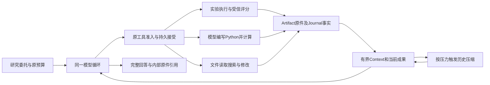

# 研究能力增强与实验交付 Spec

问题编号：`KNOWLEDGE-DECISION-DELIVERY-001`。本文只拥有目标、总体职责、专题协作和推进顺序。方案、验收与验证结果各有唯一正文，按下表阅读；正式成绩及发布资格由评测盘点拥有。

## 1. 目标、价值与范围

**当前目标是让 Agent 依据真实数据与执行成果持续分析，并完成有依据的回答。** SciFact E1 保留为受约束实验闭环；LongDS task2 官方英文及 task3 历史中文用例检验跨轮定义、程序和结果的正确接续。前者的实验选择由模型承担，后者按公开的逐轮请求改变分析条件，分别验收，不把多轮用户请求称为一次委托后的自主研究。2026-10-22用户明确排除用户资源下载和结果打包；HTTP下载、ZIP、导出清单及外部CLI复现不属于当前Agent能力门槛。原始工具数据仍归Artifact，实验和Python实际执行仍归Journal，供模型读取、恢复及工程审计；不在完成时复制成一套用户交付文件。

目标用户需要在获准材料上完成实验比较或持续数据分析。SciFact 用例面向知识／RAG 开发者；LongDS 用例面向反复调整条件、核对敏感性并形成市场建议的数据分析者。Agent 自行选择工具、编写及修订程序，消费真实输出，再回答当前问题。公开题目是能力验证材料，不把公开数据结论用于当前私人知识库或实际商业决策。

已有方法和结论是方案起点。[历史检索评测](../../evals/retrieval-benchmark-20260709.md)已有 Open／Galileo 的局部比较，现有 [Graph 策略](../../../src/personal_agent/memory/graphiti/search_strategies.py)也提供混合检索实现；它们的材料、实现和产品消费边界各按原身份解释。本任务据已知方向完成指定委托的工程验证与交付，交付质量看选中方案实际可运行、配置及结果一致、用户可复用，不以再次介绍 BM25／向量／混合检索或必须发现新算法结论验收。当前 E1 使用 SciFact，验收对象是该实验方案；当前个人知识库的效果由其正式读取链及真实问题另行验收，不将公开实验配置自动装入该链。

直接价值是由Agent完成必要实验、消费证据并给出可追溯结论；减少多少人工协调、时间或成本，需要与满足同一契约的脚本加普通模型比较后再作主张。

本例以材料、环境、权限和预算已准备齐全为起点。预期用户无需替 Agent 选择下一项实验、提供中间计划或整理执行结果，就能取得有实际依据的完整交付；运行中出现关键缺失事实时沿 [输入不明确时怎样澄清](research-experiment-acceptance.md#13-输入不明确时怎样澄清) 澄清。检索程序负责一次配置的准确执行，Agent 负责将多次执行、分析和交付组织成闭环。具体行为由 [推进、结束与恢复](research-experiment-protocol.md#4-推进结束与恢复) 说明，达到 [评估标准及评分资格](research-experiment-acceptance.md#4-评估标准及评分资格) 判据即验收本例自主交付能力。

本方案分别检验自主交付、持续推进、决策行为、业务收益和机制贡献：

| 验收目标 | 达到怎样的表现即成立 |
| --- | --- |
| 自主完成实验研究交付 | E1 的实际执行、分析、最终评测和回答满足原请求；初始条件充分后由 Agent 连续推进，任务中用户业务指挥介入为 0；下载、打包和 CLI 不参与当前能力计分 |
| 持续推进及恢复 | E2 验同 run 中断后接续；LongDS L1／L2 验同一对话中连续新请求的分析状态继承；L3 另验进程恢复。各自消费真实成果及原额度，不能互相替代 |
| 长上下文机制 | C6／E3 验真实容量压力下摘要、原件及后继实质工作；LongDS 仅在实际触发时增加相应证据，没有触发不否定已成立的跨轮分析结果 |
| 证据驱动的 agentic 能力 | 至少一处实际新证据支持的实质选择，能定位当时合法选项、模型选择、后续执行及交付后果；可选择必要验证，也可有据停止追加 |
| 业务收益 | 同预算、同结果契约下，完整交付率及预声明的人工介入、时间或成本比较达标 |
| 特定 Harness 机制收益 | 同模型、同工具及同结果契约下，沿 [能力、机制和业务收益分别比较](research-experiment-acceptance.md#3-能力机制和业务收益分别比较) 单变量比较量化目标机制在质量、成本、重复工作或恢复上的贡献 |

Harness 提供可靠执行、可恢复事实、当前工作集和必要反馈，研究模型据此承担实际取舍。有效推进包括找出互补性并验证、否定假设、保留 BM25 或及时交付；必要工作由真实证据和原目标决定。固定程序承担基线及独立评分，受控程序使模型可以将分析变为实际候选；研究自主性由“成果进入下一次选择、程序或实验，并影响后续工作”的实际链路验收。

首版已有的受限实验、模型自主计算和回答链按 [当前先完成的闭环](research-experiment-protocol.md#1-当前先完成的闭环)、[整体架构、增强顺序与本轮切片](#3-整体架构增强顺序与本轮切片) 保留。跨run分析接续由[LongDS 长程数据分析 Spec](longds-analysis.md#longds-长程数据分析-spec)设计，现已接入并完成上述LongDS流程；业务语义仍按独立评分解释。Context容量与历史压缩继续由主循环及ADR 0038拥有。独立研究子 Agent、任意 Shell、跨天后台仍在当前切片之外。旧 CSV 分析候选已并入本主线，原始来源及历史归档保留。

## 2. 专题正文与阅读路径

| 阅读任务 | 唯一正文 |
| --- | --- |
| 理解总体目标、分层及增强顺序 | 本文 |
| 修改受限检索实验、候选执行与完成协议 | [受限检索实验执行协议](research-experiment-protocol.md) |
| 核对 SciFact 自然请求、R 需求、验收与评分 | [研究实验请求与验收](research-experiment-acceptance.md) |
| 修改源码／JSON 工作产物、快照及 patch | [共享程序产物契约](program-artifact-contract.md) |
| 理解 LongDS 连续分析与跨进程恢复用例 | [LongDS 分析 Spec](longds-analysis.md) |
| 设计精度、自检、计算成文和原件提交 | [结果成文候选](analysis-result-correctness.md) |
| 实施原文要求、口径继承及语义核验闭环 | [长程语义候选](longtask-semantic-consistency.md) |
| 反查已执行验证、诊断及当时计划 | [verify_results](verify_results/README.md) |

## 3. 整体架构、增强顺序与本轮切片

沿现有架构：Conversation 拥有同一用户目标、模型循环和完成流程；检索实验 Application 拥有实验协议、受信评分、冻结及复现；独立 Python Application 执行模型选择的分析代码；两者共享沙箱技术及执行额度。Artifact 拥有原件，原 Journal 拥有接受／命令／执行事实。Context 物化和历史压缩消费这些事实，不另建研究平台、CodeAgent、第二个 Plan 或可写事实副本。数据按合法 Artifact 引用交接，不以工具调用次数代替研究决策。



各机制已取得的证据及未验证边界见[验证记录](verify_results/analysis-correctness.md#6-拆分时的机制证据边界)。当前方案只按各自声明的用户结果和适用反事实推进，不把执行、恢复或压缩通过等同语义正确。

当前推进按[长程语义候选](longtask-semantic-consistency.md)贯通用户原约束、分析口径、成果依赖与反馈。已关闭的范围删除与执行基础保持；原件提交、claim 消融及其他机制收益单独比较。正式成绩与历史运行条件只从对应验证记录和评测盘点读取。

架构改动限于原工具面新增一次有界Python执行、共享原沙箱、原Journal的typed接受分支与统一额度、原Artifact输出及交付消费。原检索领域保留自己的评分和候选协议；Composition Root只映射当前许可的执行配置。删除项是被替代的沙箱定义及旧隐式文件名协议，不恢复已经撤回的固定统计／Context注入路径。详细接口和检查点只在Python Spec维护。

## 4. 能力怎样接入

**保持一个受治理主干，业务能力内聚，运行事实各有唯一 owner。** 主 Agent 统筹整体目标，研究职责组织比较、解释及报告收敛；实验能力执行明确配置；共享治理处理权限、额度、调用和提交。首轮按 [当前先完成的闭环](research-experiment-protocol.md#1-当前先完成的闭环) 解开对 claim／verifier 的前置依赖，完整研究 Sub-agent 抽取按主循环 Spec 独立准入。

```text
正式请求及授权材料
  → 恢复原目标、未完成工作、已提交事实和额度
  → Context：当前权限 → 所需材料 → 有界工作集／必要压缩
  → 模型选择下一动作
       ├─ 读取／运行实验 → 准入 → 实际执行 → 提交事实和产物引用
       │                                          ↓
       │                           下一轮消费结果，继续分析或调整
       ├─ 提交完整候选 → 适用核验 → Completion → 交付确切正文
       │                      缺口反馈 → 回到当前任务
       └─ 缺关键条件、资源不足或不可恢复失败 → 返回等待／限制及实际进展
```

模型判断下一项必要工作、实验假设及何时提交；代码检查权限、容量、版本和不变量，执行端产生事实。计划完成、工具成功或模型说“已完成”都不能直接关闭目标。普通问答与研究沿原 `FinalMessage` 出口组织交付，所需检查按各自契约适用；本例沿现行提交协议，直接携参提交候选由主循环 Spec 另行验证。

## 5. 扩展机制与开源取舍

业务模块在 Composition Root 显式装配，复用现有 Registry 和调用协议；middleware 沿 Model Port／Gateway 包装计量、追踪及适用技术重试；hook 通知已提交进展，不拥有目标、执行或完成的写权限。Context 语义变换属于具名协作，不能藏入任意 hook。这些职责不要求先建跨业务插件平台。

执行与文件工具的固定源码比较见[原采用依据](verify_results/analysis-correctness.md#7-原执行与文件工具的采用依据)；组件参考继续从[工具执行与安全](../../agentRef/tool-execution-and-safety.md)定位。

压缩的两个独立源码比较由[Context 参考](../../agentRef/context-engineering.md#5-压缩的实际装配消费与恢复)拥有，完整子能力调用由[委托比较](../../agentRef/multi-agent-and-delegation.md)拥有。外部机制只支持候选取舍，不能代替本例失败和收益证据。

## 6. 当前范围、继续条件与完成边界

已实现的 Python 执行、原件读取、跨轮交付、容量压缩和限定进程恢复保持各自证据；它们不等于长程分析正确。当前核心缺口是用户约束被重解释、默认／临时／历史口径混用，以及正确工具结果在成文时改变。具体依据见[分析审计与设计复审](verify_results/analysis-correctness.md)，正式结果见[评测盘点](../../evals/02-current-case-inventory.md)。

1. 原实验初步闭环按[受限实验协议](research-experiment-protocol.md)返回确切正文；下载、ZIP、导出清单及用户外部 CLI 复现已经退出 Agent 完成门槛。内部执行、冻结／test、权限、原件及原预算保持。
2. 下一切片按[SEM 设计及验收](longtask-semantic-consistency.md)推进，先分别验证 Context 位置及自然语言要求区呈现；表达采用 OpenCode、LangChain 公共路径的可读正文组织，内部保留 typed 列表。后续直接纠错候选是交付前核验、反馈与实际修订，原文及执行材料提供依据。按[task2 整体审计](verify_results/analysis-correctness.md#8-task2-整体方案审计)分别覆盖提取、主 Agent 理解、程序及跨轮错误；语义核验固定七项局部输入及完整连续任务，与 Context 对照不混合归因，不把引用或原文到达记为纠错。各项均为设计候选，尚未实施。
3. [NUM 成文候选](analysis-result-correctness.md)的原件提交、claim 消融和其他机制收益单独比较，不能与 SEM 捆绑后分别声称收益。
4. 用户结果、执行事实、恢复、压缩、agency 和 Harness 贡献分别判定。局部达到原判据即关闭；完整任务未达标保持未完成，不重写旧分数或追加已关闭边界的义务。

当前架构由[架构入口](../../architecture/README.md)拥有；Python、Loop Schema 和历史压缩继续引用原专题。准入状态唯一登记于[Future 队列](../../future/design-optimization-backlog.md)，各子 Spec 不再复制队列或正式成绩表。
