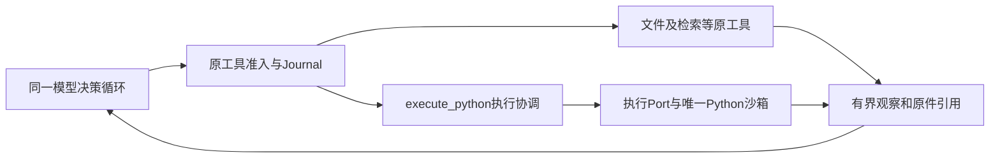

# 模型自主 Python 数据分析工具 Spec

状态：截至 2026-10-24，自主程序执行、程序文件复用及独立对话许可已接入；有界局部执行、原件恢复和消费停止成立，完整统计回答及长任务结果仍未通过。归属 `KNOWLEDGE-DECISION-DELIVERY-001` 的自主计算切片；[整体研究 Spec](knowledge-decision-delivery.md#3-整体架构增强顺序与本轮切片)拥有增强顺序，[评测盘点](../../evals/02-current-case-inventory.md)拥有正式结果。LongDS 侧契约及验收范围见 §3.5，不从局部执行推断稳定修复。

## 1. 目标、依据与取舍

目标是让模型把分析意图写成 Python，主动选择输入、执行并消费真实结果。Runtime 保护权限、资源、身份和恢复，不替模型选择统计项、生成分析程序或决定研究结论。

已有真实 E1 的实验文件与指标正确，但报告误归属失败集合并解释错例。原搜索工具已给出47／52／38个零 Recall 命中及完整命中行；不能把问题归为缺少单项计数。准入前模型可写 Artifact、读文件，并通过检索候选程序产生排名，当时没有通用数据分析执行入口。开放计算能否改善交集、差集及其他分析仍是候选假设；它不自动解决已有正确数字在成文时被写错的问题。

旧候选在完整原四条消息后新增第五条统计与核对消息，三份主计数／集合均正确；它没有提供query0的明确排名与前十判断，一份仍解释反了原正nDCG。因此，将模型所需的排名计算为明确结果是合理待证方向；不把旧局部失败当作该方向已经失败，也不把3／3数字正确当成确定性代码能保证自由成文。新切片由模型自行选择代码及统计项，工程不预填正确程序或期待数字。

采用一个独立 `execute_python` 工具，复用现有 Artifact 读写和受控沙箱。对比：自动统计并注入 Context 已撤回；在 `retrieval_experiment` 增加 `analyze_results` 会把可编程计算绑定到检索业务，本轮不采用；通用 Shell 或长期 Notebook 会扩大状态、权限和恢复面，首期不引入。独立工具只承载一次有界 Python 执行，不建立插件平台或新的任务编排。

外部依据与实际调用链见[按需计算比较](../../agentRef/tool-execution-and-safety.md#9-模型按需计算数据与结果反馈)。采纳模型生成代码、执行侧处理数据和实际反馈消费；不复制外部默认权限，不据外部实现宣称本工程收益。

## 2. 需求与责任

| 编号 | 必须产生的行为 | 责任主体／验收 |
| --- | --- | --- |
| PY-1 | 模型决定是否调用、代码、输入及下一步；不要求固定统计流程，不自动扫描当前实验或注入统计块 | 模型；V1／V4 |
| PY-2 | 只读取本轮当前合法可读的确切 Artifact 版本，输入别名、原字节及摘要绑定，不接受宿主路径或隐藏标注 | Artifact 与执行准入；V2 |
| PY-3 | 在固定 Python 环境实际运行提交的代码，保留真实退出码、输出、错误和资源终态；失败反馈回原决策链 | 执行系统；V1／V2 |
| PY-4 | 已接受请求、冻结 Command 和执行结果可恢复；同一调用不因重试重新运行，未知执行先核对终态 | Conversation Journal 与执行适配器；V3 |
| PY-5 | 大数据留在文件中；模型只收到有界输出及原件引用，可沿原读／搜索工具继续读取 | Artifact 与 Context 物化；V1／V2 |
| PY-6 | 工具成功只证明实际执行；不生成权限、研究完成、语义通过或正式实验评分事实 | 原决策、Verification、Completion owner；V4 |
| PY-7 | Python 与其他工具由同一模型循环选择；代码及其 stdout 不取得其他工具的调用权，不产生嵌套业务动作 | 原工具治理与事实 owner；V2／V4 |

首期消费者是已有研究实验授权及额度的 Conversation。工具实现不依赖检索模型；Composition Root 仅在能绑定既有运行权限、固定镜像与剩余额度时装配。每轮工具可见性和调用准入还须核对当前主体、run授权、deployment_digest、剩余额度与绝对截止；全局注册不等于当前会话获权。缺任一绑定时不暴露或拒绝，不能因工具存在默认扩大所有用户权限。

每次模型决策前从当前Journal重新投影工具可见性，恢复对账后重新纳入已释放额度的Python入口；不得缓存恢复前的工具集。恢复消费按原action关联的未结算Command，Python和原检索实验即使已有unknown观察也须先对账；同一动作更新当前观察投影，原快照及工具调用计数保留，不创建新执行。V3同时检查这两个恢复消费者。

### 2.1 架构位置与其他工具

按[现行架构分层](../../devSpec/architecture-ownership.md#3-强制术语与能力分层)，研究和知识管理等 Application Capability 拥有用户目标及完成标准；Python 执行是 Runtime Mechanism，`execute_python` 是它在原工具协议中的模型可见入口。`application/python_execution` 只承载 Application 内的执行协调协作者和 Port，不新建产品能力路由、Aggregate 或 CodeAgent，不拥有第二套 Plan、决策循环或 Completion。目录名称不改变该责任。

模型可见工具并列接入原 Tool Port，由模型根据任务选择和交替使用；不规定先检索、再Python、再成文的固定流程。工具之间通过当前合法 Artifact 引用交接数据，保持下列分工。

| 执行入口 | 拥有的职责 | 与 Python 的关系 |
| --- | --- | --- |
| 原文件读／搜索及 Artifact 写／patch | 定位原文、读取窗口、产生与修改不可变内容 | 模型可将合法原件绑定给程序，或继续读取程序输出；不复制文件 owner |
| `execute_python` | 执行模型编写的解析、筛选、连接及计算，保存实际输出 | 处理已绑定数据；不自动替模型调用其他工具或选择后继动作 |
| 原检索实验工具 | 数据集与候选协议、受信评分、冻结、正式评测事实 | Python 可分析获准结果；自行打印分数不能写入正式评分、冻结或实验回执 |
| 原知识写入及外部服务工具 | 各自授权、业务写入口及副作用事实 | 仍由模型另外提出原工具调用；代码输出不触发写入或授予权限 |

首期采用[外部比较中的工具并列方式](../../agentRef/tool-execution-and-safety.md#91-代码执行与其他工具的架构关系)。模型可先取得数据引用，再计算、补读或提出下一工具调用，顺序由模型决定。沙箱不注入 `ToolExecutor`、ArtifactService、凭证或宿主API；stdout 中即使含工具名、命令JSON或“已完成”文字，也只作为原件内容进入观察，不能被解析为新的 Proposal、Receipt 或权限。

让Python调用其他工具属于程序化工具编排，与数据计算是不同的执行契约。本轮不实现该桥接；当前没有封存证据表明新工具必须绕过模型轮次才能完成目标。若后续真实用例需要，须另行证明收益，并在每个嵌套调用上复用原 Schema、权限、预算、业务写入口、审计及恢复绑定；不能只向沙箱暴露服务对象，也不预建通用工具代理平台。固定流程或分析技能可以指导模型，不能取得执行权限或代替用户结果验收。

## 3. 模型可见契约

`execute_python` 沿原 ToolCallProposal／Admission／Tool Port 调用，接收模型直接生成的完整代码和可选只读文件绑定。代码不要求先经另一轮工具写盘；已有程序通过 Artifact 绑定为文件，模型使用标准 Python 读取或运行。

```text
ExecutePythonArgs
  code: str
  input_files: tuple[PythonInputBinding, ...] = ()
    PythonInputBinding(name: str, resource_id: str)
```

当前唯一生产契约由 §3.8 和 ADR 0044 拥有，直接代码／原生参数设计沿 §3.7 和 ADR 0043：code 唯一必填，input_files 省略默认为空列表，显式 null 拒绝；模型选择已有 resource_id，Runtime 从当前合法集合恢复完整引用。新代码固化原 UTF-8 字节，已有程序作为只读输入恢复原字节；Command／Receipt 中的 program_ref 属于实际执行身份，继续保留。§3.1—§3.7 按各自日期保留原协议的设计、失败与证据。程序最多128 KiB，输入最多32项、合计64 MiB；绑定前检查实际大小，超限明确拒绝。

`name` 是模型选择的平面文件名，允许ASCII字母、数字、下划线、连字符、点，长度1—64；拒绝空名、`.`、`..`、末尾点、路径分隔符、绝对路径、大小写碰撞及Windows保留设备名（含带扩展名形式，如 `CON.json`）。`program.py` 和 `input_manifest.json` 保留。文件按原字节只读映射为 `/inputs/<name>`；不靠扩展名推断数据语义。代码可通过 `sys.argv[1]` 获取 `/inputs`，由模型决定解析格式、筛选、连接、统计和输出。

工具参数不开放执行主体、owner、资源类型／版本、run、容器参数、镜像、独立Shell入口或预算。Runtime 从认证、当前合法文件及现行授权绑定这些字段；内部 ResourceRef 继续记录完整身份。程序可用镜像已有的 Python 标准库；首期复用现有固定候选镜像，不联网或安装依赖，不为单个错例预装分析函数。Python自行启动的子进程仍受同一容器、进程数及停止规则约束；固定入口不等于禁用Python的子进程能力。

stdout 为任意 UTF-8 文本，可用 `print` 输出数字、JSON或CSV，不固定业务字段；stderr 是执行诊断。工具运行脚本，不自动返回末尾表达式，也不保留解释器变量。首期只导出这两条流，容器内其他临时文件不自动发布。生成更多交付文件仍用已有 Artifact 工具；多文件导出须有真实需求后单独设计。

`PythonExecutionReceipt` 绑定 action_id、command_digest、status、process_exit_code、program_ref、input_manifest_ref、stdout_ref、stderr_ref、elapsed_seconds 及捕获限制。成功与失败都返回已实际取得的字段，未知字段保持缺失。模型反馈另带stdout最多4000字符、stderr最多2000字符的原样预览及明确省略量；完整已捕获字节由对应 Artifact 拥有。预览超界或包含无效UTF-8时不给伪造的修复正文，返回原件引用和限制。外层仍满足现有单观察20,000字符边界。

### 3.1 Schema与描述的外部对照复审（2026-10-22）

本节拥有工具接口的依据与机制。首轮已实施、固定回放并撤回的历史见§3.2；用户随后明确模型有自主工具选择权，本轮重新接入由§3.3拥有，不重开旧组。用户要求先参考优秀实践，故先核对[两份独立实现的正式声明和模型消费链](../../agentRef/tool-execution-and-safety.md#10-python工具的参数结构与字段说明)，再决定本项目的适配。

**当前证据。** [实发声明审计](../../../.tmp/python-schema-reference-review-20261022/schema-audit.json)确认原工具总说明790字符，Schema序列化1845字符；包含引用身份在内的15个属性节点均无字段description，program、inputs、文件name和resource_ref也没有局部说明。缺口来自typed字段定义，strictify保留description，没有在运输途中丢失。原Args的inputs默认空元组，但native strictify把program和inputs都列为必填，工具说明没有明确解释无文件时也须传空数组。Schema含一处oneOf、discriminator、maxItems及四处minLength，是否被Provider强制是独立问题，不能以参数体量或字段数量推断失败原因。

最近实际候选已产生6份可见文件绑定，却放入program.inputs；仅在诊断副本移为同级后Schema合法。这支持审查“程序对象是否容易被理解为包含文件的整次作业”这一新假设，不证明嵌套是唯一原因。旧反馈修订没有改变这些声明，不能把它的失败外推为Schema调整必然失败或必然成功。

**当时的外部机制与取舍。** AutoGen和OpenHands均直接暴露带局部说明的code，把执行器或运行环境留给系统。当时以显式输入绑定和已有程序原字节引用为由，继续保留两种模型程序来源；§3.7 根据新失败及用户要求重新审查该取舍，不把它当作下一候选必须保留的前提。仅追加字段说明迁移最小，可作为说明不足的独立诊断，但不能减少program来源分支带来的层级。优先隔离比较下述单一模型可见契约，而不是继续向全局Prompt或错误反馈追加提醒。

```text
候选 ExecutePythonArgs（native动作仍使用现行 arguments 对象）
  code: str | null
  program_ref: ResourceRef | null
  input_files: tuple[PythonInputBinding, ...]
    PythonInputBinding(name: str, resource_ref: ResourceRef)
```

code与program_ref必须恰好一项不是null，由唯一typed Args确定性校验；空字符串是已选择的新源码，仍沿原程序字节上限处理，不能用真假值代替null判断。三个键在模型wire中均显式必填，不用的来源填null，无输入文件填空数组。代码是直接字符串，不再增加kind/code对象；program_ref沿已有原文复用契约，不让模型重抄原程序。input_files名称明确它是本次执行的文件绑定，与code／program_ref同级；绑定结构、合法引用、文件名规则和32项／64MiB限制保持。此null选择带来一个额外显式键，是保留两种程序来源及减掉来源对象／tag的代价，不宣称字段总数更少。

| 字段 | 模型必须能直接看到的说明 |
| --- | --- |
| code | 本次新编写的完整Python源码；复用原程序时填null。代码按文件执行，需要print才有输出；不承诺有状态解释器或末尾表达式返回 |
| program_ref | 当前可见且获准读取的程序Artifact确切引用；新代码时填null。引用恢复原字节，不接受宿主路径，不允许选择两种来源或都不选 |
| input_files | 本次授权只读文件列表；与code／program_ref同级；无文件也必须传空数组。代码只能据明确绑定读取相应文件，不能从任务或代码猜测补齐 |
| binding.name | 该原件在只读输入目录的平面文件名，与代码中的文件名对应；说明允许字符及保留名，Runtime仍执行完整校验 |
| binding.resource_ref | 本轮当前合法Artifact的确切版本；此处是输入数据来源，与program_ref的程序来源职责分开；身份字段不能授予执行权限 |

字段说明与工具总说明作为同一个版本化模型可见契约维护，参数含义放在相应字段，总说明只交代用途、环境、输出和边界；不重复堆满全局Prompt。采用之前先核对最终native Schema，不能只检查Pydantic类或文档。示例如有必要，只说明通用结构，不包含本研究题目、统计步骤或期待数字；文档中的占位引用不得成为发给模型的可调用资源。首个结构候选不依赖新增示例、理想反馈或额外材料取得通过。

**架构与迁移。** 业务Args owner仍是Python执行协调，工具继续由原Tool Port和Web Composition Root装配。`models.py`拥有唯一请求形状、字段语义及来源互斥；原工具声明直接使用该typed模型；`model_actions`保持通用Schema封装，不增加Python专用字段猜测或codec分支。服务从新代码固化或从program_ref恢复原字节，继续冻结现有Command.program身份及Command.inputs，不保存另一份可写程序来源镜像。权限、预算、stdout、Receipt和交付清单保持原owner。

实施前搜索并同轮迁移工具签名、请求接受／Journal校验、执行协调、恢复对账、交付闭包及有效Offline消费者，删除旧program union、kind和inputs请求路径，不接收两套形状或自动修正旧非法载荷；Command／Receipt原件身份不因模型接口改名而重写。扫描现存未结算运行及持久接受数据，存在真实恢复消费者时先按REL决定迁移，不能使它们静默失效。历史封存按原代码身份读取，不改原输入、成绩或校验和。本次候选迁移的真实执行及回撤检查见§3.2，不能把已撤回形状视为现行契约。

**重新准入与验证。** 以下是本轮实施前固定的输入、判据与预算，实际结果由§3.2及评测盘点拥有，不授权追加样本。先完成迁移消费者及Provider方言的零HTTP检查，明确合法／非法程序来源、无文件、已有程序引用、错层级和权限／恢复边界，复用现有真实产物而非新建单元套件。结构和说明属于同一接口候选，不能分别归功于扁平化、字段改名或描述。

后续局部输入优先取当前E1首次漏参的cd1483043eda4efea3087b750f89f80d完整实发请求，避免把“旧Schema下失败的调用迁入新Schema”混成新格式首次生成的效果。原用户任务、113项输入、20工具中其余19份声明、Provider及采样／输出／恢复参数保持，候选仅由正式定义链替换Python声明；baseline使用当次真实原声明。二者当前持有的实际反馈均保留，不注入理想参数或为新Schema伪造前置调用。原生历史与Provider严格模式另组验证，不同时改变。

新组独立身份，10baseline＋10candidate交错、各一次首响应、零重试／工具执行；源deepseek-flash、thinking enabled、temperature=0、max_tokens=32768、timeout=480，20物理请求／4M已知tokens／3600秒，发送前按完整实际body预约输入、8192协议预留与最大输出。协议和实际Python参数分别记分：完整动作及新Args合法、程序来源恰一项不是null、文件绑定格式及名称合法、引用当前可见，才计参数生成通过；组级须candidate 10/10 独立运行均实际生成合格Python参数。合法改选其他动作只记Python未覆盖，不能替代该分子，不放宽门槛或补样求覆盖。

代码与输入的衔接另行审读：允许已绑定文件未被使用；代码明确读取只读输入目录中一个未绑定名字时记录实际冲突；动态路径无法静态确定则记未决，不猜测判对或判错。此项不冒充执行检查，零工具组只能证明参数生成与可见引用，不能证明任意程序已成功读取文件。明确冲突或未决不能被参数形状通过覆盖为完整工作流恢复。首个候选协议／参数确定失败、未知用量、Provider故障、截断、漂移或额度不足按停止线关闭，保留未执行；先审读每份实际输出再继续。整例用户结果仍须按已有正式E1或另行准入的真实连续执行链验收，结构生成不能计为程序执行或研究完成。本组已执行并关闭，不重开。

整体critic：直接代码参数有两个独立源码依据，新的可定位输入缺口与真实错层级为本轮因果假设提供依据；显式文件授权及原文引用没有牺牲。代价是接口迁移与null互斥；当前执行和恢复可行性已有取证，模型重复验证的Python覆盖不足。全局去掉arguments会影响其他19份动作与Plan，缺乏本轮必要性；缩短ResourceRef另涉身份／scope恢复；二者保留为独立架构问题。Provider强约束由Adapter适用性拥有，不用切beta端点或削弱本地Schema掩盖此候选结果。后续先修正验收的选择／参数边界，不因缺覆盖将接口判为直接失败或追加本组样本。

### 3.2 本次实施与局部验收计划

2026-10-22用户授权开始推进。分类为内部工具请求契约及模型可见Schema变更，目标是切断程序来源对象被当作整次作业容器的失败链；开放语义、权限、冻结执行事实及完成owner保持。依据为§3.1真实失败与独立源码，不从结构简化推断效果。默认配置data/interaction_runs扫描为0，未发现须迁移的持久接受记录；扫描时出现的一份短暂Python进程随后已退出。该事实仅覆盖本机当前配置，不把.tmp封存实验视为现存生产恢复任务；已关闭归档始终按原代码身份读取。

实施继续当前codex/research-capability工作树并保留既有改动，原组不重跑。新身份为.tmp/python-schema-implementation-20261022，已保存改前源码及真实成功程序的平坦参数反事实，旧契约明确拒绝该新形状。依次完成以下任务：

1. 替换models.py唯一Args并删除两个旧来源DTO及union；新代码／程序引用互斥和输入名校验仍唯一归属该模型。字段中文说明由现有Python Prompt家族的版本化参数项提供，总描述升版；不添加平台、Port或Python专用通用解码分支。
2. 同轮迁移工具签名、Python执行协调、Journal的冻结绑定校验及有效python_execution_boundary离线消费者；保留Command.program／inputs和Receipt／清单字段。更新ADR 0039与工具正文，记录没有兼容消费者且不重写旧冻结事实。
3. 零模型回放真实成功程序及实际合法引用，核对native投影、新Args、旧形状拒绝、相同代码／绑定还原和摘要改变；再复用生产Artifact、FileJournal、ToolExecutor与Docker执行一个真实原程序，并用新实例恢复同一完成回执，额外执行须为0。允许重绑真实原程序Artifact后单列已有程序引用覆盖；本阶段最多2个容器、60秒实际执行／300秒监督，不把工程重放当模型自主结果。不维护或运行单元套件。
4. 从生产工具声明与原113项完整输入构造§3.1的10+10对照，先零HTTP核对只有Python声明变化，冻结所有执行源码、SDK输入及成本。baseline消费封存旧声明和旧typed Args，candidate消费当前声明及新Args；历史baseline模型仅在评测源副本加载，不进入生产兼容。一次原子样本完成审读再发下一项，沿原停止线收口。最后执行ruff指定规则、layers、文档／链接及diff检查，并进行一次独立代码评审。

Provider预检记录当前稳定端点不承诺beta strict，现存minLength／maxItems仍由本地typed及执行边界强制；本候选不切端点或声称Provider强约束通过。没有修改持久Command或digest算法，新的Args只产生新请求摘要。额外字段键、null互斥和5个参数说明注册项计入复杂度；旧来源类型、旧请求字段及重复描述在同一变更删除。

失败时按预声明停止付费且保留未知／未执行，不加提示或补样求通过；未达到候选10/10实际Python参数通过不宣称修复。未经准入的新工具契约撤回到本轮改前源码，已成立的精确缺失字段诊断保留；原件、Command和回执不随回撤改写。

本轮已实施五份生产文件及一个有效Offline消费者的候选迁移。零模型阶段以真实5735字节程序和5份原绑定分别执行新代码与已有程序引用，两次stdout均与原输出逐字节相同，实际执行共1.266秒；新实例恢复原回执未新增作业。未授权版本引用被拒绝、零Command及零派发，两个实际容器均已移除。准备脚本首次漏传Profile限额，在任何容器和模型请求前失败；修正诊断装配后通过，不计产品失败或生产修复。

固定10+10回放已完成：两组各10/10动作协议合法；baseline实际生成Python参数2/10、合格2/2，其余8次未覆盖；candidate实际生成5/10、合格5/5，其余5次未覆盖。没有观察到非法Python参数，也没有达到候选10/10实际覆盖；不能把未覆盖当参数失败、把5/5改作预声明分母，或从2对5的选择次数推出接口收益。20次物理／完整响应、2,406,780已知tokens、未知0、703.035秒监督窗口；零工具执行、零补样、无重试，研究语义及完整E1未验收。

原组依当时冻结的10/10调用门槛撤回六份候选代码；305份生产源码回到当轮改前哈希。该撤回是历史执行事实，不是新接口机制失败。用户随后明确合法选择其他工具不是问题：将调用频次作为接入与回撤门槛不合理，新的接入决定见§3.3。原件、冻结判据、20次响应及一次独立代码审查保持，见[封存报告](../../../.tmp/python-schema-implementation-20261022/final-report.md)；不重标旧组结果，不追加旧组付费。

### 3.3 接回生产链路并继续正式流程验证

2026-10-22用户明确要求将修改接入生产链路后继续验证。目标是沿既有工具循环消费§3.1的唯一新接口，保留模型自主决策；合法选择其他工具不是参数缺陷，不设Python调用次数、调用比例或必须使用某工具的准入与回撤门槛。首轮两组各10/10动作协议合法、候选实际Python参数5/5合法以及真实执行／恢复证据仍成立；旧10/10必须调用Python的设计不再作为当前门禁，旧封存身份不变。不据本次接入宣称总体稳定率或研究语义已修复。

**架构与实现。** 复用§2.1／3.1的架构分析及已核对AutoGen、OpenHands源码，重新采用封存的同一实现，不另起方案：Python Args拥有code／program_ref／input_files与来源互斥，既有Prompt家族拥有字段说明；工具签名、服务、Journal绑定及唯一有效Offline消费者同轮替换旧来源union。Conversation和Web Composition Root继续装配原Tool Port，模型拥有工具及代码选择，原Artifact、Command、执行、Receipt和Completion的owner与摘要算法保持。不新增工具、兼容分支、存储、自动补参或强制工具选择。

**迁移与验证计划。** 新独立身份为`.tmp/python-schema-production-20261022/`，保存本轮改前六份文件、当前设计和旧534文件封存校验。当前默认data/interaction_runs扫描0份记录；短暂Python进程须核对是否本次解释器包装，不据此推断存量服务。按改前字节和封存候选摘要确认后恢复同一六份实现，检查所有当前消费者，复用已成立的两模式真实执行、原字节、权限拒绝和新实例回执恢复证据，不为形式重复派发容器或重跑旧20组。

接入后先检查最终native声明三键必填及字段说明、真实原请求新形状验证、旧形状拒绝、调用链与静态检查；再通过既有正式准备和F1作用域HTTP反事实核对配置、数据、镜像和权限，全部零模型。随后仅运行一条新E1的initial_closure：原中文自然请求、四份公开材料、生产Web Composition Root、真实deepseek-flash及正式工具链，不注入原成功程序、统计答案或旧中间状态。沿既有成熟profile：主决策thinking enabled、32,768输出、1M窗口；摘要thinking disabled、8,192输出；3600秒任务／累计执行、64轮／256工具／4委派／20M tokens，structured单次480秒、SDK重试0，其他路径按实际冻结配置。一次正式采集，不追加模型组或重跑整例；预算、无法确认消费、不可恢复服务或协议故障按现行停止线封存。已有未知费用按原身份保留，不借新准备覆盖。

该次流程判据见[当前版本完整流程 E2E（2026-10-22）](verify_results/research-experiment.md#43-当前版本完整流程-e2e2026-10-22)：同一正式提交的报告、冻结配置、原始结果、清单v3和包实际交付，认证下载字节／摘要一致，独立完整排名复算及生产CLI干净复现通过，知识库无越权写入且本run进程／作业均终止。参数与Python执行只按实际发生的调用记事实；若模型选择Python，核对新三键、合法绑定、真实Receipt及stdout后继消费、分析原件闭包随清单下载；未选择仅记该分支未发生，不阻止其他合法路径完成用户任务。统计／报告语义仍按用户决定暂放，研究质量、自然压力压缩和发布资格不由流程通过替代。

整体critic：参考机制、原失败、已完成回放和确定性执行相互独立，不因调用频次否定合法自主决策；本轮修正接入门槛并补正式消费，既有权限与恢复不放宽。五份生产文件及一个有效Offline消费者已与封存审查版逐字节一致；新三键、字段说明、真实原请求、旧形状拒绝及静态检查通过。新E1准备和F1正式HTTP的200／404／404／404、零模型及实际解释器终止通过。唯一新E1已结束，漏填input_files未复现；两份非法JSON被拒，五份合法Python参数实际执行四成功、一份读未绑定文件失败，后继模型使用不同程序及绑定成功继续，不把它写成同一失败程序修复。stdout预览原样进入后继实际请求，完整原件仍按引用读取；这证明送达，不能代替理解或报告语义验收。接口继续接入生产，不因新独立采集问题撤回。启动脚本引号、只读审计解码与续接字段名等临时脚本错误、原始失败及修正单列归档，均不作为生产接口失败或模型成绩。

**正式采集后的独立阻塞与只读续接。** 唯一新E1已从正式POST连续到最终回答，POST／Trace均200、33份完成SDK响应、3,178,471已知tokens；五次Python实际执行四成功、一份未绑定文件失败，另两份非法JSON拒绝，后继模型自行改用不同程序及绑定继续。采集器连续下载110份资源，在59份完成后命中生产每key每60秒60请求的429；其finally中的审计关闭也被同一限流拒绝，原SQL审计缺closure，原采集命令退出1。问题owner是评测采集器的只读HTTP客户端，不是模型工具接口、权限或生产限流；本轮不重跑E1、不修改已冻结生产／采集源码。

保留原capture、59份部分下载和原失败，先封存全部原文件；在新独立输出目录启动同配置生产Web，只对同一已完成run作认证GET下载，按实际Retry-After等待并受300秒监督，实际模型调用须为0。对全部110份资源重新校验字节、摘要及原部分下载的一致性，随后复用正式独立排名审计及生产CLI干净复现。该临时续接脚本只拥有HTTP采集和归档，不能写Journal、注入结果、改变原审计或生成SQL关闭凭证；旧运行期observer健康状态无法从磁盘事后恢复，故完整流程门禁仍须保留此缺口。新增服务实际解释器须停止，原文件和源码身份须保持；下载／复现通过只关闭对应检查点，不把它改标为原采集整例通过。后续正式采集器的限流恢复另按真实失败设计，不混入本次冻结身份。

下载续接已取得110份资源，59份旧部分下载逐字节相等，服务实际停止且零模型。原采集正式审计保持user_delivery=missing和退出1；续接不篡改该判定。独立审计发现10组排名中一组candidate train的nDCG为0.71970，对发布0.71971，逐查询最大差0.0107342；先定位评分排序精度口径，不放宽误差或改结果。首次生产CLI干净复现失败，实际result路径258字符写入成功而rankings路径260字符失败；保留失败目录，在仓库`.tmp/py-prod-repro-20261022/`新短路径用同清单及原CLI做一次有界复现，最多300秒监督，不改源码、包、配置或模型，也不在原部分目录重试。

**独立评分口径修正。** 上述差异定位到同一候选train的query 1003：64位分数在生产评分器转为32位后形成同分，按docid降序打破并列；不是模型报告数字改写或输入缺失。完整10组原排名按32位转换重算时逐查询误差均不超过1e-12。外部依据是[pytrec-eval-terrier v0.5.11构建](https://github.com/terrierteam/pytrec_eval/blob/v0.5.11/setup.py)及其[trec_eval v9.0.8分数结构](https://github.com/usnistgov/trec_eval/blob/v9.0.8/trec_format.h)。最小修正仅在既有独立delivery auditor排序前显式转换IEEE binary32，限定已声明0.5.11；其他版本明确拒绝而非猜测。生产scorer、报告、排名、误差门槛及已封存采集全部保持。责任是评测器正确还原冻结评分契约，不新增评分模型或模块；用本次10份完整真实结果Offline回放验收，原64位失败记录保留。该源码修正晚于原采集，单独记录新旧摘要，不把新的评测代码冒称原325源码身份未变。

**当前结论。** 只读续接后的110份认证资源／107份包内原件、同一Final报告原字节、五份Python成功及失败执行闭包通过；校正评分口径的正式独立审计10/10通过，原64位失败保留。短路径原生产CLI在245.750秒退出0，四份候选train及三份最终test共7项比较通过，排名分数最大差0；未更改原包或任务配置。原E1为33物理／33完整响应、3,178,471已知tokens、未知0，max prompt 162,220 tokens，未触发自然压缩。21表前后行摘要一致，但原SQL关闭429造成覆盖不完整，完整流程门禁仍未通过，不宣称研究语义、长任务或发布资格成立。生产接入及局部执行验收成立；下一责任是正式采集器对只读下载和审计关闭的有界限流恢复，原运行期健康证明无法补造，不为消除此缺口重跑本组模型。详细事实与校验和由[本轮报告](../../../.tmp/python-schema-production-20261022/final-report.md)拥有。

### 3.4 当前验收聚焦Agent能力

2026-10-22用户明确用户下载和打包结果均不需要；§3.3为已关闭历史执行记录，其下载／包／CLI条件退出当前能力门禁。当前按[当前范围与历史文件交付的关系](research-experiment-protocol.md#5-当前范围与历史文件交付的关系)删除生产自动发布和采集下载，保留模型自主代码、合法输入、实际终态、原件读取、结果消费和确切回答；不因接口调用次数或文件数量判断能力。两份真实完成状态的恢复局部验证通过，未重跑模型、未补造旧SQL审计闭合，也不宣称语义或长任务通过。

### 3.5 LongDS 用例的条件适配

2026-10-23 新增[整体 LongDS 长程数据分析 Spec](longds-analysis.md#longds-长程数据分析-spec)的 LongDS task3；普通基线、相位 target 与独立能力 target 均已结束。本节拥有已接入的 Python 侧许可及局部执行边界；能力 target 首轮未交付，完整结果由整体 Spec 拥有。现有模型参数和一次有界执行契约继续沿用；数据源、逐轮问题、状态选择和评分由整体 Spec 及外部原题拥有。

原 `orchestration/runtime.py` 在检索部署分支内构造 `PythonExecutionProfile`，Conversation 以检索材料绑定 run 后才曝光 `execute_python`；本次 L1 基线的实际能力表与该装配一致。16 个源 CSV 合计约 3.45 MB，满足当前输入数量及总字节的静态上限；实际程序、派生输出、内存和时限由新能力 target 核对。

L1 确认无法独立执行后，Runtime 已接入显式独立许可并映射既有 Python 执行 profile，Conversation 按该许可、主体及剩余额度投影和接受 Python；检索专用部署和完成条件继续由检索 owner 管理。执行服务仍校验已接受请求、确切输入、冻结 Command、profile digest 和原 Receipt。当前 `code`／`program_ref`／`input_files` 不因数据领域变化新增参数或默认文件。

同一对话的新 run 复用已授权程序及输出时，合法引用由 Conversation 从原 Journal／Artifact 恢复，Python 只消费新 run 显式绑定的确切原件；权限不因旧调用成功自动继承。任务总预算及跨轮关系由整体 Spec 的 Conversation／Journal 接续负责，Python 保持共享执行额度和未知状态对账，不建立另一套分析状态或费用账本。

实施依据为 L1 实际失败；typed 授权、调用方及责任已在本 Spec、ADR 和架构正文固定。替换相关检索许可耦合同时覆盖工具曝光、请求接受、执行预算、恢复和完成适用性，实际结果按下述 target 及反事实计分。原题参考代码与答案不进入 profile、工具说明、容器或生产 Context。

原 L1 已证实当时动作投影没有 Python，且原候选镜像不含 pandas／NumPy；更早还存在取得样例正文即强制成文的 Conversation 缺陷，已按[整体 Spec 的因果切片](verify_results/longds-analysis.md#11-l1-结果与首个因果切片)修正并验局部检查点。分析库只准备固定基础镜像上的通用环境，不含解题逻辑或参考中间表。独立能力 target 已实际执行首轮，7 次 Python 均成功，包含两次原程序引用；最终因核验未过、达到主决策次数上限返回限制，第二轮未到达。局部反事实见下文，不把执行成功写成完整用户结果通过。

#### 独立许可及接续的实施契约

相位 target 已实际到达“读取后仍有动作”的检查点，原运行已以限制结束并封存。下列切片依[ADR 0040](../../adr/0040-scoped-python-analysis-authorization.md)定稿并接入，独立能力 target 已结束；跨用户轮的实质分析消费仍未验证。

- Application 的 `PythonExecutionAuthorization` 拥有显式主体、专用 `conversation_id`、绝对 `expires_at`、单轮时限、任务总 tokens、任务执行秒数、固定镜像和原 `PythonExecutionLimits`。它从部署文件读取，不由模型提交。其规范摘要绑定既有 `PythonExecutionProfile.deployment_digest`，沿原 Command／Receipt 契约执行；Docker endpoint 是外层环境配置。授权没有数据集名、业务公式或分析程序。
- Settings 增加 `python_execution_config_path`，环境变量为 `PERSONAL_AGENT_PYTHON_EXECUTION_CONFIG`。Runtime 显式加载许可并装配原工具；与检索部署同时配置时拒绝，避免同一工具两个执行 owner。检索部署仍可映射为原 Profile，二者是同一执行契约的两种合法装配，不保留两套工具或分析实现。
- `InteractionTrace.python_authorization_digest` 只保存本 run 接受的授权身份，继续与原 `deployment_digest` 区分；后者只用于检索领域完成。新 run 主体／对话须匹配、未过期，截止取单轮限额与授权绝对截止的较早者。同一授权下的新 run 保留各自真实 usage；原 Journal 按主体、对话和授权摘要聚合，不复制旧 usage、重置总额或从模型自述计费。授权变化后不能把同一对话静默当新任务扩额。
- Journal 对获准分析对话持有现有跨进程文件锁，覆盖本次模型／执行的读取、准入与消费提交。任务内未知模型消费或未决执行阻止新增付费调用和新进程；同请求先恢复原接受事实。同 run 的原消息、输入和授权仍不可改写。额度及截止同时用于动作、意图、摘要和核验相关模型入口，模型可见剩余 token 由同一聚合投影派生。
- Conversation 将同一授权／主体／对话的成功程序执行和工作产物观察、原件引用投影到后继 run；不继承其他对话、不按基准依赖标签挑历史、不复制压缩 checkpoint。引用经原 Artifact 当前校验后才物化为可读来源；原件缺失返回具名反馈，权限失败保持拒绝。程序、stdout 等仍由原 Artifact／Journal 拥有，读取和执行再次检查本 run 的获准引用集合。
- 工具参数和沙箱协议不变，通用描述允许使用固定镜像已安装的第三方库、由程序检查版本；禁止安装依赖及网络。库版本在 L0 环境检查封存，不把 Netflix 公式或正确状态预置给模型。

2026-10-23 集成审查确认五个未通过边界：Python 动作准入仍误查检索摘要；普通 Verifier 内部调用未写 run 用量；未交付 Plan 与分析历史重复投影同一观察；通用运行的已知异常响应可能内外重复计量；完整 Trace 提交还遗漏新增授权摘要。它们属于既有许可、计量及不可变绑定的实现缺口，不调整任务成功标准。修正分别使用原 `python_profile_digest`、按 action_id 合并同一观察、统一异常计量责任及保留授权字段。

普通核验的逐调用 scope 绑定、同步装配及立即提交机制由[工具模型用量记录](../tool-model-usage-handoff.md#当前普通核验的机制与范围)唯一拥有；本许可沿同一 Journal 消费聚合及停止，不另建费用交接路径。原核验内容与稿件／回执绑定保持。

本次 target 已实际产生模型自写代码、程序 Artifact、`program_ref` 复用和成功 Python 回执。其已提交 revision 100 的独立执行前缀用于零模型 Offline 回放，4/4 通过：确切请求恢复保留原 Receipt；同主体请求改到另一对话 scope 被 Journal 拒绝；移开真实 stdout 字节时物化具名缺失反馈且原请求恢复读取失败；恢复原字节后读取结果及摘要与原来一致。全部新增 `execute`／`reconcile` 为 0，原 Journal 未改写。证据在 `.tmp/longds-implementation-20261023/python-stage-boundaries/`，其源是实际执行阶段，不是完整回答或进程恢复结果。两轮正式回答及后继 run 的实质消费仍按整体 Spec 继续计分。

核验停止边界另用该真实阶段中最新 `SubmittedFinal`、原 criteria 和完整引用输入，经原 workflow／Conversation 模型入口回放。只在独立分支的第一次真实核验响应交付后注入丢失，立即保留未知消费；再次核验必须在模型 Port 前拒绝。预算固定一个核验逻辑调用、至多两次原协议物理请求、100k 已知 tokens，未知后不再付费。只判计量和下一调用停止，不判该真实稿件语义正确性，不修改主运行或原授权。

该核验分支已通过：实际 1 次物理模型请求、旁路已知 12,014 tokens、观察侧未知 0；生产 Journal 已保留未知消费，第二次核验在模型 Port 前拒绝，未增加请求。来源为 revision 100 中实际 `final-25`、原 criteria 和完整引用，不补造草稿。封存于 `.tmp/longds-implementation-20261023/verifier-stop-boundary/`；它验证核验调用的停止责任，不计正式回答通过或评分成功。

验证：完成相位采集后，以新的代码／配置身份从空对话执行原 L1 最多两轮，主体及对话通过显式部署许可；模型自主计算、保存或复用程序并消费输出。每轮实际 Final 及后续原件可达分别检查，官方语义分数另列。取其真实状态检查其他对话未授权引用零执行、实际原件缺失及恢复、同请求恢复零重执行、总额度与未知消费零新增调用。正式 Dockerfile 在 `scripts/python_execution/`，本次构建并检查的分析镜像为 `sha256:510b3b843826cf0bb0684f73e33171ef96735856d2f6569c7a235a2426678755`，执行限制沿原默认 60 秒／512 MiB／1 CPU／64 进程／32 MiB 临时空间；L1 总许可 20M tokens、7,200 执行秒、绝对两小时，每轮至多 3,600 秒。必要用量达到停止线时保留结果；不以正确答案或预写代码修正运行。

### 3.6 MiniMax 首轮的参数修复再次失败（2026-10-23）

**此前改动已接入，但没有证明工具参数和修复在所有模型上可靠。** §3.1—3.3 修正原 `program／inputs` 的容器层级和字段说明，生产采用 `code／program_ref／input_files`。当时 DeepSeek 固定回放中实际生成的新参数为 5/5 合法；后续正式轨迹 7 次 Python 提议含 2 次非法 JSON，5 次合法参数执行为 4 成功／1 代码读取未绑定文件失败，没有再漏 `input_files`。这些事实保留，不概括为全部工具调用或所有拒绝恢复均已解决。

本次 MiniMax 真实首轮的两份 Python 请求都带齐三个键及 16 份绑定，确认没有回退旧实现；两份均输出 `program_ref=""`，16 个 `resource_ref.revision` 均为字符串 `"1"`。实际 Schema 已声明新代码时 `program_ref=null`、revision 为 integer，输入 Artifact 的版本也是整数。首份拒绝的 17 项字段诊断、完整原提议及修复指引均进入末次实际请求，工具 Schema 与 SDK 到 HTTP 的投影相同，已发送 `strict=true`；不能再以开启 strict 或增加必填键作为已定位修复。

同一末次响应的可见思考摘要已明确识别两个类型要求，最终工具参数却重复旧值。失败点至少已到参数输出，不能说模型完全没收到或没理解反馈；可见理由不证明完整隐藏原因。前后输出均正常以 `tool_calls` 结束，未达到 32,768 输出上限，也没有容量拒绝；不能归为输出截断。Runtime 在两次同类 Python 拒绝后按原停止线返回 limitation，Python 实际执行零。参数／拒绝恢复可靠性在当前模型身份下重新打开，原成功样本不追溯作废。

**另发现一项适配差异，因果仍待验证。** MiniMax [官方工具循环](https://platform.minimax.cn/docs/guides/text-m3-function-call)要求保留完整 assistant 消息及 `reasoning_content／tool_calls`，再交回工具结果；本次五个决策请求均为 `system/user/system`，用 typed 状态快照表达执行与拒绝，没有原生 assistant／tool 历史。该差异由模型消息适配与 Context 物化边界负责，不属于 Python 执行器；此前独立 AutoGen／OpenHands 比较仍可复用。不得直接认定它造成这两项输出错误，或跳过架构分析改写整套历史。反馈当前只有字段路径及 `schema_type／schema_anyOf`，缺少就地的预期类型说明，但本次模型已识别要求，也不能据此认定单纯补错误文案必然有效。

提高思考强度可作为独立假设，尚未做 low/high 对照，不能宣称能修复或没有作用。[官方深度参数](https://platform.minimax.cn/docs/api-reference/text-openai-api)确认 high 增加思考投入，不承诺 Schema 正确。后续先固定此完整失败请求及消费者：若测深度，只改变 `reasoning_effort`，其余完整消息、工具、输出额度及恢复策略保持，按 QLT 预声明每组至少十次及预算后执行；合法改选其他工具不算参数错误，也不外推 Python 覆盖。原生历史适配差异须作为另一变量单独诊断，禁止和深度同时修改后归因。该只读审计当时没有改部署、新增模型调用或重跑整轮；用户后续授权的实际续接与新轨迹按下段唯一规格执行。采集侧角色字段异常由独立收尾责任处理，不与本参数原因合并。输入身份、摘要和对照见[本次只读审计](../../../.tmp/minimax-tool-repair-audit-20261023/report.json)。

用户随后授权按官方文档补齐原生工具历史。当前生产候选及真实阶段证据见[唯一续接规格](../model-provider-transport.md#2026-10-23-原生工具会话续接规格)：固定 low 的一次实际请求返回合法 Python 参数，36,568 tokens、未知零，未执行新程序。此前失败及旧 Schema 证据不改写；该单例不关闭参数可靠性缺口，不等同排序、报告或长任务已经正确。 随后的真实新轨迹交付前两轮后，在第 3 轮先漏 program_ref，收到完整原生 tool 拒绝后又漏 input_files，按原停止线结束；新执行总计 11 次 Python、10 成功／1 失败，两份回答官方标准评分为 0/2。参数生成和反馈恢复仍未满足完整流程，原生历史不是已证明的充分修复，详见[本轮结果](../../evals/02-current-case-inventory.md#2026-10-23-原生工具历史接入后的流程结果已停止)。

### 3.7 Code Agent 直接参数的接入与验证（2026-10-24）

本节保留该切片实施及验证身份；模型文件绑定的完整对象随后由 §3.8 的现有 ID 输入替代，原生参数、strict 选择及执行事实设计继续有效。

**目标与准入。** 用户要求直接参考 Code Agent 相关工具设计，不再独立发明工具协议。设计核对完成后，用户授权接入生产接口并验证；本节进入实施阶段，完成情况按实际证据更新，决定见 [ADR 0043](../../adr/0043-direct-code-agent-tool-parameters.md)。本次原始源码、dirty patch、Journal 全量清单及执行账本保存在 [.tmp/code-agent-tool-production-20261024](../../../.tmp/code-agent-tool-production-20261024/progress.md)。新候选的真实依据是原生历史已接入的 LongDS 第 3 轮：第一次有 code／input_files=[] 却漏 program_ref，收到完整配对拒绝后，第二次有 code／program_ref=null 却漏 input_files，两次源码均为 1,147 字符、无执行。两个失败物理请求分别为 ab3f94abe6ca4526b00617aa6cf7305c、9d96e7fb646a42f4a329b6064bfefd69；首响应有可见思考，修复响应没有返回思考正文，未知部分不猜测。旧三键、字段文案和原生续接已实际到达，不能再以补一句“必须填”作为本轮方案。

**选定来源与修正判断。** [Code Agent 固定源码对照](../../agentRef/tool-execution-and-safety.md#11-code-agent-执行工具的最小输入与默认值)拥有来源清单。以 OpenHands CodeAct 的直接 code 参数作为 Python 动作形式，以 Codex exec_command 的单必填执行内容、可选执行项及 strict=false 作为参数声明和默认值处理基准。OpenHands 0.59.0 还要求 security_risk，不能宣称它只有一个字段；本工程权限由现有确定性治理拥有，不要求模型再提交风险等级。此前只是借用 code 字段，却继续让模型搬运三键互斥／空值契约，采纳不充分；新设计不保留该程序来源二选一。

**架构分析。** 原链为 Conversation → model_actions 原生声明／解码 → Tool Port → PythonExecutionService → 原 Docker Port；Artifact 与 Journal 仍分别拥有字节和执行事实。模型负责代码、文件选择和后续动作；运行系统负责身份、授权、额度、固定镜像及实际终态。新方案继续采用原独立执行工具，不新建 CodeAgent、Notebook、工具目录、代理桥或文件系统 owner。Code Agent 的长期 workspace／IPython 与本工程每次有界执行不同，不能因为照参考接口就扩大宿主 Shell、网络或可恢复解释器状态。唯一必要的参数适配是保留当前获准 Artifact 的可选文件绑定；省略表示不挂载文件，绝不自动从代码、任务或旧记录发现文件。

候选模型契约：

```text
execute_python
  code: str                              # 唯一必填，本次执行的完整 Python 代码
  input_files: tuple[PythonInputBinding, ...] = ()
```

普通无文件调用只需提交 `{"code":"print(1)"}`。input_files 提交时保持既有 name／resource_ref、主体／版本、32 项及 64 MiB 检查；省略确定性解析为空列表，显式 null 则拒绝。默认值只在唯一 typed 输入解析边界按公开 Schema 应用，不在 Admission 补业务参数或替模型选数据。code 不再可为 null；删除模型参数 program_ref、来源互斥校验及两种来源分支。已有程序与数据一样，经现有 input_files 绑定为只读文件，由模型用标准 Python 的 runpy／文件读取执行，原字节由 Artifact 恢复；不要求重抄旧源码、不由 Runtime 生成包装程序。Command／Receipt 中表示实际固化程序的 program_ref 继续属于执行事实，不能与删除的模型来源字段混为一项。此路径增加一段模型选择的标准 Python 文件执行代码，换掉专有来源选择协议，须实测程序复用，不把设计写成已通过。

**声明与 Adapter。** 原生 function.parameters 直接表达 canonical 业务参数，采用 Code Agent 的直接对象参数，不额外套通用 arguments 对象。该决定属于整个原生动作物化契约，不能加 execute_python 特例或保留两套可接受布局；受影响普通工具、Agent 与控制动作均须迁移生产者／解码／反馈及有效评测消费者。检索工具原 canonical action 对象也直接保留，不再先去 action 后套 arguments。工具定义携带标准 strict 选择；声明在 BaseTool.extras.strict，由 Registry、EffectiveToolCapability、ModelActionDefinition 逐层传递，缺省保持原 strict=true；可选参数的代码执行工具沿 Codex 声明 strict=false，Schema 保留 required=[code] 和默认空输入语义，Adapter 不再将其强制 strictify 成全部必填。其他既有严格 Schema 的选择保持。非 strict 只表示不宣称服务端约束解码，本地 Schema／typed 校验、拒绝和治理不放宽。实际采纳是整套声明／解析候选，不能分别声称去外壳、少字段或缩短说明的独立收益。

**描述草案。** 总说明采用“执行你提交的 Python 代码并返回输出和执行状态”，随后仅补当前必要差异：每次独立执行、print 输出、只读输入目录、固定环境与输出原件；程序参数说明分别只解释本次代码和可选文件绑定。镜像、硬限、权限与完成事实由原 owner 执行，不再在字段中重复来源二选一指令。实际中文措辞与版本在实施前按此含义固化，不能把参考的 Shell 或持久 IPython 承诺写入当前工具。

**迁移与删除。** 实施前核对全部 Args、工具工厂、原生声明／解码、已接受请求与 digest、Journal 恢复、Artifact 绑定、Command 冻结、当前 Offline 消费者及权威正文。Journal.conversation_traces 会枚举并用当前类型读取全部保留轨迹，已结算记录也在影响范围，不能只查 active／pending。此次[完整目录清单](../../../.tmp/code-agent-tool-design-20261024/journal-inventory.json)确认当前配置的 data/interaction_runs 没有轨迹快照；正式切换前必须重查全部保留快照和接受记录。已封存的 .tmp 评测根保留原源码与协议身份，由原版本只读消费；新验证采用独立空 Journal 根，不将旧快照接入新类型。若切换时发现正式根新增旧型记录，先按 REL 明确历史读取、迁移或根隔离边界，再准入对应变更；不得修改原始请求、Command、digest 或用猜补字段恢复。不在新生产接受旧三键／旧 arguments 包装。删除旧来源 XOR、重抄 null 说明、强制所有可选字段必填的受影响路径；不修改 structured response_format 的严格输出契约。跨模块协议替换须记录 ADR，本节设计不是迁移已完成的证明。

**固定验收及接续。** 沿当前 MiniMax-M3.1-Flash／adaptive＋low、原 32,768 输出／480 秒及完整原生历史：

1. 零付费准备：由正式定义链导出实际 Schema，检查 canonical 参数直达 SDK、required 仅 code、input_files 缺省／显式空列表等价、显式 null／未知字段／越权引用明确拒绝。消费原生历史首批实际并行工具、控制及 SDK 修复完整阶段，检查旧原文不改写、原调用结果配对、用量及完整组压缩不回归。此为完整实际阶段边界回放，不建立逐函数单元替代套件。
2. 真实参数阶段：固定上述第 3 轮首次失败的完整请求和上游原件，原协议 baseline 与新定义候选各做 10 次独立连续旅程，先 baseline、后候选；历史两次失败不代替 baseline 的 10 次。每次从各自完整首请求开始，消费本次模型实际选择，若拒绝则由正式 validator 生成反馈、最多一次应用层实际修复，不能注入期望参数或借用另一旅程的反馈。首响应、SDK 协议修复和应用层参数修复分别记分。旧历史原调用形状保留为事实，不篡改成新协议；因此该输入同时覆盖历史与新声明的切换，不能外推为空会话同分布。单次旅程合法或一次恢复后合法为 pass，候选须 10/10 才通过；baseline 参数失败是待测结果，不触发候选停止线。模型合法选择其他工具不算漏参，实际 Python N/M 单列，未覆盖不能充当 Python 成功。实际 Python 调用还须审读代码明确需要的文件是否绑定，不把可选字段合法省略当作必需数据已取得。禁止补样、切换 think 或裁剪历史求通过。
3. 执行阶段：使用既有成功程序／原件，沿新契约实际验证新代码、标准 Python 复用原文件、原字节与输入 manifest、原请求恢复零重执行，以及越权／原件缺失拒绝；不预写业务统计替模型作答。合法程序的执行与模型成文语义分开计分。原 11 次 Python 与两份错误回答保留，不转为新成功。
4. 成本与停止：SDK 每次 generate 允许一次协议修复，应用层再修复一次最多产生 4 次物理请求；两组共 20 次旅程，物理请求上限为 80。原完整请求的零 HTTP [预约估算](../../../.tmp/code-agent-tool-design-20261024/budget-estimate.json)为输入 290,526 tokens，输出预留 32,768、协议预留 8,192；按最多四次的历史增长保守预约共 36,349,280 tokens，据此将整组上限固定为 37M 新已知 tokens、12 小时（每组固定18.5M／6小时，不跨组转移）、单请求原 480 秒，纳入整体剩余额度，不额外叠加。该数是准备整组的上限估算，不是实际消耗；实施后必须以两组完整 wire 重新核算，剩余额度不足则在 HTTP 前停止，不能少跑样本后宣称通过。候选首个旅程参数失败、任一组未知用量／服务失败／截断／身份漂移或额度触线均封存未执行项，不重开同组；baseline 参数失败正常记录并继续其余预定样本。第 1、3 项工程准备单独归档实际边界；设计阶段没有消费预算；本次实际消耗见下方状态。
5. 完成原生接口与执行迁移、独立审查和局部验收后，才从正式自然首题恢复新身份流程；不直接再跑 36 轮。本次正式接续固定为原 LongDS 两轮 L1，通过生产 HTTP／Composition Root、新 principal／conversation／空 Journal、真实 MiniMax low、原分析镜像和 direct＋none，沿原 40 决策／10M 每轮、整例20M及每轮3600秒停止线执行一次；无参数协议终止、真实执行结果及最终交付分别记录，业务答案与参数检查分开。流程停止后只对实际 answer 沿现有 LongDS 官方固定 Judge 评分；复用已通过资格的原 Judge 根，沿原2M共享预算、每题最多3次协议尝试及480秒限制，不重评或替换旧回答。完整长任务、自然压缩、第 17→18 轮恢复及业务评分仍由整体 Spec 拥有。本候选只修工具使用契约，不接回 claim／核验、不调整评分答案或既有停止线。

**引用字段事实澄清（2026-10-24）。** 这里的引用是输入CSV、生成程序与结果文件的Artifact定位，不是文献引用。PythonInputBinding直接复用内部ResourceRef，因而模型Schema同时出现resource_id、resource_type、owner与revision。ResourceRef.revision是默认1的正整数，不接受null；当前Artifact创建路径使用默认版本1，新内容通过新资源ID保存。execute_python的非strict声明保留该默认值，revision可省略；read_artifact的strict声明将其变为必填并去掉default。实际错误为字符串"1"，不是缺少研究数据。当前内部身份对象直接暴露给模型，增加了无业务选择的版本／主体重抄负担；文件选择属于模型，合法版本、主体和原字节绑定属于Runtime。这个边界澄清不改变当前接口，后续文件接口优化仍须按已核对Code Agent机制和原治理边界准入。[事实审计](../../../.tmp/resource-reference-audit-20261024/report.json)保留实际两份Schema及源码身份；旧封存中integer/null的解释文字不改写。

**实施与验证状态。** 已迁移生产工具、参数模型、声明／解码、strict 传递、执行及 Journal；旧来源 XOR、payload_field 和统一包装已删除。真实执行边界 7 次容器执行通过，包含程序文件复用、原字节、权限拒绝和恢复零重执行。完整阶段模型组已完成：baseline 首响应 8/10、一次应用修复后 9/10，13 次物理请求／1,179,217 tokens；候选首响应 10/10，10 次物理请求／892,014 tokens；两组未知均零。候选实际 Python 参数 6/6 合法、引用均当前可读，其他三次 prepare_final 和一次双 read_artifact 合法；代码包含语法／潜在运行错误，不把参数合法计作执行或业务正确。实际报告及审读见[本轮归档](../../../.tmp/code-agent-tool-production-20261024/parameter-audit.json)。 正式两轮新身份流程完成 2/2 交付，23 次物理模型请求、1,299,152 tokens、未知零、316.843秒，进程已停止；11次Python执行8成功／3失败。实际 SDK 均为直参且 Python strict=false，prepare_final 直参已到达；原字节、完整原生配对、Journal恢复及压缩原始来源检查通过，无自然摘要激活。真实流程仍产生4次引用参数拒绝：两轮均把revision写成字符串，第二轮在反馈后再次输出同类错误，并改读其他原件后继续；不能写成参数错误已全部修复。独立官方标准评分0/2：第一轮混用电影与全部类型时长缺失，第二轮四个市场的延迟供给分量错误；排序、总分等正确不覆盖必需字段错误。新Judge2次、14,581 tokens、未知零。生产机制局部通过和两个原始错误回答分别保留，后续不原样追加整轮或把参数成绩替代业务结果。详见[同轨迹审计](../../../.tmp/code-agent-tool-production-20261024/flow-audit/report.json)与[剩余问题](../../../.tmp/code-agent-tool-production-20261024/remaining-issues.json)。

**整体 critic 与退出。** 代码内容由模型生成，权限／事实／完成仍归原 owner；没有硬编码统计、自动补输入、提升风险权限或额外运行循环。代价是 native 动作协议迁移面广，以及已有文件程序需要标准 Python 调用；这两项都已列为验证对象，不能以工具字段变少替代可用性证据。若真实阶段仍在新契约下失败，停止本候选及依赖 E2E，保留已成立原生历史；按 EVD 复审取得新依据，不继续补提示词。独立 builder 提出的 baseline 样本、物理请求预算及全部保留轨迹读取三处缺项已补齐；生产已接入，模型验收状态见上段。

### 3.8 文件选择只提交现有 ID（2026-10-24）

**问题与重新准入。** §3.7 的新两轮轨迹有4次文件引用拒绝，第二轮曾收到反馈后再次把 revision 写成字符串；原生历史及直接参数已经成立，继续提醒整数不能消除不必要的填写责任。用户授权继续简化，并要求每项设计优先基于优秀实践。本节是模型可见工具协议变更，依据为同一真实轨迹，语义答案问题继续暂缓，不改变 direct／claim 可替换结果模块。实施与原始身份保存在 [.tmp/resource-id-tool-production-20261024](../../../.tmp/resource-id-tool-production-20261024/progress.md)。

**逐项采用依据。** [固定源码比较](../../agentRef/tool-execution-and-safety.md#12-文件选择与运行环境分责)核对了声明、模型消费及实际运行链；成熟机制是起点，效果仍由本地验证决定。

| 决定 | 优秀实践与本工程必要适配 |
| --- | --- |
| 模型只提交一个文件定位字符串 | OpenHands 文件工具提交 path，Codex exec_command 可提交 workdir；两者不要求复述文件 owner／版本。本工程复用已存在的 resource_id，不创造文件路径、短 ID、映射表或新的可写目录 |
| Runtime 解析作用域和完整身份 | Codex 根据 turn environment 解析 cwd 并执行 sandbox policy；OpenHands 在已装配 Runtime／沙箱解析路径。本工程仍只从当前获准 Artifact 集合解析，不按任意 ID 搜索存储或猜测最新版本 |
| 文件读、搜索、检查、补丁与 Python 共用定位方式 | OpenHands 的查看／编辑共用 path，执行与文件工具共用同一环境。本工程统一这些公开文件输入，执行依旧是一次性只读挂载，不能复制持久 workspace 的写权限 |
| 原件、版本和执行事实仍由系统保存 | 参考运行侧负责实际读取／执行；本工程保留更严格的 ResourceRef、Command、digest、Receipt 与恢复要求，不能把外部源码当成恢复保证 |
| 参数错误由正式反馈恢复 | 沿现有原生 assistant／tool 配对协议，不另造修复器、类型强转或正确参数注入；使用完整真实失败阶段连续回放 |

**架构与唯一契约。** Artifact 继续拥有不可变文件和完整 ResourceRef；模型选择 ID、Python 文件名、代码及下一动作。`application/artifacts/models.py` 的一个 typed 解析函数从调用方已获准集合恢复唯一确切引用；未知、歧义、跨主体及非 Artifact 均明确拒绝。它不读全局索引、不新增持久化事实。Conversation 管理当前可读集合和动态合法 ID 枚举；各能力在执行前调用同一解析函数，ArtifactService 继续验证元数据、版本及原字节。Admission 不改写 payload 或替模型选文件。

候选输入为 `execute_python(code, input_files=[{name, resource_id}])`、`read_artifact(resource_id, start_line, limit, start_column)`、`search_action_output(resource_id, keyword, regex, result_offset)`、`inspect_artifact(resource_id, question)`、`write_artifact(request={operation:patch, base_resource_id, edits})`；其他字段、默认值、strict 选择及硬限保持。动态 ID 枚举分别沿现有读取、检查与执行作用域；不把压缩历史变成可核验来源或 Python 新输入。工具结果及来源仍可携带完整 ResourceRef，供程序恢复和证据绑定；续读参数改用 resource_id，模型不再填写 owner／resource_type／revision。内部 capture_upload、检索实验的固定部署与结果协议不属于通用文件选择，不扩大迁移。

当前 Artifact 创建与派生均使用不可变新 ID，版本固定为1；同一 ID 的多份不同完整引用仍拒绝，绝不取第一份或默认 revision=1。Python 已接受参数保存模型的确切 ID，Command 在首次派发前从当前合法集合固化完整引用；Journal 检查每个名称／ID 对应的确切 Command 引用，恢复保持原冻结身份。不可变 Artifact ID 已绑定内容／发布身份，因此没有新增“最新版本”语义；未来若引入可变 Artifact，须重新设计版本选择，不能沿用此假设。

**迁移、删除和撤回。** 同一变更迁移上述 Args、生产工具、Context／Prompt、续读、Python Command 校验、Journal、当前正式评测消费者及权威正文，删除这些模型输入中的完整 ResourceRef，不保留旧对象解析或自动修正字符串 revision。正式数据根先查全部保留 Journal 和 Artifact 生产绑定；无旧型数据才切换，否则先按 REL 解决历史读取边界。历史 .tmp 全部按原代码／协议身份只读，新验证用空根，原请求／digest 不改写。跨模块决定见 [ADR 0044](../../adr/0044-model-artifact-id-selection.md)。失败只撤回本节变更，保留原生历史及 §3.7 已成立机制。

**固定验证与预算。** ① 源码与生产 Schema 零 HTTP 核对，明确删掉5类模型文件输入中的内部身份字段；消费正式真实原件验证读／搜索、草稿补丁、Python 原字节及 Command、拒绝与恢复。既有无关输出／超时机制只在消费者行为不变时复用原身份，不重跑单元套件。② 固定首轮第一处 revision 失败请求 `de86ece1a4324e3faeab6fcbf7148f3a` 的全部消息、材料、工具、模型 MiniMax-M3.1-Flash、adaptive＋low、输出32768及480秒；baseline 与候选各10个独立连续旅程。仅替换上述工具声明与对应生产协议说明，历史事实不改写；每旅程最多一次应用修复，SDK 原修复另计。合法其他动作算参数合法，文件／Python 覆盖单列；候选须10/10，且实际文件 ID 必须可解析到当次可读原件，代码正确性另计。每组40次物理请求、3M已知 tokens、3600秒，两组共80次／6M／7200秒；逐次保守预约、未知用量、截断、费用不足或候选确定失败均停止，不补样。③ 局部成立后沿已有正式 LongDS Web 入口跑新的2轮直接回答流程，使用原20M任务预算／每轮最多40模型轮次／3600秒；只验流程交付、ID解析、真实程序和执行消费，保留参数／执行错误。原官方答案0/2不改写；本轮未重评则明确语义未验证，不以两轮流程证明36轮长任务或发布通过。

**实施顺序与整体 critic。** 先冻结原源码／数据清单并执行 baseline；再按一个切片实现 Artifact ID 解析及5类消费者，同步唯一文档；完成阶段候选和实际执行检查后才跑2轮流程，最后独立整体评审与静态检查。共享边界为 ID→完整引用解析、获准集合及 Python Command 绑定，不分拆新的 Registry／Provider／工作区。价值是删除无必要的模型身份搬运；Agent 保留是否计算、文件选择和代码生成权，Harness 只拥有确定性身份和执行。待证项是实发参数和流程是否达到固定判据，语义答案、自然压缩及36轮持续性不作为本轮通过条件。

文件交接的拒绝证据由正式 ToolExecutor→检查工具→Artifact 读取边界拥有；不能以直接调用解析函数的零散断言替代整条拒绝链。v3 的成功交接保留，v4 将相同真实文件的未知、歧义、跨主体及错误版本反事实送入该正式工具边界；原件及候选 seal 先核对。该评测收口不改变生产代码或真实模型组，不重算旧结果。

状态：独立设计检查无阻断项；原协议完整回放10次，首次1/10、一次应用恢复后2/10，19次物理请求、329,286 tokens、未知0。候选首次10/10，10次请求、138,206 tokens、未知0；实际8次 Python／5次读取参数合法，32个 Python 文件绑定均在当次可见集合；未执行这8份模型程序，语法编译均成功不等于运行或分析正确。真实执行旅程 v2 完成7次进程及原件／恢复／拒绝检查；首轮另有2次实际进程，因拒绝场景构造误改不可变 Journal 输入而停止，原件保留；修正只在独立反事实初始快照加入冲突引用。文件交接旅程 v3 通过读／搜索／检查／创建／补丁及原字节恢复；前两次分别因评测漏带来源元数据、误认版本拒绝的异常类型停止，均为零新模型／零容器，生产契约未为其放宽。正式两轮随后完成，详见下段；整体研究与长任务保持未通过。

**正式接续结果。** 两轮均交付 answer，按 planned_turns_finished 结束；21次物理请求、1,180,998 tokens、未知0，587.015秒，生成进程已停止。第一轮16次决策、1,010,210 tokens；第二轮3次决策、170,788 tokens。实际9次 Python，6成功／3失败；失败分别为模型代码读取不存在的 duration 字段、向只读输入目录写文件、后续独立执行读取已不存在的临时文件。另有2次参数集合拒绝：Egypt 文件 ID 多抄一字符，以及 write_artifact.create 提交当前不支持的 text/csv；均有后继合法工具执行并最终交付，原 revision 类型错误未出现。这不等于所有参数或程序已经可靠。

[同轨迹审计](../../../.tmp/resource-id-tool-production-20261024/flow-audit/report.json)确认9份确切模型源码与 Command／Receipt 原字节一致，ID／文件名恢复到对应完整引用，新 SDK 五类工具不含 ResourceRef 输入，完整原生配对、Journal 重读及原始压缩导出保持，源码身份相同。未生成或激活压缩摘要。官方语义本轮未评分，旧0/2保持原身份，36轮中余34轮未执行。本切片完成既定参数、执行及两轮流程验收；ID 抄写、程序正确性和临时文件生命周期仍按实际问题保留，不扩建自动修复、持久工作区或语义核验。

## 4. 执行、事实与恢复

1. Admission 只验证工具可见、程序来源及输入引用／大小／名称是否合法，不判断分析方法正确与否。ArtifactService 在读取边界核权及校验版本；不可读、跨主体、摘要变化、路径请求或缺执行配置时拒绝，零容器派发。
2. 复用 `accepted_tool_request_digest` 与现有 `accepted_tool_requests`，新增 typed `AcceptedPythonToolRequest`。该条目保存原请求，以及本动作的 Command、执行事实和 Receipt；不新增平行 Journal、任务队列或数据库。
3. `PythonExecutionService` 恢复确切程序和输入，生成 `PythonExecutionCommand`：原作用域、接受请求摘要、程序／输入引用及摘要、环境身份、限额、绝对截止。Command 摘要由这些冻结值推导。解析或绑定失败不派发；接受请求到冻结 Command 的对应关系可机械核对，不改写模型代码或替换输入。
4. 在派发前提交 Command。沿原沙箱按 command_digest 建立稳定作业身份，只执行 `python -I /inputs/program.py /inputs`。输入只读、禁网、无宿主目录及凭证；保留现有只读根目录、临时空间和子进程停止机制。新代码每次从文件开始执行，不依赖跨调用解释器变量。
5. 进程事实和工具产物协议分开：退出码0是进程事实，非UTF-8 stdout等输出协议失败另记 `invalid_output`；超时、输出超限、OOM、非零退出及未知终态分别保留。不能把进程退出0当成数据或结论已正确，也不因诊断截断把错误改成成功。

真实V2检查发现，前置额度耗尽抛出的TimeoutError被通用网关解释为配置超时，反馈显示`>Nones`。Python工具边界须保留原拒绝原因并返回不可重试失败，不把尚未派发的额度拒绝写成进程超时；零容器派发和原接受记录保持。该修正不改变全局网关及其他工具错误协议。
6. ArtifactService 按 command_digest 幂等保存程序、输入清单、stdout及已捕获stderr；清单只包含文件名、ResourceRef、原字节摘要／大小、程序身份、镜像及限额，不发布凭证或宿主路径。原始输入继续由原 owner 拥有，清单是冻结 Command 的只读投影，其发布引用不反向参与本Command摘要，避免自引用。stderr原件必须取执行器实际捕获字节，不能把当前有损解码字符串当作原件。
7. Journal 是请求、执行终态及Receipt唯一写入口；Artifact是字节唯一owner。Receipt引用加入原 `trace_resource_refs` 和读取权限投影。随后生成普通 `ActionObservation`，模型决定继续读取、改代码、分析或提交，不自动更新Plan或进入Final。
8. 相同 action_id／请求摘要恢复时返回原Receipt；未终态先按原Command核对作业，不重新调用模型生成命令或重新启动容器。真实作业结果已保存而发布未完成时，仅幂等补发布；作业或输出丢失不能猜成功或暗中重算。参数变化由模型提出新调用。

该操作会消耗运行额度、启动进程和生成不可变产物，不能作为可任意重试的普通读取。网关元数据采用 `permission_scope=python:execute`、`side_effects=write_local`、`max_retries=0`、`timeout_seconds=None`；绝对截止与停止由执行器拥有，避免外层默认超时遗留活跃作业。受既有权限准入，不为每次已授权调用新增人工审批。冻结／持久化实施决定由[ADR0039](../../adr/0039-model-directed-python-execution.md)拥有，接受实施不代表验证通过。

## 5. 环境、预算与Context

检索研究装配复用部署的 candidate_image_id、Engine端点和 candidate 沙箱限额；通用许可的装配由 §3.5 拥有。默认单次60秒、512 MiB、1 CPU、64进程、32 MiB临时空间；stdout最多16 MiB、stderr捕获最多64 KiB。Composition Root 将获准执行字段映射为 typed `PythonExecutionProfile` 只读配置；Python请求、Command、Service及执行Port不依赖 `RetrievalDeployment`、评分模型或数据集类型，不另设可写配置来源。部署摘要只绑定本次授权身份，不把检索业务配置带入程序。所有实际值来自显式配置，写入Command，不让模型覆盖。stderr或失败stdout发生捕获截断时保存已捕获字节及明确限制，不声称完整原始流。

Conversation Journal 以一个具名只读预算投影汇总现有实验记录和新Python记录的实际耗时及未知预留。原实验 `load` 与Python调用都消费该投影，不各建累计计数；两类Command绑定须在同一Journal锁内重新核对并原子预留，不能让并发调用消费同一份余量。新调用上限取部署单次限额、当前run剩余执行额度与绝对截止的最小值。准备、绑定和启动消耗同一截止；未知终态继续保留预留，并在核对完成前阻止该run启动另一执行作业，原件读取可继续。工具没有额度时不出现自动扩容、忽略deadline或新建run。

模型初始只见工具描述和已有数据目录。调用后仅追加该次执行反馈与可读引用，不把全部输入或历史产物自动展开；现有读／搜索按实际窗口取正文。数据保留在执行侧可降低输入量，但该设计不声明已减少tokens、解决Context容量压力或增强长任务，分别按实际证据计分。

## 6. 装配、模块与产物消费



| 入口／模块 | 计划职责及直接协作者 |
| --- | --- |
| `tools/execute_python.py`、`kernel/prompt_templates/python_execution.py` | typed工具参数、通用中文文件／执行说明；调用Application，不含当前任务统计代码或期待数字 |
| `application/python_execution/models.py`、`ports.py`、`service.py` | 请求、Command、进程事实、Receipt及输入清单契约；协调Artifact、Journal、执行Port，不依赖检索业务Model |
| `application/conversation/models.py`、`journal.py`、`artifact_sources.py`、`history_compaction.py` | 接受请求与具名Python事实写入口、共享预算投影、恢复及结果可读集合；更新封闭union与pending保护，观察已存在也不能跳过unknown核对；原两类工具协议保持 |
| `application/conversation/service.py`、`model_actions.py` | 与其他工具相同的接受、分派和反馈，不直接运行Python，不自动选择数据或生成分析 |
| `application/artifacts/service.py` | 复用已有 `read_upload` 的授权原字节读取、摘要校验和原有发布，不新增重复读取服务或文件存储 |
| `infra/python_execution/sandbox.py`、`backend.py` | 原沙箱的唯一实现及通用执行适配器。将 `infra/retrieval_experiment/sandbox.py` 移入此处，迁移原controller消费者，删除旧定义；不复制第二套Docker生命周期 |
| `orchestration/runtime.py` | 从当前获准部署映射只读Python执行配置，显式装配同一Artifact、Journal、执行器和工具；无执行配置不暴露 |

原沙箱输入目前把别名追加 `.json`。共享化时改为显式平面文件名；首次执行、恢复、controller的config适配与backend输入哈希消费者同时迁移。原检索controller继续传入原来的 `rankings_0.json` 等确切文件名，命令、数据字节、权限和限额保持。该行为保持迁移必须覆盖旧真实程序输入，不能只靠静态导入通过。

共享范围只到运行Python程序、挂载输入、捕获输出、停止和核对作业。原检索controller与新工具是两个明确消费者，各自调用该执行实现；检索领域不通过模型可见的 `execute_python` 反调，不依赖其Tool参数，也不共享评分或完成协议。首期不因“代码能力通用”抽取所有工具基类、通用工作流或跨业务可写执行状态。

交付目录增加分析原件后，不能再靠“JSON形状像实验结果”确定正式评分对象。原 `ExperimentDeliveryFacts` 增加从当前Journal成功开发记录派生的 `development_result_refs`，独立排名审计只消费该字段与 `final_result_refs`；文件目录可含合法其他run的分析输入，但不会成为本run实验事实或评分分母。该只读投影有现行审计消费者，不新增业务写入口。

stdout和输入清单是分析执行产物，不进入ExperimentActionReceipt.result_refs、候选冻结或正式评分集合。原retrieval_experiment保持实验职责，不增加analyze_results。当前程序、输入、stdout／stderr保留为内部Artifact供模型读搜、恢复和工程审计；当前Completion核对原执行与输入身份，不收集用户导出闭包，不生成manifest或ZIP，不启动下载或外部复现。历史v3封存和既有离线读取者保持原身份。

## 7. 验收规格与费用边界

本轮实施并按本节做局部验证，完整V4和压缩保持后续。实现依据是原E1的真实失败及完整请求；局部来源固定为实验已完成、首次报告生成前仍可调用工具的完整action `af209a821ee94bc4939d77fae7da8109` 和原Journal `0056.json`。源SDK SHA-256为 `f369d6bd9db320f9461156abea0027f52ca6cf29110837f86fd76089c6b7849c`，Journal为 `203ce8c7e39c8994a8ab566433cc393f7e11bd3c68f60a59eac8fa53851f364a`；[零模型准备](../../../.tmp/python-analysis-implementation-20261021/source-preflight.md)封存89项输入、19工具、57项可读原件及实际配置。保留已有错误Plan，不宣称修复最早Plan错误。更早 `2a26...` 到Final至少需5—6次物理发送，超出本组4次；禁止工具的Final请求也不能替代该来源。

源时剩余47轮／226工具／17,546,437 tokens，执行余3,119.258935秒、wall余1,900.262306秒；原业务预算保持。历史deadline仅在独立Offline分支按这些剩余量映射到当前时间，原sealed run不改。局部停止点是实际写出的完整报告Artifact，可另记录Final；不要求为本次统计检验重复完整产品发布。真实源输入到模型程序、执行输出和成稿须连续，来源未定位或余量不可还原不得付费。

| 用例 | 对应需求 | 实际输入与通过条件 |
| --- | --- | --- |
| V1 连续分析与反馈 | PY-1／3／5 | 模型从完整真实action输入自主产生代码和调用；执行消费该次确切代码及原件，后续模型消费同轨迹实际输出。按原件独立复核实际陈述的集合与数值；不强制某段代码、统计项或调用顺序。合法其他解法的用户结果可通过，但新工具贡献记未覆盖 |
| V2 执行拒绝与安全终态 | PY-2／3／5／7 | 在实际V1请求／程序上做逐项明确的真实边界反事实：跨主体或不可读引用、字节／版本变化、非法文件名、重复别名、额度不足均零派发；程序异常、超时、stdout超限及输出协议失败保留真实反馈，确认实际容器和子进程停止。实际程序打印伪造工具调用、评分回执及完成文字时只返回内容，不出现额外工具派发、知识写入或实验事实。使用真实阶段资料与隔离执行，不创建等价单元测试 |
| V3 恢复与共享预算 | PY-4 | 以V1实际接受、派发、输出已存但发布未完成三个检查点分别恢复；原代码、输入、Command、原件及费用保持，无额外容器启动，未知先reconcile。另从原检索候选真实输入验证沙箱共享化前后行为保持 |
| V4 用户结果与责任边界 | PY-1／6 | 正式Web入口、原中文研究请求、真实模型和现行执行链完成目标；独立评分检查实际报告、程序／数据引用、文件交付及必要反事实。工具调用或代码存在不算通过；数字正确但解释相反仍失败。当前实验phase1暂缓语义核验的状态独立保留，本工具不顺带修改该完成契约或宣称修复成文 |

局部组的独立成稿判据如下；期待值只保存在评测端，不进入模型请求。报告可以采用其他有据统计和错例，不能因合法换例判错，也不能把未覆盖记作修复。

| 关系 | 独立核对与计分 |
| --- | --- |
| 计数及方法归属 | 对报告实际采用的统计，按确切方法、split、深度及原per_query重新核对；本源train809的零Recall真值为47／52／38。误归属、分母变化或正文／表格相反均失败；合法未报某项记该关系未覆盖 |
| 交集与差集 | 对实际陈述的查询集合核对原件，BM25／dense为common22、BM25-only25、dense-only30；不能把BM25／RRF的30／17／8移给另一组合。实际采用其他比较时按对应原集合核对 |
| 排名、前十及例子 | 对实际选择的全部例子，按原qrels和rankings复核相关文档位置、逐查询指标及文字含义；query0 dense真值为gold第4、nDCG@10约0.4307、Recall@100=1。“未进前十”失败；合法换例仍检查其实际排名，query0关系记未覆盖，不注入或强迫选择该例 |
| 分析和整体一致性 | 保留原委托要求的实质错例分析和已有聚合指标；实际输出的所有数值及例子可核对且彼此一致。只有数字出现、执行成功或自述通过不计成稿通过；缺少实质分析记未完成 |
| 机制贡献 | 真实模型生成程序、正式执行消费该程序及当前合法输入、后续模型消费该次输出，三者连续成立才记录工具贡献。合法直接读原件的好报告仍可用户结果通过，但工具贡献未覆盖；代码计算和成文分别报告 |

真实报告归档须覆盖发布后的`research_experiment_delivery.report_ref`及其SubmittedFinal／正文摘要绑定，不能只遍历`write_artifact`接受记录，因为该工具的程序／配置并非报告。已发布报告单独标识；只到SubmittedFinal时保留完整提交原文并记录未发布，不伪造报告Artifact。新draft仍全部导出供独立审读，文件类型和命名不充当报告通过判据。

局部语义修复声明采用完整真实阶段基线／候选各10次、交错独立分支，唯一能力变量是 `execute_python` 及其实际反馈。每分支最多4次物理模型发送，原配置／格式修复均记入该上限；全组最多80次、20M已知tokens、2小时。单请求与来源配置相同，实际调用时还受剩余截止约束。基线与候选均保留完整原任务、工具及材料，不注入正确代码或期待答案。候选须10／10完成既定局部数值及例子一致性判据；任一确定失败、未知用量、费用／时间不足按预声明停止，保留未执行，不补样或现场改提示。合法分支离开局部分析边界时记未覆盖，不伪造下一请求。

准备阶段须先核对当前受信凭据／端点与封存profile，不能启动后才发现配置不一致。本次首次B1在Runtime构造前因当前MiMo端点与源DeepSeek身份不同被拒绝，HTTP发送为0；保留原失败及组状态后，只允许一次同组准备纠正，20样本、来源、模型、预算及原组时钟不变。这是模型样本尚未进入的配置预检失败，不删除或替换已发生的模型失败；任何物理发送后的停止线保持，不另组补样。

本次整体准备复审进一步定位到装配恢复不完整：只恢复模型配置的AgentService缺少源Web入口的CaptureService，并把当前MCP／A2A带入，首SDK原19工具变为24，硬对照在HTTP前拒绝。临时启动脚本的runpy主模块命名还阻断Pydantic归档，改为导入正式模块main；这不是生产Python执行故障。两段零发送拒绝都属于同一次尚未完成的准备纠正，原失败、SDK和组时钟保留，不填入模型样本分母。

准备修正采用原`build_web_app_context`构造Service，按封存collector及原HEAD helper恢复关闭MCP／GitHub／Notion／A2A、既有16432评测数据库和停用后台启动的配置。凭据只从受信环境绑定，端点摘要与源profile核对；不通过删改SDK、替换旧Plan或注入归档工具定义凑输入相同。helper未在源码ZIP中，但原HEAD的blob与当前逐字一致，缺口与依据一并归档；未记录的私有Settings不声称完整还原。

增加独立零HTTP输入预检：在新隔离副本上分别构造baseline／candidate真实首SDK，核对完整用户消息、89项typed输入、原19工具及顺序、模型参数和System，只有Python能力及声明的wall映射允许不同。截断发生在真实SDK构造后、发送前，不返回伪造模型输出、不执行模型样本；两arm全部通过才允许原组进入首次物理发送。付费首发仍重复硬对照，费用、未知消费及candidate语义失败停止线不变。网络保护只在HTTP发送入口及模型SDK边界拒绝，禁止子进程启动；不增加未批准的通用socket连接拦截。首次实现的额外socket guard误挡Windows asyncio自唤醒socketpair，首SDK未到达；按已定位原因删除该过宽拦截，保留失败原件并有界复验，不把本地初始化记为HTTP外连。

本次按EVD重复阻塞完成整体准备critic后再准入。参考Inspect的[固定task_run源码](https://github.com/UKGovernmentBEIS/inspect_ai/blob/5e06ec2d8ba569c4ec867bfd48a7d66cda53c370/src/inspect_ai/_eval/task/run.py)：实际装配同时恢复model、roles、sandbox、checkpoint、config和solver；[完整run-config](https://inspect.aisi.org.uk/tasks.html#run-config-file)也覆盖任务、生成及执行设置。适用取舍是核对实际完整装配及请求；本工程不引入新评测框架或自动重试，其外部机制不代替本次两个arm的真实输入证据。

上述是本轮新局部组的硬上限；用户本次已授权局部验证，但不续期此前已关闭组。零模型预检发现原“完整80次最坏都必须容纳”的准入口径不适合开放工具轨迹：源请求146,271输入tokens，80次各用满32,768输出约14.32M，仍未计实际后继输入增长；按1M容量最坏估算约79.34M。修订为逐物理发送保守预留当前完整SDK输入上界、协议开销及最大输出，再按实际usage结算；不能预留则拒绝本次发送并停止余下样本，不增加20M／80次／2小时上限，不裁剪材料或减少最低验收次数。该设计不承诺预算一定容纳整组，只有完成原10＋10及判据才可声明局部修复，预算早停一律报告未执行／未覆盖，不另起组补样。

各分支只使用来源时剩余业务额度；组调度预算不得写回原run。历史时间映射只能标作Offline Eval，不作为新Product E2E或真实恢复证据。候选首发实际SDK及必要时间映射须在首次付费前封存，完整材料和原工具保持，唯一能力变量是Python入口及实际反馈。

V4复用既有E1自然请求：“请用提供的 SciFact 材料和获准环境，比较 BM25 与向量检索，分析实际错例，判断是否需要组合；有必要时再做验证。用 train 分析和选择配置，冻结后在 test 上比较基线与选中方案。交付完整报告、配置、原始结果和复现说明。按给定预算自行推进，缺关键条件再问我；先不要修改当前知识库。”权限附件与部署来自正式准备，不新增要求必须调用Python的题面。完整target仍须原评分资格及独立用量、知识写入检查，预算由其原运行入口拥有。

## 8. 实施顺序、删除与当前状态

本轮按下列顺序实施；当前代码已接入，实际边界与模型语义分别验证。使用既有Spec和真实阶段证据，不创建另一份会话计划作为权威设计。实现及回放前以本节和来源封存固定身份；每步静态／真实阶段证据不冒充完整Product E2E。

1. **准入与契约（PY-1／2／4／7）。** 封存V1真实action输入；固定Profile、typed请求／Command／Receipt、共享预算及权限来源，按REL记录跨模块持久执行ADR。确认原工具并列、Artifact交接及无工具桥接边界；列出所有Schema、网关、Journal及恢复消费者，不使用raw dict承载自写协议。
2. **执行与原件（PY-2／3／4）。** 一次迁移唯一沙箱及原controller输入适配；实现Python执行Port和Artifact原字节边界，补实际V2／V3反事实，保留原检索行为。新增契约在现有owner中落地，不复制文件系统或作业状态。
3. **生产接入（PY-1／5）。** 装配独立工具、版本化通用说明、接受请求、可读引用及反馈；V1连续消费真实模型输出，不以工程脚本生成理想分析程序替代。
4. **验收与交付（PY-6）。** 按既定局部组与适用V4分别验收，清理临时路径并同步工具、Prompt、API、架构与评测正文；成功执行、分析正确、成文正确及完整产品通过分别报告。

### 8.1 实施接口与局部阅读入口

Python协调模块的正式调用为 `PythonExecutionService.execute(arguments: ExecutePythonArgs, *, execution_scope, action_id, request_digest) -> PythonToolResult`。执行器实现 `execute(command, inputs) -> PythonBackendOutcome`、`reconcile(command) -> PythonBackendOutcome`、`cleanup(command) -> None`；输入是已校验原字节的typed快照，执行器不读取Artifact存储或业务标签。

Journal新增四个具名方法：`load_python_execution` 返回 `PythonJournalView`，`bind_python_command` 冻结并原子预留，`record_python_execution` 记录实际进程事实，`record_python_result` 记录发布Receipt。Command、execution、receipt保存在 `AcceptedPythonToolRequest` 中；不另建Python记录表。原实验与Python通过一个只读额度投影和相同run锁核对实际消耗／预留。

实施分工按职责固定：执行模块负责 `application/python_execution/{models,ports,service}.py`、`infra/python_execution/{sandbox,backend}.py`、工具及其Prompt；Conversation集成负责接受union、具名Journal方法、工具分派、pending保护、可读引用和Composition Root；完成消费者核对原执行与输入身份，内部原件继续由Artifact保存，不自动打包下载；评测负责真实阶段分支、实际SDK、用量及独立成稿审读。相邻模块先共享typed接口，再开展独立实现；不以目录划分替代责任分析。

实施检查从仓库根运行：`python scripts/check_layers.py`、`ruff check --select F401,F811,F821 src scripts`、`python scripts/check_dev_spec.py`及`git diff --check`，使用本地`.venv`解释器。V2／V3使用真实源材料和实际沙箱的Offline旅程；不新增或运行单元测试。正式局部runner落在 `evals/provider_diagnostics/python_result_analysis.py`，运行入口和判据在实验前同步评测文档；旧统计runner保持删除。

旧自动统计模块、Context接入、专用Prompt和runner已撤回，当前源码不保留恢复入口。本次删除研究Spec中的旧活动方案正文和失效链接，只保留[失败汇总](../../evals/02-current-case-inventory.md#2026-10-21-程序统计与成文自检的局部失败)及封存原件；不删除历史证据、既有压缩或用户其他改动。新的工具、模型分支、预算投影和沙箱迁移已接入生产调用链；代码审查已修正每轮可见性缓存和原实验unknown恢复两个问题。实际执行、恢复和成文收益按本节既定验证记录，未完成的语义组不声明修复。

2026-10-21独立builder审查未发现改变当前切片且尚未回答的重大问题；结论只针对设计可实施性。整体critic覆盖：价值限定为自主计算入口；已知计数重复供数已排除；计算与成文分责；最小范围为一个工具和一次执行；原事实owner与预算保持；未知执行、发布恢复及旧沙箱消费者是实施门禁。后续新真实用例表明只读工具已足够或新入口无实际贡献时，撤回对应机制主张，不继续扩建执行平台。

### 8.2 本轮结果与下一项责任

本轮已关闭执行／原件／恢复边界和代码评审问题；真实候选主动选择五份原件、编写Python、成功计算并将完整stdout送入后继模型。原52／38及query0前十判断在该份草稿中正确，但报告把两个不交方向的损失总量16写成8，并有指标次序及因果解释错误。执行与程序结果正确，剩余最早责任是模型对统计口径与报告解释的判断，不归因工具输出未进入Context。

首次candidate明确失败后，本组按原停止线关闭，18样本未执行，没有改提示、工具或额度补样；因此未达到各10次门槛，单份旧错误正确不宣布局部修复。报告是完整JSON草稿，没有正式Final发布。正式样本、用量、关系判定和限制由[当前评测盘点](../../evals/02-current-case-inventory.md#2026-10-21至22-模型自主python执行的局部验证)拥有，[关闭报告及封存](../../../.tmp/python-analysis-20261021/final-report.md)保留当前原件。

语义问题按用户决定暂放；本节保留已确认失败及诊断，不启动下一语义候选，也不自动接回 claim／verifier。将来恢复该问题时，先审计实际报告、程序及 stdout 的最小充分输入，区分未计算的关系、已给出但被误归属的结果和未隔离变量的因果判断，再决定原模型主动复核或通用语义核验；不恢复固定统计注入，不扩建数据模型或执行平台。独立交付与恢复边界可继续准备，顺序由[整体当前状态与剩余决定](verify_results/research-experiment.md#4-当前状态与剩余决定)拥有。本局部组没有追加候选、付费样本或完整 V4；后续压缩及其证据由主循环 §3.11 独立拥有。

当前文档结果更新晚于已关闭组的实验身份；原准入Spec字节保存在该组code-snapshot.zip及validation-plan绑定中，原结果按原身份保留，不以本文更新重标执行或恢复该组。

2026-10-22按用户要求追加一次隔离中性追问：保留C1实际生成报告的完整SDK请求、实际assistant响应及对应写入回执，询问 `newly_zero_where_one_tower_hit=8` 的统计范围和依据，不提供期待数字或归因。模型、温度、thinking及最大输出保持来源配置；仅追加解释问题，并将tool choice改为none，禁止业务执行。单次物理发送、零重试／修复，480秒超时、32,768输出tokens，完整请求ASCII字节上界加8,192协议预留及最大输出不得超过1M tokens；超限或失败立即停止。不重启关闭组，不计修复验收；原问题、实际请求、回答、用量和来源摘要另存 `.tmp/python-decision-neutral-20261022/`。模型事后自述只辅助诊断，不作为唯一因果证据。

该次追问已完成，模型解释为把相对单个检索器的38−30=8扩大写成整体损失，未核对两个方向的查询关系；但其“现有交集无法判断重合”的回答仍错。原输入的RRF与两塔交集各30、RRF总38、两塔交集22，已约束三者交集恰为22，故两个方向不交、总损失16。诊断只支持继续检查口径构造与关系推导，未改变原失败判定；实际回答、费用与限制见[本次诊断](../../../.tmp/python-decision-neutral-20261022/report.md)。

### 8.3 当前正式 E1 的调用完整性失败

2026-10-22 用户要求先验证完整流程、研究语义暂放。当前正式 E1 已自主调用本工具，五份输入、实际执行及完整输出后继消费成立；后两次原始调用遗漏必填inputs，被原Schema准确拒绝后触发重复无效动作停止，未到完整交付。该问题是调用参数输出完整性，不改判工具执行事实或旧局部语义失败；本轮未更改工具Prompt、参数Schema或生产准入。正式数据由[评测盘点](../../evals/02-current-case-inventory.md#2026-10-22-当前版本完整流程-e2e-失败)拥有，后续责任及准入由[总方案当前状态与剩余决定](verify_results/research-experiment.md#4-当前状态与剩余决定)拥有。

该次漏参的[Context与反馈审计](verify_results/research-experiment.md#inputs-漏参的-context-与反馈审计2026-10-22)已确认：第一次拒绝原样进入下一模型请求，模型仍漏参；第二次写入Journal后触发停止，未有第三次调用。工具Schema和所计划7份资源引用均可见；表达不足与Context因果关系分别记录，没有据此更改工具或重开语义实验。
